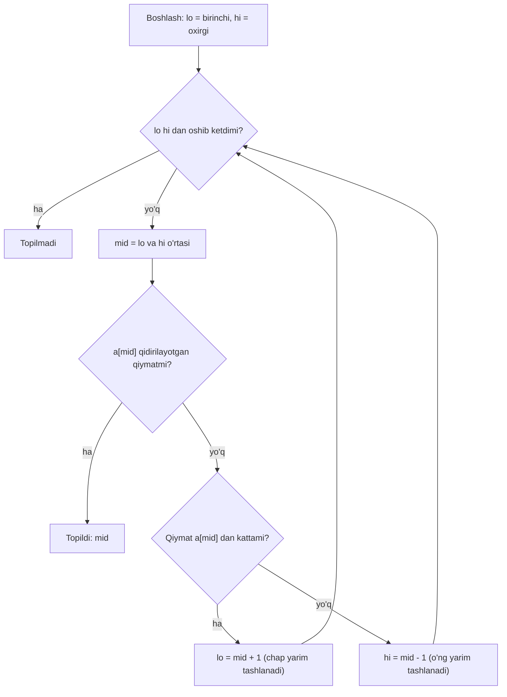

## Bu dars nima uchun kerak

Siz yillar davomida kod yozib kelgansiz: API, frontend, baza so'rovlari. Lekin kundalik ishda ko'pincha "qanday yozish" savoli hal qilinadi, "nima uchun aynan shunday ishlaydi" va "bundan yaxshiroq yo'l bormi" savollari esa ochiq qoladi. CS50 kursi aynan shu bo'shliqni yopadi: kompyuter ichida ma'lumot qanday ko'rinishda turadi, xotira qanday ishlaydi, algoritm qachon to'g'ri va qachon tez, yuqori darajali tillar ostida nima yashiringan.

Birinchi dars kursning butun qolgan qismi tayanadigan uchta tushunchani aniq qilib qo'yadi: **muammo**, **input/output** va **algoritm**. Bular oddiy eshitiladi, lekin har birining aniq ta'rifi bor va bu ta'riflar keyingi darslarda (qidiruv, saralash, xotira, ma'lumotlar tuzilmalari) qayta-qayta kerak bo'ladi.

Bu darsdan keyin siz:

- muammo (problem) va uning aniq nusxasini (instance) ajrata olasiz;
- algoritmning beshta majburiy xususiyatini bilasiz va "bu algoritmmi yoki yo'qmi" degan savolga asosli javob bera olasiz;
- telefon kitobi misolidagi uchta algoritmning qadamlar sonini formula bilan hisoblay olasiz;
- pseudocode ning to'rt qurilish blokini (funksiya, shart, mantiqiy ifoda, sikl) ajrata olasiz va uni C yoki JavaScript ga o'gira olasiz;
- algoritm to'g'riligini precondition, invariant va to'xtash (termination) orqali tekshira olasiz;
- o'sish tezligi (log n, n, n log n, n², 2ⁿ) amalda qanday farq qilishini raqamlar bilan ko'rsata olasiz;
- hamma muammoni ham algoritm bilan yechib bo'lmasligini va buning sababini bilasiz.

## Computer science nima

Computer science - hisoblash (computation) haqidagi fan: qaysi muammolarni hisoblash orqali yechish mumkin, qanday yechish mumkin va qancha resurs (vaqt, xotira) talab qilinadi. Kompyuter bu fanning asosiy quroli, lekin mavzusi emas. Algoritmni qog'ozda, qalam bilan ham bajarish mumkin; kompyuter uni tez va xatosiz bajaradi, xolos.

CS50 butun fanni bitta sxemaga keltiradi: **input -> algoritm -> output**. Kirishda ma'lumot bor, chiqishda natija kerak, o'rtadagi "qora quti" - algoritm. Kurs davomida biz shu qora qutini ochamiz: uning ichida qanday qadamlar bor, ular qancha vaqt oladi, kirish ma'lumoti xotirada qanday saqlanadi.

Bu sxemaning ikkita darhol chiqadigan savoli bor:

1. **Input va output qanday ifodalanadi?** Kompyuter faqat bitlar bilan ishlaydi. Matn, son, rasm, ovoz - hammasi bitlarga aylantirilishi kerak. Bu mavzu 2 va 3-darslarda chuqur ko'riladi.
2. **Algoritm qanday yoziladi va qanday baholanadi?** Bu - shu darsning asosiy mavzusi va keyingi 59 darsning ko'pchiligining ham mavzusi.

Siz uchun muhim bir kuzatish: Node.js da `array.includes(x)` yoki PostgreSQL da `WHERE id = 42` yozganingizda ham shu sxema ishlaydi. Faqat algoritmni siz emas, runtime yoki query planner tanlaydi. Bu tanlov qanday qilinishini tushunish - computer science ni bilishning amaliy foydasi.

## Muammo, instance va algoritm

Bu uch so'zni aniq ajratish kerak, chunki keyinchalik "algoritm sekin" degan gapning ma'nosi aynan shunga bog'liq.

- **Muammo (problem)** - kirish va chiqish o'rtasidagi talab qilingan munosabat, umumiy ko'rinishda. Masalan: "tartiblangan ismlar ro'yxati va bitta ism berilgan; shu ism ro'yxatda bormi, bor bo'lsa qaysi o'rinda?"
- **Instance (nusxa)** - muammoning aniq kirish ma'lumoti bilan berilgan bitta holati. Masalan: aniq 1000 sahifali telefon kitobi va "Karimov" ismi.
- **Algoritm** - muammoning **har qanday** instance i uchun to'g'ri natija beradigan, aniq belgilangan qadamlar ketma-ketligi.

Oxirgi ta'rifdagi "har qanday" so'zi asosiy. Bitta instance uchun ishlaydigan, lekin boshqasida xato beradigan qadamlar - algoritm emas, tasodifiy omad. Masalan, "kitobning 500-sahifasini och, ism o'sha yerda" - ba'zi instance lar uchun to'g'ri, lekin umumiy yechim emas.

### Knuth bo'yicha algoritmning beshta xususiyati

Donald Knuth "The Art of Computer Programming" ning 1-jildi, 1.1 bo'limida algoritmni Evklid algoritmi (ikki sonning eng katta umumiy bo'luvchisi) misolida tushuntiradi va algoritmda bo'lishi shart bo'lgan beshta xususiyatni sanaydi. Evklid algoritmi uch qadamdan iborat: m ni n ga bo'lib qoldiq r ni topish; r nolga teng bo'lsa, javob n; aks holda m ga n ni, n ga r ni berib, birinchi qadamga qaytish.

| Xususiyat | Ma'nosi | Evklid algoritmida |
|---|---|---|
| Finiteness (cheklilik) | Har qanday kirish uchun cheklangan qadamdan keyin to'xtaydi | Qoldiq har safar kamayadi va manfiy bo'la olmaydi, demak oxiri nolga yetadi |
| Definiteness (aniqlik) | Har bir qadam bir ma'noli belgilangan | "Bo'l, qoldiqni ol, solishtir" - talqinga o'rin yo'q |
| Input | Nol yoki undan ko'p kirish, aniq to'plamdan | Ikkita musbat butun son |
| Output | Bir yoki undan ko'p chiqish, kirish bilan aniq munosabatda | m va n ning eng katta umumiy bo'luvchisi |
| Effectiveness (bajariluvchanlik) | Har bir amal shunchalik oddiyki, uni qog'oz va qalam bilan aniq, cheklangan vaqtda bajarish mumkin | Butun sonlarni bo'lish va solishtirish |

Knuth yana bir muhim farqni ko'rsatadi: barcha xususiyatlarga ega, lekin to'xtamasligi mumkin bo'lgan jarayonni u **computational method** deb ataydi, algoritm emas. Sizning amaliyotingizdan misol: HTTP serverning event loop i yoki Kafka consumer i ataylab cheksiz ishlaydi. Ular algoritm emas, reaktiv jarayon. Lekin ular ichida har bir so'rovni qayta ishlaydigan handler to'xtashi shart, ya'ni u algoritm bo'lishi kerak. Cheksiz sikl handler ichida bo'lsa, bu bug.

Definiteness ham amaliy ahamiyatga ega. "Ro'yxatni saralab chiq" - inson uchun yetarli, mashina uchun emas: qaysi tartibda? Teng elementlar qanday joylashadi? Bo'sh ro'yxat bo'lsa nima bo'ladi? Dasturlash tillari aynan shu noaniqlikni yo'qotish uchun mavjud: kompilyator noaniq gapni qabul qilmaydi.

## Telefon kitobi: uchta algoritm

CS50 ning birinchi ma'ruzasidagi klassik misol: qog'oz telefon kitobida ismni topish. Kitob alifbo tartibida, ya'ni **tartiblangan**. Bu fakt keyinroq hal qiluvchi bo'ladi.

**1-algoritm: sahifama-sahifa.** Birinchi sahifadan boshlab har birini ko'rib chiqamiz. To'g'rimi? Ha: agar ism kitobda bo'lsa, albatta topamiz; bo'lmasa, oxiriga yetib "yo'q" deymiz. Lekin eng yomon holatda n sahifaning hammasini ko'ramiz.

**2-algoritm: ikki sahifadan.** Ikki baravar tez. Lekin bitta nozik joy bor: ikki sahifadan sakraganda kerakli sahifani o'tkazib yuborishimiz mumkin. Shuning uchun algoritm "ismdan o'tib ketdikmi?" deb tekshirishi va o'tib ketgan bo'lsa, bitta sahifa orqaga qaytishi kerak. Bu tuzatishsiz algoritm **noto'g'ri**: tez, lekin ba'zi instance larda javobni topmaydi. Eng yomon holat: taxminan n/2 + 1 qadam.

**3-algoritm: o'rtadan bo'lish.** Kitobni o'rtasidan ochamiz. Kerakli ism o'rtadagidan oldin bo'lsa, o'ng yarmini butunlay tashlab yuboramiz; keyin bo'lsa, chap yarmini. Qolgan yarim bilan xuddi shu ishni takrorlaymiz. Har qadamda muammo ikki baravar kichrayadi. Bu - **binary search**.

Nega 3-algoritm faqat tartiblangan kitobda ishlaydi? Chunki "ism o'rtadagidan oldin" degan bitta solishtirish yarim kitobni tekshirmasdan tashlashga ruxsat beradi. Tartib bo'lmasa, tashlangan yarmida ham ism bo'lishi mumkin edi. Tartib - bu algoritmning **precondition** i (oldindan bajarilishi shart bo'lgan shart). Bu haqda pastda batafsil.

### Qadamlar sonini hisoblash

Binary search eng yomon holatda nechta qadam qiladi? n sahifadan boshlaymiz, har qadamda yarmini tashlaymiz: n, n/2, n/4, ..., 1. Bitta sahifa qolguncha bo'lishlar soni k bo'lsa, n / 2ᵏ = 1, ya'ni k = log₂ n. Butun sonlarda aniq formula: eng ko'pi bilan ⌊log₂ n⌋ + 1 ta solishtirish.

| Sahifalar (n) | 1-algoritm (n) | 2-algoritm (⌊n/2⌋ + 1) | 3-algoritm (⌊log₂ n⌋ + 1) |
|---|---|---|---|
| 100 | 100 | 51 | 7 |
| 1 000 | 1 000 | 501 | 10 |
| 1 000 000 | 1 000 000 | 500 001 | 20 |
| 4 000 000 000 | 4 000 000 000 | 2 000 000 001 | 32 |

Hisoblar: log₂ 1000 ≈ 9.97, demak ⌊9.97⌋ + 1 = 10. log₂ 10⁶ ≈ 19.93, demak 20. 4 milliard taxminan 2³¹·⁹ ga teng, demak 32.

Jadvalning eng muhim xulosasi: kitob hajmi **ikki baravar** oshsa, 1 va 2-algoritmlar qadamlari ikki baravar oshadi, 3-algoritmga esa **bitta** qadam qo'shiladi. Butun Yer aholisi (8 milliarddan ko'p) bitta tartiblangan ro'yxatda bo'lsa ham, kerakli odamni 33 ta solishtirishda topish mumkin.

Bu yerda 1 va 2-algoritm orasidagi farq "konstanta" farqi: ikkalasi ham n ga proporsional o'sadi. 3-algoritm esa o'sishning boshqa sinfida. 16-darsda bu farq Big O orqali formal ifodalanadi: 1 va 2-algoritmlar O(n), 3-algoritm O(log n).

### Binary search qadamlari



## Pseudocode: to'rt qurilish bloki

Algoritmni kodga o'tkazishdan oldin uni oddiy tilda, lekin aniq qadamlar bilan yozish foydali. Bu **pseudocode**. CS50 telefon kitobi algoritmini taxminan quyidagicha yozadi (bu yerda o'z so'zlarimiz bilan):

```text
1  Telefon kitobini ol
2  Kitobni o'rtasidan och
3  Sahifaga qara
4  Agar kerakli odam shu sahifada bo'lsa
5      Unga qo'ng'iroq qil
6  Aks holda, agar odam kitobda oldinroq bo'lsa
7      Kitobning chap yarmining o'rtasini och
8      3-qatorga qayt
9  Aks holda, agar odam kitobda keyinroq bo'lsa
10     Kitobning o'ng yarmining o'rtasini och
11     3-qatorga qayt
12 Aks holda
13     To'xta
```

Bu matnda dasturlashning to'rt asosiy qurilish bloki bor va ular har bir tilda uchraydi:

| Blok | Pseudocode dagi misol | C | JavaScript |
|---|---|---|---|
| Funksiya (amal) | "kitobni och", "qo'ng'iroq qil" | `printf(...)`, o'z funksiyangiz | `fetch(...)`, `console.log(...)` |
| Shart (conditional) | "agar ..., aks holda ..." | `if / else if / else` | `if / else if / else` |
| Mantiqiy ifoda (boolean expression) | "odam shu sahifada" - rost yoki yolg'on | `a[mid] == target` | `a[mid] === target` |
| Sikl (loop) | "3-qatorga qayt" | `while`, `for` | `while`, `for`, `for...of` |

E'tibor bering: 12-13 qatorlardagi "aks holda to'xta" - eng ko'p unutiladigan holat. Kitob tugadi, odam topilmadi - nima qilish kerak? Bu holat yozilmasa, dastur cheksiz siklga tushadi yoki noto'g'ri natija qaytaradi. Dasturning "qotib qolishi" ko'pincha aynan shunday hisobga olinmagan holatdan kelib chiqadi.

To'rt blokka yana bitta tushuncha qo'shiladi: **o'zgaruvchi** (holatni saqlash). Pseudocode da u yashirin: "chap yarim" degani - hozirgi chegaralarni eslab qolish. Kodda bu `lo` va `hi` o'zgaruvchilari. 4-darsda bu bloklar va abstraction batafsil ko'riladi.

## Pseudocode dan kodga

C ni 5-darsdan boshlab tizimli o'rganamiz. Hozir maqsad - sintaksisni emas, pseudocode qanday qilib aniq dasturga aylanishini ko'rish. Quyidagi dastur 1000 elementli tartiblangan massivda linear va binary search ni bajaradi va har birining qadamlarini sanaydi.

```c
#include <stdio.h>

// Tartiblangan massivda qiymatni qidiradi. Topilsa indeksini, topilmasa -1 qaytaradi.
// steps - nechta taqqoslash bo'lganini hisoblaydi.
int binary_search(const int a[], int n, int target, int *steps)
{
    int lo = 0, hi = n - 1;
    *steps = 0;
    while (lo <= hi)
    {
        int mid = lo + (hi - lo) / 2;
        (*steps)++;
        if (a[mid] == target)
        {
            return mid;
        }
        else if (a[mid] < target)
        {
            lo = mid + 1;
        }
        else
        {
            hi = mid - 1;
        }
    }
    return -1;
}

int linear_search(const int a[], int n, int target, int *steps)
{
    *steps = 0;
    for (int i = 0; i < n; i++)
    {
        (*steps)++;
        if (a[i] == target)
        {
            return i;
        }
    }
    return -1;
}

int main(void)
{
    enum { N = 1000 };
    int pages[N];
    for (int i = 0; i < N; i++)
    {
        pages[i] = i * 2; // 0, 2, 4, ... tartiblangan
    }

    int targets[] = {0, 998, 1998, 1999};
    for (int k = 0; k < 4; k++)
    {
        int ls, bs;
        int li = linear_search(pages, N, targets[k], &ls);
        int bi = binary_search(pages, N, targets[k], &bs);
        printf("target=%4d  linear: index=%4d steps=%4d  binary: index=%4d steps=%2d\n",
               targets[k], li, ls, bi, bs);
    }
    return 0;
}
```

Kompilyatsiya va ishga tushirish:

```text
$ clang -std=c11 -Wall -Wextra -o search search.c
$ ./search
target=   0  linear: index=   0 steps=   1  binary: index=   0 steps= 9
target= 998  linear: index= 499 steps= 500  binary: index= 499 steps= 1
target=1998  linear: index= 999 steps=1000  binary: index= 999 steps=10
target=1999  linear: index=  -1 steps=1000  binary: index=  -1 steps=10
```

Natijadan uchta kuzatish:

1. **Eng yaxshi holat har ikkalasida ham bor.** Linear search 0 ni bitta qadamda topdi (u birinchi turibdi). Binary search 998 ni bitta qadamda topdi (u aynan o'rtada: mid = 0 + (999 - 0) / 2 = 499). Lekin algoritmni eng yaxshi holat bo'yicha baholash befoyda - tasodifga tayanish.
2. **Eng yomon holat formulaga mos.** Binary search topilmagan qiymat uchun 10 ta qadam qildi, ⌊log₂ 1000⌋ + 1 = 10.
3. **"Topilmadi" ham javob.** 1999 massivda yo'q (faqat juft sonlar bor). Ikkala algoritm ham -1 qaytardi. Bu - pseudocode dagi "aks holda to'xta" qatorining kodi: `while (lo <= hi)` sharti buzilganda sikl tugaydi.

JavaScript dagi ekvivalenti deyarli bir xil ko'rinadi. Farq faqat sonlarda: JavaScript da `number` 64-bitli floating-point, shuning uchun bo'lish natijasini `Math.floor` bilan butunlashtirish kerak. C da `int / int` o'zi butun bo'lish beradi. Bu farqning sababi 6 va 7-darslarda ko'riladi.

## To'g'rilik: algoritm qachon to'g'ri

"Testlar o'tdi" - to'g'rilikning isboti emas. Testlar faqat siz o'ylagan instance larni tekshiradi. Algoritm **har qanday** instance da to'g'ri ekanini ko'rsatish uchun uchta savolga javob berish kerak.

### 1. Precondition: kirish nimaga va'da beradi

Binary search uchun massiv o'sish tartibida saralangan bo'lishi shart. Bu shart bajarilmasa, algoritm xato natija qaytaradi va **xato haqida xabar bermaydi**. Masalan, [5, 1, 9, 3] massivida 1 ni qidirsak: lo = 0, hi = 3, mid = 1, a[1] = 1, topildi - tasodifan to'g'ri. 5 ni qidirsak: mid = 1, a[1] = 1 kichik, lo = 2, keyin a[2] = 9 katta, hi = 1, sikl tugaydi, -1. 5 massivda bor, lekin "topilmadi". Precondition ni kim ta'minlaydi - chaqiruvchi yoki funksiya - har doim aniq bo'lishi kerak.

### 2. Invariant: har qadamda nima rost bo'lib qoladi

**Loop invariant** - siklning har bir aylanishi boshida rost bo'lgan da'vo. Binary search uchun: "agar qiymat massivda bo'lsa, u a[lo..hi] oralig'ida". Uchta narsani ko'rsatamiz:

- **Boshlanish:** lo = 0, hi = n - 1, oraliq butun massiv - da'vo rost.
- **Saqlanish:** a[mid] qiymatdan kichik bo'lsa, massiv saralangani uchun a[0..mid] dagi hamma element ham kichik, demak qiymat a[mid+1..hi] da. lo = mid + 1 qilish invariantni buzmaydi. Teskari holat ham xuddi shunday.
- **Yakun:** sikl lo > hi bo'lganda tugaydi, oraliq bo'sh. Invariant bo'yicha qiymat bo'sh oraliqda bo'lishi kerak edi, demak u massivda yo'q. -1 to'g'ri javob.

Bu uch qismli fikrlash CLRS ("Introduction to Algorithms") ning 2-bobida loop invariant usuli sifatida beriladi va kurs davomida saralash algoritmlarida (17-19-darslar) qayta ishlatiladi.

### 3. Termination: algoritm to'xtaydimi

Har aylanishda hi - lo + 1 (oraliq uzunligi) qat'iy kamayadi: mid oraliq ichida, va keyingi oraliq mid ni o'z ichiga olmaydi. Manfiy bo'lmagan butun son cheksiz kamaya olmaydi, demak sikl tugaydi. Bu - Knuth ning finiteness xususiyatining aniq isboti. Agar `lo = mid` deb yozsangiz (`mid + 1` o'rniga), lo va hi qo'shni bo'lganda mid = lo bo'lib qoladi, oraliq kichraymaydi va dastur cheksiz siklga tushadi. Bu binary search da eng ko'p uchraydigan xato.

### Tarixiy saboq: oddiy algoritmda ham bug

Binary search juda oddiy ko'rinadi, lekin uni to'g'ri yozish qiyin. Joshua Bloch 2006 yil iyunida Google Research blogida Jon Bentley ning "Programming Pearls" kitobiga tayanib shunday yozadi: birinchi binary search 1946 yilda chop etilgan, lekin barcha n qiymatlari uchun to'g'ri ishlaydigan birinchi versiya faqat 1962 yilda chiqqan.

Bloch maqolasining asosiy mavzusi esa boshqa bug: o'rtani `int mid = (low + high) / 2;` deb hisoblash. low + high yig'indisi int ning maksimal qiymatidan oshib ketsa, natija manfiy songa aylanadi. Bloch bu xato Bentley kitobidagi versiyada yigirma yil, Java ning `java.util.Arrays` kutubxonasidagi (Bloch o'zi yozgan) versiyada esa taxminan to'qqiz yil sezilmay qolganini yozadi. Xato faqat milliardlab elementli massivlarda chiqadi, shuning uchun oddiy testlar uni hech qachon topmagan.

Buni o'zimiz tekshiramiz:

```c
#include <limits.h>
#include <stdio.h>

int main(void)
{
    int lo = 1500000000, hi = 2000000000;
    printf("INT_MAX        = %d\n", INT_MAX);
    printf("lo + (hi-lo)/2 = %d\n", lo + (hi - lo) / 2);
    printf("(lo + hi) / 2  = %d\n", (lo + hi) / 2);
    return 0;
}
```

```text
$ gcc -std=c11 -fsanitize=undefined -o mid mid.c
$ ./mid
mid.c:9:41: runtime error: signed integer overflow: 1500000000 + 2000000000 cannot be represented in type 'int'
INT_MAX        = 2147483647
lo + (hi-lo)/2 = 1750000000
(lo + hi) / 2  = -397483648
```

Hisob: 1 500 000 000 + 2 000 000 000 = 3 500 000 000, bu INT_MAX (2 147 483 647) dan katta. C standartida signed integer overflow **undefined behavior**: kompilyator har qanday natija berishi mumkin, bu yerda -397 483 648 chiqdi. `-fsanitize=undefined` flag i buni ish vaqtida ushlab, xabar berdi. `lo + (hi - lo) / 2` esa overflow qilmaydi, chunki hi - lo har doim oraliq uzunligidan oshmaydi. Shu sababli yuqoridagi binary_search funksiyasida aynan shu shakl ishlatilgan. Integer overflow 7-darsda chuqur ko'riladi.

JavaScript da `(lo + hi) / 2` overflow qilmaydi (son 2⁵³ gacha aniq), lekin Bloch taklif qilgan `(lo + hi) >>> 1` usuli JavaScript da xavfli: `>>>` operandni 32-bitli unsigned butun songa aylantiradi. `node` da tekshirsak, lo = 3·10⁹, hi = 4·10⁹ uchun `(lo + hi) >>> 1` 1 352 516 352 beradi, to'g'ri javob esa 3 500 000 000. Saboq: bitta tilda to'g'ri bo'lgan "hiyla" boshqa tilda bug ga aylanishi mumkin, chunki sonlarning ichki ko'rinishi har xil.

## O'sish tezligi: nega log n hamma narsani hal qiladi

Algoritmlarni solishtirishda aniq soniyalar emas, kirish hajmi oshganda qadamlar **qanday o'sishi** muhim. Soniyalar mashinaga, tilga, kompilyatorga bog'liq; o'sish shakli esa algoritmning o'ziga xos xususiyati.

Hisob sharti: mashina soniyasiga 10⁹ ta oddiy amal bajaradi va har bir "qadam" bitta amal.

| O'sish | n = 10⁶ | n = 10⁹ | Misol |
|---|---|---|---|
| log₂ n | 20 amal, 20 ns | 30 amal, 30 ns | binary search |
| n | 1 ms | 1 s | linear search |
| n log₂ n | 2·10⁷ amal, 20 ms | 3·10¹⁰ amal, 30 s | merge sort (19-dars) |
| n² | 10¹² amal, 1000 s (16.7 daqiqa) | 10¹⁸ amal, 10⁹ s (31.7 yil) | selection sort (17-dars) |

Hisoblar: 10⁶ · log₂ 10⁶ ≈ 10⁶ · 19.93 ≈ 2·10⁷. 10¹⁸ / 10⁹ = 10⁹ soniya; 10⁹ / 86 400 / 365 ≈ 31.7 yil.

Eksponensial o'sish (2ⁿ) - masalan, n ta elementning barcha qism-to'plamlarini tekshirish - undan ham tezroq portlaydi: n = 30 da 2³⁰ ≈ 1.07·10⁹ amal, ya'ni taxminan 1 soniya; n = 50 da 2⁵⁰ ≈ 1.13·10¹⁵ amal, ya'ni taxminan 13 kun; n = 60 da taxminan 36.6 yil. Kirish atigi 2 baravar oshdi (30 dan 60 ga), vaqt esa milliard baravar.

Amaliy xulosa: tezroq server sotib olish o'sish sinfini o'zgartirmaydi. 10 baravar tez protsessor n² algoritmni 10 baravar tezlashtiradi, lekin n ni faqat √10 ≈ 3.16 baravar oshirishga imkon beradi. Algoritmni n² dan n log n ga almashtirish esa n = 10⁶ da 1000 soniyani 20 ms ga tushiradi.

## Hisoblashning chegarasi: hamma muammo ham yechilmaydi

Har bir muammoga algoritm bormi? Yo'q, va bu isbotlangan fakt. Alan Turing 1936 yilda "On Computable Numbers, with an Application to the Entscheidungsproblem" maqolasida (Proceedings of the London Mathematical Society, 42-jild) hisoblashning matematik modelini - keyinchalik Turing mashinasi deb ataladigan modelni - taklif qildi va mexanik usul bilan hal qilib bo'lmaydigan masalalar mavjudligini isbotladi. Bugun bu natija odatda **halting problem** ko'rinishida tushuntiriladi.

Halting problem: "ixtiyoriy dastur P va kirish x berilgan; P x da ishlaganda to'xtaydimi?" degan savolga har doim to'g'ri javob beradigan algoritm mavjud emas. Isbot g'oyasi qarama-qarshilik orqali:

1. Faraz qilaylik, shunday `halts(P, x)` funksiya bor va u doim to'xtab, to'g'ri "ha" yoki "yo'q" qaytaradi.
2. Yangi dastur `D(P)` yozamiz: agar `halts(P, P)` "ha" desa, `D` cheksiz siklga kiradi; "yo'q" desa, `D` darhol to'xtaydi.
3. `D(D)` ni ishga tushiramiz. Agar `D(D)` to'xtasa, demak `halts(D, D)` "yo'q" degan, ya'ni `D(D)` to'xtamaydi - qarama-qarshilik. Agar to'xtamasa, `halts(D, D)` "ha" degan, ya'ni to'xtaydi - yana qarama-qarshilik.
4. Demak 1-qadamdagi faraz noto'g'ri: bunday `halts` funksiyasi yo'q.

Bu nazariy qiziqish emas, amaliy cheklov. Shu sabab hech qanday linter yoki static analyzer "bu kodda cheksiz sikl yo'q" yoki "bu funksiya hech qachon crash bermaydi" deb barcha dasturlar uchun aniq kafolat bera olmaydi. Ular taxminiy ishlaydi: yo xavfsiz tomonga ortiqcha ogohlantiradi, yo ba'zi xatolarni o'tkazib yuboradi. TypeScript ning tip tekshiruvchisi ham ataylab cheklangan qoidalar bilan ishlaydi.

Muammolarni uch guruhga ajratish mumkin:

- **Yechilmaydigan** (undecidable): umuman algoritm yo'q. Halting problem.
- **Yechiladigan, lekin amalda og'ir**: algoritm bor, lekin ma'lum algoritmlar katta n da eksponensial vaqt oladi (masalan, ko'p shaharni aylanib chiqishning eng qisqa yo'lini aniq topish). Amalda taxminiy yoki evristik yechimlar ishlatiladi (53-dars).
- **Samarali yechiladigan**: n, n log n, n² kabi o'sish bilan. CS50 ning asosiy qismi shu guruh bilan ishlaydi.

## Ko'p uchraydigan xatolar

1. **Algoritmni bitta instance da tekshirib, to'g'ri deb hisoblash.** "Mening testim o'tdi" - faqat shu instance uchun. To'g'rilik invariant va chegaraviy holatlar (bo'sh kirish, bitta element, birinchi va oxirgi element, mavjud bo'lmagan qiymat) bilan tekshiriladi.
2. **Precondition ni unutish.** Saralanmagan massivda binary search xato natija qaytaradi va hech qanday xabar bermaydi. Funksiya hujjatida yoki nomida shart aniq yozilishi kerak.
3. **"Topilmadi" holatini yozmaslik.** Pseudocode dagi "aks holda to'xta" qatori tushib qolsa, cheksiz sikl yoki noto'g'ri indeks chiqadi.
4. **Chegarani noto'g'ri siljitish.** `lo = mid` yoki `hi = mid` (±1 siz) - oraliq kichraymay qolishi va cheksiz sikl. Har bir chegara o'zgarishida "oraliq qat'iy kichrayadimi?" deb so'rang.
5. **O'rtani `(lo + hi) / 2` deb hisoblash.** Katta indekslarda overflow. To'g'risi: `lo + (hi - lo) / 2`.
6. **Konstanta va o'sish sinfini aralashtirish.** "Ikki sahifadan" algoritm ikki baravar tez, lekin u ham n ga proporsional. 10⁹ elementda u ham soniyalar oladi, binary search esa nanosoniyalar.
7. **Bir tildagi hiylani boshqa tilga ko'r-ko'rona ko'chirish.** Java dagi `>>> 1` JavaScript da 32-bitga kesadi. Sonlarning ichki ko'rinishini bilmasdan optimizatsiya qilish - yangi bug.
8. **"Har qanday muammoni kod bilan hal qilsa bo'ladi" deb o'ylash.** Ba'zi muammolar isbotlangan holda yechilmaydi, ba'zilari amalda juda og'ir. Bunday holda talabni o'zgartirish (taxminiy javob, cheklangan kirish) to'g'ri yo'l.

## Xulosa

- Computer science - hisoblash haqidagi fan: qaysi muammo yechiladi, qanday va qancha resursga. Butun fan input -> algoritm -> output sxemasiga tayanadi.
- Muammo - umumiy talab, instance - aniq kirish, algoritm - har qanday instance uchun to'g'ri javob beradigan aniq qadamlar.
- Knuth bo'yicha algoritm cheklilik, aniqlik, input, output va bajariluvchanlik xususiyatlariga ega. To'xtamaydigan jarayon - computational method.
- Telefon kitobidagi uchta algoritm: n, taxminan n/2 va ⌊log₂ n⌋ + 1 qadam. Hajm ikki baravar oshsa, binary search ga faqat bitta qadam qo'shiladi.
- Pseudocode ning qurilish bloklari: funksiya, shart, mantiqiy ifoda, sikl (va holat uchun o'zgaruvchi). Ular har bir tilda bor.
- To'g'rilik uch savol bilan tekshiriladi: precondition, loop invariant (boshlanish, saqlanish, yakun) va termination.
- O'sish sinfi apparatdan muhimroq: n² dan n log n ga o'tish 10⁶ elementda 1000 soniyani 20 ms ga tushiradi.
- Halting problem kabi muammolar uchun algoritm umuman mavjud emas; shu sabab static analyzer lar faqat taxminiy ishlaydi.

## Amaliy topshiriq

Telefon kitobi muammosining kengroq varianti: kitobda bir xil familiyali bir nechta odam bo'lishi mumkin va sizga shu familiyaning **birinchi** uchragan joyi kerak. Bu - `lower_bound` muammosi: tartiblangan massivda qiymatdan kichik bo'lmagan birinchi elementning indeksi (bunday element bo'lmasa, n).

Topshiriq qadamlari:

1. **Muammoni aniq yozing.** Input, output va precondition ni Knuth uslubida yozing. Output ning kirish bilan munosabatini aniq ifodalang: qaysi indeks qaytadi, qiymat massivdagi hamma elementdan katta bo'lsa nima qaytadi, massiv bo'sh bo'lsa-chi?
2. **Pseudocode yozing.** Binary search g'oyasidan foydalaning, lekin qiymat topilganda darhol to'xtamang: birinchi uchrash chaproqda bo'lishi mumkin. Qaysi chegaradan qaysi chegaragacha (lo..hi yoki lo..hi-1) ishlashingizni tanlang va izohlang.
3. **Kodga o'giring.** C, JavaScript yoki TypeScript da yozing (C ni hali o'rganmagan bo'lsangiz, JS/TS bilan boshlang). Funksiya taqqoslashlar sonini ham qaytarsin.
4. **To'g'rilikni isbotlang.** Loop invariant ni bitta gap bilan yozing va uning boshlanish, saqlanish, yakun qismlarini ko'rsating. Sikl nega to'xtashini oraliq uzunligi orqali tushuntiring.
5. **Chegaraviy holatlarni sinang.** Kamida quyidagilar: bo'sh massiv; bitta element; [2, 2, 2, 2] da 2 ni qidirish (javob 0); [1, 3, 3, 3, 5] da 3 (javob 1), 4 (javob 4), 0 (javob 0), 6 (javob 5). Natijalar jadvalini bering.
6. **Hisob-kitob.** n = 10⁶ va n = 2³² - 1 uchun eng yomon holatdagi taqqoslashlar sonini formula bilan hisoblang. "Ikki sahifadan" algoritmni shu muammo uchun to'g'ri ishlashi uchun qanday tuzatish kerak va u eng yomon holatda nechta qadam oladi?

Yaxshi javobda bo'lishi kerak bo'lgan narsalar:

- output ta'rifi bo'sh massiv va "hamma elementdan katta qiymat" holatlarini qamrab olgan;
- qiymat topilganda ham qidiruv chap tomonga davom etishi aniq ko'rsatilgan;
- o'rta indeks overflow siz hisoblangan (`lo + (hi - lo) / 2` yoki tilga mos ekvivalenti, JS da `>>>` ishlatilmagan);
- invariant aniq yozilgan va har bir chegara o'zgarishida oraliq qat'iy kichrayishi ko'rsatilgan;
- barcha test holatlari natijasi bilan berilgan;
- taqqoslashlar soni formula bilan: taxminan ⌈log₂(n + 1)⌉, n = 10⁶ da 20, n = 2³² - 1 da 32.

Javobni pastdagi maydonga yozib, chatga yuboring.

## Manbalar

- CS50x. [Lecture 0 notes](https://cs50.harvard.edu/x/notes/0/) - "Computer Science and Problem Solving", "Algorithms" (telefon kitobi, uchta algoritm va ularning o'sishi), "Pseudocode" (funksiya, shart, mantiqiy ifoda, sikl) bo'limlari.
- CS50x 2026. [Kurs sahifasi](https://cs50.harvard.edu/x/2026/) - haftalar ro'yxati va kurs tavsifi (correctness, design, style).
- Donald E. Knuth. The Art of Computer Programming, 1-jild "Fundamental Algorithms", 3-nashr, 1.1 bo'lim "Algorithms". [InformIT dagi parcha](https://www.informit.com/articles/article.aspx?p=2221792) - Evklid algoritmi E, algoritmning beshta xususiyati, computational method tushunchasi.
- Joshua Bloch. [Extra, Extra - Read All About It: Nearly All Binary Searches and Mergesorts are Broken](https://research.google/blog/extra-extra-read-all-about-it-nearly-all-binary-searches-and-mergesorts-are-broken/), Google Research blog, 2006 yil 2 iyun - `(low + high) / 2` overflow bugi, JDK dagi va Programming Pearls dagi versiyalar, 1946 va 1962 yillar haqidagi Bentley iqtibosi.
- Thomas H. Cormen va boshq. [Introduction to Algorithms, 4-nashr](https://mitpress.mit.edu/9780262046305/introduction-to-algorithms/), MIT Press - 2-bob "Getting Started": loop invariant usuli (boshlanish, saqlanish, yakun).
- Alan M. Turing. [On Computable Numbers, with an Application to the Entscheidungsproblem](https://dc2.philarchive.org/rec/TUROCN), Proceedings of the London Mathematical Society, 42-jild, 1-son, 230-265-betlar, 1936.
