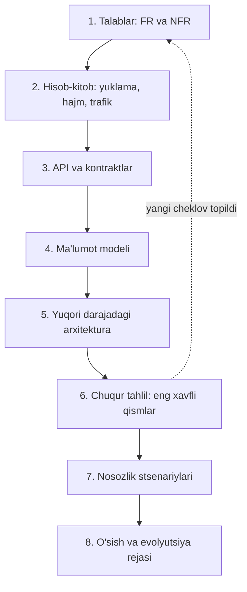
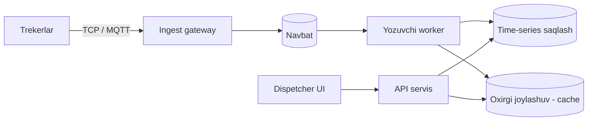

## Bu dars nima uchun birinchi

Keyingi 99 dars texnologiyalar haqida: indekslar, replication, Kafka, Raft, cache. Lekin bularning hech biri "qaysi birini tanlash kerak?" degan savolga o'z-o'zidan javob bermaydi. Javob har doim talablardan kelib chiqadi. Shu sabab birinchi dars texnologiya emas, fikrlash usuli haqida: talabni qanday aniqlash, uni qanday o'lchanadigan qilish va qarorni qanday asoslash.

Bu darsdan keyin siz:

- funksional va nofunksional talablarni ajrata olasiz va "tez ishlasin" kabi noaniq talabni raqamga aylantira olasiz;
- tizim sifatining to'rt asosiy o'qini (performance, reliability, scalability, maintainability) bilasiz;
- "scalable" so'zining o'zi hech narsa anglatmasligini va uning o'rniga nimani aytish kerakligini tushunasiz;
- har qanday dizayn masalasini qaysi tartibda yechishni bilasiz;
- qarorlarni qaytariladigan va qaytarilmaydiganga ajrata olasiz.

## System design nima

System design - bu tizimning tarkibiy qismlarini (servislar, bazalar, navbatlar, cache, tarmoq), ular orasidagi ma'lumot oqimini va har bir qism nimaga javob berishini tanlash jarayoni. Asosiy so'z - **tanlash**. Har bir tanlov biror narsani beradi va evaziga boshqa narsani oladi.

Kod yozish bilan farqi: kodda xato odatda aniq ko'rinadi - test o'tmaydi, funksiya noto'g'ri qiymat qaytaradi. Dizayndagi xato esa oylar o'tib, yuklama oshganda, disk to'lganda yoki bitta server o'chganda chiqadi. Shuning uchun dizayn qarorlarini oldindan, raqamlar va cheklovlar asosida tekshirish kerak.

Uchta keng tarqalgan noto'g'ri tasavvur:

1. **"To'g'ri dizayn bitta."** Yo'q. Bir xil masala uchun 10 ta kishi 10 xil yaxshi dizayn beradi. Farq - har biri qaysi talabni ustun qo'ygani va buni qanchalik ochiq asoslaganida.
2. **"Katta kompaniyalar qilganini qilish kerak."** Netflix yoki Uber arxitekturasi ularning yuklamasi, jamoasi va pul imkoniyati uchun qurilgan. 50 ming foydalanuvchili tizimga 200 ta microservice qo'yish - yuklamaga emas, kimningdir blog postiga qarab dizayn qilish.
3. **"System design = interview."** Interview - bu ko'nikmani tekshirishning bir usuli. Asl ko'nikma real ishda kerak: yangi modul qo'shishda, tizim sekinlashganda, "bu bazani almashtiramizmi?" degan savolda.

## Funksional va nofunksional talablar

**Funksional talablar (FR)** - tizim **nima qiladi**. Foydalanuvchi yoki boshqa tizim bajara oladigan amallar:

- haydovchi joylashuvi har 10 soniyada serverga yuboriladi;
- dispetcher xaritada mashinalarni real vaqtda ko'radi;
- yoqilg'i sathi keskin tushsa, ogohlantirish yuboriladi.

**Nofunksional talablar (NFR)** - tizim buni **qanchalik yaxshi** qiladi. Tezlik, ishonchlilik, kengayish, xavfsizlik, narx, qonunchilikka moslik.

Ko'p jamoalar FR ni yaxshi yozadi, NFR ni esa "tez, ishonchli, masshtablanadigan" deb bitta qatorda o'tib ketadi. Vaholanki arxitekturani asosan NFR belgilaydi. Bir xil funksional talab - "foydalanuvchi xabar yuborsin" - 100 foydalanuvchi uchun bitta PostgreSQL bilan, 100 million foydalanuvchi uchun esa butunlay boshqa tizim bilan yechiladi.

### NFR ni o'lchanadigan qilish

Noaniq NFR ni tekshirib bo'lmaydi, demak u talab emas, istak. Har bir NFR quyidagilarga ega bo'lishi kerak: **metrika, chegara, sharoit**.

| Noaniq | O'lchanadigan |
|---|---|
| Tez ishlasin | Xaritadagi joylashuv so'rovi uchun p99 javob vaqti 300 ms dan kam, 2 000 so'rov/s yuklamada |
| Ishonchli bo'lsin | Telemetriya qabul qilish oyiga 99.9% mavjud; qabul qilingan nuqta yo'qolmaydi |
| Masshtablansin | 10 000 dan 100 000 qurilmagacha arxitekturani o'zgartirmasdan, faqat server qo'shib o'sa olsin |
| Ma'lumot saqlansin | Xom GPS nuqtalari 90 kun, agregatlar 3 yil saqlanadi |
| Xavfsiz bo'lsin | Mijoz A mijoz B ning ma'lumotini hech qanday so'rov bilan ko'ra olmaydi |

E'tibor bering: "p99" - so'rovlarning 99 foizi shu vaqtdan tezroq javob olishi. O'rtacha qiymat (average) sekin so'rovlarni yashiradi, shuning uchun javob vaqti deyarli har doim percentile bilan beriladi. Bu mavzu 3-darsda chuqur ko'riladi. "Oyiga 99.9%" esa oyiga taxminan 43 daqiqa ishlamaslikka ruxsat degani (30 kun × 24 soat × 60 daqiqa × 0.001 = 43.2 daqiqa). SLO va error budget 65-darsda.

## Tizim sifatining to'rt o'qi

Kleppmann "Designing Data-Intensive Applications" kitobining 2-nashrida (2026) nofunksional talablarga alohida bob ajratadi va ularni performance, reliability, scalability va maintainability atrofida tushuntiradi. Bu to'rttasi butun kurs bo'yicha qayta-qayta uchraydi.

### 1. Performance

Ikki asosiy o'lchov:

- **Response time (javob vaqti)** - mijoz so'rov yuborgandan javob olguncha o'tgan vaqt. Bunga tarmoq, navbatda kutish va qayta ishlash kiradi.
- **Throughput (o'tkazuvchanlik)** - vaqt birligida bajariladigan ish: so'rov/s, yozuv/s, MB/s.

Kleppmann "latency" va "response time" ni ajratadi: latency - so'rov xizmat ko'rsatilishini **kutib** turgan vaqt, response time esa mijoz ko'radigan to'liq vaqt. Amaliyotda bu so'zlar ko'pincha aralashtiriladi, lekin farqni bilish muhim: server so'rovni 5 ms da qayta ishlashi mumkin, lekin oldida 1 000 ta so'rov navbatda turgan bo'lsa, mijoz 2 soniya kutadi.

### 2. Reliability (ishonchlilik)

Tizim xatolar bo'lganda ham to'g'ri ishlashda davom etishi. Ikki tushunchani ajrating:

- **Fault (nosozlik)** - tizimning bitta qismi me'yordan chiqdi: disk buzildi, servis qulab tushdi, tarmoq uzildi.
- **Failure (ishdan chiqish)** - tizim **bir butun sifatida** foydalanuvchiga kerakli xizmatni ko'rsata olmayapti.

Maqsad - fault larni nolga tushirish emas (bu mumkin emas), balki fault failure ga aylanmasligini ta'minlash. Bu **fault tolerance** deyiladi. Nosozlik manbalari uch xil:

- **Apparat** - disk, xotira, elektr, tarmoq kartasi. Ko'p serverli tizimda bu doimiy hodisa: minglab disk bo'lsa, har kuni qaysidir biri buziladi.
- **Dasturiy** - bir vaqtda ko'p tugunni yiqitadigan xato, masalan sana bilan bog'liq bug yoki barcha servislar bog'liq bo'lgan servisning sekinlashishi. Bular xavfliroq, chunki bir-biriga bog'liq (correlated).
- **Inson** - noto'g'ri konfiguratsiya, noto'g'ri deploy. Katta tizimlardagi uzilishlarning sezilarli qismi aynan konfiguratsiya o'zgarishlaridan keladi. Shu sabab avtomatik tekshiruv, bosqichma-bosqich deploy va tez rollback muhim (68-dars).

### 3. Scalability (kengayuvchanlik)

"Bu tizim scalable" degan gap o'z-o'zidan ma'nosiz. To'g'ri savol: **"Agar yuklama X marta oshsa, tizim qanday o'zgaradi va biz nima qilamiz?"**

Buning uchun avval yuklamani tasvirlash kerak. Yuklama parametrlari tizimga qarab har xil:

- veb-servis uchun - so'rov/s;
- baza uchun - o'qish va yozish nisbati;
- chat uchun - bir vaqtda ulangan foydalanuvchilar soni;
- telemetriya uchun - qurilmalar soni va har biri qanchalik tez-tez nuqta yuboradi;
- cache uchun - hit rate.

**Klassik misol: Twitter home timeline.** Kleppmann kitobining 1-nashrida Twitter ning 2012 yildagi taqdimotiga asoslangan raqamlar keltiriladi: tvit yozish o'rtacha soniyasiga 4.6 ming atrofida, cho'qqida 12 mingdan ortiq, home timeline o'qish esa soniyasiga 300 ming atrofida. Yozishlar sonining o'zi muammo emas. Muammo - har bir tvitni har bir obunachining lentasiga yetkazish (**fan-out**).

Ikki yondashuv bor:

1. **O'qishda yig'ish (fan-out on read).** Foydalanuvchi lentasini ochganda, u obuna bo'lgan barcha odamlarning so'nggi tvitlarini so'rov bilan yig'ib, saralash. Yozish arzon, o'qish qimmat.
2. **Yozishda tarqatish (fan-out on write).** Tvit yozilganda, uni darhol har bir obunachining tayyor lentasiga (cache) qo'shish. O'qish arzon, yozish qimmat.

O'qishlar yozishlardan ikki tartib ko'p bo'lgani uchun Twitter ikkinchisiga o'tgan. Lekin millionlab obunachili akkauntlarda bitta tvit millionlab yozishga aylanadi, shuning uchun ular uchun gibrid yo'l tanlangan: oddiy foydalanuvchilarning tvitlari yozishda tarqatiladi, juda mashhurlariniki esa o'qishda qo'shiladi.

Bu misolning saboqi: **qaror "qaysi texnologiya yaxshi"dan emas, yuklama tuzilishidan chiqdi** - o'qish/yozish nisbati va obunachilar soni taqsimotidan. News feed dizayni 87-darsda to'liq ko'riladi.

### 4. Maintainability (qo'llab-quvvatlanuvchanlik)

Dasturiy ta'minot narxining katta qismi uni yozishda emas, keyin yillar davomida ishlatish, tuzatish va o'zgartirishda. Uchta jihat:

- **Operability** - operatsion jamoa uchun tizimni kuzatish, sozlash, tiklash oson bo'lishi. Yaxshi monitoring, tushunarli loglar, avtomatlashtirilgan deploy.
- **Simplicity** - keraksiz murakkablikni olib tashlash. Murakkablikning bir qismi masalaning o'zidan keladi (zaruriy), bir qismi esa noto'g'ri abstraksiya va tarixiy qarorlardan (tasodifiy). Ikkinchisini kamaytirish kerak.
- **Evolvability** - talab o'zgarganda tizimni o'zgartirish oson bo'lishi.

Bu to'rttasidan tashqari real loyihada yana kamida uchta o'q bor: **xavfsizlik**, **narx** va **qonunchilik** (masalan, shaxsiy ma'lumotlarni qaysi mamlakatda saqlash talabi - 78-dars). AWS Well-Architected Framework ham shunga o'xshash oltita "ustun" bilan ishlaydi: operational excellence, security, reliability, performance efficiency, cost optimization va sustainability.

## Trade-off: har bir qaror nimanidir sotib oladi

Dizayndagi deyarli har bir qaror bir talabni boshqasi hisobiga yaxshilaydi. Asosiy juftliklar:

| Nimani olasiz | Nimani berasiz | Misol |
|---|---|---|
| Kuchli consistency | Latency, mavjudlik | Har bir yozuvni boshqa data-markazga sinxron replikatsiya qilish |
| Past latency | Yangilik (freshness) | Cache 60 soniyalik eskirgan ma'lumot qaytaradi |
| Yuqori mavjudlik | Narx, murakkablik | Ikki regionda to'liq nusxa |
| Yozish tezligi | O'qish tezligi | LSM-tree vs B-tree (13-14 darslar) |
| Moslashuvchanlik | Soddalik | Plaginlar arxitekturasi vs oddiy if/else |
| Tez yetkazish | Uzoq muddatli toza tuzilma | Hozir monolit, keyin ajratish |

Ikki amaliy qoida:

1. **Trade-off ni ochiq yozing.** "Biz PostgreSQL ni tanladik" emas, "Biz PostgreSQL ni tanladik, chunki tranzaksiyalar va JOIN kerak; evaziga yozishni bitta tugundan ko'p kengaytira olmaymiz; bu 50 ming yozuv/s gacha yetadi deb hisobladik" deb yozing. Shunda kelajakda shart o'zgarsa, qarorni qayta ko'rib chiqish kerakligi ko'rinadi.
2. **Bugungi talabga loyihalang, ertangi o'sishga yo'l qoldiring.** Hozir 10 ming qurilma bo'lsa, 1 milliard uchun loyihalash kerak emas (YAGNI). Lekin 10x o'sishda nima sinishini bilish va uni arzon tuzatish yo'lini qoldirish kerak.

### Qaytariladigan va qaytarilmaydigan qarorlar

Jeff Bezos Amazon aksiyadorlariga 2015 yilgi maktubida qarorlarni ikki turga ajratadi: **1-tur** - qaytarilmaydigan yoki qaytarish juda qimmat bo'lgan ("bir tomonlama eshik"), **2-tur** - qaytariladigan ("ikki tomonlama eshik"). 1-tur qarorlarni sekin va ehtiyotkorlik bilan, 2-turni tez qabul qilish kerak.

System design da bu juda foydali filtr:

- **Odatda qaytarish qiyin:** ma'lumot modeli va asosiy baza, sharding kaliti, tashqi API kontrakti (mijozlar unga bog'lanib qoladi), ID formati, ma'lumot qaysi mamlakatda saqlanishi.
- **Odatda qaytarish oson:** cache qo'shish yoki olib tashlash, servis ichidagi kutubxona, instance turi, load balancer algoritmi, ichki servislar orasidagi protokol (agar ularni o'zingiz boshqarsangiz).

Vaqtingizni birinchi guruhga sarflang.

## Dizayn jarayoni: qaysi tartibda fikrlash

Alex Xu "System Design Interview" kitobida interview uchun to'rt bosqichli freymvork beradi: (1) masalani tushunish va ko'lamini belgilash, (2) yuqori darajadagi dizaynni taklif qilib, kelishib olish, (3) chuqur tahlil, (4) yakun - zaif joylar va yaxshilanishlar. Real ishda bu jarayon kengroq. Kurs davomida quyidagi 8 qadamdan foydalanamiz:

1. **Talablar.** FR ro'yxati, o'lchanadigan NFR, nima ko'lamga **kirmaydi**. Oxirgisi muhim: "biz to'lovlarni qilmaymiz, faqat hisob chiqaramiz" degan bitta gap dizaynni ancha soddalashtiradi.
2. **Hisob-kitob.** So'rov/s (o'rtacha va cho'qqi), saqlanadigan hajm (kunlik va yillik), tarmoq trafigi, xotiraga sig'ishi kerak bo'lgan "issiq" ma'lumot. Maqsad - aniq raqam emas, **tartib**: 100 yozuv/s mi, 100 ming mi? Bu ikki holatda arxitektura butunlay boshqa (2-dars).
3. **API.** Tashqi dunyo tizim bilan qanday gaplashadi: endpointlar, xabarlar, protokol. Bu kontrakt bo'lgani uchun keyin o'zgartirish qimmat.
4. **Ma'lumot modeli.** Qanday obyektlar bor, ular qanday bog'langan, qanday so'rovlar bilan o'qiladi. Bazani so'rov shakli tanlaydi, aksincha emas.
5. **Yuqori darajadagi arxitektura.** 5-10 ta blokli diagramma: kirish nuqtasi, servislar, saqlash, navbatlar, tashqi tizimlar.
6. **Chuqur tahlil.** Hamma narsani bir xil chuqurlikda emas, **eng xavfli** 1-3 qismni: eng ko'p yuklama tushadigan joy, eng qimmat xato bo'ladigan joy, eng noaniq joy.
7. **Nosozliklar.** Har bir blok uchun: "bu o'chsa nima bo'ladi?" Ma'lumot yo'qoladimi, foydalanuvchi nimani ko'radi, qanday tiklanadi?
8. **Evolyutsiya.** 10x yuklamada nima birinchi sinadi va qanday kengaytiriladi.

Strelka 6 dan 1 ga qaytadi: chuqur tahlilda ko'pincha talablarda yo'q bo'lgan savol chiqadi ("qurilma oflayn bo'lsa, eski nuqtalarni keyin yuboradimi?"). Bu normal - jarayon chiziqli emas.

## Amaliy misol: GPS telemetriya qabul qilish

Jarayonni kichik misolda ko'ramiz. Masala: korporativ avtoparklar uchun GPS treker ma'lumotlarini qabul qilish va dispetcherga ko'rsatish.

**1. Talablar.**

FR:

- treker har 10 soniyada nuqta yuboradi: koordinata, tezlik, vaqt, yoqilg'i sathi;
- dispetcher o'z parkidagi mashinalarning oxirgi joylashuvini xaritada ko'radi;
- dispetcher istalgan mashinaning tanlangan kun bo'yicha marshrutini ko'radi;
- ko'lamga kirmaydi: video, hisobotlar generatsiyasi.

NFR:

- qabul qilingan nuqta yo'qolmasligi kerak (qurilma "qabul qilindi" javobini olgach);
- xaritadagi oxirgi joylashuv 5 soniyadan ko'p kechikmasin;
- marshrut so'rovi p99 1 soniyadan tez;
- 10 000 qurilmadan 100 000 gacha o'sish;
- har bir mijoz faqat o'z ma'lumotini ko'radi.

**2. Hisob-kitob.**

- Yozish: 10 000 qurilma ÷ 10 s = **1 000 nuqta/s** o'rtacha. Ish soatlarida cho'qqi taxminan 2-3 baravar, ya'ni 2-3 ming nuqta/s deb hisoblaymiz.
- Hajm: bitta nuqta indekslar bilan taxminan 100 bayt deylik. 1 000 × 100 B = 100 KB/s. Kuniga: 100 KB × 86 400 ≈ **8.6 GB/kun**, yiliga ≈ **3.2 TB**.
- 100 000 qurilmada hammasi 10 baravar: 10 ming nuqta/s, 86 GB/kun.

Xulosa: 1 000 yozuv/s - bitta yaxshi sozlangan PostgreSQL uchun ham ko'tarib bo'ladigan yuklama. Lekin yiliga 3 TB va 10x o'sishda 30 TB - bu ma'lumotni qanday saqlash, siqish va eskisini o'chirish masalasi (81-dars: time-series). Demak eng xavfli joy - yozish emas, **saqlash hajmi va eski ma'lumot**.

**5. Yuqori darajadagi arxitektura (birinchi variant).**

Bu diagrammadagi har bir blok - savol. Navbat nega kerak (yozuvchi sekinlashsa, gateway nuqtalarni yo'qotmasligi uchun - 41-dars)? Oxirgi joylashuv nega alohida (eng ko'p o'qiladigan so'rovni katta jadvaldan qidirmaslik uchun)? Gateway qachon "qabul qilindi" deb javob beradi - navbatga yozilgandan keyinmi yoki oldinmi? Oxirgi savol to'g'ridan-to'g'ri "nuqta yo'qolmasin" NFR iga bog'liq.

Bu dizayn yakuniy emas. Kursda har bir blokni alohida ochamiz va 96-darsda shu masalani boshidan oxirigacha to'liq loyihalaymiz.

## Ko'p uchraydigan xatolar

1. **Texnologiyadan boshlash.** "Kafka, Redis, Kubernetes qo'yamiz" - talab va raqam yo'q bo'lsa, bu dizayn emas, ro'yxat.
2. **Noaniq NFR.** "Tez" va "ishonchli" ni tekshirib bo'lmaydi. Raqam qo'ying.
3. **Faqat o'rtacha qiymat.** O'rtacha 50 ms bo'lishi mumkin, p99 esa 3 soniya. Foydalanuvchilar dumni his qiladi.
4. **Faqat baxtli yo'lni dizayn qilish.** Har bir blok uchun "bu o'chsa nima bo'ladi?" so'ralmagan bo'lsa, dizayn yarim.
5. **Yuklamani 1000x ortiq hisoblash.** Bugun kerak bo'lmagan murakkablik har kuni operatsion narx sifatida to'lanadi.
6. **Operatsiya va narxni unutish.** Kim kechasi soat 3 da tizimni tiklaydi? Oyiga qancha turadi?
7. **Qaytarilmaydigan qarorni tez qabul qilish.** Ma'lumot modeli va tashqi API ga ko'proq vaqt ajrating.

## Xulosa

- System design - texnologiya ro'yxati emas, talablar asosida asoslangan tanlovlar to'plami.
- FR tizim nima qilishini, NFR qanchalik yaxshi qilishini belgilaydi. Arxitekturani asosan NFR belgilaydi.
- NFR har doim metrika, chegara va sharoitga ega bo'lishi kerak.
- To'rt asosiy o'q: performance, reliability, scalability, maintainability. Ularga xavfsizlik, narx va qonunchilik qo'shiladi.
- "Scalable" emas, "X marta o'sishda nima bo'ladi" deb so'rang. Bunga javob yuklama parametrlaridan chiqadi.
- Har bir qaror trade-off. Uni ochiq yozing va qaytarilmaydigan qarorlarga ko'proq vaqt bering.
- Jarayon: talablar, hisob-kitob, API, ma'lumot modeli, arxitektura, chuqur tahlil, nosozliklar, evolyutsiya.

## Amaliy topshiriq

iQuariX platformasiga **yoqilg'i nazorati (ДУТ) ogohlantirish moduli** qo'shilmoqda deb faraz qiling: yoqilg'i datchigi ma'lumotiga qarab yoqilg'i quyish va to'kib olish (o'g'irlik) holatlarini aniqlab, dispetcherga xabar berish kerak.

Faqat **1, 2 va 8-qadamlar** hamda trade-off qismini bajaring (arxitektura chizish hali shart emas):

1. **FR** - 5-7 ta. Nima ko'lamga kirmasligini ham yozing.
2. **NFR** - kamida 5 ta, har biri metrika + chegara + sharoit bilan. Ogohlantirish qancha kechikishi mumkin? Noto'g'ri ogohlantirish (false positive) qanchalik qabul qilinadi?
3. **Yuklama parametrlari va hisob-kitob.** Qurilmalar soni, datchik o'qish chastotasi, kuniga hosil bo'ladigan hajm, kuniga taxminiy ogohlantirishlar soni. Taxminlaringizni ochiq yozing.
4. **3 ta trade-off.** Har birida: nimani tanladingiz, nimani berdingiz, qachon bu qarorni qayta ko'rish kerak bo'ladi. Masalan: aniqlash datchikda yoki serverdami; har bir nuqta kelganda real vaqtdami yoki daqiqalik oynalar bo'yichami.
5. **Qaysi qarorlar 1-tur (qaytarilmaydigan)?** Kamida 2 tasini ayting va nega.
6. **10x o'sish.** Qurilmalar 10 baravar ko'paysa, sizning hisob-kitobingizdagi qaysi raqam birinchi muammoga aylanadi?

Yaxshi javobda bo'lishi kerak bo'lgan narsalar:

- NFR larning hammasi tekshirsa bo'ladigan raqam bilan;
- datchik shovqini (yoqilg'i chayqalishi, nishablik) tufayli noto'g'ri ogohlantirish muammosi tilga olingan;
- qurilma oflayn bo'lib, keyin to'plangan ma'lumotni yuborishi hisobga olingan;
- hisob-kitobda o'rtacha va cho'qqi alohida;
- trade-offlarda "qachon qayta ko'rish kerak" sharti bor.

Javobni pastdagi maydonga yozib, chatga yuboring.

## Manbalar

- Martin Kleppmann, Chris Riccomini. [Designing Data-Intensive Applications, 2-nashr](https://www.oreilly.com/library/view/designing-data-intensive/9781098119058/), O'Reilly, 2026. 1-bob (trade-offlar) va 2-bob (nofunksional talablar, Twitter timeline misoli, reliability, scalability, maintainability).
- Martin Kleppmann. Designing Data-Intensive Applications, 1-nashr, O'Reilly, 2017. 1-bob - Twitter yuklama raqamlari.
- [The Architecture Twitter Uses to Deal with 150M Active Users](https://highscalability.com/the-architecture-twitter-uses-to-deal-with-150m-active-users/), High Scalability, 2013 - Raffi Krikorian ning "Timelines at Scale" taqdimoti konspekti.
- Alex Xu. System Design Interview: An Insider's Guide, 1-jild, 3-bob "A Framework for System Design Interviews". [Kitob sharhi](https://blog.pragmaticengineer.com/system-design-interview-an-insiders-guide-review/).
- Jeff Bezos. Amazon aksiyadorlariga 2015 yilgi maktub - 1 va 2-tur qarorlar. [Tahlil](https://fs.blog/reversible-irreversible-decisions/).
- [AWS Well-Architected Framework](https://docs.aws.amazon.com/wellarchitected/latest/framework/definitions.html) - oltita ustun.
- Google. [Site Reliability Engineering, "Service Level Objectives" bobi](https://sre.google/sre-book/service-level-objectives/) - NFR ni o'lchanadigan qilish.
