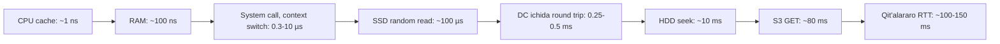
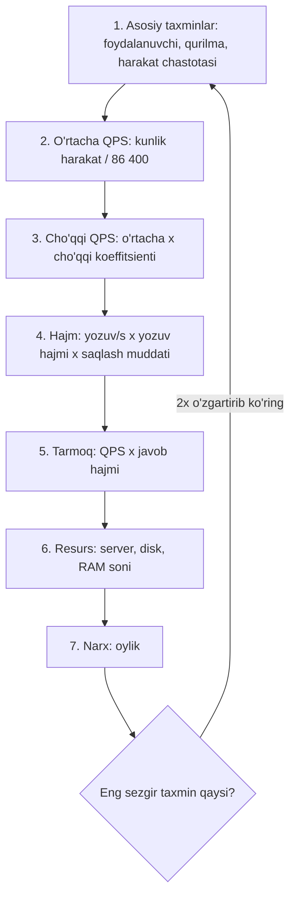

## Bu dars nima uchun kerak

1-darsda dizayn jarayonining ikkinchi qadami "hisob-kitob" ekanini ko'rdik: 100 yozuv/s va 100 ming yozuv/s uchun arxitektura butunlay boshqa. Lekin bu raqamlarni qayerdan olish kerak? Va olingan raqam "ko'pmi yoki kammi" ekanini qanday bilasiz?

Buning uchun ikki narsa kerak:

1. **Asosiy operatsiyalar narxini yoddan bilish** - RAM dan o'qish, SSD dan o'qish, data-markaz ichidagi round trip, qit'alararo paket. Bu raqamlar bir-biridan 10, 100, 1 000 000 marta farq qiladi va aynan shu farq dizayn qarorini belgilaydi.
2. **Tez, qo'pol, lekin to'g'ri tartibdagi hisob qilish** - "back-of-the-envelope" (konvert orqasida) hisob. Maqsad aniq javob emas, balki 10 baravar xatodan qochish.

Bu darsdan keyin siz:

- asosiy latency raqamlarini tartib bo'yicha bilasiz va ular 2009 yildan beri qanday o'zgarganini tushunasiz;
- qaysi raqamlar texnologiya bilan o'zgaradi, qaysilari fizika bilan cheklangan ekanini ajrata olasiz;
- so'rov/s, hajm, tarmoq trafigi, server soni va oylik narxni bir necha daqiqada hisoblay olasiz;
- "nines" (99.9%, 99.99%) ni ruxsat etilgan ishlamaslik vaqtiga aylantira olasiz;
- hisobingizda qaysi taxmin eng xavfli ekanini topa olasiz.

## "Har bir dasturchi bilishi kerak bo'lgan raqamlar"

Bu jadvalning tarixi: Peter Norvig "Teach Yourself Programming in Ten Years" maqolasida oddiy kompyuterdagi operatsiyalar vaqti jadvalini bergan. Jeff Dean (Google) uni 2009 yilda LADIS konferensiyasidagi "Designs, Lessons and Advice from Building Large Distributed Systems" keynote ma'ruzasida "Numbers Everyone Should Know" sarlavhasi bilan ommalashtirgan. Keyinchalik Jonas Bonér GitHub gist ko'rinishida tarqatgan va u "Latency Numbers Every Programmer Should Know" nomi bilan mashhur bo'lgan.

Dean slaydidagi raqamlar (2009):

| Operatsiya | Vaqt | Nisbat |
|---|---|---|
| L1 cache reference | 0.5 ns | 1x |
| Branch mispredict | 5 ns | |
| L2 cache reference | 7 ns | L1 dan 14x |
| Mutex lock/unlock | 25 ns | |
| Main memory (RAM) reference | 100 ns | L1 dan 200x |
| 1 KB ni Zippy (Snappy) bilan siqish | 3 000 ns = 3 µs | |
| 2 KB ni 1 Gbps tarmoq orqali yuborish | 20 000 ns = 20 µs | |
| RAM dan 1 MB ketma-ket o'qish | 250 000 ns = 250 µs | |
| Bitta data-markaz ichida round trip | 500 000 ns = 0.5 ms | |
| Disk seek (HDD) | 10 000 000 ns = 10 ms | DC round trip dan 20x |
| HDD dan 1 MB ketma-ket o'qish | 20 000 000 ns = 20 ms | |
| Paket: Kaliforniya - Niderlandiya - Kaliforniya | 150 000 000 ns = 150 ms | |

Bonér gistidagi versiyada yana ikki qator bor: SSD dan 4 KB tasodifiy o'qish taxminan 150 µs va SSD dan 1 MB ketma-ket o'qish taxminan 1 ms.

### 2026 yildagi raqamlar

Bu raqamlarning bir qismi eskirgan. Simon Eskildsen ning ochiq "napkin-math" loyihasi raqamlarni zamonaviy apparatda o'lchab, yangilab boradi. Uning README sida aytilishicha, raqamlar 2026 yil 8 martda GCP `c4-standard-48-lssd` instance (Intel Xeon 6985P-C) da qayta o'lchangan. Tanlangan qatorlar (yaxlitlangan, eslab qolish uchun):

| Operatsiya | Latency | Throughput |
|---|---|---|
| RAM dan ketma-ket o'qish (64 B) | 0.5 ns | 20 GiB/s (bitta thread) |
| RAM dan tasodifiy o'qish (64 B) | 20 ns | 3 GiB/s |
| System call | 300 ns | |
| Kriptografik hash (64 B) | 100 ns | 1 GiB/s |
| Context switch | 10 µs | |
| SSD dan ketma-ket o'qish (8 KiB) | 1 µs | 8 GiB/s |
| SSD dan tasodifiy o'qish (8 KiB) | 100 µs | 70 MiB/s |
| SSD ga yozish, fsync bilan (8 KiB) | 300 µs | 30 MiB/s |
| Bitta region ichida tarmoq | 250 µs | 2 GiB/s |
| Baza/cache so'rovi | 500 µs | |
| HDD tasodifiy o'qish (8 KiB) | 10 ms | 0.7 MiB/s |
| Blob storage (S3 kabi) GET, 128 KiB | 80 ms | 100 MiB/s |
| Regionlararo tarmoq | o'zgaruvchan | 25 MiB/s |

Muallif o'zi ogohlantiradi: ba'zi raqamlar hisoblash qulayligi uchun ataylab yaxlitlangan, bu benchmark emas, eslab qolish vositasi.

### Nima o'zgardi, nima o'zgarmadi

Ikki jadvalni solishtirsak, muhim xulosa chiqadi:

- **SSD hamma narsani o'zgartirdi.** 2009 da "diskka tasodifiy murojaat" degani 10 ms edi. Hozir NVMe SSD da 100 µs, ya'ni 100 baravar tez. Lekin u hali ham RAM dan taxminan 1 000 baravar sekin.
- **fsync qimmat.** Fayl tizimiga yozish (fsync siz) mikrosoniyalar. Ma'lumotni diskka **kafolatli** yozish (fsync) esa yuzlab mikrosoniya. Har bir tranzaksiya commit i fsync talab qiladi, shuning uchun bazalar group commit qiladi (14-dars).
- **Ketma-ket va tasodifiy farqi saqlanib qoldi.** SSD da ham ketma-ket o'qish 8 GiB/s, tasodifiy esa 8 KiB bloklarda 70 MiB/s atrofida (bitta oqimda). 4-darsda bu farqning sababini ochamiz.
- **Yorug'lik tezligi o'zgarmadi.** Qit'alararo round trip 2009 da ham, hozir ham o'nlab-yuzlab millisoniya. Buni hech qanday apparat tuzatmaydi.

Shu sabab yodda saqlash kerak bo'lgan asosiy narsa aniq nanosoniyalar emas, **tartiblar** (order of magnitude) zinapoyasi:

Har bir strelka taxminan 1-2 tartib (10-100 baravar) sekinlashish.

### Insoniy masshtabda

Raqamlarni his qilish uchun 1 ns ni 1 soniya deb tasavvur qiling:

| Operatsiya | Haqiqiy vaqt | "1 ns = 1 s" masshtabida |
|---|---|---|
| L1 cache | 0.5 ns | yarim soniya |
| RAM | 100 ns | 1 daqiqa 40 soniya |
| SSD random read | 100 µs | 100 000 s, ya'ni 1.2 kun |
| DC ichida round trip | 0.5 ms | 500 000 s, ya'ni 5.8 kun |
| HDD seek | 10 ms | 10^7 s, ya'ni 116 kun |
| Qit'alararo RTT | 150 ms | 1.5 × 10^8 s, ya'ni 4.8 yil |

Hisob: 100 000 / 86 400 ≈ 1.16 kun; 150 000 000 / 31 536 000 ≈ 4.76 yil.

Bu jadvaldan bevosita dizayn qoidasi chiqadi: **bitta tarmoq round trip ichida CPU millionlab operatsiya bajaradi**. Shuning uchun "N+1 query" muammosi (sikl ichida bazaga 100 ta so'rov) kod ichidagi har qanday algoritmik optimizatsiyadan qimmatroq: 100 × 0.5 ms = 50 ms faqat kutishga ketadi.

## Fizika chegarasi: yorug'lik tezligi

Optik tolada yorug'lik vakuumdagidan sekinroq tarqaladi: tezlik c/n, bunda n - sindirish ko'rsatkichi. Fiber Optic Association ma'lumotiga ko'ra standart singlemode tola (Corning SMF-28) uchun n ≈ 1.467, demak tezlik taxminan **204 500 km/s**. Bundan foydali qoida: **1 km tolada bir tomonga taxminan 5 µs**, ya'ni **1 000 km ga 5 ms bir tomonga, 10 ms round trip**.

Misol: Toshkent - Frankfurt (ko'p Markaziy Osiyo trafigi Yevropa orqali o'tadi). Aeroportlar orasidagi to'g'ri chiziq (great circle) masofa taxminan 4 700 km.

- Bir tomonga minimum: 4 700 km × 5 µs/km ≈ 23.5 ms.
- Round trip minimum: ≈ 47 ms.

Bu **nazariy pastki chegara**. Haqiqiy kabel to'g'ri chiziq bo'ylab yotmaydi, yo'lda routerlar, navbatlar bor, shuning uchun real RTT bundan sezilarli yuqori bo'ladi. Muhimi: 47 ms dan pastga hech qanday optimizatsiya bilan tushib bo'lmaydi. Agar foydalanuvchi Toshkentda, server Frankfurtda bo'lsa va sahifa ochilishi uchun 4 ta ketma-ket round trip kerak bo'lsa (DNS, TCP handshake, TLS, HTTP so'rov - 5-7 darslar), faqat fizika tufayli kamida 190 ms yo'qotiladi.

Bu ikki xulosaga olib keladi:

1. **Round trip lar sonini kamaytirish** ko'pincha serverni tezlashtirishdan foydaliroq (TLS 1.3, HTTP/2, connection reuse - 7-dars).
2. **Ma'lumotni foydalanuvchiga yaqinlashtirish** (CDN 25-dars, multi-region 77-dars) - yagona yo'l.

## Asosiy birliklar va konvertatsiyalar

Hisob-kitobning yarmi birliklarni to'g'ri aylantirish. Yodda saqlash kerak bo'lgan narsalar:

**Vaqt:**

- 1 kun = 86 400 s ≈ **10^5 s** (hisobda 100 000 deb olish xatoni 16% ga oshiradi, bu qabul qilinadi).
- 1 oy ≈ 2.6 × 10^6 s.
- 1 yil ≈ 3.15 × 10^7 s (eslab qolish uchun: π × 10^7).

**Hajm:**

- Ikkilik (KiB, MiB, GiB = 2^10, 2^20, 2^30) va o'nlik (KB, MB, GB = 10^3, 10^6, 10^9) birliklar orasidagi farq GB darajasida 7.4%, TB darajasida 10% atrofida. Back-of-envelope da buni e'tiborsiz qoldirish mumkin, lekin disk sotib olishda yoki bulut hisobida emas.
- 2^10 ≈ 10^3, 2^20 ≈ 10^6, 2^30 ≈ 10^9, 2^40 ≈ 10^12.

**Tarmoq:**

- Tarmoq tezligi **bit** da, fayl hajmi **bayt** da. 1 Gbps = 125 MB/s (8 ga bo'lish). 10 Gbps = 1.25 GB/s.
- Amalda protokol overhead va boshqa trafik tufayli to'liq tezlikning 70-80% idan ortig'iga tayanmang.

**Tipik obyekt hajmlari** (taxminlar, har doim o'z tizimingizda tekshiring):

- UUID: 16 bayt (binary), 36 bayt (matn).
- Timestamp: 8 bayt.
- GPS nuqta (lat, lon, vaqt, tezlik, yo'nalish, bir nechta datchik): xom holda 30-60 bayt, bazada indeks va qator overhead i bilan 100-200 bayt.
- Kichik JSON API javobi: 1-10 KB.
- Rasm thumbnail: 10-50 KB, to'liq rasm: 200 KB - 3 MB.

## Availability: "nines" ni vaqtga aylantirish

1-darsda 99.9% oyiga taxminan 43 daqiqa ekanini hisobladik. Umumiy formula: ruxsat etilgan ishlamaslik = davr × (1 - availability).

| Availability | Kuniga | Oyiga (30 kun) | Yiliga (365 kun) |
|---|---|---|---|
| 99% | 14.4 daqiqa | 7.2 soat | 3.65 kun |
| 99.9% | 1.44 daqiqa | 43.2 daqiqa | 8.76 soat |
| 99.95% | 43.2 s | 21.6 daqiqa | 4.38 soat |
| 99.99% | 8.64 s | 4.32 daqiqa | 52.6 daqiqa |
| 99.999% | 0.864 s | 25.9 s | 5.26 daqiqa |

Har bir qo'shimcha "9" ruxsat etilgan ishlamaslikni 10 baravar kamaytiradi. 99.99% da oyiga 4 daqiqa - bu inson alert ni ko'rib, laptopni ochib, muammoni tushunishiga ham yetmaydi. Demak 99.99% dan yuqori availability **avtomatik** failover ni talab qiladi, qo'lda tiklash bilan bunga erishib bo'lmaydi.

Ketma-ket bog'liqliklar availability ni ko'paytiradi: agar so'rov 3 ta servisdan o'tsa va har biri 99.9% bo'lsa, umumiy: 0.999^3 ≈ 0.997, ya'ni 99.7%. Bu mavzu 61 va 65-darslarda chuqur ko'riladi.

## Back-of-envelope metodikasi

Jeff Dean o'sha 2009 yilgi ma'ruzasida bu yondashuvni "back of the envelope calculations" deb atab, asosiy ko'nikma sifatida ko'rsatgan: dizaynni qurishdan oldin, qaysi variant ishlashini qo'pol hisob bilan baholash.

### Dean ning thumbnail misoli

Masala: 30 ta rasm thumbnail i bilan natijalar sahifasini generatsiya qilish. Har bir asl rasm 256 KB, HDD dan o'qiladi (seek 10 ms, o'qish 30 MB/s).

- **1-dizayn, ketma-ket o'qish:** 30 seek × 10 ms + 30 × 256 KB / 30 MB/s = 300 ms + 256 ms ≈ **560 ms**.
- **2-dizayn, parallel o'qish:** 10 ms + 256 KB / 30 MB/s ≈ **18 ms**. Dean qo'shimcha qiladi: variatsiyani hisobga olsak, real natija 30-60 ms bo'ladi.

Keyingi variantlar: thumbnail larni oldindan hisoblab cache da saqlash, va h.k. Hisobni yozish 1 daqiqa oladi, lekin 30 baravar farqni kod yozishdan oldin ko'rsatadi. Va "variatsiyani hisobga olsak" degan izohga e'tibor bering: parallel so'rovda eng sekin javob butun javobni belgilaydi. Bu tail latency muammosi 3-darsning asosiy mavzusi.

### Qadamlar

1. **Taxminlarni yozing.** Har bir taxmin alohida qatorda. Keyin kimdir "bu noto'g'ri" desa, faqat shu qatorni o'zgartirasiz.
2. **O'rtacha QPS.** Kunlik amallar soni / 86 400.
3. **Cho'qqi.** Trafik kun bo'yi tekis emas. Tipik koeffitsient 2-3x, lekin hodisaga bog'liq tizimlarda (sotuv, sport, ish kuni boshi) 10x va undan ko'p bo'lishi mumkin. Tizim cho'qqiga loyihalanadi, narx esa ko'pincha o'rtachaga bog'liq.
4. **Hajm.** Yozuv/s × yozuv hajmi × saqlash muddati × replikatsiya koeffitsienti (odatda 3).
5. **Tarmoq.** Kiruvchi va chiquvchi alohida. Chiquvchi trafik bulutda pulli.
6. **Resurslar.** Bitta server/disk nima qila oladi (yuqoridagi jadvallardan), kerakli soni qancha.
7. **Narx.** Oylik, eng katta 2-3 modda.
8. **Sezgirlik tahlili.** Har bir taxminni 2 baravar oshirib ko'ring. Qaysi biri natijani eng ko'p o'zgartiradi? O'shani aniqlashtirish kerak.

### Yaxlitlash qoidalari

Alex Xu "System Design Interview" ning 2-bobida (back-of-the-envelope estimation) bir nechta amaliy maslahat beradi: raqamlarni yaxlitlang (99 987 / 9.1 o'rniga 100 000 / 10), taxminlarni yozib qo'ying, har bir raqamga birlik yozing ("5" emas, "5 MB"). Bularga qo'shimcha:

- Darajalar bilan ishlang: 3 × 10^4 × 2 × 10^3 = 6 × 10^7. Nollarni sanashdan ko'ra xavfsizroq.
- Natijani "aqlga sig'adimi" tekshiruvidan o'tkazing: "bitta PostgreSQL 10^9 yozuv/s" chiqsa, qayerdadir 1 000 baravar xato bor.

### Xu ning Twitter misoli (mashq raqamlari)

Xu kitobidagi mashq (muallif bu Twitter ning real raqamlari emasligini ta'kidlaydi):

- 300 mln oylik faol foydalanuvchi (MAU), 50% i har kuni faol: DAU = 150 mln.
- Har biri kuniga o'rtacha 2 tvit.
- QPS = 150 × 10^6 × 2 / 86 400 ≈ 3 472 ≈ **3 500**. Cho'qqi = 2 × o'rtacha ≈ **7 000**.
- Tvitlarning 10% ida 1 MB media.
- Media hajmi kuniga: 150 × 10^6 × 2 × 0.1 × 1 MB = 30 × 10^6 MB = **30 TB/kun**.
- 5 yilda: 30 TB × 365 × 5 ≈ **55 PB**.

E'tibor bering: QPS (3 500) bitta katta bazaga sig'adi, 55 PB esa yo'q. Bu misolda arxitekturani yozish tezligi emas, **media hajmi** belgilaydi: matn va media alohida saqlanadi, media object storage ga (60-dars) va CDN ga (25-dars) ketadi. 1-darsdagi GPS misolida ham xuddi shunday xulosa chiqqan edi.

## Resurs va narx hisobi

Hajmni bilgach, keyingi savol: nechta server va qancha pul?

### Bitta server nima qila oladi

Qo'pol, lekin foydali tartiblar (aniq qiymat yuklama turiga juda bog'liq, har doim o'lchang):

| Resurs | Taxminiy imkoniyat | Izoh |
|---|---|---|
| Oddiy stateless HTTP servis (bitta yadro) | 1 000 - 10 000 so'rov/s | biznes logikaga bog'liq |
| Kalit bo'yicha o'qish, Redis | 10^5 operatsiya/s tartibida | bitta instance |
| PostgreSQL, indeks bo'yicha nuqtaviy SELECT | 10^4 - 10^5 so'rov/s | RAM ga sig'sa |
| fsync li yozish, bitta oqim | ~3 000 commit/s | 300 µs/fsync (napkin-math) |
| NVMe SSD ketma-ket o'qish | bir necha GiB/s | |
| 10 Gbps tarmoq kartasi | ~1.25 GB/s | nazariy |

Oxirgidan oldingi qator muhim hisob: agar har bir commit 300 µs fsync talab qilsa, bitta oqim soniyasiga 1 / 0.0003 ≈ 3 333 commit qila oladi. Bazalar bundan yuqoriga group commit (bir fsync da ko'p tranzaksiya) va parallel oqimlar bilan chiqadi.

### Server soni

Formula: kerakli serverlar = cho'qqi QPS / (bitta server QPS × maqsadli utilization).

Maqsadli utilization odatda 50-70%. Nega 100% emas: 3-darsda ko'ramizki, utilization 100% ga yaqinlashganda navbat va latency keskin oshadi; bundan tashqari bitta server o'chsa, qolganlar uning yukini ko'tarishi kerak (N+1).

Misol: cho'qqi 7 000 QPS, bitta server 2 000 QPS, utilization 60%: 7 000 / (2 000 × 0.6) ≈ 5.8, ya'ni 6 server, N+1 bilan 7.

### Narx

Bulutda eng katta xarajat moddalari odatda: compute, saqlash, chiquvchi trafik. AWS S3 Standard narxlari (us-east-1, birinchi 50 TB): **$0.023 / GB-oy** saqlash, PUT so'rovlari $0.005 / 1 000, GET $0.0004 / 1 000, internetga chiquvchi trafik birinchi 10 TB uchun $0.09 / GB (oyiga 100 GB bepul). Narxlar region va vaqtga qarab o'zgaradi, hisobdan oldin rasmiy narx sahifasini tekshiring.

Misol: 30 TB/kun media 1 oy saqlansa, oy oxirida ≈ 900 TB. Faqat saqlash: 900 000 GB × $0.023 ≈ $20 700/oy, va bu har oy o'sadi. Agar bu media ning 10% i oyiga bir marta internetga yuklab olinsa: 90 000 GB × $0.09 ≈ $8 100/oy. Bunday hisob CDN, storage class lar (cold storage) va retention siyosati (78-dars) haqidagi qarorlarni majburlaydi.

## Trade-off: qanchalik aniq hisoblash kerak

| Yondashuv | Qachon | Afzallik | Kamchilik |
|---|---|---|---|
| Faqat tartib (10^3 mi, 10^5 mi) | Dizaynning boshida, arxitektura tanlash | 5 daqiqa, arxitektura xatosini oldini oladi | Server soni, narxni bermaydi |
| Back-of-envelope (2x aniqlik) | Arxitektura va budjet bahosi | Resurs va narxni beradi | Taxminlarga juda bog'liq |
| Benchmark / prototip | Eng xavfli 1-2 komponent | Real raqam | Vaqt talab qiladi, yuklama modeli noto'g'ri bo'lsa adashtiradi |
| Production o'lchov | Tizim ishlayotganda | Haqiqat | Faqat mavjud tizim uchun |

Qoida: arzonidan boshlang. Agar back-of-envelope natija chegaraga yaqin chiqsa (masalan, "bitta baza 70% yuklanadi"), keyingi bosqichga - benchmark ga o'ting. Agar natija chegaradan 100 baravar uzoq bo'lsa ("1 000 yozuv/s, baza 100 000 ni ko'taradi"), benchmark kerak emas.

## Real tizimlardan misollar

- **Google, Jeff Dean:** o'sha 2009 ma'ruzada yangi klaster birinchi yilida qanday nosozliklarni boshdan kechirishini ham raqamlarda beradi: taxminan 1 000 ta alohida mashina nosozligi, minglab HDD nosozligi, 20 ga yaqin rack nosozligi (har biri 40-80 mashina 1-6 soatga yo'qoladi). Bu ham back-of-envelope: minglab mashina bo'lsa, nosozlik istisno emas, kundalik hodisa ekanini raqam bilan ko'rsatadi.
- **Amazon Dynamo (2007):** maqolada ichki SLA misoli "500 so'rov/s cho'qqi yuklamada so'rovlarning 99.9% i 300 ms ichida javob olsin" shaklida berilgan, ya'ni metrika, chegara va sharoit bilan. Shuningdek, bitta sahifa so'rovi 150 dan ortiq servisga murojaat qilishi mumkinligi aytiladi. Bunday fan-out da har bir servisning latency raqami muhim (3-dars).
- **napkin-math loyihasi** ning o'zi amaliy misol: muallif raqamlarni real bulut instance da Rust dasturlari bilan o'lchaydi va har bir yangi apparat avlodida yangilaydi. O'z infratuzilmangiz uchun ham shunday "o'z raqamlar jadvali"ni yuritish foydali.

## iQuariX kontekstida: video arxiv hisobi

Faraz qiling, iQuariX mijozlaridan biri 2 000 ta yuk mashinasiga har biriga 2 ta kamera (yo'l va kabina) o'rnatmoqchi va video bulutga yuklansin deydi. Arxitektura haqida gapirishdan oldin hisob:

**Taxminlar** (har biri tekshirilishi kerak):

- kamera bitrate: 1 Mbps (720p H.264 uchun qo'pol taxmin);
- mashina kuniga 10 soat yuradi;
- video 30 kun saqlanadi;
- hamma video uzluksiz bulutga yuklanadi (bu taxminni keyin shubha ostiga olamiz).

**Hisob:**

- Bitta kamera: 1 Mbps = 125 KB/s. 10 soat = 36 000 s. 125 KB × 36 000 = 4.5 GB/kun.
- Hammasi: 2 000 × 2 × 4.5 GB = **18 TB/kun**.
- 30 kunlik arxiv: 18 × 30 = **540 TB**.
- Kiruvchi trafik ish soatlarida: 4 000 kamera × 1 Mbps = **4 Gbps** uzluksiz.
- Saqlash narxi (S3 Standard narxi bilan, qo'pol): 540 000 GB × $0.023 ≈ **$12 400/oy**.
- Mobil trafik: har bir mashina oyiga 2 × 4.5 GB × 30 = 270 GB mobil internet. Bu SIM-karta tariflari uchun juda katta raqam.

**Xulosa:** hisob 2 daqiqa oldi va "hamma videoni uzluksiz bulutga yuklash" taxmini iqtisodiy jihatdan eng xavfli ekanini ko'rsatdi. Muqobil: video qurilmada (DVR SD-kartasida) saqlanadi, bulutga faqat hodisa (keskin tormoz, to'qnashuv, AI aniqlagan xavfli harakat) atrofidagi 30 soniyalik kliplar va dispetcher so'ragan fragmentlar yuklanadi. Agar mashina kuniga 10 ta hodisa bo'lsa: 10 × 30 s × 2 kamera × 125 KB/s = 75 MB/kun, uzluksiz yuklashdagi 9 GB/kun ga nisbatan 120 baravar kam. Bu yerda dizayn qarorini texnologiya emas, bitta ko'paytirish belgiladi. Video ingest 84-darsda chuqur ko'riladi.

Endi sezgirlik: bitrate 2 Mbps bo'lsa hamma narsa 2 baravar oshadi; mashina 20 soat yursa ham 2 baravar. Saqlash muddati 90 kun bo'lsa - 3 baravar. Demak mijoz bilan birinchi navbatda **saqlash muddati** va **qaysi video bulutga kerak** degan savollarni aniqlash kerak.

## Ko'p uchraydigan xatolar

1. **Bit va baytni aralashtirish.** 1 Gbps kanal 1 GB/s emas, 125 MB/s. Xato 8 baravar.
2. **Cho'qqini unutish.** O'rtacha QPS ga loyihalangan tizim ish kunining boshida yiqiladi. Har doim cho'qqi koeffitsientini alohida yozing va uni qayerdan olganingizni ayting.
3. **Replikatsiya va indeksni hisobga olmaslik.** Xom hajm 1 TB bo'lsa, 3 ta replika va indekslar bilan diskda 4-5 TB bo'lishi mumkin.
4. **Taxminlarni yashirish.** Natija "540 TB" deb yozilgan, lekin "1 Mbps, 10 soat" qayerdan kelgani yo'q. Tekshirib, tuzatib bo'lmaydi.
5. **Haddan tashqari aniqlik.** "3 472.2 QPS" yozish noto'g'ri aniqlik illyuziyasini beradi. Taxminlar 2 baravar noaniq bo'lsa, natija ham shunday.
6. **Eskirgan raqamlar.** "Disk murojaati 10 ms" 2009 yil HDD si uchun to'g'ri edi. NVMe SSD da bu 100 µs. Qaysi apparatda ishlashingizni biling.
7. **Fizikani e'tiborsiz qoldirish.** Yevropadagi server Toshkentdagi foydalanuvchiga 20 ms latency berishini kutish mumkin emas: faqat yorug'lik round trip i ≈ 47 ms.
8. **Narxni hisoblamaslik.** Texnik jihatdan ishlaydigan dizayn oyiga mijoz to'laganidan ko'p pul talab qilishi mumkin.

## Xulosa

- Latency raqamlarining aniq qiymatlari emas, tartiblari muhim: cache ns, RAM ~100 ns, SSD ~100 µs, DC round trip ~0.5 ms, HDD ~10 ms, qit'alararo ~100+ ms.
- SSD 2009 dan beri tasodifiy o'qishni ~100 baravar tezlashtirdi, lekin fsync, tarmoq round trip va yorug'lik tezligi asosiy cheklov bo'lib qoldi.
- Tolada 1 000 km ≈ 5 ms bir tomonga. Bu pastki chegara, uni optimizatsiya bilan yengib bo'lmaydi.
- Kuniga ≈ 10^5 s; 1 Gbps = 125 MB/s; har bir "9" ishlamaslikni 10 baravar kamaytiradi.
- Hisob tartibi: taxminlar, o'rtacha va cho'qqi QPS, hajm, tarmoq, resurs, narx, sezgirlik.
- Ko'pincha arxitekturani QPS emas, hajm va narx belgilaydi.
- Eng sezgir taxminni toping va birinchi navbatda o'shani aniqlashtiring.

## Amaliy topshiriq

Faraz qiling, iQuariX ga 50 000 mashinali yirik logistika mijozi kelmoqda. Ular quyidagilarni xohlaydi: GPS va datchiklar (har 5 soniyada), yoqilg'i datchigi (har 10 soniyada), dispetcher xaritasida real vaqt, 1 yillik tarix.

1. **Taxminlar jadvali.** Har bir xabar hajmi (xom va bazadagi), mashina kuniga necha soat faol, cho'qqi koeffitsienti, dispetcherlar soni va ular xaritani qanchalik tez-tez yangilashi. Har biriga qisqa asos yozing.
2. **Yozish yuklamasi.** O'rtacha va cho'qqi xabar/s, kiruvchi trafik (Mbps).
3. **Saqlash.** Kunlik, yillik hajm; 3 replika va indekslar bilan; siqish (masalan 5-10x, time-series bazalarda tipik deb faraz qiling) bilan va siqishsiz.
4. **O'qish yuklamasi.** Dispetcher xaritalari uchun so'rov/s va oxirgi joylashuvlar to'plamining RAM dagi hajmi (50 000 mashina × bitta yozuv hajmi).
5. **Narx.** Saqlash uchun oylik narxni ikkita variantda hisoblang: hammasi tez SSD da; 30 kundan eskisi arzon object storage da.
6. **Sezgirlik.** Qaysi taxmin 2 baravar o'zgarsa natija eng ko'p o'zgaradi? Mijozga qaysi 2 ta savolni birinchi berasiz?

Yaxshi javobda bo'lishi kerak bo'lgan narsalar:

- barcha taxminlar alohida yozilgan va birliklar ko'rsatilgan;
- o'rtacha va cho'qqi alohida, cho'qqi koeffitsienti asoslangan;
- bit/bayt va KB/MB konvertatsiyalari to'g'ri;
- replikatsiya, indeks va siqish hajmga alohida ko'paytuvchi sifatida kiritilgan;
- "oxirgi joylashuv" ma'lumoti RAM ga sig'ishi raqam bilan ko'rsatilgan;
- sezgirlik tahlilidan mijozga aniq savollar chiqarilgan.

Javobni pastdagi maydonga yozib, chatga yuboring.

## Manbalar

- Jeff Dean. [Designs, Lessons and Advice from Building Large Distributed Systems](https://research.cs.cornell.edu/ladis2009/talks/dean-keynote-ladis2009.pdf), LADIS 2009 keynote - "Numbers Everyone Should Know", "Back of the envelope calculations" (thumbnail misoli) va klasterning birinchi yilidagi nosozliklar slaydlari.
- Peter Norvig. [Teach Yourself Programming in Ten Years](https://norvig.com/21-days.html) - "Answers" bo'limidagi operatsiyalar vaqti jadvali (raqamlarning asl manbai).
- Jonas Bonér. [Latency Numbers Every Programmer Should Know](https://gist.github.com/jboner/2841832) - SSD qatorlari qo'shilgan mashhur gist versiyasi.
- Simon Eskildsen. [napkin-math](https://github.com/sirupsen/napkin-math) - 2026 yil martida qayta o'lchangan zamonaviy raqamlar jadvali (README).
- Alex Xu. [System Design Interview, 2-bob "Back-of-the-envelope Estimation"](https://bytebytego.com/courses/system-design-interview/back-of-the-envelope-estimation) - ikkilik darajalar, availability jadvali, Twitter QPS mashqi va maslahatlar.
- Fiber Optic Association. [Fiber FAQs](https://foa.org/FiberFAQs.html) - tolada yorug'lik tezligi va sindirish ko'rsatkichi (SMF-28 uchun n = 1.467).
- DeCandia va boshq. [Dynamo: Amazon's Highly Available Key-value Store](https://www.allthingsdistributed.com/files/amazon-dynamo-sosp2007.pdf), SOSP 2007 - 2.2 bo'lim, SLA va 99.9 percentile.
- [Amazon S3 narxlari](https://aws.amazon.com/s3/pricing/) - saqlash, so'rov va trafik narxlari (hisobdan oldin joriy qiymatlarni tekshiring).
