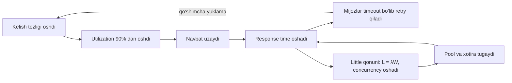
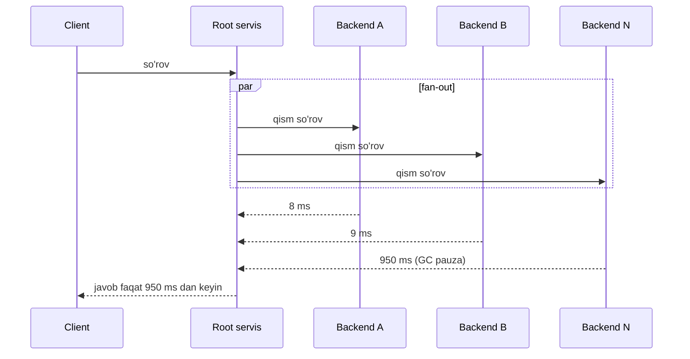

## Bu dars nima uchun kerak

1-darsda NFR "p99 300 ms dan kam, 2 000 so'rov/s da" ko'rinishida yozilishi kerakligini ko'rdik. 2-darsda alohida operatsiyalar qancha vaqt olishini o'rgandik. Endi savol: **ko'p so'rov bir vaqtda kelganda** nima bo'ladi? Nega server 50% yuklanganda hammasi yaxshi, 90% da esa latency birdan 5 baravar oshadi? Nega har bir servis "tez" bo'lsa ham, ularni birlashtirgan sahifa sekin? Nega dashboard dagi o'rtacha latency yaxshi, mijozlar esa shikoyat qiladi?

Bularning hammasiga javob uchta tushunchada: latency taqsimoti (percentile), navbatlar nazariyasi (Little qonuni va utilization) va fan-out dagi tail latency.

Bu darsdan keyin siz:

- latency, response time, throughput, concurrency tushunchalarini aniq ajratasiz;
- percentile larni to'g'ri hisoblash, saqlash va agregatsiya qilishni bilasiz (va nega ularni o'rtachalash mumkin emasligini);
- Little qonuni bilan connection pool, thread soni va navbat uzunligini hisoblay olasiz;
- utilization oshganda latency nega chiziqli emas, giperbolik o'sishini tushunasiz;
- fan-out tail latency ni qanday kuchaytirishini va hedged request kabi usullarni bilasiz;
- yuklama testida "coordinated omission" xatosini taniysiz.

## Asosiy tushunchalar

- **Response time** - mijoz so'rov yuborgandan javob olguncha o'tgan to'liq vaqt (tarmoq + navbatda kutish + qayta ishlash).
- **Latency** - qat'iy ma'noda so'rov **kutib** turgan vaqt (1-darsdagi Kleppmann ta'rifi). Amaliyotda "latency" ko'pincha response time ma'nosida ishlatiladi; bu darsda ham shunday qilamiz, lekin farq qachon muhimligini ta'kidlaymiz.
- **Service time** - so'rovni bevosita qayta ishlash vaqti, navbatsiz.
- **Throughput** - vaqt birligida **tugallangan** ishlar soni (so'rov/s, xabar/s, MB/s).
- **Concurrency (parallel ishlar soni)** - ma'lum bir vaqt momentida tizim ichida turgan (navbatda yoki qayta ishlanayotgan) so'rovlar soni.
- **Utilization** - resurs band bo'lgan vaqt ulushi (0 dan 1 gacha).

Muhim: latency va throughput mustaqil emas. Throughput ni maksimal qilishning eng oson yo'li - navbatni to'ldirib, resursni hech qachon bo'sh qoldirmaslik. Lekin aynan shu latency ni oshiradi. Bu darsning asosiy trade-off i shu.

## Taqsimot va percentile

### Nega o'rtacha yetarli emas

Latency taqsimoti deyarli hech qachon normal (Gauss) emas. U o'ngga uzun "dum"ga ega: ko'pchilik so'rovlar tez, ozgina qismi esa 10-100 baravar sekin. Sekinlik sabablari: GC pauza, cache miss, disk, boshqa so'rovlar bilan raqobat (lock), tarmoqda paket yo'qolishi va qayta yuborish, fon jarayonlari (compaction, backup), qo'shni VM lar.

Google SRE kitobining "Monitoring Distributed Systems" bobidagi misol: o'rtacha latency 100 ms bo'lgan, 1 000 so'rov/s li servisda so'rovlarning 1% i 5 soniya olishi mumkin. O'rtacha qiymat buni deyarli ko'rsatmaydi, lekin bu soniyasiga 10 ta xafa foydalanuvchi demak.

### Percentile ta'rifi

**pN** - so'rovlarning N foizi shu qiymatdan tez (yoki teng) bo'lgan chegara.

- **p50 (median)** - "tipik" foydalanuvchi tajribasi.
- **p95, p99** - dum. SLO larda eng ko'p ishlatiladi.
- **p99.9, p99.99** - "eng chekka" dum. Katta fan-out li tizimlarda muhim.
- **max** - bitta eng yomon so'rov. Ko'pincha shovqin, lekin ba'zan eng muhim signal (masalan, 30 soniyalik GC pauza).

Hisoblash misoli: 10 ta so'rov vaqti (ms): 12, 14, 15, 15, 16, 18, 20, 25, 40, 900.

- O'rtacha: (12+14+15+15+16+18+20+25+40+900) / 10 = 1 075 / 10 = **107.5 ms**.
- Median (p50): saralangan qatorda 5 va 6-qiymatlar o'rtasi: (16+18)/2 = **17 ms**.
- p90: 9-qiymat, **40 ms**.
- max: **900 ms**.

O'rtacha (107.5 ms) birorta haqiqiy so'rovni ham ifodalamaydi: 9 ta so'rov undan ancha tez, bittasi ancha sekin.

### Amazon nega p99.9 ni tanlagan

Dynamo maqolasida (2007) Amazon ichki SLA larini 99.9 percentile bo'yicha yozishi tushuntiriladi. Sabab qiziq: eng sekin so'rovlar ko'pincha eng **qimmatli** mijozlarniki - uzoq xarid tarixi bor foydalanuvchilarni personalizatsiya qilish ko'proq ma'lumot qayta ishlashni talab qiladi. O'rtacha yoki median ularni yashiradi. 99.9 dan yuqorisi esa xarajat-foyda tahlili bo'yicha juda qimmatga tushgani uchun tanlanmagan.

### Percentile larni o'rtachalash mumkin emas

Bu juda keng tarqalgan xato. Sizda 10 ta server bor, har biri o'z p99 ini hisoblaydi. Butun servis p99 i ularning o'rtachasi emas. Misol:

- 1-server: 9 800 so'rov, hammasi 50 ms dan tez, p99 = 50 ms.
- 2-server: 200 so'rov, hammasi 2 000 ms (bu serverda disk muammosi bor), p99 = 2 000 ms.

"O'rtacha p99" = (50 + 2 000) / 2 = 1 025 ms. Haqiqiy umumiy p99: jami 10 000 so'rovning eng sekin 1% i, ya'ni 100 ta so'rov. Eng sekin 200 ta so'rov 2 000 ms, demak umumiy p99 = **2 000 ms**. O'rtachalash dumni ikki baravar kamaytirib ko'rsatdi. Agar serverlar yuklamasi teskari bo'lsa, xato boshqa tomonga ketadi. Umumiy p99 ni bilish uchun **to'liq taqsimot** kerak, ikkita raqam emas.

To'g'ri yo'l - **histogram larni** birlashtirish. Har bir server latency ni bucket larga sanaydi (0-10 ms, 10-30 ms, 30-100 ms, ...). Histogram larni qo'shish mumkin (bucket bo'yicha yig'indi), keyin umumiy histogram dan percentile hisoblanadi. SRE kitobining "Monitoring Distributed Systems" bobi chegaralarni eksponensial, har biri ~3 baravar oshib boradigan qilib tanlashni tavsiya qiladi: 0-10, 10-30, 30-100, 100-300 ms. Shu maqsadda maxsus tuzilmalar bor:

| Usul | G'oya | Xususiyat |
|---|---|---|
| Fixed bucket histogram (Prometheus) | Oldindan berilgan chegaralar | Arzon, birlashtiriladi; aniqlik bucket chegaralariga bog'liq |
| HdrHistogram | Logaritmik bucket lar, berilgan nisbiy aniqlik | Keng diapazonda aniq, birlashtiriladi |
| t-digest, DDSketch | Taqsimotni siqilgan "sketch" bilan ifodalash | Kichik xotira, birlashtiriladi, xatosi chegaralangan |
| Xom qiymatlarni saqlash | Hamma narsani yozish | Eng aniq, lekin qimmat |
| Server p99 larining o'rtachasi | | **Noto'g'ri**, ma'nosiz |

Metrics va monitoring 66-67 darslarda chuqur ko'riladi.

## Little qonuni

John Little 1961 yilda "Operations Research" jurnalida isbotlagan formula:

**L = λ × W**

- **L** - tizim ichidagi o'rtacha elementlar soni (concurrency);
- **λ** (lambda) - o'rtacha kelish tezligi (barqaror holatda throughput ga teng);
- **W** - har bir element tizimda o'tkazgan o'rtacha vaqt (response time).

Kuchi - umumiyligida. Little ning 50 yillik sharh maqolasida ta'kidlanganidek, qonun navbat tartibidan (FIFO, LIFO, ustuvorlik) va kelish taqsimotidan qat'i nazar o'rinli; faqat uzoq muddatli o'rtachalar mavjud va chekli bo'lishi kerak. Ya'ni bu taxmin emas, buxgalteriya identifikatsiyasi.

### Misol 1: connection pool hajmi

API servis soniyasiga 2 000 so'rov qabul qiladi, har bir so'rov bazada o'rtacha 5 ms ushlab turadi.

L = 2 000 × 0.005 = **10** ta bir vaqtdagi baza ulanishi o'rtacha.

Demak pool hajmi 10 dan sal ko'p bo'lsa yetadi (cho'qqi va o'zgaruvchanlik uchun zaxira bilan, masalan 20-30). Pool ni 500 qilish yordam bermaydi: baza CPU yadrolari cheklangan va ortiqcha ulanishlar faqat raqobatni oshiradi. Aksincha, agar so'rov bazada 50 ms ushlansa (sekin query), xuddi shu throughput uchun L = 100 ulanish kerak. Pool tugashi ko'pincha "pool kichik" emas, "query sekinlashdi" belgisi.

### Misol 2: maksimal throughput ni topish

Node.js servisda 4 ta worker, har biri bir vaqtda 50 ta so'rovni ushlab tura oladi (masalan, tashqi API ga ulanishlar limiti), ya'ni L_max = 200. Tashqi API o'rtacha 400 ms javob beradi.

λ_max = L / W = 200 / 0.4 = **500 so'rov/s**.

Agar tashqi API 2 soniyaga sekinlashsa: λ_max = 200 / 2 = **100 so'rov/s**. Kirish 500 so'rov/s da qolsa, soniyasiga 400 ta so'rov navbatga tushadi va navbat cheksiz o'sadi. Bitta sekin bog'liqlik butun servisni "yiqitishi"ning matematikasi shu. Himoya: timeout, bulkhead, load shedding (62-64 darslar).

### Misol 3: navbat kechikishi

Kafka consumer lag 120 000 xabar, consumer lar soniyasiga 2 000 xabar qayta ishlaydi. Yangi xabar qayta ishlanguncha qancha kutadi? W = L / λ = 120 000 / 2 000 = **60 s**. Shu bitta bo'lish monitoring da "lag xabar sonida" ni "lag vaqtda" ga aylantiradi, bu esa SLO bilan solishtirsa bo'ladigan raqam.

## Utilization va navbat: nega 90% xavfli

Eng oddiy navbat modeli - M/M/1: bitta server, kelishlar tasodifiy (Poisson), xizmat vaqti eksponensial. Belgilar: μ - server tezligi (so'rov/s), λ - kelish tezligi, ρ = λ/μ - utilization. Model bo'yicha:

- tizimdagi o'rtacha elementlar soni: ρ / (1 - ρ);
- o'rtacha response time: **W = 1 / (μ - λ)**.

Hisob: server bitta so'rovni 1 ms da bajaradi (μ = 1 000/s).

| λ (so'rov/s) | ρ | W = 1/(μ-λ) | Navbatdagi o'rtacha elementlar ρ/(1-ρ) |
|---|---|---|---|
| 100 | 10% | 1.1 ms | 0.11 |
| 500 | 50% | 2 ms | 1 |
| 800 | 80% | 5 ms | 4 |
| 900 | 90% | 10 ms | 9 |
| 950 | 95% | 20 ms | 19 |
| 990 | 99% | 100 ms | 99 |

Utilization 50% dan 99% ga, ya'ni 2 baravardan kam oshganda, latency 50 baravar oshdi. Bu chiziqli emas, **giperbolik** bog'liqlik: ρ → 1 da W → ∞.

M/M/1 da response time eksponensial taqsimlangan, shuning uchun p99 = ln(100) / (μ - λ) ≈ 4.6 × W. 90% utilization da: p99 ≈ 4.6 × 10 ms = **46 ms**, holbuki service time atigi 1 ms.

Real tizimlar M/M/1 emas (ko'p yadro, o'zgaruvchan xizmat vaqti), lekin sifat jihatidan xulosa bir xil:

1. **Yuqori utilization = uzun navbat = yuqori tail latency.** Shuning uchun latency ga sezgir servislar uchun maqsadli utilization 50-70% (2-darsdagi server soni hisobi).
2. **Xizmat vaqti o'zgaruvchanligi ham navbatni oshiradi.** Bir xil o'rtacha bilan, ba'zan 100 ms oladigan so'rovlar orqasida tezkor so'rovlar kutib qoladi (head-of-line blocking). Sekin va tez so'rovlarni alohida navbat/pool larga ajratish shu sababdan foydali.
3. **Ko'p server (M/M/c) bitta umumiy navbatdan oladi** va bir xil utilization da latency ancha past bo'ladi. Shuning uchun har bir serverga alohida navbat emas, umumiy navbat yoki aqlli load balancing (22-dars) yaxshiroq.

SRE kitobi ham "saturation" signalida shuni ta'kidlaydi: tizimlar ko'pincha 100% utilization ga yetmasdan oldin degradatsiyaga uchraydi va latency ning oshishi saturation ning erta belgisi.

Bu diagrammadagi ikkita teskari aloqa (retry va resurs tugashi) cascading failure ning asosiy mexanizmi (64-dars).

## Tail latency va fan-out

### Fan-out matematikasi

Zamonaviy so'rov bitta servisga emas, o'nlab-yuzlab servisga tarqaladi (Dynamo maqolasiga ko'ra Amazon sahifasi 150 dan ortiq servisga murojaat qilishi mumkin). Parallel fan-out da javob **eng sekin** backend kutilgandan keyin tayyor bo'ladi.

Jeff Dean va Luiz André Barroso ning "The Tail at Scale" maqolasi (Communications of the ACM, 2013) dan misol: har bir server so'rovlarning 1% iga 1 soniyada javob beradi. Agar foydalanuvchi so'rovi 100 ta serverga parallel ketsa:

P(hech bo'lmasa bitta sekin) = 1 - 0.99^100 ≈ 1 - 0.366 = **0.634**, ya'ni 63% so'rov 1 soniyadan ko'p.

Har bir serverda sekin javob 10 000 da 1 bo'lsa ham, 2 000 serverga fan-out da taxminan har 5 so'rovdan biri 1 soniyadan oshadi: 1 - 0.9999^2000 ≈ 1 - 0.819 ≈ 0.18.

Xulosa: **backend ning p99 i frontend ning p50 iga aylanadi**. SRE kitobi ham shuni aytadi: frontend bir nechta servisga bog'liq bo'lsa, bitta backend ning sekin dumi frontend uchun "tipik" javob vaqtiga aylanadi.

Maqoladagi o'lchov (Google, katta fan-out daraxti, root darajasida): bitta tasodifiy so'rovning p99 i 10 ms; barcha so'rovlar tugashining p99 i 140 ms; so'rovlarning 95% i tugashi p99 i 70 ms. Ya'ni eng sekin 5% ni kutish umumiy p99 latency ning yarmini tashkil qiladi.

### Tail ni kamaytirish usullari

"The Tail at Scale" maqolasi tail ni yo'qotib bo'lmasligini, uni "tail-tolerant" texnikalar bilan yashirish kerakligini taklif qiladi:

- **Hedged requests.** So'rov bitta replikaga yuboriladi; agar u kutilgan p95 vaqtidan uzoq javob bermasa, ikkinchi replikaga nusxa yuboriladi va qaysi biri birinchi javob bersa, o'sha olinadi. Yuklama faqat ~5% oshadi. Maqoladagi Google benchmark: 100 serverga taqsimlangan BigTable jadvalidan 1 000 kalit o'qishda, 10 ms dan keyin hedge yuborish 99.9 percentile ni **1 800 ms dan 74 ms ga** tushirgan, so'rovlar soni atigi 2% oshgan.
- **Tied requests.** So'rov darhol ikki serverning navbatiga qo'yiladi, har biri boshqasi haqida biladi; birinchisi bajarishni boshlaganda ikkinchisini bekor qiladi. Maqoladagi benchmark: median 16% ga, p99.9 deyarli 40% ga kamaygan, disk yuklamasi 1% dan kam oshgan.
- **Micro-partitioning va tez rebalancing** - bitta sekin mashinadan ishni tez ko'chirish.
- **Ehtimoliy javob (good enough).** Qidiruvda 100 shard dan 98 tasi javob bersa, qolgan 2 tasini kutmasdan natija qaytarish.
- **Fon ishlarini cheklash** (compaction, GC) va ularni sinxron qilish - hammasi bir vaqtda qisqa pauza qiladi, uzoq vaqt davomida tarqoq emas.

Hedging ning xavfi: agar sekinlik **yuklama** dan bo'lsa (hamma replikalar band), ikkinchi so'rov yuklamani oshiradi va vaziyatni yomonlashtiradi. Shuning uchun hedge faqat kechikish chegarasidan keyin va cheklangan ulushda yuboriladi. Idempotent bo'lmagan operatsiyalarda (to'lov) esa umuman mumkin emas (39-dars).

## Throughput va latency trade-off i

| Usul | Throughput ga ta'siri | Latency ga ta'siri | Qachon |
|---|---|---|---|
| Batching (bir nechta yozuvni birga) | Ko'p oshadi | Oshadi (batch to'lishini kutish) | Telemetriya ingest, Kafka producer, group commit |
| Navbat (buffer) qo'shish | Cho'qqilarni silliqlaydi | Navbat to'lganda oshadi | Yuklama notekis, kechikish qabul qilinadi |
| Yuqori utilization | Server boshiga ko'proq | Tail keskin oshadi | Offline batch ishlar |
| Past utilization (zaxira) | Server boshiga kamroq, qimmat | Past va barqaror | Interaktiv API |
| Parallellik (fan-out) | Ko'p ishni bo'ladi | Median kamayadi, tail oshishi mumkin | Qidiruv, scatter-gather |
| Hedged request | Biroz kamayadi (ortiqcha ish) | Tail keskin kamayadi | O'qish, idempotent so'rovlar |
| Pipelining | Oshadi | Har bir so'rov uchun round trip kamayadi | Redis, HTTP/2, baza protokollari |

Pipelining misoli: Redis rasmiy benchmark hujjatidagi namunaviy chiqishlarda pipeline siz SET 180 180 so'rov/s, 16 ta so'rovni pipeline qilganda (`-P 16`, MacBook Air 11" da) esa SET 1 536 098 so'rov/s. Bu ikki o'lchov hujjatda bir xil mashinada deb ko'rsatilmagan, shuning uchun aniq nisbatni emas, tartibni oling: pipelining throughput ni bir tartibga yaqin oshiradi. Server tezlashmadi - round trip lar soni kamaydi.

Batching misoli: Kafka producer `linger.ms` parametri bilan bir necha millisoniya kutib, xabarlarni batch ga yig'adi. Throughput sezilarli oshadi, har bir xabar latency si esa shu millisoniyalarga oshadi (43-44 darslar).

## O'lchash: coordinated omission

Ko'p yuklama testi vositalari (masalan, klassik `wrk`) "yopiq tsikl" da ishlaydi: har bir ulanish javob olgandan keyingina keyingi so'rovni yuboradi. Agar server 1.4 soniyaga to'xtab qolsa, shu vaqtda yangi so'rovlar **yuborilmaydi** va shuning uchun "sekin" deb o'lchanmaydi. Natijada test yomon davrni deyarli ko'rmaydi. Gil Tene bu effektni **coordinated omission** deb atagan.

`wrk2` README sidagi misol: Apache serverni 1.4 soniyaga to'xtatib turilganda, tuzatilgan (to'g'ri) p99 **1.27 s**, tuzatilmagan p99 esa **6.04 ms** chiqqan, ya'ni taxminan 200 baravar farq. `wrk2` buni ikki narsa bilan tuzatadi: so'rovlarni **doimiy tezlikda** (`-R` parametri) yuboradi va latency ni so'rov **yuborilishi kerak bo'lgan** vaqtdan hisoblaydi.

Amaliy qoidalar:

- Yuklama testini "maksimal tezlikda" emas, **belgilangan throughput da** o'tkazing (ochiq tsikl) va latency ni o'sha throughput uchun yozing: "2 000 so'rov/s da p99 = 80 ms".
- Throughput ni bosqichma-bosqich oshiring va p99 qayerda keskin egilishini toping. Bu "tizim sig'imi" - maksimal throughput emas.
- Latency ni klient tomonida ham o'lchang. Server ichidagi metrika navbatda kutgan vaqtni ko'rmaydi (bu yerda latency va response time farqi muhim).

## iQuariX kontekstida

Masala sharti: iQuariX da telemetriya ingest quyidagicha ishlaydi: trekerlar TCP orqali gateway ga ulanadi, gateway nuqtani parse qilib, navbatga yozadi, worker lar navbatdan olib bazaga batch bilan yozadi.

**1. Gateway concurrency.** 20 000 treker, har biri doimiy TCP ulanish ushlab turadi. Little qonuni bu yerda ulanishlarga emas, **so'rovlarga** qo'llanadi: 20 000 / 10 s = 2 000 nuqta/s; har bir nuqtani parse qilib navbatga yozish 2 ms (navbatga yozish round trip i bilan). L = 2 000 × 0.002 = 4 ta bir vaqtdagi ish. Juda kam. Lekin navbat brokeri 500 ms ga sekinlashsa: L = 2 000 × 0.5 = 1 000 ta osilgan so'rov va har biri xotirada bufer ushlab turadi. Gateway da bunday holat uchun chegaralangan bufer va backpressure kerak (50-dars).

**2. Worker lag.** Workerlar 3 000 nuqta/s yoza oladi, cho'qqida 2 500 nuqta/s keladi: utilization 83%. M/M/1 intuitsiyasi bo'yicha bu chegara: 10-15% lik o'sish lag ni keskin oshiradi. Agar ertalab 8:00 da hamma mashinalar bir vaqtda yonib, 15 daqiqa davomida 4 000 nuqta/s kelsa, navbatda (4 000 - 3 000) × 900 s = 900 000 nuqta yig'iladi. Cho'qqidan keyin 2 500 nuqta/s da, ortiqcha sig'im 500/s bilan, bu lag 900 000 / 500 = 1 800 s = **30 daqiqada** tozalanadi. Dispetcher xaritasi 30 daqiqa orqada qoladi. Bu hisob "oxirgi joylashuv"ni navbatni chetlab, alohida tez yo'l bilan yangilash kerakligini ko'rsatadi.

**3. Dashboard fan-out.** Dispetcher sahifasi parallel ravishda 6 ta servisdan ma'lumot oladi: joylashuv, yoqilg'i, alertlar, haydovchi skoringi, video holati, geozonalar. Har biri p99 = 200 ms, ya'ni 1% so'rov 200 ms dan sekin. Sahifa 200 ms dan sekin ochilish ehtimoli: 1 - 0.99^6 ≈ 5.9%. Demak sahifaning p94 i taxminan backend lar p99 iga teng. Agar sahifa uchun "p99 300 ms" SLO bo'lsa, har bir backend ga p99.9 darajasida talab qo'yish kerak yoki sekin bloklarni asinxron yuklash (skeleton UI) kerak.

## Ko'p uchraydigan xatolar

1. **O'rtacha latency ga alert qo'yish.** O'rtacha dumni yashiradi. p95/p99 va xato ulushiga qo'ying.
2. **Percentile larni o'rtachalash** (serverlar bo'yicha yoki vaqt oynalari bo'yicha). Histogram larni birlashtiring.
3. **Throughput siz latency raqami.** "p99 = 50 ms" qaysi yuklamada? Bo'sh serverda istalgan tizim tez.
4. **Serverni 90%+ utilization gacha "tejash".** Interaktiv servislar uchun bu tail latency ni bir necha baravar oshiradi.
5. **Pool ni katta qilib muammoni "tuzatish".** Little qonuni bo'yicha concurrency o'sishi W o'sganining belgisi. Sababini (sekin query, sekin bog'liqlik) tuzating.
6. **Yopiq tsiklli yuklama testi.** Coordinated omission yomon davrlarni yashiradi; doimiy tezlikda test qiling.
7. **Hedging ni hamma joyda yoqish.** Yuklama tufayli sekinlikda u vaziyatni yomonlashtiradi; idempotent bo'lmagan operatsiyalarda xavfli.
8. **Faqat server tomonida o'lchash.** Navbat, tarmoq va klient tomonidagi kutish ko'rinmaydi.

## Xulosa

- Latency taqsimoti uzun dumli; uni percentile (p50, p99, p99.9) bilan tasvirlang, o'rtacha bilan emas.
- Percentile larni o'rtachalab bo'lmaydi; histogram yoki sketch larni birlashtiring.
- Little qonuni L = λW: pool hajmi, maksimal throughput va navbat kechikishini hisoblashning universal vositasi.
- Utilization 1 ga yaqinlashganda navbat va latency giperbolik o'sadi; interaktiv servislar uchun 50-70% maqsad.
- Fan-out da backend ning p99 i frontend ning tipik latency siga aylanadi (100 ta backend, har biri 1% sekin: 63% so'rov sekin).
- Tail ni hedged/tied request, ehtimoliy javob va fon ishlarini boshqarish bilan kamaytirish mumkin.
- Batching va navbat throughput ni oshiradi, latency ni oshiradi; bu asosiy trade-off.
- Yuklama testini belgilangan tezlikda o'tkazing va latency ni throughput bilan birga yozing.

## Amaliy topshiriq

Masala sharti: iQuariX da "Hisobotlar" servisi bor: dispetcher sana oralig'ini tanlaydi, servis 4 ta manbadan parallel ma'lumot oladi (GPS treklar, yoqilg'i hodisalari, haydovchi skoringi, alertlar) va PDF generatsiya qiladi. Hozirgi o'lchovlar (cho'qqi soat): 40 so'rov/s; manbalar p50/p99: GPS 80/900 ms, yoqilg'i 30/150 ms, skoring 20/100 ms, alertlar 15/400 ms; PDF generatsiya 300 ms (CPU, bitta yadro).

1. **Fan-out.** Ma'lumot yig'ish bosqichining p99 i qaysi manbaga bog'liq? Manbalar mustaqil (shart). Yig'ish bosqichi 400 ms dan oshish ehtimolini baholang: har bir manba uchun 400 ms dan oshish ehtimolini uning p50/p99 qiymatlaridan chiqaring va qanday chiqarganingizni yozing.
2. **Little qonuni.** Butun so'rov o'rtacha 600 ms davom etsa, servisda bir vaqtda nechta so'rov bo'ladi? PDF bosqichi uchun cho'qqida nechta CPU yadrosi band bo'ladi va utilization 60% bo'lishi uchun nechta yadro kerak?
3. **Navbat.** Oy oxirida hisobotlar 3 baravar ko'payadi. Yadro soni o'zgarmasa nima bo'ladi? Navbat va latency ni raqam bilan tushuntiring.
4. **Tail ni kamaytirish.** GPS manbasi uchun 2 ta usul taklif qiling (hedging, cache, oldindan agregatsiya, va h.k.) va har birining narxini ayting. Hedging bu yerda xavfsizmi?
5. **SLO va o'lchash.** Servis uchun SLO yozing (metrika, chegara, sharoit). Uni qanday o'lchaysiz (histogram, bucket chegaralari) va yuklama testini qanday o'tkazasiz?

Yaxshi javobda bo'lishi kerak bo'lgan narsalar:

- fan-out da eng sekin manba p99 ni belgilashi va ehtimollar ko'paytirilishi to'g'ri ishlatilgan;
- Little qonuni bilan concurrency va kerakli yadrolar soni hisoblangan;
- 3 baravar o'sishda utilization 1 dan oshishi va navbat cheksiz o'sishi ko'rsatilgan;
- hedging ning qo'shimcha yuklama va idempotentlik nuqtai nazaridan bahosi bor;
- SLO throughput sharti bilan, o'lchash histogram bilan, yuklama testi doimiy tezlikda.

Javobni pastdagi maydonga yozib, chatga yuboring.

## Manbalar

- Jeffrey Dean, Luiz André Barroso. [The Tail at Scale](https://cacm.acm.org/research/the-tail-at-scale/), Communications of the ACM, 2013 - fan-out matematikasi, 1-jadval (root darajasidagi p99), hedged va tied requests natijalari. [Google Research sahifasi](https://research.google/pubs/pub40801/).
- Google. [Site Reliability Engineering, "Monitoring Distributed Systems"](https://sre.google/sre-book/monitoring-distributed-systems/) - to'rt "golden signal", o'rtacha va histogram, "Worrying About Your Tail" bo'limi.
- John D. C. Little. [Little's Law as Viewed on Its 50th Anniversary](https://people.cs.umass.edu/~emery/classes/cmpsci691st/readings/OS/Littles-Law-50-Years-Later.pdf), Operations Research, 2011 - qonunning shartlari va 1961 yilgi asl isbot.
- DeCandia va boshq. [Dynamo: Amazon's Highly Available Key-value Store](https://www.allthingsdistributed.com/files/amazon-dynamo-sosp2007.pdf), SOSP 2007 - 2.2 bo'lim, 99.9 percentile SLA tanlovi sababi.
- [wrk2 README](https://github.com/giltene/wrk2) - coordinated omission, doimiy throughput va tuzatilgan/tuzatilmagan p99 misoli.
- [M/M/1 queue](https://en.wikipedia.org/wiki/M/M/1_queue) - utilization, o'rtacha elementlar soni va response time formulalari.
- [Redis benchmark](https://redis.io/docs/latest/operate/oss_and_stack/management/optimization/benchmarks/) - pipelining bilan va siz throughput.
- Martin Kleppmann, Chris Riccomini. [Designing Data-Intensive Applications, 2-nashr](https://www.oreilly.com/library/view/designing-data-intensive/9781098119058/), O'Reilly, 2026 - nofunksional talablar bobi: response time, percentile, tail latency amplification.
