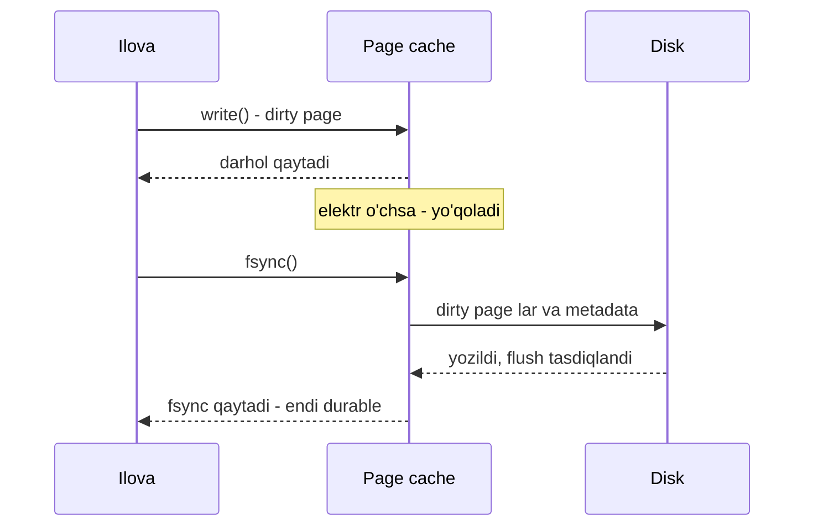

## Bu dars nima uchun kerak

2-darsda latency raqamlarini yodladik: RAM ~100 ns, SSD random read ~100 µs, HDD seek ~10 ms. Bu darsda bu raqamlar **qayerdan kelishini** ochamiz. Sababini bilmasangiz, raqam faqat jadval bo'lib qoladi. Sababini bilsangiz, quyidagi savollarga o'zingiz javob bera olasiz:

- Nega Kafka xabarlarni diskda saqlaydi, lekin RAM dagi navbatlardan sekin emas?
- Nega PostgreSQL ga "hamma RAM ni shared_buffers ga bering" deb maslahat berilmaydi?
- Nega LSM-tree bazalari (Cassandra, RocksDB) yozishda B-tree dan tez (13-14 darslar)?
- Nega `fsync` siz yozish tez, lekin elektr o'chganda ma'lumot yo'qoladi?
- Nega bir xil algoritm massiv ustida bog'langan ro'yxatdan ko'p baravar tez ishlaydi?

Butun storage engine lar (2-modul) shu darsdagi apparat xususiyatlari ustiga qurilgan.

Bu darsdan keyin siz:

- xotira iyerarxiyasini (register, L1/L2/L3, RAM, SSD, HDD) va har bir darajaning birligi (cache line, page, block, sector) nima ekanini bilasiz;
- sequential va random IO farqining **fizik** sababini HDD va SSD uchun alohida tushuntira olasiz;
- SSD ichidagi FTL, garbage collection va write amplification ni bilasiz;
- Linux page cache, dirty page, writeback va fsync qanday ishlashini bilasiz;
- durability va performance o'rtasidagi trade-off ni (fsync, write cache, O_DIRECT) asoslab tanlay olasiz.

## Xotira iyerarxiyasi

Har bir daraja oldingisidan katta, arzon va sekin. Har bir darajada ma'lumot **bloklar** bilan ko'chiriladi, bitta bayt bilan emas. Bu darsning asosiy g'oyasi shu: **sizga 1 bayt kerak bo'lsa ham, apparat butun blokni olib keladi**. Shuning uchun yonma-yon joylashgan ma'lumotni ketma-ket o'qish arzon, tarqoq ma'lumotni o'qish qimmat.

| Daraja | Tipik hajm | Latency (tartib) | Ko'chirish birligi |
|---|---|---|---|
| Register | bir necha yuz bayt | < 1 ns | so'z (8 B) |
| L1 cache | o'nlab KB / yadro | ~1 ns | cache line (64 B) |
| L2 cache | yuzlab KB - bir necha MB / yadro | bir necha ns | cache line |
| L3 cache | o'nlab-yuzlab MB / protsessor | o'nlab ns | cache line |
| RAM | GB - TB | ~100 ns | cache line (RAM dan CPU ga) |
| NVMe SSD | TB | ~100 µs (random read) | page (bir necha KB) |
| HDD | o'nlab TB | ~10 ms (seek) | sector (512 B yoki 4 KB) |
| Tarmoq orqali boshqa mashina RAM i | | ~0.25-0.5 ms (DC ichida) | paket |

Ulrich Drepper ning "What Every Programmer Should Know About Memory" (2007) maqolasida Intel Pentium M uchun keltirilgan qiymatlar (CPU tsikllarida): register 1 gacha, L1d ~3, L2 ~14, RAM ~240. Zamonaviy protsessorlarda aniq qiymatlar boshqa, lekin nisbat o'xshash: RAM ga murojaat L1 dan ikki tartib qimmat.

## CPU cache: nega ma'lumot joylashuvi muhim

### Cache line

CPU RAM dan bitta baytni emas, **64 baytlik cache line** ni oladi (Drepper: dastlabki cache larda 32 bayt bo'lgan, hozir 64 bayt norma). Agar sizga `int64` kerak bo'lsa va keyin uning yonidagi 7 ta `int64` kerak bo'lsa, ular allaqachon cache da.

### Prefetching

Protsessor murojaat naqshini kuzatadi. Agar siz manzillarni ketma-ket o'qiyotgan bo'lsangiz, u keyingi cache line larni **oldindan** yuklaydi. Drepper ning o'lchovlarida ketma-ket o'qishda RAM hajmidagi to'plamlar ham prefetching tufayli L2 latency siga yaqin vaqtda o'qilgan; tasodifiy o'qishda esa bitta element vaqti 450 tsikldan oshgan, chunki prefetch ishlamaydi va TLB (manzil tarjimasi cache i) miss lari qo'shiladi.

Bundan amaliy xulosalar:

- **Massiv bog'langan ro'yxatdan tez.** Massiv elementlari ketma-ket, ro'yxat tugunlari esa heap da tarqoq; har bir `next` potentsial cache miss.
- **Column-oriented saqlash** (16-dars) analitikada tez, chunki bitta ustunning qiymatlari ketma-ket turadi va bitta cache line da ko'p qiymat bor.
- **Struct-of-arrays vs array-of-structs.** Agar sizga 1 mln GPS nuqtaning faqat tezligi kerak bo'lsa, `[{lat, lon, speed, ts, ...}]` dan ko'ra alohida `speed[]` massivi bir necha baravar kam xotira o'tkazadi.

### Ko'p yadroda: cache coherence va false sharing

Har bir yadroning o'z L1/L2 i bor. Bir yadro cache line ni o'zgartirsa, boshqa yadrolardagi nusxalari bekor qilinishi kerak (coherence protokoli). Agar ikki yadro **bir cache line dagi turli o'zgaruvchilarni** o'zgartirsa, line yadrolar orasida "tennis to'pi"dek sakraydi, garchi mantiqan ular umumiy ma'lumotga ega bo'lmasa ham. Bu **false sharing** deyiladi va ko'p thread li hisoblagichlarni bir necha baravar sekinlashtiradi. Yechim - har bir thread ning ma'lumotini alohida cache line ga joylash (padding).

Node.js da bu kamroq uchraydi (asosiy kod bitta thread), lekin worker_threads, SharedArrayBuffer yoki native modullarda (masalan, baza driverlari) muhim.

### NUMA

Ko'p protsessorli serverlarda RAM protsessorlar orasida bo'lingan: har bir protsessor o'z "yaqin" RAM iga tezroq, boshqasinikiga sekinroq murojaat qiladi (Non-Uniform Memory Access). Katta baza serverlarida bu sezilarli bo'lishi mumkin; shuning uchun ba'zan bazani bitta NUMA tuguniga bog'lash yoki interleave qilish tavsiya etiladi.

## HDD: mexanika

HDD - aylanuvchi magnit plastinalar va ular ustida harakatlanuvchi o'qish boshchasi. Bitta tasodifiy o'qish uch qismdan iborat:

1. **Seek** - boshchani kerakli trekka siljitish: bir necha millisoniya.
2. **Rotational latency** - kerakli sektor boshcha ostiga kelguncha kutish. 7 200 RPM disk soniyasiga 120 marta aylanadi, bitta aylanish 8.33 ms, o'rtacha yarim aylanish **~4.2 ms**.
3. **Transfer** - ma'lumotni o'qish: kichik blok uchun juda kam vaqt.

Jami tasodifiy o'qish ~10 ms atrofida, ya'ni bitta disk soniyasiga taxminan **100 ta** tasodifiy IO (IOPS) qila oladi. Ketma-ket o'qishda esa seek va aylanish kutish bir marta bo'ladi va keyin ma'lumot plastinadan uzluksiz oqadi: yuzlab MB/s.

Hisob: 4 KB li tasodifiy o'qishlar bilan 100 IOPS = 400 KB/s. Ketma-ket 200 MB/s. Farq **500 baravar**. Kafka hujjatidagi raqamlar bundan ham keskin: 6 ta 7 200 RPM SATA diskdan iborat RAID-5 massivida chiziqli yozish ~600 MB/s, tasodifiy yozish ~100 KB/s, ya'ni 6 000 baravardan ortiq farq.

## SSD: elektronika, lekin o'z qoidalari bilan

SSD da harakatlanuvchi qism yo'q, shuning uchun seek ham yo'q. Lekin NAND flash ning o'z cheklovlari bor:

### Page, block va erase

- O'qish va yozish **page** birligida (bir necha KB, hozirgi eng katta page lar 16 KB atrofida). 1 bayt o'qish ham butun page ni o'qiydi.
- Yozilgan page ni **joyida o'zgartirib bo'lmaydi**. Avval o'chirish (erase) kerak.
- O'chirish faqat **block** birligida: block ko'plab page lardan iborat (masalan, 256 page). Erase yozishdan ancha sekin.

Natija: SSD ma'lumotni "joyida yangilamaydi". O'zgargan page yangi bo'sh joyga yoziladi, eskisi "eskirgan" (stale) deb belgilanadi.

### FTL va garbage collection

SSD kontrolleridagi **Flash Translation Layer (FTL)** operatsion tizim ko'radigan mantiqiy manzillarni (LBA) fizik page larga xaritalaydi. Eskirgan page lar ko'payganda, **garbage collection** blokdagi hali tirik page larni boshqa joyga ko'chiradi va blokni o'chiradi.

### Write amplification

GC tirik page larni ko'chirganda, host yozgan ma'lumotdan **ko'proq** ma'lumot fizik flash ga yoziladi. Nisbat - write amplification (WA). Yuqori WA ikki narsani yomonlashtiradi: yozish throughput i (GC fon ishi resurs oladi, latency da kutilmagan sakrashlar paydo bo'ladi) va disk umri (flash cheklangan sondagi erase siklga chidaydi).

WA ni kamaytiradigan naqshlar:

- **Katta, ketma-ket, page ga moslangan yozish.** Kichik tarqoq yozishlar read-modify-write va GC ni ko'paytiradi.
- **Issiq va sovuq ma'lumotni ajratish.** Tez o'zgaradigan va o'zgarmaydigan ma'lumot bir blokda bo'lsa, GC sovuq ma'lumotni qayta-qayta ko'chiradi.
- **Katta bo'laklarda o'chirish.** Butun faylni o'chirish (masalan, eski segment yoki SSTable) GC uchun ideal.

E'tibor bering: bular aynan **append-only log** va LSM-tree ning xususiyatlari (12-13 darslar). Bu bazalar SSD bilan tabiiy ravishda yaxshi ishlaydi.

Bu yerda ikki xil "write amplification" ni farqlang: SSD ichidagi (FTL darajasi) va storage engine darajasidagi (baza bitta mantiqiy yozuv uchun WAL, indeks, compaction orqali ko'p marta yozadi - 14-dars). Ular bir-biriga ko'payadi.

### Parallellik va queue depth

SSD ichida ko'plab flash chiplari parallel ishlaydi. Shuning uchun SSD ning to'liq tezligi faqat **bir vaqtda ko'p so'rov** bo'lganda chiqadi. NVMe interfeysi 65 535 tagacha navbat, har birida 65 536 tagacha buyruqni qo'llab-quvvatlaydi, eski SATA AHCI esa bitta navbat va 32 buyruq. 2-darsdagi napkin-math jadvalidagi "SSD random read 70 MiB/s" bitta oqim uchun; parallel so'rovlar bilan zamonaviy NVMe disk bundan bir necha baravar ko'p IOPS beradi. Little qonuni (3-dars) bu yerda ham ishlaydi: IOPS = queue depth / latency.

Misol: latency 100 µs, queue depth 1: 1 / 0.0001 = 10 000 IOPS. Queue depth 32 bilan (agar disk ichki parallellik bilan latency ni ushlab tura olsa): 320 000 IOPS. Haqiqiy qiymat disk modeliga bog'liq.

### Ketma-ket hali ham muhimmi?

SSD da random va sequential o'qish farqi HDD dagidek 500-6 000 baravar emas, lekin baribir sezilarli (napkin-math: 8 KiB bloklarda bitta oqim bilan ketma-ket ~8 GiB/s, tasodifiy ~70 MiB/s). Sabablari: page dan kichik o'qishlar, oldindan o'qish (readahead) ishlamasligi, har bir so'rov uchun system call va kontroller overhead i, yozishda esa GC. Xulosa: **SSD da ham ketma-ket naqsh yaxshi**, lekin tasodifiy o'qish endi "taqiqlangan" emas, shuning uchun B-tree indekslar SSD da yaxshi ishlaydi.

## Operatsion tizim: page cache

Ilova `read()` chaqirganda, Linux ma'lumotni to'g'ridan-to'g'ri diskdan emas, **page cache** orqali beradi. Page cache - yadro boshqaradigan, foydalanilmayotgan barcha RAM ni egallaydigan fayl bloklari cache i (4 KB lik page lar).

### O'qish

1. Ilova `read(fd, buf, 4096)` chaqiradi.
2. Yadro page cache da kerakli page bormi tekshiradi.
3. Bor bo'lsa (hit) - RAM dan ilova buferiga nusxa: mikrosoniyalar.
4. Yo'q bo'lsa (miss) - diskdan o'qish, page cache ga joylash, keyin nusxa. Ketma-ket o'qish aniqlansa, yadro keyingi page larni **oldindan o'qiydi** (readahead).

Natija: ikkinchi marta o'qilgan fayl ancha tez. "Benchmark ikkinchi marta tezroq" fenomeni shundan.

### Yozish

1. `write()` ma'lumotni page cache ga nusxalaydi va page ni **dirty** (iflos, diskka yozilmagan) deb belgilaydi. Chaqiruv deyarli darhol qaytadi.
2. Yadro flusher thread lari dirty page larni **fonda** diskka yozadi: ma'lum vaqt o'tgach (`dirty_expire_centisecs`) yoki dirty page lar ulushi chegaradan oshganda (`dirty_background_ratio`).
3. Agar dirty ulushi yuqoriroq chegaradan (`dirty_ratio`) oshsa, yozayotgan jarayonning o'zi yozish tugaguncha **bloklanadi**. Bu ilovada kutilmagan latency sakrashlarining keng tarqalgan sababi.

Muhim: `write()` muvaffaqiyatli qaytdi degani ma'lumot diskda degani **emas**. Agar shu paytda elektr o'chsa, dirty page lar yo'qoladi.

### fsync va durability

`fsync(fd)` faylning barcha dirty page larini (va metadata sini) diskka yozib, disk ham ularni barqaror xotiraga yozganini tasdiqlaguncha kutadi. 2-darsdagi raqam: 8 KiB yozish fsync bilan ~300 µs, fsync siz ~2 µs. 150 baravar farq.

Shu sababli bazalar har bir tranzaksiya uchun fsync qilsa ham, ularni **guruhlaydi** (group commit): bir vaqtda commit qilayotgan 50 ta tranzaksiya bitta fsync ni baham ko'radi.

PostgreSQL hujjati ("WAL reliability" bo'limi) durability ni buzishi mumkin bo'lgan qatlamlarni sanab o'tadi:

- **OS page cache** - fsync bilan hal qilinadi.
- **RAID kontroller write-back cache i** - batareya (BBU) bo'lmasa, elektr o'chganda yo'qoladi.
- **Diskning o'z cache i** - ko'p iste'molchi SATA disklar va SSD larda volatile write-back cache bor. Hujjat ko'p SSD lar standart holatda flush buyruqlarini to'liq bajarmasligi haqida ogohlantiradi.
- **Torn page** - disk 512 baytlik sektorlar bilan yozadi, PostgreSQL esa 8 KB lik page lar bilan. Elektr yozish o'rtasida o'chsa, page yarim yozilgan bo'lib qoladi. PostgreSQL buni `full_page_writes` bilan hal qiladi: checkpoint dan keyin page birinchi marta o'zgarganda uning to'liq nusxasi WAL ga yoziladi.

Xulosa: durability - bitta `fsync` chaqiruvi emas, butun stek (ilova, fayl tizimi, kontroller, disk) bo'yicha kafolat. Bulutda (masalan, tarmoq disklari) bu kafolat provayder tomonidan beriladi va uning latency si mahalliy NVMe dan yuqori.

### Bazalar va page cache

Ikki yondashuv bor:

1. **Page cache ga tayanish** (buffered IO). PostgreSQL o'z buffer pool i (`shared_buffers`) bilan birga OS page cache dan ham foydalanadi. Rasmiy hujjat 1 GB dan ko'p RAM li ajratilgan serverda `shared_buffers` uchun **RAM ning 25%** ini boshlang'ich qiymat sifatida tavsiya qiladi va 40% dan ko'pi odatda yaxshiroq ishlamasligini aytadi, chunki PostgreSQL OS cache iga ham tayanadi. Bu "double buffering" ga olib keladi (bir page ikki joyda), lekin oddiylik va OS ning readahead/writeback mexanizmlaridan foydalanish evaziga.
2. **Page cache ni chetlab o'tish** (O_DIRECT). Ba'zi bazalar (masalan, InnoDB ni O_DIRECT bilan sozlash, ScyllaDB) cache ni to'liq o'zlari boshqaradi. Afzalligi: double buffering yo'q, eviction siyosati baza bilganiga mos. Kamchiligi: murakkablik, readahead va writeback ni o'zingiz yozasiz.

Kafka esa radikal tarzda birinchi yo'lni tanlagan. Uning dizayn hujjatiga ko'ra:

- JVM heap da katta cache saqlash o'rniga xabarlar fayl tizimiga yoziladi va OS page cache ga tayaniladi. Java obyektlari overhead i ma'lumot hajmini ko'pincha ikki baravar oshiradi va katta heap GC ni sekinlashtiradi; page cache bilan 32 GB li mashinada GC muammosiz 28-30 GB cache olinadi.
- Page cache servis qayta ishga tushganda ham "issiq" qoladi; 10 GB lik jarayon ichidagi cache esa qayta to'ldirilishi kerak bo'lardi (hujjatda taxminan 10 daqiqa deyilgan).
- Iste'molchiga yuborishda `sendfile` (zero-copy) ishlatiladi: ma'lumot page cache dan to'g'ridan-to'g'ri tarmoq socket iga uzatiladi, ilova xotirasiga nusxalanmaydi. Hujjatdagi muhim izoh: TLS yoqilganda sendfile ishlatilmaydi, chunki shifrlash user space da bo'ladi.

Ya'ni Kafka ning tezligi "diskda saqlashga qaramay" emas, aynan **append-only ketma-ket yozish + page cache + zero-copy** kombinatsiyasi tufayli.

## Trade-off jadvallari

### Yozish strategiyalari

| Strategiya | Throughput | Latency | Durability | Qayerda |
|---|---|---|---|---|
| `write()` fsync siz | Juda yuqori | Juda past | Elektr o'chsa oxirgi soniyalar yo'qoladi | Loglar, cache, qayta tiklanadigan ma'lumot |
| Har bir yozuvdan keyin fsync | Past (bitta oqimda ~3 000/s) | ~300 µs+ | Yuqori | Kichik hajmli muhim yozuvlar |
| Group commit | Yuqori | Biroz oshadi (guruhni kutish) | Yuqori | PostgreSQL, MySQL, ko'p bazalar |
| Davriy fsync (har N ms) | Yuqori | Past | Oxirgi N ms yo'qolishi mumkin | Redis AOF `everysec`, ba'zi broker lar |
| Replikatsiya + fsync siz | Yuqori | Tarmoq round trip | Bir nechta mashina bir vaqtda o'chmasa saqlanadi | Kafka (odatiy sozlamada replikatsiyaga tayanadi), 26 va 44 darslar |

Oxirgi qator muhim g'oya: taqsimlangan tizimlarda durability ko'pincha "diskka yozildi" emas, "N ta mashinaning xotirasiga yetdi" deb ta'riflanadi. Bu turli mashinalar bir vaqtda o'chmasligiga tayanadi - korrelyatsiyalangan nosozliklar (butun data-markazda elektr o'chishi) uchun xavfli.

### Saqlash qurilmalari

| Xususiyat | HDD | SATA SSD | NVMe SSD | RAM |
|---|---|---|---|---|
| Random read latency | ~10 ms | yuzlab µs gacha | ~100 µs va kam | ~100 ns |
| Random IOPS | ~100 | o'n minglab | yuz minglab va undan ko'p | |
| Sequential | yuzlab MB/s | ~0.5 GB/s (SATA interfeysi cheklaydi) | bir necha GB/s | o'nlab GB/s |
| GB narxi | eng arzon | o'rta | o'rta | eng qimmat |
| Qachon | Arxiv, sovuq ma'lumot, ketma-ket log lar | Umumiy maqsad | Bazalar, issiq ma'lumot | Cache, issiq to'plam |

## Real tizimlardan misollar

- **Kafka** - yuqorida: append-only log, page cache, sendfile. Brokerda iste'molchilar "yetib olgan" bo'lsa, diskdan o'qish deyarli bo'lmaydi, chunki ma'lumot hali page cache da.
- **PostgreSQL** - `shared_buffers` 25% tavsiyasi, OS cache ga tayanish, `full_page_writes` torn page larga qarshi, WAL ketma-ket yoziladi, ma'lumot page lari esa checkpoint da fonda.
- **LSM-tree bazalar (RocksDB, Cassandra)** - tasodifiy yozishlarni xotirada (memtable) yig'ib, diskka katta ketma-ket fayllar sifatida yozadi. Bu HDD da muhim edi va SSD da write amplification ni kamaytiradi (13-dars).
- **Redis** - butun ma'lumot RAM da; durability uchun AOF log ni ketma-ket yozadi va fsync siyosatini tanlash imkonini beradi (24-dars).

## iQuariX kontekstida

Faraz qiling, iQuariX telemetriya bazasi (PostgreSQL) 64 GB RAM li serverda. Jadval `gps_points (device_id, ts, lat, lon, speed, ...)`, kuniga ~9 GB yangi ma'lumot (1-dars hisobi), indeks `(device_id, ts)`.

**1. Yozish naqshi.** Nuqtalar vaqt bo'yicha keladi, lekin 10 000 xil qurilmadan aralash. Agar asosiy kalit tasodifiy UUIDv4 bo'lsa, B-tree indeks har bir yozuvda tasodifiy page ga tegadi: indeks RAM ga sig'masa, har bir insert tasodifiy disk o'qishi va dirty page yaratadi. Vaqt bo'yicha tartiblangan kalit (UUIDv7 yoki `(ts, ...)` - 57-dars) yangi yozuvlarni indeksning "o'ng chetiga" jamlaydi, issiq page lar RAM da qoladi. Bu bitta tanlov yozish IO sini bir necha baravar o'zgartirishi mumkin.

**2. O'qish naqshi.** "Mashina X ning kechagi marshruti" - `device_id = X AND ts BETWEEN ...`. Agar jadval ma'lumoti qo'shilish tartibida (vaqt bo'yicha) saqlansa, bitta mashinaning 8 640 nuqtasi (kuniga, har 10 s da) 8 640 ta **turli** page ga tarqalgan bo'lishi mumkin, chunki har bir page da boshqa 10 000 qurilmaning nuqtalari ham bor. Bu 8 640 ta tasodifiy o'qish: SSD da ~100 µs dan, ~0.86 s, agar page cache da bo'lmasa. Agar ma'lumot `(device_id, ts)` bo'yicha klasterlansa (yoki time-series baza qurilma bo'yicha chunk lasa), xuddi shu nuqtalar ~100 baytdan, ~850 KB, ya'ni ~100 ta ketma-ket page bo'ladi. Farq ikki tartib. Bu time-series bazalar (TimescaleDB, ClickHouse) ma'lumotni qanday tartiblashining sababi (81-dars).

**3. Page cache hajmi.** Oxirgi 7 kun issiq deylik: 7 × 9 GB = 63 GB. 64 GB RAM ga (shared_buffers 16 GB + OS cache) sig'maydi. Agar dispetcherlar asosan oxirgi 24 soatga qarasa (9 GB), u bemalol sig'adi. Shuning uchun "issiq to'plam" ni so'rov naqshidan hisoblash kerak, jami hajmdan emas.

**4. Video.** Kamera yozuvlari katta, ketma-ket va bir marta yoziladi. Ular uchun bazadagi page cache emas, object storage (60-dars) to'g'ri joy, aks holda video oqimi page cache dan issiq telemetriya page larini siqib chiqaradi.

## Ko'p uchraydigan xatolar

1. **`write()` muvaffaqiyatli = diskda deb hisoblash.** fsync siz ma'lumot page cache da; elektr o'chsa yo'qoladi.
2. **Benchmark ni issiq page cache bilan o'tkazish.** Ikkinchi ishga tushirish RAM dan o'qiydi; production da sovuq o'qishlar boshqacha natija beradi.
3. **Bazaga butun RAM ni berish.** PostgreSQL uchun OS cache ham kerak; `shared_buffers` ni 80% qilish odatda yordam bermaydi.
4. **SSD da hamma narsa bir xil tez deb o'ylash.** Kichik tasodifiy yozishlar va to'lgan disk GC tufayli latency sakrashlariga olib keladi.
5. **Disk cache va SSD flush xususiyatlarini tekshirmaslik.** Iste'molchi SSD lar flush buyruqlarini to'liq bajarmasligi mumkin; muhim baza uchun "power loss protection" li disk kerak.
6. **Ma'lumot joylashuvini e'tiborsiz qoldirish.** Bir xil hajm va indeks bilan, ma'lumot qanday tartibda saqlanishi IO ni 100 baravar o'zgartirishi mumkin.
7. **Tasodifiy UUIDv4 ni katta jadvalda B-tree kalit sifatida ishlatish.** Indeks bo'ylab tasodifiy yozish, issiq to'plam butun indeksga teng.
8. **Dirty page chegaralarini bilmaslik.** Katta yozish oqimi `dirty_ratio` ga yetganda ilova bloklanadi va latency da tushunarsiz sakrashlar paydo bo'ladi.

## Xulosa

- Har bir daraja (cache line 64 B, SSD page, HDD sector, OS page 4 KB) bloklar bilan ishlaydi; kerakli bayt yonidagilar "bepul" keladi.
- Ketma-ket murojaat prefetch va readahead tufayli tez, tasodifiy murojaat esa har bir blok uchun to'liq narx to'laydi.
- HDD da tasodifiy IO ~10 ms (seek + aylanish), ~100 IOPS; ketma-ket va tasodifiy farqi yuzlab-minglab baravar.
- SSD joyida yangilamaydi: FTL, GC va write amplification. Katta, ketma-ket, append-only yozish SSD uchun ham eng yaxshi.
- Page cache o'qishni tezlashtiradi va yozishni kechiktiradi; durability faqat fsync va butun stek kafolati bilan.
- fsync ~150 baravar qimmat; bazalar uni group commit bilan amortizatsiya qiladi.
- Kafka, PostgreSQL, LSM-tree dizayni bevosita shu apparat xususiyatlaridan kelib chiqqan.
- Ma'lumot joylashuvi (clustering, kalit tartibi) indeks mavjudligi kabi muhim.

## Amaliy topshiriq

Faraz qiling, iQuariX yoqilg'i datchiklari (ДУТ) uchun alohida saqlash qatlami loyihalanmoqda. 30 000 datchik har 10 soniyada o'qish yuboradi: `(sensor_id, ts, level_raw, level_liters, temperature)`. Ma'lumot 1 yil saqlanadi. Asosiy so'rovlar: (a) bitta mashina bo'yicha oxirgi 24 soat grafigi, (b) barcha mashinalar bo'yicha kunlik yoqilg'i sarfi hisoboti (tunda), (c) real vaqtda keskin tushishni aniqlash.

1. **Hajm va IO.** Yozish/s, bitta yozuvning taxminiy hajmi (qator overhead i bilan), kunlik va yillik hajm. Bular RAM ga, bitta NVMe ga sig'adimi?
2. **Joylashuv.** (a) va (b) so'rovlar uchun ma'lumotni qaysi tartibda saqlash kerak? Ular bir-biriga zid bo'lsa, qanday murosaga kelasiz? Har bir tanlovda (a) so'rov nechta page o'qishini taxminlang.
3. **Durability.** Qaysi ma'lumot har bir yozuvda fsync talab qiladi, qaysi biri davriy fsync yoki replikatsiyaga tayanishi mumkin? Datchik qurilmada buferlash imkoniyatini hisobga oling.
4. **Issiq to'plam.** Qaysi ma'lumot page cache/RAM da turishi kerak va u qancha joy oladi? RAM hajmini tanlang.
5. **Qurilma tanlovi.** Issiq va sovuq ma'lumot uchun qaysi saqlash qurilmasi (NVMe, HDD, object storage) va nega? Taxminiy narx farqini ayting.

Yaxshi javobda bo'lishi kerak bo'lgan narsalar:

- hajm hisobi ochiq, birliklar bilan, qator va indeks overhead i hisobga olingan;
- (a) so'rov uchun "qurilma bo'yicha klasterlash" va (b) uchun "vaqt bo'yicha skanerlash" ziddiyati tan olingan va yechim (partitioning, ikki xil tartib, oldindan agregatsiya) taklif qilingan;
- page soni bo'yicha tasodifiy va ketma-ket o'qish solishtirilgan;
- durability qarori qurilmadagi buferlash va qayta yuborish imkoniyatiga bog'langan;
- issiq to'plam so'rov naqshidan hisoblangan, jami hajmdan emas.

Javobni pastdagi maydonga yozib, chatga yuboring.

## Manbalar

- Ulrich Drepper. [What Every Programmer Should Know About Memory, 2-qism: CPU caches](https://lwn.net/Articles/252125/), LWN.net, 2007 - cache line, iyerarxiya, tsikllardagi latency, ketma-ket va tasodifiy murojaat o'lchovlari. [1-qism](https://lwn.net/Articles/250967/).
- [Apache Kafka Design: Persistence va Efficiency](https://kafka.apache.org/42/design/design/) - "Don't fear the filesystem", chiziqli va tasodifiy yozish raqamlari, page cache, sendfile va TLS izohi.
- [PostgreSQL: Reliability and the Write-Ahead Log](https://www.postgresql.org/docs/current/wal-reliability.html) - write cache qatlamlari, fsync, BBU, torn page va full_page_writes.
- [PostgreSQL: Resource Consumption](https://www.postgresql.org/docs/current/runtime-config-resource.html) - `shared_buffers` 25% tavsiyasi va OS cache ga tayanish.
- Emmanuel Goossaert. [Coding for SSDs, Part 3: Pages, Blocks, and the Flash Translation Layer](https://codecapsule.com/2014/02/12/coding-for-ssds-part-3-pages-blocks-and-the-flash-translation-layer/) - page, block, erase, FTL, GC, write amplification.
- [Linux kernel: /proc/sys/vm documentation](https://docs.kernel.org/admin-guide/sysctl/vm.html) - dirty_ratio, dirty_background_ratio, dirty_expire_centisecs, drop_caches.
- [NVM Express](https://en.wikipedia.org/wiki/NVM_Express) - NVMe va AHCI navbatlari soni va chuqurligi.
- Simon Eskildsen. [napkin-math](https://github.com/sirupsen/napkin-math) - SSD, fsync va RAM raqamlari (2026 o'lchovlari).
