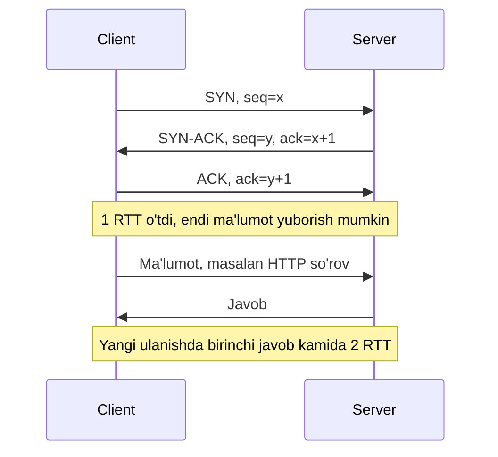

## Bu dars nima uchun kerak

2-darsda ko'rdik: bitta data-markaz ichidagi round trip ~0.5 ms, qit'alararo ~100+ ms, va yorug'lik tezligini hech qanday optimizatsiya yengmaydi. Lekin real ilovada latency faqat bitta RTT emas. Yangi ulanish ochish, TLS, sekin boshlanuvchi uzatish, yo'qolgan paketni qayta yuborish - bularning hammasi RTT ga **ko'paytiriladi**. Shuning uchun tarmoq qatlamini bilmasdan "nega API Toshkentdan 800 ms, serverda esa 20 ms?" degan savolga javob berib bo'lmaydi.

Bundan tashqari, TCP ning xatti-harakati to'g'ridan-to'g'ri arxitektura qarorlariga ta'sir qiladi: connection pooling, keep-alive, load balancer lar (22-dars), HTTP/2 va HTTP/3 (7-dars), WebSocket va MQTT (8-dars), GPS trekerlar uchun TCP yoki UDP tanlovi.

Bu darsdan keyin siz:

- IP, TCP va UDP qatlamlari nima kafolatlashi va nimani kafolatlamasligini bilasiz;
- TCP three-way handshake, ulanish yopish va TIME-WAIT ni tushunasiz;
- flow control va congestion control farqini, slow start, CUBIC va BBR g'oyasini bilasiz;
- bandwidth-delay product bilan maksimal throughput ni hisoblay olasiz;
- head-of-line blocking nima ekanini va u qachon muammo bo'lishini bilasiz;
- TCP yoki UDP ni asoslab tanlay olasiz.

## Qatlamlar: kim nimaga javob beradi

Internet qatlamli. Har bir qatlam pastdagisining ustiga qurilgan va o'z kafolatini qo'shadi:

| Qatlam | Protokol misollari | Manzil | Kafolat |
|---|---|---|---|
| Link | Ethernet, Wi-Fi | MAC | Bitta segment ichida kadr uzatish |
| Network | IPv4, IPv6 | IP manzil | "Best effort": paket yetib borishi, tartib, takrorlanmaslik kafolatlanmaydi |
| Transport | TCP, UDP, QUIC (UDP ustida) | Port | TCP: ishonchli, tartibli bayt oqimi. UDP: faqat port va checksum |
| Application | HTTP, DNS, MQTT, gRPC | URL, topic | Ilova semantikasi |

Asosiy g'oya: **IP hech narsani kafolatlamaydi**. Paketlar yo'qolishi, takrorlanishi, tartibsiz kelishi, kechikishi mumkin. Router lar navbati to'lsa, paketlarni shunchaki tashlab yuboradi. Ishonchlilikni kim qo'shadi - transport qatlami (TCP) yoki ilovaning o'zi (UDP ustida).

Bitta Ethernet kadri odatda 1 500 baytlik payload (MTU) ko'taradi. IP va TCP sarlavhalaridan keyin TCP segmentiga taxminan 1 460 bayt ma'lumot qoladi (MSS). Bu raqam keyingi hisob-kitoblarda kerak.

## TCP: ishonchli oqim qanday quriladi

TCP spetsifikatsiyasi hozir **RFC 9293** (2022) da, u 1981 yilgi asl RFC 793 ni almashtirgan. TCP ilovaga ishonchli, tartibli **bayt oqimi** beradi. Buning uchun:

- **Sequence number** - har bir bayt raqamlanadi. Qabul qiluvchi tartibni tiklaydi va takrorlarni tashlaydi.
- **ACK** - qabul qiluvchi "N-baytgacha hammasini oldim" deb javob beradi.
- **Retransmission** - ACK kelmasa, ma'lumot qayta yuboriladi.
- **Checksum** - buzilgan segment tashlanadi.
- **Flow control** - qabul qiluvchi buferini to'ldirib yubormaslik.
- **Congestion control** - tarmoqni to'ldirib yubormaslik.

E'tibor bering: TCP **xabar** chegaralarini saqlamaydi. Siz 2 marta 100 bayt yuborsangiz, qabul qiluvchi bir marta 200 bayt yoki 3 marta (50, 120, 30) o'qishi mumkin. GPS treker protokollarini parse qilishda bu klassik xato: ilova o'zi framing (uzunlik prefiksi yoki ajratuvchi) qilishi kerak.

### Three-way handshake

Handshake ning maqsadi - ikki tomon boshlang'ich sequence number larni kelishib olishi. Narxi: **1 RTT** ma'lumot yuborilishidan oldin. Toshkent - Frankfurt (2-dars: nazariy minimum ~47 ms, real ko'proq) uchun bu har bir yangi ulanishga kamida ~50 ms. TLS ustiga yana 1 RTT (TLS 1.3) qo'shadi (7-dars).

**TCP Fast Open** (RFC 7413, 2014) bu RTT ni qisqartirishga urinadi: avvalgi ulanishda olingan cookie bilan klient ma'lumotni to'g'ridan-to'g'ri SYN ichida yuboradi. RFC dagi ma'lumotlarga ko'ra, HTTP so'rovlarining taxminan 35% i yangi ulanishlarda bo'lgan va handshake HTTP tranzaksiyasi tarmoq latency sining 25% igacha qismini tashkil qilishi mumkin. Lekin muhim cheklov: SYN dagi ma'lumot kamdan-kam hollarda **ikki marta** yetib borishi mumkin, shuning uchun RFC idempotent bo'lmagan so'rovlarni (masalan, himoyasiz POST) SYN da yubormaslikni talab qiladi. Amalda TFO keng tarqalmadi; xuddi shu g'oya QUIC/HTTP/3 da 0-RTT sifatida qaytdi (7-dars).

### Ulanishni yopish va TIME-WAIT

Ulanish FIN segmentlari bilan yopiladi. Yopishni **birinchi boshlagan** tomon **TIME-WAIT** holatiga o'tadi va unda 2 × MSL turadi. MSL (Maximum Segment Lifetime) RFC 9293 da 2 daqiqa deb olingan (Linux amalda TIME-WAIT ni 60 soniya ushlaydi). Maqsad - eski ulanishning kechikkan segmentlari xuddi shu port juftligi bilan ochilgan yangi ulanishga aralashib ketmasligi.

Amaliy oqibat: agar servis boshqa servisga har bir so'rov uchun **yangi ulanish** ochib yopsa (masalan, keep-alive siz HTTP klient), klient tomonda minglab TIME-WAIT soketlari to'planadi va vaqtinchalik (ephemeral) portlar tugashi mumkin. Hisob: bitta manzil juftligi uchun ~28 000 ephemeral port (Linux standart diapazoni taxminan 32 768-60 999) va 60 s TIME-WAIT: 28 000 / 60 ≈ **470 yangi ulanish/s** - shundan keyin portlar tugaydi. Yechim - ulanishlarni qayta ishlatish (connection pool, keep-alive).

### Ulanish qayta ishlatish nega muhim

Ilya Grigorik ning "High Performance Browser Networking" kitobidagi misol: 56 ms RTT (Nyu-York - London) bilan kichik faylni yangi ulanishda olish 264 ms, mavjud ulanishda 96 ms. Farq: handshake va slow start (pastda). Shuning uchun backend dan backend ga chaqiruvlar **har doim** connection pool orqali bo'lishi kerak, va bu baza ulanishlari uchun ham (PgBouncer kabi pooler lar) to'g'ri.

## Flow control va congestion control

Ikkalasi ham "qancha ma'lumotni ACK kutmasdan yuborish mumkin" degan savolga javob beradi, lekin turli sabablar bilan:

- **Flow control** - **qabul qiluvchini** himoya qiladi. Qabul qiluvchi har bir ACK da o'z buferida qancha joy borligini e'lon qiladi (receive window, rwnd).
- **Congestion control** - **tarmoqni** himoya qiladi. Yuboruvchi tarmoq qancha ko'tara olishini o'zi taxmin qiladi (congestion window, cwnd).

Yuborilgan, lekin hali tasdiqlanmagan ma'lumot = min(rwnd, cwnd).

### Bandwidth-delay product (BDP)

Bitta ulanishning maksimal throughput i:

**throughput ≤ window / RTT**

Ya'ni kanalni to'liq yuklash uchun window kamida **bandwidth × RTT** bo'lishi kerak.

Misol 1 (HPBN kitobidan): window 16 KB, RTT 100 ms: 16 KB / 0.1 s = 160 KB/s ≈ **1.31 Mbps**, kanal qanchalik keng bo'lishidan qat'i nazar. 10 Mbps kanalni to'ldirish uchun 100 ms RTT da window kamida 10 Mbps × 0.1 s = 1 Mbit ≈ **122 KB** bo'lishi kerak.

Misol 2: Toshkent - Frankfurt, RTT 80 ms deylik, 1 Gbps kanal. BDP = 125 MB/s × 0.08 s = **10 MB**. TCP sarlavhasidagi window maydoni 16 bitli, ya'ni maksimal 65 535 bayt. Window scaling opsiyasi (RFC 7323) uni 2^14 gacha ko'paytirib, ~1 GiB gacha kengaytiradi. Scaling siz: 64 KB / 0.08 s = 800 KB/s ≈ 6.4 Mbps - 1 Gbps kanalning 1% idan kam.

Bu "uzoq va keng kanal" (long fat network) muammosi: backup, replikatsiya, katta fayllarni regionlararo ko'chirishda bitta TCP ulanish kanalni to'ldira olmaydi. Shuning uchun bunday vositalar ko'pincha **parallel ulanishlar** ishlatadi (masalan, S3 multipart upload, 60-dars).

### Slow start

Yangi ulanish tarmoq qancha ko'tarishini bilmaydi. Shuning uchun u kichik cwnd dan boshlaydi va har bir ACK da cwnd ni bitta segmentga oshiradi (RFC 5681). Natijada cwnd har RTT da taxminan **ikki baravar** o'sadi - eksponensial, nomi "slow" bo'lsa ham.

Boshlang'ich cwnd (initcwnd) ning tarixi: uzoq vaqt 2-4 segment edi. **RFC 6928** (2013) uni 10 segmentga (~14 600 bayt) oshirishni taklif qildi. Google tajribalarida bu veb-qidiruv latency sini o'rtacha 11.7% (68 ms) ga yaxshilagan, qayta yuborishlar esa biroz oshgan (1.98% dan 2.29% ga). RFC ga ko'ra 4 KB lik eski window ga Google qidiruv javoblarining atigi ~10% i sig'ardi.

Hisob: 64 KB javob, initcwnd = 10 (~14.6 KB), RTT 56 ms. Segmentlar: 64 KB / 1 460 B ≈ 45 segment. cwnd: 10, 20, 40, 80. Yuborilgan jami: 10, 30, 70 - uchinchi RTT da 45 dan oshadi. Demak **3 RTT** ≈ 168 ms faqat ma'lumot uzatishga, handshake dan tashqari. initcwnd = 4 bo'lsa: 4, 12, 28, 60 - **4 RTT**.

Saboq:

- **Birinchi ~14 KB** "bepul" - bitta RTT da ketadi. Muhim HTML/JSON javoblarini shu hajmda ushlash foydali.
- Kichik so'rovlarda bandwidth deyarli ahamiyatsiz; **RTT soni** latency ni belgilaydi.
- Bo'sh turgan ulanishda ba'zi tizimlar cwnd ni qayta kichraytiradi (slow-start after idle). Uzoq yashaydigan, vaqti-vaqti bilan ma'lumot yuboradigan ulanishlar uchun buni o'chirish tavsiya etiladi (Linux da `net.ipv4.tcp_slow_start_after_idle`).

### Congestion avoidance va paket yo'qolishi

cwnd chegaraga (ssthresh) yetgach, u sekinroq, har RTT da ~1 segmentga o'sadi. Yo'qolish aniqlanganda:

- **3 ta takroriy ACK** (fast retransmit) - bitta segment yo'qolgan, keyingilari kelgan. Segment darhol qayta yuboriladi va cwnd kamaytiriladi.
- **Retransmission timeout (RTO)** - umuman ACK kelmayapti. Bu qimmat: cwnd keskin kichrayadi va timeout odatda yuzlab millisoniyalar (minimal RTO odatda 200 ms atrofida yoki undan ko'p).

Bu tail latency (3-dars) ning muhim manbai: bitta yo'qolgan paket va RTO javobga yuzlab millisoniya qo'shadi.

### CUBIC va BBR

Klassik Reno algoritmi yo'qolishda cwnd ni ikki baravar kamaytirib, keyin chiziqli o'stiradi. Yuqori tezlikli, uzoq kanallarda bu juda sekin tiklanadi. Ikki zamonaviy yondashuv:

- **CUBIC** (RFC 9438, 2023). cwnd oxirgi yo'qolishdan beri o'tgan **vaqtning kub funksiyasi** bo'yicha o'sadi: avval tez, oldingi yo'qolish nuqtasiga yaqinlashganda sekinlashadi, keyin yana tezlashadi. Yo'qolishda cwnd ni 0.7 ga ko'paytiradi (Reno da 0.5). RFC ga ko'ra CUBIC Linux, Windows va Apple tizimlarida standart algoritm.
- **BBR** (Google, 2016). Yo'qolishni signal sifatida ishlatmaydi. Buning o'rniga ikki narsani o'lchaydi: bottleneck kanal o'tkazuvchanligi va minimal RTT, va yuborish tezligini shularga moslaydi. G'oya: yo'qolishga asoslangan algoritmlar router buferlarini to'ldirguncha tezlashadi, bu esa katta buferli tarmoqlarda navbat va latency ni oshiradi ("bufferbloat"). Google Cloud blogiga ko'ra, YouTube da BBR o'rtacha throughput ni 4% ga (ba'zi mamlakatlarda 14% dan ko'p) oshirgan va RTT ni 33% ga kamaytirgan.

Amaliy ma'nosi: mobil va yo'qolishli tarmoqlarda (masalan, mashinalardagi 4G modemlar) congestion control tanlovi throughput va latency ga sezilarli ta'sir qiladi. Linux da server tomonida `net.ipv4.tcp_congestion_control` bilan o'zgartiriladi.

## Head-of-line blocking

TCP ma'lumotni **tartib bilan** beradi. Agar 5-segment yo'qolsa, 6, 7, 8-segmentlar qabul qiluvchida bo'lsa ham, ilova ularni 5-segment qayta yuborilib kelgunicha ola olmaydi. Bu **head-of-line (HOL) blocking**.

Bu qachon muhim:

- **Bitta ulanishda ko'p mustaqil oqim.** HTTP/2 ko'p so'rovni bitta TCP ulanishda multiplekslaydi; bitta paket yo'qolsa, **barcha** so'rovlar to'xtaydi. HTTP/3 (QUIC) aynan shuni hal qilish uchun UDP ustiga qurilgan (7-dars).
- **Real vaqt ma'lumoti.** Ovoz, video, o'yin holati, GPS joylashuvi: 200 ms oldingi eskirgan paketni kutishdan ko'ra, uni o'tkazib yuborib, yangisini ko'rsatish yaxshiroq.

## UDP

UDP (RFC 768, 1980) - IP ustidagi juda yupqa qatlam: 8 baytlik sarlavha (manba porti, manzil porti, uzunlik, checksum). RFC ning o'zi aytadi: yetkazish va takrorlanishdan himoya kafolatlanmaydi.

UDP nimani bermaydi va bu nimani anglatadi:

- **Handshake yo'q** - birinchi paket darhol ma'lumot. 0 RTT.
- **Ishonchlilik yo'q** - yo'qolgan paketni ilova o'zi aniqlashi va kerak bo'lsa qayta so'rashi kerak.
- **Tartib yo'q** - HOL blocking ham yo'q.
- **Congestion control yo'q** - ilova o'zi tarmoqni to'ldirib yubormasligi kerak. Bu muhim mas'uliyat.
- **Xabar chegaralari saqlanadi** - bitta `send` bitta datagram.

UDP qayerda ishlatiladi: DNS (6-dars), real vaqt media (WebRTC, VoIP), o'yinlar, QUIC/HTTP/3, ba'zi telemetriya protokollari, ichki tarmoqdagi monitoring (StatsD).

### TCP va UDP taqqoslash

| Xususiyat | TCP | UDP |
|---|---|---|
| Ulanish o'rnatish | 1 RTT handshake | Yo'q |
| Ishonchlilik | Kafolatlangan (qayta yuborish) | Yo'q, ilova o'zi qiladi |
| Tartib | Kafolatlangan | Yo'q |
| HOL blocking | Bor | Yo'q |
| Congestion control | O'rnatilgan | Ilovaning mas'uliyati |
| Xabar chegarasi | Yo'q (bayt oqimi) | Bor (datagram) |
| NAT va firewall | Yaxshi o'tadi | Ba'zan bloklanadi, NAT binding tez eskiradi |
| Holat (state) serverda | Har bir ulanish uchun | Yo'q (yoki ilova darajasida) |
| Tipik qo'llanish | API, baza, fayl, MQTT | DNS, media, o'yin, QUIC |

Qoida: agar sizga ishonchlilik va tartib kerak bo'lsa va siz UDP ustiga o'zingiz yozmoqchi bo'lsangiz, ehtimol siz TCP ning yomonroq versiyasini yozasiz. UDP ni faqat "eskirgan ma'lumot keraksiz" bo'lsa yoki QUIC kabi tayyor, puxta protokol ishlatilsa tanlang.

## Real tizimlardan misollar

- **Google, RFC 6928:** initcwnd ni 10 ga oshirish katta masshtabdagi tajriba asosida standartga taklif qilingan; Linux standart qiymati ham 10.
- **Google, BBR:** YouTube va Google Cloud da qo'llangan, RTT ni sezilarli kamaytirgan.
- **CUBIC:** Linux, Windows va Apple stack larida standart congestion control.
- **QUIC / HTTP/3:** HOL blocking va handshake narxini hal qilish uchun TCP o'rniga UDP ustida qurilgan (7-dars).
- **DNS:** oddiy so'rov-javob uchun UDP; javob katta bo'lsa yoki zone transfer da TCP (6-dars).

## iQuariX kontekstida

Faraz qiling, iQuariX ga GPS trekerlar TCP orqali ulanadi (ko'p treker protokollari shunday ishlaydi), mashinalarda 2G/4G modem.

**1. Doimiy ulanish va NAT.** Mobil operator NAT i bo'sh turgan TCP ulanishni ma'lum vaqtdan keyin "unutishi" mumkin; shundan keyin server ulanishni ochiq deb o'ylaydi, treker esa ma'lumot yubora olmaydi. Deylik operator NAT timeout i 5 daqiqa. Treker har 10 s da nuqta yuborsa, muammo yo'q. Lekin to'xtab turgan mashina har 5 daqiqada yuborsa, ulanish chegarada. Shuning uchun protokol darajasida heartbeat (masalan, har 60-120 s) va server tomonda "jim" ulanishlarni aniqlash kerak. TCP keepalive ning standart Linux taymeri (2 soat) bu uchun juda uzoq.

**2. Ulanishlar soni.** 50 000 treker = 50 000 doimiy TCP ulanish. Har biri yadroda xotira oladi (buferlar). Bitta ulanishga bufer bilan ~10-20 KB desak: 50 000 × 20 KB = 1 GB. Bu bitta serverga sig'adi, lekin load balancer va gateway sonini hisoblashda e'tiborga olinadi. L4 load balancer (22-dars) bunday uzun ulanishlarni teng taqsimlashi kerak; server qayta ishga tushganda 50 000 treker bir vaqtda qayta ulanadi (reconnect storm) - treker tomonda jitter li backoff kerak (62-dars).

**3. Handshake narxi.** Agar treker har bir nuqta uchun yangi ulanish ochsa: 4G da RTT 50-100 ms, handshake + TLS (7-dars) = 2-3 RTT, ya'ni har nuqtaga 150-300 ms va server tomonda 10 baravar ko'p TIME-WAIT va CPU (TLS). Doimiy ulanish va batch yuborish ancha samarali.

**4. Oflayn to'plangan ma'lumot.** Mashina tunnelda 30 daqiqa aloqasiz qoldi va 180 ta nuqta to'pladi. Qayta ulanganda u ularni bitta batch da yuboradi: 180 × 50 B = 9 KB - bitta initcwnd ga sig'adi, bitta RTT da ketadi. Lekin bir necha soatlik buferda (masalan, 10 000 nuqta, 500 KB) slow start va mobil tarmoqdagi yo'qolishlar tufayli bir necha soniya ketadi. Ilova darajasida tasdiqlash (qaysi nuqtalar qabul qilinganini bildirish) kerak, chunki TCP ACK faqat **yadro** ma'lumotni olganini bildiradi, ilova uni bazaga yozganini emas.

Oxirgi nuqta juda muhim: **TCP ACK end-to-end kafolat emas.** Server yadrosi segmentni olib ACK yuborgan, lekin ilova uni parse qilishdan oldin qulagan bo'lsa, ma'lumot yo'qoladi. Shuning uchun "qabul qilindi" javobi ilova darajasida, navbatga yoki bazaga yozilgandan keyin berilishi kerak (1-darsdagi savol).

**5. UDP varianti.** Ba'zi treker protokollari UDP ni qo'llaydi: trafik va batareya tejaladi, handshake yo'q. Evaziga ilova o'zi tasdiqlash va qayta yuborishni qilishi kerak, NAT orqali server qurilmaga buyruq yuborishi qiyinlashadi. Joylashuvni real vaqtda ko'rsatish uchun yo'qolgan nuqta katta muammo emas; yoqilg'i o'g'irligini aniqlash uchun esa har bir o'qish muhim. Ya'ni tanlov ma'lumot turiga bog'liq.

## Ko'p uchraydigan xatolar

1. **TCP ni xabar protokoli deb o'ylash.** TCP bayt oqimi; ilova framing ni o'zi qilishi kerak.
2. **TCP ACK ni ilova tasdig'i deb hisoblash.** ACK faqat yadro olganini bildiradi. End-to-end tasdiq ilova darajasida.
3. **Har bir so'rovga yangi ulanish.** Handshake, TLS, slow start va TIME-WAIT narxi. Connection pool va keep-alive ishlating.
4. **Kichik javobda bandwidth ni optimizatsiya qilish.** Kichik javoblarda RTT soni muhim; round trip larni kamaytiring.
5. **BDP ni e'tiborsiz qoldirish.** Regionlararo replikatsiya yoki backup bitta ulanishda kanalni to'ldira olmaydi; window scaling va parallel ulanishlar kerak.
6. **UDP ustida "o'z TCP" ini yozish.** Ishonchlilik, tartib va congestion control ni to'g'ri qilish juda qiyin; tayyor protokol (QUIC) ishlating.
7. **NAT timeout va TCP keepalive standartlarini bilmaslik.** Mobil qurilmalar bilan uzun ulanishlar uchun ilova darajasida heartbeat kerak.
8. **Qayta ulanish bo'roni (reconnect storm) ni hisobga olmaslik.** Server qayta ishga tushganda minglab qurilma bir vaqtda ulanadi; jitter li backoff kerak.

## Xulosa

- IP hech narsani kafolatlamaydi; TCP ishonchli, tartibli bayt oqimi qo'shadi, UDP faqat port va checksum.
- Yangi TCP ulanish ma'lumotdan oldin 1 RTT talab qiladi; TLS bilan yana ko'proq. Ulanishlarni qayta ishlating.
- TIME-WAIT yopishni boshlagan tomonda qoladi; ko'p qisqa ulanishlar ephemeral portlarni tugatishi mumkin.
- Throughput ≤ window / RTT; uzoq va keng kanallarda window scaling va parallel ulanishlar kerak.
- Slow start: initcwnd 10 segment (~14 KB), keyin har RTT da ikki baravar; kichik javoblarda RTT soni hal qiladi.
- CUBIC hozir standart; BBR yo'qolish o'rniga bandwidth va RTT ni o'lchab, navbatlarni kamaytiradi.
- HOL blocking TCP ning tartib kafolatidan keladi; QUIC uni UDP ustida hal qiladi.
- TCP ACK end-to-end tasdiq emas; "qabul qilindi" ilova darajasida beriladi.

## Amaliy topshiriq

Faraz qiling, iQuariX uchun yangi treker protokoli loyihalanmoqda. 50 000 mashina, 4G modem (RTT 60-150 ms, paket yo'qolishi 1-3%), har 10 s da nuqta (~50 bayt), hodisalar (keskin tormoz, eshik ochilishi) darhol, oflayn bo'lganda qurilmada 7 kungacha buferlash. Server qurilmaga buyruq ham yuborishi kerak (dvigatelni bloklash, konfiguratsiya).

1. **Transport tanlovi.** TCP, UDP yoki QUIC? Har bir ma'lumot turi (joylashuv, hodisa, buyruq) uchun talabni yozing va tanlovni asoslang. Serverdan qurilmaga buyruq yetkazish NAT orqasida qanday ishlaydi?
2. **Ulanish modeli.** Doimiy ulanishmi yoki har safar yangi? Har birida handshake narxini, trafik va server resurslarini raqam bilan solishtiring (TLS bilan va TLS siz).
3. **Heartbeat va aniqlash.** NAT timeout noma'lum. Heartbeat intervalini qanday tanlaysiz? Server "o'lik" ulanishni qanchalik tez aniqlaydi?
4. **Tasdiqlash protokoli.** Ilova darajasidagi ACK ni loyihalang: qachon yuboriladi, qurilma qachon nuqtani buferdan o'chiradi, takroriy yuborishda server dublikatni qanday aniqlaydi?
5. **Oflayn yuklash.** 7 kunlik bufer hajmini hisoblang. Qayta ulanganda uni yuborish qancha vaqt oladi (RTT, slow start, yo'qolishlarni hisobga olib)? Real vaqt ma'lumotini kechiktirmaslik uchun nima qilasiz?
6. **Reconnect storm.** Gateway qayta ishga tushganda 50 000 qurilma qayta ulanadi. Serverga yuklamani hisoblang va qurilma tomonidagi strategiyani yozing.

Yaxshi javobda bo'lishi kerak bo'lgan narsalar:

- ma'lumot turlari bo'yicha alohida talab (yo'qolishga chidamlilik, kechikish) va shunga mos transport;
- TCP ACK va ilova ACK farqi aniq ko'rsatilgan;
- dublikatni aniqlash uchun qurilma + ketma-ketlik raqami kabi idempotentlik kaliti;
- oflayn bufer hajmi va yuklash vaqti raqam bilan, real vaqt va tarixiy ma'lumot uchun ustuvorlik;
- reconnect storm uchun eksponensial backoff va jitter.

Javobni pastdagi maydonga yozib, chatga yuboring.

## Manbalar

- [RFC 9293: Transmission Control Protocol (TCP)](https://www.rfc-editor.org/rfc/rfc9293), IETF, 2022 - handshake, holat mashinasi, TIME-WAIT va MSL.
- [RFC 5681: TCP Congestion Control](https://www.rfc-editor.org/rfc/rfc5681), 2009 - slow start, congestion avoidance, fast retransmit va fast recovery.
- [RFC 6928: Increasing TCP's Initial Window](https://www.rfc-editor.org/rfc/rfc6928), 2013 - initcwnd = 10 va Google tajriba natijalari; [RFC 9438: CUBIC for Fast and Long-Distance Networks](https://www.rfc-editor.org/rfc/rfc9438), 2023 - kub o'sish funksiyasi, β = 0.7, standart algoritm sifatida qo'llanishi.
- [RFC 7323: TCP Extensions for High Performance](https://www.rfc-editor.org/rfc/rfc7323), 2014 - window scaling; [RFC 7413: TCP Fast Open](https://www.rfc-editor.org/rfc/rfc7413), 2014 - SYN dagi ma'lumot va takrorlanish xavfi.
- [RFC 768: User Datagram Protocol](https://www.rfc-editor.org/rfc/rfc768), 1980 - UDP sarlavhasi va kafolatlari.
- Ilya Grigorik. [High Performance Browser Networking, 2-bob "Building Blocks of TCP"](https://hpbn.co/building-blocks-of-tcp/) - BDP, slow start hisoblari, HOL blocking, ulanishni qayta ishlatish.
- Google Cloud. [TCP BBR congestion control comes to GCP](https://cloud.google.com/blog/products/networking/tcp-bbr-congestion-control-comes-to-gcp-your-internet-just-got-faster), 2017 - BBR g'oyasi va YouTube natijalari.
