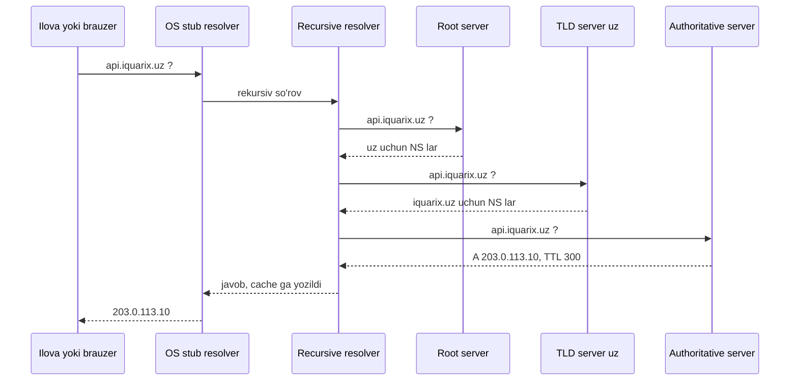
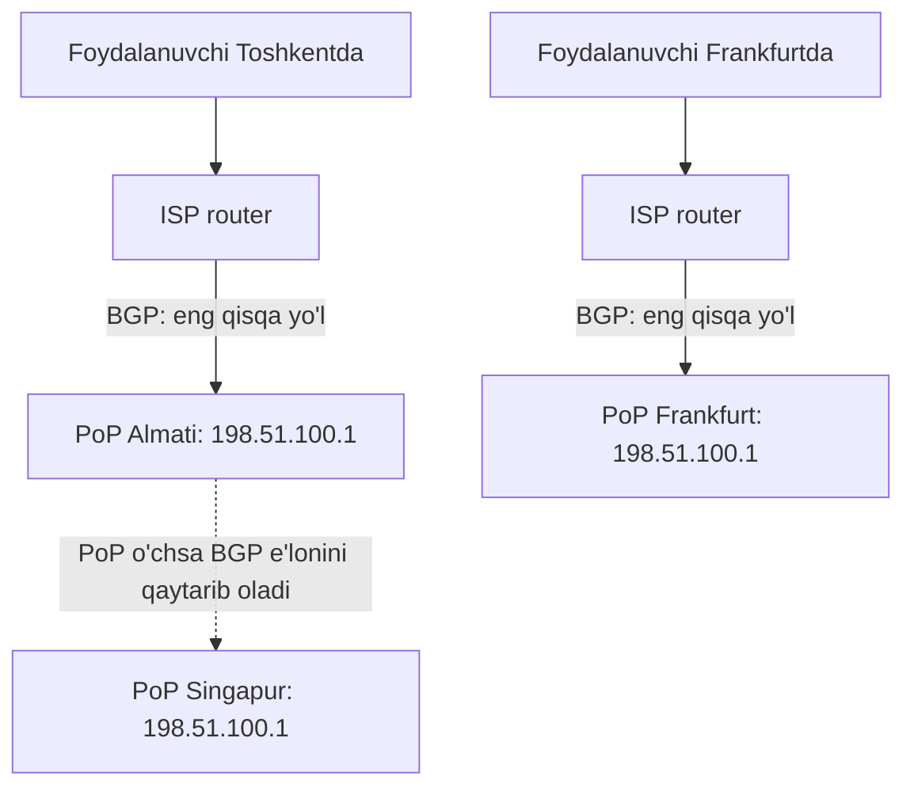

## Bu dars nima uchun kerak

Har bir so'rov - brauzerdan, mobil ilovadan, GPS trekerdan, servisdan servisga - odatda DNS dan boshlanadi. DNS ko'pincha "ko'rinmas" infratuzilma deb qaraladi, lekin u uchta sababga ko'ra system design ning markaziy qismi:

1. **Latency.** Sovuq DNS resolve bir necha round trip, ya'ni o'nlab-yuzlab millisoniya (2 va 5-darslar).
2. **Trafikni boshqarish.** DNS - global load balancing, failover va geo-routing ning eng keng tarqalgan vositasi (77-dars).
3. **Nosozlik nuqtasi.** DNS ishlamasa, serverlar ishlab tursa ham tizim "yo'q". Katta uzilishlarning ko'pchiligi tarixida DNS bor: 2021 yil oktyabrdagi Facebook uzilishi va 2025 yil oktyabrdagi AWS us-east-1 uzilishi.

Bu darsdan keyin siz:

- DNS resolve jarayonini qadamma-qadam, har bir cache qatlami bilan bilasiz;
- asosiy yozuv turlarini va ularning dizayndagi rolini bilasiz;
- TTL tanlashning trade-off ini va migratsiya paytidagi TTL strategiyasini bilasiz;
- anycast qanday ishlashini va nega DNS va CDN uchun ideal ekanini tushunasiz;
- DNS orqali load balancing va failover ning imkoniyatlari va cheklovlarini bilasiz;
- DNS ni ilova va Kubernetes darajasida to'g'ri ishlatishni bilasiz.

## DNS tuzilishi

DNS - **ierarxik, taqsimlangan, cache lanadigan** kalit-qiymat bazasi. Kalit - domen nomi va yozuv turi, qiymat - yozuv (IP manzil, boshqa nom, matn).

Ierarxiya o'ngdan chapga o'qiladi: `api.iquarix.uz.` da oxiridagi nuqta - root, keyin `uz` (TLD), keyin `iquarix.uz` (domen zonasi), keyin `api`. Har bir daraja keyingi darajaga **vakolat beradi** (delegation): root `uz` qaysi serverlarda ekanini biladi, `uz` serverlari `iquarix.uz` uchun authoritative serverlarni biladi.

Root daraja: 13 ta root server identifikatori (A dan M gacha), 12 ta tashkilot boshqaradi. Lekin bu 13 ta mashina emas: root-servers.org ma'lumotiga ko'ra 2026 yil 19 oktyabr holatida dunyo bo'ylab 2 047 ta root server instance ishlaydi. Bu anycast tufayli mumkin (pastda).

### Ishtirokchilar

- **Stub resolver** - OS dagi kichik klient (`getaddrinfo`). O'zi rekursiya qilmaydi, faqat so'rovni rekursiv resolver ga yuboradi.
- **Recursive resolver** - ISP, korporativ yoki ommaviy resolver (masalan, 1.1.1.1, 8.8.8.8). U butun qidiruvni bajaradi va natijani cache laydi.
- **Authoritative server** - zona uchun "haqiqat manbai". Siz boshqaradigan yoki DNS provayderingiz (Route 53, Cloudflare DNS) boshqaradigan server.

## Resolve jarayoni

Cache bo'sh bo'lgan holat (Cloudflare ning DNS tushuntirishiga asoslangan):

Har bir qadamda cache bor va ko'pincha butun zanjir o'tilmaydi:

1. **Brauzer cache i.** Cloudflare ning tushuntirishiga ko'ra zamonaviy brauzerlar DNS yozuvlarini standart holatda ma'lum vaqt cache laydi va so'rov birinchi navbatda shu cache da tekshiriladi. Node.js ning `dns.lookup()` i esa OS ning `getaddrinfo` funksiyasini chaqiradi (Node hujjati), ya'ni cache bo'lsa, u OS darajasida.
2. **OS cache i** - OS dagi stub resolver ning o'z cache i (Cloudflare: so'rov mashinadan chiqishidan oldingi oxirgi lokal to'xtash joyi). Linux da bu systemd-resolved yoki nscd kabi servis yoqilganmi-yo'qligiga bog'liq, shuning uchun serveringizda qaysi biri ishlayotganini tekshiring.
3. **Recursive resolver cache i** - eng muhim qatlam. Mashhur domenlar deyarli har doim shu yerda topiladi. Resolver root va TLD serverlar manzillarini ham uzoq cache laydi, shuning uchun to'liq zanjir kamdan-kam o'tiladi.

### Latency hisobi

Masala sharti uchun belgilar: stub dan resolver gacha RTT = r, resolver dan har bir authoritative serverga RTT = R.

- Issiq cache (resolver da bor): 1 × r. Resolver bir data-markazda bo'lsa, r ≈ 0.5 ms (2-dars, Dean jadvali); u boshqa shaharda yoki mamlakatda bo'lsa, r 2-darsdagi yorug'lik tezligi hisobi bo'yicha masofaga bog'liq.
- Sovuq cache: r + 3 × R (root, TLD, authoritative). Masalan, R = 47 ms bo'lsa (Toshkent - Frankfurt nazariy minimumi, 2-dars), 3 × 47 = 141 ms faqat fizika hisobiga; real RTT bundan yuqori.
- Bunga keyin TCP handshake (1 RTT), TLS (1 RTT, 7-dars) va HTTP so'rov (1 RTT) qo'shiladi.

Shuning uchun: authoritative DNS ni anycast li provayderda saqlash va TTL ni juda past qilmaslik birinchi so'rov latency sini sezilarli kamaytiradi.

### Transport

DNS so'rovlari odatda **UDP** orqali (port 53): bitta so'rov, bitta javob, handshake yo'q (5-dars). Javob katta bo'lsa (DNSSEC, ko'p yozuvlar) yoki kesilgan bo'lsa, **TCP** ga o'tiladi. Zamonaviy shifrlangan variantlar: DNS over TLS (DoT) va DNS over HTTPS (DoH) - maxfiylik uchun, lekin qo'shimcha handshake narxi bilan.

## Yozuv turlari

| Yozuv | Nima qiladi | Dizayndagi roli |
|---|---|---|
| A / AAAA | Nom -> IPv4 / IPv6 manzil | Asosiy manzil; bir nechta A yozuv = oddiy load balancing |
| CNAME | Nom -> boshqa nom (alias) | CDN va SaaS ga yo'naltirish (`app.iquarix.uz` -> `xyz.cloudfront.net`); zona cho'qqisida (apex) ishlatib bo'lmaydi |
| ALIAS / ANAME | Provayder kengaytmasi, apex da CNAME o'xshash | `iquarix.uz` ni load balancer ga yo'naltirish |
| NS | Zona qaysi serverlarda | Delegatsiya, DNS provayderini almashtirish |
| SOA | Zona metadata si | Negative caching TTL ni belgilaydi |
| MX | Pochta serverlari | Email |
| TXT | Ixtiyoriy matn | Domen egaligini tasdiqlash, SPF, DKIM |
| SRV | Servis -> host:port, ustuvorlik va og'irlik bilan | Service discovery (ba'zi tizimlarda), SIP, XMPP |
| CAA | Qaysi CA sertifikat berishi mumkin | Xavfsizlik |

CNAME zanjiri har bir bo'g'in uchun qo'shimcha qidiruv talab qilishi mumkin (agar resolver cache ida bo'lmasa), shuning uchun uzun zanjirlardan qoching.

## TTL: cache qancha yashaydi

Har bir yozuvning **TTL** (time to live) i bor - resolver uni necha soniya cache lashi mumkin. Bu DNS ning asosiy trade-off i:

| TTL | Afzallik | Kamchilik | Qachon |
|---|---|---|---|
| Juda past (10-60 s) | O'zgarish tez tarqaladi, tez failover | Ko'p so'rov authoritative ga, ko'p sovuq resolve (latency), DNS provayderiga bog'liqlik oshadi | DNS asosidagi failover, faol migratsiya |
| O'rta (300-3 600 s) | Muvozanat | O'zgarish daqiqalar-soatlarda tarqaladi | Ko'p API va veb-saytlar |
| Yuqori (soatlar-kun) | Tez, authoritative ishlamasa ham ishlaydi | O'zgarish juda sekin, xato yozuvni tuzatish uzoq | NS yozuvlari, kamdan-kam o'zgaradigan nomlar |

### TTL bilan bog'liq haqiqatlar

- **TTL kafolat emas, maslahat.** Ba'zi resolver lar va klientlar TTL ni e'tiborsiz qoldiradi yoki minimal qiymat qo'yadi. Ba'zi uzoq yashaydigan jarayonlar (eski JVM sozlamalari, ba'zi kutubxonalar) manzilni bir marta resolve qilib, abadiy ishlatadi. Shuning uchun DNS dan failover qilganda eski IP dagi servisni darhol o'chirmang.
- **Negative caching.** "Bunday nom yo'q" (NXDOMAIN) javobi ham cache lanadi. RFC 2308 ga ko'ra uning TTL i SOA yozuvining MINIMUM maydoni va SOA TTL ining kichigi. Agar siz yangi subdomen yaratishdan **oldin** unga murojaat qilgan bo'lsangiz, "yo'q" javobi shu vaqt davomida cache da qoladi.
- **Serve-stale.** RFC 8767 (2020) resolver larga authoritative serverlarga yetib bo'lmaganda **muddati o'tgan** cache yozuvini qaytarishga ruxsat beradi (tavsiya: javobda TTL 30 s, eskirgan ma'lumotni 1-3 kungacha saqlash). G'oya: "eski non nonsizlikdan yaxshi". Bu DNS provayder uzilishida ta'sirni kamaytiradi, lekin hamma resolver buni qo'llamaydi.

### Migratsiya strategiyasi

Servisni yangi IP ga ko'chirish:

1. Hozirgi TTL ni bilib oling, masalan 3 600 s.
2. Migratsiyadan **kamida bitta eski TTL oldin** TTL ni 60 s ga tushiring. Aks holda resolver lar eski yozuvni hali 1 soat ushlab turadi.
3. Yangi IP ni yozing. TTL ni hurmat qiladigan resolver va klientlar 60 s (yangi TTL) ichida yangi manzilga o'tadi.
4. Eski IP dagi servisni bir muddat (soatlar-kunlar) ishlatib turing, TTL ni hurmat qilmaydigan klientlar uchun. Eski manzildagi trafikni kuzating, nolga yaqinlashganda o'chiring.
5. Hammasi barqaror bo'lgach, TTL ni normal qiymatga qaytaring.

## Anycast

**Unicast** da har bir IP manzil bitta joyga tegishli. **Anycast** da bitta IP manzil ko'plab joydan (data-markaz, PoP) BGP orqali e'lon qilinadi. Internet routerlari paketni marshrutlash nuqtai nazaridan **eng yaqin** joyga yuboradi.

Nega DNS uchun ideal:

- DNS asosan UDP, bitta paketli so'rov-javob. Har bir so'rov mustaqil, shuning uchun marshrut o'zgarib, keyingi so'rov boshqa PoP ga borsa ham muammo yo'q.
- Yaqinlik tufayli latency kam.
- **DDoS himoyasi:** hujum trafigi bitta joyga emas, barcha PoP larga tarqaladi. Cloudflare buni anycast ning asosiy afzalligi sifatida ko'rsatadi.
- **Failover avtomatik:** PoP ishlamasa, u BGP e'lonini qaytarib oladi va trafik keyingi yaqin joyga boradi.

TCP uchun anycast murakkabroq: agar uzun ulanish davomida BGP marshruti o'zgarsa, paketlar boshqa PoP ga borib, ulanish uziladi. Amalda marshrutlar odatda barqaror va CDN lar (Cloudflare, Google) HTTP uchun ham anycast ishlatadi, lekin uzoq yashaydigan ulanishlar uchun bu risk hisobga olinadi.

Anycast ning xavfli tomoni Facebook ning 2021 yil 4 oktyabrdagi uzilishida ko'rindi. Facebook muhandislik blogidagi tushuntirishga ko'ra: backbone tarmog'ini tekshirish uchun berilgan buyruq barcha data-markazlar orasidagi ulanishlarni uzib qo'ydi. DNS serverlari joylashgan kichik ob'ektlar data-markazlarga ulana olmagach, o'zini nosog'lom deb hisoblab, BGP e'lonlarini qaytarib oldi. Natijada DNS serverlari ishlab tursa ham, internetdan ularga yo'l qolmadi va butun dunyo Facebook nomlarini resolve qila olmadi. Bundan tashqari ichki vositalar ham DNS ga bog'liq bo'lgani uchun tiklash qiyinlashdi va muhandislar data-markazlarga jismonan borishi kerak bo'ldi.

Saboq: health check ga bog'langan avtomatik e'lon qaytarish lokal nosozlikda yaxshi, lekin **global** nosozlikda hamma joy bir vaqtda "o'zini o'chiradi". Bunday mexanizmlarga "hamma o'chsa, baribir e'lon qil" kabi himoya kerak.

## DNS orqali load balancing

### Round-robin DNS

Eng oddiy usul: bitta nomga bir nechta A yozuv. Resolver/klient ulardan birini (ko'pincha tartibni aylantirib) tanlaydi.

Cheklovlari:

- **Health check yo'q** - o'lik server IP si ham qaytariladi (oddiy DNS da).
- **Notekis taqsimot** - katta resolver (masalan, korporativ NAT ortidagi minglab foydalanuvchi) bitta javobni cache laydi va hammasi bitta serverga boradi.
- **Sekin o'zgarish** - TTL va TTL ni hurmat qilmaydigan klientlar tufayli.
- **Klient xatti-harakati turlicha** - ba'zi klientlar birinchi IP ni oladi, ba'zilari ishlamasa keyingisini sinaydi.

Shuning uchun DNS odatda **global** darajadagi qo'pol taqsimot uchun ishlatiladi (qaysi region yoki data-markaz), region ichidagi aniq taqsimotni esa L4/L7 load balancer qiladi (22-dars).

### Managed DNS ning "aqlli" siyosatlari

AWS Route 53 hujjatida sakkizta routing siyosati keltirilgan:

| Siyosat | Nima qiladi | Qo'llanish |
|---|---|---|
| Simple | Bitta resurs | Oddiy sayt |
| Weighted | Berilgan nisbatda bo'lish | Canary (5% yangi versiya), migratsiya |
| Latency | Eng past latency li region | Multi-region API |
| Geolocation | Foydalanuvchi joylashuvi bo'yicha | Qonunchilik, tarkibni lokalizatsiya |
| Geoproximity | Resurslar joylashuvi bo'yicha, siljitish bilan | Regionlar orasida trafikni siljitish |
| IP-based | Manba IP diapazoni bo'yicha | Ma'lum ISP larni ma'lum joyga |
| Failover | Asosiy nosog'lom bo'lsa, zaxiraga | Active-passive DR (69-dars) |
| Multivalue answer | Health check li bir nechta (8 tagacha) tasodifiy javob | Health check li round-robin |

Bularning hammasi **health check** bilan birlashtiriladi: provayder resursni tekshiradi va nosog'lom bo'lsa, uni javobdan chiqaradi.

### Geo-routing va resolver muammosi

DNS server javobni **resolver ning** IP si bo'yicha tanlaydi, foydalanuvchiniki emas. Agar Toshkentdagi foydalanuvchi ommaviy resolver ishlatsa va u resolver boshqa mamlakatdan so'rasa, javob noto'g'ri regionga yo'naltirishi mumkin. **EDNS Client Subnet** (RFC 7871, 2016) resolver ga foydalanuvchi IP sining qisqartirilgan qismini (IPv4 da /24, IPv6 da /56 tavsiya etiladi) authoritative serverga yuborish imkonini beradi. RFC mualliflarining o'zi bu maxfiylik muammosi ekanini tan oladi, shuning uchun ba'zi ommaviy resolver lar ECS ni yubormaydi.

### Failover tezligi hisobi

DNS failover vaqti = aniqlash vaqti + tarqalish vaqti.

- Hisob shartlari: health check har 10 s (Route 53 da 30 s yoki qo'shimcha haq evaziga 10 s "Fast" interval tanlanadi), 3 marta ketma-ket xato: 3 × 10 = 30 s aniqlash.
- TTL 60 s: resolver larda eski javob 60 s gacha yashaydi.
- Jami: ~90 s ko'pchilik klientlar uchun, TTL ni hurmat qilmaydiganlar uchun ko'proq.

Agar SLO 99.99% (oyiga ~4.3 daqiqa, 2-dars) bo'lsa, bitta DNS failover budjetning ~35% ini yeydi. Shuning uchun tez failover kerak bo'lsa, anycast yoki bitta barqaror IP ortidagi load balancer (DNS o'zgarishsiz) afzal.

## DNS servislar ichida

Microservice va Kubernetes muhitida DNS ichki **service discovery** vositasi (53-dars). Kubernetes da har bir Service uchun `my-svc.my-namespace.svc.cluster.local` ko'rinishidagi nom yaratiladi va cluster DNS (CoreDNS) uni Service IP siga resolve qiladi.

Amaliy tuzoqlar:

- **ndots.** Kubernetes hujjatiga ko'ra pod uchun kubelet `/etc/resolv.conf` ni yaratadi; standart `ClusterFirst` siyosatida unda `search <namespace>.svc.cluster.local svc.cluster.local cluster.local` va `options ndots:5` bo'ladi. `resolv.conf(5)` man sahifasiga ko'ra nomda `ndots` dan kam nuqta bo'lsa, resolver qidiruv ro'yxatidagi domenlarni navbat bilan qo'shib sinaydi (glibc standart qiymati 1, Kubernetes uni 5 qiladi). Natijada `api.example.com` (2 ta nuqta) uchun avval `api.example.com.default.svc.cluster.local`, `api.example.com.svc.cluster.local`, `api.example.com.cluster.local` so'raladi va faqat keyin nomning o'zi - har bir tashqi nom uchun 3 ta keraksiz so'rov (IPv4 va IPv6 so'ralsa, ikki baravar). Yechim: tashqi nomlarni oxirida nuqta bilan (FQDN) yozish yoki pod ning `dnsConfig.options` ida `ndots` ni kamaytirish.
- **Node.js da `dns.lookup()`.** Node hujjatiga ko'ra `dns.lookup()` (ko'p tarmoq API larining standart resolve usuli) OS ning `getaddrinfo` funksiyasini libuv threadpool ida sinxron chaqiradi. Threadpool standart holatda 4 ta thread (`UV_THREADPOOL_SIZE` hujjati) va barcha `fs` API lari, `zlib` va asinxron crypto funksiyalari (`pbkdf2`, `scrypt`, `randomBytes` va boshq.) bilan umumiy. Sekin DNS bu pool ni band qilib, butunlay bog'liq bo'lmagan fayl operatsiyalarini sekinlashtirishi mumkin. `dns.resolve*()` esa tarmoq orqali to'g'ridan-to'g'ri ishlaydi va threadpool ni band qilmaydi. Har bir yangi ulanish `getaddrinfo` chaqiruvi demak; natija cache lanishi OS darajasidagi cache ga bog'liq. Shuning uchun yuqori yuklamali servisda connection pool (ulanishlar qayta ishlatiladi, resolve kamayadi) va OS yoki ilova darajasidagi lokal DNS cache foydali.
- **DNS - yashirin bog'liqlik.** Agar har bir servis chaqiruvi DNS ga bog'liq bo'lsa, DNS ning sekinlashishi butun tizimni sekinlashtiradi.

## Real tizimlardan misollar

- **AWS, 2025 yil 19-20 oktyabr.** AWS ning rasmiy post-event xulosasiga ko'ra, DynamoDB ning DNS boshqaruv avtomatikasidagi yashirin race condition `dynamodb.us-east-1.amazonaws.com` regional endpoint ini **bo'sh** DNS yozuvi bilan qoldirgan: ikki komponentdan biri kechikib eski rejani qo'llagan, boshqasining tozalash jarayoni esa o'sha rejani o'chirib, endpoint ning barcha IP manzillarini olib tashlagan. Avtomatika holatni tuzata olmagan, qo'lda aralashuv kerak bo'lgan. DynamoDB ga bog'liq ko'plab AWS servislari (EC2 instance ishga tushirish, Network Load Balancer, Lambda va boshqalar) zanjir bo'ylab ta'sirlangan; hodisa umumiy hisobda 14 soatdan ortiq davom etgan. Saboq: DNS - ma'lumot, va uni o'zgartiruvchi avtomatika ham xavfsizlik to'siqlariga muhtoj.
- **Facebook, 2021 yil 4 oktyabr.** Yuqorida: BGP e'lonlari qaytarib olinib, DNS serverlari internetdan "yo'qolgan".
- **Root serverlar.** 13 ta identifikator, 12 operator, 2 047 ta anycast instance (2026 yil oktyabr) - anycast masshtabining eng yaxshi namunasi.
- **Route 53.** Health check bilan sakkiz xil routing siyosati - DNS ni global traffic manager sifatida ishlatish.

## iQuariX kontekstida

Masala sharti: iQuariX da quyidagi nomlar bor: `app.iquarix.uz` (dispetcher veb-ilovasi), `api.iquarix.uz` (mobil va integratsiya API), `gw.iquarix.uz` (GPS trekerlar ulanadigan TCP gateway).

**1. Trekerlar va DNS.** Bu masalada trekerlarning server manzili SMS yoki konfiguratsiya orqali yoziladi va **IP manzil** yoki domen bo'lishi mumkin. Agar 50 000 treker IP ga bog'langan bo'lsa, server manzilini o'zgartirish har bir qurilmani qayta sozlashni talab qiladi - bu 1-darsdagi "qaytarilmaydigan qaror" ning klassik misoli. Domen nomi ishlatish yaxshiroq, lekin masala shartiga ko'ra firmware DNS ni faqat yonganda bir marta resolve qiladi va TTL ni hurmat qilmaydi (sizning trekerlaringiz qanday ishlashini ishlab chiqaruvchi hujjatidan yoki test bilan aniqlang). Shuning uchun gateway uchun **barqaror IP** (masalan, cloud provayderining statik IP si yoki anycast IP) va uning orqasida load balancer - eng xavfsiz yondashuv: backend lar o'zgarsa ham, qurilma ko'radigan manzil o'zgarmaydi.

**2. TTL tanlovi.** `app` va `api` uchun TTL 300 s tanlanadi (yuqoridagi jadvaldagi o'rta diapazon). Rejalashtirilgan migratsiyadan bir kun oldin 60 s ga tushiriladi. `gw` uchun DNS o'zgarishiga umuman tayanilmaydi (yuqoridagi sabab).

**3. Mahalliy foydalanuvchilar uchun latency.** Agar authoritative DNS faqat Frankfurtda bo'lsa, Toshkentdagi resolver uchun har bir sovuq so'rov kamida 47 ms (2-darsdagi nazariy minimum) qo'shadi; real RTT bundan yuqori. Anycast li DNS provayderini tanlash arzon va samarali qaror.

**4. Mijozlar integratsiyasi.** Katta mijoz o'z ichki tarmog'idan `api.iquarix.uz` ga murojaat qiladi va firewall da IP ni oq ro'yxatga qo'ygan. Agar API orqasidagi IP lar tez-tez o'zgarsa (masalan, avtomatik masshtablanadigan load balancer), integratsiya buziladi. Bunday mijozlar uchun barqaror egress/ingress IP lar ro'yxatini e'lon qilish kerak.

## Ko'p uchraydigan xatolar

1. **TTL ni migratsiya kuni pasaytirish.** Eski TTL davomida resolver lar eski javobni ushlab turadi; TTL ni oldindan pasaytiring.
2. **Eski serverni DNS o'zgargach darhol o'chirish.** TTL ni hurmat qilmaydigan klientlar hali eski IP ga keladi.
3. **DNS failover ni soniyalik failover deb hisoblash.** Aniqlash + TTL + klient xatti-harakati daqiqalar oladi.
4. **Round-robin DNS ni load balancer o'rnida ishlatish.** Health check yo'q, taqsimot notekis.
5. **Qurilmalarga IP ni "qattiq" yozish yoki aksincha, DNS ni hurmat qilmaydigan qurilmalarga DNS asosida failover qilish.** Qurilmalar xatti-harakatini biling.
6. **Kubernetes da ndots ni bilmaslik.** Tashqi nomlar uchun keraksiz qidiruvlar latency qo'shadi.
7. **Node.js da `dns.lookup` threadpool ni band qilishini bilmaslik.** Sekin DNS fayl operatsiyalarini ham sekinlashtiradi.
8. **DNS ni yagona provayderda saqlab, uning nosozligini rejalashtirmaslik.** Muhim domenlar uchun ikkinchi provayder yoki uzunroq TTL ko'rib chiqiladi.

## Xulosa

- DNS - ierarxik, taqsimlangan, cache lanadigan kalit-qiymat bazasi: root, TLD, authoritative; recursive resolver hamma ishni qiladi.
- Cache har qatlamda (ilova, OS, resolver); sovuq resolve bir necha RTT, issiq bitta yoki nol.
- TTL - o'zgarish tezligi va latency/barqarorlik o'rtasidagi trade-off; migratsiyadan oldin oldindan pasaytiring.
- Negative javoblar ham cache lanadi; serve-stale provayder uzilishida yordam beradi.
- Anycast bitta IP ni ko'p joydan e'lon qiladi: past latency, DDoS ga chidamlilik, avtomatik failover.
- DNS load balancing - global, qo'pol daraja; aniq taqsimot va tez failover uchun L4/L7 LB kerak.
- DNS katta uzilishlarning markazida bo'lgan (Facebook 2021, AWS 2025): uni o'zgartiruvchi avtomatika ham himoyaga muhtoj.

## Amaliy topshiriq

Masala sharti: iQuariX ikkinchi region ochmoqda: hozir hamma narsa bitta data-markazda (Yevropa), yangisi Markaziy Osiyoga yaqin joyda. Maqsad: O'zbekiston mijozlari uchun latency ni kamaytirish va bitta data-markaz ishlamay qolsa, xizmatni davom ettirish.

1. **Nomlar xaritasi.** `app`, `api`, `gw` va integratsiya webhook lari uchun qaysi nom qaysi regionga yo'naltirilishi kerak? Qaysi routing siyosati (latency, geolocation, failover, weighted) va nega?
2. **TTL rejasi.** Har bir nom uchun normal TTL va migratsiya/failover paytidagi TTL. Failover vaqtini (aniqlash + tarqalish) raqam bilan hisoblang va SLO budjeti bilan solishtiring.
3. **Trekerlar.** 50 000 treker hozir Yevropadagi gateway ga ulangan, firmware DNS ni faqat yonganda resolve qiladi. Ularni ikkinchi regionga qanday o'tkazasiz? Region o'chsa nima bo'ladi?
4. **Weighted migratsiya.** Mijozlarning 5%, keyin 25%, 100% ini yangi regionga o'tkazish rejasi. Qaysi metrikalarga qarab keyingi qadamga o'tasiz?
5. **DNS nosozligi.** DNS provayderingiz 2 soat ishlamasa nima bo'ladi? Ta'sirni kamaytirish uchun 2 ta chora.

Yaxshi javobda bo'lishi kerak bo'lgan narsalar:

- har bir nom uchun alohida siyosat va asos;
- failover vaqti hisob bilan (health check intervali, xatolar soni, TTL) va SLO bilan solishtirilgan;
- trekerlar DNS ni hurmat qilmasligi hisobga olingan va barqaror IP/anycast yoki qurilma konfiguratsiyasini yangilash rejasi bor;
- weighted migratsiyada aniq metrikalar (xatolar, p99, trafik) va orqaga qaytish rejasi;
- DNS provayderi nosozligi uchun TTL, ikkinchi provayder yoki serve-stale kabi chora.

Javobni pastdagi maydonga yozib, chatga yuboring.

## Manbalar

- Cloudflare Learning. [What is DNS?](https://www.cloudflare.com/learning/dns/what-is-dns/) - resolve ning 8 qadami, resolver turlari va cache qatlamlari; [What is an Anycast network?](https://www.cloudflare.com/learning/cdn/glossary/anycast-network/) - anycast va DDoS ga chidamlilik.
- [Root Server Technical Operations](https://root-servers.org/) - 13 identifikator, 12 operator, instance lar soni.
- [RFC 2308: Negative Caching of DNS Queries](https://www.rfc-editor.org/rfc/rfc2308), 1998 - negative TTL qoidasi; [RFC 8767: Serving Stale Data](https://www.rfc-editor.org/rfc/rfc8767), 2020 - serve-stale tavsiyalari.
- [RFC 7871: Client Subnet in DNS Queries](https://www.rfc-editor.org/rfc/rfc7871), 2016 - EDNS Client Subnet va maxfiylik muammolari.
- [Amazon Route 53: Choosing a routing policy](https://docs.aws.amazon.com/Route53/latest/DeveloperGuide/routing-policy.html) - sakkiz routing siyosati; [Values for creating health checks](https://docs.aws.amazon.com/Route53/latest/DeveloperGuide/health-checks-creating-values.html) - 30 s va 10 s (Fast) request interval.
- AWS. [Summary of the Amazon DynamoDB Service Disruption in the Northern Virginia (US-EAST-1) Region](https://aws.amazon.com/message/101925/), 2025 - DNS avtomatikasidagi race condition.
- Meta Engineering. [More details about the October 4 outage](https://engineering.fb.com/2021/10/05/networking-traffic/outage-details/), 2021 - BGP e'lonlarining qaytarib olinishi va DNS.
- [Node.js DNS hujjati](https://nodejs.org/api/dns.html) - "Implementation considerations": `dns.lookup` va threadpool; [Node.js CLI: UV_THREADPOOL_SIZE](https://nodejs.org/api/cli.html) - standart 4 thread va threadpool ishlatadigan API lar.
- Kubernetes. [DNS for Services and Pods](https://kubernetes.io/docs/concepts/services-networking/dns-pod-service/) - pod `resolv.conf` (search, ndots:5), ClusterFirst, dnsConfig; [resolv.conf(5)](https://man7.org/linux/man-pages/man5/resolv.conf.5.html) - ndots va search semantikasi.
