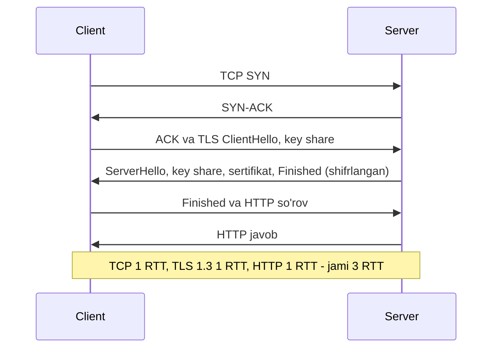
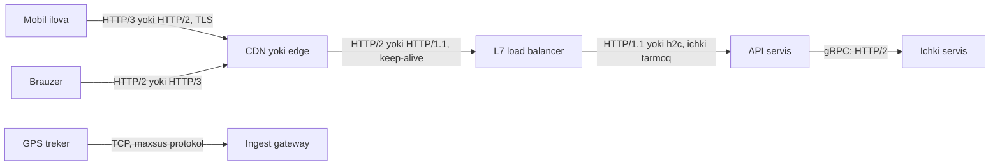

## Bu dars nima uchun kerak

5-darsda TCP ning narxini ko'rdik: handshake 1 RTT, slow start, head-of-line (HOL) blocking. 6-darsda DNS resolve ham bir necha RTT olishi mumkinligini ko'rdik. HTTP - bu qatlamlarning ustidagi asosiy ilova protokoli va uning har bir versiyasi aynan shu narxlarni kamaytirishga urinish. TLS esa har bir ulanishga yana handshake qo'shadi.

Bu darsdagi bilim to'g'ridan-to'g'ri arxitektura qarorlariga aylanadi: load balancer HTTP/2 ni terminate qiladimi yoki backend gacha olib boradimi (22-dars), gRPC nega HTTP/2 ga qurilgan (9-dars), mobil ilova uchun HTTP/3 yoqish arziydimi, TLS qayerda tugatiladi (74-dars), 0-RTT xavfsizmi.

Bu darsdan keyin siz:

- HTTP/1.1, HTTP/2 va HTTP/3 ning har biri qaysi muammoni hal qilgani va qaysi yangi muammoni keltirib chiqarganini bilasiz;
- TLS 1.3 handshake ni va uning TLS 1.2 dan farqini tushunasiz;
- yangi ulanishda birinchi baytgacha nechta RTT ketishini har bir kombinatsiya uchun hisoblay olasiz;
- 0-RTT ning replay xavfini va undan himoyalanishni bilasiz;
- QUIC ning connection migration va mustaqil stream lari mobil qurilmalar uchun nima berishini bilasiz;
- qaysi qatlamda qaysi protokolni ishlatishni asoslab tanlay olasiz.

## HTTP/1.1: matnli, bitta navbat

HTTP/1.1 matnli protokol: so'rov qatori, sarlavhalar, bo'sh qator, tana. Asosiy xususiyatlari:

- **Keep-alive (persistent connection).** HTTP/1.0 da har bir so'rov uchun yangi TCP ulanish ochilardi. HTTP/1.1 da ulanish standart holatda ochiq qoladi va qayta ishlatiladi. Bu 5-darsdagi handshake va slow start narxini tejaydi.
- **Bir ulanishda bir vaqtda bitta so'rov.** Javob kelmaguncha keyingi so'rov yuborilmaydi (amalda). **Pipelining** (javobni kutmasdan bir nechta so'rov yuborish) spetsifikatsiyada bor, lekin javoblar faqat tartib bilan qaytishi kerak. Ilya Grigorik ning "High Performance Browser Networking" kitobiga ko'ra, bitta sekin javob orqasidagilarni bloklagani (ilova darajasidagi HOL blocking) va oraliq proksilar bilan muammolar tufayli ko'p brauzerlar pipelining ni o'chirib qo'ygan.
- **Parallellik faqat ko'p ulanish bilan.** Brauzerlar har bir host ga 6 tagacha parallel TCP ulanish ochadi. Har bir ulanish o'z handshake, TLS va slow start narxini to'laydi.
- **Sarlavhalar siqilmaydi.** Grigorik ma'lumotiga ko'ra brauzer so'rovi odatda 500-800 bayt siqilmagan sarlavha olib yuradi, cookie lar bilan bir necha kilobaytgacha. Kichik API so'rovlarida sarlavha foydali ma'lumotdan katta bo'lishi mumkin.

HTTP/1.1 davridagi "optimizatsiyalar" - domain sharding (ko'proq ulanish uchun ko'p subdomen), fayllarni birlashtirish (concatenation), sprite lar - aslida protokol cheklovlarini aylanib o'tish edi. HTTP/2 da ularning ko'pi zararli bo'lib qoldi.

## HTTP/2: binar framing va multiplexing

HTTP/2 hozir RFC 9113 (2022) bilan belgilangan (asl RFC 7540 ni almashtirgan). Semantika (metodlar, status kodlar, sarlavhalar) o'zgarmagan, faqat "simdagi" format o'zgargan:

- **Binar frame lar.** Har bir xabar frame larga bo'linadi (HEADERS, DATA, SETTINGS, RST_STREAM, ...).
- **Stream lar va multiplexing.** Bitta TCP ulanishda ko'plab mustaqil **stream** (har biri bitta so'rov-javob) bir vaqtda, frame lari aralashgan holda ketadi. Ilova darajasidagi HOL blocking yo'qoladi: sekin javob boshqalarni to'xtatmaydi.
- **HPACK sarlavha siqish.** Ikki tomon sarlavhalar jadvalini saqlaydi va takrorlanuvchi sarlavhalarni indeks bilan yuboradi. Har bir so'rovda bir xil cookie va user-agent qayta yuborilmaydi.
- **Flow control** stream va ulanish darajasida.
- **Bitta ulanish.** Brauzer bitta host ga bitta ulanish ochadi; bu bitta handshake, bitta TLS va bitta "isigan" congestion window demak.

RFC 9113 ba'zi narsalarni bekor qilgan: eski ustuvorlik (priority) sxemasi eskirgan deb belgilangan, shifrlanmagan HTTP/2 ga "Upgrade" orqali o'tish (h2c) ham kam ishlatilgani uchun eskirgan. RFC `SETTINGS_MAX_CONCURRENT_STREAMS` ni kamida 100 qilishni tavsiya qiladi.

**Server push** HTTP/2 ning va'da qilingan xususiyatlaridan biri edi: server klient so'ramagan resurslarni oldindan yuboradi. Amalda u foyda bermadi. Chrome jamoasi push ni Chrome 106 da standart holatda o'chirishini e'lon qildi: tahlillar aniq foyda ko'rsatmagan, ko'pincha regressiya bo'lgan, foydalanish esa HTTP/2 saytlarining 1% atrofida edi. O'rniga **103 Early Hints** (server faqat "bu resurslar kerak bo'ladi" deb maslahat beradi) va `preload` tavsiya etiladi.

### HTTP/2 ning yangi muammosi: TCP HOL blocking

HTTP/2 ilova darajasidagi HOL ni yo'qotdi, lekin TCP darajasidagi HOL qoldi va hatto kuchaydi. Barcha stream lar bitta TCP oqimida. Bitta paket yo'qolsa (5-dars), TCP keyingi barcha baytlarni ilovaga bermaydi - **barcha** stream lar to'xtaydi. HTTP/1.1 da 6 ta ulanishdan bittasida yo'qolish faqat o'sha ulanishni to'xtatardi. Shuning uchun yuqori paket yo'qolishli tarmoqlarda (mobil, Wi-Fi) HTTP/2 ba'zan HTTP/1.1 dan yomon ishlashi mumkin.

### HTTP/2 va xavfsizlik: Rapid Reset

Multiplexing yangi hujum vektorini ochdi. 2023 yil avgustda Cloudflare **HTTP/2 Rapid Reset** (CVE-2023-44487) hujumini qayd etdi: klient stream ochadi va darhol RST_STREAM bilan bekor qiladi. Bekor qilingan stream concurrency limitidan darhol joy bo'shatadi, shuning uchun klient cheksiz ochib-yopib turishi mumkin, server esa har birini qayta ishlashga resurs sarflaydi. Cloudflare ma'lumotiga ko'ra cho'qqi soniyasiga ~201 mln so'rovga yetgan, bunda botnet atigi ~20 000 mashinadan iborat bo'lgan. Saboq: protokol samaradorligi hujumchiga ham samaradorlik beradi; L7 himoya va rate limiting (56, 80-darslar) protokol darajasidagi suiiste'mollarni ham hisobga olishi kerak.

## TLS 1.3

TLS (Transport Layer Security) TCP ustida shifrlash, autentifikatsiya (sertifikat orqali server haqiqiyligini tasdiqlash) va yaxlitlikni beradi. TLS 1.3 RFC 8446 (2018) da belgilangan; 2026 yilda u RFC 9846 bilan almashtirildi, lekin bu kichik yangilanish - versiya raqami o'sha, orqaga moslik saqlangan.

### TLS 1.2 dan asosiy farqlari

- **Handshake 2 RTT dan 1 RTT ga.** TLS 1.2 da to'liq handshake 2 RTT olardi. TLS 1.3 da klient birinchi xabardayoq (ClientHello) kalit almashish ma'lumotini (key share) yuboradi, server javobidan keyin shifrlangan ma'lumot boshlanadi.
- **Eski va xavfli algoritmlar olib tashlandi.** Statik RSA va statik Diffie-Hellman kalit almashish, siqish, DSA, renegotiation olib tashlandi; faqat AEAD shifrlar qoldi.
- **Forward secrecy majburiy.** RFC ga ko'ra barcha ochiq kalitga asoslangan kalit almashish endi forward secrecy beradi: server ning maxfiy kaliti keyinchalik o'g'irlansa ham, yozib olingan eski trafikni ochib bo'lmaydi.
- **Handshake ning ko'p qismi shifrlangan,** shu jumladan server sertifikati.

### Session resumption va 0-RTT

Agar klient server bilan avval bog'langan bo'lsa, ular oldingi sessiyadan olingan kalitni (PSK) ishlatishi mumkin. Bunda klient **birinchi xabar bilan birga** ilova ma'lumotini (early data) yuborishi mumkin - bu **0-RTT**.

Muammo: RFC 8446 ning o'zi ta'kidlaydi - 0-RTT ma'lumot uchun ulanishlar orasida **replay himoyasi yo'q** va u forward secret emas. Tarmoqdagi hujumchi shifrlangan birinchi xabarni nusxalab, qayta yuborishi mumkin; server uni yana bajaradi. Agar bu "pul o'tkazish" so'rovi bo'lsa - ikki marta o'tkaziladi.

Himoya:

- **Faqat xavfsiz (safe, idempotent) so'rovlar.** RFC 8470 (2018) bo'yicha klient early data da faqat GET kabi xavfsiz metodlarni yuborishi mumkin. Cloudflare 0-RTT ni joriy qilganda uni faqat query parametrsiz GET so'rovlari uchun qo'llagan.
- **`Early-Data: 1` sarlavhasi va 425 Too Early.** Oraliq proksi (CDN, load balancer) so'rovni handshake tugashidan oldin uzatsa, `Early-Data: 1` sarlavhasini qo'shadi. Origin server xavfli deb hisoblasa, **425 (Too Early)** qaytaradi va klient so'rovni handshake tugagach qayta yuboradi.
- **Ilova darajasida idempotentlik.** Eng ishonchli himoya: o'zgartiruvchi so'rovlar idempotency key bilan (9 va 39-darslar). Cloudflare ham eslatadi: brauzerlar oddiy tarmoq nosozliklarida ham so'rovlarni qayta yuboradi, shuning uchun ilova baribir replay ga chidamli bo'lishi kerak.

### TLS narxi

- **CPU.** Handshake dagi asimmetrik kriptografiya qimmat, simmetrik shifrlash (AES-GCM, zamonaviy CPU larda apparat tezlatish bilan) esa arzon. Shuning uchun asosiy narx - **yangi ulanishlar**, uzatilgan baytlar emas. Connection reuse va session resumption muhim.
- **Latency.** Har bir yangi ulanishga +1 RTT (TLS 1.3) yoki +2 RTT (TLS 1.2).
- **Zero-copy yo'qoladi.** 4-darsda ko'rdik: Kafka TLS yoqilganda `sendfile` dan foydalana olmaydi, chunki shifrlash user space da.

## HTTP/3 va QUIC

HTTP/3 (RFC 9114, 2022) HTTP semantikasini **QUIC** transport protokoli (RFC 9000, 2021) ustiga o'tkazadi. QUIC esa **UDP** ustida ishlaydi va TCP + TLS ning vazifalarini o'zi bajaradi.

Nega TCP ni tuzatish emas, yangi protokol? TCP operatsion tizim yadrosida va millionlab tarmoq qurilmalarida (middlebox: firewall, NAT, proksi) "qotib qolgan" - ular TCP sarlavhalari haqida taxminlar qiladi va yangi xususiyatlarni buzadi (ossification). QUIC user space da ishlaydi va deyarli hamma narsasi shifrlangan, shuning uchun middlebox lar unga aralasha olmaydi va protokol tez rivojlana oladi. Evaziga TCP ga xos yadro va tarmoq kartasi optimizatsiyalarining bir qismi UDP uchun yo'q, shuning uchun QUIC server tomonda ko'proq CPU talab qilishi mumkin.

### QUIC ning asosiy xususiyatlari

1. **Birlashgan handshake.** Transport va TLS 1.3 handshake bitta: yangi ulanish **1 RTT** (TCP + TLS 1.3 da 2 RTT). Qayta ulanishda 0-RTT mumkin (o'sha replay cheklovlari bilan - RFC 9000 ham 0-RTT replay dan himoya qilmasligini aytadi).
2. **Mustaqil stream lar.** QUIC har bir stream ichida tartibni kafolatlaydi, lekin turli stream lar orasida emas. Bitta stream dagi paket yo'qolishi boshqalarni to'xtatmaydi - TCP darajasidagi HOL blocking yo'qoladi. Shu sababli HTTP/3 HPACK o'rniga **QPACK** (RFC 9204) ishlatadi: HPACK sarlavhalar tartib bilan kelishiga tayanardi, bu esa HOL ni qaytarardi.
3. **Connection ID va migratsiya.** TCP ulanishi (manba IP, manba port, manzil IP, manzil port) to'rtligi bilan aniqlanadi; telefon Wi-Fi dan 4G ga o'tsa, IP o'zgaradi va ulanish uziladi. QUIC ulanishni **connection ID** bilan aniqlaydi, shuning uchun u NAT qayta bog'lanishi va tarmoq almashishidan "omon qoladi". Bu yangi muammo ham keltiradi: load balancer paketlarni IP bo'yicha emas, connection ID bo'yicha to'g'ri serverga yo'naltirishi kerak (22-dars).
4. **Kashf qilish.** Klient avval HTTP/1.1 yoki HTTP/2 (TCP) orqali ulanadi, server `Alt-Svc: h3=":443"` sarlavhasi bilan HTTP/3 borligini e'lon qiladi, keyingi ulanishlar QUIC orqali. Agar UDP bloklangan bo'lsa (ba'zi korporativ tarmoqlar), klient TCP ga qaytadi. Shuning uchun HTTP/3 har doim TCP varianti bilan **birga** ishlaydi.

W3Techs ma'lumotiga ko'ra hozir veb-saytlarning taxminan 41% i HTTP/3 ni qo'llab-quvvatlaydi - asosan CDN lar tufayli.

## Taqqoslash va RTT hisobi

| Xususiyat | HTTP/1.1 | HTTP/2 | HTTP/3 |
|---|---|---|---|
| Transport | TCP | TCP | QUIC (UDP ustida) |
| Format | Matn | Binar frame lar | Binar frame lar |
| Bir ulanishda parallel so'rovlar | Yo'q (amalda) | Ha, stream lar | Ha, mustaqil stream lar |
| Ilova darajasida HOL | Bor | Yo'q | Yo'q |
| Transport darajasida HOL | Har bir ulanishda alohida | Bor, barcha stream larga ta'sir | Yo'q (stream lar mustaqil) |
| Sarlavha siqish | Yo'q | HPACK | QPACK |
| Shifrlash | Ixtiyoriy (TLS) | Amalda majburiy (brauzerlar) | Majburiy, QUIC ichida |
| Yangi ulanish, birinchi javobgacha | TCP 1 + TLS 1.3 1 + HTTP 1 = 3 RTT | 3 RTT | QUIC 1 + HTTP 1 = 2 RTT |
| Qayta ulanish (0-RTT) | 2 RTT (TCP + so'rov, TLS 0-RTT bilan) | 2 RTT | 1 RTT |
| Tarmoq almashganda | Ulanish uziladi | Uziladi | Migratsiya |
| Middlebox muammolari | Kam | Kam | UDP bloklanishi mumkin |

Hisob: foydalanuvchi Toshkentda, server Frankfurtda, RTT 80 ms. DNS cache da bor.

- HTTP/2 + TLS 1.3, yangi ulanish: 3 × 80 = **240 ms** server ishlov berish vaqtidan tashqari.
- HTTP/2 + TLS 1.2: TCP 1 + TLS 2 + HTTP 1 = 4 RTT = **320 ms**.
- HTTP/3, yangi ulanish: 2 × 80 = **160 ms**.
- HTTP/3, 0-RTT: 1 × 80 = **80 ms** (faqat xavfsiz so'rovlar uchun).
- Mavjud ulanishda har qanday versiya: **80 ms** (1 RTT).

Agar sovuq DNS resolve ham bo'lsa (6-dars), unga yana 1-4 RTT qo'shiladi. Xulosa: mobil ilova uchun eng katta yutuq - ulanishni ochiq ushlab turish va qayta ishlatish; HTTP/3 esa yangi ulanishlar va yo'qolishli tarmoqlarda qo'shimcha 1 RTT va HOL dan yutadi.

## Arxitekturadagi joyi

Odatiy naqsh:

- **Tashqi tomonda** (klient - edge) eng zamonaviy protokol: HTTP/2 va HTTP/3, TLS 1.3. Bu yerda RTT katta va tarmoq sifatsiz, shuning uchun yutuq eng ko'p.
- **TLS termination** edge yoki load balancer da. Ichkarida yoki qayta shifrlash (mTLS, 74-dars), yoki ishonchli tarmoqda ochiq HTTP.
- **Ichkarida** (data-markaz ichida RTT ~0.5 ms) protokol tanlovi kamroq muhim; asosiysi - ulanishlarni qayta ishlatish (keep-alive, pool). gRPC HTTP/2 ning multiplexing va oqimli (streaming) imkoniyatlarini ishlatadi (9-dars).
- **Uzoq yashaydigan HTTP/2 ulanishlar va load balancing.** HTTP/2 da klient bitta ulanishga ko'p so'rov yuboradi. L4 load balancer ulanishlarni taqsimlaydi, so'rovlarni emas, shuning uchun bitta backend ga ko'p yuklama tushishi mumkin. gRPC uchun L7 (so'rov darajasida) balanslash yoki klient tomonida balanslash kerak (22-dars).

## Real tizimlardan misollar

- **Google, QUIC.** QUIC Google da boshlangan va keyin IETF da standartlashtirilgan; HTTP/3 shu asosda.
- **Cloudflare.** HTTP/3 va 0-RTT ni keng joriy etgan; 0-RTT ni faqat parametrsiz GET uchun cheklagan va origin ga replay ni aniqlash uchun maxsus sarlavha yuboradi.
- **Chrome, server push.** Chrome 106 dan boshlab standart holatda o'chirilgan; Early Hints tavsiya etilgan.
- **HTTP/2 Rapid Reset (2023).** Cloudflare, Google, AWS bir vaqtda e'lon qilgan rekord L7 DDoS; ko'plab HTTP/2 server implementatsiyalari yangilangan.
- **Kafka va TLS.** TLS yoqilganda zero-copy sendfile ishlatilmaydi (4-dars), bu broker CPU sarfini oshiradi.

## iQuariX kontekstida

Faraz qiling, iQuariX ning haydovchi mobil ilovasi va dispetcher veb-ilovasi bor, serverlar Yevropada.

**1. Haydovchi ilovasi.** Haydovchi doimiy harakatda: 4G dan 3G ga, tunnelda aloqasiz, keyin qayta ulanish. TCP da har bir tarmoq almashishi ulanishni uzadi, keyin DNS + TCP + TLS: 3 RTT, 4G da RTT 100 ms bo'lsa 300 ms, uning ustiga slow start. QUIC connection migration bilan ulanish ko'pincha omon qoladi. Haydovchi ilovasi har 30 s da holat yuborsa va tez-tez tarmoq almashsa, HTTP/3 ning foydasi sezilarli. Lekin UDP ba'zi operatorlarda cheklangan bo'lishi mumkin, shuning uchun HTTP/2 ga qaytish (fallback) majburiy.

**2. Dispetcher veb-ilovasi.** Bir sahifa 50 ta so'rov qiladi (xarita tile lari, API). HTTP/1.1 da 6 ta ulanish, har biri o'z handshake i bilan; HTTP/2 da bitta ulanish va multiplexing. Domain sharding va fayllarni birlashtirishdan voz kechish kerak.

**3. Treker gateway.** Trekerlar HTTP ishlatmaydi, maxsus TCP protokoli (5-dars). Agar treker TLS ni qo'llasa, har bir qayta ulanish TLS handshake ni talab qiladi: 50 000 treker reconnect storm da (5-dars) server CPU sini handshake lar band qiladi. Session resumption va reconnect jitter muhim.

**4. Integratsiya API va 0-RTT.** Mijozlar API orqali "dvigatelni bloklash" buyrug'ini yuboradi. Bu xavfsiz bo'lmagan (non-idempotent) operatsiya. Agar CDN yoki load balancer da 0-RTT yoqilgan bo'lsa, bunday so'rovlar early data da qabul qilinmasligi kerak: yoki 0-RTT ni faqat GET uchun yoqish, yoki `Early-Data: 1` ko'rganda 425 qaytarish, va baribir idempotency key talab qilish.

## Ko'p uchraydigan xatolar

1. **HTTP/2 da HTTP/1.1 davri optimizatsiyalarini saqlash.** Domain sharding HTTP/2 ning bitta ulanish afzalligini yo'q qiladi.
2. **HTTP/2 hamma joyda tezroq deb o'ylash.** Yuqori paket yo'qolishli tarmoqda TCP HOL tufayli barcha stream lar to'xtaydi.
3. **0-RTT ni o'zgartiruvchi so'rovlar uchun yoqish.** Replay xavfi; faqat xavfsiz metodlar va idempotency.
4. **HTTP/3 ni TCP fallback siz yoqish.** UDP bloklangan tarmoqlarda klient ulana olmaydi.
5. **L4 load balancer bilan uzoq yashaydigan HTTP/2/gRPC ulanishlar.** Ulanishlar teng, so'rovlar notekis taqsimlanadi.
6. **Har bir so'rovga yangi TLS ulanish.** Asosiy TLS narxi handshake da; reuse va resumption ishlating.
7. **Server push ga tayanish.** Brauzerlarda amalda o'chirilgan; Early Hints va preload ishlating.
8. **Protokol darajasidagi DDoS ni hisobga olmaslik.** Rapid Reset kabi hujumlar uchun server va proksilarni yangilab turing, stream ochish tezligini cheklang.

## Xulosa

- HTTP/1.1: keep-alive, lekin bir ulanishda bitta so'rov; parallellik ko'p ulanish hisobiga.
- HTTP/2: binar frame lar, multiplexing va HPACK; ilova HOL yo'q, lekin bitta TCP oqimda transport HOL kuchaydi.
- TLS 1.3: 1 RTT handshake, majburiy forward secrecy, eski algoritmlar yo'q; 0-RTT replay dan himoyalanmagan.
- QUIC/HTTP/3: UDP ustida, birlashgan handshake (yangi ulanish 2 RTT gacha), mustaqil stream lar, connection migration.
- Yangi ulanishda birinchi javobgacha: HTTP/2 + TLS 1.3 3 RTT, HTTP/3 2 RTT, mavjud ulanishda 1 RTT.
- Eng katta yutuq - ulanishlarni qayta ishlatish; protokol versiyasi ikkinchi darajali.
- Tashqi tomonda zamonaviy protokol, ichkarida keep-alive va pool; HTTP/2 ni L7 da balanslang.

## Amaliy topshiriq

Faraz qiling, iQuariX haydovchi mobil ilovasini qayta loyihalamoqda. Ilova: har 30 s da holat (joylashuv, status) yuboradi, dispetcherdan topshiriqlarni oladi, hodisa bo'lganda rasm (200-500 KB) yuklaydi, "smena tugadi" kabi muhim amallarni yuboradi. 3 000 haydovchi, 4G/3G, RTT 80-200 ms, kuniga o'rtacha 20 marta tarmoq almashadi.

1. **Protokol tanlovi.** HTTP/1.1, HTTP/2 yoki HTTP/3? Har bir amal turi uchun RTT larni hisoblang (yangi ulanish va mavjud ulanish). Tarmoq almashishini hisobga oling.
2. **Ulanish strategiyasi.** Ulanishni doimiy ushlaysizmi? Bu batareya va server resurslariga qanday ta'sir qiladi? 3 000 doimiy ulanish uchun server tomonidagi resursni baholang.
3. **0-RTT siyosati.** Qaysi so'rovlarga 0-RTT ruxsat beriladi, qaysilariga yo'q? Server tomonda buni qanday majburlaysiz (Early-Data, 425, idempotency key)?
4. **TLS termination.** TLS qayerda tugaydi va ichkarida qanday protokol? Load balancer HTTP/2 va HTTP/3 ni qanday qayta ishlaydi?
5. **Fallback va o'lchov.** UDP bloklangan operatorlar uchun nima bo'ladi? Qaysi metrikalar bilan HTTP/3 foyda berayotganini tasdiqlaysiz?

Yaxshi javobda bo'lishi kerak bo'lgan narsalar:

- har bir protokol uchun RTT hisobi yangi va mavjud ulanishda alohida;
- connection migration va tarmoq almashish chastotasi raqam bilan bog'langan;
- 0-RTT faqat xavfsiz so'rovlar uchun, o'zgartiruvchi amallar idempotency key bilan;
- HTTP/3 uchun TCP fallback va UDP bloklanishi hisobga olingan;
- o'lchov metrikalari: ulanish o'rnatish vaqti, p95/p99 so'rov vaqti, protokol ulushi, xatolar.

Javobni pastdagi maydonga yozib, chatga yuboring.

## Manbalar

- Ilya Grigorik. [High Performance Browser Networking, 11-bob "HTTP/1.X"](https://hpbn.co/http1x/) - keep-alive, pipelining muammolari, 6 ulanish, sharding, sarlavha overhead i.
- [RFC 9113: HTTP/2](https://www.rfc-editor.org/rfc/rfc9113), 2022 - frame lar, stream lar, eskirgan priority va h2c, MAX_CONCURRENT_STREAMS tavsiyasi.
- [RFC 8446: TLS 1.3](https://www.rfc-editor.org/rfc/rfc8446), 2018 - 1-RTT handshake, 0-RTT va replay, olib tashlangan algoritmlar, forward secrecy; [RFC 9846](https://www.rfc-editor.org/rfc/rfc9846) - TLS 1.3 ning yangilangan spetsifikatsiyasi.
- [RFC 8470: Using Early Data in HTTP](https://www.rfc-editor.org/rfc/rfc8470), 2018 - Early-Data sarlavhasi va 425 Too Early.
- [RFC 9000: QUIC](https://www.rfc-editor.org/rfc/rfc9000), 2021 va [RFC 9114: HTTP/3](https://www.rfc-editor.org/rfc/rfc9114), 2022 - connection ID, stream lar, QPACK, Alt-Svc.
- Cloudflare. [The Road to QUIC](https://blog.cloudflare.com/the-road-to-quic/) - handshake, HOL, migratsiya, ossification; [Introducing 0-RTT](https://blog.cloudflare.com/introducing-0-rtt/) - replay xavfi va cheklovlar.
- Cloudflare. [HTTP/2 Rapid Reset: deconstructing the record-breaking attack](https://blog.cloudflare.com/technical-breakdown-http2-rapid-reset-ddos-attack/), 2023 - CVE-2023-44487.
- Chrome Developers. [Removing HTTP/2 Server Push from Chrome](https://developer.chrome.com/blog/removing-push) - push dan voz kechish sabablari va Early Hints.
