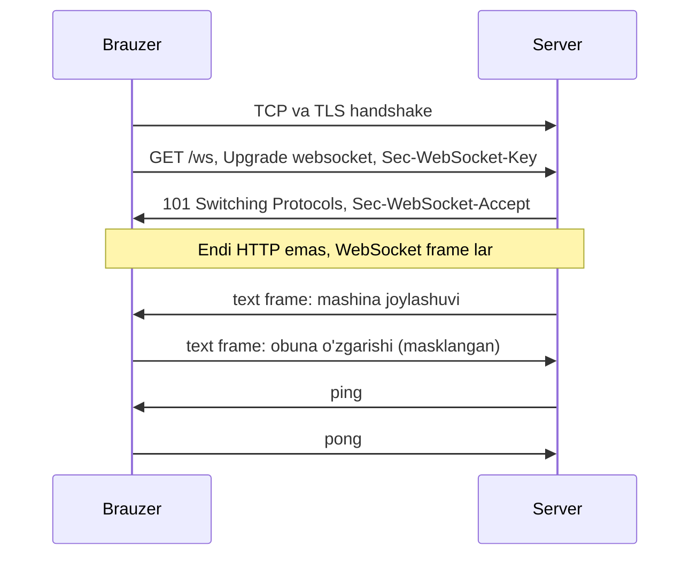
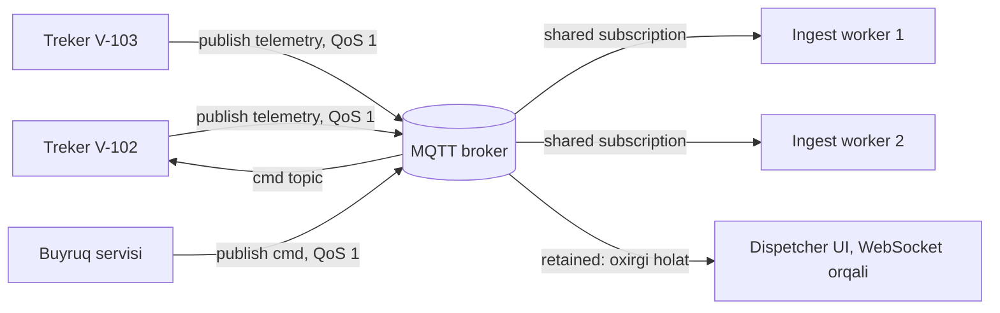

## Bu dars nima uchun kerak

HTTP so'rov-javob modeli: klient so'raydi, server javob beradi. Lekin ko'p ilovalarda ma'lumot **server tomonda** paydo bo'ladi va klientga darhol yetishi kerak: dispetcher xaritasida mashina harakati, yangi alert, chat xabari, buyurtma holati. Yoki aksincha: minglab qurilma serverga doimiy ma'lumot yuboradi va serverdan buyruq kutadi.

Buning uchun bir nechta texnika bor va ularning har biri boshqacha narx to'laydi: server resurslari, latency, trafik, mobil batareya, proksi va load balancer lar bilan moslik. 5-darsdagi TCP, 6-darsdagi DNS va 7-darsdagi HTTP/2-HTTP/3 bilimi shu yerda birlashadi.

Bu darsdan keyin siz:

- short polling, long polling, SSE, WebSocket va MQTT qanday ishlashini protokol darajasida bilasiz;
- har birining latency, trafik va server resursi narxini hisoblay olasiz;
- uzoq yashaydigan ulanishlarni masshtablash muammolarini (stateful gateway, fan-out, reconnect storm) tushunasiz;
- MQTT ning QoS darajalari, keep alive, will va retained xabarlar qanday ishlashini bilasiz;
- vazifa uchun to'g'ri texnikani asoslab tanlay olasiz.

## Short polling

Klient har N soniyada so'raydi: "yangi narsa bormi?"

```
GET /alerts?since=1712345678   har 5 soniyada
```

- **Latency:** o'rtacha N/2, eng yomoni N. 5 s interval bilan o'rtacha 2.5 s kechikish.
- **Trafik va yuklama:** ko'pchilik javoblar bo'sh. 10 000 ochiq dispetcher sahifasi, har 5 s: 10 000 / 5 = **2 000 so'rov/s**, ulardan aksariyati hech narsa qaytarmaydi.
- **Afzalligi:** juda oddiy, stateless, har qanday proksi va cache bilan ishlaydi, server qayta ishga tushsa ham hech narsa uzilmaydi.

Trade-off aniq: intervalni kamaytirsangiz latency kamayadi, yuklama esa teskari proporsional oshadi. 1 s interval bilan yuqoridagi misolda 10 000 so'rov/s.

Short polling yomon emas. Agar yangilanish kamdan-kam va 30-60 s kechikish qabul qilinsa (hisobot tayyor bo'ldimi, eksport holati), bu eng arzon va ishonchli yechim.

## Long polling

Klient so'rov yuboradi, server esa yangi ma'lumot paydo bo'lguncha (yoki timeout gacha, masalan 30 s) **javobni ushlab turadi**. Javob kelgach, klient darhol yangi so'rov yuboradi.

- **Latency:** yangi hodisa deyarli darhol yetadi (bitta RTT atrofida), lekin ikki hodisa ketma-ket kelsa, ikkinchisi klient qayta so'rov yuborguncha kutadi.
- **Server resursi:** har bir kutayotgan klient - ochiq ulanish va server tomonda kutish holati. Thread-per-request serverlarda (klassik Java servlet, PHP-FPM) bu thread larni band qiladi; event loop li serverlarda (Node.js, Go) arzon.
- **Moslik:** oddiy HTTP, shuning uchun deyarli hamma joyda ishlaydi. Proksi va load balancer timeout lari long poll timeout idan uzunroq bo'lishi kerak.

Nozik joylar:

- **Hodisalarni yo'qotmaslik.** Javob qaytgan va klient yangi so'rov yuborgan oraliqda kelgan hodisa yo'qolmasligi uchun klient "oxirgi olingan hodisa ID si" ni yuboradi, server esa undan keyingilarni qaytaradi. Demak serverda qisqa muddatli hodisalar buferi kerak.
- **Thundering herd.** Bitta hodisa 10 000 kutayotgan klientga javob qaytarsa, 10 000 klient bir vaqtda yangi so'rov yuboradi.

Long polling WebSocket keng tarqalmagan davrda real-time ning asosiy usuli edi va hozir ham fallback sifatida ishlatiladi (masalan, Socket.IO kabi kutubxonalar WebSocket ishlamasa unga qaytadi).

## Server-Sent Events (SSE)

SSE - bitta HTTP javobi orqali **serverdan klientga** uzluksiz hodisalar oqimi. Brauzerda `EventSource` API, server tomonda oddiy HTTP javob, `Content-Type: text/event-stream`, javob yopilmaydi.

Format (WHATWG HTML standarti) - matnli qatorlar, har bir hodisa bo'sh qator bilan tugaydi:

```
event: vehicle-position
id: 81723
data: {"id":"V-102","lat":41.31,"lon":69.27,"speed":54}

event: alert
id: 81724
data: {"type":"fuel-drop","vehicle":"V-77"}

```

Maydonlar: `event` (hodisa turi), `data` (yuk), `id` (hodisa ID si), `retry` (qayta ulanish kutish vaqti). `:` bilan boshlanadigan qatorlar izoh - ular ko'pincha ulanishni "tirik" ushlash uchun yuboriladi.

Kuchli tomonlari:

- **Avtomatik qayta ulanish va davom ettirish.** Ulanish uzilsa, brauzer o'zi qayta ulanadi va oxirgi olingan `id` ni `Last-Event-ID` sarlavhasida yuboradi. Server shu joydan davom ettiradi. Long polling da buni qo'lda yozish kerak edi.
- **Oddiy HTTP.** Mavjud autentifikatsiya, CDN, load balancer, HTTP/2 bilan ishlaydi.
- **HTTP/2 bilan yaxshi.** MDN ga ko'ra HTTP/1.1 da SSE ulanishlari brauzer va domen bo'yicha 6 ta bilan cheklangan (barcha tablar bo'yicha umumiy) - 7-tab ochilmay qoladi. HTTP/2 da ular bitta TCP ulanish ichidagi stream lar (odatda 100 tagacha).

Cheklovlari:

- **Faqat bir tomonlama** (server - klient). Klientdan serverga oddiy HTTP so'rovlar bilan yuboriladi - ko'p ilovalar uchun bu yetarli.
- **Faqat matn** (UTF-8). Binar ma'lumot base64 bilan (+33% hajm).
- Ba'zi proksilar javobni buferlaydi va oqimni buzadi; `Cache-Control: no-cache` va proksi buferlashini o'chirish (masalan, Nginx da `X-Accel-Buffering: no`) kerak bo'ladi.

Dispetcher dashboard i kabi "server ko'p yuboradi, klient kam" holatlari uchun SSE ko'pincha WebSocket dan oddiyroq va yetarli tanlov.

## WebSocket

WebSocket (RFC 6455, 2011) - bitta TCP ulanish ustida **ikki tomonlama**, to'liq dupleks, xabarlarga asoslangan kanal.

### Handshake

WebSocket HTTP/1.1 orqali boshlanadi va keyin protokolni almashtiradi:



Server `Sec-WebSocket-Accept` da klient kalitini belgilangan GUID bilan xeshlab qaytaradi - bu server haqiqatan WebSocket ni tushunganini isbotlaydi.

### Frame lar

- Har bir xabar bir yoki bir nechta **frame**. Sarlavha 2 baytdan boshlanadi, uzunlikka qarab yana 2 yoki 8 bayt, klientdan kelganda yana 4 baytlik mask kaliti: jami 2-14 bayt. HTTP so'rovining yuzlab baytlik sarlavhasiga nisbatan juda kam.
- Text (UTF-8) va binary frame lar; close, ping, pong boshqaruv frame lari.
- **Masking.** Klientdan serverga barcha frame lar tasodifiy kalit bilan masklanishi shart, serverdan klientga - masklanmaydi. RFC buni oraliq qurilmalarni (masalan, tutib oluvchi proksilarni) chalg'itishning oldini olish bilan tushuntiradi: kalit oldindan aytib bo'lmaydigan bo'lgani uchun zararli skript simdagi baytlarni nazorat qila olmaydi.

### WebSocket ning narxi

- **Stateful ulanish.** Har bir klient serverda ochiq ulanish va xotira. Load balancer ulanishni bitta backend ga "yopishtiradi"; backend qayta ishga tushsa, uning barcha klientlari qayta ulanadi.
- **O'z protokolingizni yozasiz.** WebSocket faqat "quvur" beradi: xabar formati, so'rov-javobni bog'lash, tasdiqlash, qayta ulanishda davom ettirish, autentifikatsiya yangilash - hammasini ilova darajasida qilish kerak. SSE dagi `Last-Event-ID` kabi tayyor mexanizm yo'q.
- **Infratuzilma moslashuvi.** Load balancer (idle timeout lar), proksi va firewall lar WebSocket ni qo'llab-quvvatlashi kerak. Ko'p bulut LB larda idle timeout standart holatda daqiqalar atrofida, shuning uchun ilova ping/pong yuborib turishi kerak.
- **HTTP/2 va HTTP/3.** Klassik WebSocket HTTP/1.1 Upgrade orqali alohida TCP ulanishda ishlaydi. HTTP/2 va HTTP/3 ustida ham WebSocket ni ishlatish uchun alohida standartlar bor, lekin qo'llab-quvvatlash hamma joyda bir xil emas.

WebSocket qachon kerak: haqiqiy ikki tomonlama, kam latency li, tez-tez xabar almashinuvi - chat, birgalikda tahrirlash, o'yinlar, savdo terminallari, dispetcher va haydovchi orasidagi interaktiv aloqa.

## MQTT

MQTT - IoT uchun yaratilgan yengil **publish/subscribe** protokoli. Joriy versiya MQTT 5.0 (OASIS standarti, 2019 yil mart), undan oldingi keng tarqalgan versiya 3.1.1. Odatda TCP ustida (1883 port, TLS bilan 8883), brauzerlar uchun WebSocket ustida ham.

### Model

Qurilmalar (klientlar) to'g'ridan-to'g'ri bir-biri bilan emas, **broker** orqali gaplashadi:

- klient **topic** ga xabar **publish** qiladi: `fleet/acme/vehicles/V-102/telemetry`;
- boshqa klientlar topic larga **subscribe** qiladi, wildcard lar bilan: `+` bitta darajani (`fleet/acme/vehicles/+/telemetry`), `#` qolgan barcha darajalarni (`fleet/acme/#`) almashtiradi. Wildcard lar faqat obunada ishlatiladi.



### Ixcham format

Fixed header 2 baytdan (paket turi va bayroqlar + qolgan uzunlik), katta xabarlarda 5 baytgacha. Topic nomi va yuk qo'shiladi. HTTP so'rovidagi yuzlab baytlik sarlavhalarga nisbatan bu mobil trafik va batareya uchun sezilarli farq.

### QoS darajalari

| QoS | Kafolat | Almashinuv | Narx |
|---|---|---|---|
| 0 | At most once - yo'qolishi mumkin | PUBLISH | Eng arzon |
| 1 | At least once - takrorlanishi mumkin | PUBLISH, PUBACK | Bitta tasdiq; qabul qiluvchi dublikatlarni hal qilishi kerak |
| 2 | Exactly once (ikki tomon o'rtasida) | PUBLISH, PUBREC, PUBREL, PUBCOMP | 2 ta to'liq almashinuv, ikki tomonda holat |

Muhim nozikliklar:

- QoS **har bir bo'g'in uchun alohida**: publisher - broker va broker - subscriber. Subscriber past QoS bilan obuna bo'lsa, xabar unga past QoS bilan yetadi.
- QoS 2 ning "exactly once" i faqat MQTT bo'g'ini ichida. Broker xabarni bazaga yozuvchi worker ga yetkazdi, worker esa bazaga yozib, tasdiqlashdan oldin quladi - xabar qayta keladi. End-to-end exactly-once uchun ilova darajasida idempotentlik kerak (39-dars). Amalda ko'p tizimlar QoS 1 + idempotent qayta ishlashni tanlaydi.

### Sessiya, keep alive va will

- **Keep Alive.** Klient CONNECT da interval beradi (soniyalarda). Shu vaqt ichida boshqa paket yubormasa, PINGREQ yuboradi. Server 1.5 × Keep Alive davomida hech narsa olmasa, ulanishni yopadi. Bu 5-darsdagi NAT timeout muammosining protokol darajasidagi yechimi.
- **Persistent session.** MQTT 5 da `Clean Start = 0` va `Session Expiry Interval` bilan broker klient oflayn bo'lganda uning obunalarini va QoS 1/2 xabarlarini saqlaydi. Qurilma qayta ulanganda kutilgan buyruqlarni oladi.
- **Will message.** Klient ulanishda "vasiyat" xabarini beradi; agar u to'g'ri DISCONNECT siz yo'qolsa (aloqa uzildi, quvvat tugadi), broker bu xabarni publish qiladi. Qurilma onlayn/oflayn holatini kuzatish uchun ideal.
- **Retained message.** Topic ga retain bayrog'i bilan yuborilgan oxirgi xabar broker da saqlanadi va yangi obunachi darhol uni oladi. Har bir topic da bittasi, yangisi eskisini almashtiradi; bo'sh yuk bilan o'chiriladi. "Mashinaning oxirgi holati" uchun qulay: dispetcher sahifasi ochilganda keyingi xabarni kutmasdan oxirgi holatni ko'radi.
- **Shared subscriptions** (MQTT 5). Bir guruhdagi bir nechta subscriber o'rtasida xabarlar taqsimlanadi - har bir xabar faqat bittasiga boradi. Bu ingest worker larni gorizontal masshtablash imkonini beradi (navbatlardagi consumer group ga o'xshash, 41-43 darslar).

MQTT broker navbat emas: uzoq muddatli saqlash, qayta o'qish (replay), katta hajmli tarix uchun MQTT dan keyin Kafka kabi log qo'yiladi (43-dars).

## Taqqoslash

| Xususiyat | Short polling | Long polling | SSE | WebSocket | MQTT |
|---|---|---|---|---|---|
| Yo'nalish | Klient so'raydi | Klient so'raydi, server ushlaydi | Server - klient | Ikki tomonlama | Ikki tomonlama, pub/sub |
| Latency | Interval/2 o'rtacha | ~1 RTT | ~0 (oqim) | ~0 | ~0 |
| Bo'sh holatdagi trafik | Yuqori | O'rta (timeout da qayta so'rov) | Past (izohli keep-alive) | Past (ping/pong) | Juda past (PINGREQ) |
| Xabar overhead i | To'liq HTTP | To'liq HTTP | Bir necha bayt maydon nomi | 2-14 bayt | 2-5 bayt + topic |
| Server holati | Yo'q | Kutayotgan so'rov | Ochiq oqim | Ochiq ulanish | Ochiq ulanish + sessiya |
| Qayta ulanishda davom ettirish | Tabiiy (since parametri) | Qo'lda | Tayyor (Last-Event-ID) | Qo'lda | Persistent session, QoS |
| Binar ma'lumot | Ha | Ha | Yo'q (base64) | Ha | Ha |
| Brauzer | Ha | Ha | Ha | Ha | WebSocket orqali |
| Eng mos joy | Kam o'zgaradigan holat | Fallback | Dashboard, bildirishnomalar | Chat, interaktiv | IoT qurilmalar |

## Uzoq yashaydigan ulanishlarni masshtablash

SSE, WebSocket va MQTT ning umumiy muammosi: ular **stateful**. Bu stateless HTTP servislarni masshtablash (21-dars) qoidalarini o'zgartiradi.

### 1. Ulanishlar soni va xotira

Bitta ulanish narxi: yadro buferlari, TLS holati, ilova obyektlari. Taxminan 10-50 KB deylik. 100 000 ulanish × 30 KB = **3 GB** RAM - bitta serverga sig'adi. Event loop li serverlar (Node.js, Go, Erlang) bir mashinada yuz minglab ulanishni ushlay oladi; asosiy cheklov ko'pincha xotira, fayl deskriptorlari limiti va TLS handshake CPU si.

### 2. Gateway va backend ni ajratish

Odatiy naqsh: ulanishlarni ushlab turuvchi **gateway** qatlami biznes-logikadan ajratiladi. Gateway "kim qaysi kanalga obuna" ni biladi va xabarlarni yetkazadi; biznes servislar stateless qoladi va gateway larga pub/sub (Redis Pub/Sub, NATS, Kafka) orqali xabar yuboradi.

Slack muhandislik blogi (2023) aynan shunday arxitekturani tasvirlaydi: har bir klient eng yaqin edge region ga doimiy WebSocket ochadi, Envoy uni **Gateway Server** ga uzatadi. Gateway serverlar xotirada foydalanuvchi va obunalarni saqlaydi. **Channel Server** lar consistent hashing (29-dars) bo'yicha kanallarga egalik qiladi. Xabar kanal serveriga, undan shu kanalga obuna bo'lgan barcha gateway larga, ulardan klientlarga boradi. Slack o'n millionlab ulangan klientlarni va dunyo bo'ylab ~500 ms ichida yetkazishni qayd etadi.

### 3. Fan-out

Bitta hodisa ko'p obunachiga yetishi kerak. Discord muhandislik blogi (2017) Elixir/Erlang da ~5 mln bir vaqtdagi foydalanuvchiga masshtablash tajribasini tasvirlaydi: har bir WebSocket klienti uchun sessiya jarayoni, guild (server) jarayoni esa guild dagi har bir hodisani unga ulangan barcha sessiyalarga yuboradi. Bir vaqtda 30 000 tagacha foydalanuvchi bo'lgan katta guild larda bitta jarayon (Erlang jarayonlari bitta thread li) navbatdan orqada qola boshlagan. Yechim - Manifold kutubxonasi: qabul qiluvchilarni masofaviy tugun bo'yicha guruhlab, har bir tugunga bitta xabar yuborish va u yerda tarqatish. Bu CPU va tugunlar orasidagi trafikni kamaytirgan. Fan-out muammosi 87-darsda (news feed) to'liq ko'riladi.

### 4. Deploy va reconnect storm

Gateway ni yangilash - barcha ulanishlarni uzish demak. 100 000 klient bir vaqtda qayta ulansa, DNS, TLS handshake va autentifikatsiya bo'roni bo'ladi. Yechimlar:

- **Graceful drain:** yangi ulanishlarni qabul qilishni to'xtatib, eskilarini asta-sekin (daqiqalar davomida) yopish.
- **Klient tomonda jitter li eksponensial backoff** (62-dars).
- **Davom ettirish tokeni / oxirgi hodisa ID si:** qayta ulangan klient hamma narsani qaytadan yuklamasin.

### 5. Load balancing

L4 LB ulanishlarni teng taqsimlaydi, lekin yangi qo'shilgan server bo'sh qoladi (eski ulanishlar ko'chmaydi). Masshtablashda ulanishlarni qayta muvozanatlash uchun ba'zan serverlar "eng eski ulanishlarni" yopib, klientni qayta ulanishga undaydi. LB idle timeout lari heartbeat intervalidan uzun bo'lishi kerak.

## iQuariX kontekstida

Faraz qiling, iQuariX da uch xil real-time oqim bor:

**1. Trekerlar - server (IoT).** 50 000 treker. Agar treker MQTT ni qo'llasa: telemetriya `t/{tenant}/{vehicle}` ga QoS 1, holat (onlayn/oflayn) will message bilan, buyruqlar `cmd/{vehicle}` ga QoS 1 va persistent session bilan - mashina tunneldan chiqqanda kutilgan buyruqni oladi. Ingest worker lar shared subscription orqali yuklamani bo'lishadi va idempotent yozadi (treker ID + ketma-ketlik raqami). Ko'p arzon trekerlar esa o'z maxsus TCP protokolida ishlaydi (5-dars) - unda gateway shu protokolni MQTT yoki ichki navbatga tarjima qiladi.

Trafik hisobi: har 10 s da 60 baytlik yuk. HTTP POST da sarlavhalar bilan ~500 bayt, MQTT da ~60 + topic (~20) + 2 = ~82 bayt. Kuniga (10 soat): 3 600 xabar. HTTP: 3 600 × 500 = 1.8 MB; MQTT: 3 600 × 82 ≈ 0.3 MB (TCP/IP sarlavhalari va TLS ni hisobga olmasdan). 50 000 mashinada oyiga farq terabayt tartibida mobil trafik - bu SIM tariflari uchun to'g'ridan-to'g'ri pul.

**2. Server - dispetcher (brauzer).** 2 000 dispetcher, har biri o'z parkining 50-500 mashinasini ko'radi. Ma'lumot asosan bir tomonlama: joylashuvlar va alertlar. **SSE** HTTP/2 ustida yetarli va oddiy: avtomatik qayta ulanish, `Last-Event-ID` bilan o'tkazib yuborilgan alertlarni olish. Joylashuvlar uchun har bir hodisani emas, har 1-2 soniyada **birlashtirilgan** yangilanish yuborish trafikni keskin kamaytiradi (500 mashina × har 10 s = 50 hodisa/s bitta dispetcherga; 2 s lik batch bilan - soniyasiga 0.5 xabar). Filtr va obuna o'zgarishlari oddiy HTTP so'rovlar bilan.

**3. Dispetcher - haydovchi (mobil ilova).** Ikki tomonlama chat va topshiriqlar: WebSocket yoki mobil ilova ham MQTT ishlatishi mumkin. Mobil ilova fonda bo'lganda OS ulanishni uzadi - bu holda push bildirishnomalar (85-dars) kerak.

Bu uchta oqimni bitta texnologiyaga majburlash xato bo'lardi: har birining yo'nalishi, klient turi va ishonchlilik talabi boshqacha.

## Ko'p uchraydigan xatolar

1. **Har qanday "real-time" uchun WebSocket tanlash.** Bir tomonlama oqim uchun SSE oddiyroq; kam o'zgaradigan holat uchun polling yetarli.
2. **Qayta ulanishda hodisalarni yo'qotish.** Oxirgi hodisa ID si va server tomonidagi qisqa bufer kerak; SSE da `Last-Event-ID` ni ishlating.
3. **Biznes logikani gateway ga tiqish.** Stateful gateway faqat ulanishlar va yetkazish uchun; logika stateless servislarda.
4. **Heartbeat siz uzoq ulanishlar.** LB, NAT va proksi idle timeout lari ulanishni jimgina uzadi.
5. **Reconnect storm ni rejalashtirmaslik.** Deploy da graceful drain, klientda jitter li backoff.
6. **MQTT QoS 2 ni end-to-end exactly-once deb hisoblash.** Kafolat faqat bitta bo'g'in uchun; qayta ishlash idempotent bo'lishi kerak.
7. **Har bir hodisani alohida yuborish.** UI uchun yuqori chastotali yangilanishlarni birlashtiring (batch, throttle), aks holda brauzer va tarmoq to'lib ketadi.
8. **HTTP/1.1 da ko'p SSE oqimi.** Brauzer va domen bo'yicha 6 ulanish limiti; HTTP/2 ishlating yoki oqimlarni birlashtiring.

## Xulosa

- Short polling oddiy va stateless, lekin latency va bo'sh so'rovlar o'rtasida trade-off.
- Long polling deyarli darhol yetkazadi, lekin davom ettirish va thundering herd ni qo'lda hal qilish kerak.
- SSE - server dan klientga oqim uchun eng oddiy standart: avtomatik qayta ulanish, Last-Event-ID, HTTP/2 bilan yaxshi.
- WebSocket - ikki tomonlama, kam overhead li kanal, lekin protokolni (tasdiq, davom ettirish) o'zingiz yozasiz.
- MQTT - IoT uchun: 2 baytli sarlavha, pub/sub, QoS 0/1/2, keep alive, will, retained, persistent session.
- Uzoq ulanishlar stateful: gateway ni logikadan ajrating, fan-out, deploy va reconnect storm ni loyihalang.
- Har bir oqim uchun alohida texnika tanlash normal: qurilmalar, brauzer va mobil ilova talablari turlicha.

## Amaliy topshiriq

Faraz qiling, iQuariX "Live Map" funksiyasini qayta qurmoqda. Talablar: 3 000 dispetcher bir vaqtda onlayn, har biri 10-2 000 mashinani ko'radi; mashinalar har 10 s da joylashuv yuboradi (jami 50 000 mashina); alertlar (yoqilg'i to'kish, geozonadan chiqish) 2 soniyadan kam kechikish bilan va **yo'qolmasdan** yetishi kerak; dispetcher xaritani surib/zoom qilganda ko'rinadigan mashinalar to'plami o'zgaradi.

1. **Texnika tanlovi.** Joylashuvlar va alertlar uchun qaysi texnika (polling, SSE, WebSocket)? Bir xilmi yoki alohidami? Asoslang.
2. **Trafik hisobi.** Eng katta dispetcher (2 000 mashina) ga soniyasiga nechta yangilanish keladi? Har birini alohida yuborish va 1 s lik batch bilan yuborishda bayt/s ni solishtiring. Barcha dispetcherlar uchun jami chiquvchi trafik.
3. **Gateway arxitekturasi.** Ulanishlarni ushlovchi gateway, obunalar (qaysi dispetcher qaysi mashinalarni ko'radi) va hodisa manbai (ingest dan) qanday bog'lanadi? Diagramma chizing. Fan-out qayerda bo'ladi?
4. **Alertlar yo'qolmasligi.** Dispetcher brauzeri 30 s ga aloqani yo'qotdi. Qayta ulanganda o'tkazib yuborilgan alertlarni qanday oladi? Server tomonda nima saqlanadi va qancha vaqt?
5. **Deploy.** Gateway ning yangi versiyasini 3 000 ulanishni sezilarli uzmasdan qanday chiqarasiz?
6. **Sig'im.** Bitta gateway serveri nechta ulanishni ushlaydi (taxmin bilan)? Nechta server kerak, N+1 bilan?

Yaxshi javobda bo'lishi kerak bo'lgan narsalar:

- joylashuvlar (yo'qolishi mumkin, eng yangisi muhim) va alertlar (yo'qolmasligi kerak) uchun turli ishonchlilik talablari ajratilgan;
- trafik hisobi batch/throttle bilan va siz, raqamlar bilan;
- gateway stateful, biznes servislar stateless; obunalar va fan-out joyi aniq;
- alertlar uchun hodisa ID si, server tomonidagi bufer va Last-Event-ID yoki ekvivalent;
- deploy da graceful drain va klientda jitter li backoff.

Javobni pastdagi maydonga yozib, chatga yuboring.

## Manbalar

- [RFC 6455: The WebSocket Protocol](https://www.rfc-editor.org/rfc/rfc6455), 2011 - opening handshake, frame formati, masking, ping/pong.
- WHATWG. [HTML Standard: Server-sent events](https://html.spec.whatwg.org/multipage/server-sent-events.html) - text/event-stream formati, Last-Event-ID, qayta ulanish.
- MDN. [Using server-sent events](https://developer.mozilla.org/en-US/docs/Web/API/Server-sent_events/Using_server-sent_events) - HTTP/1.1 da 6 ulanish cheklovi va HTTP/2.
- OASIS. [MQTT Version 5.0](https://docs.oasis-open.org/mqtt/mqtt/v5.0/os/mqtt-v5.0-os.html), 2019 - QoS darajalari, Keep Alive 1.5x qoidasi, will, session expiry, shared subscriptions, fixed header.
- HiveMQ. [MQTT Essentials: Retained Messages](https://www.hivemq.com/blog/mqtt-essentials-part-8-retained-messages/) va [Topics and Best Practices](https://www.hivemq.com/blog/mqtt-essentials-part-5-mqtt-topics-best-practices/) - retained xabarlar, wildcard lar.
- Slack Engineering. [Real-time Messaging](https://slack.engineering/real-time-messaging/), 2023 - Gateway va Channel Server lar, consistent hashing, WebSocket.
- Discord. [How Discord Scaled Elixir to 5,000,000 Concurrent Users](https://discord.com/blog/how-discord-scaled-elixir-to-5-000-000-concurrent-users), 2017 - sessiya va guild jarayonlari, fan-out, Manifold.
- Ilya Grigorik. [High Performance Browser Networking, 11-bob "HTTP/1.X"](https://hpbn.co/http1x/) - HTTP sarlavhalari overhead i.
