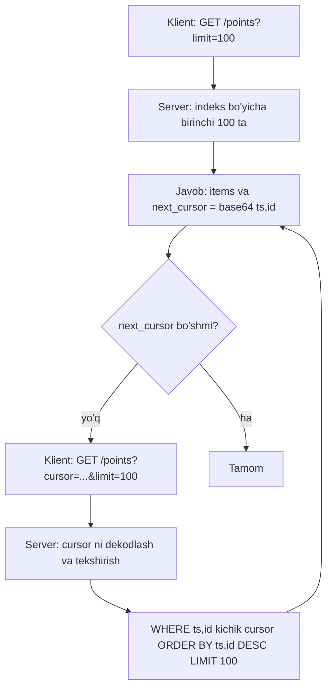
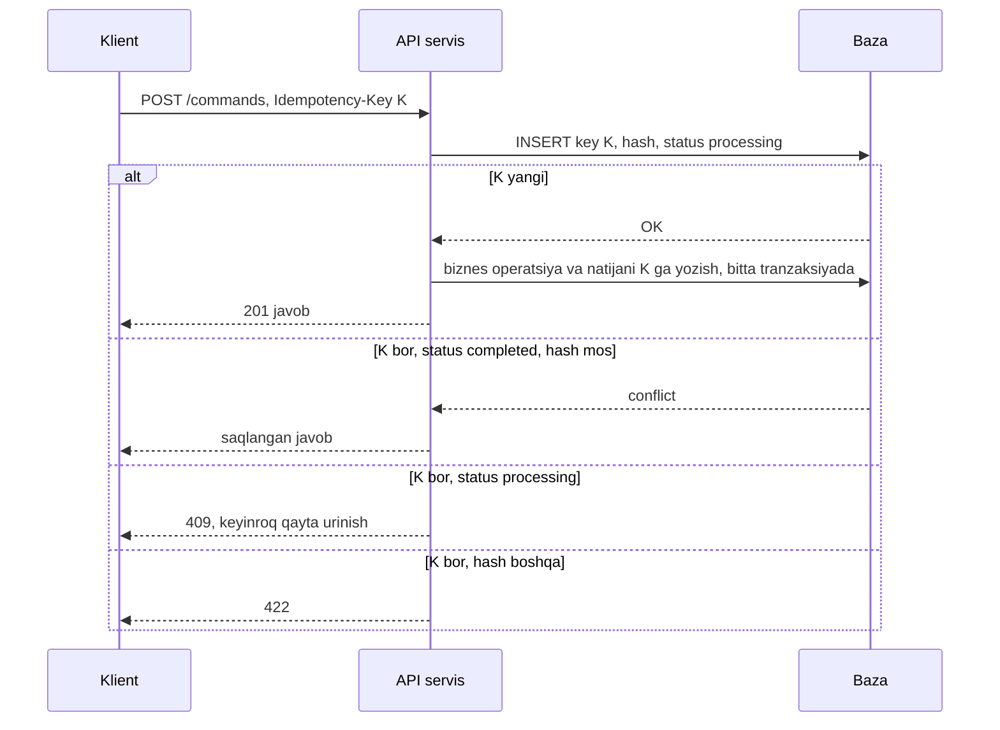

## Bu dars nima uchun kerak

1-darsda tashqi API kontrakti "qaytarilmaydigan qarorlar" (1-tur) qatorida edi: mijozlar unga bog'lanib qoladi va uni o'zgartirish ularning kodini buzadi. Ichki API lar ham ko'pincha shunday bo'ladi: 20 ta servis bitta endpoint ga bog'langan bo'lsa, uni o'zgartirish 20 ta deploy demak.

5-8 darslarda transport qatlamini ko'rdik: TCP, HTTP/2, HTTP/3, real-time kanallar. Bu darsda ularning ustidagi qatlam: **API ni qanday shakllantirish** - qaysi uslub (REST, gRPC, GraphQL), katta ro'yxatlarni qanday qaytarish (pagination), kontraktni qanday o'zgartirish (versioning) va tarmoq nosozliklarida so'rovni xavfsiz qayta yuborish (idempotency).

Bu darsdan keyin siz:

- REST, gRPC va GraphQL ning ichki modeli, kuchli va zaif tomonlarini bilasiz va har biri qayerga mosligini asoslay olasiz;
- HTTP metodlarining safe va idempotent semantikasini va ulardan retry siyosatida foydalanishni bilasiz;
- offset va cursor (keyset) pagination farqini SQL va hisob bilan tushuntira olasiz;
- API versioning strategiyalarini va orqaga moslikni saqlash qoidalarini bilasiz;
- idempotency key ni server tomonda to'g'ri implementatsiya qila olasiz, shu jumladan parallel so'rovlar va qisman bajarilgan operatsiyalar holatida.

## Asosiy savol: kim chaqiradi va qanday

API uslubini tanlashdan oldin uchta savolga javob bering:

1. **Iste'molchi kim?** Tashqi mijozlar (noma'lum tillar, noma'lum vositalar) - standart va oddiylik muhim. Ichki servislar (o'z jamoangiz) - samaradorlik va qat'iy tiplash muhim. Frontend (bir nechta ekran, har xil ma'lumot ehtiyoji) - moslashuvchanlik muhim.
2. **Aloqa shakli?** So'rov-javob, oqim (streaming), hodisalar (8-dars, 41-dars).
3. **Kontrakt qanchalik barqaror bo'lishi kerak?** Ochiq API yillar davomida yashaydi; ichki API bitta deploy bilan o'zgarishi mumkin.

## REST

REST atamasini Roy Fielding 2000 yildagi dissertatsiyasida kiritgan: bu arxitektura uslubi, protokol emas. Uning cheklovlari: client-server, stateless, cache lanadigan javoblar, uniform interface, layered system va ixtiyoriy code-on-demand. Amalda "REST API" deganda odatda **resurslarga yo'naltirilgan HTTP API** tushuniladi:

- resurslar URI bilan: `/vehicles/V-102`, `/vehicles/V-102/trips`;
- amallar HTTP metodlari bilan: GET o'qish, POST yaratish, PUT almashtirish, PATCH qisman o'zgartirish, DELETE o'chirish;
- holat status kodlari bilan: 200, 201, 204, 400, 401, 403, 404, 409, 422, 429, 5xx;
- formati odatda JSON.

### Safe va idempotent metodlar

Bu bo'lim retry va cache dizayni uchun eng muhim qism.

- **Safe** metod serverda holatni o'zgartirmaydi (mantiqan): GET, HEAD, OPTIONS, TRACE.
- **Idempotent** metodni N marta bajarish 1 marta bajarish bilan bir xil **natija holat** beradi: barcha safe metodlar, plus PUT va DELETE.
- **POST va PATCH idempotent emas** (kafolatlanmagan). Ikki marta yuborilgan `POST /payments` ikkita to'lov yaratishi mumkin.

MDN dagi misol: `DELETE /items/X` birinchi marta 200, keyingilari 404 qaytaradi - status kodi farq qiladi, lekin server holati bir xil (X yo'q), shuning uchun DELETE idempotent. Idempotentlik javob haqida emas, **ta'sir** haqida.

Amaliy oqibat: tarmoq timeout bo'lganda klient bilmaydi - so'rov yetib bordimi, bajarildimi? Idempotent so'rovni bemalol qayta yuborish mumkin. POST ni qayta yuborish uchun **idempotency key** kerak (pastda).

### Optimistic concurrency: ETag va If-Match

Ikki dispetcher bir vaqtda mashina sozlamasini o'zgartirmoqda. Oxirgi yozgan g'olib bo'ladi va birinchisining o'zgarishi jimgina yo'qoladi (lost update, 18-dars). HTTP buning uchun shartli so'rovlarni beradi: server resurs versiyasini `ETag` sarlavhasida qaytaradi, klient o'zgartirishda `If-Match: "<etag>"` yuboradi. Agar resurs o'zgargan bo'lsa, server **412 Precondition Failed** qaytaradi va klient qayta o'qib, birlashtiradi. Bu baza darajasidagi `UPDATE ... WHERE version = ?` ning API darajasidagi ko'rinishi.

### Xatolar formati

RFC 9457 (2023, RFC 7807 o'rnini olgan) xatolar uchun standart format beradi: `application/problem+json`, maydonlar `type`, `title`, `status`, `detail`, `instance` va qo'shimcha kengaytmalar. Har bir servis o'z xato formatini o'ylab topishi o'rniga shuni ishlatish klientlar uchun bir xillik beradi.

```json
{
  "type": "https://api.iquarix.uz/problems/geofence-overlap",
  "title": "Geozona boshqasi bilan kesishadi",
  "status": 409,
  "detail": "Zona Z-17 mavjud Z-03 bilan 40% kesishadi",
  "instance": "/geofences/requests/8f2c",
  "conflictingZone": "Z-03"
}
```

### REST ning kuchli va zaif tomonlari

Kuchli: universal (har qanday til, curl, brauzer), HTTP cache (CDN, `Cache-Control`, ETag), tushunarli, vositalar ko'p (OpenAPI).

Zaif:

- **Over-fetching / under-fetching.** `/vehicles/V-102` 40 ta maydon qaytaradi, mobil ilovaga 3 tasi kerak. Yoki aksincha: ekran uchun mashina, uning haydovchisi, oxirgi 5 alert kerak - 3 ta so'rov, mobil tarmoqda 3 RTT.
- **JSON narxi.** Matnli format, kalit nomlari har bir obyektda takrorlanadi, parse qilish CPU talab qiladi (10-dars).
- **Kontrakt qat'iy emas.** OpenAPI bo'lmasa, tiplar faqat hujjatda.

## gRPC

gRPC - Google da boshlangan RPC freymvorki: servis va xabarlar **Protocol Buffers** (10-dars) da ta'riflanadi, klient va server kodi generatsiya qilinadi.

```proto
service Telemetry {
  rpc GetLastPosition(VehicleId) returns (Position);
  rpc StreamPositions(FleetFilter) returns (stream Position);
  rpc UploadBatch(stream Position) returns (UploadAck);
}
```

### Ichki mexanika

- Transport - **HTTP/2** (7-dars). Har bir RPC - bitta HTTP/2 stream. gRPC protokol hujjatiga ko'ra so'rov `POST /{Service}/{Method}` ko'rinishida, `content-type: application/grpc`; har bir xabar oldida 1 baytlik "siqilgan" bayrog'i va 4 baytlik uzunlik turadi (length-prefixed message).
- Natija statusi HTTP status kodida emas, oxirgi HEADERS frame idagi **trailer** larda: `grpc-status`, `grpc-message`. Shuning uchun trailer larni qo'llab-quvvatlamaydigan proksilar gRPC ni buzadi.
- Brauzer HTTP/2 frame larini va trailer larni to'g'ridan-to'g'ri boshqara olmaydi, shuning uchun brauzerdan gRPC uchun gRPC-Web va maxsus proksi (odatda Envoy) kerak.

### To'rt xil chaqiruv

gRPC hujjatiga ko'ra:

| Tur | Ma'nosi | Misol |
|---|---|---|
| Unary | Bitta so'rov, bitta javob | Oxirgi joylashuvni olish |
| Server streaming | Bitta so'rov, javoblar oqimi | Park bo'yicha joylashuvlar oqimi |
| Client streaming | So'rovlar oqimi, bitta javob | Oflayn to'plangan nuqtalarni yuklash |
| Bidirectional | Ikki tomonlama mustaqil oqimlar | Interaktiv sessiya |

### Deadline va cancellation

gRPC ning kam baholangan, lekin eng muhim xususiyati. Hujjatga ko'ra gRPC **standart holatda deadline qo'ymaydi** - klient abadiy kutishi mumkin. Shuning uchun har bir chaqiruvda aniq deadline berish tavsiya etiladi. Deadline servislar zanjiri bo'ylab **uzatiladi** (propagation): A servisi 500 ms deadline bilan B ni chaqirdi, B 100 ms ishlatib C ni chaqirsa, C ga qolgan ~400 ms uzatiladi. Uzatishda absolyut vaqt emas, qolgan vaqt yuboriladi - serverlar soatlari farqi muammosidan qochish uchun. Deadline o'tsa, chaqiruv `DEADLINE_EXCEEDED` bilan tugaydi va server tomonda bekor qilinadi, foydasiz ish to'xtaydi. Lekin gRPC "Core concepts" hujjati ogohlantiradi: bekor qilishdan oldin qilingan o'zgarishlar orqaga qaytarilmaydi.

Bu 3-darsdagi Little qonuni bilan bevosita bog'liq: deadline bo'lmasa, sekin bog'liqlik concurrency ni cheksiz oshiradi (62-64 darslar).

### Kuchli va zaif tomonlari

Kuchli: qat'iy kontrakt va kod generatsiyasi, binar format (kichik va tez), streaming, deadline, HTTP/2 multiplexing, ichki servislar uchun ideal.

Zaif: brauzer uchun proksi kerak, inson o'qiy olmaydi (curl bilan debug qiyin), HTTP cache ishlamaydi (hammasi POST), L4 load balancer bilan uzun HTTP/2 ulanishlar notekis taqsimlanadi (7 va 22-darslar).

## GraphQL

GraphQL da server **tiplangan sxema** e'lon qiladi, klient esa aynan kerakli maydonlarni so'rov tilida so'raydi:

```graphql
query {
  vehicle(id: "V-102") {
    plate
    lastPosition { lat lon speed }
    driver { name phone }
    alerts(last: 5) { type at }
  }
}
```

Bitta so'rov, bitta RTT, ortiqcha maydonsiz. Bu over/under-fetching ni hal qiladi va ko'p ekranli frontend lar uchun qulay.

### Narxi

- **N+1 muammosi.** Har bir maydon **resolver** funksiya bilan to'ldiriladi. 100 ta mashina ro'yxati va har birining haydovchisi: sodda implementatsiya 1 + 100 ta so'rov. Yechim - **DataLoader** naqshi: event loop ning bitta tick idagi barcha `load(id)` chaqiruvlari bitta batch ga yig'ilib, bitta `WHERE id IN (...)` so'roviga aylanadi. DataLoader hujjatidagi misolda 13 tagacha so'rov 4 tagacha kamaygan. DataLoader cache i **har bir so'rov uchun alohida** yaratiladi, chunki turli foydalanuvchilar turli ma'lumot ko'rishi mumkin.
- **Narxni oldindan bilib bo'lmaydi.** Klient chuqur ichma-ich so'rov yozishi mumkin (`fleet { vehicles { trips { points { ... } } } }`), bu bazani yiqitadi. Chuqurlik va murakkablik limitlari, so'rov narxini hisoblash va rate limiting (56-dars) kerak. Ochiq API larda ko'pincha faqat oldindan ro'yxatdan o'tgan (persisted) so'rovlarga ruxsat beriladi.
- **HTTP cache ishlamaydi** (odatda bitta POST endpoint). Cache ilova darajasida qilinadi.
- **Avtorizatsiya maydon darajasida** bo'lishi kerak, chunki istalgan maydonga istalgan yo'l bilan yetib borish mumkin.

## Taqqoslash

| Mezon | REST (JSON) | gRPC | GraphQL |
|---|---|---|---|
| Kontrakt | OpenAPI (ixtiyoriy) | .proto (majburiy) | Sxema (majburiy) |
| Format | Matn (JSON) | Binar (Protobuf) | Matn (JSON) |
| Transport | HTTP/1.1, 2, 3 | HTTP/2 | HTTP (odatda POST) |
| Streaming | SSE/WebSocket alohida | O'rnatilgan, 4 tur | Subscription (alohida transport) |
| HTTP cache | Ha | Yo'q | Odatda yo'q |
| Brauzer | To'g'ridan-to'g'ri | gRPC-Web + proksi | To'g'ridan-to'g'ri |
| Kim ma'lumot shaklini belgilaydi | Server | Server | Klient |
| Tipik xavf | Over/under-fetching | Proksi va LB mosligi | N+1, qimmat so'rovlar |
| Eng mos joy | Ochiq API, integratsiyalar | Ichki servislar, streaming | Ko'p ekranli frontend, BFF |

Ko'p tizimlarda ular birga yashaydi: tashqi integratsiya API - REST, ichki servislar - gRPC, frontend uchun BFF (54-dars) - GraphQL yoki maxsus REST.

## Pagination

Katta ro'yxatni bitta javobda qaytarib bo'lmaydi: `GET /vehicles/V-102/points` bir yilda 3 mln nuqta. Ikki asosiy usul bor.

### Offset pagination

```sql
SELECT * FROM points WHERE vehicle_id = $1
ORDER BY ts DESC
LIMIT 100 OFFSET 200000;
```

Muammolar (Slack muhandislik blogi buni o'z tajribasida tasvirlaydi):

1. **Sekinlashadi.** Baza 200 100 ta qatorni o'qib, 200 000 tasini tashlab yuboradi. Narx O(offset). 2 000-sahifa birinchi sahifadan 2 000 baravar qimmat.
2. **Beqaror.** Sahifalar orasida yangi yozuv qo'shilsa, oyna siljiydi: klient ba'zi yozuvlarni ikki marta ko'radi yoki o'tkazib yuboradi. Real vaqtda yangilanadigan telemetriya uchun bu kafolatlangan xato.

Afzalligi: "17-sahifaga o'tish" va umumiy son ko'rsatish oson. Kichik, kam o'zgaradigan ro'yxatlar (admin panel, 500 ta mijoz) uchun normal.

### Cursor (keyset) pagination

Oxirgi ko'rilgan yozuvning saralash kalitidan davom etish:

```sql
SELECT * FROM points
WHERE vehicle_id = $1 AND (ts, id) < ($2, $3)
ORDER BY ts DESC, id DESC
LIMIT 100;
```

- `(vehicle_id, ts, id)` indeksi bo'lsa, baza to'g'ridan-to'g'ri kerakli joyga sakraydi: har bir sahifa narxi O(log N + sahifa hajmi), sahifa raqamidan qat'i nazar.
- Yangi yozuvlar oynani siljitmaydi.
- `id` - bir xil `ts` li yozuvlar uchun tie-breaker; usiz bir xil vaqtdagi yozuvlar yo'qolishi yoki takrorlanishi mumkin.

Klientga kalitni ochiq bermasdan, **opaque cursor** sifatida beriladi. Slack ning sxemasi: so'rovda `cursor` va `limit`, javobda `response_metadata.next_cursor` (bo'sh bo'lsa - oxiri). Cursor base64 qilingan qator, masalan `user:W07QCRPA4`. Opaque bo'lgani uchun server ichki mantiqni (hatto bir nechta shard dagi pozitsiyalarni) klientni buzmasdan o'zgartira oladi.

Cursor ning kamchiliklari: ixtiyoriy sahifaga sakrash yo'q, umumiy son yo'q (uni alohida, taxminiy qaytarish mumkin). Cursor ni imzolash yoki shifrlash foydali, aks holda klient uni qo'lda o'zgartirib, kutilmagan so'rovlar yasashi mumkin.



### Hisob

3 mln nuqta, sahifa 100, oxirgi sahifaga yetish.

- Offset: oxirgi sahifada baza ~3 mln qatorni o'qiydi. Hisob sharti: indeks orqali bitta qatorni o'qib tashlash 1 µs (barcha sahifalar RAM da; o'z bazangizda `EXPLAIN ANALYZE` bilan o'lchang). Unda 3 × 10^6 × 1 µs = **3 s** faqat bitta sahifaga. Barcha 30 000 sahifani ketma-ket o'qish: o'rtacha 1.5 mln qator × 30 000 = 4.5 × 10^10 qator o'qish.
- Keyset: har bir sahifa ~100 qator + indeks qidiruvi; barcha sahifalar jami ~3 mln qator o'qish. Farq ~15 000 baravar.

## Versioning

API o'zgaradi. Savol - eski klientlarni buzmasdan qanday.

### Orqaga mos va mos bo'lmagan o'zgarishlar

Odatda **orqaga mos** (klientni buzmaydi):

- javobga yangi maydon qo'shish (klientlar noma'lum maydonlarni e'tiborsiz qoldirsa);
- yangi ixtiyoriy so'rov parametri;
- yangi endpoint.

**Buzuvchi** (breaking):

- maydonni o'chirish yoki nomini o'zgartirish;
- maydon tipini o'zgartirish (`"speed": "54"` dan `54` ga);
- majburiy parametr qo'shish;
- ma'no o'zgarishi (tezlik km/h dan m/s ga - eng xavflisi, chunki hech narsa "sinmaydi", lekin noto'g'ri ishlaydi);
- enum ga yangi qiymat qo'shish ham ba'zi klientlarni buzadi (barcha qiymatlarni qat'iy tekshiradigan kod).

Postel qoidasi ("qabul qilishda bag'rikeng, yuborishda qat'iy") amalda: klientlarni noma'lum maydonlarni e'tiborsiz qoldiradigan qilib yozish kerak.

### Strategiyalar

| Strategiya | Misol | Afzallik | Kamchilik |
|---|---|---|---|
| URL da major versiya | `/v1/vehicles`, `/v2/vehicles` | Aniq, marshrutlash va cache oson | Katta sakrash, ikki versiyani parallel ushlash |
| Sarlavhada versiya | `Accept: application/vnd.iquarix.v2+json` | URL toza | Ko'rinmas, debug qiyinroq |
| Sana asosidagi versiya (Stripe) | `Stripe-Version: 2017-05-24` | Kichik, tez-tez o'zgarishlar, hisob versiyaga "qadalgan" | Server tomonda transformatsiya mexanizmi kerak |
| Versiyasiz evolyutsiya | Faqat orqaga mos o'zgarishlar | Eng oddiy | Intizom talab qiladi, ba'zi o'zgarishlar imkonsiz |

**Stripe misoli.** Stripe muhandislik blogi (2017) ga ko'ra: versiyalar chiqarilgan sanasi bilan nomlanadi; hisob birinchi so'rovda eng so'nggi versiyaga "qadaladi" va keyin u avtomatik ishlatiladi; `Stripe-Version` sarlavhasi bilan alohida so'rovda boshqa versiya tanlash mumkin. Ichkarida har bir buzuvchi o'zgarish alohida "version change" moduli sifatida yoziladi; javob **joriy** versiya uchun generatsiya qilinadi, keyin eski versiyalar o'zgarishlari teskari tartibda qo'llanib, klient versiyasiga "orqaga" aylantiriladi. Shunda asosiy kod faqat eng yangi modelni biladi.

Umumiy qoida: versiyani iloji boricha **kam** o'zgartiring, eskirish (deprecation) ni oldindan e'lon qiling (masalan, `Deprecation` va `Sunset` sarlavhalari bilan), va qaysi klient qaysi versiyani ishlatayotganini **o'lchang** - aks holda eski versiyani qachon o'chirish mumkinligini hech qachon bilmaysiz.

## Idempotency key

Muammo: mobil ilova `POST /payments` yubordi, timeout bo'ldi. Server to'lovni bajardimi? Klient bilmaydi. Qayta yuborsa - ikki marta to'lash xavfi, yubormasa - to'lov yo'qolishi xavfi.

Yechim: klient har bir **mantiqiy operatsiya** uchun noyob kalit yaratadi (masalan, UUIDv4) va uni `Idempotency-Key` sarlavhasida yuboradi. Qayta yuborishda **xuddi shu** kalit. Server birinchi bajarilish natijasini saqlaydi va takroriy so'rovlarga **saqlangan javobni** qaytaradi.

Stripe hujjatidagi qoidalar (API v1) yaxshi namuna:

- kalit 255 belgigacha, tavsiya - UUIDv4 yoki yetarli entropiyali tasodifiy satr, shaxsiy ma'lumotdan qurmaslik;
- birinchi so'rovning status kodi va tanasi saqlanadi, takrorlarga aynan o'sha javob qaytadi, **hatto 500 bo'lsa ham**;
- kalitlar kamida 24 soatdan keyin o'chirilishi mumkin; shundan keyin xuddi shu kalit yangi so'rov hisoblanadi;
- takroriy so'rov parametrlari asl so'rovnikidan farq qilsa - xato (tasodifiy suiiste'moldan himoya);
- agar so'rov validatsiyadan o'tmagan yoki o'sha kalit bilan boshqa so'rov **hozir bajarilayotgan** bo'lsa, natija saqlanmaydi va so'rovni qayta yuborish mumkin;
- GET va DELETE ga kalit kerak emas - ular ta'rifiga ko'ra idempotent.

IETF da ham `Idempotency-Key` sarlavhasi bo'yicha draft bor edi (draft-ietf-httpapi-idempotency-key-header); uning tavsiyalari: kalit talab qilingan joyda yo'q bo'lsa 400, o'sha kalit bilan so'rov hali bajarilayotgan bo'lsa 409, kalit boshqa tana bilan qayta ishlatilsa 422. IETF datatracker ga ko'ra draft ning oxirgi tahriri 07 (2025 yil oktyabr) va u RFC bo'lmasdan muddati o'tgan (expired) holatda; shunga qaramay `Idempotency-Key` sarlavhasi Stripe kabi API larda amaliy konvensiya sifatida ishlatiladi.

### Server tomonda implementatsiya



Muhim nozikliklar:

1. **Atomik "egallash".** Ikki takroriy so'rov bir vaqtda kelishi mumkin (klient timeout dan keyin darhol qayta yubordi, birinchisi hali ishlayapti). Kalitni `INSERT ... ON CONFLICT DO NOTHING` yoki unique constraint bilan atomik egallash kerak. "Avval tekshir, keyin yoz" (check-then-act) race condition beradi.
2. **Kalit doirasi (scope).** Kalit foydalanuvchi yoki tenant ga bog'lanadi: `(tenant_id, key)`. Aks holda bir mijoz boshqasining kaliti bilan uning javobini olishi mumkin.
3. **Tana xeshi.** Kalit bilan birga so'rov tanasining xeshi saqlanadi; takrorda solishtiriladi.
4. **Natija va biznes o'zgarish bitta tranzaksiyada.** Agar biznes yozuv commit bo'lib, idempotency yozuvi bo'lmasa (yoki aksincha), takror so'rov operatsiyani qayta bajaradi. Bitta bazada bo'lsa - bitta tranzaksiya. Tashqi tizim chaqiruvi bo'lsa (masalan, to'lov provayderi), kalitni **o'sha tizimga ham** uzatish kerak.
5. **"Processing" da qolib ketish.** Server operatsiya o'rtasida qulasa, kalit "processing" holatida qoladi. Kalitga "egallangan vaqt" yoziladi va ma'lum muddatdan keyin qayta tiklash yoki operatsiyani davom ettirish mantiqi kerak (Stripe API v2 da qisman bajarilgan ishni oxiriga yetkazishga harakat qilishini aytadi).
6. **Saqlash muddati.** Kalitlar abadiy saqlanmaydi. Stripe API v1 da ular kamida 24 soat saqlanadi; o'z tizimingizda muddat klientlarning eng uzun retry oynasidan (shu jumladan oflayn qurilmalarning qayta yuborishidan) uzunroq bo'lishi kerak.

Idempotency key HTTP dan tashqarida ham asosiy naqsh: navbat consumer lari (41-dars), MQTT QoS 1 (8-dars), to'lovlar (88-dars). Exactly-once tushunchasi 39-darsda chuqur ko'riladi.

## Real tizimlardan misollar

- **Stripe** - `Idempotency-Key` va sana asosidagi versioning; ikkalasi ham ochiq muhandislik blog postlarida (Brandur Leach, 2017) va API hujjatida tasvirlangan.
- **Slack** - offset dan cursor pagination ga o'tish, opaque base64 cursor, shard lar bo'ylab pozitsiyani cursor ichida kodlash.
- **gRPC** - Google ichki RPC tajribasidan chiqqan; gRPC hujjatiga ko'ra deadline propagation Java va Go da standart holatda yoqilgan, C++ kabi tillarda esa uni alohida yoqish kerak.
- **DataLoader** - GraphQL ekotizimidagi N+1 muammosining standart yechimi.

## iQuariX kontekstida

Masala sharti: iQuariX da uch xil API bor:

**1. Integratsiya API (tashqi, REST).** Mijozlarning ERP va 1C tizimlari mashinalar, reyslar, yoqilg'i hisobotlarini oladi va buyruqlar yuboradi.

- URL da major versiya: `/v1/...` - mijozlarning integratorlari uchun eng tushunarli.
- `GET /v1/vehicles/{id}/points?from=...&to=...&cursor=...&limit=1000` - keyset pagination, cursor ichida `(ts, id)`.
- `POST /v1/vehicles/{id}/commands` (dvigatelni bloklash) - `Idempotency-Key` majburiy, kalit `(tenant_id, key)` doirasida, 7 kun saqlanadi. Treker ga yuboriladigan buyruq ham shu kalitdan olingan ID bilan, shunda qurilma takroriy buyruqni ham aniqlay oladi (5 va 8-darslar).
- Xatolar `application/problem+json` da.
- Barcha vaqtlar UTC da ISO 8601, tezlik km/h - va bu hujjatda yozilgan, chunki birlik o'zgarishi eng xavfli buzuvchi o'zgarish.

**2. Ichki servislar (gRPC).** Ingest, geozona, yoqilg'i tahlili, hisobot servislari orasida. `StreamPositions` server streaming, har bir chaqiruvda deadline (masalan, oxirgi joylashuv uchun 200 ms), deadline zanjir bo'ylab uzatiladi.

**3. Dispetcher frontend (BFF).** Bitta ekran: xarita, mashina kartochkasi, alertlar, haydovchi. REST bilan 4-6 so'rov yoki GraphQL bilan bitta. Agar GraphQL tanlansa: DataLoader, chuqurlik limiti, tenant bo'yicha maydon darajasidagi avtorizatsiya. Alternativa: har bir ekran uchun maxsus agregatsiya endpoint i (BFF naqshi, 54-dars) - oddiyroq va cache lash osonroq.

## Ko'p uchraydigan xatolar

1. **POST ni idempotency key siz retry qilish.** Dublikat to'lovlar, buyruqlar, buyurtmalar.
2. **Idempotency ni "avval tekshir, keyin yoz" bilan qilish.** Parallel takrorlarda race condition; unique constraint bilan atomik egallang.
3. **Offset pagination ni katta, o'zgaruvchan ro'yxatlarda ishlatish.** Sekin va beqaror.
4. **Cursor da tie-breaker yo'q.** Bir xil vaqt belgili yozuvlar yo'qoladi yoki takrorlanadi.
5. **Maydon ma'nosini yoki birligini jimgina o'zgartirish.** Hech narsa sinmaydi, lekin hamma narsa noto'g'ri.
6. **gRPC da deadline qo'ymaslik.** Standart holatda yo'q; sekin bog'liqlik butun zanjirni osib qo'yadi.
7. **GraphQL ni limitlarsiz ochish.** Bitta chuqur so'rov bazani yiqitadi; N+1 ni DataLoader siz qoldirish.
8. **Versiyalar foydalanishini o'lchamaslik.** Eski versiyani qachon o'chirish mumkinligini bilmaysiz.

## Xulosa

- API kontrakti 1-tur qaror: iste'molchi, aloqa shakli va barqarorlik talabidan kelib chiqib tanlang.
- REST - universal va cache lanadigan; safe va idempotent metod semantikasi retry siyosatining asosi.
- gRPC - qat'iy kontrakt, binar format, streaming va deadline; ichki servislar uchun.
- GraphQL - klient ma'lumot shaklini belgilaydi; N+1 va qimmat so'rovlarni boshqarish shart.
- Katta ro'yxatlar uchun keyset (cursor) pagination: O(log N) sahifa narxi va barqaror oyna; cursor opaque va tie-breaker bilan.
- Versiyalashda orqaga mos o'zgarishlarni afzal ko'ring, buzuvchi o'zgarishlarni kam va e'lon qilib qiling, foydalanishni o'lchang.
- Idempotency key: atomik egallash, tenant doirasi, tana xeshi, natija va biznes o'zgarish bitta tranzaksiyada, saqlash muddati.

## Amaliy topshiriq

Masala sharti: iQuariX mijozlar uchun "Reyslar va yoqilg'i" ochiq API sini chiqarmoqda. Mijozlar: reyslar ro'yxatini olish (yiliga mashina boshiga ~2 000 reys, 5 000 mashinali mijozlar bor), har bir reysning GPS trekini olish, yoqilg'i hodisalarini olish, va mashinaga buyruq yuborish (bloklash, ochish, konfiguratsiya).

1. **Uslub tanlovi.** Ochiq API uchun REST, gRPC yoki GraphQL? Ichki servislar uchun-chi? Har birini 3 ta argument bilan asoslang.
2. **Endpoint lar va pagination.** 4-6 ta asosiy endpoint ni yozing. Reyslar va trek nuqtalari uchun pagination sxemasi: cursor tarkibi, saralash, tie-breaker, limit chegaralari. 5 000 mashinali mijoz bir yillik reyslarni yuklab olsa, nechta so'rov bo'ladi?
3. **Buyruqlar va idempotency.** `POST /commands` uchun idempotency dizayni: kalit doirasi, saqlash muddati, parallel takrorlar, server qulashi, treker ga yetkazishda dublikatni aniqlash. Javob qachon 202, qachon 201?
4. **Versiyalash.** 6 oydan keyin `fuel_liters` maydoni `fuel` obyektiga (`{liters, source, confidence}`) aylanishi kerak. Buni qanday chiqarasiz? Eski klientlar nima ko'radi?
5. **Xatolar va limitlar.** Xato formati, 429 va `Retry-After`, katta so'rovlar uchun limitlar.

Yaxshi javobda bo'lishi kerak bo'lgan narsalar:

- tashqi va ichki API uchun alohida asoslangan tanlov;
- keyset pagination, opaque cursor, tie-breaker va so'rovlar soni hisobi;
- idempotency key ning atomik egallanishi, tenant doirasi, tana xeshi, "processing" holati va qurilmaga uzatilishi;
- buyruq asinxron bo'lgani uchun 202 Accepted va holatni tekshirish endpoint i;
- buzuvchi o'zgarish uchun yangi maydon qo'shish, eskisini deprecation bilan saqlash yoki yangi versiya, foydalanishni o'lchash.

Javobni pastdagi maydonga yozib, chatga yuboring.

## Manbalar

- Stripe. [Idempotent requests](https://docs.stripe.com/api/idempotent_requests) - kalit uzunligi, saqlash muddati, saqlanadigan natija va parametr tekshiruvi; Brandur Leach. [Designing robust and predictable APIs with idempotency](https://stripe.com/blog/idempotency), 2017.
- Brandur Leach. [APIs as infrastructure: future-proofing Stripe with versioning](https://stripe.com/blog/api-versioning), Stripe, 2017 - sana asosidagi versiyalar va version change modullari.
- Slack Engineering. [Evolving API Pagination at Slack](https://slack.engineering/evolving-api-pagination-at-slack/), 2017 - offset muammolari va opaque cursor.
- [gRPC Core concepts](https://grpc.io/docs/what-is-grpc/core-concepts/) va [Deadlines](https://grpc.io/docs/guides/deadlines/) - to'rt xil RPC, deadline va propagation; [gRPC over HTTP2](https://github.com/grpc/grpc/blob/master/doc/PROTOCOL-HTTP2.md) - simdagi format va trailer lar.
- [DataLoader](https://github.com/graphql/dataloader) - batching va so'rov darajasidagi cache.
- MDN. [Idempotent](https://developer.mozilla.org/en-US/docs/Glossary/Idempotent) - idempotent va safe metodlar; [RFC 9110: HTTP Semantics](https://www.rfc-editor.org/rfc/rfc9110), 2022.
- [RFC 9457: Problem Details for HTTP APIs](https://www.rfc-editor.org/rfc/rfc9457), 2023 - xatolar formati.
- IETF. [The Idempotency-Key HTTP Header Field (draft)](https://datatracker.ietf.org/doc/html/draft-ietf-httpapi-idempotency-key-header-07) - 400/409/422 tavsiyalari (RFC ga aylanmagan draft).
