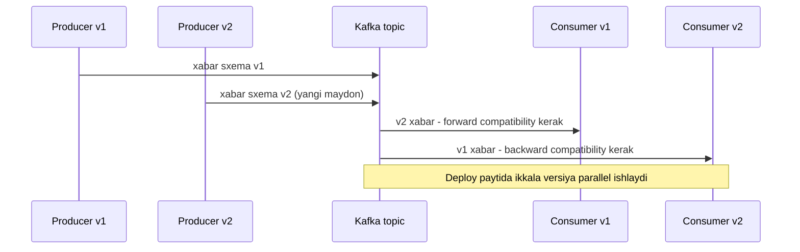

## Bu dars nima uchun kerak

Har safar ma'lumot jarayon chegarasidan chiqqanda - tarmoq orqali (9-dars), diskka, navbatga (Kafka, 43-dars), cache ga - u xotiradagi obyektdan **baytlar ketma-ketligiga** aylanishi kerak. Bu serialization (encoding). Qabul qiluvchi uni qayta obyektga aylantiradi (deserialization, decoding).

Format tanlovi ikki sababga ko'ra arxitektura qarori:

1. **Hajm va CPU.** Telemetriya kabi yuqori hajmli oqimda format bir necha baravar hajm farqi beradi (pastdagi GPS nuqtasi misolida JSON 108 bayt, Protobuf 29 bayt - 3.7 baravar): disk, tarmoq, Kafka retention va bulut hisobi shunga ko'payadi (2-dars).
2. **Evolyutsiya.** Ma'lumot uni yozgan koddan uzoq yashaydi. Kafka da 7 kunlik xabarlar, bazada 3 yillik yozuvlar, qurilmalarda 2 yil oldin yozilgan firmware. Sxema o'zgarganda **eski va yangi kod bir vaqtda** ishlaydi - rolling deploy da ham, qurilmalar parkida ham. Format buni qo'llab-quvvatlamasa, har bir o'zgarish - avariya.

Kleppmann DDIA kitobida buni markaziy mavzu sifatida ko'radi: evolvability (1-darsdagi maintainability ning bir qismi) to'g'ridan-to'g'ri encoding tanloviga bog'liq.

Bu darsdan keyin siz:

- backward va forward compatibility ni aniq ajratasiz va qaysi deploy tartibi qaysisini talab qilishini bilasiz;
- JSON ning yashirin muammolarini (raqamlar aniqligi, sxema yo'qligi, hajm) bilasiz;
- Protobuf ning simdagi formatini (tag, wire type, varint, ZigZag) bayt darajasida tushuntira olasiz;
- Avro ning writer va reader sxemasi modelini va schema resolution qoidalarini bilasiz;
- schema registry va compatibility rejimlari qanday ishlashini bilasiz;
- vazifa uchun formatni hisob bilan tanlay olasiz.

## Compatibility: ikki yo'nalish

- **Backward compatibility** - **yangi** kod **eski** ma'lumotni o'qiy oladi. Bu odatda osonroq: yangi kod muallifi eski formatni biladi.
- **Forward compatibility** - **eski** kod **yangi** ma'lumotni o'qiy oladi. Bu qiyinroq: eski kod kelajakdagi o'zgarishlarni bilmaydi, u noma'lum narsalarni **e'tiborsiz qoldira** olishi kerak.

Nega ikkalasi ham kerak - rolling deploy misolida:



Bundan tashqari bitta noziklik: eski kod yangi ma'lumotni o'qib, **qayta yozsa** (read-modify-write), u tanimagan yangi maydonni yo'qotmasligi kerak. Kleppmann buni alohida xavf sifatida ko'rsatadi: eski versiya yangi maydonni jimgina o'chirib yuboradi. Protobuf noma'lum maydonlarni saqlab, qayta serializatsiyada qaytaradi; ko'p JSON kutubxonalar va ORM lar esa yo'q.

## JSON (va matnli formatlar)

JSON (RFC 8259) - de-fakto standart: o'qiladigan, har bir tilda bor, brauzer tabiiy qo'llab-quvvatlaydi. Lekin system design nuqtai nazaridan bir nechta muammo bor.

### 1. Raqamlar

JSON spetsifikatsiyasi raqamlar aniqligini belgilamaydi. RFC 8259 faqat shuni aytadi: IEEE 754 double keng tarqalgan, va **-(2^53)+1 dan (2^53)-1 gacha** butun sonlar implementatsiyalar o'rtasida aniq bir xil talqin qilinadi. JavaScript da barcha raqamlar double, `Number.MAX_SAFE_INTEGER` = 9 007 199 254 740 991. Undan katta butun son jimgina yaxlitlanadi:

```js
JSON.parse('{"id": 9007199254740993}').id   // 9007199254740992
```

Bu nazariy emas: 64 bitli ID lar (Snowflake, 57-dars) 2^53 dan katta. Shuning uchun 64 bitli ID larni JSON da **satr** sifatida yuborish kerak. Protobuf ning rasmiy JSON mapping i ham `int64`, `uint64`, `fixed64` ni JSON da satr qilib yozadi aynan shu sababdan.

Kasr sonlar ham: `0.1 + 0.2` muammosi. Pul miqdorlarini double da emas, butun minimal birlikda (tiyin) yoki satr ko'rinishidagi decimal da yuboring (88-dars).

### 2. Sxema yo'q

JSON ning o'zi tiplarni majburlamaydi: `"speed": 54`, `"speed": "54"` va `"speed": null` - hammasi valid. JSON Schema yoki OpenAPI buni qisman hal qiladi, lekin ular ixtiyoriy va runtime da tekshirilishi kerak. Natijada kontrakt ko'pincha faqat hujjatda yashaydi.

Bundan tashqari RFC 8259 ga ko'ra obyekt kalitlari noyob bo'lishi **kerak (SHOULD)**, majburiy emas; takroriy kalitlar bo'lsa, xatti-harakat oldindan aytib bo'lmaydi - turli parserlar oxirgisini oladi, birinchisini oladi yoki xato beradi. Bu xavfsizlik muammosiga aylanishi mumkin (bir servis bir qiymatni tekshiradi, boshqasi boshqasini ishlatadi).

### 3. Hajm

Har bir yozuvda har bir kalit nomi takrorlanadi va raqamlar matn sifatida yoziladi. Kleppmann ning 2012 yilgi taqqoslashida bitta yozuv bo'shliqsiz JSON da 82 bayt, Protobuf da 33 bayt, Avro da 32 bayt, Thrift CompactProtocol da 34 bayt chiqqan.

Siqish (gzip, zstd) farqni kamaytiradi, ayniqsa ko'p yozuvli batch larda, chunki takrorlanuvchi kalit nomlari yaxshi siqiladi. Lekin siqish CPU talab qiladi va kichik yakka xabarlarda samarasi kam.

### Qachon JSON

Tashqi API, brauzer, konfiguratsiya, debug va kam hajmli integratsiyalar. Inson o'qiy olishi va universal vositalar odatda bu yerda baytlardan muhimroq.

## Protocol Buffers

Protobuf - Google da yaratilgan, sxemaga asoslangan binar format. Sxema `.proto` faylda, kod generatsiya qilinadi:

```proto
message Position {
  uint64 device_id = 1;
  uint64 ts_ms     = 2;
  sint32 lat_e6    = 3;   // gradus x 1 000 000
  sint32 lon_e6    = 4;
  uint32 speed_kmh = 5;
  uint32 heading   = 6;
  uint32 fuel_dl   = 7;   // decilitr
}
```

Asosiy g'oya: simda **maydon nomlari yo'q**, faqat **maydon raqamlari** (tag). Nom faqat kod uchun.

### Simdagi format

Rasmiy "Encoding" hujjatiga ko'ra xabar - yozuvlar ketma-ketligi, har bir yozuv: **tag** + qiymat.

- **Tag** = `(field_number << 3) | wire_type`, varint sifatida kodlanadi.
- **Wire type** qiymat qanday o'qilishini aytadi: `VARINT` (0) - int, bool, enum; `I64` (1) - double, fixed64; `LEN` (2) - string, bytes, ichki xabar, packed repeated; `I32` (5) - float, fixed32 (va eskirgan group turlari).

**Varint.** Har bir baytda 7 bit ma'lumot va 1 bit "davomi bor" belgisi (MSB). Kichik sonlar kam bayt oladi: 0-127 - 1 bayt, 128-16 383 - 2 bayt va h.k.

Hujjatdagi klassik misol: `a = 150` bo'lgan `field 1` ning baytlari `08 96 01`.

- `08` = `0000 1000`: field 1 (`1 << 3 = 8`), wire type 0 (VARINT).
- `96 01`: `96` = `1001 0110` (MSB = 1, davomi bor, payload `001 0110`), `01` = `0000 0001` (MSB = 0, oxirgi, payload `000 0001`). Payload lar little-endian: `000 0001` + `001 0110` = `1001 0110` = 128 + 16 + 4 + 2 = **150**.

Jami 3 bayt. JSON da `{"a":150}` - 9 bayt.

**Manfiy sonlar va ZigZag.** `int32`/`int64` manfiy sonni two's complement da yozadi; varint sifatida u eng yuqori biti o'rnatilgan 64 bitli son bo'lib qoladi va **10 bayt** oladi (masalan, -2). `sint32`/`sint64` esa **ZigZag** kodlashni ishlatadi: musbat `p` -> `2p`, manfiy `n` -> `2|n| - 1`. Shunda 0, -1, 1, -2 mos ravishda 0, 1, 2, 3 bo'ladi va kichik manfiy sonlar ham kam bayt oladi. Koordinata delta lari, harorat kabi manfiy bo'lishi mumkin bo'lgan maydonlar uchun `sint` tanlang.

**Maydon raqamlari narxi.** Hujjatga ko'ra 1-15 raqamli maydonlarning tag i 1 bayt, 16-2 047 - 2 bayt. Eng ko'p ishlatiladigan maydonlarga 1-15 ni bering. 19 000 - 19 999 diapazoni Protobuf ning o'zi uchun band.

**Standart qiymatlar.** proto3 da skalyar maydon standart qiymatda bo'lsa (0, bo'sh satr, false) va explicit presence yo'q bo'lsa, u simga **umuman yozilmaydi**. Bu hajmni tejaydi, lekin "qiymat 0" va "qiymat yuborilmagan" ni ajratib bo'lmaydi; farq kerak bo'lsa `optional` (explicit presence) ishlating.

### Yuqoridagi Position uchun hisob

Bu bo'lim - kodlash qoidalaridan qadamma-qadam hisoblangan natija. Qiymatlar (misol uchun tanlangan): device_id = 123456, ts_ms = 1 760 000 000 000, lat_e6 = 41 311 081, lon_e6 = 69 279 750, speed = 54, heading = 270, fuel_dl = 1 234.

**Qoida 1 - varint uzunligi.** Har bir baytda 7 bit ma'lumot, shuning uchun v ≥ 1 son uchun uzunlik = ⌈(bitlar soni) / 7⌉: v < 2^7 - 1 bayt, < 2^14 - 2 bayt, < 2^21 - 3 bayt, < 2^28 - 4 bayt, < 2^35 - 5 bayt, < 2^42 - 6 bayt.

**Qoida 2 - tag.** Maydon raqami 1-15 bo'lsa, `(raqam << 3) | wire_type` ≤ 127, ya'ni tag 1 bayt.

**Qoida 3 - ZigZag** (sint32): musbat p -> 2p.

Hisob:

| Maydon | Varint ga kiradigan qiymat | Chegara | Tag + qiymat |
|---|---|---|---|
| device_id (uint64) | 123 456 | 2^14 = 16 384 ≤ v < 2^21 = 2 097 152 | 1 + 3 |
| ts_ms (uint64) | 1 760 000 000 000 | 2^35 ≈ 3.44 × 10^10 ≤ v < 2^42 ≈ 4.40 × 10^12 | 1 + 6 |
| lat_e6 (sint32) | 2 × 41 311 081 = 82 622 162 | 2^21 ≤ v < 2^28 = 268 435 456 | 1 + 4 |
| lon_e6 (sint32) | 2 × 69 279 750 = 138 559 500 | 2^21 ≤ v < 2^28 | 1 + 4 |
| speed_kmh (uint32) | 54 | v < 2^7 | 1 + 1 |
| heading (uint32) | 270 | 2^7 ≤ v < 2^14 | 1 + 2 |
| fuel_dl (uint32) | 1 234 | 2^7 ≤ v < 2^14 | 1 + 2 |
| **Jami** | | | 7 + 22 = **29 bayt** |

Taqqoslash uchun:

- lat/lon ni `double` sifatida yozsak: har biri tag 1 bayt + 8 bayt (wire type I64) = 9 bayt, `sint32` dagi 5 bayt o'rniga. 29 - 2 × 5 + 2 × 9 = **37 bayt**.
- Xuddi shu ma'lumot ixcham JSON da: `{"deviceId":123456,"ts":1760000000000,"lat":41.311081,"lon":69.27975,"speed":54,"heading":270,"fuelDl":1234}` - belgilarni sanab (yoki `JSON.stringify(...).length`), ASCII da **108 bayt**.
- Avro da (pastda) tag lar yo'q, `int`/`long` ZigZag varint bilan: device_id 2 × 123 456 = 246 912 (3 bayt), ts 2 × 1.76 × 10^12 = 3.52 × 10^12 < 2^42 (6 bayt), lat 4, lon 4, speed 2 × 54 = 108 < 128 (1 bayt), heading 540 (2 bayt), fuel 2 468 (2 bayt) = **22 bayt**.

Hajm hisobi (shart: 50 000 mashina, har 10 s): kuniga 50 000 × 86 400 / 10 = 4.32 × 10^8 nuqta. JSON: 4.32 × 10^8 × 108 B = 46.7 GB/kun. Protobuf: × 29 B = 12.5 GB/kun. Kafka da 7 kun retention va replication factor 3 bilan (× 21): JSON ≈ 980 GB, Protobuf ≈ 263 GB. Siqish bu farqni kamaytiradi, lekin yo'qotmaydi.

### Protobuf da evolyutsiya qoidalari

Rasmiy proto3 qo'llanmasining "Updating a Message Type" bo'limiga ko'ra:

- **Yangi maydon qo'shish xavfsiz.** Eski kod uni tanimaydi va o'tkazib yuboradi (va noma'lum maydon sifatida saqlaydi), yangi kod eski ma'lumotda uni standart qiymat deb o'qiydi. Bu ham backward, ham forward compatibility.
- **Maydonni o'chirish xavfsiz**, lekin uning **raqamini qayta ishlatish mumkin emas**. Raqamni `reserved` deb belgilang, aks holda kelajakda kimdir xuddi shu raqamga boshqa ma'noli maydon qo'yadi va eski ma'lumot noto'g'ri talqin qilinadi.
- **Maydon raqamini o'zgartirish xavfli** - bu eski maydonni o'chirib, yangisini qo'shish bilan bir xil.
- **Nomni o'zgartirish** binar formatga ta'sir qilmaydi (nom simda yo'q), lekin JSON mapping va kodni buzadi.
- **Enum ga qiymat qo'shish** simda xavfsiz, lekin barcha qiymatlarni qat'iy tekshiradigan kodni buzishi mumkin.
- **Shartli mos o'zgarishlar:** `int32`, `uint32`, `int64`, `uint64`, `bool` o'zaro mos - lekin katta qiymat kichik tipga o'qilsa, kesiladi. Shuning uchun `int32` dan `int64` ga o'tishda avval hamma o'quvchilarni yangilab, keyin katta qiymatlar yozish kerak.

## Avro

Apache Avro - Hadoop ekotizimidan chiqqan, sxemaga asoslangan binar format. Protobuf dan asosiy farqi: simda **tag ham, maydon nomi ham yo'q**.

Avro spetsifikatsiyasiga ko'ra binar kodlashda maydon nomlari, tip haqida ma'lumot va ajratuvchilar yo'q; record shunchaki maydonlar qiymatlarining sxemadagi tartibda **ketma-ket** yozilishi. `int` va `long` ZigZag varint bilan. Shuning uchun Avro eng ixcham - yuqoridagi misolda 22 bayt (Kleppmann ning 2012 yilgi taqqoslashida ham Avro 32 bayt bilan eng kichik chiqqan).

Narxi: **sxemasiz o'qib bo'lmaydi.** Qaysi bayt qaysi maydonga tegishli ekanini faqat yozishda ishlatilgan sxema biladi.

### Writer va reader sxemasi

Avro ning markaziy g'oyasi: o'qishda **ikki sxema** ishtirok etadi:

- **writer's schema** - ma'lumot qaysi sxema bilan yozilgan;
- **reader's schema** - o'quvchi kod qaysi sxemani kutadi.

Avro kutubxonasi ularni **maydon nomlari bo'yicha** solishtirib (schema resolution) o'qiydi. Spetsifikatsiyadagi asosiy qoidalar:

- maydonlar tartibi farq qilishi mumkin - nom bo'yicha moslashtiriladi;
- writer da bor, reader da yo'q maydon - e'tiborsiz qoldiriladi;
- reader da bor, writer da yo'q maydon - reader dagi **default** qiymat olinadi; default bo'lmasa - xato;
- tiplar kengaytirilishi mumkin: `int` -> `long`, `float`, `double`; `long` -> `float`, `double`; `float` -> `double`; `string` <-> `bytes`;
- enum da reader tanimagan qiymat - reader enum ining default i, bo'lmasa xato;
- nomni o'zgartirish **alias** lar orqali.

Xulosa: Avro da evolyutsiya uchun **default qiymatlar** asosiy vosita. Qo'shilgan yoki o'chirilgan maydonning default i bo'lsa, o'zgarish ikki tomonlama mos. "Ixtiyoriy" maydon `["null", "string"]` kabi union va `null` default bilan ifodalanadi.

### Writer sxemasini qayerdan olish

Spetsifikatsiya aytadi: Avro ma'lumotni saqlaydigan fayl yoki tizimlar writer sxemasini doim saqlashi kerak. Variantlar:

1. **Object container file** - fayl boshida sxema bir marta, keyin millionlab yozuv bloklari (siqilgan bo'lishi mumkin, sinxronizatsiya markerlari bilan bo'linadi). Batch, data lake uchun (58-dars).
2. **Single-object encoding** - har bir xabar oldida 2 baytlik marker `C3 01` va sxemaning 8 baytlik CRC-64 fingerprint i. Spetsifikatsiya buni aynan Kafka topic ida haftalab saqlanadigan yozuvlar misolida tushuntiradi.
3. **RPC ulanishida** - ulanish boshida sxemalar kelishiladi.
4. **Schema registry** - xabarda faqat sxema ID si (pastda).

### Avro qachon ustun

Avro sxemada maydon raqamlari yo'qligi uni **dinamik generatsiya qilingan sxemalar** uchun qulay qiladi. Kleppmann ning misoli: relatsion bazani Avro ga eksport qilish - jadval ustunlaridan sxema avtomatik yasaladi, ustun qo'shilsa yangi sxema yasaladi va nom bo'yicha resolution ishlaydi. Protobuf da har bir ustunga raqamni qo'lda va barqaror berib borish kerak bo'lardi. Shuning uchun Avro CDC (48-dars) va data pipeline larda keng tarqalgan.

## Schema registry

Kafka da Avro yoki Protobuf ishlatilsa, odatda markaziy **schema registry** qo'yiladi. Confluent Schema Registry hujjatiga ko'ra:

- Har bir xabar oldida: 1 bayt **magic byte** (0), keyin 4 baytlik **schema ID** (big-endian), Protobuf uchun xabar indekslari, keyin ma'lumot. Ya'ni sxemaning o'zi emas, atigi 5 bayt overhead.
- Producer yangi sxemani registry ga ro'yxatdan o'tkazadi; registry uni **compatibility qoidasi** bo'yicha oldingi versiyalar bilan tekshiradi va mos kelmasa rad etadi. Bu buzuvchi o'zgarishni production ga yetmasdan to'xtatadi.
- Consumer ID bo'yicha writer sxemasini oladi (cache laydi) va o'z reader sxemasi bilan o'qiydi.

Compatibility rejimlari:

| Rejim | Kafolat | Deploy tartibi |
|---|---|---|
| BACKWARD (standart) | Yangi sxemali consumer oldingi versiya bilan yozilganni o'qiy oladi | Avval consumer lar, keyin producer lar |
| BACKWARD_TRANSITIVE | Yangi consumer **barcha** oldingi versiyalarni o'qiy oladi | Avval consumer lar |
| FORWARD | Eski consumer yangi sxemali ma'lumotni o'qiy oladi | Avval producer lar |
| FULL | Ikkala yo'nalish, oxirgi versiyaga nisbatan | Istalgan tartibda |
| FULL_TRANSITIVE | Ikkala yo'nalish, barcha versiyalarga nisbatan | Istalgan tartibda |
| NONE | Tekshiruv yo'q | Ehtiyot bilan |

Hujjatdagi jadvalga ko'ra ixtiyoriy maydon qo'shish va o'chirish barcha rejimlarda ruxsat etilgan. Majburiy maydon qo'shish faqat FORWARD da mos. Eng xavfsiz amaliyot: ixtiyoriy (default li) maydonlar bilan ishlash va uzoq retention li topic lar uchun `*_TRANSITIVE` rejimlar - chunki consumer topic boshidan qayta o'qisa, eng eski versiyalarni ham o'qiy olishi kerak.

## Taqqoslash

| Mezon | JSON | Protobuf | Avro |
|---|---|---|---|
| Format | Matn | Binar, tag + qiymat | Binar, faqat qiymatlar |
| Sxema | Ixtiyoriy (JSON Schema) | Majburiy (.proto) | Majburiy (JSON da yozilgan sxema) |
| Sxemasiz o'qish | Ha | Qisman (tag va tiplar ko'rinadi, nomlar yo'q) | Yo'q |
| Hajm (yuqoridagi misol) | 108 B | 29 B | 22 B |
| Maydonni aniqlash | Nom (har yozuvda) | Raqam (tag) | Nom (sxemada), resolution bilan |
| Evolyutsiya vositasi | Intizom, "noma'lumni e'tiborsiz qoldir" | Yangi raqamlar, reserved, noma'lum maydonlarni saqlash | Default lar, alias lar, writer/reader resolution |
| Kod generatsiyasi | Yo'q (ixtiyoriy) | Odatda ha | Ixtiyoriy (dinamik ham ishlaydi) |
| 64 bitli butun sonlar | Xavfli (2^53) | Aniq | Aniq |
| Inson o'qiy oladimi | Ha | Vosita bilan | Vosita va sxema bilan |
| Eng mos joy | Tashqi API, brauzer, konfiguratsiya | RPC (gRPC), qurilmalar, xabarlar | Kafka, data pipeline, CDC, data lake |

Boshqa formatlar haqida qisqacha: **MessagePack/CBOR** - JSON ning binar ekvivalentlari (sxemasiz, kalit nomlari baribir bor, shuning uchun hajm yutug'i cheklangan); **Thrift** - Protobuf ga o'xshash, tag li; **FlatBuffers/Cap'n Proto** - parse qilmasdan to'g'ridan-to'g'ri o'qish (zero-copy) uchun; **Parquet/ORC** - ustunli saqlash formatlari (16-dars), yozuvlar emas, jadvallar uchun.

## Real tizimlardan misollar

- **Google** - Protobuf ichki RPC va saqlash uchun yaratilgan; gRPC uning ustida (9-dars). Protobuf JSON mapping i int64 ni satr qiladi.
- **Kafka + Confluent Schema Registry** - Avro, Protobuf, JSON Schema; 5 baytlik prefiks va compatibility tekshiruvi.
- **Avro spetsifikatsiyasi** single-object encoding ni Kafka da haftalab saqlanadigan yozuvlar uchun tavsiya qiladi.
- **Kleppmann (2012)** - bir xil yozuvning JSON, Thrift, Protobuf, Avro dagi hajmlari va evolyutsiya mexanizmlari taqqoslanishi; DDIA da kengaytirilgan.

## iQuariX kontekstida

Masala sharti: iQuariX ma'lumot oqimi treker -> gateway -> Kafka -> worker lar -> baza va API.

**1. Treker protokoli.** Bu masalada trekerlar ishlab chiqaruvchiga qarab turli binar protokollarda ishlaydi. Gateway ularni parse qilib, **ichki kanonik formatga** - masalan Protobuf `Position` ga - aylantiradi. Shunda keyingi barcha servislar bitta formatni biladi, har bir treker protokolini emas. Bu chegara (anti-corruption layer) muhim: treker formatidagi g'alati narsalar (yoqilg'i datchigining xom qiymati, turli birliklar) shu yerda normallashtiriladi.

**2. Kafka dagi format.** Protobuf yoki Avro + schema registry, `BACKWARD_TRANSITIVE` yoki `FULL_TRANSITIVE`, chunki tarixiy ma'lumotni qayta o'qish (replay) bo'lishi mumkin. Hajm hisobi yuqorida: 108 / 29 ≈ 3.7 baravar kam, Kafka diskida (7 kun, RF 3) 980 - 263 ≈ 717 GB farq.

**3. Evolyutsiya stsenariysi.** Yangi treker modeli `engine_temp` va `can_rpm` beradi. Protobuf da yangi maydonlar `8` va `9` raqamlari bilan qo'shiladi. Eski worker lar ularni o'tkazib yuboradi (forward), yangi worker lar eski xabarlarda ularni yo'q deb biladi (backward). Muhim: proto3 da `engine_temp = 0` va "datchik yo'q" ni ajratish uchun `optional` ishlating - aks holda harorat 0 bo'lgan dvigatel va datchiksiz treker bir xil ko'rinadi, bu esa yoqilg'i va dvigatel analitikasida noto'g'ri xulosalar beradi.

**4. Tashqi API.** Mijozlarga JSON (9-dars). Treker va hodisa ID lari 64 bitli bo'lsa - satr sifatida. Koordinatalar double emas, aniq formatda (masalan, 6 xonali kasr) va hujjatda birlik bilan.

**5. Birliklar va masshtab.** `lat_e6` (gradus × 10^6) va `fuel_dl` (decilitr) kabi butun sonli maydonlar double dan ixchamroq (yuqorida 5 bayt va 9 bayt). Aniqlik hisobi: meridian bo'ylab 1 gradus = 2π × 6 371 km / 360 ≈ 111.2 km, demak 10^-6 gradus ≈ 11.1 sm (uzunlik bo'ylab Toshkent kengligida cos 41.3° marta kam, ≈ 8.4 sm). gps.gov ga ko'ra GPS SPS signalining o'zi 95% ehtimol bilan 7.8 m gacha xato beradi - bu 10^-6 gradusdan 70 baravar katta, shuning uchun bu masshtabda aniqlik yo'qolmaydi.

## Ko'p uchraydigan xatolar

1. **64 bitli ID larni JSON da raqam sifatida yuborish.** JavaScript da 2^53 dan kattasi jimgina buziladi; satr ishlating.
2. **Protobuf maydon raqamini qayta ishlatish.** Eski ma'lumot yangi ma'noda talqin qilinadi; o'chirilgan raqamlarni `reserved` qiling.
3. **Avro da default siz maydon qo'shish.** Yangi o'quvchi eski ma'lumotni o'qiy olmaydi.
4. **Faqat backward ni o'ylash.** Rolling deploy va Kafka da eski consumer yangi xabarni ham ko'radi; forward ham kerak.
5. **Noma'lum maydonlarni yo'qotuvchi read-modify-write.** Eski servis yangi maydonni o'chirib yuboradi.
6. **proto3 da "0" va "yo'q" farqini e'tiborsiz qoldirish.** Kerak bo'lsa `optional` ishlating.
7. **Manfiy bo'lishi mumkin bo'lgan qiymatlar uchun int32.** Har bir manfiy son 10 bayt; `sint32` ishlating.
8. **Schema registry siz Avro.** Writer sxemasi yo'qolsa, ma'lumotni o'qib bo'lmaydi.

## Xulosa

- Serialization tanlovi hajm, CPU va eng muhimi evolyutsiyani belgilaydi; ma'lumot kodidan uzoq yashaydi.
- Backward - yangi kod eski ma'lumotni o'qiydi; forward - eski kod yangisini o'qiydi. Rolling deploy va navbatlarda ikkalasi kerak.
- JSON universal va o'qiladigan, lekin sxemasiz, katta va 2^53 dan katta butun sonlarda xavfli.
- Protobuf: tag = (raqam << 3) | wire type, varint, ZigZag; maydon raqamlari - kontrakt, ularni o'zgartirmang va qayta ishlatmang.
- Avro: simda faqat qiymatlar, eng ixcham; writer va reader sxemasi nom bo'yicha resolution, evolyutsiya default lar orqali.
- Schema registry har xabarga 5 bayt qo'shadi va buzuvchi sxemalarni production dan oldin to'xtatadi; uzoq retention uchun TRANSITIVE rejimlar.
- Tashqi API da JSON, ichki RPC da Protobuf, Kafka va data pipeline da Avro yoki Protobuf + registry - odatiy, asosli kombinatsiya.

## Amaliy topshiriq

Masala sharti: iQuariX yoqilg'i datchiklari (ДУТ) uchun yangi hodisa oqimini Kafka ga chiqarmoqda. Hodisa: `sensor_id`, `vehicle_id`, `ts`, `level_raw` (datchikning xom qiymati), `level_liters`, `temperature` (manfiy bo'lishi mumkin), `event_type` (normal, refuel, drain_suspected). 30 000 datchik, har 10 s da, Kafka retention 14 kun, replication factor 3.

1. **Sxema.** Protobuf va Avro da sxemani yozing. Har bir maydon uchun tip tanlovini asoslang (int vs sint, double vs butun son masshtab bilan, optional kerakmi).
2. **Hajm.** O'zingiz tanlagan namunaviy qiymatlar bilan bitta hodisaning hajmini JSON, Protobuf va Avro da bayt darajasida (yuqoridagi varint qoidalari bilan) hisoblang. Kafka da 14 kunlik jami hajm (replication bilan) har bir format uchun.
3. **Evolyutsiya 1.** 3 oydan keyin `confidence` (0-100) va `algorithm_version` maydonlari qo'shiladi. Eski consumer lar va eski xabarlar uchun nima bo'ladi? Har ikki formatda yozing.
4. **Evolyutsiya 2.** `event_type` ga `sensor_fault` qiymati qo'shilmoqda. Qaysi consumer lar buzilishi mumkin va qanday himoyalanasiz?
5. **Registry va deploy.** Qaysi compatibility rejimini tanlaysiz va nega? Producer va consumer larni qaysi tartibda deploy qilasiz?
6. **Tashqi API.** Xuddi shu hodisalar mijozlarga JSON da beriladi. 64 bitli ID lar, vaqt va birliklar qanday formatlanadi?

Yaxshi javobda bo'lishi kerak bo'lgan narsalar:

- temperature uchun ZigZag (sint32) yoki ekvivalent, level uchun butun son masshtab bilan;
- hajm hisobi varint uzunliklari bilan ochiq ko'rsatilgan, 14 kun × RF 3 ko'paytmasi bilan;
- Protobuf da yangi raqamlar, Avro da default lar; "0" va "yo'q" farqi hisobga olingan;
- enum kengaytirishda noma'lum qiymatni xavfsiz qayta ishlash (UNKNOWN/default);
- TRANSITIVE rejim va unga mos deploy tartibi asoslangan;
- tashqi JSON da 64 bitli ID lar satr, vaqt UTC ISO 8601, birliklar hujjatda.

Javobni pastdagi maydonga yozib, chatga yuboring.

## Manbalar

- Martin Kleppmann, Chris Riccomini. [Designing Data-Intensive Applications, 2-nashr](https://www.oreilly.com/library/view/designing-data-intensive/9781098119058/), O'Reilly, 2026 - "Encoding and Evolution" bobi: backward/forward compatibility, JSON, Protobuf, Avro, dataflow turlari.
- Martin Kleppmann. [Schema evolution in Avro, Protocol Buffers and Thrift](https://martin.kleppmann.com/2012/12/05/schema-evolution-in-avro-protocol-buffers-thrift.html), 2012 - bayt hajmlari taqqoslanishi va evolyutsiya mexanizmlari.
- Protocol Buffers. [Encoding](https://protobuf.dev/programming-guides/encoding/) - varint, tag, wire type, ZigZag, `08 96 01` misoli.
- Protocol Buffers. [Language Guide (proto3)](https://protobuf.dev/programming-guides/proto3/) - maydon raqamlari, "Updating A Message Type" qoidalari; [ProtoJSON](https://protobuf.dev/programming-guides/json/) - int64 ning satr sifatida yozilishi.
- [Apache Avro Specification](https://github.com/apache/avro/blob/main/doc/content/en/docs/%2B%2Bversion%2B%2B/Specification/_index.md) (rasmiy repozitoriydagi manba matni) - binar kodlash, schema resolution, single-object encoding, object container files.
- Confluent. [Schema Evolution and Compatibility](https://docs.confluent.io/platform/current/schema-registry/fundamentals/schema-evolution.html) - compatibility rejimlari va deploy tartibi; [Formats, Serializers, and Deserializers](https://docs.confluent.io/platform/current/schema-registry/fundamentals/serdes-develop/index.html) - magic byte va schema ID.
- [RFC 8259: The JSON Data Interchange Format](https://www.rfc-editor.org/rfc/rfc8259), 2017 - raqamlar aniqligi va takroriy kalitlar.
- GPS.gov. [GPS Accuracy](https://www.gps.gov/systems/gps/performance/accuracy/) - SPS signal-in-space xatosi 7.8 m (95%).
- MDN. [Number.MAX_SAFE_INTEGER](https://developer.mozilla.org/en-US/docs/Web/JavaScript/Reference/Global_Objects/Number/MAX_SAFE_INTEGER) - 2^53 - 1 chegarasi.
