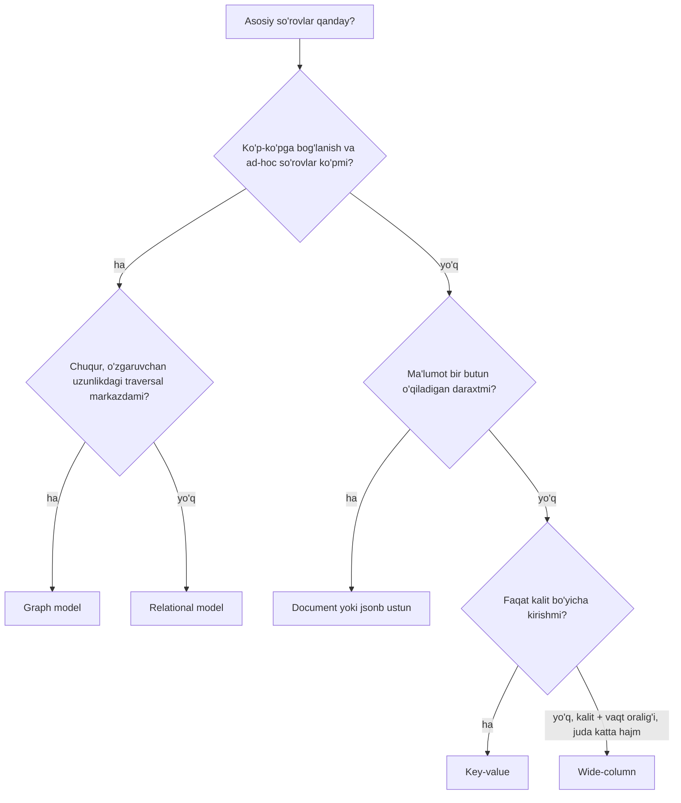

## Bu dars nima uchun kerak

1-modulda biz tizimning tashqi qatlamini ko'rdik: talablar, tarmoq, API va serialization (10-dars). Endi bazaning ichiga kiramiz. Lekin storage engine, indeks va tranzaksiyadan oldin bitta yuqoriroq savol bor: **ma'lumotni qanday shaklda tasavvur qilamiz?** Jadval va qatorlarmi, ichma-ich hujjatlarmi, tugun va qirralarmi yoki shunchaki kalit va qiymatmi?

Bu tanlov kodning har bir qatlamiga ta'sir qiladi: ORM qanday yoziladi, qaysi so'rov arzon va qaysi biri qimmat, sxemani qanday o'zgartirasiz, ma'lumotni qanday shard qilasiz. Kleppmann ma'lumot modelini dasturiy ta'minotdagi eng muhim qarorlardan biri deb ataydi, chunki u muammo haqida qanday **fikrlashimizni** ham belgilaydi. 1-darsdagi atama bilan aytganda - bu ko'pincha 1-tur (qaytarilmaydigan) qaror.

Bu darsdan keyin siz:

- beshta asosiy modelning har biri qaysi so'rov shakli uchun yaratilganini va qayerda qiynalishini bilasiz;
- normalizatsiya va denormalizatsiya, schema-on-write va schema-on-read farqini aniq tushuntira olasiz;
- PostgreSQL ichida `jsonb`, TOAST va recursive CTE yordamida document va graph modelning qaysi qismini qoplash mumkinligini va chegarasi qayerdaligini bilasiz;
- wide-column va key-value bazalarda "query-first" modellashtirishni, partition kalitini tanlashni hisob-kitob bilan bajara olasiz;
- telemetriya platformasi uchun qaysi ma'lumotni qaysi modelga qo'yishni asoslay olasiz.

## Model nima va nega u muhim

Har bir dastur qatlamlardan iborat: yuqori qatlam pastki qatlamning modeli ustida o'z modelini quradi. Siz TypeScript'da `Vehicle`, `Trip`, `Driver` obyektlarini yozasiz. Ularni saqlash uchun umumiy maqsadli modelga (jadval, JSON hujjat, graf) o'girasiz. Baza muhandislari esa bu modelni xotiradagi va diskdagi baytlarga aylantiradi (12-14 darslar). Har bir qatlam pastdagi murakkablikni yashiradi.

Model ikki narsani belgilaydi:

1. **Nimani ifodalash oson.** Daraxtsimon hujjatni hujjat modelida saqlash tabiiy, ko'p-ko'pga (many-to-many) bog'lanishlarni esa relational yoki graph modelda.
2. **Qaysi so'rov arzon.** Model bilan birga keladigan so'rov tili va storage tartibi ma'lum so'rovlarni tez, boshqalarini sekin qiladi.

Qoidani boshidanoq yozib qo'yamiz: **modelni ma'lumotning "tabiati" emas, asosiy so'rovlar shakli tanlaydi.** Bir xil GPS nuqtasi relational jadvalda ham, wide-column'da ham, key-value'da ham yashashi mumkin. Savol - uni qanday o'qiysiz.

## Relational model

Edgar Codd 1970 yilda Communications of the ACM jurnalida "A Relational Model of Data for Large Shared Data Banks" maqolasini chop etdi. Asosiy g'oya: ma'lumot **relation** (jadval) larda, har biri **tuple** (qator) lar to'plami. Muhimi - Codd ilovani ma'lumotning diskda qanday joylashganidan (tartib, indeks, kirish yo'li) ajratishni maqsad qilgan. Undan oldingi ierarxik (IBM IMS) va network (CODASYL) modellarda dasturchi ma'lumotga kirish yo'lini qo'lda "yurib" topardi. Relational modelda esa siz **nima** kerakligini aytasiz (deklarativ SQL), **qanday** topishni query planner hal qiladi (15-dars).

### Normalizatsiya va JOIN

Relational modelning asosiy kuchi - **normalizatsiya**: har bir fakt bir joyda saqlanadi, qolganlar unga ID orqali ishora qiladi.

```sql
CREATE TABLE companies (id bigint PRIMARY KEY, name text NOT NULL);
CREATE TABLE vehicles (
  id bigint PRIMARY KEY,
  company_id bigint NOT NULL REFERENCES companies(id),
  plate text NOT NULL,
  model text
);
CREATE TABLE drivers (id bigint PRIMARY KEY, company_id bigint NOT NULL REFERENCES companies(id), full_name text);
CREATE TABLE shifts (
  vehicle_id bigint REFERENCES vehicles(id),
  driver_id bigint REFERENCES drivers(id),
  started_at timestamptz,
  ended_at timestamptz
);
```

Kompaniya nomi o'zgarsa - bitta qator yangilanadi. Haydovchi bir necha mashinada, mashina bir necha haydovchi bilan ishlaydi (many-to-many) - `shifts` jadvali buni toza ifodalaydi. Foreign key va `CHECK` constraint lar ma'lumot to'g'riligini baza darajasida kafolatlaydi.

Evaziga: o'qishda **JOIN** kerak. Normalizatsiya - yozishni arzon va xavfsiz, o'qishni esa qimmatroq qiladigan trade-off.

### Impedance mismatch

Ilova kodida obyektlar daraxt shaklida: `Company { vehicles: [{ plate, sensors: [...] }] }`. Relational modelda esa tekis jadvallar. Bu ikki dunyo o'rtasidagi tarjima **impedance mismatch** deyiladi. Prisma, TypeORM, Kysely kabi vositalar uni kamaytiradi, lekin to'liq yo'qotmaydi: N+1 so'rov muammosi, `include` ichida 5 ta JOIN, migratsiya fayllari - hammasi shu tarjimaning narxi.

## Document model

Document model (MongoDB, Couchbase, PostgreSQL `jsonb`) ma'lumotni o'z-o'zini tasvirlaydigan, ichma-ich hujjatlar sifatida saqlaydi:

```json
{
  "_id": "veh_1042",
  "plate": "01A777AA",
  "company_id": "cmp_7",
  "sensors": [
    { "type": "fuel", "model": "LLS-20160", "calibration": [[0, 0], [120, 60]] },
    { "type": "can", "protocol": "J1939" }
  ],
  "settings": { "speed_limit": 90, "idle_alert_min": 15 }
}
```

### Qachon yaxshi

- **Bir-ko'pga (one-to-many) daraxt** bo'lsa va u odatda **bir butun** sifatida o'qilsa. Mashina sozlamalari, datchik kalibrovkasi, hisobot shabloni - shunday ma'lumotlar.
- **Locality**: butun hujjat bitta joyda saqlanadi, bitta o'qish bilan keladi. Relational'da xuddi shuni olish uchun 3-4 jadvalni JOIN qilish kerak.
- **Sxema moslashuvchanligi**: har xil turdagi datchiklar har xil maydonlarga ega bo'lsa, ularni bitta jadval ustunlariga majburlash noqulay.

### Qachon qiynaladi

- **Many-to-one va many-to-many.** Hujjat ichida `company_name: "Asaka Trans"` deb yozsangiz, kompaniya nomi o'zgarganda barcha hujjatlarni yangilash kerak. ID bilan ishora qilsangiz, JOIN ilovaga yoki `$lookup` ga ko'chadi. Kleppmann bu jarayonni shunday tasvirlaydi: ilova o'sgan sari ma'lumot tobora o'zaro bog'langan bo'lib boradi va document model relational modelga qarab "siljiydi".
- **Hujjatning bir qismini yangilash.** Ko'p document storage'lar kichik o'zgarishda ham butun hujjatni qayta yozadi. Hujjat katta bo'lsa, bu qimmat. Shu sabab hujjatni kichik saqlash tavsiya qilinadi.
- **Hajm chegarasi.** MongoDB'da bitta BSON hujjat maksimal 16 MiB va ichma-ichlik 100 darajadan oshmaydi. Cheksiz o'sadigan massiv (masalan, mashinaning barcha GPS nuqtalari bitta hujjat ichida) - klassik anti-pattern.

### Schema-on-read va schema-on-write

"Document bazalar sxemasiz" degan gap noto'g'ri. Sxema bor, faqat u **qayerda tekshirilishi** farq qiladi:

- **Schema-on-write** (relational): sxema yozishda baza tomonidan majburlanadi. Yangi maydon qo'shish uchun `ALTER TABLE` kerak.
- **Schema-on-read** (document): sxema yashirin, uni o'qiydigan kod talqin qiladi. Eski hujjatlarda `fuel_tank_l` yo'q bo'lsa, kod buni hisobga olishi kerak.

Bu dasturlash tillaridagi statik va dinamik tiplashga o'xshaydi. 10-darsdagi schema evolution g'oyasi shu yerda ham ishlaydi: schema-on-read'da evolution mas'uliyati ilova kodiga o'tadi.

PostgreSQL bo'yicha bir amaliy eslatma: PostgreSQL 11 dan boshlab `ALTER TABLE ... ADD COLUMN` default qiymat bilan ham (agar default volatile bo'lmasa) jadvalni qayta yozmaydi, ya'ni schema-on-write'ning "qimmat migratsiya" degan obro'si qisman eskirgan. Lekin katta jadvalda ustun turini o'zgartirish yoki `NOT NULL` qo'shish hali ham ehtiyotkorlikni talab qiladi.

### PostgreSQL ichida document model: jsonb

PostgreSQL ikki JSON turini beradi:

| Xususiyat | `json` | `jsonb` |
|---|---|---|
| Saqlash | Kiritilgan matnning aniq nusxasi, har ishlov berishda qayta parse qilinadi | Binar, ajratilgan format; kiritish biroz sekin, ishlov berish ancha tez |
| Bo'sh joylar, kalit tartibi | Saqlanadi | Saqlanmaydi |
| Takror kalitlar | Hammasi saqlanadi | Faqat oxirgisi qoladi |
| Indekslash | Yo'q (faqat expression index) | GIN orqali to'liq |

Hujjatlar ko'p holda `jsonb` ni tavsiya qiladi. GIN indeksi uchun ikki operator class bor: standart `jsonb_ops` (`?`, `?|`, `?&`, `@>`, `@?`, `@@` operatorlarini qo'llaydi, har bir kalit va qiymat uchun alohida yozuv yaratadi) va `jsonb_path_ops` (faqat `@>`, `@?`, `@@`; yo'l va qiymat xeshini saqlaydi, odatda ancha kichik va tezroq, lekin "kalit bormi" so'roviga javob bera olmaydi). Indekslar 15-darsda chuqur ko'riladi.

```sql
CREATE TABLE vehicle_profiles (vehicle_id bigint PRIMARY KEY, doc jsonb NOT NULL);
CREATE INDEX ON vehicle_profiles USING GIN (doc jsonb_path_ops);

-- J1939 CAN protokolli barcha mashinalar
SELECT vehicle_id FROM vehicle_profiles
WHERE doc @> '{"sensors": [{"type": "can", "protocol": "J1939"}]}';
```

Ichki tuzilishda muhim nuqta - **TOAST**. PostgreSQL sahifasi odatda 8 kB, qator sahifalar orasiga bo'linmaydi. Qator `TOAST_TUPLE_THRESHOLD` (standart 8 kB sahifada 2 kB) dan oshsa, katta qiymatlar avval siqiladi, keyin kerak bo'lsa alohida TOAST jadvaliga bo'laklarga bo'lib chiqariladi. Bo'lak hajmi (`TOAST_MAX_CHUNK_SIZE`) bitta sahifaga to'rtta bo'lak qatori sig'adigan qilib tanlangan, hujjat bo'yicha bu 2000 baytga yaqin. Asosiy qatorda 18 baytlik ko'rsatkich qoladi. Bitta maydonning maksimal hajmi 1 GB.

Bundan ikki amaliy xulosa chiqadi:

1. Katta `jsonb` hujjatdan bitta kalitni o'qish ham butun qiymatni TOAST'dan olib, siqilgan bo'lsa ochishni talab qiladi (de-TOAST). 50 KB hujjatdan `doc->>'plate'` ni million marta o'qish - million marta 50 KB.
2. `jsonb` ning bitta kalitini `UPDATE` qilish butun qiymatning yangi versiyasini yozadi (MVCC tufayli yangi qator versiyasi, 19-dars). Tez-tez o'zgaradigan maydonni katta hujjat ichida saqlamang - uni oddiy ustunga chiqaring.

Amaliy qoida: **so'rovda filtrlanadigan, JOIN qilinadigan va tez-tez yangilanadigan maydonlar - oddiy ustun; kam o'zgaradigan, turli shakldagi, bir butun o'qiladigan qism - `jsonb`.** Bu gibrid yondashuv ko'p SaaS tizimlar uchun eng amaliy variant.

## Graph model

Agar asosiy savollar "kim kim bilan bog'langan", "A dan B ga yo'l bormi", "3 qadamgacha bo'lgan qo'shnilar kim" bo'lsa, ma'lumot tabiiy ravishda **graf**: tugunlar (vertex) va qirralar (edge).

Ikki asosiy variant:

- **Property graph** (Neo4j, Amazon Neptune, Memgraph): har bir tugun va qirrada ID, label va xususiyatlar (key-value) bor. So'rov tillari: Cypher, Gremlin. 2024 yilda ISO graf so'rovlari uchun alohida standart - **GQL** (ISO/IEC 39075:2024) ni chiqardi. SQL:2023 esa SQL ichida property graph so'rovlari uchun **SQL/PGQ** qismini (ISO/IEC 9075-16:2023) qo'shdi.
- **Triple store / RDF** (subject, predicate, object): SPARQL bilan so'raladi, ko'proq semantic web va bilim graflarida.

### Graph so'rovni relational'da yozish

Graph modelning kuchi - **o'zgaruvchan uzunlikdagi yo'llar**. Cypher'da `(a)-[:SUPPLIES*1..5]->(b)` bitta qator. SQL'da buning uchun recursive CTE kerak:

```sql
-- edges(src, dst): qaysi omborga qaysi ombordan yuk keladi
WITH RECURSIVE reach(node, depth) AS (
    SELECT dst, 1 FROM edges WHERE src = 42
  UNION ALL
    SELECT e.dst, r.depth + 1
    FROM edges e JOIN reach r ON e.src = r.node
    WHERE r.depth < 5
) CYCLE node SET is_cycle USING path
SELECT DISTINCT node FROM reach WHERE NOT is_cycle;
```

PostgreSQL recursive CTE ni aslida iterativ bajaradi: avval boshlang'ich qism, keyin "working table" bo'sh qolguncha rekursiv qism qayta-qayta. `SEARCH BREADTH/DEPTH FIRST` va `CYCLE` bandlari PostgreSQL 14 da qo'shilgan (SQL standartidagi sintaksis). Har bir iteratsiya - bu JOIN, shuning uchun `edges(src)` bo'yicha indeks shart.

Qachon bu yetarli? Graf o'n millionlab qirradan oshmasa va traversal chuqurligi kichik bo'lsa (2-4 qadam) - ko'pincha yetarli. Chuqur traversal, shortest path, PageRank kabi algoritmlar ko'p bo'lsa - maxsus graf baza yoki graf analitika vositasi oqlanadi.

PostgreSQL'ning o'zida SQL/PGQ (`CREATE PROPERTY GRAPH`, `GRAPH_TABLE`) PostgreSQL 19 ning beta versiyalarida (REL_19_BETA1 - REL_19_BETA3 teglari) bor edi, lekin 2026-yil 15-oktabrda chiqqan 19 RC1 da va `REL_19_STABLE` branch'ida bu kod yo'q, PostgreSQL 19 relizi eslatmalarida ham SQL/PGQ tilga olinmagan. Ya'ni bu imkoniyat PostgreSQL 19 ga kirmaydi (bugungi holat: 19 hali RC bosqichida, barqaror versiya - 18). Beta kodida `GRAPH_TABLE` rewriter bosqichida (`src/backend/rewrite/rewriteGraphTable.c`) oddiy relational so'rovga qayta yozilgan, ya'ni planner va indekslar odatdagidek ishlagan. Bu yaxshi saboq: **graph so'rov tili** va **graph storage** - alohida narsalar.

### Real misol: Facebook TAO

Facebook'ning ijtimoiy grafi TAO tizimida: **objects** (foydalanuvchi, post, izoh - tipli tugunlar) va **associations** (tipli, yo'nalishli qirralar: "like qildi", "do'st"). Doimiy saqlash MySQL'da, TAO esa uning ustida RAM va Flash'dagi graf-aware cache qatlami. 2013 yilgi USENIX ATC maqolasiga ko'ra, tizim soniyasiga bir milliard o'qish va millionlab yozishni ko'taradi. Saboq: graf **modeli** API darajasida, ostida esa sharded relational baza bo'lishi mumkin. Model va storage engine - ikki xil qaror.

## Wide-column model

Google Bigtable maqolasi (OSDI 2006) bu modelni shunday ta'riflaydi: siyrak (sparse), taqsimlangan, doimiy, ko'p o'lchovli, **saralangan map**. Kalit: `(row key, column key, timestamp)`, qiymat: baytlar massivi. Ustunlar column family'larga guruhlanadi. Bigtable'dan HBase, Cassandra (Dynamo bilan aralash) va ScyllaDB kelib chiqqan.

Cassandra'da bu model ancha "relational ko'rinish"da (CQL), lekin semantika boshqa:

```sql
CREATE TABLE positions (
  vehicle_id bigint,
  day date,
  ts timestamp,
  lat double, lon double, speed smallint,
  PRIMARY KEY ((vehicle_id, day), ts)
) WITH CLUSTERING ORDER BY (ts DESC);
```

- `(vehicle_id, day)` - **partition key**: qaysi tugunda saqlanishini belgilaydi (xesh orqali, 28-29 darslar).
- `ts` - **clustering column**: partition ichida diskda saralangan tartib.

Natija: "mashina X ning D kunidagi nuqtalari, vaqt bo'yicha" so'rovi - bitta partitionni ketma-ket o'qish. Bu juda tez. Lekin "tezligi 120 dan oshgan barcha mashinalar" so'rovi - butun klasterni skanerlash. Relational'dagi kabi "keyin indeks qo'shib qo'yamiz" yo'li yo'q yoki juda cheklangan.

### Query-first modellashtirish

Cassandra hujjatlari tamoyilni ochiq aytadi: jadvallar entity'lar atrofida emas, **so'rovlar atrofida** loyihalanadi, ideal holda har bir so'rov bitta jadvaldan o'qiydi. JOIN va foreign key yo'q. Bir xil ma'lumot turli so'rovlar uchun bir necha jadvalga **denormalizatsiya** qilinadi: yozish og'irlashadi, o'qish tezlashadi. Hujjatlarda partition hajmi uchun yo'l-yo'riq: bitta partitionda 100 000 dan kam qiymat va 100 MB dan kam disk.

### Real misol: Discord

Discord 2017 yilgi blogida xabarlarni Cassandra'da `((channel_id, bucket), message_id)` primary key bilan saqlashini yozgan: partition - kanal va vaqt "bucket"i, clustering - xabarning Snowflake ID si (vaqt bo'yicha saralanadi, 57-dars). Bucket 10 kunlik statik vaqt oynasi qilib tanlangan, chunki eng katta kanallarda ham partition 100 MB dan oshmasligi kerak edi. Bucket bo'lmaganda faol kanal partitioni cheksiz o'sardi.

Keyingi "trillions" postida: 2017 yilda 12 ta Cassandra tugunida milliardlab xabar, 2022 boshida 177 tugunda trillionlab xabar. 2022 yil may oyida ScyllaDB'ga ko'chishdi: 72 tugun, tarixiy xabarlarni o'qishda p99 40-125 ms dan 15 ms gacha, yozishda 5-70 ms dan barqaror 5 ms gacha tushdi. Ular bazaning oldiga Rust'da "data service" qatlamini qo'yishdi: bir xil qatorga bir vaqtda kelgan so'rovlarni birlashtiradi (request coalescing) va channel_id bo'yicha consistent hashing bilan yo'naltiradi. Bu yerda ham model (partition kaliti) asosiy qaror bo'lib qoldi, engine almashtirildi.

## Key-value model

Eng sodda model: kalit bo'yicha qiymatni olish va yozish. Baza qiymat ichiga qaramaydi (yoki kam qaraydi). Misollar: Redis, Memcached, etcd, RocksDB (embedded), DynamoDB (aslida key-value + document).

Kuchi - **bashorat qilinadigan performance va oson sharding**: har bir so'rov bitta kalitga tegadi, demak bitta partitionga. Zaifligi - kalitdan boshqa narsa bo'yicha qidirish yo'q yoki qimmat.

Redis bu modelni boyitadi: qiymat string, hash, list, set, sorted set, stream va boshqa ma'lumot tuzilmalari bo'lishi mumkin. Shuning uchun Redis'ni "data structure server" deyishadi. Ichki tuzilishi 24-darsda.

### DynamoDB: key-value + sort key

DynamoDB'da primary key - partition key (xeshlanadi) va ixtiyoriy sort key (partition ichida saralanadi). Bu wide-column'dagi partition/clustering juftligiga juda o'xshaydi. AWS hujjatlaridagi aniq chegaralar:

- bitta item maksimal **400 KB** (atribut nomlari ham hisobga kiradi);
- partition key qiymati 2048 baytgacha, sort key 1024 baytgacha;
- bitta `Query` chaqiruvi maksimal **1 MB** natija qaytaradi, keyingisi `LastEvaluatedKey` bilan;
- bitta partition soniyasiga 3 000 dan ortiq o'qish yoki 1 000 dan ortiq yozish olsa, throttling boshlanadi;
- LSI bo'lgan jadvalda bitta partition key ostidagi item collection 10 GB dan oshmaydi.

Bu raqamlar modelni majburan shakllantiradi: issiq kalit (hot key) va cheksiz o'sadigan item collection DynamoDB'da birinchi sinadigan joy (30-dars).

## Taqqoslash: qaysi model qaysi so'rov uchun



| Model | Eng yaxshi so'rov | Qiynaladi | Sxema | Sharding | Misollar |
|---|---|---|---|---|---|
| Relational | Ad-hoc so'rovlar, JOIN, agregatsiya, constraint | Daraxtni bir butun o'qish, juda katta yozish hajmi bitta tugunda | On-write, qat'iy | Qiyin, ilova yoki Citus kabi qatlam bilan | PostgreSQL, MySQL |
| Document | Bitta hujjatni ID bo'yicha to'liq o'qish | Many-to-many, katta hujjatni qisman yangilash | On-read | Hujjat ID bo'yicha oson | MongoDB, `jsonb` |
| Graph | Ko'p qadamli traversal, yo'l qidirish | Butun graf bo'yicha agregatsiya, katta grafni sharding | Moslashuvchan | Juda qiyin (graf kesimi) | Neo4j, Neptune, TAO |
| Wide-column | Partition kalit + saralangan oraliq, juda katta yozish | Kalitdan tashqari filtr, JOIN | Jadval bor, lekin query-first | Ichki, partition key bo'yicha | Cassandra, ScyllaDB, Bigtable, HBase |
| Key-value | Kalit bo'yicha get/put, past latency | Har qanday qidiruv | Yo'q (qiymat shaffof emas) | Eng oson | Redis, DynamoDB, etcd |

Bitta muhim kuzatuv: modellar **yaqinlashmoqda**. PostgreSQL `jsonb` bilan document modelni, recursive CTE bilan graph so'rovlarni qoplaydi. MongoDB `$lookup` (JOIN) va multi-document tranzaksiyalarni qo'shdi. DynamoDB key-value'dan document'ga o'tdi. Shuning uchun savol "SQL yoki NoSQL" emas, "asosiy kirish yo'llari qaysi va ularni qaysi engine eng arzon bajaradi".

## Raqamlar: bir xil ma'lumot, uch xil model

Masala sharti: 10 000 mashina, har biri 10 soniyada bitta nuqta yuboradi; bitta nuqtaning xom foydali yuki 40 bayt (vaqt 8, lat/lon 16, qolgan 16 bayt - tezlik, yo'nalish, yoqilg'i, holat bitlari). Kuniga har bir mashinaga 86 400 / 10 = **8 640 nuqta**.

**Variant A: document, bitta mashina = bitta hujjat, nuqtalar massivda.** Bir kunda massiv 8 640 × 40 B ≈ 345 KB ga yetadi (JSON/BSON overhead bilan bir necha baravar ko'p, chunki har bir elementda maydon nomlari takrorlanadi). Bir oyda o'nlab MB - MongoDB'ning 16 MiB chegarasidan o'tib ketadi. Har bir yangi nuqta butun hujjatni qayta yozishga olib kelishi mumkin. Bu model **noto'g'ri**.

**Variant B: wide-column, partition = (vehicle_id, day).** Partition 8 640 qator, xom ma'lumot ≈ 345 KB. Bu Cassandra yo'l-yo'rig'idagi 100 000 qiymat va 100 MB chegaralaridan ancha past. Agar partition = vehicle_id bo'lsa (kunsiz), bir yilda 8 640 × 365 ≈ 3.15 mln qator - chegaradan 30 baravar ortiq. Demak bucket (kun yoki hafta) shart. Discord'dagi bucket g'oyasi aynan shu.

**Variant C: PostgreSQL, bitta qator = bitta nuqta.** Har bir qatorda 23 baytlik heap tuple header bor (alignment bilan 24 bayt) va sahifa boshida 4 baytlik line pointer. Hisob: 24 + 4 + 40 = 68 bayt, ustunlar alignment'i bilan 70 baytdan oshadi; indeks alohida. Kuniga 86.4 mln qator. Bu bilan PostgreSQL ishlaydi, lekin vaqt bo'yicha partitioning (`PARTITION BY RANGE (ts)`), BRIN yoki `(vehicle_id, ts)` indeks va eski partitionlarni `DROP` qilish strategiyasi kerak (15, 81-darslar).

Xulosa: "qaysi baza" emas, **"qaysi birlik bitta o'qishda keladi va u qanchalik o'sadi"** - asosiy hisob.

## iQuariX kontekstida: poliglot, lekin ehtiyotkor

Misolda fleet platformada quyidagi ma'lumot turlari bor. Har biri uchun model tanlashni ko'rib chiqamiz:

| Ma'lumot | Asosiy so'rov | Tavsiya etilgan model |
|---|---|---|
| Kompaniyalar, foydalanuvchilar, rollar, shartnomalar, hisob-fakturalar | JOIN, constraint, tranzaksiya, ad-hoc hisobot | Relational (PostgreSQL) |
| Mashina profili, datchik konfiguratsiyasi, yoqilg'i kalibrovka jadvali | ID bo'yicha bir butun o'qish, turli shakl | PostgreSQL `jsonb` ustun (alohida document baza shart emas) |
| Xom GPS va datchik nuqtalari | (mashina, vaqt oralig'i) bo'yicha skan, juda ko'p yozish | Time-series yoki wide-column uslubidagi partitioning (81-dars) |
| Har bir mashinaning oxirgi holati | Kalit bo'yicha juda tez o'qish | Key-value (Redis) |
| Dilerlar, subpudratchilar, mijozlar va qurilmalar o'rtasidagi egalik zanjiri | 2-4 qadamli bog'liqlik | Relational + recursive CTE; grafik baza faqat zarurat isbotlansa |

Bu yerda tuzoq - **poliglot persistence'ni haddan oshirish**. Har bir yangi baza turi alohida backup, monitoring, upgrade, xavfsizlik va bilim talab qiladi (1-darsdagi maintainability). Kichik jamoa uchun "bitta PostgreSQL + Redis + vaqt bo'yicha partitioning" ko'pincha 100 ming qurilmagacha yetadi. Yangi model qo'shish - 1-tur qaror sifatida, raqam bilan asoslanishi kerak (20-dars).

## Ko'p uchraydigan xatolar

1. **"NoSQL tezroq" deb tanlash.** Tezlik modeldan emas, so'rov shakli va kirish yo'liga mosligidan keladi. Cassandra'da partition kalitsiz so'rov PostgreSQL'dagi indeksli so'rovdan ancha sekin.
2. **Cheksiz o'sadigan massiv yoki partition.** Hujjat ichidagi tarix massivi, bucket'siz partition, bitta DynamoDB kaliti ostida yillar davomida yig'iladigan itemlar.
3. **Document modelda many-to-many ni denormalizatsiya qilib, yangilashni unutish.** Kompaniya nomi 50 000 hujjatda nusxalangan va ularning 3 tasi yangilanmay qolgan.
4. **Hamma narsani `jsonb` ga tiqish.** Filtr va JOIN qilinadigan maydonlar `jsonb` ichida bo'lsa, planner statistikasi yomonlashadi, constraint yo'qoladi, har bir yangilash butun hujjatni qayta yozadi.
5. **"Sxemasiz" degan illyuziya.** Schema-on-read'da sxema yo'qolmaydi, u kodga ko'chadi va tekshirilmay qoladi.
6. **Grafni darhol graf bazaga ko'chirish.** 3 qadamli so'rov uchun alohida Neo4j klasteri - recursive CTE va to'g'ri indeks bilan hal bo'ladigan muammoga qimmat yechim.
7. **Wide-column'da relational kabi modellashtirish.** Entity jadvallari va "keyin indeks qo'shamiz" yondashuvi; to'g'risi - avval so'rovlar ro'yxati, keyin har biri uchun jadval.

## Xulosa

- Ma'lumot modeli - so'rov shakliga mos tanlov; u keyingi barcha qatlamlarga ta'sir qiladi va qaytarish qimmat.
- Relational: normalizatsiya, JOIN, constraint, ad-hoc so'rovlar. Document: locality va bir butun o'qiladigan daraxt. Graph: ko'p qadamli bog'liqliklar. Wide-column: partition kalit + saralangan oraliq, ulkan yozish hajmi. Key-value: kalit bo'yicha bashorat qilinadigan tezlik.
- "Sxemasiz" yo'q: schema-on-write va schema-on-read bor.
- PostgreSQL `jsonb` + GIN, TOAST va recursive CTE bilan document va graph ehtiyojlarining katta qismini qoplaydi, lekin TOAST va MVCC sabab katta, tez o'zgaradigan hujjatlar qimmat.
- Wide-column va key-value'da partition kalit va uning o'sishi asosiy dizayn qarori: bucket qo'shing, hajmni hisoblang.
- Model va storage engine alohida qarorlar: TAO graf modelini MySQL ustida, Discord bir xil modelni Cassandra'dan ScyllaDB'ga ko'chirdi.

## Amaliy topshiriq

Masala sharti: iQuariX'ga **yoqilg'i hodisalari va haydovchi skoringi** moduli qo'shilmoqda. Ma'lumotlar: yoqilg'i quyish/to'kish hodisalari (har biri vaqt, hajm, joy, ishonch darajasi), haydovchi smenalari, har bir smena uchun skoring (keskin tormoz, tezlikni oshirish, burilishlar soni), skoring formulasining versiyalari (har mijoz o'z koeffitsientlarini sozlaydi).

1. Kamida 6 ta asosiy so'rovni yozing (masalan: "kompaniya X ning oxirgi 7 kundagi barcha to'kish hodisalari", "haydovchi Y ning oylik skoring trendi", "skoring formulasining joriy versiyasi").
2. Har bir ma'lumot turi uchun modelni tanlang (relational ustun, `jsonb`, alohida time-series/wide-column, key-value) va har birini 1-2 gap bilan asoslang.
3. Skoring formulasi koeffitsientlarini qayerda va qanday saqlaysiz? Formula o'zgarganda eski skoringlar qaysi versiya bilan hisoblanganini qanday bilasiz?
4. Hodisalar jadvali uchun partition yoki bucket kalitini tanlang va 10 000 mashina, kuniga mashinaga o'rtacha 3 hodisa bilan bir partitionning bir yillik hajmini hisoblang.
5. Kamida bitta joyda denormalizatsiya qiling va u qanday sinxron saqlanishini (kim, qachon yangilaydi) yozing.
6. Agar 2 yildan keyin "haydovchi - mashina - kompaniya - diler" bog'liqligi bo'yicha 4 qadamli so'rovlar kerak bo'lsa, modelingiz buni qanday ko'taradi?

Yaxshi javobda bo'lishi kerak bo'lgan narsalar:

- so'rovlar ro'yxati modeldan oldin yozilgan;
- `jsonb` faqat bir butun o'qiladigan va kam o'zgaradigan qism uchun ishlatilgan, filtr maydonlari ustunlarda;
- partition hajmi raqam bilan hisoblangan va o'sish chegarasi ko'rsatilgan;
- formula versiyasi ma'lumot bilan birga saqlangan (aks holda tarixiy skoringni qayta tushuntirib bo'lmaydi);
- har bir qo'shimcha baza turi uchun operatsion narx tilga olingan.

Javobni pastdagi maydonga yozib, chatga yuboring.

## Manbalar

- Martin Kleppmann, Chris Riccomini. [Designing Data-Intensive Applications, 2-nashr](https://www.oreilly.com/library/view/designing-data-intensive-applications/9781098119058/), O'Reilly, 2026. 3-bob "Data Models and Query Languages" - relational vs document, impedance mismatch, schema-on-read, graph modellar.
- E. F. Codd. [A Relational Model of Data for Large Shared Data Banks](https://web.eecs.umich.edu/~michjc/eecs584/Papers/codd_1970.pdf), Communications of the ACM, 1970.
- Chang va boshq. [Bigtable: A Distributed Storage System for Structured Data](https://research.google.com/archive/bigtable-osdi06.pdf), OSDI 2006. 2-bo'lim "Data Model".
- PostgreSQL hujjatlari: [JSON Types](https://www.postgresql.org/docs/current/datatype-json.html) (json vs jsonb, GIN operator classlari), [TOAST](https://www.postgresql.org/docs/current/storage-toast.html), [WITH Queries](https://www.postgresql.org/docs/current/queries-with.html) (recursive CTE, SEARCH, CYCLE).
- Discord: [How Discord Stores Billions of Messages](https://discord.com/blog/how-discord-stores-billions-of-messages) (2017, Cassandra sxemasi, bucket) va [How Discord Stores Trillions of Messages](https://discord.com/blog/how-discord-stores-trillions-of-messages) (ScyllaDB migratsiyasi, latency raqamlari).
- Apache Cassandra. [Data modeling: introduction](https://cassandra.apache.org/doc/latest/cassandra/developing/data-modeling/intro.html) - query-first, partition hajmi bo'yicha yo'l-yo'riq.
- AWS. [Constraints in Amazon DynamoDB](https://docs.aws.amazon.com/amazondynamodb/latest/developerguide/Constraints.html) va [Burst and adaptive capacity](https://docs.aws.amazon.com/amazondynamodb/latest/developerguide/burst-adaptive-capacity.html).
- Bronson va boshq. [TAO: Facebook's Distributed Data Store for the Social Graph](https://usenix.org/system/files/conference/atc13/atc13-bronson.pdf), USENIX ATC 2013; [Meta Engineering blogi](https://engineering.fb.com/2013/06/25/core-infra/tao-the-power-of-the-graph/).
- PostgreSQL: [PostgreSQL 19 release notes](https://www.postgresql.org/docs/19/release-19.html) (19 RC1, SQL/PGQ yo'q) va manba kodi: [REL_19_BETA1 dagi rewriteGraphTable.c](https://github.com/postgres/postgres/blob/REL_19_BETA1/src/backend/rewrite/rewriteGraphTable.c), [REL_19_STABLE](https://github.com/postgres/postgres/tree/REL_19_STABLE) (bu faylsiz).
