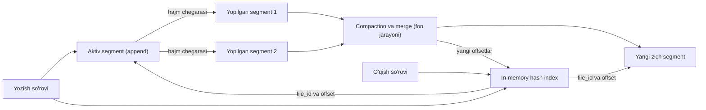

## Bu dars nima uchun kerak

11-darsda biz ma'lumotni qanday **shaklda** tasavvur qilishni ko'rdik. Endi pastga tushamiz: baza bu ma'lumotni diskka qanday yozadi va keyin qanday topadi? Bu savolga javob - **storage engine**. Siz o'z storage engine'ingizni yozmaysiz, lekin uni bilish uchta amaliy sabab bilan kerak:

1. Bazani to'g'ri **tanlash** uchun: yozishga optimallashgan engine bilan o'qishga optimallashgan engine bir xil yuklamada butunlay boshqacha ishlaydi.
2. Bazani to'g'ri **sozlash** uchun: `fsync`, compaction, checkpoint, `fillfactor` kabi parametrlar shu mexanikadan kelib chiqadi.
3. Ko'p tizim dizaynlari (Kafka, event sourcing, CDC, audit log) aynan shu g'oyalar ustiga qurilgan.

Bu dars keyingi ikki dars uchun poydevor: 13-darsda LSM-tree, 14-darsda B-tree va WAL. Ikkalasi ham shu darsdagi ikki g'oyadan boshlanadi: **append-only log** va **indeks**.

Bu darsdan keyin siz:

- append-only log nega shunchalik tez va ishonchli ekanini (4-darsdagi sequential IO bilan bog'lab) tushuntira olasiz;
- segment, compaction, merge, tombstone va crash recovery mexanikasini bilasiz;
- Bitcask uslubidagi hash index qanday ishlashini va uning ikki fundamental cheklovini (RAM va range so'rovlar) hisob bilan ko'rsata olasiz;
- PostgreSQL WAL, PostgreSQL hash index, Kafka segmentlari va Redis AOF ichida shu g'oyalarni taniy olasiz.

## Eng sodda baza: ikki funksiya

Kleppmann kitobida "dunyodagi eng sodda baza" sifatida ikki bash funksiyasi keltiriladi. Mohiyati shunday:

```bash
db_set () { echo "$1,$2" >> database; }
db_get () { grep "^$1," database | sed -e "s/^$1,//" | tail -n 1; }
```

`db_set` faylning oxiriga `kalit,qiymat` qatorini qo'shadi. `db_get` faylni boshidan oxirigacha o'qib, kalitning **oxirgi** qiymatini qaytaradi. Kalit yangilansa - eski qator o'chirilmaydi, yangisi qo'shiladi.

Bu "o'yinchoq" baza ikki muhim xususiyatni ko'rsatadi:

- **Yozish juda tez.** Har bir yozish - faylning oxiriga qo'shish (append). Diskda qidirish yo'q, mavjud ma'lumotni o'zgartirish yo'q. Bu sequential write, 4-darsdan bilamizki, u random write'dan tartib jihatidan tezroq, ayniqsa HDD'da, lekin SSD'da ham (write amplification va FTL tufayli).
- **O'qish juda sekin.** `db_get` - O(n): har safar butun faylni skanerlaydi. 10 GB faylda bitta kalitni topish uchun 10 GB o'qish kerak.

Bundan butun mavzuning markaziy g'oyasi chiqadi: o'qishni tezlashtirish uchun qo'shimcha ma'lumot tuzilmasi - **indeks** kerak. Indeks esa **har doim trade-off**: u o'qishni tezlashtiradi, lekin har bir yozishda uni ham yangilash kerak, ya'ni yozishni sekinlashtiradi va joy egallaydi. Shuning uchun baza hamma narsani avtomatik indekslamaydi - qaysi indeks kerakligini siz so'rovlaringizga qarab tanlaysiz (15-dars).

## Log: ma'lumot tuzilmasi sifatida

Bu yerda "log" deganda ilova loglari (matnli xabarlar) emas, **faqat oxiriga qo'shiladigan, tartiblangan yozuvlar ketma-ketligi** tushuniladi. Bu tushuncha butun kurs bo'yicha qayta-qayta chiqadi: WAL (14-dars), replication log (26-dars), Raft log (36-dars), Kafka (43-dars), event sourcing (46-dars).

Nega append-only yaxshi g'oya, garchi eski qiymatlar joy egallasa ham:

1. **Sequential IO.** Disk (va SSD) uchun eng qulay yozish shakli.
2. **Crash recovery sodda.** Mavjud ma'lumot hech qachon ustidan yozilmaydi. Agar yozish o'rtasida elektr o'chsa, faqat **oxirgi** yozuv chala qolishi mumkin. Uni checksum (CRC) bilan aniqlab, tashlab yuborish yetarli. "In-place" yangilashda esa yarim yozilgan sahifa eski va yangi ma'lumot aralashmasi bo'lib qolishi mumkin (torn page, 14-dars).
3. **Concurrency sodda.** Bitta yozuvchi (single writer) oxiriga qo'shadi, o'quvchilar esa o'zgarmaydigan (immutable) eski qismlarni qulfsiz o'qiydi.
4. **Fragmentatsiya yo'q.** Eski segmentlar birlashtirilganda yangi, zich fayl hosil bo'ladi.

### Yozuv formati

Real engine'da har bir yozuv odatda shunday tuziladi:

```
| CRC32 | timestamp | key_size | value_size | key | value |
```

- **CRC** - yozuvning butunligini tekshirish uchun. Qayta ishga tushganda CRC mos kelmagan oxirgi yozuv kesib tashlanadi.
- **key_size, value_size** - binar format (CSV emas), shuning uchun kalit yoki qiymat ichida vergul yoki yangi qator bo'lishi muammo emas va yozuvni o'qimasdan "sakrab o'tish" mumkin.
- **timestamp** - merge va debugging uchun.

### O'chirish: tombstone

Append-only logda yozuvni "o'chirib" bo'lmaydi. Buning o'rniga maxsus yozuv - **tombstone** (qabr toshi) qo'shiladi: "bu kalit o'chirildi". Merge paytida tombstone ko'rilsa, kalitning barcha eski qiymatlari tashlab yuboriladi. Tombstone qachon o'zi o'chirilishi mumkin - bu nozik savol: agar eski segmentda kalitning qiymati hali qolgan bo'lsa va tombstone undan oldin o'chirilsa, "o'lik" qiymat qayta tiriladi. Bu muammo 13-darsda (LSM) va 27-darsda (Cassandra `gc_grace_seconds`) yana uchraydi.

## Segmentlar, compaction va merge

Bitta fayl cheksiz o'sa olmaydi. Yechim: logni **segmentlarga** bo'lish.

1. Yozuvlar faqat **aktiv segment**ga qo'shiladi.
2. Aktiv segment ma'lum hajmga (masalan, bir necha yuz MB yoki 1 GB) yetganda yopiladi va **immutable** bo'ladi. Yangi aktiv segment ochiladi.
3. Fon jarayoni yopilgan segmentlar ustida **compaction** qiladi: har bir kalitning faqat oxirgi qiymatini qoldiradi, tombstone ostidagi kalitlarni tashlaydi.
4. Bir nechta kichik segment bitta yangi segmentga **merge** qilinadi.
5. Merge tugagach, o'qishlar yangi segmentga yo'naltiriladi va eski fayllar o'chiriladi.

Muhim nuqta: merge **yangi faylga** yozadi, eski segmentlar merge vaqtida ham o'qish uchun ishlayveradi. Shuning uchun compaction o'qish va yozishni bloklamaydi, faqat disk va CPU resursini sarflaydi.



Compaction'ning narxi bor: ma'lumot bir necha marta qayta yoziladi. Bunga **write amplification** deyiladi va u 13-14 darslarda asosiy o'lchovlardan biri bo'ladi.

## Hash index: Bitcask modeli

Endi O(n) o'qish muammosini hal qilamiz. Eng sodda indeks - **xotiradagi hash map**: har bir kalit uchun log faylidagi joyini saqlaymiz.

Bu aynan **Bitcask** dizayni. Bitcask - Basho kompaniyasining Riak bazasi uchun 2010 yilda Justin Sheehy va David Smith tomonidan ta'riflangan storage engine. Uning maqolasida dizayn maqsadlari ochiq yozilgan: har bir o'qish va yozish uchun past latency, tasodifiy yozishlarda yuqori throughput, RAM'dan ancha katta ma'lumot bilan ishlash, crash'dan tez tiklanish, oddiy backup, sodda kod va format.

### Tuzilma

- **Diskda**: segment fayllari (bittasi aktiv, qolganlari immutable).
- **Xotirada - keydir**: hash table, unda har bir kalit uchun qat'iy o'lchamli yozuv: `file_id`, qiymatning fayldagi `offset`i, qiymat o'lchami va timestamp.

### Operatsiyalar

- **Yozish (put):** yozuvni aktiv faylga append qilish, keyin keydir'da kalitni yangi joyga yo'naltirish. Bitta sequential write.
- **O'qish (get):** keydir'dan `file_id` va `offset` ni olish, keyin bitta disk o'qishi (yoki OS page cache'dan, 4-dars). Bitta random read, ko'pincha undan ham kam.
- **O'chirish (delete):** tombstone append qilish va kalitni keydir'dan olib tashlash.

### Crash recovery va hint fayllar

Keydir faqat xotirada. Jarayon qayta ishga tushganda uni qayta qurish kerak. Eng sodda yo'l - barcha segmentlarni boshidan oxirigacha o'qish, lekin bu katta ma'lumotda daqiqalab vaqt oladi. Bitcask buni **hint fayllar** bilan hal qiladi: merge paytida har bir segment yonida faqat kalitlar va ularning joylashuvi yozilgan kichik fayl yaratiladi (qiymatlarsiz). Ishga tushishda qiymatlar emas, faqat hint fayllar o'qiladi.

### Bitcask maqolasidagi raqamlar

Maqolaga ko'ra, dastlabki testlarda odatiy median latency millisekunddan past bo'lgan, sekin diskli noutbukda soniyasiga 5 000-6 000 yozish olingan, va bu testlar RAM'dan 10 baravardan katta ma'lumot to'plamida o'tkazilib, xatti-harakat o'zgarmagan. Cheklovlar ham ochiq yozilgan: keydir to'liq RAM'ga sig'ishi shart, o'qishlar OS fayl cache'iga tayanadi, siqish yo'q, Bitcask katalogini bir vaqtda faqat bitta OS jarayoni yozish uchun ochadi.

## Hash index'ning ikki fundamental cheklovi

### 1. Barcha kalitlar RAM'ga sig'ishi kerak

Hisoblaymiz. Hisob uchun shartlar - keydir'dagi har bir yozuv:

- kalitning o'zi: 16 bayt (masalan, UUID binar holda);
- `file_id` 4 bayt, `offset` 8 bayt, `value_size` 4 bayt, `timestamp` 8 bayt = 24 bayt;
- hash table overhead (bucket ko'rsatkichi, to'lish koeffitsienti, allocator) uchun masalada 40 bayt olamiz (bu implementatsiyaga bog'liq parametr, real qiymatni o'z engine'ingizda o'lchash kerak).

Jami 16 + 24 + 40 = 80 bayt/kalit. Unda:

- 10 mln kalit: 10⁷ × 80 B = **800 MB** RAM - bitta serverga oson sig'adi;
- 100 mln kalit: **8 GB** - hali mumkin;
- 1 mlrd kalit: **80 GB** - bitta serverda qimmat, sharding kerak (28-dars).

Muhim kuzatuv: RAM **qiymatlar** soniga emas, **kalitlar** soniga bog'liq. 10 mln kalit, har birining qiymati 1 MB bo'lsa, diskda 10 TB, keydir esa baribir 800 MB. Shuning uchun hash index "kalitlar kam, qiymatlar katta va tez-tez yangilanadi" yuklamasi uchun ideal: masalan, har bir qurilmaning oxirgi holati yoki hisoblagichlar.

Hash table'ni diskda saqlash ham mumkin, lekin diskdagi hash table'da random IO ko'p, o'sganda qayta xeshlash (resize) qimmat va hash collision'larni boshqarish murakkab. Shu sabab sof diskli hash index kam tarqalgan.

### 2. Range so'rovlar yo'q

Hash funksiya kalitlar tartibini buzadi. `vehicle:1042:2026-10-01` va `vehicle:1042:2026-10-02` xesh jadvalda butunlay boshqa joylarda. "1042 mashinaning 1-10 oktyabrdagi barcha yozuvlari" so'rovi uchun barcha kalitlarni ko'rib chiqish kerak.

Bu ikki cheklov keyingi darsdagi g'oyaga olib keladi: agar segment ichidagi kalitlar **saralangan** bo'lsa (SSTable), indeksni siyrak (sparse) qilish mumkin, ya'ni har bir kalitni emas, har bir necha kilobaytdagi bittasini saqlash yetarli. Bu ham RAM muammosini, ham range muammosini hal qiladi (13-dars).

## Taqqoslash

| Xususiyat | Sof log (indekssiz) | Log + in-memory hash index (Bitcask) | Diskdagi hash index (PostgreSQL hash) | Saralangan tuzilma (LSM, B-tree) |
|---|---|---|---|---|
| Yozish | O(1) append, eng tez | O(1) append + RAM'da yangilash | Bucket sahifasini joyida yangilash, ba'zan split | 13-14 darslar |
| Nuqtali o'qish | O(n) skan | 1 disk o'qishi yoki 0 (cache) | Bucket sahifasi + heap tekshiruvi | O(log n) |
| Range so'rov | O(n) | O(n) | Qo'llab-quvvatlanmaydi | Samarali |
| RAM talabi | Yo'q | Barcha kalitlar | Faqat cache | Siyrak indeks yoki ichki sahifalar |
| Crash recovery | Oxirgi yozuvni CRC bilan kesish | + keydir'ni qayta qurish (hint fayllar) | WAL orqali | WAL yoki log |
| Qayerda ishlatiladi | Kafka, WAL, AOF | Bitcask (Riak) | PostgreSQL `USING hash` | Ko'p bazalar |

## Real tizimlarda bu g'oyalar

### PostgreSQL WAL

PostgreSQL'ning asosiy jadval fayllari (heap) append-only emas - sahifalar joyida o'zgaradi. Lekin har bir o'zgarish avval **WAL**ga (Write-Ahead Log) yoziladi. PostgreSQL hujjatlari buni ochiq tushuntiradi: tranzaksiya commit bo'lganda barcha o'zgargan ma'lumot sahifalarini emas, faqat WAL'ni diskka flush qilish yetarli, chunki WAL ketma-ket yoziladi va uni sinxronlash sahifalarni flush qilishdan ancha arzon. Ko'p kichik tranzaksiya bir vaqtda kelsa, bitta `fsync` bir nechta commitni qamrab olishi mumkin (group commit). Sahifalar keyinroq, checkpoint paytida yoziladi, crash bo'lsa esa WAL'dan qayta tiklanadi (REDO). Asosiy qoida: ma'lumot fayliga o'zgarish faqat u logga yozilgandan **keyin** tushishi mumkin. Bu 14-darsda chuqur ko'riladi.

Ya'ni PostgreSQL ham "durability uchun append-only log, o'qish uchun boshqa tuzilma" g'oyasidan foydalanadi.

### PostgreSQL hash index

`CREATE INDEX ... USING hash` - diskda saqlanadigan hash index. Hujjatlarga ko'ra:

- har bir indeks yozuvida ustun qiymati emas, faqat **4 baytlik hash kodi** saqlanadi. Shuning uchun UUID yoki uzun URL kabi qiymatlarda indeks kichik bo'ladi, lekin har bir topilma heap'da qayta tekshirilishi kerak (lossy);
- faqat `=` operatori, faqat bitta ustun, `UNIQUE` yo'q;
- sahifa turlari: meta sahifa, bucket sahifalari, to'lganda zanjirlanadigan overflow sahifalar va bo'shagan overflow sahifalarni kuzatuvchi bitmap sahifalar;
- indeks bosqichma-bosqich o'sadi: har safar bitta bucket ikkiga bo'linadi (split), bu oldingi planda (foreground) bo'ladi va insert'ni sekinlashtirishi mumkin; bucketlar soni hech qachon kamaymaydi, joy faqat `REINDEX` bilan qaytadi;
- PostgreSQL 10 dan boshlab WAL'ga yoziladi, ya'ni crash-safe va replikatsiya qilinadi. Undan oldin ishlatish tavsiya etilmagan.

Qachon B-tree o'rniga hash index? Katta jadvalda faqat tenglik bo'yicha qidiriladigan uzun kalit (masalan, `external_device_uuid text`) va qiymatlar bir tekis taqsimlangan bo'lsa. Amaliyotda B-tree deyarli har doim yetarli, hash index - tor optimallashtirish.

### Kafka: log + siyrak offset indeksi

Kafka partitioni - aynan segmentlangan append-only log (43-dars). Har bir segment uchun uchta fayl: `.log` (yozuvlar), `.index` (offset - fayldagi bayt pozitsiyasi) va `.timeindex` (vaqt - offset). Fayl nomi segmentning boshlang'ich offsetidir. Standart sozlamalar: segment hajmi `log.segment.bytes` 1 GB, indeks yozuvi `log.index.interval.bytes` (standart 4096) bo'yicha har 4096 bayt log ma'lumotidan keyin bitta. Ya'ni indeks **siyrak**: offset bo'yicha o'qishda avval kerakli segment, keyin indeksdagi eng yaqin pastki yozuv topiladi va log o'sha joydan qisqa skan qilinadi. Bu keyingi darsdagi SSTable siyrak indeksining aynan o'zi. Offset tartibli bo'lgani uchun Kafka'ga hash index kerak emas.

### Redis AOF

Redis xotiradagi baza, lekin durability uchun **AOF** (Append Only File) ga har bir yozish buyrug'ini qo'shib boradi va qayta ishga tushganda uni qayta bajaradi. `appendfsync` sozlamasi aynan "log'ni qachon diskka majburan yozish" trade-off'i:

- `always` - har bir buyruqlar to'plamidan keyin `fsync`, eng xavfsiz, eng sekin;
- `everysec` - soniyada bir marta (standart va tavsiya etilgan), Redis hujjatiga ko'ra crash'da 1 soniyagacha yozish yo'qolishi mumkin;
- `no` - OS o'zi hal qiladi (Redis hujjatiga ko'ra, Linux standart sozlamada odatda har 30 soniyada flush qiladi, lekin bu kernel sozlamasiga bog'liq).

AOF ham cheksiz o'sadi (counterni 100 marta oshirish - 100 ta yozuv), shuning uchun **AOF rewrite** - compaction'ning aynan o'zi: joriy holatni tiklaydigan eng qisqa buyruqlar ketma-ketligi yangi faylga yoziladi. Redis 7.0 dan beri AOF bir nechta fayldan iborat: bitta base fayl (oxirgi rewrite paytidagi snapshot), bir yoki bir nechta incremental fayl va ularni kuzatadigan manifest. Bu bizning "immutable segmentlar + aktiv segment + merge" sxemamizga to'liq mos.

## Raqamlar: fsync siyosati va throughput

Masala sharti: telemetriya ingest servisi har bir qabul qilingan nuqtani lokal append-only logga yozadi (navbatga yuborishdan oldin buffer sifatida). Yuklama: 3 000 nuqta/s cho'qqida, har biri 100 bayt; bitta `fsync` 1 ms davom etadi.

- Ma'lumot oqimi: 3 000 × 100 B = 300 KB/s. Bu sequential write uchun arzimas: oddiy NVMe SSD sekundiga gigabaytlar bilan ketma-ket yoza oladi.
- Muammo hajmda emas, **fsync** sonida. Agar har bir nuqtadan keyin `fsync` qilsak: 3 000 fsync/s. Bitta fsync latency'si qurilmaga qarab keskin farq qiladi, shuning uchun real qiymatni o'z diskingizda o'lchang (PostgreSQL'ning `pg_test_fsync` utilitasi aynan shu uchun). Shartdagi 1 ms bilan ketma-ket ishlovchi bitta yozuvchi soniyasiga maksimal 1 000 / 1 = 1 000 fsync qila oladi - 3 000 ga yetmaydi.
- **Group commit**: har 5 ms da to'plangan yozuvlarni bitta fsync bilan yozamiz. 5 ms ichida 3 000 × 0.005 = 15 nuqta yig'iladi. Fsync soni 200/s ga tushadi, har bir nuqta qo'shimcha maksimal 5 ms kutadi. Bu PostgreSQL'dagi `commit_delay` va Redis'dagi "parallel yozishlarni bitta fsync bilan birlashtirish" g'oyasi.
- **everysec** uslubi: soniyada bitta fsync. Crash'da 3 000 nuqtagacha yo'qolishi mumkin. Agar qurilma "qabul qilindi" javobini olgandan keyin nuqta yo'qolmasligi kerak bo'lsa (1-darsdagi NFR), bu qabul qilinmaydi.

Saboq: append-only log'ning tezligi "qachon durable deb hisoblaymiz" savoliga bog'liq. Javob ACK semantikasini belgilaydi (17, 44-darslar).

## iQuariX kontekstida qo'llanish

Misolda platformada quyidagi joylar bor:

**1. Ingest gateway'dagi lokal buffer.** Trekerdan TCP orqali kelgan paketlar navbatga (Kafka yoki boshqa broker) yuborilishidan oldin lokal diskdagi segmentlangan logga yoziladi. Broker vaqtincha ishlamasa, gateway logda to'playdi va keyin qayta yuboradi. Segmentlar 64 MB, har bir yozuvda CRC; qayta ishga tushganda oxirgi chala yozuv kesiladi; navbatga muvaffaqiyatli yuborilgan segmentlar o'chiriladi. Bu yerda indeks umuman kerak emas - o'qish faqat ketma-ket.

**2. Oxirgi holat (last known position).** Misol sharti: 100 000 qurilma, har birining oxirgi holati 200 bayt. Kalitlar soni kichik (100 ming), qiymat tez-tez yangilanadi - hash index uchun ideal yuklama. Keydir: 100 000 × 80 B ≈ 8 MB. Amalda bu Redis hash yoki oddiy in-memory map bo'ladi, durability esa AOF yoki asosiy bazadan qayta tiklash orqali.

**3. Nimaga hash index yaramaydi.** "Mashina X ning kecha 14:00-16:00 dagi nuqtalari" - range so'rov. Buni hash index bilan qilib bo'lmaydi; saralangan tuzilma (LSM yoki B-tree, `(vehicle_id, ts)` kaliti bilan) kerak - 13, 14, 81-darslar.

**4. Video metadata.** Kamera kliplari obyekt storage'da (60-dars), har bir klip uchun `clip_id` - joylashuv yozuvi. Agar faqat ID bo'yicha qidirilsa, hash yetarli; lekin "shu mashinaning shu soatdagi kliplari" kerak bo'lishi aniq, demak yana saralangan indeks.

## Ko'p uchraydigan xatolar

1. **"Append-only = joy isrof, yomon" deb o'ylash.** Joy compaction bilan qaytariladi, evaziga sequential IO va sodda crash recovery olinadi. Ko'p zamonaviy tizimlarning poydevori aynan shu.
2. **Fsync'ni unutish.** `write()` qaytdi degani ma'lumot diskda degani emas - u OS page cache'da. Durability faqat `fsync` (yoki `O_DSYNC`) dan keyin.
3. **CRC'siz log format.** Crash'dan keyin chala yozuvni aniqlab bo'lmaydi va buzilgan ma'lumot "to'g'ri" deb o'qiladi.
4. **Tombstone'ni juda erta tashlash.** Eski segmentlarda kalit qiymati qolgan bo'lsa, o'chirilgan ma'lumot "tiriladi".
5. **Hash index'ni range so'rov uchun tanlash.** PostgreSQL'da `USING hash` indeks `BETWEEN` yoki `ORDER BY` uchun umuman ishlatilmaydi.
6. **Keydir hajmini hisoblamaslik.** Kalitlar soni o'sib, RAM tugaganda Bitcask uslubidagi engine ishlamay qoladi; buni oldindan hisoblash kerak.
7. **Compaction resursini rejalashtirmaslik.** Compaction disk throughput'ini foydalanuvchi so'rovlari bilan bo'lishadi; cho'qqi vaqtda u latency'ni oshiradi.

## Xulosa

- Storage engine'ning ikki asosiy vazifasi: ma'lumotni ishonchli yozish va tez topish. Ular bir-biriga zid talablar.
- Append-only log: sequential IO, sodda crash recovery (CRC bilan oxirgi yozuvni kesish), sodda concurrency. Narxi - eski qiymatlar uchun joy va compaction.
- Segmentlar + fon compaction/merge + tombstone - append-only logni cheksiz o'sishdan saqlaydi.
- Indeks o'qishni tezlashtiradi, yozishni qimmatlashtiradi. Har bir indeks - trade-off.
- Bitcask uslubidagi in-memory hash index: 1 disk o'qishi bilan get, lekin barcha kalitlar RAM'da bo'lishi va range so'rovlar yo'qligi - fundamental cheklovlar.
- Bu g'oyalar real tizimlarda: PostgreSQL WAL va hash index, Kafka segmentlari va siyrak offset indeksi, Redis AOF va rewrite.
- Log tezligining asosiy omili - fsync siyosati. Group commit fsync sonini kamaytiradi, evaziga ozgina latency qo'shadi.

## Amaliy topshiriq

Masala: iQuariX ingest gateway uchun **lokal durable buffer** loyihalang. Gateway trekerlardan paket qabul qiladi, uni lokal logga yozadi, trekerga ACK yuboradi va fon jarayonida navbatga (broker) jo'natadi. Broker 30 daqiqagacha ishlamay qolishi mumkin. Yuklama: bitta gateway'ga 5 000 qurilma, har biri 10 soniyada 150 baytlik paket; cho'qqi o'rtachadan 3 baravar.

1. Yozuv formatini aniqlang (maydonlar, o'lchamlari, CRC). Qaysi maydonlar majburiy va nega?
2. Segment hajmi va segmentni yopish qoidasini tanlang. 30 daqiqalik broker uzilishida diskda qancha ma'lumot to'planishini cho'qqi yuklama bilan hisoblang.
3. Fsync siyosatini tanlang: har yozuv, group commit (qancha ms), yoki soniyada bir marta. ACK qachon yuboriladi va har bir variantda crash'da nima yo'qolishi mumkinligini yozing.
4. Qaysi segmentni qachon o'chirish mumkinligini aniqlang (brokerga yuborilgan offsetni qayerda va qanday saqlaysiz?). Gateway qayta ishga tushganda qayerdan davom etadi?
5. Bu buffer'ga indeks kerakmi? Agar kerak bo'lsa - qaysi so'rov uchun; kerak bo'lmasa - nega.
6. Duplikat masalasi: gateway crash'dan keyin ba'zi paketlarni brokerga ikki marta yuborishi mumkinmi? Iste'molchi tomonida buni qanday hal qilish mumkin (39-darsga havola bilan)?

Yaxshi javobda bo'lishi kerak bo'lgan narsalar:

- 30 daqiqalik uzilish hajmi ochiq hisoblangan (5 000 / 10 × 3 × 150 B × 1 800 s);
- ACK va fsync o'rtasidagi bog'liqlik aniq: ACK fsync'dan oldin yuborilsa, nima yo'qolishi mumkinligi aytilgan;
- chala yozuvni aniqlash mexanizmi (CRC, uzunlik) bor;
- "yuborilgan offset" ham durable saqlanishi va u yangilanmay qolsa duplikat bo'lishi tushuntirilgan;
- indeks haqidagi qaror so'rov shaklidan kelib chiqqan.

Javobni pastdagi maydonga yozib, chatga yuboring.

## Manbalar

- Martin Kleppmann, Chris Riccomini. [Designing Data-Intensive Applications, 2-nashr](https://www.oreilly.com/library/view/designing-data-intensive-applications/9781098119058/), O'Reilly, 2026. 4-bob "Storage and Retrieval" - eng sodda baza, log, hash index, segmentlar va compaction.
- Justin Sheehy, David Smith. [Bitcask: A Log-Structured Hash Table for Fast Key/Value Data](https://riak.com/assets/bitcask-intro.pdf), Basho Technologies, 2010.
- Arpit Bhayani. [Bitcask - A Log-Structured Fast KV Store](https://arpitbhayani.me/blogs/bitcask) - yozuv formati, keydir, merge va hint fayllarning tushuntirishi.
- PostgreSQL hujjatlari: [Write-Ahead Logging (WAL)](https://www.postgresql.org/docs/current/wal-intro.html), [pg_test_fsync](https://www.postgresql.org/docs/current/pgtestfsync.html), [Hash Indexes - Implementation](https://www.postgresql.org/docs/current/hash-index.html), [PostgreSQL 10 release notes](https://www.postgresql.org/docs/10/release-10.html) (hash index WAL qo'llovi).
- Redis. [Redis persistence](https://redis.io/docs/latest/operate/oss_and_stack/management/persistence/) - AOF, `appendfsync`, rewrite va multi-part AOF.
- Conduktor. [Kafka Log Retention and Segments](https://www.conduktor.io/blog/kafka-log-retention-and-segments.md) - segment fayllari, `.index` va `.timeindex`, `log.index.interval.bytes`.
- Alex Petrov. Database Internals, O'Reilly, 2019. 7-bob "Log-Structured Storage".
