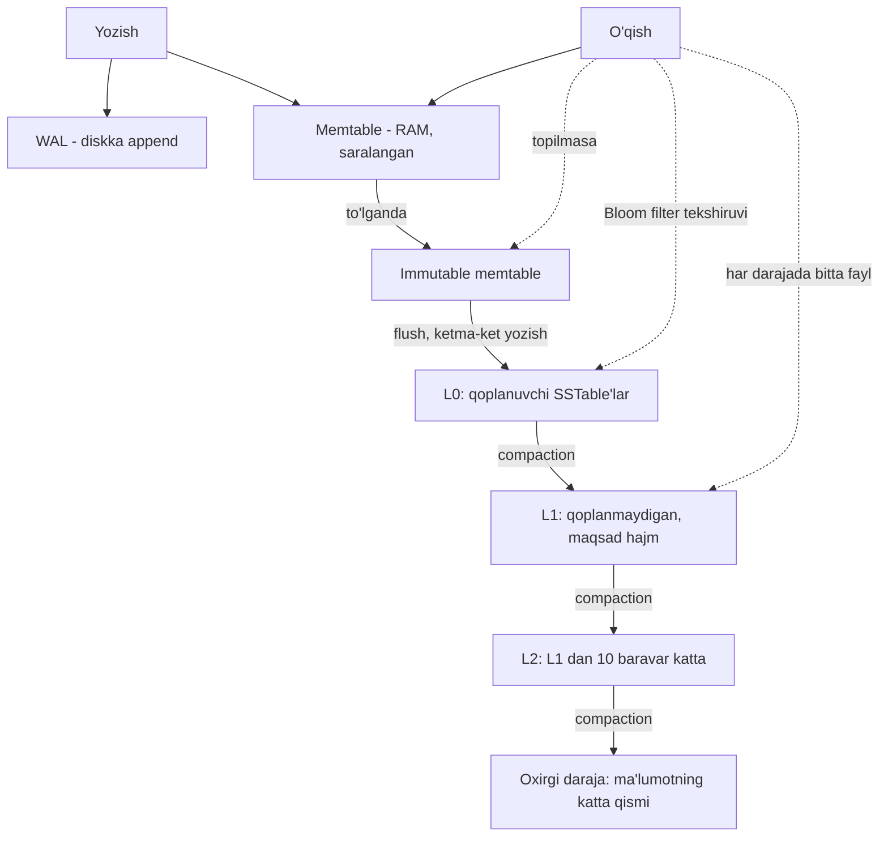

## Bu dars nima uchun kerak

12-darsda biz append-only log va in-memory hash index bilan tanishdik va ularning ikki fundamental cheklovini ko'rdik: barcha kalitlar RAM'ga sig'ishi kerak va range so'rovlar yo'q. Bu darsda shu ikki muammoni hal qiladigan tuzilmani ko'ramiz: **LSM-tree** (Log-Structured Merge-tree). Bu Cassandra, ScyllaDB, HBase, RocksDB, LevelDB, CockroachDB (Pebble orqali) va RocksDB ustiga qurilgan ko'plab tizimlarning asosidir; ClickHouse'ning MergeTree oilasi ham shunga yaqin "yoz, keyin fonda birlashtir" g'oyasida ishlaydi. Yozish hajmi katta bo'lgan har qanday tizimda - telemetriya, loglar, metrikalar, xabarlar - siz LSM bilan ishlaysiz, bilsangiz ham, bilmasangiz ham.

PostgreSQL LSM emas (u B-tree va heap ustida, 14-dars). Shuning uchun bu dars sizga PostgreSQL'ning qayerda kuchli va qayerda boshqa engine'ga yo'l berishini tushunish uchun ham kerak.

Bu darsdan keyin siz:

- SSTable nima ekanini va saralangan fayl nega siyrak indeks, samarali merge va range so'rovlarga imkon berishini tushuntira olasiz;
- LSM'ning yozish va o'qish yo'lini (memtable, WAL, flush, SSTable darajalari) bosqichma-bosqich ayta olasiz;
- size-tiered va leveled compaction'ning farqini va ularning write, read, space amplification bo'yicha trade-off'ini hisoblay olasiz;
- Bloom filter qanday ishlashini, uning false positive formulasini va bits-per-key tanlashni bilasiz;
- tombstone, `gc_grace_seconds` va TWCS kabi amaliy masalalarni telemetriya yuklamasida qo'llay olasiz.

## SSTable: saralangan segment

12-darsdagi segmentlarda yozuvlar kelgan tartibda edi. Endi bitta talab qo'shamiz: **segment ichidagi yozuvlar kalit bo'yicha saralangan va har bir kalit segmentda bir marta uchraydi.** Bunday faylga **SSTable** (Sorted String Table) deyiladi. Termin Google Bigtable maqolasidan (2006) tarqalgan.

Saralanganlik uchta katta foyda beradi:

### 1. Merge oddiy va samarali

Bir nechta SSTable'ni birlashtirish - merge sort'ning "merge" qadami: har bir fayldan birinchi yozuvni o'qiymiz, eng kichik kalitni chiqaramiz, keyingisiga o'tamiz. Fayllar RAM'dan katta bo'lsa ham ishlaydi, chunki hammasi ketma-ket o'qish va ketma-ket yozish. Bir xil kalit bir necha faylda bo'lsa, eng yangi segmentdagisi qoladi.

### 2. Indeks siyrak bo'lishi mumkin

Har bir kalitni xotirada saqlash shart emas. Har bir necha kilobaytlik **blok** uchun birinchi kalitni saqlash yetarli. `vehicle:1042:...` ni qidirsak va indeksda `vehicle:1030` (offset 81 920) va `vehicle:1055` (offset 86 016) bo'lsa, kerakli kalit shu ikki offset orasidagi 4 KB blokda. Blokni o'qib, ichida qidiramiz. 12-darsdagi Kafka `.index` fayli aynan shunday ishlaydi.

Hisob uchun shartlar: 1 mlrd kalit, o'rtacha yozuv 100 bayt, blok 4 KB, har bir indeks yozuvi (kalit + offset) 40 bayt. Bitta blokda 4 096 / 100 ≈ 40 yozuv, ya'ni 10⁹ / 40 = 25 mln blok. Indeks: 25 × 10⁶ × 40 B = **1 GB**. Bitcask'dagi 80 GB bilan solishtiring (12-dars). RAM talabi blok hajmiga proporsional ravishda kamaydi.

### 3. Siqish va range so'rov

Blok bir butun o'qilgani uchun uni siqish mumkin (Snappy, LZ4, Zstd): yaqin kalitlar o'xshash bo'lgani uchun siqish yaxshi ishlaydi. Range so'rov esa birinchi kalitni topib, keyin ketma-ket o'qish.

## LSM-tree: SSTable'ni qanday hosil qilamiz

Muammo: yozishlar tasodifiy tartibda keladi, SSTable esa saralangan bo'lishi kerak. Yechim: avval xotirada saralaymiz.

LSM-tree g'oyasi Patrick O'Neil, Edward Cheng, Dieter Gawlick va Elizabeth O'Neil'ning 1996 yilda Acta Informatica jurnalida chop etilgan "The Log-Structured Merge-Tree" maqolasidan keladi. Zamonaviy amalga oshirish (LevelDB, RocksDB) quyidagicha:

### Yozish yo'li

1. **WAL'ga append.** Yozuv avval diskdagi logga qo'shiladi (12-dars). Bu faqat crash'dan tiklash uchun; u saralangan emas.
2. **Memtable'ga qo'shish.** Xotiradagi saralangan tuzilma (odatda skip list yoki balanced tree). Yozish shu yerda tugaydi - mijozga javob qaytadi.
3. **Flush.** Memtable chegaraga yetganda (LevelDB implementatsiya hujjatiga ko'ra, log standart bo'yicha 4 MB dan oshganda), u immutable bo'ladi, yangi memtable ochiladi, eskisi esa diskka yangi SSTable sifatida yoziladi (L0 darajasi). Memtable allaqachon saralangan, demak bu bitta ketma-ket yozish.
4. **Eski WAL o'chiriladi.** Flush tugagach, shu memtable'ga tegishli log endi kerak emas.
5. **Fon compaction.** SSTable'lar darajalar bo'ylab birlashtiriladi (pastda batafsil).

Diqqat: yozish yo'lida **hech qanday random IO yo'q**. WAL - append, flush - ketma-ket, compaction - ketma-ket o'qish va yozish. LSM'ning yozishdagi kuchi shundan.

### O'qish yo'li

Kalitni topish uchun eng yangidan eng eskiga qarab:

1. Aktiv memtable.
2. Immutable memtable(lar) - flush kutayotgan.
3. L0 dagi SSTable'lar - ular bir-birini **qoplashi** (overlap) mumkin, chunki har biri alohida memtable'dan kelgan; shuning uchun L0 ning **barcha** fayllari tekshiriladi, yangisidan boshlab.
4. L1, L2, ... - har bir darajada fayllar kalit oralig'i bo'yicha qoplanmaydi, shuning uchun har darajada ko'pi bilan **bitta** fayl tekshiriladi.

Birinchi topilgan qiymat (yoki tombstone) javob. Agar kalit umuman yo'q bo'lsa - eng yomon holat: barcha darajalarni tekshirish kerak. Bloom filter aynan shuni hal qiladi.

## Compaction strategiyalari

Compaction'siz SSTable'lar soni cheksiz o'sadi, o'qish esa tobora sekinlashadi. Compaction eski qiymatlarni va tombstone'larni tozalaydi va fayllar sonini kamaytiradi. Lekin u ma'lumotni qayta-qayta yozadi. Asosiy savol: **qachon va qaysi fayllarni birlashtirish?**

### Uchta amplification

Har bir storage engine'ni (LSM ham, B-tree ham) uchta o'lchov bilan baholash mumkin. Bu atamalar RocksDB hujjatlari va akademik adabiyotda standart:

- **Write amplification (WA)** - diskka yozilgan baytlar / ilova yozgan baytlar. WA = 10 bo'lsa, 100 MB/s yozish uchun disk 1 GB/s yozadi. SSD resursi (TBW) va disk throughput'i shu bilan sarflanadi.
- **Read amplification (RA)** - bitta so'rov uchun nechta disk o'qishi (yoki nechta fayl/blok).
- **Space amplification (SA)** - diskdagi hajm / haqiqiy jonli ma'lumot hajmi. Eski versiyalar va tombstone'lar shuni oshiradi.

Bu uchtasini bir vaqtda minimallashtirib bo'lmaydi: birini yaxshilash qolganlaridan birini yomonlashtiradi. Bu g'oya **RUM conjecture** sifatida Athanassoulis va boshq. "Designing Access Methods: The RUM Conjecture" (EDBT 2016) maqolasida shakllantirilgan: read, update va memory overhead'laridan ikkitasiga yuqori chegara qo'ygan access method uchinchisiga quyi chegara qo'yadi. Maqolada R - asosiy ma'lumotni olish uchun yordamchi tuzilmalardan o'qiladigan qo'shimcha ma'lumot, U - bitta mantiqiy yangilash keltiradigan qo'shimcha fizik yozishlar, M - yordamchi ma'lumotning asosiy ma'lumotga nisbatan egallagan joyi.

### Size-tiered compaction (STCS)

O'xshash hajmdagi SSTable'lar ma'lum songa yetganda (Cassandra STCS'da `min_threshold`, standart 4), ular bitta kattaroq faylga birlashtiriladi. Natijada "qavatlar" hosil bo'ladi: kichik, o'rta, katta, juda katta.

- **WA past:** har bir yozuv har bir qavatda bir marta qayta yoziladi, qavatlar soni logarifmik.
- **SA yuqori:** bir kalitning bir nechta versiyasi turli qavatlarda uzoq yashaydi. Bundan tashqari, ikki eng katta faylni birlashtirish uchun vaqtincha ularning hajmicha bo'sh joy kerak.
- **RA yuqoriroq:** kalit bir nechta faylda bo'lishi mumkin.

Cassandra hujjatlarida (5.0) STCS standart strategiya, chunki boshqalari yuklamaga mos kelmaganda u zaxira variant sifatida foydali.

### Leveled compaction (LCS)

LevelDB va RocksDB'ning asosiy usuli. L1 dan boshlab har bir daraja bir necha fayldan iborat, fayllar kalit oralig'i bo'yicha **qoplanmaydi**, va har bir daraja oldingisidan 10 baravar katta (LevelDB'da qat'iy, RocksDB'da `max_bytes_for_level_multiplier`, standart 10). LevelDB implementatsiya hujjatiga ko'ra: L0 dagi fayllar soni chegaradan (hozir to'rtta) oshsa L1 ga compaction boshlanadi; L daraja hajmi 10^L MB dan oshsa (L1 uchun 10 MB, L2 uchun 100 MB), u keyingi darajaga compaction qilinadi; compaction chiqish fayllari 2 MB maqsad hajmida yoziladi. Compaction L darajadan bitta faylni va L+1 dagi u bilan qoplanuvchi barcha fayllarni olib, yangi L+1 fayllarini yozadi.

- **RA past:** har darajada ko'pi bilan bitta fayl.
- **SA past:** RocksDB hujjatiga ko'ra `level_compaction_dynamic_level_bytes = true` bilan ma'lumotning 90% oxirgi darajada saqlanadi va unda har bir kalit bir marta.
- **WA yuqori:** daraja ko'paytuvchisi 10 bo'lgani uchun L darajadagi bayt L+1 dagi 10 baytga yaqin ma'lumot bilan birlashtiriladi, ya'ni har bir darajaga o'tishda ma'lumot 10 baravarga yaqin qayta yoziladi.

RocksDB tuning qo'llanmasidagi misol: L1 hajmi L0 ga teng (512 MB) va har bir keyingi daraja 10 baravar katta bo'lsa, leveled compaction'da write amplification 1 + 2 + 10 + 10 + 10 = **33**, 500 GB ma'lumotda space amplification esa (512 MB + 512 MB + 5 GB + 51 GB + 512 GB) / 500 GB = **1.14**. RocksDB 8.4 dan beri `level_compaction_dynamic_level_bytes = true` standart: daraja maqsad hajmlari oxirgi darajaning haqiqiy hajmidan pastga qarab hisoblanadi.

Cassandra LCS'ni o'qishga yo'naltirilgan yoki ko'p update/delete bo'lgan yuklamalar uchun tavsiya qiladi va o'zgarmas time-series uchun yaxshi tanlov emasligini aytadi.

### Time-window compaction (TWCS)

Time-series uchun maxsus: SSTable'lar vaqt oynalari (masalan, 1 kun) bo'yicha guruhlanadi, faqat bir oyna ichida compaction qilinadi. Eski oynalar qayta yozilmaydi. TTL tugaganda **butun SSTable** o'chiriladi - compaction ham, tombstone ham kerak emas. Cassandra hujjatlari TWCS ni TTL'li, asosan o'zgarmas time-series ma'lumot uchun mo'ljallangan deb ta'riflaydi. Cassandra'ning joriy hujjatlarida yangi **UCS** (Unified Compaction Strategy) ham bor va hujjatlar uni yangi yuklamalar uchun tavsiya qiladi: u ham time-series, ham ko'p update/delete'li yuklamalarni qoplashga mo'ljallangan.

### Taqqoslash jadvali

| Strategiya | Write amp. | Read amp. | Space amp. | Yaxshi yuklama | Yomon yuklama |
|---|---|---|---|---|---|
| Size-tiered | Past | O'rta-yuqori | Yuqori (compaction paytida vaqtincha 2x gacha) | Ko'p yozish, kam o'qish | Ko'p update, disk tor |
| Leveled | Yuqori (o'nlab) | Past | Past (RocksDB misolida 1.14) | Ko'p o'qish, ko'p update/delete | Juda katta yozish oqimi |
| Time-window | Juda past | Vaqt oynasi bo'yicha past | Past, TTL bilan butun fayl o'chadi | Append-only time-series + TTL | Eski ma'lumotni update qilish, TTL'siz |

## Bloom filter

LSM'da yo'q kalitni qidirish eng qimmat: memtable, L0 ning barcha fayllari va har bir darajadan bittadan fayl. Har bir fayl uchun blok o'qish - bir nechta random IO. **Bloom filter** - har bir SSTable uchun "bu kalit bu faylda **albatta yo'q**" deb tez aytadigan ixcham ehtimollik tuzilmasi. Uni Burton Bloom 1970 yilda taklif qilgan.

### Qanday ishlaydi

- `m` bitlik massiv, boshida hammasi 0.
- `k` ta mustaqil hash funksiya.
- **Qo'shish:** kalitni `k` ta hash bilan `k` ta pozitsiyaga aylantirib, o'sha bitlarni 1 qilish.
- **Tekshirish:** `k` ta pozitsiyaning barchasi 1 bo'lsa - "ehtimol bor"; kamida bittasi 0 bo'lsa - "albatta yo'q".

False negative bo'lmaydi (qo'shilgan kalitning bitlari 1 bo'lib qoladi). False positive bo'lishi mumkin: boshqa kalitlar tasodifan kerakli bitlarni 1 qilgan bo'lsa. O'chirish yo'q (bitni 0 qilsak, boshqa kalit buziladi), lekin SSTable immutable bo'lgani uchun bu muammo emas - filter fayl bilan birga yaratiladi va o'chiriladi.

### Formula

`n` ta kalit, `m` bit, `k` hash uchun false positive ehtimolining standart yaqinlashuvi (hashlar mustaqil deb olinadi):

p ≈ (1 - e^(-k·n/m))^k

Optimal `k` = (m/n) · ln 2. Bir kalitga ajratilgan bitlar (b = m/n) bo'yicha shu formula bilan hisoblaymiz (k butun songa yaxlitlangan):

| Bit/kalit | Optimal k | False positive |
|---|---|---|
| 8 | 6 | 2.16% |
| 10 | 7 | 0.82% |
| 12 | 8 | 0.31% |
| 16 | 11 | 0.046% |

Shu formuladan: optimal k bilan b = -ln(p) / (ln 2)² bit/kalit, ya'ni 1% xato uchun 4.605 / 0.4805 ≈ 9.6 bit/kalit, va har qo'shimcha ln(10) / (ln 2)² ≈ 4.8 bit xatoni 10 baravar kamaytiradi. RocksDB tuning qo'llanmasida standart `bits_per_key` 10 va u "~1% false positive" beradi deb yozilgan. RocksDB Bloom filter wiki'siga ko'ra, Ribbon filteri (6.15.0 dan) Bloom filter joyining 30% ga yaqinini tejaydi (`NewRibbonFilterPolicy(9.9)` Bloom bilan bir xil 1% xatoni 7 bit/kalit atrofida beradi), evaziga filterlarga 3-4 baravar ko'p CPU sarflaydi, asosan fonda filter qurishda.

### Hisob: Bloom filter qancha RAM oladi va nima beradi

1 mlrd kalit, 10 bit/kalit: 10¹⁰ bit = 1.25 × 10⁹ bayt = **1.25 GB**. Bu hash index'ning 80 GB'idan ancha kam va uni RAM'da ushlab turish mumkin.

Foyda. Hisob sharti: jami 7 ta fayl tekshirilishi kerak (L0 da 2, keyin 5 daraja). Filtersiz yo'q kalit uchun 7 ta blok o'qishi. 1% false positive bilan kutilgan keraksiz o'qishlar: 7 × 0.01 = **0.07** blok. Mavjud kalit (eng yomon holda oxirgi faylda) uchun 1 ta haqiqiy o'qish va oldingi 6 fayl uchun 6 × 0.01 = 0.06. Ya'ni Bloom filter nuqtali o'qishni bitta blok o'qishiga yaqinlashtiradi.

Muhim cheklov: Bloom filter faqat **nuqtali** (aniq kalit) qidiruvga yordam beradi. Range so'rovda (`ts BETWEEN ...`) qaysi kalitlarni tekshirishni oldindan bilmaymiz. RocksDB buning uchun **prefix Bloom filter**ni taklif qiladi: kalitning prefiksi (masalan, `vehicle_id`) filterga qo'shiladi va "bu faylda shu mashinaning birorta ham yozuvi yo'q" degan savolga javob beradi.

## Tombstone va o'chirish muammolari

LSM'da o'chirish - tombstone yozish (12-dars). Tombstone eski qiymatni "soya"da qoldiradi va faqat compaction eski qiymat bilan birga uni olib tashlaydi. Bundan bir nechta amaliy muammo chiqadi:

1. **O'chirilgan ma'lumot joyni darhol bo'shatmaydi.** Ko'p delete'dan keyin disk hajmi kamaymaydi, aksincha o'sadi.
2. **Tombstone'larni o'qish qimmat.** Partitionda 100 000 tombstone bo'lsa, range so'rov ularning barchasini ko'rib chiqadi. Cassandra'da navbat (queue) sifatida ishlatilgan jadval - klassik anti-pattern.
3. **Distributed tizimda "zombi" ma'lumot.** Cassandra hujjatlari tushuntiradi: o'chirish paytida ishlamay turgan replika tombstone'ni olmaydi va eski qiymatni saqlab qoladi. Agar boshqa replikalar tombstone'ni allaqachon tozalagan bo'lsa, bu tugun qaytganda eski qiymat "yangi" deb qabul qilinib, klaster bo'ylab qayta tarqaladi. Shu sabab tombstone `gc_grace_seconds` (standart 864 000 soniya, ya'ni 10 kun) o'tmaguncha tozalanmaydi va bu vaqt ichida repair bajarilishi kerak (27-dars).

Time-series uchun eng yaxshi yo'l - alohida qatorlarni o'chirmaslik, balki TTL va TWCS bilan **butun fayllarni** tashlash, yoki PostgreSQL'da butun partitionni `DROP` qilish.

## LSM va B-tree: qisqa oldindan ko'rinish

Batafsil taqqoslash 14-darsda, hozircha intuitsiya:

- LSM yozishni **ketma-ket** qiladi va keyin fonda tartibga soladi: yozish arzon, o'qish va compaction narxi keyinroq to'lanadi.
- B-tree yozishda darhol to'g'ri sahifani topib, **joyida** yangilaydi: o'qish bashorat qilinadigan, lekin har bir yozish random IO va sahifani butunlay qayta yozish.
- LSM'da latency dumida (p99.9) compaction ta'siri ko'rinadi: fon compaction disk resursini olganda, yoki L0 to'lib, yozish sekinlashtirilganda (write stall).

## Real tizimlar

- **LevelDB** - Google'dagi ochiq kodli embedded engine; leveled compaction'ning klassik ta'rifi uning hujjatlarida. **RocksDB** - Meta tomonidan LevelDB asosida ishlab chiqilgan, server yuklamalari uchun ko'p sozlanadigan versiya (ko'p threadli compaction, column families, Ribbon filter, universal compaction).
- **Cassandra / ScyllaDB** - har bir tugunda LSM: commit log (WAL), memtable, SSTable. Compaction strategiyasi jadval darajasida tanlanadi (STCS, LCS, TWCS, UCS). 11-darsdagi Discord misolida partition hajmi muammosi aynan shu storage tufayli muhim edi.
- **CockroachDB** - 20.2 versiyadan beri standart storage engine sifatida Go'da yozilgan **Pebble**'dan foydalanadi (RocksDB'dan ilhomlangan, u bilan formatda mos). Cockroach Labs blogida keltirilgan sabablar: Go va C++ chegarasidan tez-tez o'tish (Cgo) overhead'i, RocksDB kod bazasining LevelDB'dagi 30 ming qatordan 350 ming+ qatorgacha o'sgani va engine'ni o'z ehtiyojiga moslash. Format mosligi RocksDB 6.2.1 bilan ikki tomonlama qilib mo'ljallangan.
- **Bigtable** - SSTable atamasining manbai. Maqolaning 5.4-bo'limida uchta termin bor: **minor compaction** (muzlatilgan memtable SSTable'ga aylantirilib GFS'ga yoziladi - ya'ni bizning "flush"), **merging compaction** (bir necha SSTable va memtable o'qilib, bitta yangi SSTable yoziladi) va **major compaction** (barcha SSTable'larni aynan bitta SSTable'ga qayta yozadigan merging compaction; faqat shunda o'chirilgan ma'lumot va tombstone'lar butunlay yo'qoladi). HBase uning ochiq kodli izdoshi.

## iQuariX kontekstida qo'llanish

Masala sharti: xom telemetriya uchun LSM asosidagi saqlash (masalan, Cassandra/ScyllaDB yoki RocksDB ustidagi time-series engine) ko'rib chiqilmoqda. Yuklama: 100 000 qurilma, har 10 soniyada nuqta, nuqta 100 bayt (indeks va metadata bilan), saqlash muddati 90 kun.

**Yozish hajmi:**

- 100 000 / 10 = 10 000 nuqta/s; 10 000 × 100 B = 1 MB/s; × 86 400 s = 86.4 GB/kun.
- 90 kunda jonli ma'lumot: 86.4 × 90 ≈ **7.8 TB** (siqishdan oldin; siqish koeffitsienti ma'lumotga bog'liq, uni o'z namunangizda o'lchang).

**Compaction strategiyasini tanlash:**

- **Leveled** bilan WA RocksDB misolidagidek 33 atrofida bo'lsa (masalada 30 olamiz): disk 30 MB/s yozadi, kuniga 30 × 86 400 ≈ 2.6 TB. Bu jonli ma'lumotdan ham ko'p va SSD resursini tez yeydi. Bundan tashqari, append-only ma'lumotni qayta-qayta birlashtirish foydasiz: kalitlar takrorlanmaydi, eski versiya yo'q.
- **TWCS** (1 kunlik oyna) bilan: har bir kunlik ma'lumot oyna ichida bir necha marta birlashtiriladi, keyin "muzlaydi". WA kichik raqamlar bilan o'lchanadi. 90 kundan keyin TTL bilan butun kunlik SSTable o'chiriladi - tombstone yo'q.
- Shart: kech keladigan ma'lumot (qurilma oflayn bo'lib, 3 kundan keyin yuborsa) eski oynaga tegishli SSTable yaratadi va TWCS samaradorligini buzadi. Buni ingest tomonida hisobga olish kerak: masalan, juda kech nuqtalarni alohida yo'lga yo'naltirish yoki oyna o'lchamini kattaroq olish.

**O'qish:**

- "Mashina X, kecha 14:00-16:00" - partition `(vehicle_id, day)` va clustering `ts` bilan bitta partitiondagi ketma-ket o'qish (11-dars).
- Bloom filter bu yerda partition kaliti bo'yicha ishlaydi: "bu SSTable'da shu (mashina, kun) partitioni bormi". TWCS'da bu ayniqsa samarali, chunki kecha uchun so'rov faqat kechagi oyna fayllariga tegadi.

**PostgreSQL bilan solishtirish:** 10 000 yozuv/s PostgreSQL uchun ham mumkin (vaqt bo'yicha partitioning bilan), lekin har bir insert heap'ga va har bir indeksga random IO, WAL va keyin vacuum (19-dars). LSM'ga o'tish qarori "PostgreSQL sekin" degan hissiyotdan emas, write amplification, disk hajmi va operatsion murakkablikni raqam bilan solishtirishdan kelib chiqishi kerak (20, 81-darslar).

## Ko'p uchraydigan xatolar

1. **Time-series uchun leveled compaction.** Takrorlanmaydigan append-only ma'lumotni qayta-qayta yozish - disk va SSD resursini behuda sarflash.
2. **LSM'ni navbat (queue) sifatida ishlatish.** Yozib, o'qib, o'chirish - minglab tombstone va sekinlashayotgan o'qishlar.
3. **Bloom filter range so'rovga yordam beradi deb o'ylash.** Faqat nuqtali yoki prefix qidiruvga.
4. **Compaction uchun disk zaxirasini qoldirmaslik.** Size-tiered'da katta compaction vaqtincha qo'shimcha joy talab qiladi; disk 90% to'lgan bo'lsa, compaction to'xtaydi va o'qishlar sekinlashadi.
5. **`gc_grace_seconds` ni repair siklisiz kamaytirish.** O'chirilgan ma'lumot qayta tiriladi.
6. **Faqat o'rtacha latency'ga qarash.** LSM'da compaction va write stall p99.9 da ko'rinadi.
7. **Kech keladigan ma'lumotni TWCS'da hisobga olmaslik.** Eski oynalarga yozish fayllar sonini oshiradi va TTL bilan butun faylni tashlashni kechiktiradi.

## Xulosa

- SSTable - kalit bo'yicha saralangan immutable segment; saralanganlik siyrak indeks, oddiy merge, blok siqish va range so'rovlarni beradi.
- LSM yozish yo'li: WAL, memtable, flush L0 ga, fon compaction. Yozish yo'lida random IO yo'q.
- O'qish yangidan eskiga: memtable, L0 ning barcha fayllari, keyin har darajada bitta fayl.
- Compaction - write, read va space amplification o'rtasidagi tanlov: size-tiered yozishga, leveled o'qish va joyga, time-window append-only time-series'ga mos.
- Bloom filter yo'q kalit uchun keraksiz disk o'qishlarini yo'qotadi; 10 bit/kalit 1% ga yaqin (0.82%) false positive. Faqat nuqtali va prefix qidiruv uchun.
- O'chirish - tombstone; u joyni darhol bo'shatmaydi va distributed tizimda grace period talab qiladi. Time-series'da qatorlarni emas, butun fayl yoki partitionni o'chiring.

## Amaliy topshiriq

Masala sharti: iQuariX uchun **datchik hodisalari arxivi** loyihalanmoqda: CAN-shina va yoqilg'i datchigidan kelgan xom yozuvlar. 50 000 mashina, har biri soniyasiga 1 yozuv (80 bayt), saqlash 180 kun. So'rovlar: (a) bitta mashinaning tanlangan soatdagi yozuvlari; (b) bitta mashinaning bitta aniq yozuvi `(vehicle_id, ts)` bo'yicha (tergov paytida); (c) har kecha har bir mashina uchun kunlik agregat hisoblash.

1. Kunlik va 180 kunlik jonli hajmni hisoblang (siqishsiz va 5x siqish bilan).
2. Kalit tuzilishini tanlang (partition va saralash kaliti). Bitta partition hajmini hisoblang.
3. Compaction strategiyasini tanlang va disk yozish hajmini (write amplification bilan) kunlik hisoblang. Kamida ikki strategiyani solishtiring.
4. Bloom filter: qaysi kalit yoki prefiks filterga qo'shiladi? 10 bit/kalit bilan filter qancha RAM oladi? Qaysi so'rovlar (a, b, c) undan foyda ko'radi?
5. 180 kundan eski ma'lumot qanday o'chiriladi? Tombstone'larsiz yo'lini taklif qiling.
6. Qurilma 5 kun oflayn bo'lib, keyin 5 kunlik ma'lumotni yuborsa, sizning dizayningizda nima bo'ladi?

Yaxshi javobda bo'lishi kerak bo'lgan narsalar:

- hajm hisoblari ochiq: 50 000 × 80 B × 86 400 s;
- partition kaliti vaqt bucket'ini o'z ichiga oladi va partition hajmi chegaralangan;
- compaction tanlovi append-only va TTL xususiyatiga asoslangan, WA raqam bilan;
- Bloom filter faqat nuqtali so'rovga yordam berishi tushunilgan, (c) uchun ketma-ket skan;
- kech keladigan ma'lumot muammosi va unga yechim bor.

Javobni pastdagi maydonga yozib, chatga yuboring.

## Manbalar

- Martin Kleppmann, Chris Riccomini. [Designing Data-Intensive Applications, 2-nashr](https://www.oreilly.com/library/view/designing-data-intensive-applications/9781098119058/), O'Reilly, 2026. 4-bob "Storage and Retrieval" - SSTable, LSM-tree, Bloom filter, compaction strategiyalari.
- Alex Petrov. [Database Internals](https://www.oreilly.com/library/view/database-internals/9781492040330/), O'Reilly, 2019. 7-bob "Log-Structured Storage" - LSM, amplification, RUM, Bloom filter.
- Athanassoulis, Kester, Maas, Stoica, Idreos, Ailamaki, Callaghan. [Designing Access Methods: The RUM Conjecture](https://openproceedings.org/2016/conf/edbt/paper-12.pdf), EDBT 2016.
- Chang va boshq. [Bigtable: A Distributed Storage System for Structured Data](https://research.google.com/archive/bigtable-osdi06.pdf), OSDI 2006. 5.3-5.4 bo'limlar - memtable, SSTable, minor/merging/major compaction.
- Patrick O'Neil va boshq. The Log-Structured Merge-Tree (LSM-Tree), Acta Informatica 33(4), 1996. [Qisqacha ma'lumot](https://en.wikipedia.org/wiki/Log-structured_merge-tree).
- LevelDB. [Implementation notes](https://github.com/google/leveldb/blob/main/doc/impl.md) - log, memtable, darajalar, compaction qoidalari.
- RocksDB wiki: [Leveled Compaction](https://github.com/facebook/rocksdb/wiki/Leveled-Compaction), [RocksDB Tuning Guide](https://github.com/facebook/rocksdb/wiki/RocksDB-Tuning-Guide) (amplification hisob-kitobi), [RocksDB Bloom Filter](https://github.com/facebook/rocksdb/wiki/RocksDB-Bloom-Filter).
- Apache Cassandra: [Compaction overview](https://cassandra.apache.org/doc/latest/cassandra/managing/operating/compaction/overview.html), [Tombstones](https://cassandra.apache.org/doc/latest/cassandra/managing/operating/compaction/tombstones.html).
- Cockroach Labs. [Introducing Pebble: A RocksDB-inspired key-value store written in Go](https://www.cockroachlabs.com/blog/pebble-rocksdb-kv-store/).
- [Bloom filter](https://en.wikipedia.org/wiki/Bloom_filter) - formula va bit/kalit nisbatlari.
