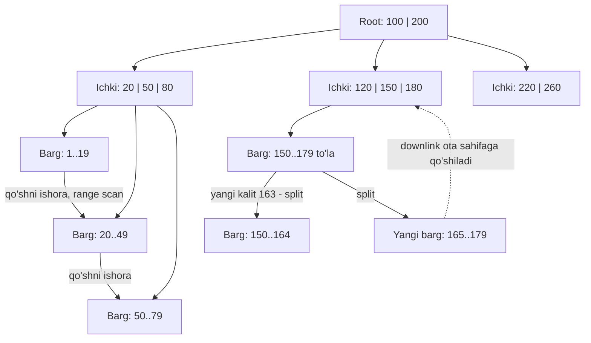
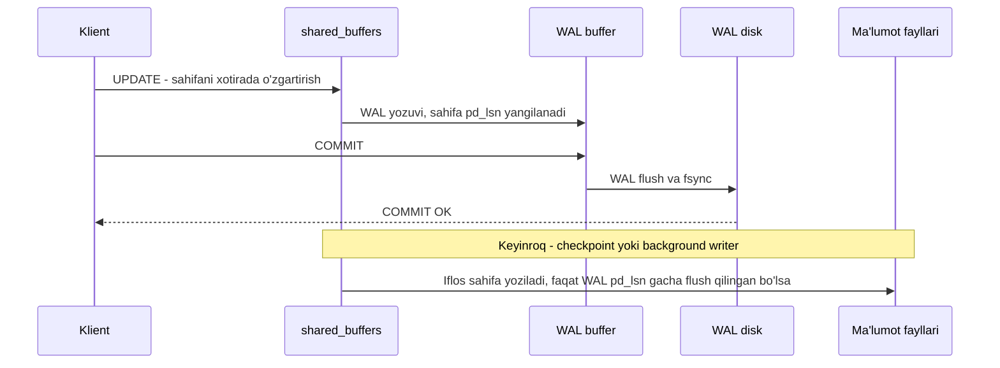

## Bu dars nima uchun kerak

13-darsda LSM-tree'ni ko'rdik: yozishni ketma-ket qilib, tartibni fonda compaction bilan tiklaydi. Bu darsda ikkinchi buyuk oila - **B-tree**. U 1970 yillardan beri relational bazalarning asosiy indeksi va PostgreSQL, MySQL InnoDB, SQL Server, Oracle, SQLite - deyarli hammasida standart. Siz har kuni `CREATE INDEX` yozganingizda, `USING` ko'rsatilmasa, PostgreSQL B-tree yaratadi.

B-tree joyida (in-place) yangilaydi, shuning uchun crash paytida sahifa yarim yozilib qolishi xavfi bor. Buni hal qiladigan mexanizm - **WAL** (write-ahead log). 12-darsda WAL'ni "durability uchun append-only log" sifatida qisqa eslatgan edik, bu darsda uni PostgreSQL misolida to'liq ochamiz: LSN, checkpoint, full page writes, `synchronous_commit`.

Oxirida LSM va B-tree'ni uchta amplification bo'yicha raqam bilan solishtiramiz. Bu 20-darsdagi baza tanlash freymvorkining asosiy kirish ma'lumotlaridan biri.

Bu darsdan keyin siz:

- B-tree tuzilishini, qidirish, qo'shish va sahifa bo'linishi (page split) jarayonini bosqichma-bosqich tushuntira olasiz;
- B-tree balandligini va bitta so'rovdagi sahifa o'qishlar sonini hisoblay olasiz;
- PostgreSQL B-tree'ning o'ziga xos xususiyatlarini (Lehman-Yao, deduplication, bottom-up deletion, fillfactor, HOT) bilasiz;
- WAL, LSN, checkpoint, full page writes va torn page muammosini aniq tushuntira olasiz;
- B-tree va LSM'ni write, read va space amplification bo'yicha solishtirib, yuklamaga qarab tanlay olasiz.

## B-tree tuzilishi

B-tree'ni Rudolf Bayer va Edward McCreight Boeing tadqiqot laboratoriyasida ishlab chiqqan; maqola 1970 yilda tarqatilgan va 1972 yilda Acta Informatica'da chop etilgan. Douglas Comer 1979 yilda uni "The Ubiquitous B-Tree" ("hamma joydagi B-tree") deb atagan - bu hozir ham to'g'ri.

LSM ma'lumotni o'zgaruvchan hajmli segmentlarga bo'ladi. B-tree esa ma'lumotni **qat'iy hajmli sahifalarga** (page, block) bo'ladi: PostgreSQL'da 8 kB (`BLCKSZ`, kompilyatsiyada o'zgartiriladi), InnoDB'da standart `innodb_page_size` 16 KB (instance yaratishda 4, 8, 16, 32 yoki 64 KB tanlanadi). Bu diskning blokli tuzilishiga mos keladi. Har bir sahifa ID (raqam) orqali boshqa sahifaga ishora qila oladi - bu xotiradagi pointer'ning diskdagi ekvivalenti.

- **Root (ildiz)** - qidiruv shu yerdan boshlanadi.
- **Ichki sahifalar (internal)** - kalitlar va ular orasidagi bolalar sahifalariga ishoralar. Har bir ishora bitta kalit oralig'ini qoplaydi.
- **Barg sahifalari (leaf)** - haqiqiy indeks yozuvlari: kalit va jadval qatoriga ishora (PostgreSQL'da TID - sahifa raqami va sahifadagi pozitsiya).

PostgreSQL hujjatlariga ko'ra, odatda barcha sahifalarning 99% dan ortig'i barg sahifalaridir. Har bir darajada sahifalar ikki tomonlama bog'langan ro'yxat sifatida ham ishlaydi - bu range scan uchun kerak: birinchi bargni topgach, keyingi barglarga qo'shni ishora orqali o'tiladi.

### Branching factor va balandlik

Bitta sahifadagi bolalar soni - **branching factor** (tarmoqlanish koeffitsienti). U kalit hajmiga bog'liq va odatda yuzlab.

Hisoblaymiz: PostgreSQL'da `bigint` ustunidagi B-tree indeksi.

- Barg yozuvi: `IndexTupleData` header 8 bayt + kalit 8 bayt = 16 bayt (MAXALIGN'ga mos), unga sahifadagi 4 baytlik line pointer qo'shiladi: **20 bayt**.
- Sahifa 8 192 bayt; 24 baytlik sahifa header'i va 16 baytlik B-tree maxsus maydoni (`BTPageOpaqueData`) chiqarilgandan keyin 8 152 bayt. B-tree standart `fillfactor` 90 bilan qurilganda barg sahifasi 90% to'ldiriladi: 8 152 × 0.9 / 20 ≈ **366 yozuv**.
- Ichki sahifadagi pivot yozuvi ham 8 + 8 + 4 = 20 bayt, to'liq sahifada 8 152 / 20 ≈ 407 ishora; hisobni soddalashtirish uchun 400 olamiz.

1 mlrd qator uchun:

- barglar: 10⁹ / 366 ≈ 2.73 mln sahifa (2.73 mln × 8 kB ≈ 22 GB);
- uning ustidagi daraja: 2.73 mln / 400 ≈ 6 830 sahifa;
- keyingi: 6 830 / 400 ≈ 18 sahifa;
- root: 1 sahifa.

Ya'ni **4 daraja**: root, 2 ta ichki, barg. Bitta kalitni topish - 4 ta sahifa o'qishi, keyin jadvaldan qatorni olish uchun yana 1 ta (heap). Ichki sahifalar jami 6 850 ga yaqin, ya'ni 6 850 × 8 kB ≈ 55 MB - ular deyarli doim `shared_buffers` yoki OS page cache'da turadi. Amalda bitta qidiruv 1-2 ta haqiqiy disk o'qishiga tushadi. Bu B-tree'ning asosiy kuchi: **bashorat qilinadigan, logarifmik o'qish**, branching factor katta bo'lgani uchun balandlik juda sekin o'sadi.

## Qidirish, qo'shish va page split

### Qidirish

1. Root sahifasini o'qish.
2. Sahifa ichida kalitni binary search bilan topib, mos bolaga o'tish.
3. Bargga yetguncha takrorlash.
4. Bargda kalit yozuvini topish (yoki yo'qligini aniqlash). Range so'rov bo'lsa, shu yerdan qo'shni barglarga ketma-ket yurish.

### Qo'shish va bo'linish

1. Kalit tushishi kerak bo'lgan bargni topish (qidirish kabi).
2. Bargda joy bo'lsa - yozuvni tartib bo'yicha qo'shish. Sahifa **joyida** qayta yoziladi.
3. Joy bo'lmasa - **page split**: yangi sahifa ajratiladi, yozuvlarning bir qismi unga ko'chiriladi, va ota sahifaga yangi sahifaga ishora (downlink) qo'shiladi.
4. Ota sahifa ham to'lgan bo'lsa, u ham bo'linadi. Bo'linish yuqoriga "ko'tarilib" boradi.
5. Root bo'linsa, yangi root yaratiladi va daraxt balandligi 1 ga oshadi. Daraxt **yuqoridan** o'sadi, shuning uchun u har doim muvozanatli: barcha barglar bir xil chuqurlikda.



### Bir operatsiya - bir nechta sahifa

Page split - bitta mantiqiy insert uchun **bir nechta** sahifani (eski barg, yangi barg, ota) yozishni anglatadi. Agar crash ularning faqat bir qismi diskka tushgandan keyin bo'lsa, daraxt buziladi: masalan, yangi barg bor, lekin otada unga ishora yo'q ("yetim" sahifa). Shu sabab B-tree o'zgarishlari WAL'ga yoziladi va qayta tiklashda to'liq qayta bajariladi.

### Concurrency: latch va Lehman-Yao

Ko'p thread bir vaqtda daraxtni o'qiydi va o'zgartiradi. Tranzaksiya qulflaridan (lock, 18-19 darslar) farqli, bu yerda qisqa muddatli ichki qulflar - **latch** - ishlatiladi. Naiv yondashuvda split paytida rootdan bargacha butun yo'lni qulflash kerak bo'lardi.

PostgreSQL B-tree'si Lehman va Yao'ning 1981 yilgi "Efficient Locking for Concurrent Operations on B-Trees" maqolasiga asoslangan (B-link tree). Har bir sahifada ikki qo'shimcha narsa bor:

- **high key** - sahifada ruxsat etilgan kalitlarning yuqori chegarasi;
- **right-link** - shu darajadagi o'ng qo'shni sahifaga ishora.

Qidiruvchi sahifaga kelib, kalit high key'dan katta ekanini ko'rsa, demak bu sahifa ayni paytda bo'lingan; u right-link bo'ylab o'ngga o'tadi. Shu tufayli o'quvchilar bir vaqtda faqat bitta sahifani latch qiladi va split'lar ularni bloklamaydi.

## PostgreSQL B-tree'ning amaliy xususiyatlari

### Fillfactor

`CREATE INDEX` hujjatlariga ko'ra, B-tree standart `fillfactor` 90: indeks qurilganda barg sahifalarda 10% bo'sh joy qoldiriladi, keyingi insert'lar darhol split'ga olib kelmasligi uchun. Doimo o'sib boruvchi kalitlarda (masalan, `id bigserial` yoki vaqt) yangi yozuvlar faqat o'ng chekka bargga tushadi. `nbtsplitloc.c` dagi `_bt_findsplitloc()` izohiga ko'ra, daraja bo'yicha eng o'ngdagi (rightmost) sahifa bo'linganda PostgreSQL chap sahifani `fillfactor`% to'la qoldirishga harakat qiladi, shuning uchun ketma-ket o'suvchi kalitlarda sahifalar "maxsus holatsiz bo'ladigan 50%" o'rniga fillfactor% atrofida to'la bo'ladi (barglar uchun standart 90, ichki sahifalar uchun `BTREE_NONLEAF_FILLFACTOR` = 70). Boshqa (rightmost bo'lmagan) split'larda maqsad - ikki sahifadagi bo'sh joyni tenglash. Tasodifiy kalitlarda (UUIDv4) esa insert'lar barcha barglarga tarqaladi: har qanday barg bo'linishi mumkin, bo'lingan sahifalar yarim to'la qoladi va keyin asta to'ladi, natijada sahifalar fillfactor'dan bo'shroq va cache'da ko'proq sahifa kerak. Bu UUIDv7 kabi vaqt bo'yicha tartiblangan ID'lar foydasiga asosiy argumentlardan biri (57-dars).

### Deduplication (PostgreSQL 13+)

Bir xil kalit ko'p qatorlarda takrorlansa (masalan, `company_id` yoki `status`), PostgreSQL ularni bitta **posting list** yozuviga birlashtiradi: kalit bir marta, keyin TID'lar saralangan massivi. Bu standart yoqilgan (`deduplicate_items = on`) va past kardinallikdagi ustunlarda indeks hajmini sezilarli kamaytiradi. Hujjatdagi cheklovlar: `INCLUDE` ustunli indekslarda, `numeric`, `jsonb`, `float4`/`float8`, `character`, nondeterministic collation'li `text`/`varchar` va container turlarda (composite, array, range) ishlamaydi.

### Bottom-up index deletion (PostgreSQL 14+)

MVCC tufayli (19-dars) har bir `UPDATE` qatorning yangi versiyasini yaratadi va, agar HOT bo'lmasa, **har bir indeksga** yangi yozuv qo'shadi. Tez-tez yangilanadigan qatorlarda eski versiyalarning indeks yozuvlari to'planib, "version churn" tufayli keraksiz page split'lar bo'ladi. PostgreSQL 14 dan boshlab B-tree shunday split kutilganda avval sahifadagi o'lik versiyalarni o'chirishga harakat qiladi ("bottom-up deletion"). Hujjatlarga ko'ra, 14 dan oldin faqat "simple deletion" (o'tib ketayotgan skanlar belgilagan `LP_DEAD` yozuvlar) bor edi.

### HOT update

**Heap-Only Tuple** - PostgreSQL'ning muhim optimallashtirishi. Agar `UPDATE` hech qaysi indekslangan ustunni o'zgartirmasa va yangi versiya **xuddi shu heap sahifasiga** sig'sa, indekslarga yangi yozuv qo'shilmaydi: indeks eski joyga ishora qiladi, u esa sahifa ichida yangi versiyaga yo'naltiriladi. BRIN kabi "summarizing" indekslar bu shartdan istisno. HOT ehtimolini oshirish uchun jadval `fillfactor` ini (standart 100) pasaytirish mumkin, masalan 70-90. Monitoring: `pg_stat_all_tables` dagi `n_tup_hot_upd` va `n_tup_upd` nisbati.

Bu B-tree ning "joyida yangilash" tabiatini PostgreSQL'ning MVCC bilan kelishtirishning asosiy vositasi. Indekslar qancha ko'p bo'lsa, HOT bo'lmagan har bir update shuncha ko'p B-tree'ga yozadi - bu B-tree tomonidagi **write amplification** manbai.

## WAL: crash'dan keyin qanday tiklanamiz

### Muammo

B-tree va PostgreSQL heap sahifalari xotirada (`shared_buffers`) o'zgartiriladi va keyinroq diskka yoziladi. Agar har bir commit'da barcha o'zgargan sahifalarni diskka yozsak (force), bu tarqoq random IO va juda sekin. Agar yozmasak, crash'da o'zgarishlar yo'qoladi.

### Yechim: write-ahead logging

Qoida oddiy: **sahifa o'zgarishi diskka faqat uni tasvirlovchi log yozuvi diskka tushgandan keyin yozilishi mumkin.** PostgreSQL hujjatlari WAL'ning foydasini shunday tushuntiradi: commit'da faqat WAL flush qilinadi, u ketma-ket yoziladi va uni sinxronlash tarqoq sahifalarni flush qilishdan ancha arzon; ko'p kichik tranzaksiyalarda bitta `fsync` bir nechtasini qamrab olishi mumkin.

Bu g'oyaning klassik nazariy asosi - IBM'dagi C. Mohan va hamkasblarining **ARIES** algoritmi (ACM TODS, 1992): "steal/no-force" siyosati (commit qilinmagan o'zgarishli sahifa diskka yozilishi mumkin; commit'da sahifalarni majburan yozish shart emas) va uch bosqichli tiklash - analysis, redo, undo. PostgreSQL'ning tiklashi soddaroq: MVCC tufayli undo bosqichi kerak emas, commit qilinmagan tranzaksiyalarning qator versiyalari shunchaki ko'rinmas bo'lib qoladi (19-dars). Shuning uchun PostgreSQL WAL'i asosan REDO log.

### LSN

WAL'dagi har bir yozuvning manzili - **LSN** (Log Sequence Number): WAL ichidagi bayt offseti, monoton o'sadi, `pg_lsn` turi sifatida ko'rinadi. Ikki LSN farqi - ular orasidagi WAL hajmi. Replication lag, `pg_stat_replication`, `pg_current_wal_lsn()` - hammasi LSN bilan ishlaydi (26-dars).

Har bir ma'lumot sahifasining header'ida `pd_lsn` bor: sahifani oxirgi o'zgartirgan WAL yozuvining LSN'i. Buffer manager sahifani diskka yozishdan oldin WAL shu LSN'gacha flush qilinganini tekshiradi - write-ahead qoidasi aynan shu yerda majburlanadi. Tiklashda esa WAL yozuvining LSN'i sahifadagi `pd_lsn` dan katta bo'lsagina qayta qo'llanadi: bir o'zgarish ikki marta qo'llanmaydi.

### WAL fayllari

WAL `pg_wal` katalogida, odatda har biri **16 MB** bo'lgan segment fayllarida (`initdb --wal-segsize` bilan o'zgartiriladi), har bir segment 8 kB lik sahifalarga bo'lingan.

### Checkpoint

WAL cheksiz o'sa olmaydi va tiklash butun tarixdan boshlanmasligi kerak. **Checkpoint** - barcha "iflos" (dirty) sahifalar diskka yozilib, WAL'dagi joy belgilanadigan nuqta. Undan oldingi WAL tiklash uchun kerak emas (lekin archiving va replication uchun kerak bo'lishi mumkin).

PostgreSQL sozlamalari va standart qiymatlari:

- `checkpoint_timeout` = **5 min** - checkpoint shu vaqtda yoki
- `max_wal_size` = **1 GB** - WAL shu hajmga yaqinlashganda, qaysi biri birinchi bo'lsa. Bu qat'iy chegara emas.
- `checkpoint_completion_target` = **0.9** - iflos sahifalarni yozish keyingi checkpoint'gacha bo'lgan vaqtning 90% iga yoyiladi, IO cho'qqisini kamaytirish uchun.

Tiklashda server `pg_control` faylidan oxirgi checkpoint joyini o'qiydi va o'sha yerdan WAL'ni oldinga qarab qayta qo'llaydi (REDO).



### Torn page va full page writes

Sahifa 8 kB, lekin disk va OS buni atomik yozishni kafolatlamaydi (masalan, 4 kB lik bo'laklar bilan). Crash paytida sahifaning yarmi yangi, yarmi eski bo'lib qolishi mumkin - **torn page**. WAL yozuvi odatda "qatorni shu joyda o'zgartir" degan kichik delta. Yarim buzilgan sahifaga deltani qo'llab bo'lmaydi.

PostgreSQL yechimi - `full_page_writes` (standart yoqilgan): **checkpoint'dan keyin sahifaning birinchi o'zgarishida** WAL'ga butun sahifa tasviri (full page image, FPI) yoziladi. Tiklashda sahifa avval shu tasvir bilan tiklanadi, keyin deltalar qo'llanadi. Narxi: WAL hajmi oshadi, ayniqsa checkpoint'dan keyin darhol. Checkpoint oralig'ini oshirish FPI sonini kamaytiradi. `wal_compression` (`pglz`, `lz4`, `zstd`) aynan shu sahifa tasvirlarini siqadi.

MySQL InnoDB xuddi shu muammoni boshqacha hal qiladi: **doublewrite buffer**. Sahifalar avval alohida doublewrite maydoniga katta ketma-ket blok va bitta `fsync` bilan, keyin asl joyiga yoziladi. Crash'da yarim yozilgan sahifa doublewrite nusxasidan tiklanadi.

### synchronous_commit: durability'ni tanlash

`synchronous_commit = off` bo'lsa, PostgreSQL WAL flush'ni kutmasdan "COMMIT OK" qaytaradi. Hujjatlarga ko'ra, crash'da oxirgi "commit qilingan" tranzaksiyalarning bir qismi yo'qolishi mumkin, lekin baza **izchil** qoladi - xuddi o'sha tranzaksiyalar toza bekor qilingandek. Bu `fsync = off` dan tubdan farq qiladi (u bazani buzishi mumkin). Yo'qolish oynasi - `wal_writer_delay` (standart 200 ms) ning uch baravarigacha. Uni tranzaksiya darajasida yoqish mumkin:

```sql
BEGIN;
SET LOCAL synchronous_commit TO OFF;
INSERT INTO raw_positions ...;  -- qayta yuborish mumkin bo'lgan, kam qiymatli ma'lumot
COMMIT;
```

Group commit uchun `commit_delay` (standart 0) va `commit_siblings` (standart 5) bor - 12-darsdagi "bir fsync bilan bir nechta yozuv" g'oyasi.

## B-tree va LSM: amplification bo'yicha taqqoslash

### Write amplification

**B-tree:** bitta 100 baytlik qatorni yangilash uchun:

- WAL yozuvi (kichik), checkpoint'dan keyingi birinchi o'zgarishda esa butun 8 kB sahifa tasviri;
- keyinroq butun 8 kB heap sahifasi diskka yoziladi;
- HOT bo'lmasa, har bir indeks uchun yana WAL yozuvi va 8 kB indeks sahifasi.

Eng yomon holat: 100 bayt o'zgarish, 5 ta indeks, har biri alohida sahifada - 6 ta sahifa × 8 kB = 48 kB sahifa yozuvi + FPI'lar bilan WAL. Faqat sahifa yozuvining o'zi 48 000 / 100 = 480 baravar. Lekin bir sahifadagi ko'p o'zgarishlar checkpoint'gacha bitta yozuvga birlashadi, shuning uchun amalda WA yuklamaning **lokalligiga** juda bog'liq: issiq sahifalarga ko'p yozish - arzon; tasodifiy kalitlarga yozish - qimmat.

**LSM:** har bir yozuv WAL'ga bir marta, keyin flush'da bir marta, keyin har compaction darajasida qayta. Leveled'da RocksDB misolidagi 33, size-tiered va time-window'da ancha kam (13-dars). Muhimi - **hammasi ketma-ket IO**.

### Read amplification

**B-tree:** nuqtali o'qish - daraxt balandligicha sahifa (amalda ichki sahifalar cache'da, 1-2 disk o'qishi). Range - bitta qidiruv va keyin qo'shni barglar bo'ylab ketma-ket. Bashorat qilinadigan.

**LSM:** nuqtali o'qish - memtable, L0, har darajada bitta fayl; Bloom filter bilan amalda bitta blokka yaqin (13-darsdagi hisob). Range so'rov esa **har bir darajadagi** iteratorni birlashtirishi kerak (merge iterator), Bloom filter yordam bermaydi. Kalitning ko'p versiyalari yoki tombstone'lar bo'lsa, ular ham o'qiladi.

### Space amplification

**B-tree:** sahifalar to'liq to'lmaydi (fillfactor; rightmost bo'lmagan split'dan keyin ikkala sahifada bo'sh joy teng taqsimlanadi, ya'ni ular yarimga yaqin to'la qoladi), PostgreSQL'da esa yana MVCC'ning o'lik qatorlari va vacuum'dan keyin qayta ishlatilmaguncha bo'sh turgan joy (bloat, 19-dars). Fragmentatsiya vaqt o'tib o'sadi; `REINDEX CONCURRENTLY` yoki `pg_repack` kengaytmasi bilan tiklanadi. PostgreSQL 19 (2026-yil 15-oktabrda RC1 chiqqan, hali final emas) relizi eslatmalarida `VACUUM FULL` va `CLUSTER` o'rnini bosuvchi `REPACK` buyrug'i va jadvalni access-exclusive qulfsiz qayta quradigan `REPACK (CONCURRENTLY)` bor.

**LSM:** leveled'da RocksDB misolida 1.14, size-tiered/universal'da compaction paytida vaqtincha 2x gacha. Bloklar siqiladi, sahifa to'lmasligi muammosi yo'q, shuning uchun LSM odatda diskda kichikroq.

### Jadval

| O'lchov | B-tree (PostgreSQL, InnoDB) | LSM leveled (RocksDB) | LSM size-tiered / time-window |
|---|---|---|---|
| Yozish IO shakli | Random (sahifani joyida), WAL ketma-ket | Ketma-ket | Ketma-ket |
| Write amplification | Lokallikka bog'liq: past (issiq sahifalar) dan juda yuqori (tasodifiy kalitlar, ko'p indeks) gacha | Yuqori (o'nlab) | Past |
| Nuqtali o'qish | Balandlik bo'yicha, ichki sahifalar cache'da: 1-2 IO | Bloom filter bilan 1 IO ga yaqin | Ko'proq fayl, Bloom filter bilan |
| Range o'qish | Juda yaxshi, barglar bo'ylab | Yaxshi, lekin darajalar bo'yicha merge | O'rtacha |
| Space amplification | Bo'sh joy, fragmentatsiya, MVCC bloat | Past (RocksDB misolida 1.14), siqish | Yuqori (2x gacha vaqtincha) |
| Latency barqarorligi | Barqaror; checkpoint IO cho'qqisi mumkin | Compaction va write stall p99.9 da | Katta compaction'lar paytida |
| Tranzaksiya va qulf | Kalit bitta joyda: row lock va constraint tabiiy | Kalit ko'p joyda; tranzaksiya ustki qatlamda | Xuddi shunday |

Umumiy qoida (Kleppmann 4-bobda shunday xulosa qiladi): LSM odatda **yozishda** tezroq va diskda ixchamroq, B-tree esa **o'qishda** bashorat qilinadigan va tranzaksion semantika uchun qulayroq. Lekin bu umumlashtirish; real yuklamada benchmark qilish kerak. Muhim nuance: zamonaviy NVMe SSD'larda random IO arzonlashgani sababli B-tree'ning yozishdagi kamchiligi kamaygan, lekin SSD'ning o'z ichki write amplification'i va resursi (TBW) LSM'ning ketma-ket yozishini hali ham afzal qiladi.

## Real tizimlar

- **PostgreSQL**: heap + B-tree (va boshqa indekslar, 15-dars), REDO WAL, full page writes, MVCC tufayli undo yo'q.
- **MySQL InnoDB**: clustered B-tree (jadval qatorlari primary key B-tree barglarida), secondary indekslar primary key'ga ishora qiladi; redo log + undo log + doublewrite buffer.
- **SQLite**: B-tree; rollback journal yoki WAL rejimi.
- **MyRocks**: Meta'ning MySQL uchun RocksDB storage engine'i. 2016 yilgi blogga ko'ra, foydalanuvchi bazasi (UDB) qatlamida bir xil ma'lumot uchun siqilgan InnoDB'dan 50% kam joy egallagan, LinkBench testida siqilgan InnoDB'dan 2 baravar, siqilmaganidan 3.5 baravar kichik bo'lgan, diskka yozish esa InnoDB'dan tartiblar bo'yicha kam bo'lgan (aniq ko'paytuvchi faqat grafikda berilgan). Bu B-tree'dan LSM'ga o'tishning space va write amplification bo'yicha real misoli.
- **CockroachDB, TiKV, YugabyteDB**: SQL qatlami ostida LSM (Pebble, RocksDB) - ya'ni "relational model" va "LSM storage" bir-birini inkor qilmaydi (11-darsdagi model va engine ajratilishi).

## iQuariX kontekstida qo'llanish

Masala sharti: PostgreSQL'da `positions` jadvali bor: 10 000 mashina, har 10 soniyada nuqta, ya'ni 1 000 insert/s, va `vehicles` jadvalida har bir nuqtada `last_position`, `last_seen_at`, `odometer` yangilanadi (1 000 update/s).

**1. `positions` - append-only insert.** Kalitlar `(vehicle_id, ts)`. Agar asosiy indeks `(vehicle_id, ts)` bo'lsa, har bir insert 10 000 ta turli joyga (har mashinaning o'z barg sahifasi) tushadi - 10 000 ta "issiq" barg sahifasi, ular cache'da tursa, WA maqbul. Agar `ts` bo'yicha indeks ham bo'lsa, u doim o'ng chekka sahifaga yoziladi - juda samarali. Lekin har bir qo'shimcha indeks har insert'da yana bitta B-tree yozuvi. Vaqt bo'yicha partitioning (kunlik) qilinsa, har bir partitionning indekslari kichik va cache'ga sig'adi, eski partitionlar `DROP` bilan o'chiriladi - vacuum va bloat'siz (81-dars).

**2. `vehicles` - tez-tez update.** 1 000 update/s, har biri yangi qator versiyasi. Agar `last_seen_at` indekslangan bo'lsa, HOT ishlamaydi va har bir update har bir indeksga yangi yozuv qo'shadi. Yechimlar:

- tez o'zgaradigan ustunlarni indekslamaslik;
- `vehicles` ni `fillfactor = 70` bilan yaratish, HOT ehtimolini oshirish uchun;
- tez o'zgaradigan holatni alohida ingichka jadvalga (`vehicle_state`) chiqarish yoki umuman Redis'da ushlab, PostgreSQL'ga davriy yozish (12-dars);
- `pg_stat_all_tables` da HOT foizini kuzatish.

**3. WAL hajmi.** 1 000 insert/s + 1 000 update/s. Hisob sharti: bitta nuqtaning WAL yozuvi 150 bayt + ikki indeks uchun 2 × 60 bayt = 270 bayt, update ham 270 bayt (real hajmni `pg_waldump --stats` yoki `pg_stat_wal` bilan o'lchang). Jami 2 000 × 270 B = 540 KB/s, ya'ni soatiga 540 KB × 3 600 ≈ 1.9 GB - full page image'larsiz. Checkpoint'dan keyin har bir sahifaga birinchi tegishda 8 kB FPI qo'shiladi: 10 000 ta issiq sahifa × 8 kB = 80 MB har bir checkpoint'dan keyin. `checkpoint_timeout` 5 daqiqa bo'lsa, bu soatiga 12 × 80 MB ≈ 1 GB qo'shimcha. Checkpoint oralig'ini 15 daqiqaga oshirish shu issiq sahifalar uchun FPI hajmini 3 baravar kamaytiradi (soatiga 4 × 80 MB = 320 MB), evaziga crash'dan tiklash uzoqroq bo'ladi. Bu raqamlar replication va WAL arxivi (backup) hajmini ham belgilaydi (26, 69-darslar).

**4. `synchronous_commit`.** Xom nuqtalar trekerdan qayta yuborilishi mumkin bo'lsa (yoki navbatda saqlangan bo'lsa), `positions` insert'lari uchun `SET LOCAL synchronous_commit TO OFF` commit latency'sini kamaytiradi. To'lov, shartnoma, foydalanuvchi ma'lumotlari uchun esa - hech qachon.

## Ko'p uchraydigan xatolar

1. **"Indeks qo'shish bepul".** Har bir indeks har bir insert'da va HOT bo'lmagan har bir update'da qo'shimcha B-tree yozuvi va WAL.
2. **Tez-tez yangilanadigan ustunni indekslash** va HOT'ni o'ldirish. Natija: indeks bloat, WAL hajmi, vacuum yuklamasi.
3. **Tasodifiy UUIDv4 primary key katta jadvalda.** Insert'lar barcha barglarga tarqaladi, cache samaradorligi tushadi, split ko'payadi.
4. **`fsync = off` yoki `full_page_writes = off` "tezlik uchun".** Birinchisi crash'da bazani buzadi; xavfsiz alternativa - kerakli tranzaksiyalarda `synchronous_commit = off`.
5. **Checkpoint sozlamalarini e'tiborsiz qoldirish.** Juda tez-tez checkpoint - FPI tufayli WAL portlashi; `max_wal_size` kichik bo'lsa, yuklama ostida checkpoint'lar ketma-ket boshlanadi.
6. **B-tree vs LSM ni faqat "yozish tezligi" bo'yicha solishtirish.** O'qish shakli, range so'rovlar, latency dumi, tranzaksiyalar va operatsion tajriba ham hisobga kiradi.
7. **WAL hajmini replication va backup rejalashtirishda hisoblamaslik.** WAL - replikalar va arxivga ketadigan asosiy oqim.

## Xulosa

- B-tree ma'lumotni qat'iy hajmli sahifalarga bo'ladi; yuzlab branching factor tufayli 1 mlrd `bigint` kalit uchun ham balandlik 4 daraja, ichki sahifalar cache'da.
- Insert joyida yangilaydi; to'lgan sahifa bo'linadi va bo'linish yuqoriga ko'tarilishi mumkin; daraxt doim muvozanatli.
- PostgreSQL B-tree: Lehman-Yao (high key, right-link), fillfactor 90, deduplication (13+), bottom-up deletion (14+); heap tomonda HOT update indekslarga yozishni oldini oladi.
- WAL: sahifa o'zgarishi faqat log diskka tushgandan keyin yoziladi; commit'da faqat WAL flush. LSN, `pd_lsn`, checkpoint va REDO tiklash.
- Torn page'ga qarshi: PostgreSQL'da full page writes, InnoDB'da doublewrite buffer.
- `synchronous_commit = off` - oxirgi tranzaksiyalarni yo'qotish xavfi, lekin buzilish yo'q; `fsync = off` - buzilish xavfi.
- LSM yozishda va disk hajmida, B-tree o'qishda va bashorat qilinadigan latency'da odatda ustun. Qaror yuklama va raqamlardan chiqadi.

## Amaliy topshiriq

Masala sharti: iQuariX PostgreSQL bazasida quyidagi holat bor. `trips` jadvali: 200 mln qator, har biri o'rtacha 300 bayt; indekslar: `PRIMARY KEY (id uuid)` (UUIDv4), `(vehicle_id, started_at)`, `(company_id, started_at)`, `(driver_id)`, `(status)`. Har bir faol reys har 30 soniyada `distance_km`, `fuel_used_l`, `updated_at` ustunlari bilan yangilanadi; bir vaqtda 20 000 faol reys. Diskda indekslar jadvaldan katta, WAL soatiga o'nlab GB, replika orqada qolmoqda.

1. Har bir indeks uchun barg sahifalari sonini va B-tree balandligini hisoblang (kalit hajmlarini o'zingiz asoslang, yaxlitlash mumkin).
2. Update oqimi uchun soniyadagi update sonini hisoblang. Qaysi update'lar HOT bo'la oladi va qaysilari yo'q? Nega?
3. WAL hajmini hisoblang (yozuv hajmlarini shart sifatida aniq ko'rsating): update'lar, indeks yozuvlari va checkpoint'dan keyingi full page image'lar alohida.
4. Kamida 4 ta aniq o'zgarish taklif qiling (indeks, fillfactor, ID turi, jadvalni bo'lish, checkpoint sozlamalari, `synchronous_commit`) va har birining trade-off'ini yozing.
5. `status` indeksi kerakmi? Qaysi so'rovlar uni ishlatadi va uning o'rniga nima qilish mumkin (15-darsga havola qilib)?
6. Agar shu yuklama 10 baravar oshsa, B-tree va PostgreSQL qolishi kerakmi yoki LSM asosidagi saqlash ko'rib chiqilishi kerakmi? Qaysi raqamlar qaror beradi?

Yaxshi javobda bo'lishi kerak bo'lgan narsalar:

- 20 000 / 30 ≈ 667 update/s hisoblangan va har bir indeksga ta'siri ko'rsatilgan;
- HOT shartlari (indekslangan ustun o'zgarmasligi va sahifada joy) aniq qo'llangan;
- UUIDv4 ning B-tree'ga ta'siri (tarqoq insert, split, cache) tushuntirilgan;
- full page writes va checkpoint oralig'i bog'liqligi raqam bilan;
- har bir taklifning narxi (masalan, checkpoint oralig'ini oshirish tiklash vaqtini uzaytiradi).

Javobni pastdagi maydonga yozib, chatga yuboring.

## Manbalar

- Martin Kleppmann, Chris Riccomini. [Designing Data-Intensive Applications, 2-nashr](https://www.oreilly.com/library/view/designing-data-intensive-applications/9781098119058/), O'Reilly, 2026. 4-bob "Storage and Retrieval" - B-tree, WAL, B-tree va LSM taqqoslash.
- Alex Petrov. [Database Internals](https://www.oreilly.com/library/view/database-internals/9781492040330/), O'Reilly, 2019. 2-bob "B-Tree Basics", 4-bob "Implementing B-Trees", 5-bob "Transaction Processing and Recovery" (WAL, ARIES), 6-bob "B-Tree Variants" (B-link tree).
- PostgreSQL hujjatlari: [B-Tree Indexes - Implementation](https://www.postgresql.org/docs/current/btree.html) (deduplication cheklovlari, bottom-up deletion), [nbtree README](https://github.com/postgres/postgres/blob/master/src/backend/access/nbtree/README) (Lehman-Yao, high key, right-link), [nbtsplitloc.c](https://github.com/postgres/postgres/blob/master/src/backend/access/nbtree/nbtsplitloc.c) (`_bt_findsplitloc`, rightmost split va fillfactor), [CREATE INDEX](https://www.postgresql.org/docs/current/sql-createindex.html) (fillfactor, deduplication), [Heap-Only Tuples](https://www.postgresql.org/docs/current/storage-hot.html), [Database Page Layout](https://www.postgresql.org/docs/current/storage-page-layout.html).
- PostgreSQL hujjatlari: [WAL Configuration](https://www.postgresql.org/docs/current/wal-configuration.html) (checkpoint), [WAL Internals](https://www.postgresql.org/docs/current/wal-internals.html) (LSN, segmentlar, REDO), [Write Ahead Log sozlamalari](https://www.postgresql.org/docs/current/runtime-config-wal.html) (`synchronous_commit`, `full_page_writes`, `commit_delay`).
- MySQL 8.4: [InnoDB Doublewrite Buffer](https://dev.mysql.com/doc/refman/8.4/en/innodb-doublewrite-buffer.html), [InnoDB Limits](https://dev.mysql.com/doc/refman/8.4/en/innodb-limits.html) (standart `innodb_page_size` 16KB, 4-64KB sahifa hajmlari).
- PostgreSQL 19: [REPACK](https://github.com/postgres/postgres/blob/REL_19_STABLE/doc/src/sgml/ref/repack.sgml) va [19 release notes](https://www.postgresql.org/docs/19/release-19.html).
- C. Mohan va boshq. ARIES, ACM TODS 17(1), 1992. [Qisqacha](https://en.wikipedia.org/wiki/Algorithms_for_Recovery_and_Isolation_Exploiting_Semantics).
- [B-tree](https://en.wikipedia.org/wiki/B-tree) - Bayer va McCreight (1970/1972), Comer (1979).
- RocksDB. [Tuning Guide](https://github.com/facebook/rocksdb/wiki/RocksDB-Tuning-Guide) - LSM amplification raqamlari taqqoslash uchun.
- Meta Engineering. [MyRocks: A space- and write-optimized MySQL database](https://engineering.fb.com/2016/08/31/core-infra/myrocks-a-space-and-write-optimized-mysql-database/), 2016.
