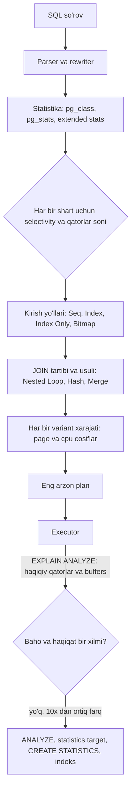

## Bu dars nima uchun kerak

12-14 darslarda storage engine ichini ko'rdik: log, hash index, LSM va B-tree. U yerda "indeks" asosan **primary key** bo'yicha qidiruvni anglatardi. Real tizimda esa bitta jadvalga o'nlab xil so'rov keladi: kompaniya bo'yicha, vaqt oralig'i bo'yicha, holat bo'yicha, JSON maydoni bo'yicha, geografik hudud bo'yicha. Har biri uchun qaysi indeks kerak, qaysi biri keraksiz yuk, va eng muhimi - **PostgreSQL qaysi indeksni nima uchun tanlaydi yoki tanlamaydi?**

Bu dars PostgreSQL'ga chuqur bog'langan, chunki siz uni har kuni ishlatasiz. Maqsad - `EXPLAIN (ANALYZE, BUFFERS)` natijasini o'qib, "bu yerda nega Seq Scan" degan savolga mexanika darajasida javob bera olish.

Bu darsdan keyin siz:

- primary va secondary indeks, heap va clustered tuzilma farqini va bundan kelib chiqadigan narxni bilasiz;
- composite indeksda ustunlar tartibini qoidaga asosan tanlay olasiz (tenglik, oraliq, saralash), PostgreSQL 18 skip scan'ni hisobga olgan holda;
- covering (`INCLUDE`), partial, expression indekslarni va index-only scan uchun visibility map rolini tushunasiz;
- B-tree, Hash, GIN, GiST, SP-GiST va BRIN'dan qaysi biri qaysi so'rov uchunligini bilasiz;
- query planner xarajat modelini (`seq_page_cost`, `random_page_cost`, selectivity, statistika) raqam bilan hisoblay olasiz va noto'g'ri plan sabablarini topa olasiz.

## Primary va secondary indeks

**Primary index** - jadvalning asosiy kaliti bo'yicha indeks. **Secondary index** - boshqa ustun(lar) bo'yicha qo'shimcha indeks; uning kalitlari unique bo'lishi shart emas.

Muhim farq - indeks yozuvi **nimaga ishora qiladi**:

- **PostgreSQL (heap tuzilma):** jadval qatorlari heap fayllarida, tartibsiz. **Barcha** indekslar, shu jumladan primary key ham, qatorning jismoniy manziliga (TID: sahifa raqami, sahifadagi pozitsiya) ishora qiladi. Primary key texnik jihatdan oddiy unique indeks.
- **MySQL InnoDB (clustered index):** qatorlarning o'zi primary key B-tree'sining barglarida saqlanadi. Secondary indekslar esa TID'ga emas, **primary key qiymatiga** ishora qiladi. Secondary indeks orqali qidiruv - ikki marta B-tree yurish.

Trade-off: PostgreSQL'da update qator boshqa sahifaga ko'chsa, barcha indekslar yangilanishi kerak (HOT bo'lmasa, 14-dars). InnoDB'da qator ko'chishi secondary indekslarga ta'sir qilmaydi, lekin har bir secondary qidiruv qo'shimcha primary key yurishini talab qiladi va katta primary key (masalan, UUID) barcha secondary indekslarni kattalashtiradi.

PostgreSQL'da `CLUSTER` buyrug'i jadvalni bir marta indeks tartibida qayta yozadi, lekin keyingi insert'larda bu tartib saqlanmaydi. Planner bu tartibni `pg_stats.correlation` orqali hisobga oladi - bu pastda muhim bo'ladi.

## Secondary indeks qanday ishlatiladi: uch xil skan

PostgreSQL indeksdan uch xil yo'l bilan foydalanadi:

1. **Index Scan** - indeks bo'yicha yurib, har bir topilgan TID uchun heap'dan qatorni olish. Natija indeks tartibida (ORDER BY uchun foydali). Kam qator uchun ideal. Ko'p qator uchun xavfli: har bir qator - ehtimoliy random IO.
2. **Bitmap Index Scan + Bitmap Heap Scan** - avval indeksdan barcha mos TID'larni xotiradagi bitmap'ga yig'ish, keyin heap sahifalarini **jismoniy tartibda** o'qish. Bir sahifa bir marta o'qiladi. Bir nechta indeks bitmap'larini AND/OR qilish mumkin (`WHERE a = 1 OR b = 2`). Tartib yo'qoladi, ORDER BY uchun alohida sort kerak.
3. **Index Only Scan** - heap'ga umuman bormasdan, faqat indeksdan javob qaytarish. Shartlar pastda.

O'rtacha selectivity'da bitmap scan, juda kichik selectivity'da index scan, katta selectivity'da esa seq scan g'olib bo'ladi. Planner aynan shu chegarani hisoblaydi.

## Composite (ko'p ustunli) indeks

`CREATE INDEX ON positions (vehicle_id, ts)` - kalit `(vehicle_id, ts)` juftligi, avval `vehicle_id` bo'yicha, teng bo'lsa `ts` bo'yicha saralangan. Telefon kitobiga o'xshaydi: familiya, keyin ism.

PostgreSQL hujjatidagi aniq qoida: **boshlang'ich ustunlardagi tenglik shartlari va tenglik sharti bo'lmagan birinchi ustundagi tengsizlik sharti** indeksning skanerlanadigan qismini cheklaydi. O'ngroqdagi ustunlardagi shartlar indeks ichida tekshiriladi (heap'ga borishni kamaytiradi), lekin skan hajmini kamaytirmaydi.

`(company_id, status, created_at)` indeksi uchun:

| So'rov | Indeks qanday ishlatiladi |
|---|---|
| `company_id = 7 AND status = 'active' AND created_at > now() - interval '1 day'` | To'liq: ikki tenglik + bitta oraliq, tor diapazon |
| `company_id = 7 AND created_at > ...` | `company_id` bo'yicha diapazon; `created_at` indeks ichida filtr (status bo'yicha barcha qiymatlar skanerlanadi) |
| `company_id = 7 ORDER BY status, created_at LIMIT 50` | Saralashsiz, indeks tartibida, 50 ta qatordan keyin to'xtaydi |
| `status = 'active'` | Boshlang'ich ustun yo'q: PostgreSQL 18 gacha deyarli foydasiz; 18 da skip scan mumkin, agar `company_id` ning turli qiymatlari kam bo'lsa |
| `company_id = 7 AND created_at > ... ORDER BY created_at` | Indeks tartibi `created_at` bo'yicha emas (o'rtada `status`), alohida sort kerak |

### Ustunlar tartibi: amaliy qoida

1. **Tenglik** bilan filtrlanadigan ustunlar birinchi.
2. Keyin **saralash** (`ORDER BY`) ustuni yoki **oraliq** sharti ustuni - bittasi. Oraliqdan keyingi ustunlar diapazonni toraytirmaydi.
3. Tenglik ustunlari orasida - ko'proq so'rovlar ishlatadigani birinchi (indeksni qayta ishlatish uchun). "Eng selektiv ustun birinchi" degan mashhur maslahat ikkinchi darajali: hammasi tenglik bo'lsa, B-tree uchun tartib ko'p farq qilmaydi.

Hujjatlar ham ogohlantiradi: ko'p ustunli indekslarni tejab ishlating, uchtadan ortiq ustunli indeks odatda faqat juda qat'iy so'rov naqshlarida foydali. Indeks maksimal 32 ta ustunga ega bo'lishi mumkin (`INCLUDE` bilan birga).

### Skip scan (PostgreSQL 18)

PostgreSQL 18 (2025 yil sentyabr) B-tree uchun **skip scan** qo'shdi: boshlang'ich ustunda shart bo'lmasa ham, keyingi ustunlardagi foydali shartlar bilan ko'p ustunli indeksdan foydalanish. Mexanika: boshlang'ich ustunning har bir alohida qiymati uchun alohida ichki qidiruv. Hujjatlarga ko'ra, bu boshlang'ich ustunda alohida qiymatlar kam bo'lganda samarali; ko'p bo'lsa, butun indeksni skanerlash kerak bo'ladi va planner odatda seq scan'ni afzal ko'radi. Ya'ni skip scan ustunlar tartibi qoidasini bekor qilmaydi, faqat chekka holatlarni yumshatadi.

## Covering indeks va index-only scan

Index-only scan heap'ga bormaydi. Ikkita shart:

1. Indeks turi buni qo'llashi kerak: B-tree har doim; GiST va SP-GiST ba'zi operator classlarda; **GIN hech qachon** (u qiymatning faqat bir qismini saqlaydi).
2. So'rov faqat indeksda bor ustunlarga murojaat qilishi kerak.

Uchinchi, yashirin shart - **MVCC ko'rinuvchanligi**. Indeks yozuvlarida qatorning qaysi tranzaksiyaga ko'rinishi haqida ma'lumot yo'q (19-dars). PostgreSQL buni **visibility map** bilan hal qiladi: har bir heap sahifasi uchun "bu sahifadagi barcha qatorlar hamma uchun ko'rinadi" biti. Bit o'rnatilgan bo'lsa - heap'ga borilmaydi; aks holda borish shart. `EXPLAIN ANALYZE` dagi `Heap Fetches: N` - aynan shunday majburiy heap tashriflari soni. Visibility map'ni `VACUUM` yangilaydi. Shuning uchun **tez-tez o'zgaradigan jadvalda index-only scan kam foyda beradi**.

`INCLUDE` - qidiruv kalitiga kirmaydigan, faqat "yuk" sifatida saqlanadigan ustunlar:

```sql
CREATE INDEX ON trips (vehicle_id, started_at) INCLUDE (distance_km, fuel_used_l);

-- heap'ga bormasdan (visibility map ruxsat bersa)
SELECT started_at, distance_km, fuel_used_l
FROM trips WHERE vehicle_id = 1042 AND started_at >= '2026-10-01';
```

`INCLUDE` ustunlari unique tekshiruvida qatnashmaydi (`UNIQUE (x) INCLUDE (y)` faqat `x` ni unique qiladi). Narxi: indeks kattalashadi, ma'lumot dublikat bo'ladi, `INCLUDE` li indekslarda deduplication ishlamaydi (14-dars). Keng ustunlarni qo'shmang.

## Partial va expression indekslar

### Partial indeks

Faqat shartga mos qatorlarni indekslaydi:

```sql
-- faqat ochiq ogohlantirishlar; yopilganlari 99% bo'lsa, indeks 100 baravar kichik
CREATE INDEX ON alerts (company_id, created_at) WHERE resolved_at IS NULL;

-- har bir mashinada bitta faol reys
CREATE UNIQUE INDEX ON trips (vehicle_id) WHERE ended_at IS NULL;
```

Ikkinchi misol - partial **unique** indeks bilan biznes qoidasini baza darajasida majburlash, juda kuchli vosita.

Hujjatlardagi muhim cheklov: planner so'rovning `WHERE` sharti indeks predikatini **mantiqan o'z ichiga olishini isbotlay olishi** kerak. Murakkab teorema isbotlovchisi yo'q: oddiy tengsizliklar (`x < 1` dan `x < 2`) taniladi, boshqa hollarda predikat so'rovda aynan yozilgan bo'lishi kerak. **Parametrli so'rovlarda** (`x < $1`) bu ishlamaydi, chunki plan paytida parametr qiymati noma'lum. Bu ORM'lar (Prisma, Kysely) bilan ishlaganda muhim: predikat ustuni so'rovda literal sifatida bo'lishi kerak (`resolved_at IS NULL` - parametr emas, shuning uchun ishlaydi).

Hujjatlar yana ogohlantiradi: har bir kategoriya uchun alohida partial indeks yaratish yomon g'oya - buning o'rniga `(category, data)` composite indeks yoki partitioning.

### Expression indeks

Ustun emas, ifoda indekslanadi:

```sql
CREATE INDEX ON users (lower(email));
SELECT * FROM users WHERE lower(email) = 'ali@example.uz';  -- ishlaydi

CREATE INDEX ON vehicle_profiles ((doc->>'vin'));
```

So'rovdagi ifoda indeksdagisi bilan bir xil yozilishi kerak. Har bir insert/update'da ifoda hisoblanadi.

## Indeks turlari: B-tree'dan tashqari

| Turi | Nimani saqlaydi | Qaysi operatorlar | Tipik qo'llanish | Narxi |
|---|---|---|---|---|
| B-tree | Saralangan kalitlar | `=`, `<`, `>`, `BETWEEN`, `IN`, `IS NULL`, prefiks `LIKE 'abc%'` (C collation yoki `text_pattern_ops` bilan), ORDER BY | Deyarli hamma narsa | Har yozishda daraxtga yozuv |
| Hash | 4 baytlik xesh | Faqat `=` | Uzun kalitlar bo'yicha tenglik (12-dars) | Range yo'q, unique yo'q |
| GIN | Kalit (element) va posting list | Massiv `@>`, `&&`; jsonb `@>`, `?`, `@@`; full-text `@@`; `pg_trgm` bilan `LIKE '%abc%'` | jsonb, teglar, matn qidiruvi | Sekin insert, katta qurish |
| GiST | Muvozanatli daraxt, "chegaralovchi" kalitlar | Geometriya, range `&&`, `@>`, inet, KNN `<->` | Geo, vaqt oraliqlari, exclusion constraint | Lossy, qayta tekshirish |
| SP-GiST | Muvozanatsiz bo'linish (quadtree, k-d tree, radix trie) | Nuqtalar, inet, text prefiks, KNN | Bir tekis taqsimlanmagan nuqtalar, prefikslar | Tor holatlar |
| BRIN | Har bir sahifa bloki uchun xulosa (min/max) | Oraliq va tenglik, lossy | Juda katta, jismoniy tartiblangan jadvallar (vaqt) | Faqat korrelyatsiya bo'lsa foydali |

### GIN: inverted index

GIN (Generalized Inverted Index) bitta qiymatni ko'p **elementga** ajratadi (massiv elementlari, jsonb kalit/qiymatlari, matn leksemalari) va har bir element uchun uni o'z ichiga olgan qatorlar ro'yxatini saqlaydi (posting list, katta bo'lsa posting tree). Ichkarida - elementlar bo'yicha B-tree. Bu qidiruv tizimlaridagi inverted index'ning aynan o'zi (59-dars).

Yozish narxi: bitta qator ko'p element berishi mumkin, demak bitta insert - ko'p indeks yozuvi. Buni yumshatish uchun **fastupdate**: yangi yozuvlar avval tartibsiz "pending list"ga tushadi va vacuum, autoanalyze paytida yoki ro'yxat `gin_pending_list_limit` (standart 4 MB) dan oshganda asosiy tuzilmaga ko'chiriladi. Narxi: qidiruv pending list'ni ham skanerlaydi, va ro'yxatni tozalashga to'g'ri kelgan insert keskin sekin bo'ladi (latency dumi). Bashorat qilinadigan latency kerak bo'lsa - `fastupdate = off`. PostgreSQL 18 dan boshlab GIN indekslarni parallel qurish mumkin.

jsonb uchun `jsonb_ops` va `jsonb_path_ops` farqi 11-darsda ko'rilgan.

### GiST va SP-GiST

GiST - "har xil indekslash sxemalari uchun shablon": muvozanatli daraxt, unda har bir ichki yozuv bolalaridagi hamma narsani "qoplaydi" (masalan, bounding box). R-tree aynan shu tarzda amalga oshiriladi. So'rov paytida qoplovchi kalit so'rov bilan kesishmasa, butun shox tashlanadi. Lossy bo'lishi mumkin - natija heap'da qayta tekshiriladi. `<->` operatori bilan **KNN** ("eng yaqin 5 ta nuqta") qidiruvini qo'llaydi. PostGIS geometriyalari odatda GiST bilan indekslanadi; bu 82-83 darslarda chuqur ko'riladi.

GiST'ning muhim amaliy qo'llanishi - **exclusion constraint**: "bir mashina bir vaqtda ikki smenaga biriktirilmasin":

```sql
CREATE EXTENSION btree_gist;
ALTER TABLE shifts ADD CONSTRAINT no_overlap
  EXCLUDE USING gist (vehicle_id WITH =, tstzrange(started_at, ended_at) WITH &&);
```

SP-GiST - muvozanatsiz, fazoni bo'luvchi tuzilmalar (quadtree, k-d tree, radix trie) uchun; tugunlarni sahifalarga shunday joylashtiradiki, ko'p tugun bo'ylab yurilsa ham kam sahifa o'qiladi.

### BRIN: kichkina, lekin shartli

BRIN (Block Range Index) har bir **sahifalar bloki** (standart `pages_per_range = 128`, ya'ni 1 MB) uchun faqat xulosa saqlaydi: odatda min va max. So'rov `ts BETWEEN a AND b` bo'lsa, oralig'i kesishmaydigan bloklar butunlay tashlanadi, qolganlari bitmap heap scan bilan o'qilib, qatorlar qayta tekshiriladi.

Hisob: 1 TB jadval = 1 TB / 1 MB = taxminan 1 mln blok. Har bir xulosa o'nlab bayt bo'lsa, BRIN **o'nlab MB**. Xuddi shu jadvaldagi `ts` bo'yicha B-tree esa o'nlab GB. Farq uch tartib.

Shart: ustun qiymati **jismoniy joylashuv bilan korrelyatsiyada** bo'lishi kerak (`pg_stats.correlation` 1 ga yaqin). Append-only telemetriyada `ts` aynan shunday. Lekin agar qatorlar update qilinib boshqa joyga ko'chsa yoki kech kelgan ma'lumot aralashsa, min/max oraliqlari kengayib, BRIN foydasiz bo'lib qoladi. PostgreSQL 14 dan `minmax_multi` (bir nechta oraliq, chetga chiqqan qiymatlarga chidamli) va `bloom` operator classlari ham bor. Yangi to'lgan bloklar avtomatik xulosalanmaydi - vacuum, `brin_summarize_new_values()` yoki `autosummarize = on` kerak.

## Query planner: xarajat modeli

PostgreSQL planner'i **xarajatga asoslangan** (cost-based): har bir mumkin plan uchun xarajatni hisoblab, eng arzonini tanlaydi. Xarajat - shartli birliklar, standart qiymatlar:

| Parametr | Standart | Ma'nosi |
|---|---|---|
| `seq_page_cost` | 1.0 | Ketma-ket sahifa o'qish (bazaviy birlik) |
| `random_page_cost` | 4.0 | Tasodifiy sahifa o'qish |
| `cpu_tuple_cost` | 0.01 | Bitta qatorni qayta ishlash |
| `cpu_index_tuple_cost` | 0.005 | Bitta indeks yozuvini qayta ishlash |
| `cpu_operator_cost` | 0.0025 | Bitta operator yoki funksiya chaqiruvi |
| `effective_cache_size` | 4GB | Planner uchun "cache qanchalik katta" taxmini (xotira ajratmaydi) |
| `default_statistics_target` | 100 | ANALYZE yig'adigan MCV va histogramma hajmi |

### Seq scan xarajati

Hujjatdagi formula: (o'qilgan sahifalar × `seq_page_cost`) + (skanerlangan qatorlar × `cpu_tuple_cost`), filtr bo'lsa yana har qatorga `cpu_operator_cost`. Hujjat misolida `tenk1` jadvali: 345 sahifa, 10 000 qator: 345 × 1.0 + 10 000 × 0.01 = **445**. `WHERE unique1 < 7000` qo'shilsa: 445 + 10 000 × 0.0025 = **470**. E'tibor bering: filtr natijadagi qatorlarni kamaytiradi, lekin ishni emas - barcha qatorlar baribir ko'riladi.

### Qachon indeks foydali: hisob

Jadval: 1 mln qator, 10 000 sahifa (sahifada 100 qator). Shart: `company_id = X`.

- Seq scan: 10 000 × 1.0 + 1 000 000 × 0.01 + 1 000 000 × 0.0025 = 10 000 + 10 000 + 2 500 = **22 500**.
- Index scan, qatorlar jadvalda tarqoq (`correlation` 0 ga yaqin): har bir topilgan qator taxminan bitta tasodifiy sahifa o'qishi, ya'ni N qator uchun taxminan 4N (CPU qismi kichik). Tenglik nuqtasi: 4N ≈ 22 500, N ≈ 5 600, ya'ni jadvalning **taxminan 0.5%**.

Ya'ni tarqoq qatorlarda indeks scan faqat juda selektiv so'rovlarda g'olib. O'rtadagi diapazonni bitmap scan egallaydi (har sahifa bir marta, jismoniy tartibda). Agar ma'lumot indeks tartibida joylashgan bo'lsa (`correlation` 1 ga yaqin, masalan append-only jadvalda `ts`), index scan ketma-ket o'qishga yaqinlashadi va ancha ko'p qatorda ham foydali bo'ladi. Aniq formula murakkabroq (cache effekti uchun Mackert-Lohman yaqinlashuvi va boshqalar), lekin mantiq shu.

### SSD va `random_page_cost`

4.0 standarti tasodifiy o'qishlarning ko'pi cache'dan keladi degan taxminga asoslangan. Hujjatlarga ko'ra, ma'lumot asosan cache'da bo'lsa, qiymatni pasaytirish o'rinli; `seq_page_cost` dan pastga tushirish esa ma'nosiz. SSD'da ko'p jamoalar 1.1-2 oralig'idagi qiymatni ishlatadi - bu amaliyot, rasmiy tavsiya emas, o'z yuklamangizda tekshiring. Qiymat pasaysa, planner indekslarni ko'proq tanlaydi.

### Statistika: selectivity qayerdan keladi

Planner "nechta qator qaytadi" ni `ANALYZE` yig'gan statistikadan biladi:

- `pg_class.reltuples`, `relpages` - jadval hajmi;
- `pg_stats` da har ustun uchun: `null_frac`, `n_distinct`, `most_common_vals` va ularning chastotalari (MCV), `histogram_bounds` (MCV'dan tashqari qiymatlar taqsimoti), `correlation` (jismoniy tartib bilan bog'liqlik).

`ANALYZE` butun jadvalni emas, **namuna**ni o'qiydi; `default_statistics_target = 100` MCV ro'yxati va histogramma hajmini belgilaydi, kerak bo'lsa ustun darajasida `ALTER TABLE ... SET STATISTICS 1000`.

**Ko'p ustunli korrelyatsiya** - eng ko'p uchraydigan noto'g'ri baho manbai. Planner standart holda ustunlarni mustaqil deb hisoblab, selectivity'larni ko'paytiradi. `city = 'Chirchiq' AND region = 'Toshkent viloyati'` uchun bu keskin past baho beradi, chunki shahar viloyatni to'liq belgilaydi. Yechim - **extended statistics**:

```sql
CREATE STATISTICS trips_dep (dependencies, ndistinct, mcv) ON company_id, driver_id FROM trips;
ANALYZE trips;
```

Hujjatdagi misolda ko'p ustunli MCV ro'yxati bir juftlikning haqiqiy chastotasi (taxminan 0.35%) va mustaqillik taxminidagi baho (taxminan 0.0027%) orasidagi ikki tartiblik xatoni tuzatadi.

### Planning jarayoni



### EXPLAIN'ni o'qish

```sql
EXPLAIN (ANALYZE, BUFFERS)
SELECT * FROM positions
WHERE vehicle_id = 1042 AND ts >= now() - interval '2 hours'
ORDER BY ts;
```

Nimaga qarash kerak:

1. **`rows=` (baho) va `actual rows=`** - 10 baravardan katta farq bo'lsa, muammo statistika yoki korrelyatsiyada. Noto'g'ri plan deyarli doim noto'g'ri bahodan boshlanadi.
2. **`Buffers: shared hit=... read=...`** - `hit` cache'dan, `read` diskdan (yoki OS cache'dan). PostgreSQL 18 dan `EXPLAIN ANALYZE` buffers ma'lumotini avtomatik ko'rsatadi.
3. **`Rows Removed by Filter`** - indeks topib, keyin tashlab yuborilgan qatorlar: indeks yetarlicha selektiv emas yoki ustun tartibi noto'g'ri.
4. **`Heap Fetches`** (Index Only Scan) - visibility map yangilanmagan, `VACUUM` kerak.
5. **Sort** va `Sort Method: external merge Disk` - `work_mem` yetmagan yoki indeks tartibi ORDER BY ga mos emas.

### Prepared statement va generic plan

ORM va driverlar (Prisma, `pg`, Kysely) odatda parametrli so'rov yuboradi. PostgreSQL prepared statement uchun dastlabki bir necha bajarishda parametrga mos **custom plan** quradi, keyin agar **generic plan** (parametr qiymatini bilmagan holda) xarajati yaqin bo'lsa, unga o'tadi. Ma'lumot bir tekis taqsimlanmagan bo'lsa (bitta katta mijoz va ko'p kichiklar), generic plan katta mijoz uchun yomon bo'lishi mumkin. Sozlama: `plan_cache_mode` (`auto`, `force_custom_plan`, `force_generic_plan`). Partial indekslar parametrli predikat bilan ishlamasligi ham shu sababdan.

## Indeksning narxi

Har bir indeks:

- har bir `INSERT` va HOT bo'lmagan har bir `UPDATE` da qo'shimcha yozuv va WAL (14-dars);
- HOT imkoniyatini kamaytiradi (indekslangan ustun o'zgarsa, HOT yo'q);
- `shared_buffers` va RAM'da joy talab qiladi;
- vacuum ishini oshiradi;
- planner vaqtini ozgina oshiradi.

Foydalanilmayotgan indekslarni topish:

```sql
SELECT relname, indexrelname, idx_scan, pg_size_pretty(pg_relation_size(indexrelid))
FROM pg_stat_user_indexes
ORDER BY idx_scan, pg_relation_size(indexrelid) DESC;
```

`idx_scan = 0` va katta hajm - o'chirish nomzodi (replikalardagi so'rovlarni ham tekshiring: statistika har serverda alohida). Ishlab turgan jadvalda indeks yaratish uchun `CREATE INDEX CONCURRENTLY`: yozishlarni bloklamaydi, lekin uzoqroq ishlaydi, tranzaksiya blokida bajarilmaydi va muvaffaqiyatsiz bo'lsa "invalid" indeks qoladi - uni o'chirib, qayta urinish kerak.

## Real tizimlar

- **InnoDB** clustered primary key va secondary indeksdan primary key orqali qatorni olish - PostgreSQL heap modeliga eng muhim alternativa.
- **Cassandra** secondary indekslari partition'lar bo'ylab tarqalgan bo'lib, kalitsiz so'rovda barcha tugunlarga murojaat qiladi; shu sabab 11-darsdagi "har so'rovga alohida jadval" yondashuvi afzal. Sharded tizimlarda secondary indeks muammosi 30-darsda chuqur ko'riladi.
- **Elasticsearch** - GIN bilan bir xil g'oya (inverted index) ustiga qurilgan butun tizim (59-dars).
- **DynamoDB** GSI - asosiy jadvaldan asinxron yangilanadigan, alohida partition kalitli "nusxa" jadval; ya'ni secondary indeks distributed tizimda alohida replikatsiya muammosiga aylanadi.

## iQuariX kontekstida qo'llanish

Faraz qiling, PostgreSQL'da quyidagi jadvallar va so'rovlar bor.

**`positions(vehicle_id, ts, lat, lon, speed, fuel)`**, kunlik partitionlar, kuniga 86 mln qator.

- "Mashina X ning oxirgi 2 soati" - `(vehicle_id, ts)` B-tree. Tenglik + oraliq, ORDER BY `ts` - saralashsiz.
- "Kecha 14:00-15:00 dagi barcha nuqtalar" (park bo'yicha analitika) - `ts` bo'yicha BRIN: har kunlik partitionda bir necha yuz KB, B-tree esa GB'lar. Ma'lumot vaqt bo'yicha keladi, shuning uchun correlation yuqori. Kech kelgan nuqtalar ko'p bo'lsa, `minmax_multi`.
- `speed` bo'yicha indeks kerak emas: "tezlik > 120" so'rovi kunlik agregat yoki stream processing'da hal qilinadi (45-dars), 86 mln qatorli jadvalga indeks qo'shish har insert'ni qimmatlashtiradi.

**`alerts(id, company_id, vehicle_id, type, created_at, resolved_at, payload jsonb)`**.

- Dispetcher ekrani: "kompaniyam bo'yicha ochiq ogohlantirishlar, yangilari birinchi" - partial indeks `(company_id, created_at DESC) WHERE resolved_at IS NULL`. Ochiq ogohlantirishlar oz bo'lsa, indeks kichik va doim cache'da.
- `payload @> '{"geofence_id": 77}'` so'rovi tez-tez bo'lsa - `GIN (payload jsonb_path_ops)`. Agar faqat shu bitta kalit kerak bo'lsa, expression B-tree `((payload->>'geofence_id'))` ancha arzon.

**`trips`** - "bir mashinada bitta faol reys" qoidasi: `UNIQUE (vehicle_id) WHERE ended_at IS NULL`. Smenalar ustma-ust tushmasligi: GiST exclusion constraint.

**Statistika tuzog'i.** Bitta yirik mijozda 5 000 mashina, qolgan 300 mijozda o'rtacha 15 tadan. `company_id = $1` parametrli so'rov generic plan'ga o'tsa, yirik mijoz uchun index scan (millionlab tasodifiy o'qish) tanlanishi mumkin. Diagnostika: `EXPLAIN ANALYZE` da baho va haqiqat farqi; yechim: `plan_cache_mode = force_custom_plan` shu so'rov uchun, yoki so'rov shaklini o'zgartirish, yoki `company_id` uchun statistics target'ni oshirish.

## Ko'p uchraydigan xatolar

1. **Har bir ustunga alohida indeks.** Composite indeks o'rniga 5 ta yakka indeks: har yozishda 5 ta B-tree yangilanadi, so'rovlar esa bitmap AND bilan sekin birlashadi.
2. **Composite indeksda oraliq ustunini tenglik ustunidan oldin qo'yish.** `(created_at, company_id)` bilan `company_id = 7 AND created_at > ...` - butun vaqt oralig'i skanerlanadi.
3. **"Indeks bor, lekin ishlatilmayapti" deb planner'ni ayblash.** Ko'pincha so'rov ko'p qator qaytaradi va seq scan haqiqatan arzonroq, yoki statistika eskirgan.
4. **Indekslangan ustunga funksiya qo'llash** (`WHERE date(ts) = '2026-10-01'`, `WHERE lower(email) = ...`) mos expression indekssiz. Yoki tip mos kelmasligi (`bigint` ustun, `numeric` parametr).
5. **GIN'ni tez-tez yoziladigan jadvalda o'ylamay qo'shish.** Insert narxi va pending list tozalanishidagi latency sakrashlari.
6. **BRIN'ni tartibsiz ma'lumotga qo'yish.** Correlation past bo'lsa, BRIN hech narsani tashlab yubora olmaydi.
7. **Foydalanilmayotgan indekslarni hech qachon tozalamaslik** va ishlab turgan bazada `CONCURRENTLY` siz indeks yaratib, yozishlarni bloklash.
8. **Index-only scan'ni kutib, vacuum'ni unutish.** `Heap Fetches` yuqori bo'lsa, foyda yo'q.

## Xulosa

- PostgreSQL'da barcha indekslar heap'dagi TID'ga ishora qiladi; InnoDB'da secondary indekslar primary key'ga. Bu update va qidiruv narxini belgilaydi.
- Indeksdan foydalanishning uch yo'li: Index Scan (kam qator, tartib), Bitmap Scan (o'rta, jismoniy tartibda, AND/OR), Index Only Scan (heap'siz, visibility map'ga bog'liq).
- Composite indeks: avval tenglik, keyin bitta oraliq yoki saralash ustuni. PostgreSQL 18 skip scan chekka holatlarni yumshatadi, qoidani emas.
- `INCLUDE`, partial va expression indekslar - aniq so'rov uchun kichik va tez indeks; partial unique va GiST exclusion - biznes qoidalari uchun kuchli vosita.
- GIN - inverted index (jsonb, massiv, matn), GiST - qoplovchi daraxt (geo, range, KNN), BRIN - tartiblangan ulkan jadval uchun mitti xulosa.
- Planner xarajat modeli: sahifa va CPU xarajatlari, statistika va selectivity. Noto'g'ri plan deyarli doim noto'g'ri qatorlar bahosidan boshlanadi.
- Har bir indeks yozishga soliq. Uni so'rov ro'yxatidan kelib chiqib qo'shing va ishlatilmayotganini o'chiring.

## Amaliy topshiriq

iQuariX'ning `fuel_events` jadvali uchun indeks strategiyasini loyihalang deb faraz qiling. Ustunlar: `id bigint`, `company_id`, `vehicle_id`, `driver_id`, `type` ('refuel', 'drain', 'anomaly'), `liters numeric`, `detected_at timestamptz`, `confirmed boolean`, `location point`, `details jsonb`. Hajm: 300 mln qator, kuniga 1 mln yangi qator, eski qatorlar deyarli o'zgarmaydi; `confirmed` dispetcher tomonidan bir marta yangilanadi. Ma'lumot 1 000 mijoz o'rtasida notekis: eng katta 5 mijoz qatorlarning 60%.

So'rovlar:

- (a) kompaniya bo'yicha oxirgi 50 ta hodisa, yangilari birinchi;
- (b) kompaniya bo'yicha tasdiqlanmagan `drain` hodisalari;
- (c) mashina bo'yicha oy davomidagi hodisalar va jami litrlar;
- (d) berilgan nuqtadan 500 m radiusdagi hodisalar;
- (e) `details` ichidagi `sensor_serial` bo'yicha qidiruv (kamdan-kam, tergov uchun);
- (f) butun park bo'yicha kunlik hisobot (kechasi).

1. Har bir so'rov uchun indeks (turi, ustunlar tartibi, `INCLUDE`, predikat) taklif qiling yoki indekssiz qolishini asoslang.
2. Har bir indeksning taxminiy hajmini va kunlik insert'lar uchun qo'shimcha yozish narxini baholang. Jami nechta indeks bo'ladi?
3. (a) va (b) uchun 5 ta katta mijozdagi notekislik planga qanday ta'sir qilishi mumkin? Prepared statement va generic plan nuqtai nazaridan tushuntiring.
4. (c) uchun index-only scan mumkinmi? Qaysi shartlar kerak va `confirmed` yangilanishi bunga qanday ta'sir qiladi?
5. Qaysi so'rov uchun partitioning indeksdan yaxshiroq yechim bo'ladi va nega?
6. Yangi indeksni ishlab turgan bazada qanday qo'shasiz va uning ishlatilayotganini qanday tekshirasiz?

Yaxshi javobda bo'lishi kerak bo'lgan narsalar:

- composite indekslarda tenglik ustunlari oldin, vaqt ustuni keyin;
- (b) uchun partial indeks, predikat literal sifatida;
- (d) uchun GiST yoki PostGIS, (e) uchun GIN yoki expression indeks narxi bilan solishtirilgan;
- BRIN `detected_at` uchun ko'rib chiqilgan va correlation sharti aytilgan;
- visibility map va vacuum index-only scan bilan bog'langan;
- har bir indeksning yozish narxi va jami indekslar soni nazorat qilingan.

Javobni pastdagi maydonga yozib, chatga yuboring.

## Manbalar

- PostgreSQL hujjatlari, 11-bob "Indexes": [Multicolumn Indexes](https://www.postgresql.org/docs/current/indexes-multicolumn.html), [Combining Multiple Indexes](https://www.postgresql.org/docs/current/indexes-bitmap-scans.html), [Partial Indexes](https://www.postgresql.org/docs/current/indexes-partial.html), [Index-Only Scans and Covering Indexes](https://www.postgresql.org/docs/current/indexes-index-only-scans.html).
- PostgreSQL hujjatlari, indeks turlari: [GIN](https://www.postgresql.org/docs/current/gin.html), [GiST](https://www.postgresql.org/docs/current/gist.html), [SP-GiST](https://www.postgresql.org/docs/current/spgist.html), [BRIN](https://www.postgresql.org/docs/current/brin.html).
- PostgreSQL hujjatlari, planner: [Using EXPLAIN](https://www.postgresql.org/docs/current/using-explain.html), [Statistics Used by the Planner](https://www.postgresql.org/docs/current/planner-stats.html), [Query Planning sozlamalari](https://www.postgresql.org/docs/current/runtime-config-query.html).
- [PostgreSQL 18 release notes](https://www.postgresql.org/docs/18/release-18.html) - skip scan, GIN parallel qurish, EXPLAIN ANALYZE da BUFFERS.
- [CREATE INDEX](https://www.postgresql.org/docs/current/sql-createindex.html) - `INCLUDE`, `CONCURRENTLY`, fillfactor.
- Martin Kleppmann, Chris Riccomini. [Designing Data-Intensive Applications, 2-nashr](https://www.oreilly.com/library/view/designing-data-intensive-applications/9781098119058/), O'Reilly, 2026. 4-bob "Storage and Retrieval" - secondary indekslar, clustered va covering indekslar, ko'p o'lchovli indekslar.
- Alex Petrov. [Database Internals](https://www.oreilly.com/library/view/database-internals/9781492040330/), O'Reilly, 2019. 1-bob (clustered va non-clustered indekslar), 2-4 boblar (B-tree).
