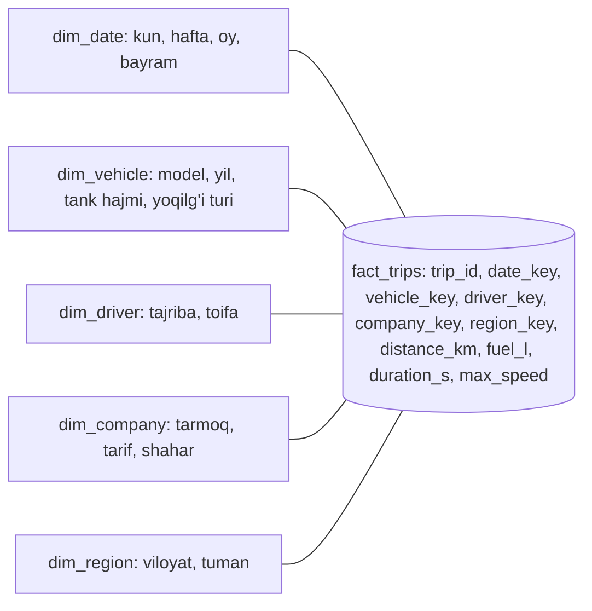

## Bu dars nima uchun kerak

12-15 darslarda biz bazaning ichini bitta yuklama turi - **tranzaksion** yuklama nuqtai nazaridan ko'rdik: kalit bo'yicha qatorni topish, uni yangilash, kichik oraliqni o'qish. Lekin har bir mahsulotda ikkinchi, butunlay boshqa yuklama ham bor: hisobotlar, dashboardlar, "o'tgan oy har bir mijoz bo'yicha jami yoqilg'i sarfi", "haftalar bo'yicha o'rtacha tezlik trendi". Bu so'rovlar millionlab qatorni skanerlaydi, lekin har qatordan bir-ikkita ustunni oladi.

Ikkala yuklamani bitta PostgreSQL'da bajarishga urinish - eng ko'p uchraydigan "nega dashboard bazani yiqitdi" hikoyasining boshlanishi. Bu darsda nima uchun bunday bo'lishini va **column-oriented storage** bu muammoni qanday hal qilishini mexanika darajasida ko'ramiz.

Bu darsdan keyin siz:

- OLTP va OLAP yuklamalarini so'rov shakli, hajm, latency va foydalanuvchi bo'yicha ajrata olasiz;
- data warehouse, ETL/ELT, star schema va fakt/o'lchov jadvallarini tushunasiz;
- column storage nega analitikada 10-100 baravar kam IO qilishini hisob bilan ko'rsata olasiz;
- ustunli siqish (dictionary, RLE, delta, bit-packing), vectorized execution va late materialization'ni bilasiz;
- ClickHouse MergeTree, Parquet va BigQuery (Dremel) qanday tuzilganini va PostgreSQL'ning bu borada qayerda turganini bilasiz.

## Ikki xil yuklama

| Xususiyat | OLTP (Online Transaction Processing) | OLAP (Online Analytical Processing) |
|---|---|---|
| Kim ishlatadi | Ilova foydalanuvchilari, API | Analitiklar, dashboardlar, hisobotlar, ML pipeline |
| So'rov shakli | Kalit bo'yicha bir nechta qator, to'liq qator | Millionlab qator, bir nechta ustun, agregatsiya |
| Yozish | Tasodifiy, kichik, ko'p, past latency | Katta partiyalar (batch) yoki oqim (stream) |
| Hajm | GB dan bir necha TB gacha | TB dan PB gacha |
| Latency | Millisekundlar, p99 muhim | Soniyalar ham qabul qilinadi |
| Bottleneck | Disk seek, qulflar, ulanishlar | Disk/xotira o'tkazuvchanligi, CPU |
| Ma'lumot | Joriy holat | Tarix, voqealar |
| Tipik engine | PostgreSQL, MySQL, B-tree, qator bo'yicha storage | ClickHouse, BigQuery, Snowflake, Redshift, DuckDB, ustun bo'yicha storage |

Kleppmann ikki yuklamani shunday ajratadi: OLTP so'rovlari kichik va oldindan ma'lum (ilova kodi ularni yozadi), OLAP so'rovlari esa ko'pincha ad-hoc - analitik yangi savol berganda yangi so'rov yoziladi. Shu sabab OLTP'da "bu so'rov uchun indeks qo'yamiz" ishlaydi, OLAP'da esa hamma ehtimoliy so'rovni indekslab bo'lmaydi - skanning o'zini arzonlashtirish kerak.

### Nega bitta bazada aralashtirish xavfli

1. **Resurs to'qnashuvi.** Bitta og'ir analitik so'rov 20 GB ni skanerlaydi, `shared_buffers` dan issiq OLTP sahifalarini siqib chiqaradi, disk o'tkazuvchanligini band qiladi - ilovaning p99 latency'si oshadi.
2. **MVCC va vacuum.** Uzoq ishlayotgan so'rov eski snapshot'ni ushlab turadi, vacuum o'lik qatorlarni tozalay olmaydi, jadval va indekslar shishadi (19-dars).
3. **Sxema ziddiyati.** OLTP uchun normalizatsiya va ko'p indeks (15-dars), OLAP uchun denormalizatsiya va keng jadvallar.
4. **Storage tartibi.** Qator bo'yicha storage butun qatorni o'qiydi, hatto 2 ustun kerak bo'lsa ham. Bu eng fundamental muammo va darsning asosiy mavzusi.

Birinchi yengillatish - analitik so'rovlarni **read replica**ga yo'naltirish (26-dars). Bu resurs to'qnashuvini kamaytiradi, lekin storage tartibi muammosini hal qilmaydi. Shuningdek replikada `hot_standby_feedback` yoqilgan bo'lsa, uzoq so'rovlar primary'da ham vacuum'ni to'xtatishi mumkin; o'chirilgan bo'lsa, replikada so'rovlar bekor qilinishi mumkin.

## Data warehouse va ETL/ELT

**Data warehouse** - analitika uchun alohida baza, unga OLTP tizimlardan ma'lumot nusxalanadi. Nusxalash jarayoni:

- **ETL** (Extract, Transform, Load) - ma'lumot manbadan olinadi, oraliq qatlamda tozalanadi va o'zgartiriladi, keyin warehouse'ga yuklanadi. Klassik yondashuv.
- **ELT** - avval xom holda yuklanadi, transformatsiya warehouse ichida SQL bilan (masalan, dbt). Zamonaviy bulutli warehouse'larning hisoblash quvvati arzon bo'lgani uchun keng tarqalgan.
- **CDC** (Change Data Capture) - OLTP bazaning WAL/replication oqimini o'qib, o'zgarishlarni deyarli real vaqtda uzatish (48-dars). Kechasi bir martalik batch o'rniga minutlar ichidagi kechikish.

Natija: OLTP baza o'z ishini qiladi, analitika boshqa tizimda, ular orasida bir tomonlama oqim. Data lake (S3'dagi Parquet fayllar) va "lakehouse" (Iceberg, Delta Lake kabi jadval formatlari) bu g'oyani "warehouse storage'ini ochiq formatdagi object storage'ga ko'chirish" yo'nalishida rivojlantiradi.

### Star schema

Warehouse'da tipik model - **star schema** (Kimball metodologiyasi):

- **Fakt jadvali** markazda: har bir qator - bitta hodisa (savdo, reys, GPS nuqta, yoqilg'i hodisasi). Juda ko'p qator, ko'pincha yuzlab ustun, asosan raqamlar va o'lchovlarga tashqi kalitlar.
- **O'lchov (dimension) jadvallari** atrofida: kim, nima, qayerda, qachon - mijoz, mashina, haydovchi, sana, hudud. Nisbatan kichik, keng va tavsifiy.



**Snowflake schema** - o'lchovlarning o'zi ham kichikroq jadvallarga normalizatsiya qilingan varianti (masalan, `dim_vehicle` alohida `dim_model` ga ishora qiladi). Teskari yo'nalish - "one big table": o'lchov atributlarini to'g'ridan-to'g'ri fakt jadvaliga ko'chirish. Ustunli storage'da bu arzon, chunki ishlatilmagan ustunlar o'qilmaydi va takrorlanuvchi qiymatlar yaxshi siqiladi.

## Column-oriented storage

### Asosiy g'oya

Qator bo'yicha storage'da (PostgreSQL heap, InnoDB) bir qatorning barcha ustunlari diskda yonma-yon. Ustun bo'yicha storage'da esa **har bir ustun alohida** saqlanadi: barcha `distance_km` qiymatlari ketma-ket, barcha `fuel_l` qiymatlari ketma-ket va h.k. Qatorni tiklash uchun har bir ustundan i-chi qiymat olinadi - shuning uchun barcha ustun fayllarida qatorlar **bir xil tartibda** bo'lishi shart.

### Hisob: qancha kam o'qiladi

Fakt jadvali: 1 mlrd qator, 100 ta ustun, o'rtacha ustun 8 bayt, ya'ni qator taxminan 800 bayt (PostgreSQL'da yana 23 baytlik header va alignment, 11-dars). So'rov:

```sql
SELECT company_key, sum(fuel_l)
FROM fact_trips
WHERE date_key BETWEEN 20260901 AND 20260930
GROUP BY company_key;
```

Kerakli ustunlar: `date_key`, `company_key`, `fuel_l` - 3 ta.

- **Qator bo'yicha:** butun jadval 1 mlrd × 800 B ≈ **800 GB** o'qiladi (sentyabr qatorlarini indeks bilan ajratib olish ham yordam bermaydi - ular baribir to'liq qatorlar, 30 kunlik ulush bo'lsa ham o'nlab GB).
- **Ustun bo'yicha, siqishsiz:** 3 × 1 mlrd × 8 B = **24 GB**. 33 baravar kam.
- **Ustun bo'yicha, siqish bilan:** `date_key` saralangan va kam qiymatli - RLE bilan deyarli nolga; `company_key` 1 000 ta qiymat - dictionary + bit-packing bilan 10 bit/qiymat atrofida; `fuel_l` - umumiy maqsadli siqish bilan, aytaylik, 3x. Jami taxminan 1-4 GB. **200-800 baravar** kam.
- Agar jadval `date_key` bo'yicha saralangan bo'lsa (yoki partitionlangan), faqat sentyabr qismi o'qiladi - yana bir tartib kam.

Bu raqamlar OLAP bazalar nega "1 mlrd qatorni soniyada" skanerlay olishini tushuntiradi. ClickHouse hujjatlaridagi misolda 100 dan ortiq ustunli jadvalda 100 mln qator 92 ms da skanerlangan - taxminan soniyasiga 1 mlrd qator, chunki faqat bir nechta ustun o'qilgan.

### Siqish: ustunlar nega yaxshi siqiladi

Bir ustundagi qiymatlar bir xil turdagi va ko'pincha o'xshash: bir xil mamlakat kodi, ketma-ket vaqt belgilari, kichik diapazondagi raqamlar. Abadi, Boncz va boshqalarning column-store'lar haqidagi sharhida (Foundations and Trends in Databases, 2012) asosiy usullar:

- **Dictionary encoding** - noyob qiymatlar ro'yxati va har qator uchun uning indeksi. 1 000 ta kompaniya - 10 bitlik kod, 8 baytlik `bigint` o'rniga.
- **Bit-packing** - kichik butun sonlarni minimal bit soni bilan zich joylash.
- **RLE** (run-length encoding) - ketma-ket takrorlar: "20260901 x 2 800 000 marta". Ustun **saralangan** bo'lsa, juda samarali. Shu sabab saralash tartibi ustunli bazalarda eng muhim dizayn qarorlaridan biri.
- **Delta va frame-of-reference** - qiymatning o'zi emas, oldingisidan farq yoki bazaviy qiymatdan farq. Vaqt belgilari uchun ideal.
- **Delta-of-delta va XOR** - time-series uchun. Facebook'ning Gorilla maqolasida (VLDB 2015): muntazam intervalda kelgan vaqt belgilarining taxminan 96% bitta bitga siqilgan, float qiymatlar oldingisi bilan XOR qilinadi; o'rtacha nuqta 16 baytdan taxminan 1.37 baytga tushgan (taxminan 12x). TimescaleDB'ning columnar siqishi ham delta-of-delta, Simple-8b, RLE, Gorilla uslubidagi XOR va dictionary usullaridan foydalanadi.

Bundan tashqari siqilgan bloklar ustida umumiy maqsadli algoritm (LZ4, Zstd) ishlatiladi.

### Bitmap indekslar

Kam qiymatli ustun uchun har bir qiymatga bitmap: "i-chi qator shu qiymatga egami". `region IN ('Toshkent', 'Samarqand')` - ikki bitmap'ning OR'i, keyin boshqa shart bitmap'i bilan AND. Bitmap'lar RLE bilan siqiladi va bitwise operatsiyalar CPU uchun juda arzon.

### Vectorized execution

Ma'lumotni kam o'qish - yarmi. Ikkinchi yarmi - CPU. Klassik bazalar (PostgreSQL ham) **Volcano** modelida ishlaydi: har bir operator `next()` chaqiruvi bilan **bitta qator** qaytaradi. Har bir qator uchun virtual funksiya chaqiruvlari, tip tekshiruvlari, shartli o'tishlar - interpretatsiya overhead'i foydali ishdan ko'p.

MonetDB/X100 maqolasi (Boncz va boshq., CIDR 2005) **vectorized execution**ni taklif qildi: operatorlar orasida bitta qator emas, bir ustunning taxminan 1 000 ta qiymatidan iborat **vektor** uzatiladi. Mualliflar standart 1024 o'lchamni ishlatgan va TPC-H Q1 uchun taxminan 1 000 optimal ekanini topgan: 1 bo'lsa interpretatsiya overhead'i qaytadi, juda katta bo'lsa vektor CPU cache'dan chiqib ketadi. Vektor ustidagi qattiq sikl (`for i in 0..1024: out[i] = a[i] * b[i]`) kompilyatorga SIMD va pipelining qo'llashga imkon beradi. DuckDB, ClickHouse, Velox, VectorWise - shu g'oya avlodlari. Muqobil yondashuv - so'rovni mashina kodiga JIT kompilyatsiya qilish (HyPer, Umbra; PostgreSQL'da ham ifodalar uchun JIT bor; chiqish arafasidagi PostgreSQL 19 da u standart holda o'chirilgan).

### Late materialization

Qatorlarni iloji boricha kech yig'ish: avval `date_key` ustunida filtr - mos pozitsiyalar ro'yxati; keyin faqat shu pozitsiyalar uchun `company_key` va `fuel_l` o'qiladi; to'liq qator hech qachon yig'ilmaydi. Natijada filtrdan o'tmagan qatorlarning boshqa ustunlari umuman o'qilmaydi va ochilmaydi.

### Ustunli storage'ga yozish

Ustunli fayl ichiga bitta qatorni joyida qo'shib bo'lmaydi - 100 ta ustun faylining har biriga, saralangan tartibni buzmasdan, siqilgan blok o'rtasiga yozish kerak bo'lardi. Yechim - 13-darsdagi LSM g'oyasi: yozishlar avval xotirada yoki kichik "part"larda to'planadi, keyin fonda katta saralangan ustunli fayllarga birlashtiriladi. Shu sabab ustunli bazalar **partiyalab yozishni** yaxshi ko'radi va bitta-bitta insert ularni qiynaydi. Update va delete ham qimmat - ko'pincha "o'chirilgan" belgisi va keyingi merge orqali.

## Real tizimlar

### ClickHouse MergeTree

ClickHouse'ning asosiy jadval engine'i:

- Har bir insert ma'lumot **part**ini yaratadi: `ORDER BY` kaliti bo'yicha saralangan, odatda har ustun alohida faylda ("Wide" part; kichik partlar bitta faylda - "Compact"). Fon jarayoni partlarni birlashtiradi (merge) - LSM'ga juda o'xshash.
- Partlar **granula**larga bo'linadi - o'qishning eng kichik birligi, standart `index_granularity = 8192` qator.
- **Siyrak primary indeks**: har bir granula uchun bitta yozuv (birinchi qatorning kalit qiymati), qator uchun emas. Shuning uchun u RAM'da turadi. 13-darsdagi SSTable siyrak indeksi bilan bir xil g'oya. Primary key unique bo'lishi shart emas.
- Har bir ustunning **mark** fayli granula boshlanishini ustun faylidagi joyga bog'laydi.
- **Data skipping indekslar** (`minmax`, `set`, `bloom_filter` va boshqalar) - granulalar guruhi uchun xulosa, mos kelmaydiganlarni o'tkazib yuborish. 15-darsdagi BRIN'ning qarindoshi.
- TTL - eski qatorlarni o'chirish yoki partlarni boshqa diskka ko'chirish, merge paytida bajariladi.

Hujjatlarning amaliy tavsiyalari: ko'p jadvallarga partition kaliti kerak emas, kerak bo'lsa odatda oylik yetarli; partitioning so'rovni tezlashtirmaydi, faqat keraksiz partitionlarni tashlaydi; mijoz ID'si bo'yicha partition qilmang, uni `ORDER BY` boshiga qo'ying.

### Parquet

Ochiq ustunli **fayl** formati (data lake'larda standart):

- fayl **row group**larga bo'linadi; har bir row group'da har ustun uchun **column chunk**; chunk'lar **page**larga;
- metadata (sxema, chunk joylashuvi, statistika) fayl **oxirida** (footer) - fayl bir o'tishda yoziladi, o'quvchi esa avval footer'ni o'qib, faqat kerakli chunk'larni oladi;
- Parquet hujjatlari katta row group'larni (512 MB - 1 GB) va 8 KB lik page'larni tavsiya qiladi.

Ichma-ich (nested) ma'lumotni ustunlarga ajratish uchun Parquet Google Dremel maqolasidagi repetition va definition level kodlashini qabul qilgan.

### BigQuery va Dremel

Google'ning Dremel tizimi (2010) - BigQuery'ning asosi. 2020 yilgi "Dremel: A Decade of Interactive SQL Analysis at Web Scale" maqolasiga ko'ra: ichma-ich ma'lumot uchun ustunli storage; storage va hisoblashni ajratish (avval lokal disklar, keyin GFS va Colossus); xotirada alohida shuffle qatlami; 2014 dan Capacitor ustunli formati - predikatlarni fayl ichida baholash, mos qatori yo'q segmentlarni ochmasdan o'tkazish, RLE yaxshilanishi uchun qatorlarni qayta tartiblash (40 ta datasetda taxminan 17% tejash). Storage va compute'ni ajratish - zamonaviy bulutli warehouse'larning (Snowflake, BigQuery, Redshift RA3) umumiy arxitekturasi.

### DuckDB

"Analitika uchun SQLite": jarayon ichida (in-process) ishlaydigan, ustunli va vectorized OLAP engine, MonetDB/X100 dan ilhomlangan. Parquet va CSV fayllarni to'g'ridan-to'g'ri so'rash mumkin. Kichik va o'rta analitika (o'nlab GB gacha) uchun alohida klastersiz yechim.

### PostgreSQL qayerda

PostgreSQL yadrosi qator bo'yicha storage va Volcano executor. Analitikani yaxshilaydigan ichki vositalar: parallel query, BRIN, partitioning va partition pruning, materialized view, PostgreSQL 18 dagi asinxron IO (`io_method`). Ustunli storage esa kengaytmalar orqali keladi (masalan, Citus columnar access method, TimescaleDB'ning gibrid qator-ustun "hypercore" storage'i, PostgreSQL ichida DuckDB engine'ini ishlatadigan kengaytmalar). Fundamental ravishda, millionlab qatorli agregatsiyalar uchun PostgreSQL'ni ustunli tizim bilan to'ldirish ko'p hollarda arzonroq.

### Taqqoslash

| Variant | Ma'lumot yangiligi | So'rov tezligi (katta skan) | Operatsion narx | Qachon |
|---|---|---|---|---|
| OLTP PostgreSQL'ning o'zida | Real vaqt | Sekin, OLTP'ga xavf | Eng past | Kichik hajm, kam hisobot |
| PostgreSQL read replica | Soniyalar | Sekin, lekin OLTP xavfsiz | Past | O'rta hajm, oddiy hisobotlar |
| PostgreSQL + materialized view / oldindan agregat jadvallar | Yangilash davriga bog'liq | Tez (agregatlar uchun) | Past-o'rta | Ma'lum, takrorlanuvchi hisobotlar |
| Ustunli kengaytma PostgreSQL ichida | Real vaqtga yaqin | Yaxshi | O'rta | Bitta tizimda qolish muhim bo'lsa |
| Alohida OLAP baza (ClickHouse) + CDC | Soniyalar-minutlar | Juda tez | O'rta-yuqori | Katta hajm, ad-hoc analitika, dashboardlar |
| Bulutli warehouse / lakehouse (BigQuery, Parquet) | Minutlar-soatlar | Tez, skan bo'yicha narx | Infrastruktura past, so'rov narxi bor | Juda katta tarixiy ma'lumot, ML |

## iQuariX kontekstida qo'llanish

Deylik, platformada quyidagi analitik ehtiyojlar bor: (1) mijoz dashboardi - kunlik masofa, yoqilg'i, bo'sh turish vaqti, haftalik trend; (2) ichki biznes analitika - mijozlar bo'yicha foydalanish; (3) haydovchi skoringi uchun tarixiy hisob.

**Hajm:** 10 000 mashina, kuniga 86.4 mln GPS nuqta (2-darsdagi hisob). Bir yilda 31.5 mlrd qator. PostgreSQL'da qator bo'yicha har nuqta header bilan taxminan 70-80 bayt - yiliga 2.2-2.5 TB, indekslarsiz.

**Ustunli variant hisobi:** 10 ta ustun: `vehicle_id` (bir granulada bir xil - saralangan bo'lsa RLE bilan deyarli nol), `ts` (delta-of-delta: muntazam 10 soniyalik interval, Gorilla tajribasiga ko'ra ko'pi bitta bit), `lat`/`lon` (qo'shni nuqtalar yaqin - delta + bit-packing), `speed` (0-200, 1 bayt), `fuel` (sekin o'zgaradi - delta yoki XOR). Ehtiyotkor baho: nuqtaga 6-10 bayt, ya'ni 10x atrofida siqish. Yiliga 200-300 GB. Saralash tartibi `ORDER BY (vehicle_id, ts)` - bu ham siqish, ham "mashina bo'yicha davr" so'rovi uchun eng yaxshi.

**Dizayn varianti (faraziy):**

- PostgreSQL - OLTP: mijozlar, mashinalar, foydalanuvchilar, sozlamalar, joriy holat, oxirgi 1-7 kunlik xom nuqtalar (operativ ko'rish uchun).
- Telemetriya oqimi navbatdan (43-dars) ikkita iste'molchiga: PostgreSQL'ga (operativ) va ClickHouse'ga (tarix va analitika). Yoki PostgreSQL'dan CDC orqali.
- ClickHouse'da `positions` MergeTree, `ORDER BY (company_id, vehicle_id, ts)`, oylik partition, TTL 2-3 yil; kunlik agregatlar uchun materialized view (`AggregatingMergeTree`).
- Dashboard so'rovlari kunlik agregatlardan o'qiydi (kichik), "drill-down" esa xom ustunli jadvaldan.
- Muhim nuance: ClickHouse'ga bitta-bitta insert qilmang - har insert part yaratadi. Navbatdan 1-5 soniyalik yoki 10-100 ming qatorlik partiyalarda yozing (yoki asinxron insert rejimi).

Qachon bu murakkablik oqlanmaydi: mashinalar 1 000 ta, hisobotlar faqat kunlik va oldindan ma'lum bo'lsa - PostgreSQL'da kunlik partitionlar, BRIN va kechasi to'ldiriladigan agregat jadvallar yetarli. Qo'shimcha baza - qo'shimcha operatsion yuk (1, 11-darslar).

## Ko'p uchraydigan xatolar

1. **Dashboard so'rovlarini OLTP primary'da bajarish.** Bitta "oxirgi 90 kun bo'yicha hisobot" tugmasi ilova latency'sini yiqitadi.
2. **Ustunli bazaga qatorma-qator insert.** Har insert alohida part, merge'lar ulgurmaydi ("too many parts" xatolari).
3. **Ustunli bazada noto'g'ri saralash kaliti.** Saralash siqishni va o'qiladigan granulalar sonini belgilaydi; vaqtni birinchi qo'yib, filtrlar asosan mijoz bo'yicha bo'lsa, ko'p granula o'qiladi.
4. **Juda mayda partitionlar** (masalan, kun x mijoz). Fayllar soni portlaydi, merge samarasiz.
5. **Ustunli bazani OLTP sifatida ishlatish.** Tez-tez update, nuqtali o'qishlar va tranzaksiyalar uchun mo'ljallanmagan.
6. **`SELECT *` analitikada.** Ustunli storage'ning butun foydasini yo'qotadi.
7. **Ma'lumot yangiligi talabini aniqlamaslik.** "Real vaqt" kerakmi yoki 15 daqiqalik kechikish yetarlimi - bu ETL, CDC yoki stream tanlovini belgilaydi.

## Xulosa

- OLTP - kalit bo'yicha kichik o'qish/yozishlar va past latency; OLAP - ko'p qatorli skan va agregatsiyalar. Ular boshqa storage tartibini talab qiladi.
- Bitta bazada aralashtirish resurs, MVCC/vacuum va storage tartibi bo'yicha to'qnashuv beradi; replika faqat birinchisini yengillatadi.
- Warehouse: ETL/ELT yoki CDC, star schema (fakt va o'lchovlar) yoki keng denormalizatsiya qilingan jadval.
- Ustunli storage faqat kerakli ustunlarni o'qiydi va ularni yaxshi siqadi (dictionary, RLE, delta, bit-packing); saralash tartibi siqish va skanni belgilaydi.
- Vectorized execution (taxminan 1 000 qiymatli vektorlar) va late materialization CPU tomonda yana bir tartib beradi.
- Ustunli bazaga yozish LSM uslubida: partiyalab, keyin fon merge. Bitta-bitta insert va update qimmat.
- ClickHouse MergeTree, Parquet, BigQuery/Dremel va DuckDB - bir xil g'oyalarning turli shakllari; PostgreSQL analitikani kengaytmalar va agregatlar bilan yaxshilaydi, lekin katta ad-hoc analitika uchun ko'pincha ustunli tizim bilan to'ldiriladi.

## Amaliy topshiriq

iQuariX uchun **mijoz analitika moduli** loyihalanmoqda deb faraz qiling. Talablar: mijoz dispetcheri istalgan davr (1 kundan 12 oygacha) bo'yicha har bir mashina va haydovchi uchun masofa, yoqilg'i sarfi, bo'sh turish, tezlik buzilishlari sonini ko'radi; ma'lumot 15 daqiqadan ko'p kechikmasligi kerak; hisobot 2 soniyada ochilishi kerak. 20 000 mashina, nuqtalar har 10 soniyada, saqlash 3 yil.

1. Hajmni hisoblang: kunlik va 3 yillik xom qatorlar soni, qator bo'yicha (PostgreSQL) va ustunli (siqish bilan, o'z taxminingiz) hajm.
2. OLTP va OLAP o'rtasidagi chegarani belgilang: qaysi ma'lumot qayerda yashaydi va qanday oqib o'tadi (CDC, navbat, batch)? 15 daqiqalik yangilik talabi qanday ta'minlanadi?
3. Ustunli jadval sxemasini yozing: ustunlar, saralash kaliti, partition kaliti, TTL. Har birini asoslang.
4. 12 oylik hisobot 2 soniyada ochilishi uchun nima qilasiz? Xom ma'lumotni skanerlash hajmini hisoblang va oldindan agregatlar (kunlik, mashina bo'yicha) kerakligini baholang.
5. Haydovchi boshqa mashinaga o'tgan yoki mashina boshqa mijozga sotilgan holatda (o'lchovlar o'zgarishi) tarixiy hisobotlar to'g'ri bo'lishi uchun nima qilasiz?
6. Agar mashinalar 2 000 ta bo'lsa, xuddi shu talablarni faqat PostgreSQL bilan qanday bajarardingiz?

Yaxshi javobda bo'lishi kerak bo'lgan narsalar:

- hajm hisoblari ochiq, siqish taxmini asoslangan;
- saralash kaliti filtr naqshlariga (mijoz, mashina, vaqt) mos;
- partiyalab yozish va kechikish byudjeti (15 daqiqa) bog'langan;
- oldindan agregatlar va ularning yangilanishi tushuntirilgan;
- o'lchovlarning vaqt bo'yicha o'zgarishi (slowly changing dimension) hisobga olingan;
- kichik hajm uchun soddaroq yechim taklif qilingan.

Javobni pastdagi maydonga yozib, chatga yuboring.

## Manbalar

- Martin Kleppmann, Chris Riccomini. [Designing Data-Intensive Applications, 2-nashr](https://www.oreilly.com/library/view/designing-data-intensive-applications/9781098119058/), O'Reilly, 2026. 1-bob (operatsion va analitik tizimlar, warehouse, data lake) va 4-bob "Storage and Retrieval" (column-oriented storage, siqish, vectorized processing).
- Daniel Abadi, Peter Boncz, Stavros Harizopoulos, Stratos Idreos, Samuel Madden. [The Design and Implementation of Modern Column-Oriented Database Systems](https://www.cs.umd.edu/~abadi/papers/abadi-column-stores.pdf), Foundations and Trends in Databases, 2012.
- Peter Boncz, Marcin Zukowski, Niels Nes. [MonetDB/X100: Hyper-Pipelining Query Execution](https://www.cidrdb.org/cidr2005/papers/P19.pdf), CIDR 2005.
- Sergey Melnik va boshq. [Dremel: A Decade of Interactive SQL Analysis at Web Scale](https://www.vldb.org/pvldb/vol13/p3461-melnik.pdf), PVLDB 13(12), 2020.
- Tuomas Pelkonen va boshq. [Gorilla: A Fast, Scalable, In-Memory Time Series Database](https://www.vldb.org/pvldb/vol8/p1816-teller.pdf), PVLDB 8(12), 2015.
- ClickHouse hujjatlari: [MergeTree table engine](https://clickhouse.com/docs/engines/table-engines/mergetree-family/mergetree), [What is ClickHouse](https://clickhouse.com/docs/intro).
- Apache Parquet: [File Format](https://parquet.apache.org/docs/file-format/), [Configurations](https://parquet.apache.org/docs/file-format/configurations/).
- [Why DuckDB](https://duckdb.org/why_duckdb); TigerData (TimescaleDB): [Compression methods](https://www.tigerdata.com/docs/learn/columnar-storage/compression-methods).
