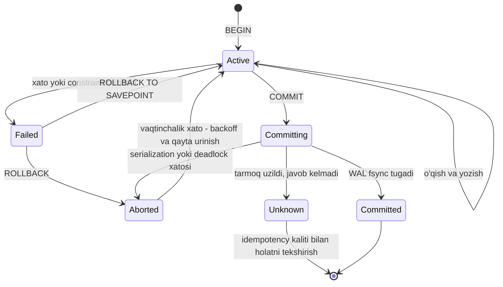

## Bu dars nima uchun kerak

Siz `BEGIN ... COMMIT` ni yuzlab marta yozgansiz. Prisma'da `$transaction`, Kysely'da `db.transaction().execute(...)`. Lekin "tranzaksiya nimani kafolatlaydi" degan savolga ko'pchilik "ACID" deb javob beradi va shu yerda to'xtaydi. Muammo shundaki, ACID'ning to'rt harfi to'rt xil narsani anglatadi, ulardan biri (C) aslida bazaning xususiyati emas, ikkinchisi (I) har bir bazada boshqacha amalga oshirilgan, to'rtinchisi (D) esa disk, OS va replikatsiyaga bog'liq va hech qachon mutlaq emas.

12-14 darslarda biz WAL va crash recovery mexanikasini ko'rdik. Bu dars yuqoriroq darajada: ilova dasturchisi sifatida tranzaksiyadan nima kutish mumkin, nima kutib bo'lmaydi, va tranzaksiya qayerda yordam bermaydi. 18-darsda izolyatsiya anomaliyalari, 19-darsda ularning amalga oshirilishi (MVCC, 2PL, SSI) chuqur ko'riladi.

Bu darsdan keyin siz:

- atomicity, consistency, isolation, durability ning har birini aniq va to'g'ri ta'riflay olasiz, shu jumladan "C" nega ilovaga tegishli ekanini;
- bitta obyektli va ko'p obyektli tranzaksiyalar farqini va NoSQL bazalardagi "tranzaksiya" so'zining chegarasini bilasiz;
- tranzaksiyani qachon qayta urinish (retry) xavfsiz va qachon xavfli ekanini tushunasiz;
- PostgreSQL'da autocommit, savepoint, aborted holat, deferred constraint, timeoutlar va `idle in transaction` muammosini amaliy boshqara olasiz;
- durability'ning real chegaralarini (fsync, disk kesh, replikatsiya) baholay olasiz.

## Tranzaksiya nima va nega kerak

Tranzaksiya - bir nechta o'qish va yozishni **bitta mantiqiy birlik**ka birlashtirish: yoki hammasi muvaffaqiyatli bajariladi (commit), yoki hech biri (abort, rollback). Bu g'oya ilovani juda ko'p xato holatlaridan ozod qiladi: tarmoq uzilishi, jarayon qulashi, disk to'lishi, constraint buzilishi, parallel yozuvchilar. Tranzaksiyasiz ilova har bir oraliq holatni o'zi tozalashi kerak bo'lardi.

Kleppmann buni shunday ifodalaydi: tranzaksiya - bu ilova uchun dasturlash modelini soddalashtirish vositasi; u ma'lum xato va concurrency muammolarini **e'tiborsiz qoldirish** imkonini beradi, chunki baza ularni hal qiladi. Lekin har bir ilovaga tranzaksiya kerak emas va har bir tranzaksiya bir xil kafolat bermaydi.

ACID atamasini Theo Härder va Andreas Reuter 1983 yilda "Principles of Transaction-Oriented Database Recovery" maqolasida kiritgan; undan oldin Jim Gray 1981 yilda atomicity, consistency va durability'ni tasvirlagan. Kleppmann ta'kidlashicha, amalda ACID'ga mos deyilgan tizimlar bir-biridan sezilarli farq qiladi va "ACID" ko'p hollarda marketing atamasiga aylangan. Shuning uchun har bir harfni alohida, aniq ko'rib chiqamiz.

## A - Atomicity: aslida "abortability"

Umumiy dasturlashda "atomik" - boshqa thread oraliq holatni ko'ra olmaydi degani. ACID'da esa bu **izolyatsiya** emas. ACID'dagi atomicity - **xato bo'lganda tranzaksiyani to'liq bekor qilish mumkinligi**: agar bir nechta yozishdan keyin biror narsa buzilsa (jarayon qulasa, constraint buzilsa, disk to'lsa), baza o'sha tranzaksiyaning barcha yozishlarini bekor qiladi. Kleppmann shu sababli "abortability" yaxshiroq atama bo'lardi deydi.

Amaliy ma'nosi: tranzaksiya bekor bo'lsa, ilova **hech narsa o'zgarmaganini** bilib, uni xavfsiz qayta urinishi mumkin. Atomicity bo'lmasa, qaysi yozuvlar o'tgani va qaysilari yo'qligini aniqlash juda qiyin.

PostgreSQL'da atomicity qanday ta'minlanadi: commit qilinmagan tranzaksiyaning qator versiyalari diskda qolishi ham mumkin, lekin ularning `xmin` tranzaksiyasi "bekor qilingan" deb belgilangani uchun hech kimga ko'rinmaydi (19-dars). Crash'dan keyin esa commit yozuvi WAL'da yo'q tranzaksiyalar avtomatik bekor deb hisoblanadi (14-dars). Ya'ni PostgreSQL'da rollback qimmat emas - u faqat holat belgisi, keyin vacuum o'lik versiyalarni tozalaydi.

### PostgreSQL'da bir nechta amaliy nozik joy

**Autocommit.** `BEGIN` siz yuborilgan har bir SQL buyrug'i alohida tranzaksiya: yashirin `BEGIN` va muvaffaqiyatli bo'lsa yashirin `COMMIT`. Ikkita alohida `UPDATE` atomik emas, agar ular bitta tranzaksiya blokida bo'lmasa.

**Aborted holat.** PostgreSQL'da tranzaksiya ichidagi biror buyruq xato bersa, butun tranzaksiya "aborted" holatga o'tadi: keyingi har qanday buyruq `current transaction is aborted, commands ignored until end of transaction block` xatosini beradi. Yagona yo'llar - `ROLLBACK` yoki `ROLLBACK TO SAVEPOINT`. Ba'zi boshqa bazalardagidek "xatoni o'tkazib yuborib davom etish" yo'q.

**Savepoint.** Tranzaksiya ichida qisman bekor qilish nuqtasi:

```sql
BEGIN;
INSERT INTO trips (...) VALUES (...);
SAVEPOINT before_geo;
INSERT INTO trip_geofence_hits (...) VALUES (...);  -- unique buzilishi mumkin
-- xato bo'lsa:
ROLLBACK TO SAVEPOINT before_geo;
COMMIT;  -- reys saqlanadi, geofence yozuvi yo'q
```

Savepoint'lar subtransaction yaratadi va ularning narxi bor: bitta tranzaksiyada juda ko'p subtransaction bo'lsa, ular jarayonning xotiradagi keshidan oshib ketadi va boshqa sessiyalarning ko'rinuvchanlik tekshiruvlari ham `pg_subtrans` orqali sekinlashishi mumkin - katta yuklamali tizimlarda hujjatlashtirilgan performance tuzog'i. Ba'zi ORM'lar har bir ichki "nested transaction" uchun yashirin savepoint yaratadi.

## C - Consistency: bu ilovaning xususiyati

"Consistency" so'zi kompyuter fanida kamida to'rt xil ma'noda ishlatiladi: replica consistency (eventual consistency, 33-dars), consistent hashing (29-dars), CAP'dagi consistency (aslida linearizability, 34-dars) va ACID'dagi consistency. Oxirgisi - **ma'lumot haqidagi invariantlar doim bajarilishi**: masalan, buxgalteriyada debet va kredit yig'indisi teng; omborda qoldiq manfiy emas; har bir reysning haydovchisi mavjud.

Kleppmann'ning asosiy fikri: bu invariantlarni **ilova** belgilaydi va **ilova** ularni saqlaydigan tranzaksiyalarni yozadi. Baza faqat ba'zi invariantlarni tekshira oladi (foreign key, unique, `CHECK`, exclusion constraint), lekin ko'pchiligini emas. Agar ilova invariantni buzadigan ma'lumot yozsa, baza uni to'xtata olmaydi. Atomicity, isolation va durability - bazaning xususiyatlari; consistency esa ilova ularga tayanib erishadigan narsa. Kleppmann hatto "C" ACID'ga asosan qisqartma chiroyli chiqishi uchun qo'shilgan deb yozadi.

### Bazaga imkon qadar ko'p invariant bering

Ilova kodidagi tekshiruv parallel so'rovlar orasida poyga (race condition) holatiga tushadi. Baza constraint'i esa atomik tekshiriladi. PostgreSQL'da:

```sql
ALTER TABLE fuel_tanks ADD CONSTRAINT level_range CHECK (level_l >= 0 AND level_l <= capacity_l);
CREATE UNIQUE INDEX one_active_trip ON trips (vehicle_id) WHERE ended_at IS NULL;  -- 15-dars
ALTER TABLE shifts ADD CONSTRAINT no_overlap
  EXCLUDE USING gist (driver_id WITH =, tstzrange(started_at, ended_at) WITH &&);
```

**Deferred constraint'lar.** Ba'zan invariant tranzaksiya oxirida to'g'ri bo'ladi, lekin oraliqda vaqtincha buziladi (masalan, ikki qatorning tartib raqamlarini almashtirish yoki o'zaro foreign key). `UNIQUE`, `PRIMARY KEY`, `REFERENCES` va `EXCLUDE` constraint'larni `DEFERRABLE INITIALLY DEFERRED` qilish mumkin - ular commit paytida tekshiriladi. `NOT NULL` va `CHECK` esa har doim darhol tekshiriladi.

Baza ifodalay olmaydigan invariantlar uchun (masalan, "mijozning faol mashinalari soni tarif limitidan oshmasin") tranzaksiya ichida tekshirish kerak - lekin bu yerda **izolyatsiya** darajasi hal qiluvchi: Read Committed'da ikki parallel tranzaksiya ikkalasi ham limitni "bo'sh" deb ko'rishi mumkin (write skew, 18-dars).

## I - Isolation: parallel tranzaksiyalar bir-biriga xalaqit bermasin

Bir vaqtda ishlayotgan tranzaksiyalar bir xil qatorlarga murojaat qilsa, poyga holatlari paydo bo'ladi. Isolation - tranzaksiyalar bir-biridan ajratilgan, ya'ni har biri go'yo yolg'iz ishlayotgandek bo'lishi kafolati. Klassik ta'rif - **serializability**: natija tranzaksiyalar qandaydir ketma-ket tartibda bajarilgandagi natija bilan bir xil.

Muammo shundaki, to'liq serializability qimmat, shuning uchun bazalar standart holda kuchsizroq darajalarni ishlatadi:

| Baza | Standart izolyatsiya |
|---|---|
| PostgreSQL | Read Committed |
| MySQL InnoDB | Repeatable Read |
| SQL Server | Read Committed (qulflar bilan; snapshot rejimi alohida yoqiladi) |
| Oracle | Read Committed |
| CockroachDB | Serializable |

PostgreSQL hujjatlariga ko'ra, u ichkarida faqat uchta darajani amalga oshiradi (Read Uncommitted Read Committed kabi ishlaydi), Repeatable Read esa snapshot isolation sifatida amalga oshirilgan va standartdan kuchliroq - phantom read'ga ham yo'l qo'ymaydi, lekin serialization anomaliyalariga yo'l qo'yadi. Bularning barchasi 18-19 darslarda.

Bu darsda muhim bo'lgan bitta nuqta: **"tranzaksiya ichida yozdim, demak xavfsiz" degani noto'g'ri.** Read Committed'da quyidagi kod parallel chaqirilganda limitni buzishi mumkin:

```ts
await db.transaction().execute(async (trx) => {
  const { count } = await trx.selectFrom('vehicles').where('company_id', '=', cid)
    .where('active', '=', true).select(trx.fn.countAll().as('count')).executeTakeFirstOrThrow();
  if (Number(count) >= limit) throw new Error('Tarif limiti');
  await trx.insertInto('vehicles').values({ company_id: cid, active: true, ... }).execute();
});
```

Ikki so'rov bir vaqtda `count = limit - 1` ni ko'radi va ikkalasi ham qo'shadi. Atomicity bor, lekin isolation yetarli emas. Yechimlar (`SELECT ... FOR UPDATE` kompaniya qatorida, Serializable daraja, yoki hisoblagich ustuni va `CHECK`) 18-darsda.

## D - Durability: commit qilingan narsa yo'qolmasin

Durability - tranzaksiya commit bo'lgach, uning yozgan ma'lumoti hatto server qulasa yoki elektr o'chsa ham saqlanib qolishi. Bitta tugunli bazada bu odatda ma'lumot WAL'ga yozilib, diskka `fsync` qilinganini anglatadi (14-dars). Replikatsiyali bazada - ma'lumot bir nechta tugunga yetkazilganini.

**Mukammal durability yo'q.** Kleppmann bir qator real xavflarni sanaydi va ular ilova arxitekturasiga bevosita ta'sir qiladi:

- **Disk va kontroller keshi.** `fsync` muvaffaqiyatli qaytgani - ma'lumot jismoniy diskda degani emas, agar disk yoki RAID kontroller o'z yozish keshini quvvatdan himoyasiz (power-loss protection'siz) ishlatsa. Server SSD'larining PLP xususiyati shu uchun muhim.
- **fsync xatolari.** 2018 yilda PostgreSQL hamjamiyatida "fsyncgate" deb nomlangan muammo aniqlandi: Linux'da `fsync()` xato qaytargandan keyin iflos sahifalar "toza" deb belgilanishi va qayta `fsync()` muvaffaqiyat qaytarishi mumkin edi - ma'lumot jimgina yo'qolardi. PostgreSQL bunga javoban `fsync` xatosida qayta urinish o'rniga PANIC qilishga o'tdi (12-versiyadagi o'zgarish 9.4 gacha bo'lgan versiyalarga backport qilingan) va tiklashni WAL'dan qiladi. Viskonsin universiteti tadqiqotchilarining 2020 yilgi USENIX ATC maqolasi ("Can Applications Recover from fsync Failures?") PostgreSQL, LMDB, LevelDB, SQLite va Redis'ni o'rganib, ularning fsync xatolarini qayta ishlash strategiyalarining hech biri to'liq yetarli emasligini ko'rsatgan.
- **Ma'lumot buzilishi.** SSD'lar vaqt o'tib xato bloklar hosil qiladi, firmware xatolari bo'ladi. Checksum'lar (`initdb --data-checksums`; PostgreSQL 18 dan yangi klasterlar uchun standart holda yoqilgan) buzilishni aniqlaydi, lekin tuzatmaydi.
- **Korrelyatsiyalangan nosozliklar.** Bir xil partiyadagi disklar bir vaqtda ishdan chiqadi; bitta data-markazdagi elektr uzilishi barcha replikalarni o'chiradi; dasturiy xato barcha tugunlarda bir vaqtda.
- **Asinxron replikatsiya.** Primary commit qilib, replikaga yetkazmasdan qulasa va replika primary'ga ko'tarilsa (failover), oxirgi commit'lar yo'qoladi (26-dars).

Shuning uchun durability - bu "ha yoki yo'q" emas, balki **xavf darajasi**: lokal fsync + sinxron replika + boshqa zonadagi replika + muntazam backup va PITR (69-dars). Har bir qatlam narx va latency qo'shadi.

### Durability'ni tanlab yumshatish

14-darsdan: `synchronous_commit = off` crash'da oxirgi tranzaksiyalarni (taxminan `wal_writer_delay` ning uch baravarigacha, standart 200 ms bilan 600 ms gacha) yo'qotishi mumkin, lekin bazani buzmaydi. Buni tranzaksiya darajasida, qayta tiklash mumkin bo'lgan ma'lumot uchun ishlatish mumkin. Replikatsiyada `synchronous_commit = remote_apply`, `on`, `remote_write` - "nechta tugun va qaysi bosqichgacha tasdiqlashi kerak" tanlovi (26-dars).

## Bitta obyektli va ko'p obyektli tranzaksiyalar

**Bitta obyekt** (bitta qator, bitta hujjat, bitta kalit) darajasidagi atomicity va izolyatsiyani deyarli barcha storage engine'lar beradi: 20 KB lik JSON hujjatning yarmi yozilgan holda qolmaydi, ikki parallel yozish bir-birini aralashtirmaydi. Bunga crash recovery logi (atomicity) va obyekt darajasidagi qulf (isolation) yetarli. Shu asosda **atomik operatsiyalar** quriladi: `UPDATE counters SET n = n + 1`, Redis `INCR`, compare-and-set (`UPDATE ... WHERE version = 7`). Ular ko'p hollarda "read-modify-write" poygasini yo'qotadi (18-dars).

Lekin bu **tranzaksiya emas** - tranzaksiya odatda **bir nechta obyektni** bitta birlik sifatida o'zgartirishni anglatadi. Ko'p obyektli tranzaksiyalar quyidagi holatlarda kerak:

- foreign key bilan bog'langan qatorlar (reys va uning nuqtalari);
- denormalizatsiya qilingan ma'lumotni sinxron saqlash (11-dars: hujjat va hisoblagich);
- secondary indekslar (baza ichida avtomatik, lekin distributed tizimda alohida muammo, 30-dars).

Ko'p distributed NoSQL bazalar tarixan ko'p obyektli tranzaksiyalardan voz kechgan, chunki ular partitionlar bo'ylab qimmat (37-dars: 2PC). Keyinchalik ko'pchiligi cheklangan shaklda qaytardi. Masalan, DynamoDB hujjatlariga ko'ra, `TransactWriteItems` 100 tagacha unique item va 4 MB gacha ma'lumotni qamraydi, bitta tranzaksiyada bitta itemga ikki amal bo'lmaydi, va ACID kafolati faqat yozish bajarilgan region ichida - global tables'da regionlar bo'ylab emas. Bu raqamlar dizaynni belgilaydi: "bitta tranzaksiyada 10 000 qatorni yangilash" DynamoDB'da mumkin emas.

## Xatolar va qayta urinish

Atomicity'ning butun g'oyasi - bekor qilingan tranzaksiyani qayta urinish. Lekin bu ko'rinishidan murakkabroq:

1. **Commit muvaffaqiyatli bo'ldi, lekin javob yo'lda yo'qoldi.** Klient timeout oladi va qayta uradi - tranzaksiya **ikki marta** bajariladi. Bu bazaning emas, ilovaning muammosi: idempotency kaliti yoki unique constraint kerak (9, 39-darslar).
2. **Xato yuklama tufayli bo'lsa**, qayta urinish yuklamani oshiradi. Exponential backoff, jitter va urinishlar chegarasi kerak (62-dars).
3. **Doimiy xatolarni qayta urinish foydasiz** (constraint buzilishi). Faqat vaqtinchalik xatolarni qayta urining: deadlock (`40P01`), serialization failure (`40001`), ulanish uzilishi.
4. **Tranzaksiyaning tashqi yon ta'sirlari** (email yuborish, tashqi API chaqiruvi, Kafka'ga xabar) rollback bilan bekor bo'lmaydi va qayta urinishda takrorlanadi. Yechim - tashqi ta'sirni commit'dan keyinga ko'chirish yoki transactional outbox (48-dars).
5. **Butun tranzaksiyani qayta bajaring.** PostgreSQL hujjatlari `40001` xatosida tranzaksiyani **boshidan** qayta bajarishni tavsiya qiladi - ya'ni o'qishlar ham qayta bajariladi, chunki qarorlar yangi ma'lumotga asoslanishi kerak. Faqat oxirgi `UPDATE` ni qayta yuborish noto'g'ri.



`Unknown` holat - eng ko'p e'tiborsiz qoldiriladigan holat. Klient tomonidan qaraganda commit bo'ldimi yoki yo'qmi, noma'lum. Uni faqat ilova darajasidagi mexanizm (idempotency kaliti, tranzaksiya ID'si bilan qatorni tekshirish) hal qiladi.

## Tranzaksiya davomiyligi: qisqa bo'lsin

Uzoq tranzaksiya PostgreSQL'da uchta muammo keltiradi:

1. **Qulflar ushlab turiladi.** Yangilangan qatorlarning qulflari commit'gacha turadi; boshqa yozuvchilar kutadi.
2. **Vacuum to'xtaydi.** Ochiq tranzaksiya snapshot'i eski qator versiyalarini "hali kerak" qilib qo'yadi, vacuum ularni tozalay olmaydi, jadval va indekslar shishadi (19-dars). Hujjatlar ham ogohlantiradi: ochiq tranzaksiya yaqinda o'lgan qatorlarni vacuum qilishga to'sqinlik qiladi.
3. **Ulanish band.** Har bir tranzaksiya bitta ulanishni (va PostgreSQL'da bitta backend jarayonni) band qiladi.

Eng xavfli naqsh - **`idle in transaction`**: ilova `BEGIN` qilib, keyin tashqi HTTP so'rovni kutadi yoki xatoda tranzaksiyani yopmay qoladi. Little qonuni bilan hisoblaymiz (3-dars): agar ulanish puli 20 ta, har tranzaksiya o'rtacha 5 ms bo'lsa, pul soniyasiga 20 / 0.005 = 4 000 tranzaksiya o'tkaza oladi. Agar tranzaksiya ichida 300 ms lik tashqi API chaqiruvi bo'lsa: 20 / 0.305 ≈ **65 tranzaksiya/s**. 60 baravar kam, va bu vaqt davomida qulflar ushlab turiladi.

Himoya sozlamalari (barchasining standart qiymati 0, ya'ni o'chirilgan; hujjatlar ularni `postgresql.conf` da global emas, rol yoki sessiya darajasida qo'yishni tavsiya qiladi):

| Sozlama | Nima qiladi |
|---|---|
| `statement_timeout` | Bitta buyruq shundan uzoq ishlasa, bekor qilinadi |
| `lock_timeout` | Qulfni kutish shundan uzoq bo'lsa, buyruq bekor qilinadi |
| `idle_in_transaction_session_timeout` | Tranzaksiya ichida "bo'sh" turgan sessiyani yopadi |
| `transaction_timeout` (PostgreSQL 17+) | Tranzaksiya umumiy davomiyligini cheklaydi |

```sql
ALTER ROLE api_service SET statement_timeout = '5s';
ALTER ROLE api_service SET lock_timeout = '2s';
ALTER ROLE api_service SET idle_in_transaction_session_timeout = '30s';
```

Kodda qoida: tranzaksiya ichida **faqat baza ishi**. Tashqi chaqiruvlar, fayl yuklash, LLM so'rovlari - tranzaksiyadan oldin yoki keyin.

## Real tizimlar

- **PostgreSQL** - to'liq ko'p obyektli ACID; atomicity MVCC holat belgilari va WAL orqali; standart Read Committed; `PREPARE TRANSACTION` orqali tashqi tranzaksiya menejeri uchun 2PC, lekin hujjatlar ilovalar uchun emasligini va unutilgan prepared tranzaksiyalar qulflarni ushlab, vacuum'ga xalaqit berishini ogohlantiradi (shuning uchun `max_prepared_transactions` odatda 0).
- **MySQL InnoDB** - undo log orqali rollback, standart Repeatable Read.
- **DynamoDB** - bitta item darajasida atomik va shartli yozish; ko'p itemli tranzaksiyalar 100 item va 4 MB chegarasi bilan, region ichida.
- **MongoDB** - bitta hujjat darajasida atomik; ko'p hujjatli tranzaksiyalar 4.0 dan replica set'da, 4.2 dan sharded klasterda (yuqori narx bilan).
- **Redis** - `MULTI/EXEC` buyruqlarni ketma-ket bajaradi, lekin klassik ma'noda rollback yo'q: biror buyruq bajarilish paytida xato bersa, qolganlari baribir bajariladi. Durability AOF sozlamasiga bog'liq (12-dars).
- **Spanner, CockroachDB** - distributed, ko'p partitionli serializable tranzaksiyalar (37-dars).

### Taqqoslash: "tranzaksiya" so'zi turli tizimlarda

| Tizim | Atomik birlik | Izolyatsiya (standart) | Rollback | Durability |
|---|---|---|---|---|
| PostgreSQL | Istalgan sondagi qator, jadval | Read Committed | To'liq | WAL fsync, ixtiyoriy sinxron replika |
| DynamoDB | 1 item; tranzaksiyada 100 item, 4 MB gacha | Item darajasida serializable, region ichida | Tranzaksiya ichida to'liq | Bir nechta AZ'ga replikatsiya |
| Redis | Bitta buyruq; MULTI/EXEC ketma-ketlik | Bitta thread, ketma-ket | Yo'q | AOF/RDB sozlamasiga bog'liq |
| MongoDB | 1 hujjat; ko'p hujjatli tranzaksiya qo'shimcha | Snapshot (tranzaksiyalarda) | To'liq | Write concern'ga bog'liq |

## iQuariX kontekstida qo'llanish

Faraz qiling, quyidagi operatsiyalar bor.

**1. Reysni yopish.** Bir vaqtda: `trips` qatorida `ended_at`, `distance_km`, `fuel_used_l` yoziladi; `vehicles.odometer` yangilanadi; haydovchi skoringi uchun `driver_scores` ga qator qo'shiladi; mijozga hisobot uchun hodisa yuboriladi. Birinchi uchtasi - bitta PostgreSQL tranzaksiyasi. Hodisa yuborish - tranzaksiya **ichida emas**: outbox jadvaliga qator yozish (shu tranzaksiyada) va alohida jarayon uni navbatga jo'natadi (48-dars). Aks holda rollback bo'lgan reys uchun hodisa ketishi yoki commit bo'lgan reys uchun hodisa yo'qolishi mumkin.

**2. Telemetriya ingest.** Har bir GPS nuqta uchun alohida tranzaksiya (autocommit) - soniyasiga 1 000 commit, har biri WAL flush. Yaxshiroq: navbatdan 500-1 000 nuqtani bitta tranzaksiyada (`INSERT ... VALUES (...), (...)` yoki `COPY`) yozish. Bu yerda atomicity'ning qo'shimcha foydasi: partiya yoki to'liq yoziladi, yoki umuman - iste'molchi navbat offsetini faqat commit'dan keyin tasdiqlaydi. Takroriy yetkazilishdan himoya uchun `(device_id, ts)` bo'yicha unique constraint va `ON CONFLICT DO NOTHING`. Agar nuqtalar trekerda yoki navbatda saqlanib qolsa, `synchronous_commit = off` ham qabul qilinadi.

**3. Tarif limiti.** "Mijoz faol mashinalari soni tarifdan oshmasin" - ilova invarianti (C), baza buni bevosita ifodalay olmaydi. Read Committed'da yuqoridagi poyga mavjud. Variant: `companies` qatorini `SELECT ... FOR UPDATE` bilan qulflash yoki `companies.active_vehicles` hisoblagichi va `CHECK (active_vehicles <= vehicle_limit)` constraint'i - atomik `UPDATE ... SET active_vehicles = active_vehicles + 1` ni constraint himoya qiladi.

**4. Billing.** Oylik hisob-faktura yaratish: yuzlab qator, bir necha jadval. Bitta tranzaksiya, `transaction_timeout` bilan; tashqi to'lov tizimi chaqiruvi tranzaksiyadan tashqarida, idempotency kaliti bilan (88-dars).

## Ko'p uchraydigan xatolar

1. **"ACID bazamiz bor, demak poygalar yo'q".** Standart Read Committed write skew va lost update'larga yo'l qo'yadi (18-dars).
2. **Consistency'ni bazaga topshirib qo'yish.** Baza faqat siz e'lon qilgan constraint'larni tekshiradi; qolgan invariantlar ilova va izolyatsiyaga bog'liq.
3. **Tranzaksiya ichida tashqi chaqiruvlar.** HTTP, email, navbatga yozish - qulflar uzoq turadi, rollback ularni bekor qilmaydi.
4. **Faqat oxirgi buyruqni qayta urinish** yoki doimiy xatolarni qayta urinish. Butun tranzaksiyani boshidan, faqat vaqtinchalik xatolarda, backoff bilan.
5. **Commit natijasi noma'lum holatni e'tiborsiz qoldirish.** Timeout'dan keyin qayta urinish dublikat yaratadi; idempotency kerak.
6. **`idle in transaction` va uzoq tranzaksiyalarni kuzatmaslik.** `pg_stat_activity` dagi `state = 'idle in transaction'` va `xact_start` ni monitoring qiling, timeoutlarni rol darajasida qo'ying.
7. **Durability'ni mutlaq deb hisoblash.** Disk keshi, asinxron replika, fsync xatolari - har biri commit qilingan ma'lumotni yo'qotishi mumkin; backup va PITR shart.
8. **Har bir telemetriya nuqtasi uchun alohida commit.** Partiyalash commit va WAL flush sonini yuzlab marta kamaytiradi.

## Xulosa

- Tranzaksiya - bir nechta operatsiyani bitta birlikka birlashtirib, xato va concurrency muammolarining bir qismini bazaga topshirish usuli.
- Atomicity - "abortability": xatoda barcha yozishlar bekor bo'ladi va xavfsiz qayta urinish mumkin. Bu izolyatsiya emas.
- Consistency - ilova invariantlari; baza faqat e'lon qilingan constraint'larni tekshiradi. Imkon qadar ko'p invariantni constraint sifatida bering.
- Isolation - parallel tranzaksiyalar ajratilganligi; standart darajalar serializable emas (18-19 darslar).
- Durability - xavf darajasi, mutlaq kafolat emas: fsync, disk keshi, replikatsiya, backup.
- Bitta obyektli atomik operatsiyalar ko'p obyektli tranzaksiya o'rnini bosmaydi; NoSQL tizimlarda tranzaksiya chegaralari (DynamoDB: 100 item, 4 MB) dizaynni belgilaydi.
- Qayta urinish: butun tranzaksiyani, faqat vaqtinchalik xatolarda, idempotency bilan. Tranzaksiyalarni qisqa saqlang va timeoutlarni qo'ying.

## Amaliy topshiriq

iQuariX'da **yoqilg'i kartasi bilan to'lov va limit** moduli loyihalanmoqda deb faraz qiling. Haydovchi AYOQSH'da yoqilg'i oladi; tizim (a) haydovchining kunlik va mashinaning oylik litr limitini tekshiradi, (b) tranzaksiyani yozadi, (c) limit qoldiqlarini kamaytiradi, (d) yoqilg'i datchigi ma'lumoti bilan keyinchalik solishtirish uchun yozuv yaratadi, (e) mijozning buxgalteriya tizimiga hodisa yuboradi. AYOQSH terminali javob olmasa, so'rovni 3 marta qayta yuboradi. Cho'qqida soniyasiga 200 ta to'lov, ba'zi mashinalar uchun bir vaqtda 2 ta karta ishlatilishi mumkin.

1. Qaysi ma'lumot invariantlarini aniqlaysiz (kamida 4 ta)? Ulardan qaysilari baza constraint'i bilan ifodalanadi va qaysilari yo'q?
2. (a)-(e) qadamlaridan qaysilari bitta PostgreSQL tranzaksiyasiga kiradi va qaysilari kirmaydi? Nega?
3. Terminalning qayta urinishlari dublikat to'lov yaratmasligi uchun nima qilasiz? Commit natijasi noma'lum bo'lgan holatni qanday hal qilasiz?
4. Bir vaqtdagi 2 ta karta oylik limitni birgalikda oshirib yubormasligi uchun Read Committed'da qanday yechim tanlaysiz? Kamida ikki variantni solishtiring (18-darsga oldindan nazar bilan).
5. Ulanish puli 30 ta, tranzaksiya o'rtacha 8 ms. Cho'qqi yuklamani ko'tarish mumkinmi? Agar tranzaksiya ichida tashqi buxgalteriya API chaqiruvi (200 ms) qoldirilsa-chi? Hisoblang.
6. Qaysi timeoutlarni qanday qiymatlar bilan qo'yasiz va nega?

Yaxshi javobda bo'lishi kerak bo'lgan narsalar:

- "limit manfiy bo'lmasin" kabi invariantlar `CHECK` yoki atomik `UPDATE ... WHERE remaining >= :liters` bilan ifodalangan;
- tashqi hodisa (e) tranzaksiyadan tashqarida, outbox orqali;
- terminal so'rovi uchun idempotency kaliti va unique constraint;
- Little qonuni bilan pul sig'imi hisoblangan: 30 / 0.008 va 30 / 0.208;
- qayta urinish faqat vaqtinchalik xatolarda va butun tranzaksiya bo'yicha.

Javobni pastdagi maydonga yozib, chatga yuboring.

## Manbalar

- Martin Kleppmann, Chris Riccomini. [Designing Data-Intensive Applications, 2-nashr](https://www.oreilly.com/library/view/designing-data-intensive-applications/9781098119058/), O'Reilly, 2026. 8-bob "Transactions" - ACID ma'nosi, bitta va ko'p obyektli operatsiyalar, qayta urinish, durability chegaralari.
- [ACID](https://en.wikipedia.org/wiki/ACID) - Härder va Reuter (1983), Jim Gray (1981).
- PostgreSQL hujjatlari: [Transactions (tutorial)](https://www.postgresql.org/docs/current/tutorial-transactions.html), [Transaction Isolation](https://www.postgresql.org/docs/current/transaction-iso.html), [SET CONSTRAINTS](https://www.postgresql.org/docs/current/sql-set-constraints.html), [PREPARE TRANSACTION](https://www.postgresql.org/docs/current/sql-prepare-transaction.html), [Client Connection Defaults](https://www.postgresql.org/docs/current/runtime-config-client.html) (timeoutlar).
- [PostgreSQL 17 release notes](https://www.postgresql.org/docs/17/release-17.html) - `transaction_timeout`.
- PostgreSQL wiki. [Fsync Errors](https://wiki.postgresql.org/wiki/Fsync_Errors) - 2018 yilgi fsync muammosi va PostgreSQL javobi.
- Anthony Rebello va boshq. [Can Applications Recover from fsync Failures?](https://www.usenix.org/conference/atc20/presentation/rebello), USENIX ATC 2020.
- AWS. [Constraints in Amazon DynamoDB](https://docs.aws.amazon.com/amazondynamodb/latest/developerguide/Constraints.html) - tranzaksiya chegaralari.
