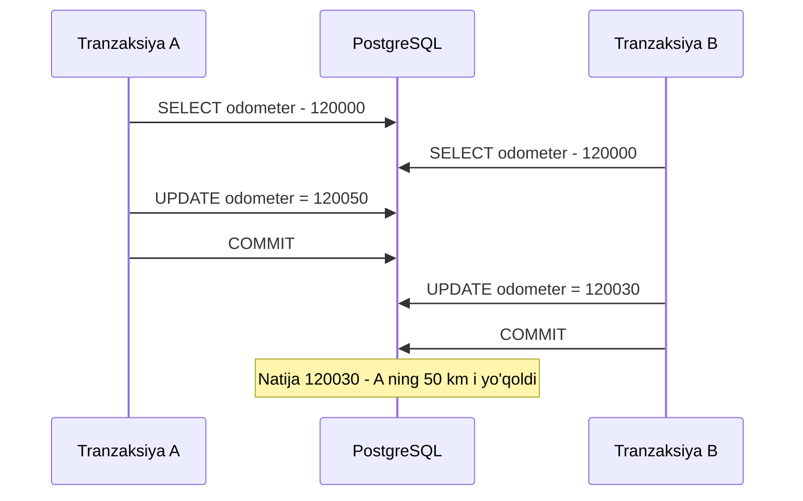
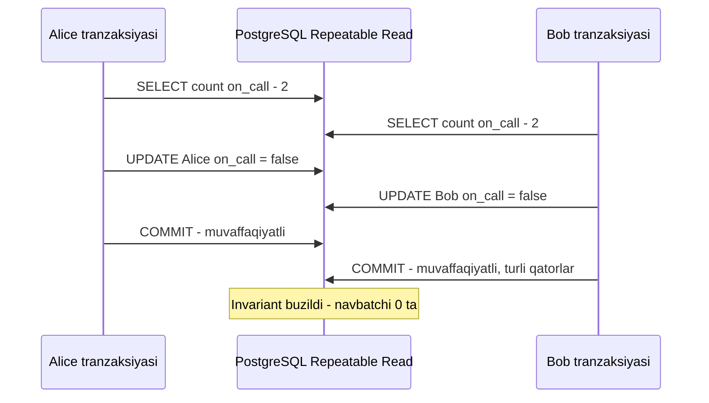
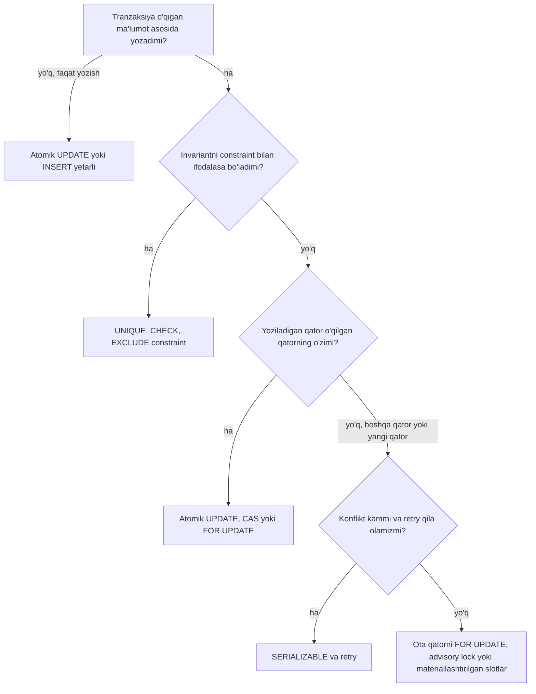

## Bu dars nima uchun kerak

17-darsda "I" - isolation - haqida qisqa gapirdik va bitta xavfli misolni ko'rdik: tranzaksiya ichida yozilgan tarif limiti tekshiruvi parallel so'rovlarda buziladi. Bu darsda shunday xatolarning to'liq "hayvonot bog'i"ni ko'ramiz: har bir anomaliya qanday paydo bo'ladi, qaysi izolyatsiya darajasi uni oldini oladi, PostgreSQL aynan nima qiladi va ilova darajasida qanday himoyalanish mumkin.

Bu nazariy mavzu emas. Concurrency xatolari testlarda deyarli chiqmaydi (bitta foydalanuvchi, ketma-ket so'rovlar), lekin production'da yuklama ostida, kamdan-kam va qayta takrorlab bo'lmaydigan tarzda chiqadi: ikki marta bron qilingan joy, manfiy qoldiq, ikki marta to'langan hisob, "yo'qolgan" yangilanish. Kleppmann ta'kidlaganidek, bunday xatolar real moliyaviy yo'qotishlar va ma'lumot buzilishiga olib kelgan.

Bu darsdan keyin siz:

- dirty read, dirty write, read skew, lost update, write skew va phantom'ni misol bilan tushuntira olasiz va ularni farqlay olasiz;
- SQL standarti darajalari va ularning PostgreSQL'dagi haqiqiy xatti-harakatini bilasiz (nega standart jadvali yetarli emasligini ham);
- Read Committed'da `UPDATE` ning qanday ishlashini (qayta baholash) va bu qachon yordam berib, qachon yordam bermasligini tushunasiz;
- har bir anomaliyaga qarshi to'g'ri vositani tanlay olasiz: atomik `UPDATE`, `FOR UPDATE`, compare-and-set, constraint, konfliktni "materiallashtirish", Serializable.

## SQL standarti va uning muammosi

SQL-92 standarti to'rtta izolyatsiya darajasini uchta "hodisa" (phenomenon) orqali ta'riflaydi:

| Daraja | Dirty read | Non-repeatable read | Phantom read |
|---|---|---|---|
| Read Uncommitted | Mumkin | Mumkin | Mumkin |
| Read Committed | Yo'q | Mumkin | Mumkin |
| Repeatable Read | Yo'q | Yo'q | Mumkin |
| Serializable | Yo'q | Yo'q | Yo'q |

1995 yilda Berenson, Bernstein, Gray, Melton va O'Neil'lar SIGMOD'da "A Critique of ANSI SQL Isolation Levels" maqolasini chop etdi. Ular ko'rsatdiki, bu ta'riflar noaniq va mavjud tizimlarni (ayniqsa qulflarga asoslangan va multiversion tizimlarni) to'g'ri tasvirlamaydi; ular yangi hodisalarni (lost update, read skew, write skew) qo'shishdi va **Snapshot Isolation**ni rasmiy ta'rifladi. Natija: bir xil nomli daraja turli bazalarda turli kafolat beradi. Masalan, Oracle'da "Serializable" aslida snapshot isolation, PostgreSQL'da "Repeatable Read" snapshot isolation va standart talab qilganidan kuchliroq.

PostgreSQL hujjatidagi haqiqiy jadval:

| PostgreSQL darajasi | Dirty read | Non-repeatable read | Phantom read | Serialization anomaly |
|---|---|---|---|---|
| Read Uncommitted | Yo'q (Read Committed kabi ishlaydi) | Mumkin | Mumkin | Mumkin |
| Read Committed (standart) | Yo'q | Mumkin | Mumkin | Mumkin |
| Repeatable Read | Yo'q | Yo'q | Yo'q | Mumkin |
| Serializable | Yo'q | Yo'q | Yo'q | Yo'q |

"Serialization anomaly" ustuni lost update va write skew kabi barcha qolgan muammolarni qamraydi. Shuning uchun quyida anomaliyalarni birma-bir ko'ramiz.

## Dirty read va dirty write

**Dirty read** - tranzaksiya boshqa tranzaksiyaning **commit qilinmagan** yozuvini ko'radi. Agar u keyin rollback qilinsa, siz hech qachon mavjud bo'lmagan ma'lumot asosida qaror qabul qilgansiz. Shuningdek, bir tranzaksiya bir nechta jadvalni yangilayotgan bo'lsa, siz yarim holatni ko'rasiz.

**Dirty write** - tranzaksiya boshqa tranzaksiyaning commit qilinmagan yozuvi **ustidan** yozadi. Kleppmann misolida: avtomobil savdosi saytida xaridor va hisob-faktura ikki jadvalda yangilanadi; ikki parallel xaridda mashina Bob'ga, hisob-faktura esa Alice'ga yozilib qolishi mumkin.

Deyarli barcha bazalar Read Committed darajasida ikkalasini ham oldini oladi:

- dirty write - qator darajasidagi yozish qulfi bilan: qatorni o'zgartirgan tranzaksiya commit yoki abort bo'lguncha boshqa yozuvchi kutadi;
- dirty read - PostgreSQL'da MVCC bilan: o'quvchi commit qilingan oxirgi versiyani ko'radi, kutmaydi (19-dars).

PostgreSQL'da Read Uncommitted ham dirty read'ga yo'l qo'ymaydi - uni tanlashning hech qanday ma'nosi yo'q.

## Read skew (non-repeatable read)

Read Committed'da har bir **buyruq** o'z snapshot'ini oladi: buyruq boshlanganda commit qilingan hamma narsani ko'radi. Bitta tranzaksiya ichidagi ikki `SELECT` turli holatlarni ko'rishi mumkin.

Misol: dispetcher hisoboti ikki so'rovdan iborat - "mashinalar ro'yxati va holati" va "holat bo'yicha jami". Ular orasida boshqa tranzaksiya mashinani "ta'mirda" holatiga o'tkazib commit qildi. Hisobotdagi ro'yxat va jami bir-biriga mos kelmaydi. Kleppmann'ning bank misoli: Alice ikki hisobi orasidagi o'tkazmaning o'rtasida ikkala hisobni o'qiydi va 100 dollar "yo'qolganini" ko'radi. Qayta yuklasa, hammasi joyida - bu vaqtinchalik nomuvofiqlik.

Qisqa interaktiv so'rovlar uchun bu ko'pincha qabul qilinadi. Lekin quyidagilar uchun qabul qilinmaydi:

- **backup va eksport** (`pg_dump` aynan shuning uchun Repeatable Read snapshot'ida ishlaydi);
- **analitik so'rovlar va integratsiya tekshiruvlari** - bir nechta jadvaldan izchil holat kerak;
- o'qilgan qiymat asosida **qaror qabul qiladigan** tranzaksiyalar.

Yechim - **snapshot isolation**: butun tranzaksiya bitta snapshot'ni ko'radi. PostgreSQL'da bu Repeatable Read. Snapshot birinchi so'rov paytida olinadi (`BEGIN` paytida emas).

## Lost update

Eng ko'p uchraydigan amaliy xato. Ikki tranzaksiya bir xil qiymatni o'qiydi, ilovada o'zgartiradi va qaytarib yozadi (**read-modify-write**). Ikkinchi yozuv birinchisini yo'qotadi.

```ts
// Ikki parallel so'rov ham odometr = 120 000 ni o'qiydi
const v = await db.selectFrom('vehicles').where('id', '=', id).select('odometer').executeTakeFirstOrThrow();
await db.updateTable('vehicles').set({ odometer: v.odometer + tripKm }).where('id', '=', id).execute();
// Natija: ikki reysdan faqat bittasining kilometri qo'shildi
```

Boshqa misollar: hisoblagichni oshirish, JSON hujjatdagi ro'yxatga element qo'shish (butun hujjatni o'qib, qayta yozish), ikki foydalanuvchining bir vaqtda bitta sozlamalar sahifasini saqlashi.



### Yechimlar

**1. Atomik operatsiya (eng yaxshi, agar mumkin bo'lsa).**

```sql
UPDATE vehicles SET odometer = odometer + 50 WHERE id = 1042;
```

Bu Read Committed'da ham xavfsiz. Sababi PostgreSQL'ning muhim mexanikasi: `UPDATE` boshqa tranzaksiya o'zgartirayotgan qatorga duch kelsa, u commit yoki rollback bo'lishini kutadi; commit bo'lsa, `UPDATE` qatorning **eng yangi versiyasi** bilan ishlaydi va `WHERE` shartini shu yangi versiya ustida **qayta baholaydi** (manba kodida EvalPlanQual deb ataladi). Shuning uchun `odometer + 50` yangi qiymatga qo'shiladi.

Hujjatlar bu mexanikaning chekkasini ham ko'rsatadi: qayta baholash faqat **shu qator** uchun. Hujjatdagi misolda `hits` ustuni 9 va 10 bo'lgan ikki qator bor; bir tranzaksiya `UPDATE website SET hits = hits + 1` qiladi, ikkinchisi parallel ravishda `DELETE FROM website WHERE hits = 10`. Natijada DELETE hech narsa o'chirmaydi, garchi `hits = 10` qatori UPDATE'dan oldin ham, keyin ham mavjud bo'lsa ham: kutgandan keyin u eski "10" qatorining yangi versiyasini ko'radi (11), boshqa qatorning yangi "10" versiyasini esa ko'rmaydi. Ya'ni Read Committed murakkab shartli so'rovlarda izchil natija bermaydi.

**2. Aniq qulf: `SELECT ... FOR UPDATE`.**

```sql
BEGIN;
SELECT odometer, last_trip_id FROM vehicles WHERE id = 1042 FOR UPDATE;
-- ilova murakkab hisob qiladi
UPDATE vehicles SET odometer = $1, last_trip_id = $2 WHERE id = 1042;
COMMIT;
```

Ikkinchi tranzaksiya `FOR UPDATE` da kutadi va birinchisi commit qilgandan keyin yangi qiymatni o'qiydi. Hisob SQL'da ifodalab bo'lmaydigan darajada murakkab bo'lsa, ishlatiladi. Narxi: qulf kutish va deadlock xavfi.

**3. Compare-and-set (optimistic locking).**

```sql
UPDATE vehicle_settings SET doc = $new, version = version + 1
WHERE vehicle_id = 1042 AND version = $old_version;
-- 0 qator yangilansa: boshqa kimdir o'zgartirgan, qayta o'qib, qayta urinish
```

Qulf ushlanmaydi, konflikt kam bo'lganda samarali. UI formalari uchun ideal ("bu yozuvni boshqa foydalanuvchi o'zgartirdi"). Read Committed'da ham ishlaydi, chunki `WHERE version = ...` eng yangi versiya ustida qayta baholanadi.

**4. Repeatable Read'da avtomatik aniqlash.** PostgreSQL Repeatable Read'da tranzaksiya o'z snapshot'idan keyin boshqa tranzaksiya o'zgartirgan qatorni yangilamoqchi bo'lsa, kutadi va u commit bo'lsa, `could not serialize access due to concurrent update` (SQLSTATE `40001`) xatosini beradi. Lost update aniqlanadi, ilova butun tranzaksiyani qayta urinishi kerak (17-dars). MySQL InnoDB'ning Repeatable Read'i esa buni aniqlamaydi - Kleppmann ham shu farqni ta'kidlaydi.

**5. Replikatsiyali tizimlarda.** Multi-leader yoki leaderless replikatsiyada qulf va CAS ishlamaydi, chunki yozuvlar turli tugunlarda parallel qabul qilinadi; u yerda konfliktlarni birlashtirish (CRDT, 40-dars) yoki "last write wins" (ma'lumot yo'qotish bilan) qo'llanadi.

## Write skew

Lost update'ning umumlashgan shakli va eng nozik anomaliya. Ikki tranzaksiya **bir xil ma'lumotni o'qiydi**, shu asosda qaror qabul qiladi va **turli** obyektlarni yangilaydi. Har biri alohida to'g'ri, birgalikda invariant buziladi. Ular turli qatorlarga yozgani uchun yozish qulflari to'qnashmaydi va snapshot isolation buni aniqlamaydi.

Kleppmann'ning klassik misoli - shifoxona navbatchiligi: smenada kamida bitta shifokor navbatchi bo'lishi kerak. Alice va Bob ikkalasi ham navbatchi, ikkalasi ham bir vaqtda "navbatdan chiqish" tugmasini bosadi:

```sql
-- Har biri o'z tranzaksiyasida:
SELECT count(*) FROM doctors WHERE on_call AND shift_id = 1234;  -- ikkalasi ham 2 ni ko'radi
-- 2 >= 2, demak chiqish mumkin
UPDATE doctors SET on_call = false WHERE name = 'Alice' AND shift_id = 1234;  -- B esa 'Bob'
COMMIT;
-- Natija: navbatchi yo'q
```

Snapshot isolation haqidagi bank misoli ham shunday: ikki hisob yig'indisi manfiy bo'lmasligi kerak; ikki parallel yechib olish har biri boshqa hisobning eski qiymatini ko'rib, ikkalasi ham o'tadi va yig'indi manfiy bo'ladi.



Write skew'ning umumiy naqshi:

1. `SELECT` biror shartga mos qatorlarni o'qiydi (yoki "yo'qligini" tekshiradi);
2. natijaga qarab ilova davom etish haqida qaror qiladi;
3. yozish amalga oshiriladi va bu yozish **1-qadamdagi so'rov natijasini o'zgartiradi**.

Real misollar:

- **Uchrashuv xonasi yoki resursni ikki marta bron qilish:** "bu vaqt oralig'ida bron bormi?" - yo'q - `INSERT`.
- **Unique username:** "bu nom bandmi?" - yo'q - `INSERT` (unique constraint bo'lmasa).
- **Ikki marta sarflash:** "balans yetarlimi?" - ha - xarajat qatorini `INSERT`.
- **Tarif limiti** (17-dars): "faol mashinalar soni limitdan kammi?" - ha - `INSERT`.
- **Multiplayer o'yin:** ikki o'yinchi bir vaqtda ikki figurani bir katakka siljitadi.

### Phantom

Yuqoridagi misollarning ko'pida 1-qadam **mavjud bo'lmagan** qatorlarni tekshiradi ("bu vaqt oralig'ida bron yo'q"), 3-qadam esa yangi qator qo'shadi. Bunda `SELECT ... FOR UPDATE` yordam bermaydi: qulflanadigan qator yo'q! Bir tranzaksiyadagi yozish boshqa tranzaksiyadagi qidiruv natijasini o'zgartirishi **phantom** deyiladi.

Muhim nozik farq: PostgreSQL Repeatable Read'da "phantom read" yo'q - bitta tranzaksiya ichida bir xil so'rovni qayta bajarsangiz, yangi qatorlarni ko'rmaysiz (snapshot). Lekin phantom tufayli kelib chiqadigan **write skew** baribir mumkin, chunki tranzaksiya boshqa tranzaksiya qo'shgan qatorni ko'rmasdan qaror qabul qiladi. Ya'ni "phantom read yo'q" degani "phantom muammosi yo'q" degani emas.

### Write skew'ga qarshi vositalar

**1. Constraint - agar ifodalash mumkin bo'lsa, eng ishonchli.**

- Unique username: `UNIQUE` indeks.
- Bron ustma-ust tushmasligi: GiST exclusion constraint (15, 17-darslar):

```sql
ALTER TABLE bookings ADD CONSTRAINT no_double_booking
  EXCLUDE USING gist (vehicle_id WITH =, tstzrange(starts_at, ends_at) WITH &&);
```

- "Har mashinada bitta faol reys": partial unique indeks.

Baza constraint'ni atomik va izolyatsiya darajasidan qat'i nazar tekshiradi. Lekin "kamida bitta navbatchi" yoki "yig'indi manfiy emas" kabi ko'p qatorli invariantlarni oddiy constraint bilan ifodalab bo'lmaydi.

**2. Qaror asosidagi qatorlarni qulflash.** Agar 1-qadamdagi qatorlar mavjud bo'lsa:

```sql
SELECT * FROM doctors WHERE on_call AND shift_id = 1234 FOR UPDATE;
```

Ikkinchi tranzaksiya kutadi va birinchisi commit qilgandan keyin hisobni qayta ko'radi. (Read Committed'da `FOR UPDATE` kutgandan keyin yangi versiyani qaytaradi; Repeatable Read'da esa qator o'zgargan bo'lsa, xato beradi.)

**3. Konfliktni materiallashtirish (materializing conflicts).** Agar tekshiriladigan narsa "qatorlar yo'qligi" bo'lsa, qulflash uchun sun'iy qatorlar yaratiladi. Masalan, mashina bron qilish uchun har bir mashina va har bir 15 daqiqalik slot uchun oldindan `slots` jadvali; bron qilishda tegishli slot qatorlari `FOR UPDATE` bilan qulflanadi. Yoki oddiyroq: "ota" qatorni qulflash - tarif limiti uchun `companies` qatorini, navbatchilik uchun `shifts` qatorini `FOR UPDATE`. Kleppmann buni oxirgi chora deb hisoblaydi: concurrency mexanikasi ma'lumot modeliga "sizib" kiradi. Agar Serializable mavjud bo'lsa, u afzal.

**4. Advisory lock.** PostgreSQL'da ilova ma'nosidagi qulf: `pg_advisory_xact_lock(hashtext('company:' || company_id))` - tranzaksiya oxirida avtomatik bo'shaydi. Konfliktni materiallashtirishning jadvalsiz varianti. Hamma yozuvchi bir xil qulfni olishi shart - aks holda himoya yo'q.

**5. Serializable izolyatsiya.** PostgreSQL'da Serializable (SSI - Serializable Snapshot Isolation, 2008 yilda Cahill, Röhm va Fekete taklif qilgan, PostgreSQL 9.1 dan beri) xavfli o'qish-yozish bog'liqliklarini kuzatadi va sikl paydo bo'lishi mumkin bo'lganda tranzaksiyalardan birini `could not serialize access due to read/write dependencies among transactions` (`40001`) bilan bekor qiladi. Ilova faqat qayta urinishni amalga oshiradi - qulflar va maxsus jadvallar kerak emas. PostgreSQL hujjatlari: agar barcha yozuvchi va izchil ko'rinish talab qiladigan tranzaksiyalar Serializable'da bo'lsa, boshqa harakat kerak emas. Ammo ogohlantirish: Serializable himoyasi hot standby va logical replica'larga tarqalmaydi. Mexanikasi 19-darsda.

## Anomaliyalar va vositalar: umumiy jadval

| Anomaliya | Misol | PostgreSQL Read Committed | PostgreSQL Repeatable Read | PostgreSQL Serializable | Amaliy vosita |
|---|---|---|---|---|---|
| Dirty write | Ikki tranzaksiya bir qatorni commit'siz yozadi | Yo'q (qator qulfi) | Yo'q | Yo'q | Avtomatik |
| Dirty read | Commit qilinmagan qiymatni ko'rish | Yo'q | Yo'q | Yo'q | Avtomatik |
| Read skew | Ikki so'rov turli holatni ko'radi | Mumkin | Yo'q | Yo'q | Repeatable Read snapshot |
| Lost update | Read-modify-write, birining yozuvi yo'qoladi | Mumkin (atomik UPDATE xavfsiz) | Aniqlanadi, 40001 | Aniqlanadi | Atomik UPDATE, FOR UPDATE, CAS |
| Write skew | Navbatchilar, balans yig'indisi | Mumkin | Mumkin | Aniqlanadi, 40001 | Constraint, FOR UPDATE, materiallashtirish, Serializable |
| Phantom write skew | Ikki marta bron, username | Mumkin | Mumkin | Aniqlanadi | Unique/exclusion constraint, Serializable |



## Qulflar: amaliy tafsilotlar

PostgreSQL'da qator darajasidagi to'rt qulf rejimi bor (kuchlisidan kuchsiziga): `FOR UPDATE`, `FOR NO KEY UPDATE`, `FOR SHARE`, `FOR KEY SHARE`. Oddiy `UPDATE` (kalit ustunini o'zgartirmasa) `FOR NO KEY UPDATE` oladi va foreign key tekshiruvlari oladigan `FOR KEY SHARE` bilan to'qnashmaydi - shuning uchun ota qatorni yangilash bola qatorlarni qo'shishni bloklamaydi. `DELETE` va kalitni o'zgartiruvchi update `FOR UPDATE` oladi. Qator qulflari xotirada saqlanmaydi (qatorning o'zida belgilanadi), shuning uchun ularning soni cheklanmagan, lekin qulflash diskka yozishga olib kelishi mumkin.

**Deadlock.** Ikki tranzaksiya bir-birining qulfini kutsa (A: 1-qator, keyin 2-qator; B: 2-qator, keyin 1-qator), PostgreSQL buni aniqlaydi (standart `deadlock_timeout` 1 soniyadan keyin tekshiradi) va ulardan birini `40P01` bilan bekor qiladi. Hujjatlar tavsiyasi: qulflarni har doim bir xil tartibda oling (masalan, ID bo'yicha o'sish tartibida), eng kuchli qulfni birinchi oling, tranzaksiyalarni qisqa saqlang va deadlock'da qayta urining.

**`NOWAIT` va `SKIP LOCKED`.** `NOWAIT` - qulfni darhol ololmasa, xato. `SKIP LOCKED` - qulflangan qatorlarni o'tkazib yuborish. Hujjatlarga ko'ra, bu nomuvofiq ko'rinish beradi va umumiy ish uchun yaroqsiz, lekin bir nechta iste'molchi navbat jadvalidan ish olishi uchun juda qulay:

```sql
SELECT id, payload FROM jobs WHERE status = 'pending'
ORDER BY id LIMIT 10 FOR UPDATE SKIP LOCKED;
```

**Upsert.** `INSERT ... ON CONFLICT DO UPDATE` hujjatlarga ko'ra, yuqori concurrency'da ham atomik "insert yoki update" natijasini kafolatlaydi - "bormi? yo'q - INSERT" naqshining to'g'ri varianti.

## Narx: qaysi darajani tanlash

| Yondashuv | Throughput | Latency | Ilova murakkabligi | Xavf |
|---|---|---|---|---|
| Read Committed + atomik operatsiyalar va constraint'lar | Eng yuqori | Past | Har bir invariant uchun o'ylash kerak | Unutilgan holat - jim xato |
| Read Committed + FOR UPDATE | O'rta (qulf kutish) | Konfliktda oshadi | O'rta, qulflar tartibi | Deadlock, uzoq kutish |
| Repeatable Read | Yuqori | Past | Retry kerak, write skew qoladi | Write skew |
| Serializable (SSI) | O'rtacha pastroq, konfliktga bog'liq | Past, retry'lar bilan | Retry freymvorki kerak | Ko'p abort yuqori konfliktda |

Kleppmann xulosasi: kuchsiz izolyatsiya darajalari performance uchun tanlangan, lekin ular nozik xatolarga olib keladi va ularni testlash juda qiyin. Serializable'ning narxi ko'p yuklamalarda kutilganidan kichik; uning asosiy talabi - ilova `40001` ni ushlab, tranzaksiyani qayta urinishi.

Amaliy strategiya: standart Read Committed, lekin **invariant tekshiradigan** kod yo'llari (pul, limitlar, bronlar, inventar) yoki constraint bilan, yoki Serializable tranzaksiyada, umumiy retry o'rami bilan.

## Real tizimlar

- **PostgreSQL**: Read Committed standart; Repeatable Read = snapshot isolation + lost update aniqlash; Serializable = SSI.
- **MySQL InnoDB**: standart Repeatable Read. Hujjatlarga ko'ra, oddiy `SELECT` tranzaksiyadagi birinchi o'qish snapshot'idan o'qiydi, lekin bu snapshot DML'ga tegishli emas: `UPDATE`/`DELETE` boshqa tranzaksiya yaqinda commit qilgan, `SELECT` ko'rmaydigan qatorlarga ham ta'sir qilishi mumkin. Phantom'larga qarshi locking read'larda next-key locking (indeks yozuvi qulfi + undan oldingi "bo'shliq" qulfi) ishlatiladi - bu "biror narsaning yo'qligini qulflash" imkonini beradi. PostgreSQL Repeatable Read'idan farqli, lost update `40001` bilan aniqlanmaydi.
- **Oracle**: "Serializable" deb ataladigan daraja aslida snapshot isolation - write skew mumkin.
- **CockroachDB**: standart Serializable.
- Saboq: hujjatdagi daraja **nomiga** emas, uning aniq tavsifiga va tekshirilgan xatti-harakatga ishoning (Jepsen kabi mustaqil testlar shu maqsadda mavjud, 33-dars).

## iQuariX kontekstida qo'llanish

Faraz qiling, quyidagi stsenariylar bor:

**1. Mashinani haydovchiga biriktirish.** Ikki dispetcher bir vaqtda bitta bo'sh mashinani turli haydovchilarga biriktiradi. "Mashina band emasmi?" - phantom write skew. Yechim: `shifts` jadvalida `EXCLUDE USING gist (vehicle_id WITH =, tstzrange(...) WITH &&)` - baza darajasida ustma-ust tushish mumkin emas. Ikkinchi dispetcher aniq xato oladi.

**2. Yoqilg'i limiti.** Haydovchining kunlik limiti 100 litr; ikki karta bir vaqtda 60 litrdan so'raydi. Agar har bir to'lov alohida `fuel_transactions` qatori va limit "yig'indi" sifatida hisoblansa - write skew (bank misoli). Variantlar:

- `driver_daily_limits(driver_id, day, remaining_l)` qatori va atomik `UPDATE ... SET remaining_l = remaining_l - 60 WHERE driver_id = $1 AND day = $2 AND remaining_l >= 60` - 0 qator yangilansa, rad etish. Bu lost update va write skew'ni bitta qator ustidagi atomik operatsiyaga aylantiradi (konfliktni materiallashtirish + atomik update).
- Yoki Serializable tranzaksiya va retry.

**3. Geofence holati.** Telemetriya worker'i mashina geofence'dan chiqqanini aniqlab, `vehicle_geofence_state` ni yangilaydi va ogohlantirish yaratadi. Bir mashinaning nuqtalari ikki worker'ga tushsa, ikkala worker ham "ichkarida" holatini o'qib, ikkalasi ham "chiqdi" ogohlantirishini yaratishi mumkin (lost update + dublikat). Yechim arxitektura darajasida: bir mashinaning hodisalarini bitta partition/worker'ga yo'naltirish (43-dars) va ogohlantirishga `(vehicle_id, geofence_id, event_ts)` unique constraint. Concurrency muammosini ba'zan baza emas, **yo'naltirish** yaxshiroq hal qiladi.

**4. Sozlamalar formasi.** Ikki administrator mijoz sozlamalarini (katta `jsonb`) bir vaqtda tahrirlaydi. Compare-and-set `version` ustuni bilan; konfliktda UI "boshqa foydalanuvchi o'zgartirdi" ko'rsatadi.

**5. Hisobot.** Oylik hisobot 6 ta so'rovdan iborat (reyslar, yoqilg'i, jarimalar, jami). Read Committed'da read skew - jami va tafsilotlar mos kelmasligi mumkin. Yechim: `BEGIN ISOLATION LEVEL REPEATABLE READ READ ONLY` (yoki replikada hisob, 16-dars).

## Ko'p uchraydigan xatolar

1. **ORM'da read-modify-write.** `entity.count += 1; save()` - klassik lost update. Atomik `increment` yoki CAS ishlating.
2. **"Tekshirib, keyin qo'shish" naqshi constraint'siz.** `findFirst` keyin `create` - ikki marta bron, dublikat username. Unique/exclusion constraint qo'ying va xatoni ushlang yoki `ON CONFLICT`.
3. **Repeatable Read write skew'dan himoya qiladi deb o'ylash.** Faqat Serializable yoki aniq qulf/constraint.
4. **`FOR UPDATE` bilan mavjud bo'lmagan qatorni himoya qilishga urinish.** Phantom'ga qarshi ishlamaydi - ota qatorni, slotni yoki advisory lock'ni qulflang.
5. **Serializable yoqib, retry yozmaslik.** `40001` foydalanuvchiga 500 xato sifatida qaytadi.
6. **Qulflarni turli tartibda olish.** Deadlock'lar yuklama ostida paydo bo'ladi.
7. **Daraja nomiga ishonish.** "Serializable" Oracle'da snapshot isolation; "Repeatable Read" MySQL va PostgreSQL'da turlicha.
8. **Concurrency xatolarini faqat bazada hal qilishga urinish.** Ba'zan bitta kalit bo'yicha hodisalarni bitta worker'ga yo'naltirish ancha soddaroq.

## Xulosa

- SQL standarti darajalari noaniq; Berenson va boshq. (1995) lost update, read skew, write skew va snapshot isolation'ni aniq ta'rifladi. Bazalar bir xil nom ostida turli kafolat beradi.
- PostgreSQL: Read Committed (har buyruq o'z snapshot'i), Repeatable Read (snapshot isolation, lost update aniqlanadi), Serializable (SSI, write skew ham aniqlanadi).
- Read Committed'da `UPDATE` qatorning eng yangi versiyasi ustida `WHERE` ni qayta baholaydi - atomik `x = x + 1` xavfsiz, ilovadagi read-modify-write esa yo'q.
- Lost update: atomik operatsiya, `FOR UPDATE`, compare-and-set yoki Repeatable Read'dagi aniqlash.
- Write skew va phantom: o'qish asosida qaror va boshqa qatorga yozish. Himoya: constraint (unique, exclusion), ota qatorni qulflash, konfliktni materiallashtirish, advisory lock yoki Serializable.
- Deadlock'larning oldini olish uchun qulflarni bir xil tartibda oling; `40001` va `40P01` uchun umumiy retry o'rami yozing.

## Amaliy topshiriq

iQuariX'da **texnik xizmat (servis) bron qilish** moduli bor deb faraz qiling. Mijozlar o'z mashinalarini hamkor servis markazlariga yozadi. Qoidalar: (a) servis markazida bir vaqtda ko'tarma (lift) soni chegaralangan (masalan, 4 ta) - har bir 30 daqiqalik slotda 4 tadan ko'p bron bo'lmasin; (b) bitta mashina bir vaqtda ikki joyga yozilmasin; (c) mijozning oylik servis byudjeti (so'mda) oshmasin; (d) bron bekor qilinsa, slot bo'shaydi. Cho'qqida bir slotga bir necha soniya ichida 10 tagacha so'rov keladi.

1. Har bir qoida uchun qaysi anomaliya (lost update, write skew, phantom) xavfi borligini aniqlang va misol ketma-ketlik bilan ko'rsating.
2. (b) qoidasini baza constraint'i bilan ifodalang (SQL yozing).
3. (a) qoidasi uchun kamida ikki yechimni taklif qiling: biri Read Committed'da (materiallashtirish yoki atomik hisoblagich), biri Serializable'da. Har birida 10 ta parallel so'rovda nima bo'lishini tushuntiring (nechta muvaffaqiyatli, qolganlari qanday xato oladi).
4. (c) qoidasi uchun yechim tanlang va nega shuni tanlaganingizni yozing.
5. Deadlock bo'lishi mumkin bo'lgan stsenariyni toping (masalan, bitta tranzaksiyada slot va byudjet qulflari) va uning oldini olish qoidasini yozing.
6. Retry o'rami (TypeScript psevdokod) yozing: qaysi SQLSTATE kodlarida, necha marta, qanday backoff bilan.

Yaxshi javobda bo'lishi kerak bo'lgan narsalar:

- (b) uchun `EXCLUDE USING gist` va `tstzrange`;
- (a) uchun "slot qatori + atomik `UPDATE ... WHERE booked < capacity`" yoki "slot qatorini `FOR UPDATE`" varianti va ularning qulf kutish narxi;
- Serializable variantida `40001` va to'liq tranzaksiya retry'i;
- qulflarni barqaror tartibda olish qoidasi;
- retry faqat vaqtinchalik xatolarda (`40001`, `40P01`), chegaralangan, jitter bilan.

Javobni pastdagi maydonga yozib, chatga yuboring.

## Manbalar

- Martin Kleppmann, Chris Riccomini. [Designing Data-Intensive Applications, 2-nashr](https://www.oreilly.com/library/view/designing-data-intensive-applications/9781098119058/), O'Reilly, 2026. 8-bob "Transactions" - weak isolation levels, lost update, write skew, phantom, materializing conflicts.
- Hal Berenson va boshq. [A Critique of ANSI SQL Isolation Levels](https://arxiv.org/abs/cs/0701157), ACM SIGMOD 1995.
- PostgreSQL hujjatlari: [Transaction Isolation](https://www.postgresql.org/docs/current/transaction-iso.html) (darajalar jadvali, Read Committed'dagi qayta baholash, `website` misoli), [Data Consistency Checks at the Application Level](https://www.postgresql.org/docs/current/applevel-consistency.html), [Explicit Locking](https://www.postgresql.org/docs/current/explicit-locking.html) (qator qulflari, deadlock, advisory lock).
- PostgreSQL hujjatlari: [SELECT - Locking Clause](https://www.postgresql.org/docs/current/sql-select.html) (`NOWAIT`, `SKIP LOCKED`), [INSERT - ON CONFLICT](https://www.postgresql.org/docs/current/sql-insert.html).
- MySQL 8.4 hujjatlari: [Consistent Nonlocking Reads](https://dev.mysql.com/doc/refman/8.4/en/innodb-consistent-read.html), [Phantom Rows (next-key locking)](https://dev.mysql.com/doc/refman/8.4/en/innodb-next-key-locking.html).
- [Snapshot isolation](https://en.wikipedia.org/wiki/Snapshot_isolation) - write skew misoli, Cahill, Röhm, Fekete (SIGMOD 2008) va PostgreSQL 9.1.
- Alex Petrov. [Database Internals](https://www.oreilly.com/library/view/database-internals/9781492040330/), O'Reilly, 2019. 5-bob "Transaction Processing and Recovery" - izolyatsiya darajalari va anomaliyalar.
