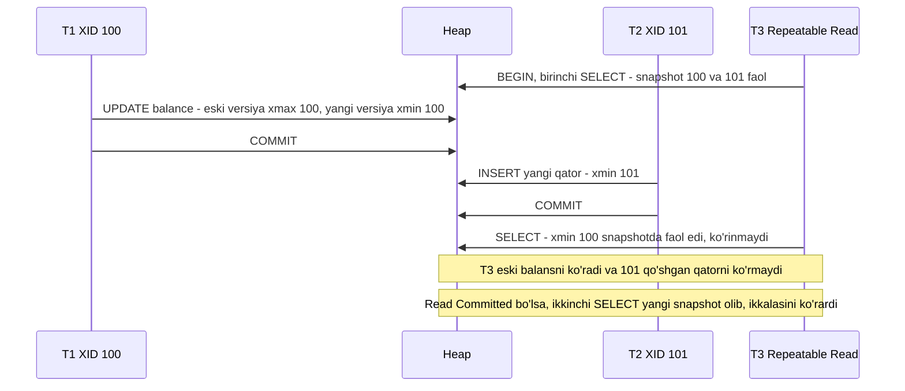
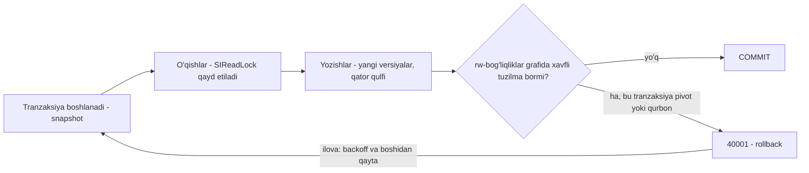

## Bu dars nima uchun kerak

18-darsda biz **nima** buzilishi mumkinligini ko'rdik: lost update, read skew, write skew, phantom. Bu darsda **qanday** ishlashini ko'ramiz: baza snapshot'ni qanday yaratadi, nega PostgreSQL'da o'quvchi yozuvchini kutmaydi, Serializable qanday qilib write skew'ni ushlaydi va bularning hammasi uchun qanday narx to'lanadi.

PostgreSQL bilan ishlaydigan muhandis uchun bu dars ayniqsa amaliy: jadval shishishi (bloat), `autovacuum` sozlamalari, "idle in transaction" sessiyalarning zarari, transaction ID wraparound xavfi va replikadagi uzoq so'rovlar - hammasi MVCC mexanikasining bevosita oqibatlari. Ularni tushunmasdan PostgreSQL'ni katta yuklamada ishlatish - qorong'ida haydash.

Bu darsdan keyin siz:

- PostgreSQL'da qator versiyalari (`xmin`, `xmax`, `ctid`), snapshot (`xmin:xmax:xip_list`) va ko'rinuvchanlik qoidalarini bosqichma-bosqich tushuntira olasiz;
- Read Committed va Repeatable Read snapshot'larining farqini mexanika darajasida bilasiz;
- vacuum, bloat, freeze va XID wraparound'ni, ularni nima to'xtatib qo'yishini va qanday kuzatishni bilasiz;
- PostgreSQL MVCC'ni InnoDB'ning undo-log yondashuvi bilan solishtira olasiz (va Uber 2016 misolini tushunasiz);
- Serializable'ning uch yo'lini - haqiqiy ketma-ket bajarish, 2PL va SSI - va ularning trade-off'larini bilasiz.

## MVCC g'oyasi

Eng sodda izolyatsiya - qulflar: o'quvchi shared lock oladi, yozuvchi exclusive lock. Lekin unda uzoq hisobot so'rovi butun jadvaldagi yozishlarni to'xtatadi, yozuvchi esa o'quvchilarni.

**MVCC** (Multi-Version Concurrency Control) boshqa yo'ldan boradi: baza har bir qatorning **bir nechta versiyasini** saqlaydi. Har bir tranzaksiya ma'lum bir vaqt momentidagi izchil holatni - **snapshot**ni - ko'radi. Yozuvchi eski versiyani o'chirmaydi, yangisini yaratadi; o'quvchi o'z snapshot'iga mos versiyani tanlaydi.

PostgreSQL hujjatlari asosiy afzallikni shunday ifodalaydi: MVCC'da o'qish uchun olingan qulflar yozish qulflari bilan to'qnashmaydi, ya'ni **o'qish hech qachon yozishni bloklamaydi va yozish hech qachon o'qishni bloklamaydi**, va PostgreSQL bu kafolatni eng qat'iy Serializable darajasida ham saqlaydi.

Yozuvchilar o'zaro baribir qator qulflari bilan to'qnashadi (18-dars: dirty write'ning oldini olish).

## PostgreSQL'da qator versiyalari

14-darsda heap tuple header'ini (23 bayt) eslatgan edik. MVCC uchun uning asosiy maydonlari:

- **`xmin`** - bu versiyani yaratgan (INSERT yoki UPDATE) tranzaksiya ID'si (XID);
- **`xmax`** - bu versiyani o'chirgan yoki yangilagan tranzaksiya ID'si (0 bo'lsa - hali "tirik"); qator qulflanganda ham shu yerga qulflovchi yoziladi;
- **`t_ctid`** - "bu yoki undan yangi versiyaning joriy TID'i": update'da eski versiya yangisiga ishora qiladi, shu bilan versiyalar zanjiri hosil bo'ladi;
- **`t_infomask`** - holat bitlari.

Operatsiyalar:

- **INSERT:** yangi versiya, `xmin = joriy XID`, `xmax = 0`.
- **DELETE:** mavjud versiyada `xmax = joriy XID`. Qator jismonan o'chirilmaydi.
- **UPDATE:** = DELETE + INSERT. Eski versiyada `xmax` o'rnatiladi va `ctid` yangisiga yo'naltiriladi; yangi versiya `xmin = joriy XID` bilan boshqa joyga (iloji bo'lsa shu sahifaga - HOT, 14-dars) yoziladi.

Buni o'zingiz ko'rishingiz mumkin - yashirin tizim ustunlari:

```sql
CREATE TABLE demo (id int PRIMARY KEY, v int);
INSERT INTO demo VALUES (1, 10);
SELECT ctid, xmin, xmax, * FROM demo;    -- (0,1) | 1001 | 0 | 1 | 10
UPDATE demo SET v = 11 WHERE id = 1;
SELECT ctid, xmin, xmax, * FROM demo;    -- (0,2) | 1002 | 0 | 1 | 11
-- (0,1) dagi eski versiya hali sahifada, xmax = 1002, lekin ko'rinmaydi
```

### Tranzaksiya holati: pg_xact

Versiyaning `xmin` va `xmax` i faqat XID raqami. U tranzaksiya commit bo'lganmi, bekor qilinganmi yoki hali davom etyaptimi - bu alohida joyda, **commit log**da (`pg_xact` katalogi, har bir tranzaksiya uchun 2 bit) saqlanadi. Har bir ko'rinuvchanlik tekshiruvida `pg_xact` ga murojaat qilmaslik uchun, PostgreSQL birinchi tekshiruvdan keyin natijani qatorning `t_infomask` bitlariga **hint bit** sifatida yozib qo'yadi (masalan, "xmin commit qilingan"). Shu sabab katta yuklamadan keyingi birinchi `SELECT` ham sahifalarni "iflos" qilib, diskka yozishga olib kelishi mumkin - bu kutilmagan, lekin normal hodisa.

17-darsda aytilgan "rollback arzon" aynan shundan: rollback faqat `pg_xact` dagi holatni "aborted" qiladi; o'sha tranzaksiya yaratgan versiyalar avtomatik ko'rinmas bo'ladi va keyin vacuum ularni tozalaydi.

## Snapshot va ko'rinuvchanlik qoidalari

PostgreSQL snapshot'i uchta qismdan iborat (`pg_current_snapshot()` uni `xmin:xmax:xip_list` ko'rinishida qaytaradi):

- **xmin** - hali faol bo'lgan eng kichik XID. Undan kichik barcha XID'lar tugagan (commit yoki rollback).
- **xmax** - tugagan eng katta XID'dan bitta ortiq. Undan katta yoki teng barcha XID'lar snapshot paytida tugamagan - ko'rinmaydi.
- **xip_list** - snapshot paytida davom etayotgan tranzaksiyalar ro'yxati.

Hujjatdagi misol: `10:20:10,14,15` - 10, 14, 15 davom etmoqda; 11-13 va 16-19 tugagan; 20 va undan kattalari kelajak.

Versiya snapshot'ga **ko'rinadi**, agar:

1. `xmin` tranzaksiyasi snapshot uchun "tugagan" (xmin < snapshot.xmax va xip_list'da yo'q) **va** commit qilingan (pg_xact yoki hint bit bo'yicha); yoki `xmin` - joriy tranzaksiyaning o'zi;
2. **va** `xmax` yoki 0, yoki snapshot uchun tugamagan, yoki bekor qilingan tranzaksiya (ya'ni o'chirish snapshot uchun hali "sodir bo'lmagan").

Bir misolda ko'ramiz:



### Read Committed va Repeatable Read farqi - bitta qatorda

- **Read Committed:** har bir **buyruq** boshida yangi snapshot.
- **Repeatable Read:** tranzaksiyadagi **birinchi** buyruqda snapshot olinadi va oxirigacha o'sha snapshot ishlatiladi.

Qolgan farqlar shundan kelib chiqadi. Repeatable Read'da tranzaksiya o'z snapshot'idan keyin boshqa tranzaksiya o'zgartirgan qatorni yangilamoqchi bo'lsa, "eng yangi versiya ustida qayta baholash" (Read Committed'dagi kabi) snapshot'ni buzgan bo'lardi - shuning uchun PostgreSQL bu holda `40001` beradi. Lost update aniqlanishi (18-dars) shu mexanikadan keladi.

### Indekslar va MVCC

PostgreSQL indeks yozuvlarida `xmin`/`xmax` yo'q. Indeks har bir versiyaga alohida ishora qiladi (HOT bo'lmasa), ko'rinuvchanlik esa heap'da tekshiriladi. Shuning uchun:

- HOT bo'lmagan har bir UPDATE har bir indeksga yangi yozuv qo'shadi (14-dars, write amplification);
- index-only scan heap'ga bormaslik uchun visibility map'ga tayanadi (15-dars);
- o'lik versiyalarga ishora qiluvchi indeks yozuvlari ham vacuum bilan tozalanishi kerak.

## Vacuum: MVCC'ning narxi

Eski versiyalar o'z-o'zidan yo'qolmaydi. **VACUUM** ularni tozalaydi. Hujjatlar vacuum'ning to'rt vazifasini sanaydi:

1. **O'lik versiyalar egallagan joyni qayta foydalanishga ochish.** Oddiy `VACUUM` joyni odatda OS'ga qaytarmaydi, faqat jadval ichida qayta ishlatishga beradi.
2. **Planner statistikasini yangilash** (`ANALYZE` qismi).
3. **Visibility map'ni yangilash** - index-only scan va keyingi vacuum'lar uchun.
4. **XID wraparound'dan himoya** - freeze.

### Qaysi versiya "o'lik"

Versiya faqat **hech bir faol snapshot** uni ko'ra olmasa o'chirilishi mumkin. Ya'ni vacuum chegarasi - tizimdagi eng eski hali kerak snapshot (**xmin horizon**). Uni orqaga ushlab turadiganlar:

- uzoq davom etayotgan tranzaksiya yoki so'rov (masalan, 2 soatlik hisobot);
- `idle in transaction` sessiya (17-dars);
- unutilgan prepared transaction (`PREPARE TRANSACTION`, 17-dars);
- replikatsiya sloti yoki `hot_standby_feedback = on` bilan replikadagi uzoq so'rov (26-dars);
- logical replication slot'ining iste'molchisi to'xtab qolsa.

Bularning birortasi bo'lsa, butun klaster bo'ylab o'lik versiyalar to'planadi - **bloat**. Natija: jadval va indekslar o'sadi, cache samaradorligi tushadi, skanlar sekinlashadi, index-only scan ishlamaydi.

### Autovacuum qachon ishga tushadi

Hujjatdagi formula: vacuum chegarasi = min(`autovacuum_vacuum_max_threshold`, `autovacuum_vacuum_threshold` + `autovacuum_vacuum_scale_factor` × qatorlar soni). Standart qiymatlar: threshold **50**, scale factor **0.2**, max threshold **100 mln** (bu yuqori chegara PostgreSQL 18 da qo'shilgan). Faqat insert bo'ladigan jadvallar uchun alohida chegaralar bor (`autovacuum_vacuum_insert_threshold` 1 000, scale factor 0.2) - ular freeze va visibility map uchun kerak.

Hisob: 500 mln qatorli `positions` jadvali. Standart sozlamalarda 50 + 0.2 × 500 mln = 100 mln o'lik qator - bu PostgreSQL 18 dagi yuqori chegaraga teng. Ya'ni 100 mln o'lik qator to'plangunga qadar autovacuum boshlanmaydi. 100 baytlik qatorlar bilan bu taxminan 10 GB "o'lik" ma'lumot. Katta jadvallar uchun per-table sozlash odatiy:

```sql
ALTER TABLE vehicles SET (autovacuum_vacuum_scale_factor = 0.01, autovacuum_vacuum_threshold = 1000);
```

Autovacuum standart holda sekinlashtirilgan (`autovacuum_vacuum_cost_limit` 200, `autovacuum_vacuum_cost_delay` 2 ms) va ishchilar soni `autovacuum_max_workers` = 3. Katta, ko'p yoziladigan bazada bu ko'pincha kam - vacuum yozish tezligiga yetib ololmaydi.

`VACUUM FULL` jadvalni yangi faylga to'liq qayta yozadi va joyni OS'ga qaytaradi, lekin `ACCESS EXCLUSIVE` qulf oladi (jadval to'liq bloklanadi) va qo'shimcha disk joyi talab qiladi. Hujjatlar muntazam oddiy vacuum'ni afzal ko'radi. Online alternativalar: `pg_repack` kengaytmasi; PostgreSQL 19 da `REPACK (CONCURRENTLY)`.

### XID wraparound va freeze

Tranzaksiya ID'lari **32 bitli**. Taqqoslash modul 2³² bo'yicha: har bir XID uchun taxminan 2 mlrd "o'tmish" va 2 mlrd "kelajak" bor. Agar qator `xmin` i 2 mlrd tranzaksiyadan eski bo'lib qolsa, u to'satdan "kelajakdan" bo'lib, ko'rinmay qoladi - ma'lumot yo'qolgandek.

Himoya - **freeze**: vacuum yetarlicha eski versiyalarni "muzlatilgan" deb belgilaydi; muzlatilgan versiya har qanday snapshot uchun "o'tmishda" hisoblanadi. Hujjatlarga ko'ra, har bir jadval kamida har 2 mlrd tranzaksiyada bir marta vacuum qilinishi kerak.

Sozlamalar va standart qiymatlar:

- `vacuum_freeze_min_age` = **50 mln** - shundan eski XID'li qatorlar muzlatiladi;
- `vacuum_freeze_table_age` = **150 mln** - shu yoshdan keyin vacuum "agressiv" bo'lib, butun jadvalni ko'radi;
- `autovacuum_freeze_max_age` = **200 mln** - shu yoshda autovacuum, hatto o'chirilgan bo'lsa ham, majburan ishga tushadi;
- `vacuum_failsafe_age` = **1.6 mlrd** - favqulodda rejim: vacuum sekinlashtirishni o'chirib, faqat freeze bilan shug'ullanadi.

Agar baribir chegara yaqinlashsa: wraparound'gacha taxminan 40 mln tranzaksiya qolganda ogohlantirishlar boshlanadi; 3 mln dan kam qolganda PostgreSQL **yangi XID berishdan bosh tortadi** - faqat read-only tranzaksiyalar ishlaydi. Bu to'liq yozish uzilishi. Hujjatlar bunday holatda avval eski prepared tranzaksiyalarni hal qilish, uzoq tranzaksiyalarni tugatish, eskirgan replication slot'larni o'chirish, keyin vacuum qilishni maslahat beradi.

Kuzatish (har bir production monitoringda bo'lishi kerak):

```sql
SELECT datname, age(datfrozenxid) FROM pg_database ORDER BY 2 DESC;
SELECT relname, age(relfrozenxid), n_dead_tup, last_autovacuum
FROM pg_stat_user_tables JOIN pg_class USING (relname) ORDER BY 2 DESC LIMIT 20;
```

Hisob: soniyasiga 2 000 yozuvchi tranzaksiya. 200 mln ga yetish: 200 × 10⁶ / 2 000 = 100 000 s ≈ **28 soat**. Ya'ni bunday bazada majburiy anti-wraparound vacuum har kuni ishlaydi. 2 mlrd chegaraga: taxminan 11.5 kun. Agar bitta "osilib qolgan" tranzaksiya vacuum'ni 2 hafta to'xtatsa - baza yozishni to'xtatadi. Telemetriyani partiyalab yozish (17-dars) XID iste'molini ham kamaytiradi: 1 000 nuqta bitta tranzaksiyada - bitta XID.

(Bitta qo'shimcha nozik joy: qator qulflari bir nechta tranzaksiyaga tegishli bo'lsa, MultiXact ID'lar ishlatiladi; ularning ham alohida wraparound va freeze sozlamalari bor.)

## InnoDB MVCC: boshqa yo'l

MySQL InnoDB ham MVCC, lekin versiyalarni boshqacha saqlaydi:

- har bir qatorda yashirin `DB_TRX_ID` (oxirgi o'zgartirgan tranzaksiya, 6 bayt) va `DB_ROLL_PTR` (undo log yozuviga ko'rsatkich, 7 bayt);
- UPDATE qatorni **joyida** o'zgartiradi, eski qiymat **undo log**ga yoziladi;
- eski snapshot'ga kerak bo'lgan o'quvchi qatorning undo zanjiri bo'yicha orqaga yurib, kerakli versiyani tiklaydi;
- **purge** jarayoni hech bir snapshot'ga kerak bo'lmagan undo yozuvlarini va o'chirilgan qatorlarni tozalaydi;
- secondary indeks yozuvlari joyida yangilanmaydi: eski yozuv "delete-marked" bo'ladi, yangisi qo'shiladi, keyin purge.

| Xususiyat | PostgreSQL (append, heap ichida) | InnoDB (in-place + undo) |
|---|---|---|
| Eski versiya qayerda | Heap'da, yangi versiya yonida | Undo log'da |
| UPDATE narxi | Yangi tuple; HOT bo'lmasa barcha indekslarga yozuv | Joyida; faqat o'zgargan ustunli secondary indekslar |
| Eski snapshot o'qishi | Versiyani heap'dan topadi | Undo zanjiri bo'yicha tiklaydi (uzun zanjirda sekin) |
| Rollback | Arzon (holat belgisi) | Undo'ni qo'llash kerak (katta tranzaksiyada qimmat) |
| Tozalash | VACUUM (heap va indekslar) | Purge (undo va delete-mark) |
| Uzoq tranzaksiya zarari | Heap va indeks bloat | Undo tablespace o'sishi, purge orqada qoladi |

### Uber 2016

Uber 2016 yilda PostgreSQL'dan MySQL'ga o'tishni asoslab blog yozgan. Ularning asosiy argumentlari aynan shu jadvaldan: PostgreSQL indekslari jismoniy manzilga (ctid) ishora qilgani uchun har bir update barcha indekslarni yangilaydi (write amplification); fizik WAL replikatsiyasi hajmli, ayniqsa data-markazlar orasida; replikadagi uzoq o'qishlar WAL qo'llanishini to'xtatadi; fizik replikatsiya major versiyalar orasida ishlamagani uchun upgrade qiyin. Bu post katta munozaraga sabab bo'lgan va ba'zi argumentlar o'z yuklamasiga xos edi; shuningdek o'shandan beri PostgreSQL'da ko'p narsa yaxshilangan (logical replication, bottom-up index deletion va boshqalar). Lekin saboq qoladi: **MVCC'ni amalga oshirish usuli yuklama shakliga qarab real narx keltiradi**. Ko'p indeksli, tez-tez yangilanadigan keng jadval - PostgreSQL uchun eng og'ir holat.

## Serializable'ga uch yo'l

18-darsda ko'rdik: snapshot isolation write skew'ga yo'l qo'yadi. To'liq serializability uchun Kleppmann uchta yondashuvni ajratadi.

### 1. Haqiqiy ketma-ket bajarish

Eng to'g'ridan-to'g'ri yo'l: tranzaksiyalarni **bitta thread'da**, birin-ketin bajarish. Concurrency yo'q - anomaliyalar ham yo'q. Bu faqat quyidagi shartlarda ishlaydi:

- ma'lumot (asosan) RAM'da - disk kutish yo'q;
- tranzaksiyalar juda qisqa va interaktiv emas - butun tranzaksiya bitta so'rovda yuboriladi (stored procedure, skript);
- yozish throughput'i bitta CPU yadrosiga sig'adi yoki ma'lumot shunday partitionlanganki, ko'p tranzaksiya bitta partition ichida.

Misollar: VoltDB/H-Store, Datomic, Redis (bitta thread'li buyruq bajarish, Lua skriptlari va `MULTI/EXEC` ketma-ket bajariladi). Tranzaksiya ichida tarmoq so'rovi yoki foydalanuvchi kutish bo'lmasligi shart.

### 2. Two-Phase Locking (2PL)

Taxminan 30 yil davomida Serializable'ning yagona keng tarqalgan algoritmi. Qoidalar:

- o'qish uchun **shared** qulf, yozish uchun **exclusive** qulf;
- bir nechta o'quvchi shared qulfni birga ushlay oladi, lekin exclusive qulf bo'lsa, hamma kutadi; yozuvchi esa barcha o'quvchilar tugashini kutadi;
- "ikki faza": tranzaksiya avval qulflarni **faqat oladi** (o'sish fazasi), keyin **faqat bo'shatadi** (qisqarish fazasi). Amalda **strict 2PL**: barcha qulflar commit yoki abort'gacha ushlab turiladi.

MVCC'dan asosiy farq: 2PL'da **o'quvchilar yozuvchilarni bloklaydi va aksincha**.

**Phantom'larga qarshi** 2PL'ga qatorlarning o'zigina emas, **qidiruv shartlari** ham qulflanishi kerak: **predicate lock** ("`vehicle_id = 7` va vaqt oralig'i 10:00-12:00 bo'lgan barcha qatorlar, hatto hali mavjud bo'lmaganlar ham"). Predicate lock'larni tekshirish qimmat, shuning uchun amalda **index-range lock** (next-key lock) - indeksning bir oralig'ini qulflash: biroz kengroq, lekin arzon yaqinlashuv. 18-darsda ko'rgan InnoDB next-key locking aynan shu.

2PL'ning narxi: past throughput va ayniqsa **bashorat qilib bo'lmaydigan latency** - bitta sekin tranzaksiya qulflar zanjiri orqali boshqalarini to'xtatadi; deadlock'lar tez-tez bo'ladi va qayta urinish ishni yo'qotadi.

### 3. Serializable Snapshot Isolation (SSI)

Michael Cahill, Uwe Röhm va Alan Fekete 2008 yilda SIGMOD'da taqdim etgan algoritm (eng yaxshi maqola mukofoti); PostgreSQL uni 9.1 versiyadan beri Serializable darajasi sifatida ishlatadi.

G'oya: snapshot isolation ustiga **optimistik** tekshiruv qo'shish. Tranzaksiyalar bloklanmasdan, o'z snapshot'ida ishlaydi; commit paytida (va jarayon davomida) baza "bu tranzaksiya o'qigan narsa asosidagi qaror eskirib qolmadimi?" ni tekshiradi.

SSI ikki holatni kuzatadi:

1. **Eskirgan MVCC o'qish:** tranzaksiya snapshot paytida commit qilinmagan yozuvni e'tiborsiz qoldirdi, lekin o'sha yozuv keyin commit bo'ldi.
2. **O'qishdan keyingi yozish:** tranzaksiya biror ma'lumotni o'qigandan keyin boshqa tranzaksiya uni o'zgartirdi.

Ikkalasi ham **read-write bog'liqlik** (rw-antidependency): "T1 o'qidi, T2 o'zgartirdi, T1 buni ko'rmadi - demak ketma-ket tartibda T1 T2 dan oldin". Bunday bog'liqliklar grafida sikl - serializability buzilishi. Nazariya ko'rsatadiki, snapshot isolation'da har bir sikl ketma-ket ikkita rw-bog'liqlikni o'z ichiga oladi (o'rtadagi tranzaksiya - "pivot"). PostgreSQL shu "xavfli tuzilma"ni aniqlaganda tranzaksiyalardan birini bekor qiladi.

PostgreSQL'dagi amalga oshirish:

- **SIReadLock** - predicate lock'lar, `pg_locks` da `mode = 'SIReadLock'` sifatida ko'rinadi. Ular haqiqatda o'qilgan ma'lumotga asoslanadi (qator, sahifa yoki butun jadval darajasida). Muhim: ular **hech qanday bloklashga olib kelmaydi** va deadlock'da qatnashmaydi - faqat konfliktni qayd qiladi.
- Seq scan butun jadval darajasidagi predicate lock oladi - har qanday parallel yozish bilan konflikt. Shuning uchun Serializable'da indeksli skanlar konfliktlarni kamaytiradi.
- Xotirani tejash uchun ko'p qator qulflari sahifa, keyin jadval qulfiga **birlashtiriladi** (granularity promotion) - bu ko'proq soxta konflikt (false positive) beradi. Sozlamalar: `max_pred_locks_per_transaction`, `max_pred_locks_per_relation`, `max_pred_locks_per_page`.
- Bekor qilish xavfsiz progress'ni kafolatlaydi: PostgreSQL wiki'ga ko'ra, bittasi commit bo'lishini kutib, keyin boshqasini bekor qiladi, shunda qayta urinish muvaffaqiyatli bo'ladi.
- `SERIALIZABLE READ ONLY DEFERRABLE` - uzoq hisobot uchun: tranzaksiya xavfsiz snapshot olinguncha bir oz kutadi, keyin hech qachon bekor qilinmaydi va boshqalarni ham bekor qildirmaydi.

PostgreSQL wiki'dagi "deposit report" misoli SSI'ning nozikligini ko'rsatadi: hisobot tranzaksiyasi to'plam "yopilgan"ini ko'radi, lekin kech qo'shilgan kvitansiyani ko'rmaydi; Repeatable Read'da hisobot hech qanday ketma-ket tartibga mos kelmaydigan holatni ko'rishi mumkin. SSI esa kvitansiya tranzaksiyasini bekor qiladi va uning qayta urinishi keyingi to'plamga tushadi. Ya'ni Serializable'da hatto **read-only** tranzaksiya ham anomaliyani ko'rishi mumkin bo'lgan holatlardan himoyalanadi.

Hujjatlardagi samaradorlik tavsiyalari: iloji boricha `READ ONLY` deb e'lon qiling; faol ulanishlarni cheklang (connection pool); tranzaksiyalarni kichik saqlang; `idle in transaction` dan qoching; Serializable himoya qilgan joyda ortiqcha `FOR UPDATE`/`FOR SHARE` ni olib tashlang.

### Uchalasini taqqoslash

| Yondashuv | Pessimistik yoki optimistik | O'quvchi yozuvchini bloklaydimi | Konflikt kam bo'lganda | Konflikt ko'p bo'lganda | Asosiy cheklov |
|---|---|---|---|---|---|
| Ketma-ket bajarish | Concurrency yo'q | Navbatda kutadi | Juda tez (RAM'da) | Bitta CPU chegarasi | Qisqa, interaktiv bo'lmagan tranzaksiyalar, ma'lumot RAM'da |
| 2PL | Pessimistik | Ha | Qulf overhead'i | Ko'p kutish va deadlock | Latency dumi, past throughput |
| SSI | Optimistik | Yo'q | Snapshot isolation'ga yaqin | Ko'p abort va retry | Retry kerak, soxta konfliktlar |



## Raqamlar: MVCC narxini hisoblash

Faraz qiling: `vehicles` jadvali - 20 000 qator, har biri 400 bayt, 4 ta indeks. Har bir mashina har 10 soniyada `last_seen_at`, `lat`, `lon`, `speed` bilan yangilanadi: 2 000 update/s.

- **HOT bo'lmasa** (masalan, `last_seen_at` indekslangan): har update - yangi 400 baytlik tuple + 4 ta indeks yozuvi. Sekundiga 2 000 o'lik versiya; 1 soatda 7.2 mln o'lik versiya, ya'ni jonli qatorlardan 360 baravar ko'p. Standart autovacuum chegarasi 50 + 0.2 × 20 000 = 4 050 o'lik qator - taxminan har 2 soniyada chegara oshadi, ya'ni autovacuum deyarli to'xtovsiz ishlaydi; agar uzoq tranzaksiya horizon'ni ushlasa, jadval soatiga taxminan 2.9 GB ga (7.2 mln × 400 B) shishiydi, indekslar ham.
- **HOT bo'lsa** (indekslangan ustunlar o'zgarmaydi, `fillfactor = 70`): yangi versiya shu sahifaga, indekslarga yozuv yo'q, eski versiyalar oddiy o'qishlar paytida ham sahifa ichida tozalanadi (HOT pruning). Bloat deyarli yo'q.
- **Arxitektura varianti:** tez o'zgaradigan "oxirgi holat"ni Redis'da ushlab, PostgreSQL'ga har 1-5 daqiqada partiyalab yozish (12-dars) - update soni 6-30 baravar kamayadi.

Saboq: PostgreSQL'da **"tez-tez yangilanadigan kichik holat"** - MVCC uchun eng qimmat yuklama. Uni ataylab loyihalash kerak.

## iQuariX kontekstida qo'llanish

Deylik, platforma PostgreSQL'da ishlaydi va quyidagi holatlar uchraydi.

**1. Analitik so'rov va bloat.** Har kecha 3 soatlik hisobot so'rovi primary'da ishlaydi. Shu 3 soat davomida xmin horizon qotib qoladi: `vehicles` va boshqa tez yangilanadigan jadvallardagi o'lik versiyalar tozalanmaydi. Yechim: hisobotni replikaga ko'chirish (lekin `hot_standby_feedback = on` bo'lsa, xuddi shu ta'sir primary'ga qaytadi; `off` bo'lsa, replikada so'rov WAL qo'llanishi bilan konfliktda bekor qilinishi mumkin), yoki hisobotni partiyalarga bo'lish, yoki OLAP tizimga ko'chirish (16-dars).

**2. Wraparound xavfi.** Telemetriya har nuqtani alohida tranzaksiyada yozsa: 10 000 mashina / 10 s = 1 000 XID/s, kuniga 86.4 mln. `autovacuum_freeze_max_age` (200 mln) har 2.3 kunda yetiladi. Ulkan `positions` jadvalini butunlay skanerlaydigan anti-wraparound vacuum soatlab ishlaydi. Yechimlar: partiyalab yozish (1 000 nuqta - 1 XID), vaqt bo'yicha partitioning (eski partitionlar bir marta muzlatiladi va boshqa o'zgarmaydi yoki `DROP` qilinadi), `age(datfrozenxid)` uchun alert (masalan, 500 mln dan oshsa).

**3. Billing va limitlar uchun Serializable.** Oylik hisob-faktura, yoqilg'i limiti, tarif limiti kabi invariant tekshiradigan kod yo'llari `SERIALIZABLE` tranzaksiyada, umumiy retry o'rami bilan (`40001`, `40P01`; 3-5 urinish, eksponensial backoff va jitter). Ular kichik va qisqa bo'lgani uchun konflikt kam. Qolgan yuklama Read Committed'da qoladi. Hisobotlar - `SERIALIZABLE READ ONLY DEFERRABLE` yoki Repeatable Read.

**4. Monitoring ro'yxati:** `pg_stat_user_tables.n_dead_tup` va `last_autovacuum`; `pg_stat_activity` dagi eng eski `xact_start` va `backend_xmin`; `pg_replication_slots` dagi `xmin`/`catalog_xmin` va faol emas slotlar; `pg_prepared_xacts`; `age(datfrozenxid)`; HOT foizi (14-dars).

## Ko'p uchraydigan xatolar

1. **Autovacuum'ni o'chirish yoki "sekin bo'lsin" deb haddan tashqari cheklash.** Natija - bloat va oxir-oqibat majburiy anti-wraparound vacuum eng noqulay vaqtda.
2. **Uzoq tranzaksiyalarni sezmaslik.** Bitta osilib qolgan sessiya butun klaster bo'ylab vacuum'ni to'xtatadi.
3. **Eskirgan replication slot'lar.** Iste'molchisi o'chgan logical slot WAL'ni ham, xmin horizon'ni ham ushlab turadi - disk to'ladi va bloat o'sadi.
4. **Bloat'ni `VACUUM FULL` bilan production'da "davolash".** Jadval to'liq bloklanadi; `pg_repack` yoki `REPACK CONCURRENTLY` va sabablarni bartaraf etish kerak.
5. **Har bir telemetriya nuqtasi uchun alohida tranzaksiya.** XID iste'moli va WAL flush'lar keskin oshadi.
6. **Serializable'ni yoqib, retry yozmaslik** yoki seq scan'lar ko'p bo'lgan yuklamada Serializable ishlatib, soxta konfliktlarga hayron bo'lish.
7. **MVCC'ni "bepul concurrency" deb hisoblash.** Har bir update yangi versiya, har bir eski snapshot - saqlanadigan tarix.
8. **Replikada Serializable kafolatiga tayanish.** Hujjatlarga ko'ra, Serializable himoyasi hot standby replikalarga tarqalmaydi.

## Xulosa

- MVCC har bir qatorning bir nechta versiyasini saqlaydi; o'quvchi o'z snapshot'iga mos versiyani ko'radi, shuning uchun o'qish va yozish bir-birini bloklamaydi.
- PostgreSQL: `xmin`, `xmax`, `ctid` versiyalar zanjiri; tranzaksiya holati `pg_xact` da va hint bitlarda; snapshot `xmin:xmax:xip_list`. UPDATE = DELETE + INSERT.
- Read Committed - har buyruqda yangi snapshot; Repeatable Read - birinchi buyruqdagi snapshot oxirigacha.
- Vacuum o'lik versiyalarni tozalaydi, visibility map'ni yangilaydi va freeze qiladi. Uzoq tranzaksiyalar, prepared tranzaksiyalar va replication slot'lar xmin horizon'ni ushlab, bloat keltiradi.
- 32 bitli XID tufayli wraparound xavfi: freeze, `autovacuum_freeze_max_age` (200 mln) va `age(datfrozenxid)` monitoringi majburiy.
- InnoDB versiyalarni undo log'da saqlaydi va joyida yangilaydi - boshqa trade-off'lar to'plami (Uber 2016 misoli).
- Serializable'ga uch yo'l: haqiqiy ketma-ket bajarish (Redis, VoltDB), 2PL (pessimistik, predicate/index-range lock), SSI (optimistik, PostgreSQL 9.1+, bloklamaydigan SIReadLock, 40001 va retry).

## Amaliy topshiriq

iQuariX PostgreSQL bazasida quyidagi muammo kuzatilmoqda deb faraz qiling: `vehicle_state` jadvali (15 000 qator, 6 ta indeks) har 5 soniyada har bir mashina uchun yangilanadi; jadval hajmi bir hafta ichida 30 MB dan 18 GB ga o'sgan; dashboard so'rovlari sekinlashgan; `age(datfrozenxid)` 900 mln ga yetgan; `pg_stat_activity` da 6 kundan beri `idle in transaction` holatidagi sessiya bor; logical replication slot'larining biri 3 haftadan beri faol emas.

1. Har bir simptomning MVCC mexanikasi bo'yicha sababini tushuntiring (bloat, sekinlashish, XID yoshi).
2. Bugun bajariladigan favqulodda qadamlarni tartib bilan yozing (nimani birinchi, nimani keyin va nega). `VACUUM FULL` ni ishlatasizmi?
3. `vehicle_state` uchun soniyadagi update sonini va HOT bo'lmagan holatda soatlik o'lik versiyalar hajmini hisoblang. Qaysi indekslar HOT'ga xalaqit berishi mumkin?
4. Uzoq muddatli yechim: sxema, indekslar, `fillfactor`, autovacuum per-table sozlamalari va/yoki arxitektura o'zgarishi (Redis, partiyalab yozish) taklif qiling.
5. XID iste'molini hisoblang (hozirgi yozish naqshida kuniga nechta XID) va uni qanday kamaytirish mumkinligini yozing.
6. Monitoring va alert ro'yxatini tuzing (metrika, chegara, nega).

Yaxshi javobda bo'lishi kerak bo'lgan narsalar:

- `idle in transaction` sessiya va faol emas slot xmin horizon'ni ushlab turgani aniqlangan va ular birinchi navbatda hal qilinadi;
- 15 000 / 5 = 3 000 update/s va o'lik versiyalar hajmi hisoblangan;
- HOT shartlari va indekslangan ustunlar tahlil qilingan;
- `VACUUM FULL` ning qulf narxi va alternativalari aytilgan;
- wraparound chegaralari (200 mln, 2 mlrd, 3 mln qolganda yozish to'xtashi) va XID iste'moli bog'langan;
- alertlar aniq chegaralar bilan.

Javobni pastdagi maydonga yozib, chatga yuboring.

## Manbalar

- Martin Kleppmann, Chris Riccomini. [Designing Data-Intensive Applications, 2-nashr](https://www.oreilly.com/library/view/designing-data-intensive-applications/9781098119058/), O'Reilly, 2026. 8-bob "Transactions" - snapshot isolation va MVCC, actual serial execution, two-phase locking, serializable snapshot isolation.
- PostgreSQL hujjatlari: [MVCC Introduction](https://www.postgresql.org/docs/current/mvcc-intro.html), [Transaction Isolation](https://www.postgresql.org/docs/current/transaction-iso.html) (Serializable, SIReadLock, tavsiyalar), [Routine Vacuuming](https://www.postgresql.org/docs/current/routine-vacuuming.html) (wraparound, freeze), [Autovacuum sozlamalari](https://www.postgresql.org/docs/current/runtime-config-autovacuum.html), [System Information Functions](https://www.postgresql.org/docs/current/functions-info.html) (`pg_current_snapshot`), [Database Page Layout](https://www.postgresql.org/docs/current/storage-page-layout.html).
- [PostgreSQL 18 release notes](https://www.postgresql.org/docs/18/release-18.html) - `autovacuum_vacuum_max_threshold`, eager freezing.
- PostgreSQL wiki. [Serializable Snapshot Isolation (SSI)](https://wiki.postgresql.org/wiki/SSI) - misollar (Black and White, Deposit Report).
- Michael Cahill, Uwe Röhm, Alan Fekete. Serializable Isolation for Snapshot Databases, SIGMOD 2008. [Qisqacha va manbalar](https://en.wikipedia.org/wiki/Snapshot_isolation).
- MySQL 8.4. [InnoDB Multi-Versioning](https://dev.mysql.com/doc/refman/8.4/en/innodb-multi-versioning.html).
- Uber Engineering. [Why Uber Engineering Switched from Postgres to MySQL](https://www.uber.com/blog/postgres-to-mysql-migration/), 2016.
- Alex Petrov. [Database Internals](https://www.oreilly.com/library/view/database-internals/9781492040330/), O'Reilly, 2019. 5-bob "Transaction Processing and Recovery" - concurrency control, 2PL, MVCC.
