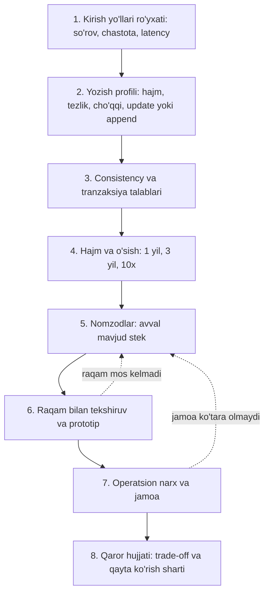

## Bu dars nima uchun kerak

2-modulning oxirgi darsi. 11-19 darslarda biz bazani ichidan ko'rdik: ma'lumot modellari, log va hash index, LSM, B-tree va WAL, indekslar va planner, ustunli storage, tranzaksiyalar, izolyatsiya va MVCC. Endi bularni bitta amaliy savolga yig'amiz: **yangi tizim yoki modul uchun qaysi bazani tanlash kerak va bu qarorni qanday asoslash kerak?**

Bu savol odatda noto'g'ri beriladi: "PostgreSQL yaxshimi yoki MongoDB?", "Cassandra'ga o'tish kerakmi?", "ClickHouse qo'shamizmi?". 1-darsdan bilamizki, to'g'ri dizayn texnologiyadan emas, talablar va raqamlardan boshlanadi. Baza tanlash - kurs bo'yicha eng qimmat **qaytarilmaydigan** (1-tur) qarorlardan biri: ma'lumot modeli, ID formati va sharding kaliti bilan birga u yillar davomida yashaydi. Shu sabab bu darsda aniq jarayon, savollar ro'yxati, hisob-kitob shablonlari va real kompaniyalar tajribasini beramiz.

Bu darsdan keyin siz:

- baza tanlashni kirish yo'llari (access patterns) va o'lchanadigan NFR'lardan boshlab, bosqichma-bosqich bajara olasiz;
- har bir nomzodni yozish va o'qish shakli, consistency va tranzaksiya talablari, hajm va o'sish, operatsion narx bo'yicha baholay olasiz;
- "PostgreSQL'da qolish" va "maxsus bazani qo'shish" o'rtasidagi chegarani raqam bilan aniqlay olasiz;
- poliglot persistence'ning foydasi va narxini, ma'lumotni tizimlar orasida sinxronlash usullarini bilasiz;
- qaror hujjatini (ADR) "qachon qayta ko'rib chiqish kerak" sharti bilan yoza olasiz.

## Asosiy tamoyil: kirish yo'li, keyin engine

11-darsdagi qoidani eslaymiz: **modelni ma'lumotning "tabiati" emas, asosiy so'rovlar shakli tanlaydi.** AWS DynamoDB hujjatlari ham NoSQL dizayni uchun xuddi shu narsani talab qiladi: sxemani boshlashdan oldin u javob berishi kerak bo'lgan savollarni bilish; uchta xususiyatni o'lchash - ma'lumot hajmi (bir vaqtda qancha saqlanadi va so'raladi), ma'lumot shakli (bazadagi shakl so'rov shakliga mos bo'lsin) va ma'lumot tezligi (cho'qqi yuklama).

Relational modelning kuchi shundaki, siz kirish yo'llarini oldindan to'liq bilmasangiz ham normalizatsiya qilingan model qurib, keyin yangi so'rovlar qo'shishingiz mumkin. DynamoDB, Cassandra kabi tizimlarda esa model **asosiy so'rovlar atrofida** quriladi va yangi kirish yo'li qo'shish qimmat (yangi jadval yoki GSI va ma'lumotni ko'chirish). Bu trade-off'ning o'zi baza tanlashning birinchi o'qi: **so'rovlaringiz qanchalik ma'lum va barqaror?**

## Qaror freymvorki: 8 qadam

### 1. Kirish yo'llari (access patterns)

Har bir asosiy so'rov uchun jadval tuzing:

| # | So'rov | Kalit | Turi | Chastota (o'rtacha/cho'qqi) | Latency talabi | Yangilik talabi |
|---|---|---|---|---|---|---|
| Q1 | Mashinaning oxirgi holati | vehicle_id | Nuqtali | 2 000 / 6 000 rps | p99 < 20 ms | < 5 s |
| Q2 | Mashina marshruti, kun bo'yicha | vehicle_id, vaqt oralig'i | Range | 50 / 200 rps | p99 < 500 ms | < 1 min |
| Q3 | Kompaniya bo'yicha oylik hisobot | company_id, oy | Agregatsiya | 2 / 20 rps | < 3 s | < 15 min |
| Q4 | Shartnoma va hisob-faktura | company_id | JOIN, tranzaksiya | 10 / 50 rps | p99 < 200 ms | Darhol |

Bu jadval qarorning yarmini beradi: Q1 - key-value, Q2 - saralangan range (LSM yoki B-tree, `(vehicle_id, ts)`), Q3 - ustunli skan yoki oldindan agregat, Q4 - relational va ACID.

### 2. Yozish profili

- **Hajm va tezlik:** yozuv/s (o'rtacha va cho'qqi), MB/s, kunlik GB.
- **Shakl:** append-only (telemetriya, loglar), tez-tez update (holat, hisoblagichlar), kam o'zgaradigan (ma'lumotnomalar).
- **Partiyalash imkoniyati:** yozishni 1-5 soniyalik partiyalarga yig'ish mumkinmi? Bu ustunli bazalar (16-dars) va XID iste'moli (19-dars) uchun hal qiluvchi.

13-14 darslardan: append-only va katta hajm LSM'ga, tez-tez update bo'ladigan kichik holat key-value yoki ehtiyotkor PostgreSQL dizayniga (HOT, 19-dars) mos.

### 3. Consistency va tranzaksiyalar

Savollar:

- Ko'p obyektli atomik o'zgarish kerakmi (17-dars)? Qaysi obyektlar orasida?
- Qaysi invariantlar bor va ularni constraint bilan ifodalasa bo'ladimi (17-18 darslar)?
- Write skew xavfi bormi - Serializable kerakmi (18-19 darslar)?
- O'qish yozishdan keyin darhol ko'rinishi kerakmi (read-your-writes, 26, 33-darslar)?
- Ma'lumot yo'qolishi qanchalik qabul qilinadi (RPO, 69-dars)? Telemetriya nuqtasi va to'lov - butunlay boshqa javob.

Pul, limitlar, bronlar, shartnomalar - kuchli tranzaksion baza. Telemetriya, metrikalar, loglar - ko'pincha eventual consistency va partiyaviy yozish yetarli.

### 4. Hajm va o'sish

Hisoblang: hozir, 1 yil, 3 yil va 10x stsenariy. Jonli ma'lumot, indekslar, replikalar, backup. Har bir nomzod uchun "bitta tugunga sig'adimi?" savoli. Zamonaviy bitta server o'nlab TB disk va yuzlab GB RAM bilan keladi, lekin muammo ko'pincha hajmning o'zi emas, balki unga bog'liq **operatsiyalar**: vacuum, backup va tiklash vaqti, indeks qurish, replika yaratish. Notion va Figma misollarida (pastda) aynan shu sinadi.

### 5. Nomzodlar: avval mavjud stekdan

Birinchi nomzod har doim **jamoa allaqachon ishlatayotgan va biladigan** baza, ko'pincha PostgreSQL. Savol: "uni qanday ishlatish kerakki, talablar bajarilsin?" Ko'p hollarda javob: partitioning, to'g'ri indekslar, `jsonb`, BRIN, partiyaviy yozish, read replica, oldindan agregatlar. Faqat raqam bilan ko'rsatilgan aniq to'siq bo'lsa, maxsus baza ko'rib chiqiladi.

### 6. Raqam bilan tekshiruv va prototip

Qog'ozdagi hisob (2-dars) va keyin **real ma'lumot shakli bilan** prototip: haqiqiy so'rovlar, haqiqiy taqsimot (bitta katta mijoz va ko'p kichiklar), haqiqiy cho'qqi. Vendor benchmark'lari sizning yuklamangiz emas. p99'ni o'lchang, o'rtachani emas (3-dars).

### 7. Operatsion narx va jamoa

Kleppmann'ning maintainability o'qi (1-dars) bu yerda hal qiluvchi. Har bir yangi baza turi uchun:

- kim uni kechasi soat 3 da tiklaydi;
- backup, tiklash va PITR qanday, tiklash qancha vaqt oladi;
- monitoring, alertlar, upgrade jarayoni;
- xavfsizlik (shifrlash, kirish huquqlari, audit);
- managed xizmat bormi va uning narxi;
- jamoada nechta odam uni chuqur biladi.

Kichik jamoa uchun har bir qo'shimcha baza - doimiy "soliq".

### 8. Qaror hujjati

ADR (Architecture Decision Record) shabloni: kontekst va talablar (raqamlar bilan), ko'rib chiqilgan variantlar, tanlov, **nimani qurbon qildik**, va **qayta ko'rib chiqish sharti** ("yozish 30 ming/s dan oshsa", "jadval 5 TB dan oshsa", "vacuum 6 soatdan uzoq ishlasa"). Oxirgisi qarorni dogmaga aylanishdan saqlaydi.

## Bazalar xaritasi: qaysi oila nima uchun

| Oila | Misollar | Kuchli tomoni | Zaif tomoni | Tipik qo'llanish |
|---|---|---|---|---|
| Relational OLTP | PostgreSQL, MySQL | Ad-hoc so'rovlar, JOIN, ACID, constraint, keng ekotizim | Yozishni bitta tugundan kengaytirish qiyin, katta jadvallarda vacuum/bloat | Biznes ma'lumoti, hisob, foydalanuvchilar, konfiguratsiya |
| Distributed SQL (NewSQL) | CockroachDB, Spanner, YugabyteDB, TiDB | SQL va tranzaksiyalar ko'p tugunda, avtomatik sharding | Latency (konsensus), narx, murakkab operatsiyalar | Global, ko'p regionli tranzaksion tizimlar |
| Document | MongoDB, PostgreSQL `jsonb` | Locality, moslashuvchan sxema | Many-to-many, hujjat hajmi, denormalizatsiya sinxronligi | Kontent, profillar, konfiguratsiyalar |
| Key-value | Redis, DynamoDB, etcd | Bashorat qilinadigan past latency, oson sharding | Kalitdan tashqari so'rov yo'q | Sessiya, cache, oxirgi holat, hisoblagichlar |
| Wide-column | Cassandra, ScyllaDB, Bigtable, HBase | Juda katta yozish hajmi, chiziqli kengayish | Query-first, JOIN yo'q, tombstone va compaction nozikliklari | Xabarlar, time-series, hodisalar tarixi |
| Time-series | TimescaleDB, InfluxDB, ClickHouse | Vaqt bo'yicha siqish, retention, downsampling | Umumiy maqsadli so'rovlar cheklangan | Telemetriya, metrikalar (81-dars) |
| OLAP / ustunli | ClickHouse, BigQuery, DuckDB, Snowflake | Milliardlab qatorli skan va agregatsiya | Nuqtali update, tranzaksiyalar | Analitika, dashboardlar (16-dars) |
| Search | Elasticsearch, OpenSearch | Full-text, fuzzy, faceted qidiruv | Asosiy manba sifatida ishonchsiz, eventual | Qidiruv, log tahlili (59-dars) |
| Graph | Neo4j, Neptune | Chuqur traversal | Sharding, umumiy agregatsiya | Bog'liqliklar tahlili, tavsiyalar |
| Object storage | S3, GCS, MinIO | Arzon, cheksiz hajm | Latency, so'rov imkoniyati yo'q (Parquet bilan qisman) | Video, fayllar, arxiv, data lake (60-dars) |

## PostgreSQL'da qolish va undan chiqish: chegaralar

O'quvchi PostgreSQL bilan ishlagani uchun eng amaliy savol: **qachon PostgreSQL yetmay qoladi?** Aniq universal raqam yo'q, lekin oldingi darslardan signallar ro'yxatini tuzish mumkin:

| Signal | Qayerda o'lchanadi | Birinchi yechim (PostgreSQL ichida) | Keyingi qadam |
|---|---|---|---|
| Yozish WAL va IO'ni to'yintiradi | `pg_stat_wal`, disk throughput | Partiyalab yozish, indekslarni kamaytirish, `synchronous_commit` tanlab o'chirish, partitioning (14, 17-darslar) | Sharding (Citus yoki ilova darajasida) yoki LSM/time-series baza |
| Vacuum yetib ololmaydi, bloat o'sadi | `n_dead_tup`, vacuum davomiyligi | HOT, fillfactor, per-table autovacuum, tez o'zgaradigan holatni ajratish (19-dars) | Jadvalni bo'lish, holatni key-value'ga ko'chirish |
| XID yoshi tez o'sadi | `age(datfrozenxid)` | Partiyalash, partitioning va eski partitionlarni muzlatish yoki o'chirish | Sharding |
| Analitik so'rovlar OLTP'ni sekinlashtiradi | p99 latency, `pg_stat_statements` | Replika, agregat jadvallar, materialized view (16-dars) | Ustunli OLAP baza + CDC |
| Bitta jadval ko'p TB, backup/tiklash soatlab | Tiklash vaqti (RTO) | Partitioning, inkremental backup | Sharding yoki ma'lumotni boshqa tizimga ko'chirish |
| Kalit bo'yicha juda ko'p o'qish (o'n minglab rps) | Ulanishlar, CPU | Cache-aside Redis (23-dars), replikalar | Key-value asosiy saqlash |
| Full-text, fuzzy qidiruv sifati yetmaydi | Qidiruv natijalari | `tsvector` + GIN, `pg_trgm` (15-dars) | Elasticsearch/OpenSearch |

### Real misol: Notion

Notion 2021 yilda PostgreSQL'ni shard qildi. Ularning blogiga ko'ra sabab: `VACUUM` muntazam ravishda to'xtab qolar, o'lik versiyalardan joy qaytarilmas edi, va TXID wraparound - Postgres'ni yozishni to'xtatishga majbur qiladigan holat - "mahsulot uchun ekzistensial tahdid" sifatida ko'rilgan. Bu 19-darsdagi mexanikaning aynan o'zi. Sharding kaliti - workspace ID (har bir blok faqat bitta workspace'ga tegishli, so'rovlar asosan bitta shard ichida qoladi). 480 ta mantiqiy shard 32 ta fizik bazaga (har birida 15 tadan) taqsimlangan; har bir mantiqiy shard - alohida Postgres sxemasi. Ular Citus yoki Vitess kabi tayyor vositalar o'rniga **ilova darajasida** routing'ni tanlagan - ma'lumot taqsimotini to'liq nazorat qilish uchun.

Saboq: ular bazani **almashtirmagan**, PostgreSQL'ni kengaytirgan. Sharding kaliti esa so'rov shaklidan (workspace bo'yicha) kelib chiqqan.

### Real misol: Figma

Figma'ning ma'lumotlar bazasi infratuzilmasi 2020 yildan beri taxminan 100 baravar o'sgan; 2020 yilda u AWS'dagi eng katta fizik instansdagi bitta PostgreSQL edi. Ularning yo'li:

1. **Vertikal partitioning** - bog'liq jadvallar guruhlarini (masalan, "fayllar", "tashkilotlar") alohida bazalarga ajratish. Ular buni nisbatan oson va juda samarali deb baholagan.
2. Ba'zi jadvallar TB va milliardlab qatorga yetganda vacuum ishonchliligi muammolari va RDS IOPS chegaralariga yaqinlashish - **gorizontal sharding**.
3. CockroachDB, TiDB, Spanner va Vitess'ni ko'rib chiqishgan, lekin o'sish sur'ati va qolgan vaqt zaxirasini hisobga olib, migratsiyani juda xavfli deb topgan; RDS PostgreSQL bo'yicha ichki tajriba ham muhim bo'lgan. NoSQL'ni rad etishgan, chunki u backend'ning relational modelini deyarli to'liq qayta yozishni talab qilardi.
4. O'z **DBProxy** servisini (Go) qurishgan: SQL'ni parse qilib, mantiqiy va fizik routing'ni rejalashtiradi, shard kaliti bo'lmagan so'rovlar uchun scatter-gather qiladi. Bir xil shard kalitiga ega jadvallar guruhi - "colo" - shu kalit doirasida JOIN va tranzaksiyalarni saqlab qoladi.
5. Avval shardlarni mantiqiy darajada (Postgres view'lar orqali) joriy qilib, keyin xavfliroq fizik bo'linishni bajarishgan. Birinchi gorizontal shard qilingan jadval 2023 yil sentyabrda, taxminan to'qqiz oylik ishdan keyin ishga tushgan.

Saboq: **migratsiya xavfi va jamoa tajribasi** - baza tanlashda texnik xususiyatlar bilan teng og'irlikdagi omillar. "Yaxshiroq" baza bilan katta migratsiya ko'pincha mavjud bazani kengaytirishdan xavfliroq.

### Real misol: Discord va MyRocks

Discord (11-dars) xabarlar uchun Cassandra'dan ScyllaDB'ga o'tdi - bir xil ma'lumot modeli, boshqa engine: 177 tugundan 72 tugunga, p99 latency sezilarli pasaygan. Meta MySQL'ning storage engine'ini InnoDB'dan RocksDB'ga (MyRocks) almashtirib, foydalanuvchi bazasi qatlamida siqilgan InnoDB'ga nisbatan 50% joy tejagan (14-dars). Ikkala holatda ham **model va API saqlanib, storage engine almashgan** - bu migratsiya xavfini keskin kamaytiradi.

## Poliglot persistence: foyda va narx

Bitta tizimda bir nechta baza - **poliglot persistence**. Har bir kirish yo'li o'ziga mos engine'da. Foydasi aniq. Narxi esa ko'pincha kam baholanadi:

1. **Sinxronlash muammosi.** Bir xil ma'lumot (masalan, mashina va uning holati) ikki joyda bo'lsa, ular qanday mos saqlanadi?
2. **Operatsion yuk** - har bir tizim uchun backup, monitoring, upgrade, xavfsizlik.
3. **Bilim** - jamoa har birini chuqur bilishi kerak.
4. **Tranzaksiya chegarasi** - ikki baza o'rtasida atomik yozish yo'q (37-dars: 2PC muammolari).

### Sinxronlash usullari

| Usul | Qanday | Muammo |
|---|---|---|
| Dual write (ilova ikkala bazaga yozadi) | Kodda ketma-ket ikki yozish | Bittasi muvaffaqiyatsiz bo'lsa nomuvofiqlik; parallel yozishlarda tartib buziladi. Tavsiya etilmaydi |
| CDC (Change Data Capture) | Asosiy bazaning WAL/replication oqimini o'qib, boshqasiga uzatish | Kechikish (soniyalar); qo'shimcha infratuzilma (48-dars) |
| Transactional outbox | Asosiy tranzaksiyada outbox jadvaliga hodisa, alohida jarayon uni tarqatadi | Iste'molchilar idempotent bo'lishi kerak (17, 48-darslar) |
| Event log birinchi (log-centric) | Avval navbatga (Kafka) yoziladi, barcha bazalar undan o'qiydi | Asosiy "haqiqat manbai" - log; o'qishdan keyin yozishni ko'rish kechikadi (46-dars) |

Qoida: har bir ma'lumot uchun **bitta haqiqat manbai** (system of record) aniqlansin; qolganlari undan **hosila** (derived data) - cache, qidiruv indeksi, analitik nusxa. Hosila ma'lumot buzilsa, uni manbadan qayta qurish mumkin bo'lishi kerak.

## Raqamlar: qaror shablonini to'ldirish

Faraz qiling, iQuariX'ga **video hodisalar** moduli qo'shilmoqda: kabinadagi kameralar AI orqali hodisalarni aniqlaydi (charchoq, telefon ishlatish, chekish), har bir hodisa uchun 10-20 soniyalik klip va metadata saqlanadi.

**Yuklama taxmini:** 5 000 kamerali mashina, kuniga mashinaga o'rtacha 8 hodisa, cho'qqi o'rtachadan 4 baravar.

- Hodisalar: 5 000 × 8 = 40 000/kun, o'rtacha 40 000 / 86 400 ≈ 0.46/s, cho'qqi taxminan 2/s. Bu PostgreSQL uchun arzimas yuklama.
- Metadata: hodisaga 2 KB (`jsonb` bilan AI natijalari) - kuniga 80 MB, yiliga taxminan 29 GB. PostgreSQL uchun kichik.
- Klip: 15 s, 1 Mbit/s - taxminan 1.9 MB. Kuniga 40 000 × 1.9 MB ≈ 75 GB, yiliga taxminan 27 TB. **Bu bazaga emas, object storage'ga** (60-dars).
- So'rovlar: "kompaniya bo'yicha oxirgi hodisalar, tur bo'yicha filtr" (partial va composite indeks, 15-dars); "haydovchi bo'yicha oylik statistika" (agregat); "klipni ko'rish" (object storage'dan presigned URL).

**Qaror:** metadata - PostgreSQL (mavjud stek, tranzaksiya bilan haydovchi va mashinaga bog'lanadi, `jsonb` AI natijalari uchun), klip - object storage, hodisa yaratilishi - outbox orqali bildirishnoma servisiga. Yangi baza turi kerak emas. Qayta ko'rib chiqish sharti: hodisalar kuniga 10 mln dan oshsa yoki ad-hoc analitika kerak bo'lsa - hodisalar oqimini OLAP bazaga (16-dars) CDC orqali qo'shish.

Bu misol ataylab "zerikarli": ko'p hollarda to'g'ri javob - mavjud bazani to'g'ri ishlatish va katta binar ma'lumotni bazadan tashqariga chiqarish.

## iQuariX kontekstida: to'liq xarita

Deylik, platformaning yetuk holatidagi saqlash xaritasi quyidagicha ko'rib chiqilmoqda (faraziy):

| Ma'lumot | Haqiqat manbai | Hosilalar | Asos |
|---|---|---|---|
| Mijozlar, foydalanuvchilar, rollar, shartnomalar, billing | PostgreSQL (Serializable kritik yo'llarda) | Analitik nusxa (CDC) | ACID, constraint, JOIN, kam hajm |
| Mashinalar, datchiklar, konfiguratsiya | PostgreSQL (`jsonb` konfiguratsiya uchun) | Redis cache | Kam o'zgaradi, bog'liq |
| Oxirgi holat | Redis (yoki PostgreSQL ingichka jadval, HOT bilan) | WebSocket orqali UI | Juda ko'p nuqtali o'qish va yozish, yo'qolsa telemetriyadan tiklanadi |
| Xom telemetriya | Navbat (log) | PostgreSQL (operativ 7-30 kun, kunlik partition) va ustunli baza (tarix, 3 yil) | Append-only, katta hajm, ikki xil kirish yo'li |
| Hodisalar (yoqilg'i, geofence, video) | PostgreSQL | Bildirishnomalar, analitika | Kam hajm, tranzaksion bog'liqlik |
| Video va fayllar | Object storage | CDN | Katta binar (60, 84-darslar) |
| Qidiruv (mashina, haydovchi, manzil) | PostgreSQL (`pg_trgm`, GIN) | Kerak bo'lsa keyinroq qidiruv tizimi | Hozirgi hajmda yetarli |

Bu xaritada ataylab **PostgreSQL markazda** va har bir qo'shimcha tizim aniq raqamli sabab bilan. Kichik jamoa uchun boshlang'ich nuqta: PostgreSQL + Redis + object storage + navbat. Ustunli OLAP baza - analitika talabi raqam bilan isbotlanganda.

## Ko'p uchraydigan xatolar

1. **Texnologiyadan boshlash.** "Cassandra kerak, chunki katta ma'lumot" - kirish yo'llari va raqamlarsiz.
2. **Bugungi yuklamani 1000x ortiq baholash.** 2 hodisa/s uchun distributed baza - kundalik operatsion soliq.
3. **Kirish yo'llarini bilmay query-first bazani tanlash.** DynamoDB yoki Cassandra'da yangi so'rov qo'shish relational'dagidan ancha qimmat.
4. **Katta binar ma'lumotni bazada saqlash.** Video, rasm, PDF - object storage'ga; bazada faqat havola va metadata.
5. **Dual write.** Ikki bazaga ilovadan ketma-ket yozish - nomuvofiqlik manbai; CDC yoki outbox ishlating.
6. **Haqiqat manbaini aniqlamaslik.** Qaysi nusxa to'g'ri ekanini hech kim bilmaydi; hosilani qayta qurib bo'lmaydi.
7. **Migratsiya xavfini kam baholash.** Figma va Notion misollari: mavjud bazani kengaytirish ko'pincha yangi bazaga ko'chishdan xavfsizroq.
8. **Qaror hujjatida "qayta ko'rib chiqish sharti" yo'qligi.** Qaror dogmaga aylanadi yoki aksincha, har hafta qayta muhokama qilinadi.

## Xulosa

- Baza tanlash - 1-tur qaror: kirish yo'llari, yozish profili, consistency, hajm va operatsion narx bo'yicha raqam bilan asoslanadi.
- Avval kirish yo'llari jadvali: so'rov, kalit, turi, chastota, latency va yangilik talabi. Bu qarorning yarmi.
- Birinchi nomzod - jamoa biladigan mavjud baza; maxsus baza faqat o'lchangan aniq to'siq bo'lsa.
- PostgreSQL'ning chegaralari vacuum, XID, WAL/IO, analitik skan va bitta jadval hajmida namoyon bo'ladi; ko'pi avval PostgreSQL ichida yechiladi (partitioning, HOT, partiyalash, replika, agregatlar).
- Notion va Figma bazani almashtirmasdan PostgreSQL'ni shard qilgan; Discord va Meta model saqlanib engine'ni almashtirgan. Migratsiya xavfi va jamoa tajribasi - teng og'irlikdagi omillar.
- Poliglot persistence: har ma'lumot uchun bitta haqiqat manbai, qolganlari CDC yoki outbox orqali hosila. Dual write'dan qoching.
- Qarorni ADR sifatida yozing: variantlar, qurbon qilingan narsa va qayta ko'rib chiqish sharti.

## Amaliy topshiriq

iQuariX uchun **haydovchi skoringi va mukofot (gamification) moduli** uchun saqlash qarorini qabul qiling deb faraz qiling. Funksiyalar: (a) har bir reys tugaganda haydovchiga 0-100 ball (tezlik buzilishi, keskin tormoz, bo'sh turish, yoqilg'i tejamkorligi); (b) haydovchining kunlik, haftalik, oylik o'rtacha bali; (c) kompaniya ichida va shahar bo'yicha reyting (top-100, "men nechanchi o'rindaman"); (d) ballar uchun bonus to'lovlari (oyiga bir marta, pul bilan bog'liq); (e) mijoz menejeri uchun istalgan davr va filtr bo'yicha tahlil. Yuklama: 30 000 haydovchi, kuniga haydovchiga o'rtacha 6 reys, reyting sahifasi soniyasiga 300 so'rov cho'qqida, saqlash 3 yil.

1. Kirish yo'llari jadvalini tuzing (kamida 6 ta so'rov: kalit, turi, chastota, latency, yangilik talabi).
2. Yozish profili va hajmni hisoblang: kunlik reyslar, 3 yillik qatorlar, hajm.
3. Har bir funksiya (a-e) uchun haqiqat manbai va kerak bo'lsa hosila saqlashni tanlang. Reyting (c) uchun nima ishlatasiz va nega (masalan, Redis sorted set yoki PostgreSQL oyna funksiyalari)? Har birining raqamli asosini yozing.
4. (d) uchun consistency va tranzaksiya talablarini aniqlang: qaysi invariantlar, qaysi izolyatsiya darajasi, idempotency qanday ta'minlanadi?
5. Hosila ma'lumot qanday sinxronlanadi (CDC, outbox, davriy qayta hisoblash)? Reyting va asosiy ma'lumot farq qilib qolsa, qanday tiklanadi?
6. ADR yozing: tanlov, ko'rib chiqilgan 2 ta muqobil, qurbon qilingan narsa, 2-3 ta qayta ko'rib chiqish sharti (aniq raqamlar bilan).

Yaxshi javobda bo'lishi kerak bo'lgan narsalar:

- kirish yo'llari jadvali qarordan oldin va raqamlar bilan;
- 30 000 × 6 = 180 000 reys/kun va 3 yillik hajm ochiq hisoblangan;
- pul bilan bog'liq (d) qismi tranzaksion bazada, idempotency kaliti va invariantlar bilan;
- reyting hosila ma'lumot sifatida, qayta qurish yo'li bilan;
- yangi baza turi qo'shilsa, uning operatsion narxi va qayta ko'rib chiqish sharti ko'rsatilgan;
- dual write ishlatilmagan.

Javobni pastdagi maydonga yozib, chatga yuboring.

## Manbalar

- Martin Kleppmann, Chris Riccomini. [Designing Data-Intensive Applications, 2-nashr](https://www.oreilly.com/library/view/designing-data-intensive-applications/9781098119058/), O'Reilly, 2026. 1-bob (trade-offlar, operatsion va analitik tizimlar, system of record va derived data), 3-bob (ma'lumot modellari), 4-bob (storage), 8-bob (tranzaksiyalar).
- AWS. [NoSQL design for DynamoDB](https://docs.aws.amazon.com/amazondynamodb/latest/developerguide/bp-general-nosql-design.html) - kirish yo'llari, ma'lumot hajmi, shakli va tezligi.
- Notion. [Sharding Postgres at Notion](https://www.notion.com/blog/sharding-postgres-at-notion) - sabablar (vacuum, TXID wraparound), workspace ID kaliti, 480 mantiqiy shard.
- Figma. [How Figma's databases team lived to tell the scale](https://www.figma.com/blog/how-figmas-databases-team-lived-to-tell-the-scale/) - vertikal partitioning, gorizontal sharding, DBProxy, colo.
- Discord. [How Discord Stores Trillions of Messages](https://discord.com/blog/how-discord-stores-trillions-of-messages).
- Meta Engineering. [MyRocks: A space- and write-optimized MySQL database](https://engineering.fb.com/2016/08/31/core-infra/myrocks-a-space-and-write-optimized-mysql-database/).
- Uber Engineering. [Why Uber Engineering Switched from Postgres to MySQL](https://www.uber.com/blog/postgres-to-mysql-migration/), 2016.
- PostgreSQL hujjatlari: [Routine Vacuuming](https://www.postgresql.org/docs/current/routine-vacuuming.html), [Table Partitioning](https://www.postgresql.org/docs/current/ddl-partitioning.html).
