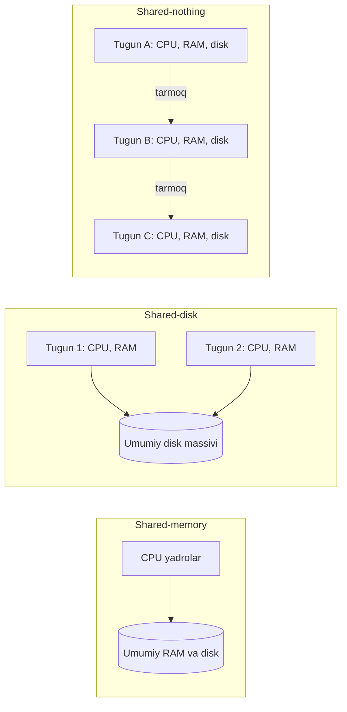
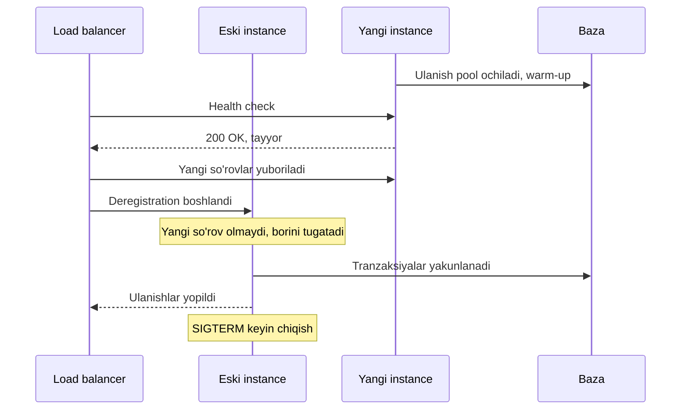

## Bu dars nima uchun kerak

2-modulda bitta baza ichida nima bo'layotganini ko'rdik: storage engine, indeks, tranzaksiya, izolyatsiya. Endi savol boshqacha: yuklama bitta mashina ko'tara oladigan darajadan oshsa nima qilamiz? 3-modul aynan shu haqida: load balancing, cache, CDN, replication va sharding. Bu dars ularning hammasi uchun poydevor, chunki birinchi qaror doim bir xil: **kattaroq mashina olamizmi yoki ko'proq mashina?**

Javob ko'rinadigan darajada oddiy emas. "Horizontal scaling yaxshi, vertical yomon" degan gap keng tarqalgan, lekin real tizimlarda dunyoning eng katta saytlaridan ba'zilari bitta katta bazada ishlaydi. Boshqa tomondan, application serverlarni ko'paytirish faqat ular **stateless** bo'lsagina oson. Stateful servisni ko'paytirish esa replication va sharding muammosiga aylanadi (26-30 darslar).

Bu darsdan keyin siz:

- vertical va horizontal scaling ning narx, chegara va nosozlik nuqtai nazaridan farqini bilasiz;
- shared-memory, shared-disk va shared-nothing arxitekturalarini ajrata olasiz;
- Universal Scalability Law (USL) yordamida "yana server qo'shsak qancha o'sadi?" degan savolga raqam bilan javob bera olasiz;
- servisni stateless qilish uchun qaysi holatni qayerga ko'chirish kerakligini bilasiz;
- sticky session, graceful shutdown va connection pool kabi amaliy masalalarni hisobga olasiz;
- app qatlamini ko'paytirganda bottleneck qayerga ko'chishini oldindan ko'ra olasiz.

## Ikki yo'l: kattaroq yoki ko'proq

**Vertical scaling (scale up)** - mavjud mashinani kuchliroq mashinaga almashtirish: ko'proq CPU yadro, RAM, tezroq disk. Ilova kodi o'zgarmaydi.

**Horizontal scaling (scale out)** - bir xil vazifani bajaradigan mashinalar sonini oshirish va yuklamani ular orasida taqsimlash. Kod va arxitektura bunga tayyor bo'lishi kerak.

Kleppmann DDIA 2-nashrining 2-bobida bu farqni uchta arxitektura orqali tushuntiradi:

1. **Shared-memory.** Bitta mashina, ko'p thread yoki process bir xil RAM ga murojaat qiladi. Bu klassik vertical scaling. Muammo: narx chiziqli emas, chiziqdan tezroq o'sadi. Ikki baravar resursli mashina odatda ikki baravardan ancha qimmat, va ichki bottleneck lar (xotira shinasi, lock lar) tufayli ikki baravar yuklamani ham ko'tarmaydi.
2. **Shared-disk.** Bir nechta mashina o'z CPU va RAM iga ega, lekin tez tarmoq orqali umumiy disk massivini (SAN yoki NAS) ishlatadi. An'anaviy data warehouse larda uchraydi. Cheklov - lock va contention. Zamonaviy cloud-native bazalarning bir qismi (masalan, compute va storage ajratilgan tizimlar) shunga o'xshash, lekin fayl tizimi emas, bazaga maxsus storage API ishlatadi.
3. **Shared-nothing.** Har bir tugun o'z CPU, RAM va diskiga ega, ular oddiy tarmoq orqali dasturiy koordinatsiya qiladi. Bu horizontal scaling. Chiziqli o'sish **imkoniyati** bor, eng arzon narx/samaradorlik nisbatidagi mashinalarni ishlatish mumkin, bir nechta data-markazga tarqatib ishonchlilikni oshirish mumkin. Evaziga: ma'lumotni aniq sharding qilish kerak va taqsimlangan tizimlarning butun murakkabligi keladi (4-modul).



### Vertical scaling ning haqiqiy chegarasi qayerda

Zamonaviy apparatda bitta mashinaning chegarasi juda yuqori. AWS 2024 yilda e'lon qilgan U7i high memory instance larning eng kattasi **896 vCPU va 32 TiB RAM** ga ega. Bunday mashina asosan SAP HANA kabi in-memory bazalar uchun mo'ljallangan, lekin raqam muhim: "bitta mashinaga sig'maydi" degan holat ko'p jamoalar o'ylagandan ancha kech keladi.

Vertical scaling ning chegarasi odatda texnik emas, boshqa narsalar:

- **Narx egri chizig'i.** Eng katta instance lar narx/yadro bo'yicha o'rta instance lardan qimmat bo'lishi mumkin, va ulardan kattasi yo'q - keyingi qadam faqat arxitekturani o'zgartirish.
- **Yagona nosozlik nuqtasi (SPOF).** Bitta mashina qancha kuchli bo'lmasin, u o'chsa xizmat to'xtaydi. Shuning uchun vertical scaling deyarli doim replication bilan birga ishlatiladi (26-dars).
- **O'zgartirish uchun downtime.** Cloud da instance turini o'zgartirish odatda qayta ishga tushirishni talab qiladi. Bazada bu failover rejasi bilan bajariladi.
- **Bitta mashina ichidagi bottleneck.** Ko'p yadroda lock contention, NUMA, bitta thread ga bog'liq jarayonlar (masalan, ba'zi bazalarda replication apply jarayoni) yadro qo'shishdan foyda bermaydi.
- **Blast radius.** Hamma mijoz bitta mashinada bo'lsa, bitta yomon so'rov hammaga ta'sir qiladi.

### Real misol: Let's Encrypt

Let's Encrypt (2021 yil yanvaridagi blog post) sertifikat markazining asosiy bazasini ataylab **bitta MariaDB primary** da ushlab turadi: murakkablikni kamaytirish xavfsizlik, ishonchlilik va qo'llab-quvvatlash uchun muhim deb hisoblaydi. O'qishlar replikalarga yuboriladi. Natijada primary juda kuchli bo'lishi kerak. Ular serverni yangilagan:

| Komponent | Eski | Yangi |
|---|---|---|
| CPU | 2x Intel Xeon E5-2650 (24 yadro) | 2x AMD EPYC 7542 (64 yadro) |
| RAM | 1 TB | 2 TB |
| Disk | 24x 3.8 TB SATA SSD | 24x 6.4 TB NVMe SSD |

Natija: API so'rovining median vaqti taxminan 90 ms dan 9 ms ga, o'rtacha query vaqti 0.45 ms dan 0.15 ms ga tushgan, primary CPU yuklamasi 90% dan oshiqdan taxminan 25% ga kamaygan. O'sha paytda ular 235 milliondan ortiq saytga sertifikat berardi. Mualliflar sharding hozircha kerak bo'lmaganini, lekin kelajakda kerak bo'lishi mumkinligini ochiq yozgan.

Saboq: vertical scaling - bu "sust" yechim emas, balki **murakkablikni sotib olmaslik** uchun ongli tanlov. Bu tanlov qachon tugashini (qaysi metrika qaysi chegaraga yetganda) oldindan bilish kerak.

### Real misol: Stack Overflow (2016)

Nick Craver 2016 yil fevralida Stack Overflow arxitekturasini batafsil yozgan. Bitta kun (2016 yil 9 fevral) uchun raqamlar:

- load balancer ga 209 420 973 HTTP so'rov;
- 66 294 789 sahifa yuklanishi;
- HTTP so'rovlardan 504 816 843 SQL query.

Bu yuklama 11 ta IIS web server (har birida 2x 12 yadroli Xeon va 64 GB RAM) va ikki AlwaysOn klasterdagi **4 ta SQL Server** (384 GB va 768 GB RAM) bilan ko'tarilgan. Hardware postida SQL Server lar "deyarli doim 5-10% CPU" da ishlashi yozilgan. Craver web tier ataylab ortiqcha olinganini ta'kidlaydi: rolling deploy, zaxira va redundancy uchun.

Hisoblab ko'ramiz:

- 209 420 973 / 86 400 ~ **2 424 HTTP so'rov/s** o'rtacha;
- 504 816 843 / 86 400 ~ **5 843 SQL query/s** o'rtacha.

Bu raqamlar "katta sayt" degan tasavvurga nisbatan kichik ko'rinadi, chunki ular kuchli cache (Redis, ASP.NET ichki cache) va samarali kod bilan qisqartirilgan. Bu yerda ikki yondashuv aralash: **web qatlami horizontal** (stateless, 11 ta bir xil server), **baza qatlami vertical** (bir nechta juda kuchli server, primary va replikalar).

Bu klassik naqsh va deyarli har bir tizimda takrorlanadi: stateless qatlamni ko'paytirish arzon, stateful qatlamni esa imkon qadar uzoq vertical o'stirib, keyin replication va sharding ga o'tish.

## Universal Scalability Law: nega 10 server 10 baravar tez emas

"Server qo'shsak, throughput chiziqli o'sadi" degan taxmin deyarli doim noto'g'ri. Buni raqam bilan tushunish uchun ikki model bor.

### Amdahl qonuni

Agar ishning σ ulushi ketma-ket (parallel qilib bo'lmaydigan) bo'lsa, N ta parallel ishchi bilan maksimal tezlanish:

```
S(N) = N / (1 + σ(N - 1))
```

N cheksizga intilganda S(N) 1/σ ga yaqinlashadi. σ = 0.05 (ishning 5 foizi ketma-ket) bo'lsa, qancha server qo'shmang, 20 baravardan ortiq tezlanish bo'lmaydi.

### USL: contention va coherency

Neil Gunther ning Universal Scalability Law (USL) modeli Amdahl ga ikkinchi had qo'shadi:

```
C(N) = N / (1 + α(N - 1) + βN(N - 1))
```

- **α (contention)** - umumiy resurs uchun navbat: bitta lock, bitta baza primary, bitta navbat. Bu Amdahl dagi ketma-ket ulush.
- **β (coherency)** - tugunlar o'zaro kelishishi narxi: cache larni sinxronlash, distributed lock, gossip, ma'lumotni har bir tugunga yetkazish. N(N-1) bilan o'sadi, chunki har bir juftlik o'zaro ta'sir qilishi mumkin.

β > 0 bo'lsa, egri chiziqning **cho'qqisi** bor, undan keyin server qo'shish throughput ni **kamaytiradi** (retrograde scaling). Cho'qqi nuqtasi:

```
N* = sqrt((1 - α) / β)
```

### Hisob-kitob misoli

Deylik, load test natijasida α = 0.05, β = 0.0001 topildi (bitta server = 1 birlik):

| N | Maxraj: 1 + α(N-1) + βN(N-1) | C(N) | Samaradorlik C(N)/N |
|---|---|---|---|
| 1 | 1 | 1.00 | 100% |
| 10 | 1 + 0.45 + 0.009 = 1.459 | 6.85 | 69% |
| 32 | 1 + 1.55 + 0.099 = 2.649 | 12.08 | 38% |
| 100 | 1 + 4.95 + 0.99 = 6.94 | 14.41 | 14% |
| 200 | 1 + 9.95 + 3.98 = 14.93 | 13.40 | 7% |

N* = sqrt(0.95 / 0.0001) = sqrt(9 500) ~ 97. Ya'ni taxminan 97 serverdan keyin har bir yangi server tizimni sekinlashtiradi. 32 serverda biz 32 baravar emas, 12 baravar olamiz.

Amaliy xulosalar:

- α ni kamaytirish uchun umumiy bottleneck ni yo'qotish kerak: bitta bazaga barcha yozuvlar, global lock, bitta "master" servis. Bu ko'pincha sharding (28-dars) degani.
- β ni kamaytirish uchun tugunlar orasidagi koordinatsiyani kamaytirish kerak: har bir so'rovda distributed lock olmaslik, cache invalidatsiyasini barcha tugunga broadcast qilmaslik.
- α va β ni taxmin qilmang, **o'lchang**: 1, 2, 4, 8, 16 instance bilan load test qilib, USL egri chizig'ini nuqtalarga moslashtiring. Gunther ning maqolasi va R tilidagi `usl` paketi aynan shu uchun.

Stateless application serverlar uchun β odatda juda kichik (ular bir-biri bilan gaplashmaydi), shuning uchun ular deyarli chiziqli o'sadi. Lekin ularning hammasi bitta bazaga murojaat qilsa, α bazaning sig'imi bilan belgilanadi. Aynan shu sabab app serverlarni ko'paytirish faqat bottleneck ni bazaga ko'chiradi.

## Stateless servis nima va nega u muhim

**State (holat)** - bitta so'rov tugagandan keyin ham saqlanib qoladigan va keyingi so'rovga ta'sir qiladigan ma'lumot. Servis **stateless** deyiladi, agar har qanday so'rovni har qanday instance bir xil natija bilan bajara olsa, chunki barcha doimiy holat tashqi saqlash joyida (baza, cache, object storage).

The Twelve-Factor App metodologiyasining VI faktori shuni talab qiladi: process lar stateless va share-nothing bo'lsin, saqlanishi kerak bo'lgan har qanday ma'lumot stateful backing service da (odatda baza) turishi kerak. Lokal xotira va disk faqat bitta so'rov doirasidagi qisqa cache sifatida ishlatilishi mumkin va keyingi so'rovda u yerda bo'lishiga tayanib bo'lmaydi.

Stateless bo'lishning amaliy foydalari:

- **Erkin ko'paytirish va kamaytirish.** Autoscaler (76-dars) instance qo'shadi yoki o'chiradi, foydalanuvchi buni sezmaydi.
- **Oson nosozlikdan tiklanish.** Instance o'lsa, load balancer so'rovni boshqasiga yuboradi, hech narsa yo'qolmaydi.
- **Oson deploy.** Rolling, blue-green, canary (68-dars) - eski instance larni yangisiga bemalol almashtirish.
- **Oddiy load balancing.** Har qanday algoritm ishlaydi (22-dars).

### State qayerda yashirinadi

Ko'p servis o'zini "stateless" deb hisoblaydi, lekin quyidagilardan birini xotirada saqlaydi:

| Yashirin state | Muammo | Qayerga ko'chirish |
|---|---|---|
| HTTP session (login, savat) | Boshqa instance foydalanuvchini tanimaydi | Redis yoki Memcached (TTL bilan), yoki imzolangan token (JWT, 71-dars) |
| Yuklangan fayllar lokal diskda | Boshqa instance faylni topa olmaydi, konteyner o'lsa yo'qoladi | Object storage (S3, 60-dars) |
| In-memory cache | Har bir instance da boshqa versiya, invalidatsiya qiyin | Qisqa TTL li lokal cache yoki umumiy Redis (23-24 darslar) |
| In-process navbat yoki fon vazifalar | Instance o'lsa vazifa yo'qoladi | Tashqi navbat (41-dars) |
| Cron / scheduler har bir instance da | N ta instance = N marta bajariladi | Bitta scheduler yoki distributed lock / leader election (38-dars) |
| Rate limit hisoblagichlari xotirada | Limit N baravar oshib ketadi | Redis da markazlashgan hisoblagich (56-dars) |
| WebSocket / TCP ulanish | Ulanish jismonan bitta instance ga bog'langan | Ulanish holatini registry da saqlash, xabarni pub/sub orqali yetkazish |
| Auto-increment ID ni xotirada generatsiya qilish | Ikki instance bir xil ID beradi | Baza sequence, UUIDv7, Snowflake (57-dars) |

Oxirgi ikkitasi alohida e'tiborga loyiq: uzoq yashovchi ulanishlar (WebSocket, MQTT, xom TCP) servisni **tabiatan stateful** qiladi. Bu holda maqsad - ulanishni stateless qilish emas (bu mumkin emas), balki **ulanishdan boshqa hamma narsani** tashqariga chiqarish. Instance o'lsa, ulanish uziladi, mijoz qayta ulanadi (boshqa instance ga), va hech qanday biznes ma'lumot yo'qolmaydi.

### Sticky session: qachon va nega ehtiyotkorlik bilan

**Sticky session (session affinity)** - load balancer bir foydalanuvchining so'rovlarini doim bitta instance ga yuborishi. Masalan, AWS Application Load Balancer duration-based stickiness da `AWSALB` nomli cookie generatsiya qiladi, davomiyligi 1 soniyadan 7 kungacha sozlanadi. Application-based variantida ilovaning o'z cookie si ishlatiladi.

Twelve-Factor metodologiyasi sticky session ga tayanishni to'g'ridan-to'g'ri metodologiya buzilishi deb ataydi. Sabablari:

- instance o'lsa yoki deploy da almashtirilsa, undagi session yo'qoladi;
- yuklama notekis bo'ladi: "og'ir" foydalanuvchilar bitta instance ga yopishib qoladi, yangi instance qo'shilganda eski foydalanuvchilar unga o'tmaydi;
- autoscaling kamaytirishda (scale-in) ulanishlarni uzish kerak bo'ladi.

Shunga qaramay sticky session ning o'rinli joylari bor: **optimallashtirish** sifatida (lokal cache isib qolgan instance ga yuborish), lekin **to'g'rilik** uchun emas. Qoida: sticky session o'chirilganda tizim sekinroq ishlashi mumkin, lekin noto'g'ri ishlamasligi kerak.

## Horizontal scaling ning amaliy mexanikasi

Stateless servisni ko'paytirish kod nuqtai nazaridan oson, lekin operatsion tomondan bir nechta majburiy qism bor.



### 1. Readiness va health check

Instance ishga tushgani uning so'rov qabul qilishga tayyorligini anglatmaydi: config yuklanishi, bazaga ulanish, cache isishi kerak. Load balancer faqat health check dan o'tgan instance ga trafik yuboradi. Health check turlari va xatolari 22-darsda batafsil ko'riladi.

### 2. Graceful shutdown (ohista to'xtash)

Instance o'chirilayotganda bajarilayotgan so'rovlar uzilmasligi kerak. Ikki taymer muhim:

- **AWS ALB deregistration delay** - target ro'yxatdan chiqarilgandan keyin mavjud so'rovlar tugashi uchun kutish vaqti, standart qiymati **300 soniya**. Qisqa so'rovli API uchun bu ortiqcha uzun, deploy ni sekinlashtiradi. Ko'pincha 30-60 soniyaga tushiriladi.
- **Kubernetes `terminationGracePeriodSeconds`** - standart **30 soniya**. Pod o'chirilganda preStop hook bajariladi, keyin konteynerga SIGTERM yuboriladi, muddat tugasa SIGKILL. Pod ni Service endpoint laridan olib tashlash parallel ravishda tarqaladi, shuning uchun ilova SIGTERM olishi bilan darhol chiqib ketsa, ba'zi so'rovlar hali eski pod ga kelib "connection refused" oladi. Keng tarqalgan yechim - preStop da qisqa `sleep` (masalan, 5-10 soniya), so'ng ilova yangi so'rov qabul qilishni to'xtatib, borlarini tugatadi.

Node.js da bu odatda shunday: SIGTERM kelganda `server.close()` (yangi ulanishlarni qabul qilmaydi), keep-alive ulanishlarni yopish, navbatdagi ishlarni tugatish, bazaga pool ni yopish, keyin `process.exit(0)`.

### 3. Connection pool portlashi

Bu horizontal scaling ning eng ko'p unutiladigan oqibati. Hisoblaymiz:

- PostgreSQL da `max_connections` standart qiymati odatda **100**.
- Har bir app instance da Prisma yoki `pg` pool hajmi 10 deylik.
- 8 instance = 80 ulanish. Hali sig'adi.
- Autoscaler yuklama cho'qqisida 20 instance ga oshirdi: 20 × 10 = **200 ulanish** - bu limitdan ikki baravar ko'p. Yangi instance lar bazaga ulana olmaydi, health check dan o'tmaydi yoki so'rovlarda xato beradi. Ya'ni yuklama oshganda server qo'shish **tizimni yomonlashtirdi**.

PostgreSQL da har bir ulanish alohida backend process, va `max_connections` ni ko'tarish shared memory ajratilishini ham oshiradi. Shuning uchun yechim limitni cheksiz ko'tarish emas, **connection pooler** qo'yish: PgBouncer transaction mode da server ulanishini faqat tranzaksiya davomida mijozga beradi, keyin pool ga qaytaradi. PgBouncer ning o'zi har bir mijoz ulanishiga standart holatda taxminan 2 kB xotira sarflaydi, shuning uchun minglab mijoz ulanishini 50-100 ta haqiqiy baza ulanishiga "siqish" mumkin. Evaziga transaction mode da session darajasidagi imkoniyatlar (session advisory lock, `SET` bilan o'rnatilgan sozlamalar, ba'zi prepared statement rejimlari) cheklanadi.

Umumiy qoida: **har bir instance ning pool hajmi × maksimal instance soni** baza limitidan kichik bo'lishi kerak. Bu tenglikni autoscaler ning maksimal chegarasini belgilashda ishlating.

### 4. Bottleneck ko'chishi

App qatlami horizontal o'sgach, keyingi bottleneck lar odatda shu tartibda chiqadi:

1. baza ulanishlari (yuqorida);
2. bazaning yozish sig'imi (bitta primary) - 26 va 28-darslar;
3. umumiy cache yoki Redis ning bitta tuguni (bitta thread li buyruq bajarilishi) - 24-dars;
4. tashqi API rate limitlari (SMS, xarita, to'lov provayderi);
5. tarmoq va load balancer ning o'zi.

## Trade-off: vertical vs horizontal

| Mezon | Vertical (scale up) | Horizontal (scale out) |
|---|---|---|
| Kod o'zgarishi | Deyarli yo'q | Stateless qilish, ba'zan sharding |
| Narx o'sishi | Chiziqdan tez, yuqori chegarasi bor | Chiziqqa yaqin (stateless uchun), lekin koordinatsiya narxi bor |
| Maksimal sig'im | Eng katta mashina bilan cheklangan | Nazariy jihatdan cheklanmagan, amalda USL cho'qqisi |
| Ishonchlilik | SPOF, replica kerak | Bitta tugun o'lishi xizmatni to'xtatmaydi |
| Operatsion murakkablik | Past | Yuqori: LB, service discovery, deploy, monitoring |
| Consistency | Bitta mashinada oddiy (ACID) | Ko'p tugunli state da qiyin (4-modul) |
| Elastiklik | Sekin (qayta ishga tushirish) | Tez (instance qo'shish daqiqalarda) |
| Latency | Tarmoq hop yo'q, lokal xotira | Har bir tugun orasida tarmoq latency si |
| Mos keladi | Baza, stateful tizimlar, erta bosqich | Stateless API, worker, gateway |

Amaliy qoida (Figma tajribasi ham shuni ko'rsatadi): Figma 2020 yilda bitta PostgreSQL ni AWS dagi eng katta fizik instance da ishlatgan. Keyin replikalar, cache va bir nechta vertical partitioning (jadvallar guruhini alohida bazalarga ajratish) qo'shilgan. Faqat ba'zi jadvallar bir necha terabayt va milliardlab qatorga yetib, vacuum ishonchlilikka ta'sir qila boshlagach va eng ko'p yoziladigan jadvallar RDS ning maksimal IOPS chegarasiga yaqinlashgach, ular horizontal sharding ga o'tgan (birinchi shard qilingan jadval 2023 yil sentabrida). Ya'ni har bir qadam keyingi oddiy variant tugaganda qo'yilgan.

## iQuariX kontekstida

Faraz qiling, platforma uch qatlamdan iborat:

1. **Telemetriya ingest gateway** - trekerlar TCP orqali doimiy ulanib, har 10-30 soniyada paket yuboradi.
2. **API servis** (NestJS) - dispetcher paneli, hisobotlar, sozlamalar.
3. **Real-time servis** - dispetcher brauzeriga WebSocket orqali mashinalar harakati.

**API servis** eng oson: session ni Redis ga yoki JWT ga chiqaring, fayl yuklashlarni S3 ga, cron vazifalarni alohida worker ga. Shundan keyin u erkin ko'payadi.

**Ingest gateway** tabiatan stateful: har bir treker bitta instance bilan uzoq TCP ulanishda. Deylik, 20 000 treker va 4 gateway instance. Har biriga taxminan 5 000 ulanish. Bitta instance deploy uchun o'chirilsa:

- 5 000 treker bir vaqtda uziladi va qayta ulanadi. Agar ular hammasi bir vaqtda ulanishga harakat qilsa, qolgan 3 instance ga "reconnect storm" tushadi. Shuning uchun graceful shutdown da ulanishlarni bir zumda emas, bir necha daqiqa davomida bosqichma-bosqich yopish foydali.
- Treker qaysi gateway ga ulanganini biznes mantiq bilmasligi kerak. Paket gateway dan darhol navbatga (41-dars) yoziladi, "qurilma onlayn" holati Redis da TTL bilan saqlanadi. Shunda gateway instance i o'lsa, faqat TCP ulanish yo'qoladi, ma'lumot emas.
- Serverdan qurilmaga buyruq (masalan, dvigatelni bloklash) yuborish kerak bo'lsa, qaysi instance da ulanish borligini bilish kerak: `device_id -> gateway_instance` xaritasini Redis da saqlab, buyruqni o'sha instance ga pub/sub orqali yetkazish mumkin.

**Baza qatlami.** Har bir NestJS instance da Prisma pool 10 ta, autoscaler maksimal 30 instance gacha ko'tarsa, 300 ulanish kerak bo'ladi. PgBouncer ni transaction mode da qo'ymasdan bu ishlamaydi. Telemetriya yozuvchi worker lar alohida pool bilan ishlashi kerak, aks holda dispetcher so'rovlari telemetriya yozuvi bilan ulanish uchun raqobatlashadi.

**Vertical qayerda to'g'ri.** Asosiy PostgreSQL ni boshida kuchli instance ga ko'tarish, replikani o'qish uchun qo'shish (26-dars) - sharding dan ancha arzon. Sharding (masalan, tenant_id bo'yicha) faqat bitta primary ning yozish sig'imi yoki hajmi yetmay qolganda.

## Ko'p uchraydigan xatolar

1. **"Horizontal har doim yaxshiroq" deb boshlash.** Bitta kuchli baza va replikalar ko'p yillar yetadi. Sharding ni erta qilish murakkablikni oldindan to'lash.
2. **App serverlarni ko'paytirib, bazani unutish.** Bottleneck shunchaki bazaga ko'chadi, ulanishlar soni limitdan oshadi.
3. **Yashirin state.** Lokal disk ga fayl, xotirada session yoki rate limit, har bir instance da cron. Hammasi bitta instance da ishlaydi va ikkinchisi qo'shilganda buziladi.
4. **Sticky session ga to'g'rilik uchun tayanish.** Deploy yoki instance o'limida foydalanuvchi ma'lumotini yo'qotadi.
5. **Graceful shutdown yo'qligi.** Har bir deploy da bir necha foiz so'rov 502 yoki uzilgan ulanish bilan tugaydi va buni "tarmoq muammosi" deb o'ylashadi.
6. **Chiziqli o'sishni taxmin qilish.** USL ni o'lchamasdan "10 server = 10x" deb capacity rejalash.
7. **Stateful ulanishlarni (TCP, WebSocket) oddiy HTTP kabi ko'paytirish.** Reconnect storm, buyruqni to'g'ri instance ga yetkazish va ulanishlar notekisligi hisobga olinmaydi.
8. **Vertical scaling ning chegarasini kuzatmaslik.** CPU, IOPS, xotira o'sishini monitoring qilmay, oxirgi oyda shoshilinch sharding qilish.

## Xulosa

- Vertical scaling - kod o'zgarmaydi, lekin narx chiziqdan tez o'sadi, chegarasi va SPOF bor. Horizontal - chiziqli o'sish imkoniyati va ishonchlilik, evaziga taqsimlangan tizim murakkabligi.
- Real tizimlar odatda aralash: stateless qatlam horizontal, baza imkon qadar uzoq vertical, keyin replication va sharding.
- USL: C(N) = N / (1 + α(N-1) + βN(N-1)). Contention (α) va coherency (β) tufayli o'sish cho'qqisi bor, undan keyin server qo'shish zarar.
- Stateless servis - doimiy holat tashqarida. Session, fayl, navbat, cron, rate limit, ID generatsiyasi - yashirin state manbalari.
- Sticky session - optimallashtirish, to'g'rilik kafolati emas.
- Horizontal scaling ning operatsion qismi: readiness, graceful shutdown, connection pooling.
- Har bir instance pool hajmi × maksimal instance soni < baza ulanish limiti.

## Amaliy topshiriq

Faraz qiling, iQuariX da hozir hamma narsa bitta 16 vCPU li VM da ishlaydi: NestJS API, TCP ingest gateway, cron vazifalar (kunlik hisobotlar), yuklangan fayllar lokal diskda, va PostgreSQL alohida VM da. Qurilmalar 15 000 dan 60 000 ga yil ichida o'sishi kutilmoqda.

1. Joriy servisdagi **barcha yashirin state** larni ro'yxat qiling (kamida 6 ta) va har biri uchun qayerga ko'chirishni yozing.
2. **Ingest gateway** ni horizontal qilish rejasini yozing: treker qanday qilib instance ga taqsimlanadi, instance o'lganda nima bo'ladi, serverdan qurilmaga buyruq qanday yetkaziladi.
3. **Connection hisob-kitobi**: API va worker lar uchun maksimal instance sonini va pool hajmini tanlang, PostgreSQL limiti va PgBouncer bilan birga hisoblang.
4. **Graceful shutdown** ketma-ketligini ham API, ham gateway uchun yozing: qaysi taymer qancha, nega.
5. Load test natijasi: 1 instance 4 000 paket/s, 4 instance 13 000 paket/s, 8 instance 20 000 paket/s. USL ga mos keladimi? Taxminan α va β qanday tartibda bo'lishi mumkin, va 60 000 qurilma (har biri 10 soniyada paket) uchun shu arxitektura yetadimi? Bottleneck qayerda bo'lishi mumkinligi haqida gipoteza bering.
6. Qaysi qatlamni **vertical** o'stirishni tanlaysiz va qaysi metrika chegarasiga yetganda horizontal ga o'tasiz?

Yaxshi javobda bo'lishi kerak bo'lgan narsalar:

- cron, fayllar, session, rate limit, qurilma onlayn holati kabi state lar aniqlangan;
- gateway uchun "ulanish yo'qolishi mumkin, ma'lumot yo'qolmasligi kerak" tamoyili va reconnect storm ga qarshi chora;
- ulanishlar hisobida instance soni × pool hajmi va PgBouncer;
- USL hisobida samaradorlik pasayishi ko'rsatilgan (4 instance da 81%, 8 da 62%) va sabab haqida gipoteza (umumiy navbat, baza yozuvi);
- vertical dan horizontal ga o'tish uchun aniq raqamli trigger.

Javobni pastdagi maydonga yozib, chatga yuboring.

## Manbalar

- Martin Kleppmann, Chris Riccomini. [Designing Data-Intensive Applications, 2-nashr](https://www.oreilly.com/library/view/designing-data-intensive/9781098119058/), O'Reilly, 2026. 2-bob: shared-memory, shared-disk, shared-nothing. [ScyllaDB blogidagi parcha](https://www.scylladb.com/2026/08/04/ddia-2nd-edition-excerpt-on-scalability/).
- Neil J. Gunther. [A General Theory of Computational Scalability Based on Rational Functions](https://arxiv.org/abs/0808.1431), 2008 - USL va uning Amdahl qonuni bilan bog'liqligi. Amaliy qo'llanish: [WSO2, Measuring Software Scalability using USL](https://wso2.com/blog/research/measuring-software-scalability-using-universal-scalability-law/).
- [The Twelve-Factor App, VI. Processes](https://12factor.net/processes) - stateless process lar va sticky session.
- Nick Craver. [Stack Overflow: The Architecture - 2016 Edition](https://nickcraver.com/blog/2016/02/17/stack-overflow-the-architecture-2016-edition/) va [The Hardware - 2016 Edition](https://nickcraver.com/blog/2016/03/29/stack-overflow-the-hardware-2016-edition/) - kunlik raqamlar va server konfiguratsiyasi.
- Let's Encrypt. [The Next Gen Database Servers Powering Let's Encrypt](https://letsencrypt.org/2021/01/21/next-gen-database-servers.html), 2021 - bitta primary va vertical yangilanish natijalari.
- Figma. [How Figma's databases team lived to tell the scale](https://www.figma.com/blog/how-figmas-databases-team-lived-to-tell-the-scale/), 2024 - vertical dan vertical partitioning va horizontal sharding ga o'tish.
- AWS. [Edit target group attributes for your Application Load Balancer](https://docs.aws.amazon.com/elasticloadbalancing/latest/application/edit-target-group-attributes.html) - deregistration delay, stickiness, AWSALB cookie. [U7i high memory instances](https://aws.amazon.com/about-aws/whats-new/2024/05/amazon-ec2-high-memory-u7i-instances).
- [PostgreSQL: Connections and Authentication](https://www.postgresql.org/docs/current/runtime-config-connection.html) (`max_connections`) va [PgBouncer Features](https://www.pgbouncer.org/features.html) - pool rejimlari.
