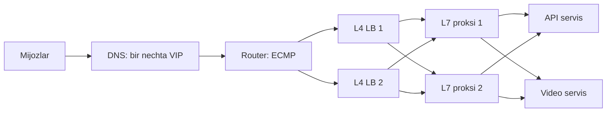
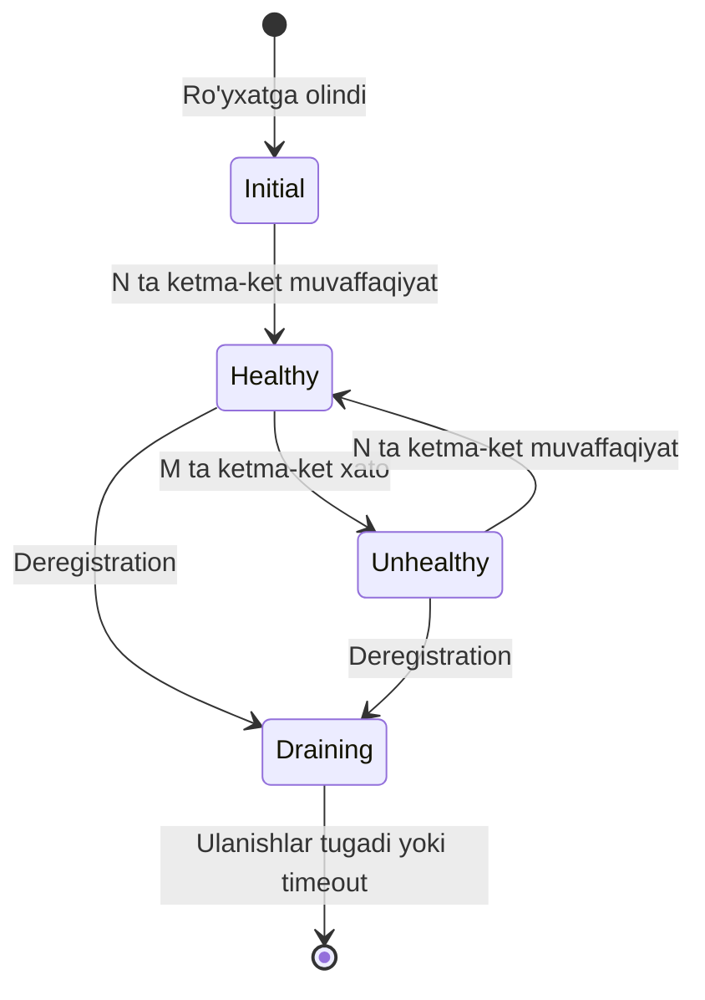

## Bu dars nima uchun kerak

21-darsda stateless servislarni ko'paytirishni ko'rdik. Lekin 10 ta bir xil server bo'lishi yetarli emas: kimdir har bir so'rovni qaysi serverga yuborishni hal qilishi, o'lgan serverni aniqlab, unga trafik yubormasligi va yangi serverni ohista ishga qo'shishi kerak. Bu **load balancer** ning vazifasi.

Load balancer oddiy "proksi" ko'rinadi, lekin aynan shu yerda ko'p jiddiy uzilishlar boshlanadi: noto'g'ri health check butun flotni "o'lik" deb belgilaydi, gRPC trafigi bitta pod ga yopishib qoladi, yangi qo'shilgan server birinchi soniyada minglab so'rov olib yiqiladi. Bu dars load balancer qanday ishlashini paket va so'rov darajasida ko'rsatadi.

Bu darsdan keyin siz:

- L4 va L7 load balancing ning ichki farqini (TCP ulanish vs HTTP so'rov) va har birining narxini bilasiz;
- round robin, least connections, power of two choices, EWMA va consistent hashing algoritmlarini qachon ishlatishni bilasiz;
- active va passive health check, outlier detection va fail-open tushunchalarini tushunasiz;
- Google Maglev, Facebook Katran va Cloudflare Unimog kabi katta tizimlar L4 ni qanday qurganini bilasiz;
- uzoq yashovchi ulanishlar (gRPC, WebSocket, TCP trekerlar) uchun balancing muammosini tushunasiz.

## Load balancer qayerda turadi

Tizimda bir nechta balancing qatlami bo'lishi mumkin:

1. **DNS darajasida** - bitta domen uchun bir nechta IP qaytarish, geo-routing (6-darsda ko'rilgan, 77-darsda chuqurroq).
2. **Tarmoq kirishida (edge)** - ECMP router va L4 load balancer lar.
3. **L7 proksi** - HTTP so'rovlarini servislarga yo'naltiradigan NGINX, HAProxy, Envoy, AWS ALB.
4. **Servis ichida (client-side)** - gRPC klienti yoki service mesh sidecar (55-dars) har bir so'rovni o'zi taqsimlaydi.

Bu ikki qavatli naqsh (L4 oldida, L7 orqasida) katta tizimlarda standart: L4 juda tez va arzon, lekin "aqlsiz"; L7 aqlli, lekin qimmat. L4 L7 proksilarni ko'paytirish imkonini beradi.

## L4 va L7: ichki farq

### L4 (transport qatlami)

L4 load balancer TCP yoki UDP paketlarni ko'radi: IP manzillar, portlar, protokol. U HTTP sarlavhalarini, URL ni, cookie ni **bilmaydi**. Qaror **ulanish (flow)** darajasida qabul qilinadi: TCP ulanishning birinchi paketi qaysi backend ga ketsa, shu ulanishning barcha paketlari o'sha backend ga boradi.

Ikki asosiy ishlash rejimi:

- **NAT / proksi rejimi.** LB mijoz bilan va backend bilan alohida (yoki manzili almashtirilgan) ulanish ushlaydi. Javob ham LB orqali qaytadi.
- **Direct Server Return (DSR).** LB faqat kiruvchi paketlarni backend ga yuboradi (masalan, IP-in-IP yoki GUE inkapsulyatsiya bilan), backend esa javobni **to'g'ridan-to'g'ri** mijozga yuboradi. Veb trafikda javob so'rovdan ko'p marta katta bo'lgani uchun bu LB ning yuklamasini keskin kamaytiradi.

AWS Network Load Balancer (NLB) TCP uchun target ni protokol, manba IP va port, manzil IP va port hamda TCP sequence number dan hosil qilingan **flow hash** bo'yicha tanlaydi. Har bir TCP ulanish butun umri davomida bitta target ga boradi, bitta mijozning turli ulanishlari esa turli target larga ketishi mumkin. NLB TCP idle timeout standart qiymati **350 soniya** (60-6000 oralig'ida sozlanadi), UDP uchun 120 soniya. Muddat o'tgach, NLB ulanishni flow jadvalidan o'chiradi va keyingi paketga TCP RST bilan javob beradi. Bu IoT qurilmalari uchun muhim: keepalive interval idle timeout dan qisqa bo'lishi kerak.

### L7 (application qatlami)

L7 load balancer TCP ulanishni **tugatadi** (terminate qiladi), TLS ni ochadi, HTTP so'rovni to'liq o'qiydi va har bir **so'rov** uchun alohida qaror qabul qiladi. Shuning uchun u:

- URL yo'li, host, header, cookie bo'yicha routing qila oladi (`/api/*` bir servisga, `/video/*` boshqasiga);
- HTTP/2 da bitta ulanish ichidagi so'rovlarni turli backend larga taqsimlay oladi;
- retry, timeout, rate limit, autentifikatsiya, siqish, header qo'shish qila oladi;
- HTTP status kodlarini ko'rib, passive health check va outlier detection qila oladi.

Narxi: har bir so'rovni parse qilish, TLS terminatsiya (CPU), ikki tomonlama ulanish (mijoz-LB va LB-backend), qo'shimcha latency va LB ning o'zi ko'proq resurs talab qiladi.

### Taqqoslash

| Mezon | L4 | L7 |
|---|---|---|
| Ko'radi | IP, port, protokol | URL, header, cookie, body |
| Qaror birligi | TCP ulanish yoki UDP flow | Har bir HTTP so'rov |
| TLS | O'tkazib yuboradi (passthrough) yoki oddiy terminatsiya | Odatda terminatsiya qiladi |
| Throughput va narx | Juda yuqori, arzon (kernel yoki XDP da) | Pastroq, CPU talab qiladi |
| Latency qo'shimchasi | Juda kichik | Kattaroq (parse, TLS, ikkinchi ulanish) |
| Routing imkoniyati | Faqat port va IP bo'yicha | Yo'l, host, header, og'irlik, canary |
| HTTP/2 va gRPC | Bitta ulanish = bitta backend, notekislik | So'rov darajasida taqsimlaydi |
| Xatolarni ko'rish | Faqat TCP darajasida | 5xx, timeout, latency |
| Mos protokollar | Har qanday TCP/UDP: MQTT, xom TCP, DB | HTTP/1.1, HTTP/2, gRPC, WebSocket |
| Misollar | AWS NLB, Maglev, Katran, IPVS | AWS ALB, NGINX, HAProxy, Envoy |

### Uzoq yashovchi ulanishlar muammosi

HTTP/1.1 da mijoz bir nechta ulanish ochadi va ular vaqti-vaqti bilan yopilib qayta ochiladi, shuning uchun L4 balancing ham oxir-oqibat tekis taqsimlanadi. **HTTP/2 va gRPC** esa bitta uzoq yashovchi TCP ulanish ichida barcha so'rovlarni multiplex qiladi. Kubernetes Service standart holatda ulanish darajasida (L4) balancing qiladi, shuning uchun gRPC klienti bitta pod ga ulanadi va **barcha** so'rovlar shu pod ga ketadi, qolgan replikalar bo'sh turadi. Linkerd jamoasi 2018 yilda buni batafsil tasvirlagan. Yechimlar:

- klient tomonida balancing (gRPC klient barcha pod manzillarini headless Service DNS orqali oladi va so'rovlarni o'zi taqsimlaydi);
- L7 proksi yoki service mesh sidecar (Envoy, Linkerd) so'rov darajasida taqsimlaydi;
- ulanishlarni majburiy davriy qayta ochish (masalan, server tomonida max connection age).

Xuddi shu muammo WebSocket va MQTT da ham bor: ulanish ochilgan paytdagi taqsimot uzoq vaqt saqlanadi. Yangi pod qo'shilsa, unga faqat **yangi** ulanishlar keladi. Deploy dan keyin eski pod lar o'chganda barcha mijozlar qolgan pod larga qayta ulanadi va notekislik yanada oshadi.

## Load balancing algoritmlari

### Statik algoritmlar

**Round robin.** Navbat bilan: 1, 2, 3, 1, 2, 3... NGINX, HAProxy va AWS ALB da standart algoritm. Barcha so'rovlar bir xil narxda va barcha serverlar bir xil kuchda bo'lsa yaxshi ishlaydi. Muammo: agar bir so'rov 5 ms, boshqasi 5 soniya bo'lsa, round robin buni bilmaydi.

**Weighted round robin.** Server kuchiga qarab og'irlik: 2 baravar kuchli server 2 baravar ko'p so'rov oladi. Canary deploy (68-dars) da yangi versiyaga 5% og'irlik berish ham shunday.

**Random.** Tasodifiy server. Envoy hujjati ta'kidlaydiki, health check sozlanmagan holatda random round robin dan yaxshiroq bo'lishi mumkin, chunki round robin o'lgan serverdan keyingi serverga ortiqcha yuklama tushirish (bias) xususiyatiga ega.

**Hash asosida (IP hash, header hash).** `hash(mijoz IP) mod N` - bir mijoz doim bitta serverga. Muammo: N o'zgarsa, deyarli hamma kalit boshqa serverga ko'chadi. Shuning uchun **consistent hashing** ishlatiladi (29-darsda chuqur ko'riladi). NGINX da `hash $key consistent` ketama algoritmini yoqadi va server qo'shilganda yoki olib tashlanganda faqat kam sonli kalit ko'chadi - bu cache serverlar oldida hit rate ni saqlash uchun muhim.

### Dinamik algoritmlar

**Least connections.** Eng kam faol ulanishli serverga yuborish. NGINX `least_conn` og'irliklarni hisobga oladi, teng bo'lsa weighted round robin bilan tanlaydi. AWS ALB da bunga o'xshash "least outstanding requests" algoritmi bor. Turli uzunlikdagi so'rovlarda round robin dan yaxshi.

Muammo: LB ko'p bo'lsa (masalan, 20 ta L7 proksi), har biri faqat o'zining ulanishlarini biladi. Va yangi qo'shilgan server 0 ulanishga ega bo'lgani uchun **barcha** LB lar bir vaqtda unga yuklama yuboradi (herd effect). Yangi server cache i sovuq, JIT isimagan, ulanish pool i bo'sh - va u birinchi daqiqada yiqiladi.

**Power of two choices (P2C).** Ikki tasodifiy server tanlanadi va ulardan kam band bo'lgani olinadi. Michael Mitzenmacher ning tadqiqoti ko'rsatganki, bitta tasodifiy tanlovdan ikki tanlovga o'tish kutish vaqtini **eksponensial** yaxshilaydi, ikkidan uchga o'tish esa faqat doimiy koeffitsient beradi. P2C ning kuchi: u deyarli least connections kabi yaxshi taqsimlaydi, lekin barcha LB lar bir vaqtda bitta "eng bo'sh" serverga yopirilmaydi, chunki tanlov tasodifiy juftliklar ichida. Envoy da least request algoritmi og'irliklar teng bo'lsa aynan P2C dan foydalanadi (`choice_count` standart 2), NGINX da `random two least_conn` (1.15.1 versiyadan).

**Latency asosida (EWMA).** Har bir server uchun javob vaqtining eksponensial og'irlikli o'rtachasini (EWMA) hisoblab, eng tez javob berayotganini tanlash. Linkerd shundan foydalanadi: sekinlashgan pod dan trafikni avtomatik olib qochadi va tail latency ni kamaytiradi. Xavfi: xatoni juda tez qaytaradigan server (masalan, darhol 500 qaytaradi) "eng tez" ko'rinadi va hamma trafikni oladi. Shuning uchun latency asosidagi algoritmlar xato darajasi bilan birga ishlatiladi.

### Algoritm tanlash

| Algoritm | Afzallik | Kamchilik | Qachon |
|---|---|---|---|
| Round robin | Oddiy, holat yo'q | So'rov narxini bilmaydi | Bir xil, qisqa so'rovlar |
| Weighted RR | Turli kuchli serverlar, canary | Og'irlikni qo'lda sozlash | Heterogen flot, canary |
| Least connections | Turli uzunlikdagi so'rovlar | Herd effect, ko'p LB da noaniq | Uzun va turli so'rovlar, bitta LB |
| P2C least request | Tekis, herd effect yo'q, O(1) | Biroz murakkabroq | Ko'p LB li zamonaviy tizimlar |
| EWMA latency | Sekin server dan qochadi | Tez xato beradigan server tuzog'i | Tail latency muhim bo'lsa |
| Consistent hash | Kalit bitta serverda (cache locality) | Hot key notekisligi | Cache, sharded state, sessiya |

### Hisob-kitob: nega round robin og'ir so'rovlarda yomon

Deylik, 4 server, har biri bir vaqtda 50 ta so'rovni parallel bajara oladi. So'rovlarning 95% i 10 ms, 5% i 2 soniya (hisobot generatsiyasi). Yuklama 2 000 so'rov/s.

- O'rtacha server ga: 2 000 / 4 = 500 so'rov/s.
- Little qonuni (3-dars): bir vaqtdagi so'rovlar = λ × W. O'rtacha W = 0.95 × 0.01 + 0.05 × 2 = 0.1095 s. Bir serverda o'rtacha 500 × 0.1095 ~ 55 so'rov bir vaqtda. Bu allaqachon 50 limitdan oshadi, demak navbat paydo bo'ladi.
- Round robin og'ir so'rovlarni tasodifan bitta serverga to'plashi mumkin. Har bir serverga soniyasiga o'rtacha 25 ta og'ir so'rov keladi, ular 2 soniya davomida 50 ta slot ni egallaydi - ya'ni faqat og'ir so'rovlar bitta serverning **barcha** slotlarini band qilishi mumkin. Tebranish bo'lsa, shu server ustidagi yengil so'rovlar ham soniyalab kutadi.
- Least request yoki P2C esa band serverni ko'radi va yengil so'rovlarni bo'sh serverlarga yuboradi.

Yaxshiroq yechim esa algoritmdan ham oldin: og'ir hisobotlarni alohida pool ga yoki asinxron navbatga chiqarish (bulkhead, 63-dars).

## Health check: kim tirik

### Active health check

LB har bir backend ga muntazam so'rov yuboradi (masalan, `GET /healthz`) va javobga qarab uni sog'lom yoki nosog'lom deb belgilaydi. AWS ALB target group uchun standart qiymatlar:

| Parametr | Standart |
|---|---|
| Interval | 30 soniya |
| Timeout | 5 soniya |
| Healthy threshold | ketma-ket 5 muvaffaqiyat |
| Unhealthy threshold | ketma-ket 2 xato |
| Muvaffaqiyat kodi | HTTP 200 |

Hisoblaymiz: server o'lgan bo'lsa, uni aniqlash uchun eng yomon holatda taxminan 2 × 30 = **60 soniya** (plus timeout) kerak. Shu vaqt ichida unga kelgan so'rovlar xato bilan tugaydi. Tiklangan serverni qayta qo'shish esa 5 × 30 = **150 soniya**. Ko'p servislar uchun interval ni 5-10 soniyaga tushirish mantiqiy, lekin har bir LB tugunidan har bir backend ga so'rov ketadi: 50 LB tugun × 200 backend × 1 so'rov / 5 s = 2 000 health check so'rov/s. Katta flotlarda health check ning o'zi sezilarli yuklama.

### Passive health check va outlier detection

LB haqiqiy trafikni kuzatadi va xato bergan serverni vaqtincha chiqaradi:

- NGINX open source da `max_fails` (standart 1) va `fail_timeout` (standart 10 soniya): 10 soniya ichida 1 ta muvaffaqiyatsiz urinish bo'lsa, server 10 soniyaga "mavjud emas" deb belgilanadi. Upstream guruhda bitta server bo'lsa, bu parametrlar e'tiborga olinmaydi.
- Envoy outlier detection: standart holatda ketma-ket **5 ta 5xx** dan keyin host 30 soniyaga chiqariladi (har safar takrorlanganda vaqt oshadi), tahlil har 10 soniyada bajariladi va klasterning **10%** idan ko'pi chiqarilmaydi.

Oxirgi cheklov (max ejection percent) juda muhim himoya: agar muammo backend larda emas, umumiy bog'liqlikda bo'lsa (masalan, baza sekinlashdi), hamma host 5xx qaytaradi va outlier detection butun klasterni chiqarib tashlamaydi.

### Health check qanchalik "chuqur" bo'lishi kerak

AWS Builders' Library dagi "Implementing health checks" maqolasi health check larni to'rt turga ajratadi:

1. **Liveness** - process tirikmi, port ochiqmi, oddiy HTTP 200 qaytadimi.
2. **Local health** - server o'zi mustaqil ishlay oladimi: disk ga yoza oladimi, kerakli fon process lar ishlayaptimi. Bular bir vaqtda ko'p serverda buzilishi ehtimoli past.
3. **Dependency health** - server bazaga, boshqa servislarga ulana oladimi.
4. **Anomaly detection** - serverni boshqa serverlar bilan taqqoslash (xato darajasi, latency, soat farqi, eski kod versiyasi).

Asosiy xavf: **dependency health check ni LB ga bog'lash**. Agar `/healthz` bazaga so'rov yuborsa va baza 30 soniya sekinlashsa, **barcha** serverlar bir vaqtda nosog'lom bo'ladi, LB ularning hammasini chiqaradi va baza tiklanganda ham servis ishlamay qoladi. Yumshoq bog'liqlik (soft dependency) qattiq bog'liqlikka aylanadi. Bundan tashqari, yuklama ostida sekinlashgan server health check ga ham kech javob beradi, LB uni chiqaradi, qolganlariga yuklama oshadi, ular ham sekinlashadi - pastga spiral (cascading failure, 64-dars).

Amaliy tavsiya (shu maqoladan): LB tez harakat qiladigan health check larni faqat **liveness va local** tekshiruvlar bilan cheklash, dependency tekshiruvlari va anomaly detection ni esa markazlashgan tizimda (alerting, odam ishtirokida) qilish. Health check so'rovlari uchun alohida resurs (thread yoki concurrency limitdan ozod qilish) ajratish.

### Fail-open

Agar **barcha** backend nosog'lom bo'lsa, LB nima qiladi? AWS ALB hujjatiga ko'ra, target group da faqat nosog'lom target lar qolsa, LB **barcha** target larga trafik yuboradi (fail-open). Mantiq: hamma serverlar bir vaqtda o'lishi ehtimoldan ko'ra, health check ning o'zi buzilgan bo'lishi ehtimolroq. Fail-open da hech bo'lmaganda ba'zi so'rovlar o'tadi, fail-closed da esa hech biri. Envoy da shunga o'xshash "panic threshold" tushunchasi bor: sog'lom host ulushi standart **50%** dan pastga tushsa, Envoy health holatini e'tiborsiz qoldirib, trafikni barcha host larga taqsimlaydi.

### Health check holat diagrammasi

Draining holati 21-darsda ko'rilgan graceful shutdown bilan bog'liq: AWS da deregistration delay standart 300 soniya.

### Slow start

Yangi yoki tiklangan serverga darhol to'liq ulush berish uni yiqitishi mumkin (sovuq cache, JIT, bo'sh pool). **Slow start** og'irlikni noldan nominal qiymatgacha bosqichma-bosqich oshiradi. AWS ALB da slow start rejimi bor, lekin u faqat round robin bilan ishlaydi (least outstanding requests va weighted random bilan ishlatib bo'lmaydi). NGINX da `slow_start` parametri faqat tijoriy NGINX Plus da.

## Katta tizimlarda L4: Maglev, Katran, Unimog

### Google Maglev

Google ning 2016 yil NSDI maqolasi Maglev ni tasvirlaydi: oddiy Linux serverlarda ishlaydigan dasturiy L4 load balancer, 2008 yildan beri Google trafigiga xizmat qiladi. Asosiy g'oyalar:

- Routerlar ECMP orqali paketlarni Maglev mashinalari orasida taqsimlaydi. Barcha Maglev mashinalar teng huquqli, aktiv-passiv juftlik yo'q.
- Har bir mashina paketni servisga moslaydi va backend ni **consistent hashing** (Maglev hashing) bilan tanlaydi. Shuning uchun turli Maglev mashinalar bitta ulanish uchun bir xil backend ni tanlaydi, hatto ular o'zaro holat almashmasa ham.
- Connection tracking bilan birga, bu Maglev mashinasi yoki backend o'zgarganda mavjud ulanishlar uzilishini minimallashtiradi.
- Bitta Maglev mashinasi kichik paketlar bilan 10 Gbps liniyani to'ldira oladi.

Maglev hashing Envoy da ham mavjud: 65 537 yozuvli doimiy jadval. Envoy hujjatiga ko'ra, 256K o'lchamli ring hash ga nisbatan jadval qurish taxminan 10 baravar, host tanlash taxminan 5 baravar tez, lekin host olib tashlanganda kalitlar ko'proq (simulyatsiyada taxminan ikki baravar) ko'chadi.

### Facebook Katran

Facebook 2018 yilda Katran ni open source qilgan: XDP va eBPF da yozilgan L4 load balancer. Paket tarmoq kartasidan kelishi bilan, kernel ning asosiy tarmoq stekiga yetmasdan qayta ishlanadi. Katran kengaytirilgan Maglev hashing ishlatadi, IP-in-IP inkapsulyatsiya qiladi va faqat **DSR** rejimida ishlaydi: backend lar (L7 LB lar) javobni to'g'ridan-to'g'ri mijozga yuboradi. 5-tuple dan consistent hashing tufayli barcha Katran instance lar holat sinxronlamasdan bir xil backend ni tanlaydi, lokal LRU cache esa faqat optimallashtirish.

### Cloudflare Unimog

Cloudflare 2020 yildagi postida Unimog ni tasvirlagan: alohida LB qatlami yo'q, **har bir server load balancer** vazifasini ham bajaradi. XDP dasturi ulanish 4-tuple ini hash qilib, forwarding jadvaldagi bucket ni tanlaydi (bucket lar serverlardan ancha ko'p, bu yuklamani nozik sozlash imkonini beradi). Jadval o'zgarganda mavjud ulanishlarni saqlash uchun har bir bucket da joriy va oldingi server saqlanadi: lokal socket topilmagan paket oldingi serverga yuboriladi (daisy chaining). Ular faqat router ECMP bilan qanoatlanmaganining sabablari: serverlar to'plami o'zgarganda ulanishlar uziladi, router ECMP guruh hajmi katta data-markazlar uchun yetmaydi va har bir server yuklamasini dinamik sozlab bo'lmaydi.

Uchala tizimdan umumiy saboq: **L4 qatlamida holat (state) minimal bo'lishi kerak**, ulanishni backend ga moslash consistent hashing orqali hisoblanadi, shunda istalgan LB tuguni o'lishi yoki qo'shilishi ulanishlarni deyarli buzmaydi.

## LB ning o'zi SPOF bo'lmasligi

Bitta LB - bitta nosozlik nuqtasi. Yechimlar:

- **Aktiv-passiv juftlik va virtual IP** (VRRP, keepalived): asosiy LB o'lsa, zaxira IP ni oladi. Oddiy, lekin bitta LB ning sig'imi bilan cheklangan.
- **ECMP + bir nechta aktiv LB** (Maglev, Katran usuli): router trafikni barcha LB larga taqsimlaydi, consistent hashing ulanishlarni saqlaydi.
- **DNS darajasida bir nechta IP** (AWS NLB har bir Availability Zone da alohida IP beradi va zonada sog'lom target qolmasa, o'sha zona IP sini DNS dan olib tashlaydi).
- **Managed LB** (ALB, NLB, Cloud Load Balancing) - masshtablash va redundancy provayder zimmasida, lekin ularning ham limitlari va "isish" xususiyatlari bor.

## iQuariX kontekstida

Faraz qiling, platformada uch xil trafik bor:

1. **Trekerlar** - xom TCP (yoki MQTT) orqali doimiy ulanish, har 10-30 soniyada kichik paket.
2. **Dispetcher veb paneli va mobil ilova** - HTTPS API va WebSocket.
3. **Video** - kameralardan oqim va arxiv yuklab olish (84-dars).

**Trekerlar uchun L4 (NLB yoki HAProxy TCP mode).** L7 kerak emas: protokol HTTP emas, va har bir paketni parse qilish faqat gateway ning ishi. Muhim nuqtalar:

- **Idle timeout.** Agar treker 60 soniyada bir marta paket yuborsa va qurilma to'xtab turganda 5 daqiqa jim tursa, NLB ning standart 350 soniyalik idle timeout i ulanishni flow jadvalidan o'chiradi. Keyingi paket RST oladi, treker qayta ulanadi va bu vaqtdagi ma'lumot qurilma buferiga qoladi. Yechim: qurilma keepalive interval ini timeout dan qisqa qilish yoki timeout ni oshirish.
- **Notekislik.** Ulanishlar uzoq yashaydi, shuning uchun yangi gateway instance ga faqat yangi ulanishlar keladi. Deploy dan keyin taqsimotni tekislash uchun gateway lar ulanishlarni bosqichma-bosqich yopishi mumkin.
- **Mijoz IP si.** Gateway ga qurilmaning haqiqiy IP si kerak bo'lsa (masalan, operator tarmog'ini aniqlash uchun), client IP preservation yoki PROXY protocol ni sozlash kerak.

**API uchun L7 (ALB yoki NGINX/Envoy).** Yo'l bo'yicha routing (`/api/reports` og'ir hisobot servisiga, qolgani asosiy API ga), canary, retry va timeout. Algoritm: least outstanding requests yoki P2C, chunki hisobot so'rovlari bir necha soniya, oddiy so'rovlar millisekundlar.

**Health check.** API ning `/healthz` endpointi faqat process holatini va lokal resurslarni tekshirsin. Agar u PostgreSQL ga so'rov yuborsa, baza qisqa sekinlashganda LB barcha API instance larni chiqarib tashlaydi va dispetcherlar butunlay ishlamay qoladi, vaholanki ko'p sahifalar cache dan ishlashi mumkin edi. Baza holatini esa alohida monitoring (67-dars) kuzatadi.

**Ichki gRPC.** Agar servislar orasida gRPC ishlatilsa (masalan, telemetriya worker dan geofence servisiga), Kubernetes Service ning L4 balancing i tufayli barcha so'rovlar bitta pod ga ketishi mumkin. Klient tomonida balancing yoki service mesh kerak.

## Ko'p uchraydigan xatolar

1. **Dependency ni LB health check ga qo'shish.** Bitta baza sekinlashishi butun flotni LB dan chiqaradi.
2. **gRPC yoki WebSocket ni L4 bilan "taqsimlangan" deb o'ylash.** Ulanish darajasida taqsimot uzoq yashovchi ulanishlarda yuklamani bitta instance ga yig'adi.
3. **Least connections ni slow start siz ishlatish.** Yangi server barcha LB lardan bir vaqtda yuklama oladi va yiqiladi.
4. **Idle timeout larni hisobga olmaslik.** LB, NAT, mobil operator va server timeout lari mos kelmasa, ulanishlar jim uziladi. Keepalive eng qisqa timeout dan kichik bo'lishi kerak.
5. **Standart health check qiymatlarini o'zgartirmaslik.** 30 soniya interval va 2 ta xato - o'lik serverga bir daqiqa trafik yuborish degani.
6. **Faqat latency bo'yicha tanlash.** Darhol xato qaytaradigan server "eng tez" bo'lib, butun trafikni yutadi.
7. **LB ni SPOF qilib qoldirish.** Bitta NGINX VM hamma narsaning oldida, zaxirasiz.
8. **Hash asosidagi balancing da oddiy `mod N` ishlatish.** Server qo'shilganda deyarli barcha kalitlar ko'chadi, cache hit rate keskin tushadi.

## Xulosa

- L4 ulanishni, L7 so'rovni taqsimlaydi. L4 tez va arzon, L7 aqlli va qimmat. Katta tizimlarda ikkalasi qatlam bo'lib ishlaydi.
- HTTP/2, gRPC, WebSocket va TCP trekerlar kabi uzoq ulanishlarda L4 balancing notekis bo'ladi; so'rov darajasida taqsimlash yoki ulanishlarni davriy yangilash kerak.
- Round robin oddiy so'rovlar uchun, least request yoki P2C turli uzunlikdagi so'rovlar uchun, consistent hashing cache locality uchun.
- Power of two choices: ikki tasodifiy tanlov bitta tanlovga nisbatan eksponensial yaxshilanish beradi va herd effect ni oldini oladi.
- Health check: LB uchun liveness va local tekshiruvlar, dependency tekshiruvlari esa alohida. Fail-open va max ejection percent butun flot chiqarib tashlanishidan himoya qiladi.
- Maglev, Katran, Unimog: ECMP + consistent hashing + minimal holat = LB tugunlari o'zgarganda ham ulanishlar saqlanadi.

## Amaliy topshiriq

Faraz qiling, iQuariX da 40 000 treker TCP orqali ulanadi, 6 ta gateway instance, API 10 ta instance, dispetcherlar soni 3 000 ta (har biri WebSocket ulanish ochadi).

1. **LB arxitekturasini chizing**: trekerlar, API va WebSocket uchun qaysi qatlamda (L4 yoki L7) qaysi LB, nega.
2. **Algoritm tanlang** har bir trafik turi uchun va asoslang. API da 3% so'rov 3-8 soniyalik hisobot ekanini hisobga oling.
3. **Health check dizayni**: gateway va API uchun `/healthz` nimani tekshiradi, nimani tekshirmaydi, interval va threshold qanday. Unhealthy serverni aniqlash vaqtini hisoblang.
4. **Deploy stsenariysi**: gateway instance lardan biri yangilanmoqda. 40 000 / 6 ulanish nima bo'ladi, qayta ulanish to'lqinini qanday yumshatasiz, deploy dan keyin taqsimot qanday tekislanadi?
5. **Idle timeout zanjiri**: treker, mobil operator NAT, LB va gateway timeout lari. Qurilma keepalive interval ini qanday tanlaysiz?
6. **Nosozlik**: PostgreSQL 2 daqiqa javob bermadi. Sizning dizayningizda LB nima qiladi, dispetcher nima ko'radi?

Yaxshi javobda bo'lishi kerak bo'lgan narsalar:

- trekerlar uchun L4, API uchun L7 tanlovi va uning sababi;
- uzoq ulanishlar notekisligi va reconnect storm ga qarshi chora (jitter bilan qayta ulanish, bosqichma-bosqich drain);
- health check da dependency yo'qligi va fail-open yoki max ejection haqida fikr;
- aniqlash vaqtining raqamli hisobi (interval × threshold);
- keepalive eng qisqa idle timeout dan kichik.

Javobni pastdagi maydonga yozib, chatga yuboring.

## Manbalar

- Daniel E. Eisenbud va boshq. [Maglev: A Fast and Reliable Software Network Load Balancer](https://research.google/pubs/pub44824/), NSDI 2016 - ECMP, consistent hashing, connection tracking.
- Facebook Engineering. [Open-sourcing Katran, a scalable network load balancer](https://engineering.fb.com/2018/05/22/open-source/open-sourcing-katran-a-scalable-network-load-balancer/), 2018 - XDP, Maglev hashing, DSR.
- Cloudflare. [Unimog - Cloudflare's edge load balancer](https://blog.cloudflare.com/unimog-cloudflares-edge-load-balancer/), 2020 - har bir server LB, daisy chaining.
- AWS. [Implementing health checks](https://builder.aws.com/content/3Ev53O39izHCtWLzp4XU6t8PC1O/implementing-health-checks), Amazon Builders' Library - liveness, local, dependency, fail-open. [ALB health checks](https://docs.aws.amazon.com/elasticloadbalancing/latest/application/target-group-health-checks.html) va [ALB target group attributes](https://docs.aws.amazon.com/elasticloadbalancing/latest/application/edit-target-group-attributes.html) - standart qiymatlar, algoritmlar.
- AWS. [What is a Network Load Balancer?](https://docs.aws.amazon.com/elasticloadbalancing/latest/network/introduction.html) - flow hash. [NLB TCP configurable idle timeout](https://aws.amazon.com/blogs/networking-and-content-delivery/introducing-nlb-tcp-configurable-idle-timeout/) - 350 soniya standart.
- Envoy. [Supported load balancers](https://www.envoyproxy.io/docs/envoy/latest/intro/arch_overview/upstream/load_balancing/load_balancers) - P2C, ring hash, Maglev. [Outlier detection proto](https://www.envoyproxy.io/docs/envoy/latest/api-v3/config/cluster/v3/outlier_detection.proto) - standart qiymatlar.
- NGINX. [ngx_http_upstream_module](https://nginx.org/en/docs/http/ngx_http_upstream_module.html) - least_conn, random two, hash consistent, max_fails va fail_timeout.
- Michael Mitzenmacher. [The Power of Two Choices in Randomized Load Balancing](https://www.eecs.harvard.edu/~michaelm/abstracts/tpds2001.html), IEEE TPDS 2001. Linkerd: [gRPC Load Balancing on Kubernetes without Tears](https://linkerd.io/2018/11/14/grpc-load-balancing-on-kubernetes-without-tears/), 2018.
