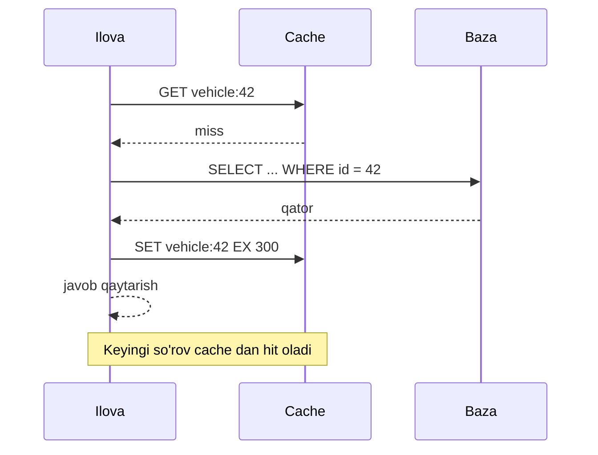

## Bu dars nima uchun kerak

21-22 darslarda app qatlamini ko'paytirdik va trafikni taqsimladik. Lekin keyingi bottleneck deyarli doim baza bo'ladi: har bir so'rov uni o'qiydi, va bazani masshtablash (replication, sharding) qimmat va murakkab. **Cache** - eng arzon masshtablash vositasi: tez-tez o'qiladigan ma'lumot nusxasini tezroq joyda saqlash. Yaxshi cache bazaga tushadigan o'qish yuklamasini 10-100 marta kamaytiradi.

Lekin cache bilan tizimda ma'lumotning **ikki nusxasi** paydo bo'ladi, va ularni mos ushlash - kompyuter fanining mashhur "ikki qiyin muammosi"dan biri. Bu darsda cache ni qayerga qo'yish, unga qanday o'qish va yozish, nima qachon chiqariladi (eviction) va qancha xotira kerakligini ko'ramiz. Cache invalidation, stampede va hot key muammolari hamda Redis ichki tuzilishi 24-darsda chuqur ko'riladi.

Bu darsdan keyin siz:

- hit ratio ning latency va baza yuklamasiga ta'sirini hisoblay olasiz;
- cache-aside, read-through, write-through, write-around, write-back va refresh-ahead naqshlarini va har birining xavfini bilasiz;
- cache-aside dagi klassik race condition ni va nega "update emas, delete" qilinishini tushunasiz;
- LRU, LFU, TTL va W-TinyLFU eviction siyosatlarining farqini va Redis ularni qanday taxminiy amalga oshirishini bilasiz;
- lokal va masofaviy cache ni qachon ishlatishni va cache hajmini qanday hisoblashni bilasiz.

## Cache qayerda bo'lishi mumkin

So'rov yo'lida deyarli har bir qatlamda cache bor:

| Qatlam | Misol | Odatiy latency | Kim boshqaradi |
|---|---|---|---|
| Brauzer / mobil ilova | HTTP cache, lokal saqlash | 0 (tarmoq yo'q) | Cache-Control sarlavhalari |
| CDN / edge | Cloudflare, CloudFront | Mijozga yaqin, o'nlab ms | 25-darsda |
| Reverse proxy | NGINX proxy_cache, Varnish | Data-markaz ichida, ~1 ms | Infratuzilma |
| Ilova ichida (in-process) | Node.js Map, LRU kutubxona, Caffeine | Mikrosekundlar | Ilova kodi |
| Taqsimlangan cache | Redis, Memcached | Data-markaz ichida, ~0.2-1 ms | Ilova kodi |
| Baza ichida | PostgreSQL shared_buffers, OS page cache | RAM tezligida | Baza va OS |

Oxirgi qator haqida eslatma: baza o'zi ham cache. PostgreSQL hujjati shared_buffers uchun boshlang'ich qiymat sifatida RAM ning **25%** ini tavsiya qiladi va 40% dan ko'pi odatda foyda bermasligini yozadi, chunki PostgreSQL OS page cache ga ham tayanadi (4-dars). Ya'ni bazaning "issiq" ma'lumoti allaqachon RAM da bo'lishi mumkin. Tashqi cache ning qo'shimcha foydasi - so'rovni bajarish (parse, plan, join, serializatsiya) va bazaning ulanish va CPU resursini tejash.

## Hit ratio matematikasi

Cache samaradorligining asosiy metrikasi - **hit ratio** (h): so'rovlarning qancha qismi cache dan javob oldi.

O'rtacha kirish vaqti:

```
T = h × T_cache + (1 - h) × (T_cache + T_db + T_set)
```

Cache-aside da miss uchta qadam: cache dan o'qish, bazadan o'qish, cache ga yozish (AWS ElastiCache hujjati ham buni "cache miss penalty" deb ataydi).

Misol: T_cache = 0.5 ms, T_db = 10 ms, T_set = 0.5 ms.

| Hit ratio | O'rtacha T | Bazaga so'rov (10 000 so'rov/s dan) |
|---|---|---|
| 0% (cache yo'q, faqat baza) | 10 ms | 10 000 /s |
| 80% | 0.8 × 0.5 + 0.2 × 11 = 2.6 ms | 2 000 /s |
| 95% | 0.95 × 0.5 + 0.05 × 11 = 1.03 ms | 500 /s |
| 99% | 0.99 × 0.5 + 0.01 × 11 = 0.61 ms | 100 /s |

Muhim kuzatuv: hit ratio 95% dan 99% ga ko'tarilishi "atigi 4%" ko'rinadi, lekin bazaga yuklama **5 baravar** kamayadi (500 dan 100 ga). Baza yuklamasi **miss ratio** ga (1 - h) proporsional. Shuning uchun hit ratio emas, miss ratio haqida o'ylash foydaliroq: 5% dan 1% ga.

Ikkinchi kuzatuv - **modal xatti-harakat** xavfi. Agar baza faqat 500 so'rov/s ko'tara olsa va cache 99% hit beradigan holatda 100 /s olayotgan bo'lsa, cache to'liq o'chganda (restart, flush, tarmoq) bazaga birdan 10 000 /s keladi - 20 baravar ortiq. AWS Builders' Library dagi "Caching challenges and strategies" maqolasi buni "servis cache ga qaram bo'lib qolishi" deb ataydi va cache o'chirilgan holatda load test qilishni, load shedding va dependency ga so'rovlarni cheklashni tavsiya qiladi.

## O'qish naqshlari

### Cache-aside (lazy loading)

Eng keng tarqalgan naqsh. Ilova cache ni ham, bazani ham o'zi boshqaradi:

1. Ilova cache dan `GET key` qiladi.
2. Hit bo'lsa - qaytaradi.
3. Miss bo'lsa - bazadan o'qiydi, `SET key value EX ttl` qiladi va qaytaradi.



Afzalliklari: faqat haqiqatan so'ralgan ma'lumot cache ga tushadi; cache tuguni o'lsa, tizim ishlashda davom etadi (sekinroq, miss lar orqali qayta to'ladi). Kamchiliklari: birinchi so'rov sekin, va baza o'zgarganda cache eskirgan qiymatni saqlaydi - shuning uchun TTL va yozishda invalidatsiya kerak.

### Read-through

Mantiq bir xil, lekin miss da bazaga cache **o'zi** (yoki cache kutubxonasi) boradi, ilova faqat cache bilan gaplashadi. Masalan, Caffeine `LoadingCache` yoki loader funksiyali kutubxonalar. Afzallik: kod soddaroq va bir xil kalit uchun parallel miss larni kutubxona bitta yuklashga birlashtira oladi (request coalescing, 24-dars). Redis o'zi read-through qilmaydi - bu ilova tomonidagi abstraksiya.

### Refresh-ahead

Kalit muddati tugashidan **oldin** fonda yangilanadi, foydalanuvchi esa eski qiymatni olishda davom etadi. Caffeine da `refreshAfterWrite`: muddat o'tgach, keyingi so'rov eski qiymatni darhol oladi, yangilash esa asinxron bajariladi; yangilash xato bersa, eski qiymat saqlanadi. AWS maqolasidagi **soft TTL / hard TTL** g'oyasi shunga yaqin: soft TTL da yangilashga urinish, dependency javob bermasa hard TTL gacha eski ma'lumotni berish. Bu dependency qisqa ishdan chiqqanda ham servisni ishlashda saqlaydi.

## Yozish naqshlari

### Write-through

Yozish bazaga va cache ga **sinxron** ravishda bajariladi. Cache doim yangi qiymatga ega (agar ikki yozuv o'rtasida xato bo'lmasa). Kamchiliklari: har bir yozish ikki joyga (latency), va yozilgan ma'lumotning ko'p qismi hech qachon o'qilmasligi mumkin - cache xotirasi behuda sarflanadi (AWS hujjati buni "cache churn" deydi, TTL bilan yumshatiladi). Yangi bo'sh cache tugunida ma'lumot faqat qayta yozilganda paydo bo'ladi, shuning uchun write-through odatda cache-aside bilan birga ishlatiladi.

### Write-around

Yozish faqat bazaga, cache esa **o'chiriladi** (invalidate) yoki tegilmaydi; keyingi o'qishda cache-aside orqali to'ladi. Kam o'qiladigan, ko'p yoziladigan ma'lumot uchun yaxshi: cache keraksiz yozuvlar bilan to'lmaydi.

### Write-back (write-behind)

Yozish faqat cache ga tushadi va mijozga darhol "tayyor" deyiladi; bazaga keyinroq, asinxron, ko'pincha batch qilib yoziladi. Afzallik: yozish latency si juda past, bir kalitga ko'p yozuvlar bitta bazaga yozuvga birlashadi (coalescing). Xavf: cache tuguni bazaga yozishdan oldin o'lsa, **ma'lumot yo'qoladi**. Bu durability ni cache ning ishonchliligiga bog'laydi.

Write-back ning eng mashhur misollari - cache emas, saqlash tizimlarining o'zi: OS page cache "dirty" sahifalarni keyinroq diskka yozadi, PostgreSQL shared_buffers ham o'zgargan sahifalarni checkpoint da yozadi. Ular ma'lumotni yo'qotmasligi uchun **WAL** ishlatadi (14-dars): avval ketma-ket log ga yoziladi, keyin sahifa ixtiyoriy vaqtda. Ilova darajasida write-back qilmoqchi bo'lsangiz, xuddi shunday durable log kerak - masalan, Kafka (43-dars) yoki Redis da AOF bilan.

### Taqqoslash

| Naqsh | O'qish latency | Yozish latency | Eskirish (staleness) | Ma'lumot yo'qolish xavfi | Qachon |
|---|---|---|---|---|---|
| Cache-aside | Hit da tez, miss da 3 qadam | Baza + invalidatsiya | TTL va invalidatsiyaga bog'liq | Yo'q | Umumiy holat, ko'p o'qish |
| Read-through | Cache-aside kabi | O'zgarmaydi | Xuddi shunday | Yo'q | Kutubxona yoki provayder qo'llasa |
| Write-through | Har doim deyarli hit | Baza + cache (sekinroq) | Past | Yo'q | Yozilgan narsa tez o'qiladi |
| Write-around | Yangi yozuv birinchi o'qishda miss | Faqat baza | Past (invalidatsiya bilan) | Yo'q | Ko'p yozish, kam o'qish |
| Write-back | Tez | Juda tez | Cache - haqiqat manbai | **Bor** | Hisoblagichlar, agregatlar, durable log bilan |
| Refresh-ahead | Doim tez | O'zgarmaydi | Refresh oralig'icha | Yo'q | Issiq, oldindan bilinadigan kalitlar |

## Cache-aside dagi race condition va "delete, update emas"

Yozishda cache ni yangilashning ikki usuli bor: `SET key yangi_qiymat` yoki `DEL key`. Facebook ning "Scaling Memcache at Facebook" (NSDI 2013) maqolasida ular **delete** ni tanlagan, chunki delete idempotent: qayta yuborilsa ham natija bir xil. Ikkinchi sabab - ikki parallel yozuv tartibi buzilsa, `SET` eski qiymatni oxirgi qilib qo'yishi mumkin.

Lekin delete ham to'liq xavfsiz emas. Klassik ketma-ketlik:

1. A o'qish so'rovi: cache miss, bazadan **eski** qiymat v1 ni o'qidi (lekin hali cache ga yozmadi, masalan, GC pauza).
2. B yozish so'rovi: bazaga v2 yozdi, cache dan `DEL key` qildi.
3. A: cache ga `SET key v1` qildi.

Natija: bazada v2, cache da v1, va u TTL tugaguncha qoladi. Facebook bu muammoni (ular "stale set" deydi) **lease** mexanizmi bilan hal qilgan: miss bo'lganda memcached mijozga 64-bitli token beradi, `SET` faqat shu token bilan qabul qilinadi, va oradagi `DEL` tokenni bekor qiladi. Shuning uchun 3-qadamdagi eski `SET` rad etiladi. Lease ning ikkinchi vazifasi - thundering herd ga qarshi (24-dars).

Lease bo'lmagan oddiy tizimlarda bu muammoni yumshatish usullari:

- **qisqa TTL** - xato bo'lsa ham, eskirish TTL bilan chegaralangan;
- **delayed double delete** - yozishdan keyin `DEL`, so'ng bir necha yuz millisekunddan keyin yana `DEL` (oddiy, lekin kafolat emas);
- **versiya bilan yozish** - qiymat bilan birga `updated_at` yoki versiya saqlash va eskiroq versiyani yozmaslik (masalan, Lua skript bilan atomar tekshirish);
- **CDC orqali invalidatsiya** - baza o'zgarishlar oqimidan (48-dars) invalidatsiya qilish, shunda tartib bazaning commit tartibiga mos.

Ikkinchi xavf: **"avval cache, keyin baza"** tartibi. Agar cache dan o'chirib, keyin bazaga yozsangiz, oradagi o'qish eski qiymatni bazadan olib cache ga qaytaradi. To'g'ri tartib - **avval baza (commit), keyin invalidatsiya**. Va invalidatsiya tranzaksiya **commit** bo'lgandan keyin bajarilishi kerak: tranzaksiya ichida `DEL` qilinsa va tranzaksiya hali tugamagan bo'lsa, parallel o'qish commit qilinmagan holatdan oldingi qiymatni cache ga qaytaradi.

## Eviction: xotira to'lganda nima chiqariladi

Cache cheklangan, shuning uchun to'lganda qaysidir kalit chiqarilishi kerak. Ikki alohida mexanizm bor:

- **Expiration (TTL)** - kalit belgilangan vaqtdan keyin o'chadi, xotira to'la bo'lmasa ham. Bu **to'g'rilik** (eskirish chegarasi) uchun.
- **Eviction** - xotira limiti yetganda siyosatga ko'ra chiqarish. Bu **sig'im** uchun.

### Asosiy siyosatlar

- **LRU (least recently used)** - eng uzoq vaqt murojaat qilinmagan kalit. Vaqtga nisbatan lokal bo'lgan yuklamada yaxshi. Kamchiligi: bitta katta skan (masalan, hisobot barcha mashinalarni bir marta o'qiydi) issiq kalitlarni siqib chiqaradi.
- **LFU (least frequently used)** - eng kam murojaat qilingan kalit. Barqaror mashhur kalitlarni saqlaydi, skanga chidamli. Kamchiligi: ilgari mashhur bo'lgan, endi kerak bo'lmagan kalit uzoq qoladi, shuning uchun hisoblagich vaqt bilan kamaytirilishi (decay) kerak.
- **TTL asosida** - eng tez muddati tugaydigan kalit.
- **Random** - tasodifiy. Ajablanarli darajada yomon emas va juda arzon.
- **FIFO** - eng eski yozilgan.

### Redis qanday qiladi

Redis `maxmemory-policy` sozlamasi bilan quyidagilardan birini tanlaydi: `noeviction`, `allkeys-lru`, `allkeys-lfu`, `allkeys-random`, `volatile-lru`, `volatile-lfu`, `volatile-random`, `volatile-ttl`; Redis 8.6 dan boshlab `allkeys-lrm` va `volatile-lrm` (oxirgi **o'zgartirilgan** vaqt bo'yicha) ham qo'shilgan. `volatile-*` siyosatlar faqat TTL li kalitlardan tanlaydi va TTL li kalit bo'lmasa `noeviction` kabi ishlaydi.

Muhim tuzoq: redis.conf dagi standart qiymat **`noeviction`**. Ya'ni Redis ni cache sifatida ishlatsangiz va siyosatni o'zgartirmasangiz, xotira to'lganda yozish buyruqlari **xato** qaytaradi. Cache uchun odatda `allkeys-lru` yoki `allkeys-lfu` qo'yiladi.

Redis aniq LRU ni saqlamaydi (har bir kalit uchun bog'langan ro'yxat qo'shimcha xotira talab qiladi). Buning o'rniga bir nechta tasodifiy kalitni tanlab (`maxmemory-samples`, standart 5), ulardan eng eskisini chiqaradi; Redis 3.0 dan boshlab yaxshi nomzodlar pool i saqlanadi va natija haqiqiy LRU ga juda yaqin. Samples ni 10 ga oshirish aniqroq, lekin ko'proq CPU.

Redis LFU (4.0 dan) har bir kalitda kichik **Morris counter** (0-255 oralig'ida, ehtimoliy o'suvchi) saqlaydi. `lfu-log-factor` hisoblagich qanchalik tez to'yinishini belgilaydi (hujjatdagi misolda 10 bo'lganda taxminan 1 million murojaatda 255 ga yetadi), `lfu-decay-time` esa hisoblagich necha daqiqada kamaytirilishini (misolda 1 daqiqa).

### W-TinyLFU: zamonaviy in-process cache lar

Einziger, Friedman va Manes ning "TinyLFU: A Highly Efficient Cache Admission Policy" (2015) maqolasi muhim g'oyani qo'shadi: muammo faqat **kimni chiqarish** emas, balki **kimni qabul qilish** (admission). Yangi kalit faqat chiqarilishi kerak bo'lgan kalitdan **tez-tez** murojaat qilingan bo'lsa, cache ga kiradi. Chastotalar ixcham ehtimoliy struktura (Count-Min Sketch turidagi) bilan taxmin qilinadi.

Java dagi Caffeine kutubxonasi W-TinyLFU ni ishlatadi: yangi kalitlar kichik LRU "oyna" ga tushadi, oynadan chiqqan kalit asosiy Segmented LRU ga faqat TinyLFU filtri ruxsat bersa o'tadi. Caffeine 4-bitli CountMinSketch ishlatadi va oyna/asosiy qism nisbatini hill-climbing bilan moslashtiradi. Natija: skan va bir martalik kalitlarga chidamli, LRU dan ko'p yuklamalarda sezilarli yaxshi hit ratio.

## Lokal va taqsimlangan cache

| Mezon | Lokal (in-process) | Taqsimlangan (Redis, Memcached) |
|---|---|---|
| Latency | Mikrosekundlar, tarmoq yo'q | Tarmoq round trip, odatda sub-millisekund |
| Sig'im | Bitta process xotirasi | Klaster bo'yicha, yuzlab GB |
| Moslik | Har bir instance da o'z nusxasi, invalidatsiya qiyin | Hamma bir nusxani ko'radi |
| Hit ratio | N instance da N ta sovuq cache | Umumiy, deploy da saqlanadi |
| Baza yuklamasi | Instance lar soni bilan o'sadi | Instance lar soniga bog'liq emas |
| Nosozlik | Process bilan birga o'ladi | Alohida flot, alohida mavjudlik |
| Serializatsiya | Kerak emas (obyekt) | Har safar serialize va parse |

AWS maqolasi ta'kidlaydi: lokal cache ning yashirin muammosi - har bir yangi server **bo'sh** cache bilan boshlanadi (cold start), va deploy da butun flot bir vaqtda sovuq bo'ladi. Ko'p tizimlar ikki darajali yondashuv ishlatadi: juda issiq va kam o'zgaradigan kalitlar uchun qisqa TTL li lokal cache (L1), qolgani uchun Redis (L2). Redis 6 dan boshlab **client-side caching** (tracking) bor: server klient o'qigan kalitlarni eslab qoladi va ular o'zgarganda klientga invalidatsiya xabari yuboradi (yoki broadcasting rejimida prefix bo'yicha). Bu L1 invalidatsiyasini sezilarli osonlashtiradi.

## Cache hajmini hisoblash

Haqiqiy yuklamalarda murojaatlar odatda notekis (Zipf ga yaqin taqsimot): kalitlarning kichik qismi so'rovlarning katta qismini oladi. Shuning uchun hamma narsani cache ga sig'dirish shart emas - **ishchi to'plam** (working set) sig'ishi kerak.

Misol hisob:

- 50 000 ta mashina, har biri uchun "oxirgi holat" obyekti JSON da taxminan 1 KB.
- Redis da har bir kalitning qo'shimcha xarajati (kalit nomi, ichki struktura, expire) - deylik, taxminan 100 bayt (aniq qiymat struktura va versiyaga bog'liq, `MEMORY USAGE` bilan o'lchang).
- 50 000 × 1.1 KB = **55 MB**. Bu kichik - hammasini cache da ushlash mumkin.

Endi marshrut tarixi: kuniga 50 000 mashina × 8 640 nuqta (10 soniyada bir) × 100 bayt = **43 GB/kun**. Buni cache ga sig'dirish mantiqsiz. Lekin dispetcherlar asosan "bugungi" va "kechagi" marshrutlarni ko'radi va faqat ozchilik mashinalar uchun. Cache ga butun tarixni emas, **so'ralgan marshrut javoblarini** (masalan, mashina + kun + soddalashtirilgan trek) qo'yish to'g'ri.

Qo'shimcha qoidalar:

- Redis da `maxmemory` ni mashina RAM idan sezilarli kichik qo'ying: fork (RDB snapshot) va fragmentatsiya uchun joy kerak (24-dars).
- Hit ratio ni **kalit turi bo'yicha** o'lchang, umumiy raqam muammoli kalit turini yashiradi.
- Hajmni taxmin bilan emas, real trafik trace i bilan simulyatsiya qilish mumkin (masalan, so'rov loglaridan turli hajm va siyosatlar bilan hit ratio hisoblash).

## Real tizimlardan misollar

- **Facebook memcache** (NSDI 2013): soniyasiga milliardlab so'rov, trillionlab element. Look-aside (cache-aside) naqsh, yozishda delete, lease lar, ishdan chiqqan serverlar o'rniga klasterdagi serverlarning taxminan 1% ini tashkil qiluvchi "Gutter" pool. Maqolaga ko'ra lease lar thundering herd ga moyil kalitlar uchun bazaga cho'qqi so'rovni 17 ming/s dan 1.3 ming/s gacha kamaytirgan.
- **Netflix EVCache** (2013): memcached asosidagi taqsimlangan cache. Nomi Ephemeral (TTL bilan yo'qoladi), Volatile (istalgan vaqtda chiqarilishi mumkin) Cache. Yozish bir nechta Availability Zone dagi nusxalarga, o'qish lokal zonadan.
- **AWS ElastiCache** hujjati: lazy loading va write-through ni birga ishlatish va har doim TTL qo'shishni tavsiya qiladi.

## iQuariX kontekstida

Faraz qiling, dispetcher paneli uchun quyidagi o'qishlar bor:

1. **Mashinaning oxirgi holati** (joylashuv, tezlik, yoqilg'i) - juda ko'p o'qiladi, har 10-30 soniyada yangilanadi.
2. **Mashina va haydovchi ma'lumotnomasi** (nomi, raqami, guruhi) - ko'p o'qiladi, kam o'zgaradi.
3. **Kunlik hisobotlar** (yurgan masofa, yoqilg'i sarfi) - og'ir hisoblanadi, o'tgan kunlar uchun o'zgarmaydi.
4. **Geofence ro'yxati** - har bir telemetriya nuqtasida tekshiriladi.

Mos naqshlar:

- **Oxirgi holat** - write-through (aniqrog'i, telemetriya worker har bir nuqtada `SET vehicle:last:42` qiladi). Bu yerda Redis amalda asosiy manba, bazada esa tarix. TTL qo'yish foydali (masalan, 24 soat) - jim qolgan mashinalar xotirani band qilmaydi va "oflayn" holatini aniqlash osonlashadi.
- **Ma'lumotnoma** - cache-aside, TTL 5-10 daqiqa, yozishda commit dan keyin `DEL`. Bundan tashqari, API instance ichida 30-60 soniyalik lokal L1 cache (yoki Redis client-side caching).
- **Hisobotlar** - o'tgan kunlar uchun uzun TTL (o'zgarmas ma'lumot), bugungi kun uchun qisqa TTL yoki umuman cache siz. Kalitga sana va tenant kiritilsin: `report:{tenant}:{vehicle}:{date}`.
- **Geofence** - telemetriya worker lari ichida lokal cache, chunki har bir nuqtada Redis ga borish tarmoq round trip qo'shadi. Geofence o'zgarganda pub/sub orqali invalidatsiya.
- **Write-back qayerda?** Masalan, "bugungi yurgan masofa" hisoblagichi: har bir nuqtada bazaga yozish o'rniga Redis da `INCRBYFLOAT` va har daqiqada bazaga flush. Redis o'lsa, so'nggi bir daqiqalik hisob yo'qolishi mumkin - lekin uni xom telemetriyadan qayta hisoblash mumkin bo'lgani uchun bu qabul qilinadi.

Multi-tenant xavfi: kalitda tenant_id bo'lmasa, bir mijozga boshqasining ma'lumoti chiqishi mumkin. Cache kalitlarini loyihalash ham xavfsizlik masalasi (73-dars).

## Ko'p uchraydigan xatolar

1. **Redis ni standart `noeviction` bilan cache sifatida ishlatish.** Xotira to'lganda yozishlar xato beradi va ilova qulaydi.
2. **TTL siz kalitlar.** Invalidatsiyada bitta xato abadiy eskirgan ma'lumotga aylanadi. Har doim TTL - xavfsizlik to'ri.
3. **Avval cache ni o'chirib, keyin bazaga yozish** yoki tranzaksiya commit bo'lmasdan invalidatsiya qilish.
4. **Cache o'chganda bazani sinab ko'rmaslik.** 99% hit ratio bilan ishlaydigan tizim cache flush dan keyin bazani 100 baravar yuklama bilan bosadi.
5. **Write-back ni durable log siz qilish.** Cache tuguni o'lsa, "saqlandi" deb javob berilgan ma'lumot yo'qoladi.
6. **Faqat umumiy hit ratio ni kuzatish.** Bitta kalit turi 20% hit bilan bazani yuklaydi, umumiy raqam esa 95% ko'rsatadi.
7. **Kalitda versiya, tenant yoki parametrlarni unutish.** Turli foydalanuvchilar yoki API versiyalari bir-birining javobini oladi.
8. **Hamma narsani cache lash.** Kam o'qiladigan yoki tez o'zgaradigan ma'lumot faqat xotirani va murakkablikni oshiradi.

## Xulosa

- Baza yuklamasi miss ratio ga proporsional: 95% dan 99% hit ga o'tish bazani 5 baravar yengillashtiradi.
- Cache-aside - standart naqsh; write-through yangi ma'lumotni tez beradi; write-around keraksiz yozuvlardan himoya qiladi; write-back tez, lekin durability ni cache ga bog'laydi.
- Yozishda: avval baza commit, keyin `DEL`. Stale set race i bor - TTL, versiya, lease yoki CDC bilan yumshatiladi.
- Eviction (sig'im) va TTL (to'g'rilik) - alohida mexanizmlar. Redis standarti `noeviction`, cache uchun `allkeys-lru` yoki `allkeys-lfu` qo'ying.
- Redis LRU va LFU ni namunalash (sampling) bilan taxminiy bajaradi; zamonaviy in-process cache lar W-TinyLFU admission filtri bilan LRU dan yaxshiroq natija beradi.
- Lokal cache tez, lekin har instance da sovuq va nomuvofiq; taqsimlangan cache umumiy, lekin tarmoq va serializatsiya narxi bor. Ko'pincha ikki daraja.
- Cache o'chgan holatni rejalashtiring: tizim cache ga qaram bo'lib qolmasin.

## Amaliy topshiriq

Faraz qiling, iQuariX dispetcher paneli bosh sahifasi har ochilganda quyidagilarni yuklaydi: tenant ning barcha mashinalari ro'yxati (o'rtacha 200, eng kattasida 5 000), har birining oxirgi holati, aktiv ogohlantirishlar soni va bugungi umumiy statistika. Cho'qqida 2 000 dispetcher, sahifa har 15 soniyada yangilanadi.

1. **Yuklamani hisoblang**: cache siz bazaga soniyasiga qancha so'rov tushadi (taxminlaringizni yozing).
2. Har bir ma'lumot turi uchun **cache naqshini** tanlang (cache-aside, write-through, write-back, refresh-ahead) va TTL ni asoslang.
3. **Kalit sxemasini** yozing (tenant, versiya, parametrlar) va invalidatsiya qachon, kim tomonidan qilinishini aniqlang.
4. **Race condition**: mashina guruhi o'zgartirilganda eski qiymat cache da qolib ketmasligi uchun nima qilasiz?
5. **Cache hajmini** hisoblang va Redis `maxmemory` va eviction siyosatini tanlang.
6. **Cache yo'q stsenariysi**: Redis 5 daqiqa ishlamadi. Baza nimani ko'radi, va siz uni qanday himoya qilasiz?

Yaxshi javobda bo'lishi kerak bo'lgan narsalar:

- yuklama hisobida o'rtacha va cho'qqi, hit ratio dan baza so'rovlariga o'tish;
- oxirgi holat uchun write-through, ma'lumotnoma uchun cache-aside, og'ir agregatlar uchun refresh-ahead yoki uzun TTL kabi farqlangan tanlov;
- kalitlarda tenant_id;
- "commit dan keyin DEL" va TTL ni xavfsizlik to'ri sifatida;
- `noeviction` tuzog'i va maxmemory hisobida qo'shimcha xarajat;
- Redis o'chganda load shedding yoki so'rovlarni cheklash, lokal fallback cache.

Javobni pastdagi maydonga yozib, chatga yuboring.

## Manbalar

- Rajesh Nishtala va boshq. [Scaling Memcache at Facebook](https://www.usenix.org/conference/nsdi13/technical-sessions/presentation/nishtala), NSDI 2013 - look-aside, delete, lease, Gutter pool. [PDF](https://www.usenix.org/system/files/conference/nsdi13/nsdi13-final170_update.pdf).
- Matt Brinkley, Jas Chhabra. [Caching challenges and strategies](https://aws.amazon.com/builders-library/caching-challenges-and-strategies/), Amazon Builders' Library - lokal vs tashqi, cold start, soft/hard TTL, cache ga qaramlik.
- AWS. [Caching strategies (ElastiCache)](https://docs.aws.amazon.com/AmazonElastiCache/latest/dg/Strategies.html) - lazy loading, write-through, TTL.
- Redis. [Key eviction](https://redis.io/docs/latest/develop/reference/eviction/) - siyosatlar, taxminiy LRU, LFU. [redis.conf](https://raw.githubusercontent.com/redis/redis/unstable/redis.conf) - `maxmemory-policy noeviction` standarti. [Client-side caching](https://redis.io/docs/latest/develop/reference/client-side-caching/).
- Gil Einziger, Roy Friedman, Ben Manes. [TinyLFU: A Highly Efficient Cache Admission Policy](https://arxiv.org/abs/1512.00727), 2015. Caffeine wiki: [Efficiency](https://github.com/ben-manes/caffeine/wiki/Efficiency) va [Refresh](https://github.com/ben-manes/caffeine/wiki/Refresh).
- Netflix. [Announcing EVCache](https://netflixtechblog.com/announcing-evcache-distributed-in-memory-datastore-for-cloud-c26a698c27f7), 2013.
- PostgreSQL. [Resource Consumption: shared_buffers](https://www.postgresql.org/docs/current/runtime-config-resource.html).
