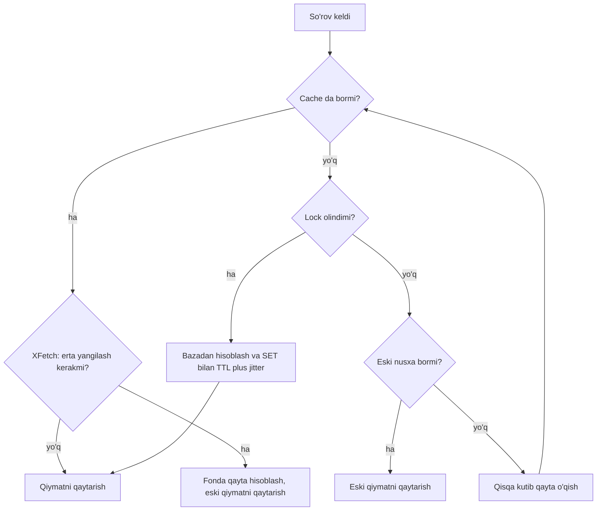

## Bu dars nima uchun kerak

23-darsda cache naqshlari va eviction ni ko'rdik. Bu dars - cache production da qanday **buziladi** haqida. Cache bilan bog'liq uzilishlarning ko'pchiligi naqsh tanlovidan emas, uchta muammodan keladi:

1. **Invalidation** - ma'lumot o'zgardi, cache esa eski qiymatni beryapti.
2. **Stampede (thundering herd)** - mashhur kalit muddati tugadi va minglab so'rov bir vaqtda bazaga yopirildi.
3. **Hot key** - bitta kalit shunchalik ko'p o'qiladiki, uni saqlayotgan bitta Redis tuguni yoki shard yiqiladi.

Bularni to'g'ri hal qilish uchun cache serverining o'zi qanday ishlashini bilish kerak. Shuning uchun darsning ikkinchi yarmi Redis ichki tuzilishiga bag'ishlangan: bitta thread li buyruq bajarilishi, ma'lumot strukturalarining ichki kodlanishi, expire mexanizmi, persistence va fork, Redis Cluster dagi hash slot lar.

Bu darsdan keyin siz:

- invalidatsiya strategiyalarini (TTL, explicit delete, versiyali kalit, CDC, pub/sub) va ularning kafolatlarini bilasiz;
- stampede ga qarshi uch usulni (lock / request coalescing, lease, probabilistic early expiration) formula bilan tushunasiz;
- hot key ni aniqlash va bo'lish usullarini bilasiz;
- Redis nega bitta thread da tez ishlashini va qaysi buyruqlar uni bloklashini bilasiz;
- RDB, AOF va fork ning latency va xotiraga ta'sirini hisoblay olasiz;
- Redis Cluster ning 16 384 hash slot modelini va qaysi holatda yozuvlar yo'qolishi mumkinligini bilasiz.

## Invalidation: eskirgan ma'lumot bilan kurash

Cache dagi qiymat bazadagi qiymatning **nusxasi**. Ular har doim ham bir xil emas, va savol "qachon bir xil bo'ladi" emas, "qanchalik farq qilishi mumkin va qancha vaqt" degan savol.

### Strategiyalar

| Strategiya | Qanday | Eskirish chegarasi | Narx va xavf |
|---|---|---|---|
| Faqat TTL | Kalit N soniyadan keyin o'chadi | Maksimal TTL | Oddiy; qisqa TTL = ko'p miss, uzun TTL = uzoq eskirish |
| Explicit delete | Yozuvdan keyin `DEL` | Odatda millisekundlar, race da TTL gacha | Har bir yozish yo'lida unutmaslik kerak |
| Versiyali kalit | Kalitga versiya qo'shish: `vehicle:42:v17` | Yangi versiya darhol | Eski versiyalar TTL bilan o'chadi, xotira sarfi |
| Pub/sub invalidatsiya | Yozuvchi xabar yuboradi, barcha lokal cache lar tozalaydi | Xabar yetkazilish vaqti | Pub/sub kafolatsiz: uzilishda xabar yo'qoladi |
| CDC asosida | Bazaning o'zgarish logidan (WAL) invalidatsiya | Replication lag | Ishonchli tartib, qo'shimcha infratuzilma (48-dars) |
| Redis client tracking | Server o'zi klientga invalidatsiya yuboradi | Ulanish holatiga bog'liq | Faqat Redis kalitlari uchun, L1 cache ga |

Amaliy qoida: **har doim TTL** va uning ustiga **explicit invalidatsiya**. TTL - xatolarga qarshi xavfsizlik to'ri: invalidatsiya kodida bug bo'lsa ham, eskirish cheklangan.

### Invalidatsiya qiyin bo'lgan holatlar

- **Hosila (derived) ma'lumot.** Cache da bitta qator emas, JOIN yoki agregat natijasi saqlansa (masalan, "tenant ning barcha mashinalari ro'yxati"), qaysi yozuv qaysi kalitlarni eskirtirishini aniqlash qiyin. Yechim: kalitlar orasida bog'lanish (tag) saqlash yoki shunday ma'lumotga faqat qisqa TTL.
- **Ro'yxat va sahifalash.** `list:tenant:7:page:3` ni har bir yangi qatorda invalidatsiya qilish kerak. Ko'pincha ro'yxatlarni cache lash o'rniga ID lar ro'yxati + har bir obyekt alohida cache.
- **Ko'p regionli tizim.** Facebook memcache maqolasi ko'rsatadiki, replikadan o'qiydigan regionda invalidatsiyani bazaning o'zgarish oqimidan qilish kerak (ular buni mcsqueal nomli daemon bilan qilgan: u baza commit qilgan SQL so'rovlardan delete larni ajratib, memcache klasterlariga tarqatadi), aks holda cache replika hali olmagan eski qiymat bilan qayta to'ladi.
- **Replika va cache poygasi.** Yozish primary ga, `DEL` cache ga, keyingi o'qish esa hali yangilanmagan replikadan (26-dars) - cache yana eski qiymat bilan to'ladi. Yechim: yozgandan keyin qisqa vaqt shu kalitni primary dan o'qish yoki CDC asosidagi invalidatsiya.

## Cache stampede

**Stampede** - mashhur kalit cache dan yo'qolgan paytda (TTL tugadi, eviction, restart) ko'p parallel so'rov bir vaqtda miss olib, hammasi bazaga borishi va bir xil qiymatni qayta hisoblashi.

Hisob: kalit soniyasiga 2 000 marta o'qiladi, uni qayta hisoblash (og'ir SQL) 500 ms. TTL tugagan paytdan birinchi so'rov natijani cache ga yozguncha 500 ms o'tadi. Shu vaqtda 2 000 × 0.5 = **1 000 ta** so'rov miss oladi va har biri bir xil og'ir SQL ni yuboradi. Agar bu SQL bazada 1 CPU yadroni 500 ms band qilsa, 1 000 parallel nusxa bazani bir necha soniyaga to'liq bosadi, so'rovlar sekinlashadi, qayta hisoblash 500 ms dan oshadi, va oyna yanada kengayadi. Bu ijobiy teskari aloqa (positive feedback) - cascading failure ning klassik boshlanishi (64-dars).

Uch asosiy yechim bor.

### 1. Lock yoki request coalescing

Miss bo'lganda faqat **bitta** so'rov qayta hisoblaydi, qolganlari kutadi yoki eski qiymatni oladi.

- **Process ichida:** bir xil kalit uchun parallel miss larni bitta Promise ga birlashtirish. Go da `singleflight` paketi aynan shu: bir kalit uchun bir vaqtda faqat bitta bajarilish, qolgan chaqiruvchilar uning natijasini oladi. Node.js da kalit bo'yicha `Map<key, Promise>`.
- **Taqsimlangan:** Redis da `SET lock:key token NX PX 5000`. Lock ni olgan so'rov qayta hisoblaydi, qolganlari qisqa kutib qayta o'qiydi yoki eski qiymatni (agar saqlangan bo'lsa) beradi. Lock ni bo'shatishda token tekshiriladi (Lua skript bilan: faqat qiymat o'zimizniki bo'lsa `DEL`), aks holda muddati o'tib boshqa so'rov olgan lock ni o'chirib yuborish mumkin. Distributed lock larning chuqur muammolari 38-darsda.

Process ichidagi coalescing 20 instance da stampede ni 1 000 dan 20 ga tushiradi. Taqsimlangan lock esa 1 ga, lekin har bir miss ga qo'shimcha Redis round trip qo'shadi.

### 2. Lease (Facebook usuli)

23-darsda ko'rilgan lease token stampede ga qarshi ham ishlaydi: memcached bir kalit uchun token ni har 10 soniyada faqat bir marta beradi (standart sozlama). Token olmagan mijozlar qisqa kutib qayta urinadi, va bu vaqtga kelib qiymat odatda allaqachon cache da bo'ladi. Maqolada keltirilishicha, thundering herd ga moyil kalitlar uchun bazaga cho'qqi so'rov bir haftalik kuzatuvda 17 ming/s dan 1.3 ming/s ga tushgan.

### 3. Probabilistic early expiration (XFetch)

Vattani, Chierichetti va Lowenstein ning "Optimal Probabilistic Cache Stampede Prevention" (VLDB 2015) maqolasi lock siz yechim beradi: har bir so'rov kalit muddati tugashidan **oldin**, tasodifiy ehtimol bilan, qayta hisoblashga qaror qilishi mumkin. Ehtimol muddat yaqinlashgan sari oshadi. Qoida:

```
agar  hozir - Δ × β × ln(rand())  ≥  expiry  bo'lsa  ->  qayta hisobla
```

- Δ - qiymatni qayta hisoblash vaqti (cache ga qiymat bilan birga saqlanadi);
- β - agressivlik koeffitsienti, standart 1; β > 1 erta yangilashni kuchaytiradi;
- rand() - (0, 1] oralig'idagi tasodifiy son, shuning uchun -ln(rand()) musbat va eksponensial taqsimlangan (o'rtachasi 1).

Misol: Δ = 0.5 s, β = 1. Muddatgacha 2 soniya qolgan. Qayta hisoblash uchun -0.5 × ln(r) ≥ 2, ya'ni ln(r) ≤ -4, r ≤ e^(-4) ~ 0.018. Har bir so'rov taxminan 1.8% ehtimol bilan yangilaydi. Soniyasiga 2 000 so'rovda bu deyarli darhol kimdir yangilaydi degani. Muddatgacha 10 soniya qolganda esa ehtimol e^(-20), ya'ni amalda nol. Ya'ni yangilash muddat oxiriga yaqin, lekin undan **oldin** va odatda bitta yoki bir nechta so'rov tomonidan sodir bo'ladi.

Afzalligi: lock yo'q, qo'shimcha round trip yo'q, foydalanuvchilar hech qachon miss ni kutmaydi. Kamchiligi: kam o'qiladigan kalitlarda ishlamaydi (muddatgacha hech kim so'ramasa, oddiy miss bo'ladi) - lekin u yerda stampede ham yo'q.

### 4. Qo'shimcha usullar

- **TTL ga jitter.** Bir vaqtda yaratilgan ko'p kalitlarga bir xil TTL berilsa, ular bir vaqtda tugaydi. TTL ga ±10-20% tasodifiy qo'shimcha. Redis hujjati ham bir vaqtda muddati tugaydigan ko'p kalitlar Redis ni blokka tushirishi mumkinligini ogohlantiradi (pastda).
- **Stale-while-revalidate.** Kalitda ikki muddat: soft TTL o'tganda eski qiymat beriladi va fonda yangilanadi, hard TTL o'tganda haqiqiy miss.
- **Oldindan isitish (warm-up).** Deploy yoki cache flush dan keyin eng issiq kalitlarni trafik kelishidan oldin yuklash.



## Hot key

**Hot key** - bitta kalitga murojaatlar shunchalik ko'pki, uni saqlayotgan bitta tugun sig'imi yetmaydi. Taqsimlangan cache da kalit bitta shard ga tegishli, shuning uchun klasterga tugun qo'shish yordam bermaydi: hamma so'rov baribir o'sha bitta tugunga boradi.

Hisob: Redis tuguni pipelining siz oddiy GET larda soniyasiga taxminan 100-200 ming buyruq bajara oladi (Redis benchmark hujjatidagi misolda pipelining siz SET taxminan 180 ming so'rov/s; natijalar apparatga qattiq bog'liq). Endi kalit qiymati 50 KB (masalan, tenant ning barcha mashinalari JSON da) va soniyasiga 20 000 marta o'qiladi: 20 000 × 50 KB = **1 GB/s ~ 8 Gbit/s** chiquvchi trafik. Bu buyruqlar soni bo'yicha emas, **tarmoq** bo'yicha tugunni to'ldiradi. Katta qiymatli hot key (big key) ikki baravar xavfli.

### Aniqlash

- `redis-cli --hotkeys` (LFU siyosati yoqilgan bo'lsa ishlaydi) va `redis-cli --bigkeys`;
- tugunlar bo'yicha CPU va tarmoq notekisligini monitoring: bitta shard qolganlaridan sezilarli band bo'lsa, odatda hot key;
- ilova tomonida kalit bo'yicha so'rov hisoblagichi (namuna olib).

### Yechimlar

1. **Lokal L1 cache.** Eng samarali: hot key ni har bir app instance xotirasida 1-5 soniya saqlash. 50 instance bo'lsa, Redis ga yuklama 20 000/s dan taxminan 50 × (1 / TTL) ga tushadi. Facebook ham bir kalitga juda ko'p murojaat bo'lganda bunday kalitlarni ko'paytirgan (replicated pool).
2. **Kalitni replikatsiya qilish (key splitting).** `hot:key#0` ... `hot:key#N-1` nusxalari, ular turli shard larga tushadi. O'qishda tasodifiy nusxa tanlanadi, yozishda hammasi yangilanadi. O'qish ko'p, yozish kam bo'lsa yaxshi.
3. **Replika lardan o'qish.** Redis replika laridan o'qish (eventual consistency bilan) o'qish sig'imini oshiradi.
4. **Qiymatni kichraytirish.** 50 KB JSON o'rniga hash maydonlari, siqish yoki faqat kerakli qismni o'qish (`HMGET`).
5. **Yozuvdagi hot key** (masalan, global hisoblagich `INCR`): hisoblagichni N ta bo'lakka ajratish va o'qishda yig'ish, yoki lokal yig'ib davriy flush qilish.

Hot key ning sharding dagi umumiy ko'rinishi (hot partition) 30-darsda ko'riladi.

## Redis ichki tuzilishi

### Bitta thread li buyruq bajarilishi

Redis hujjatida yozilishicha, buyruqlarni bajarish nuqtai nazaridan Redis asosan bitta thread li server va bir nechta CPU yadrodan foyda olish uchun mo'ljallanmagan; ko'p yadroda masshtablash uchun bir nechta instance ishga tushirish kutiladi. Ichida epoll yoki kqueue asosidagi event loop: ko'plab ulanishdan kelgan buyruqlar navbat bilan, bir-biridan keyin bajariladi.

Nega bu tez:

- barcha ma'lumot RAM da, ko'p buyruqlar O(1) yoki O(log N);
- lock yo'q - har bir buyruq atomar, chunki bir vaqtda boshqa buyruq bajarilmaydi;
- vaqtning asosiy qismi tarmoq I/O ga ketadi, hisob-kitobga emas.

Redis 6 dan boshlab **I/O threads** bor: `io-threads` sozlamasi bilan socket o'qish, yozish va protokol parse qilish yordamchi thread larda bajariladi, lekin buyruqlarning o'zi baribir asosiy thread da. redis.conf izohida bu standart holatda o'chirilgan, kamida 4 yadroli mashinada va Redis CPU ni haqiqatan ko'p ishlatayotgan bo'lsagina yoqish tavsiya etiladi. `UNLINK` (4.0 dan) kabi ba'zi operatsiyalar xotirani fonda bo'shatadi.

Bitta thread ning oqibati: **bitta sekin buyruq barcha mijozlarni bloklaydi**. Xavfli buyruqlar:

- `KEYS *` - butun keyspace ni skan qiladi. Production da ishlatmang, o'rniga `SCAN` (kursor bilan bosqichma-bosqich);
- katta kolleksiyalarda O(N) buyruqlar: `SMEMBERS`, `HGETALL`, `LRANGE 0 -1`, `SUNION`, `SORT`, katta `ZRANGE`;
- katta kalitni `DEL` qilish (millionlab elementli set) - xotirani bo'shatish asosiy thread da. `UNLINK` kalitni darhol o'chiradi, xotirani esa fonda bo'shatadi;
- uzoq Lua skriptlari - skript bajarilayotganda boshqa hech narsa bajarilmaydi.

Sekin buyruqlarni `SLOWLOG GET` bilan topasiz.

### Ma'lumot strukturalari va ichki kodlanish

Redis kalit-qiymat do'koni, qiymatlar esa turli tipda: string, hash, list, set, sorted set, stream, bitmap, HyperLogLog, geospatial indeks va boshqalar. Har bir tip ichida kichik va katta o'lchamlar uchun turli kodlanish bor:

| Tip | Kichik bo'lganda | Katta bo'lganda | redis.conf dagi standart chegara |
|---|---|---|---|
| Hash | listpack (ketma-ket ixcham massiv) | hash table | 512 ta element, qiymat 64 baytgacha |
| Set (faqat butun sonlar) | intset | hash table | 512 ta element |
| Set (aralash) | listpack | hash table | 128 ta element, 64 bayt |
| Sorted set | listpack | skiplist + hash table | 128 ta element, 64 bayt |
| List | quicklist (listpack lar zanjiri) | quicklist | tugun hajmi sozlanadi |

Listpack da qidiruv O(N), lekin N kichik va ma'lumot bitta xotira blokida bo'lgani uchun CPU cache ga yaxshi tushadi (4-dars) va xotirani bir necha baravar tejaydi. Shuning uchun amaliy naqsh: millionlab mayda string kalit o'rniga ularni kichik hash larga guruhlash (har bir kalitning o'zi ham xotira xarajatiga ega).

Sorted set ning skiplist + hash table kombinatsiyasi: hash table a'zo bo'yicha O(1) qidiruv (`ZSCORE`), skiplist esa tartib bo'yicha O(log N) qo'shish va diapazon (`ZRANGEBYSCORE`). Leaderboard, vaqt bo'yicha indeks, sliding window rate limiter (56-dars) shu struktura ustida quriladi.

### Expire mexanizmi

TTL li kalitlar ikki yo'l bilan o'chiriladi:

- **Lazy (passiv).** Kalitga murojaat qilinganda muddati tugaganligi tekshiriladi va o'chiriladi.
- **Active.** Redis hujjatiga ko'ra soniyasiga 10 marta TTL li kalitlardan 20 tasi namuna sifatida olinadi, muddati tugaganlari o'chiriladi; agar namunaning 25% idan ko'pi muddati tugagan bo'lsa, jarayon takrorlanadi.

Oqibat: agar juda ko'p kalit **bir xil soniyada** tugasa (masalan, `EXPIREAT` bilan bitta vaqt belgisi berilgan), va ular TTL li kalitlarning kamida 25% ini tashkil qilsa, Redis ularni tozalash uchun sezilarli vaqt bloklanishi mumkin. Bu TTL jitter ning ikkinchi sababi.

Yana bir oqibat: muddati tugagan, lekin hech kim murojaat qilmagan kalitlar bir muddat xotirada qoladi. `INFO` dagi `expired_keys` va xotira ko'rsatkichlarini kuzatish kerak.

### Persistence: RDB, AOF va fork

Redis RAM da ishlaydi, lekin diskka saqlashi mumkin:

- **RDB** - davriy snapshot. Redis `fork()` qiladi, bola process copy-on-write orqali ma'lumotning "muzlatilgan" nusxasini faylga yozadi, ota process esa mijozlarga xizmat qilishda davom etadi. Snapshotlar orasidagi o'zgarishlar crash da yo'qoladi (odatda daqiqalar).
- **AOF** - har bir yozish buyrug'ining logi. `appendfsync` sozlamasi: `always` (har bir yozuvdan keyin fsync, eng xavfsiz va eng sekin), `everysec` (standart va tavsiya etiladi, crash da taxminan 1 soniyalik ma'lumot yo'qolishi mumkin), `no` (OS hal qiladi). AOF vaqti-vaqti bilan qayta yoziladi (rewrite), bu ham fork orqali.

Redis hujjati PostgreSQL ga yaqin xavfsizlik kerak bo'lsa ikkalasini birga ishlatishni tavsiya qiladi.

**Fork narxi.** `fork()` asosiy thread da bajariladi va vaqti process ning page table hajmiga proporsional. Hujjatdagi misol: 24 GB instance uchun page table taxminan 24 GB / 4 KB × 8 bayt ~ 48 MB. Hujjatda keltirilgan o'lchovlarda fizik serverda fork taxminan 9-13 ms/GB, eski Xen virtual mashinalarida esa 200-400 ms/GB dan ortiq bo'lgan (raqamlar eski, o'z muhitingizda `INFO` dagi `latest_fork_usec` bilan o'lchang). 24 GB da fizik serverda ham ~0.2-0.3 soniyalik pauza.

**Copy-on-write xotira.** Fork dan keyin ota process yozgan har bir sahifa nusxalanadi. Ko'p yoziladigan instance da snapshot davomida xotira sarfi deyarli **ikki baravar** oshishi mumkin. Shuning uchun `maxmemory` ni mashina RAM ining ancha qismiga qo'ymaslik kerak. Linux da **Transparent Huge Pages** yoqilgan bo'lsa, copy-on-write 4 KB emas, 2 MB lik sahifalar bilan bo'ladi va latency hamda xotira keskin oshadi - Redis hujjati THP ni o'chirishni tavsiya qiladi.

Faqat cache sifatida ishlatiladigan Redis uchun persistence ni butunlay o'chirish ham oqilona tanlov: restart dan keyin cache bo'sh boshlanadi (va stampede himoyasi kerak), lekin fork pauzalari va disk I/O yo'q.

### Replication va Redis Cluster

Redis replication **asinxron**: primary mijozga "OK" ni replikaga yetkazishdan oldin qaytaradi.

**Redis Cluster** ma'lumotni **16 384 hash slot** ga bo'ladi: kalitning slot i `CRC16(key) mod 16384`. Har bir primary tugun slot larning bir qismiga egalik qiladi, slot lar tugunlar orasida downtime siz ko'chirilishi mumkin. Bu consistent hashing emas (29-dars), balki oldindan belgilangan ko'p sonli bo'lak (fixed partitions, 28-dars) modeli.

- **Hash tag.** Kalitda `{...}` bo'lsa, faqat qavs ichidagi qism hash qilinadi: `vehicle:{42}:last` va `vehicle:{42}:trip` bir slot ga tushadi. Ko'p kalitli buyruqlar, tranzaksiyalar va Lua skriptlar faqat bitta slot dagi kalitlar bilan ishlaydi.
- **Yo'naltirish.** Klient slot -> tugun xaritasini cache laydi; noto'g'ri tugunga so'rov yuborsa, server uni to'g'ri tugunga yo'naltiradi (MOVED yoki slot ko'chirilayotgan paytda ASK).
- **Minimal konfiguratsiya** - 3 primary, tavsiya etiladigan - 3 primary + 3 replika.

Redis hujjati ochiq yozadi: Redis Cluster **kuchli consistency** ni kafolatlamaydi va tasdiqlangan yozuvlarni yo'qotishi mumkin:

1. primary "OK" deb javob berdi va replikaga yetkazmasdan o'ldi, replika primary qilib ko'tarildi;
2. tarmoq bo'linishida mijoz ozchilik tomondagi primary ga yozishda davom etdi, ko'pchilik tomon esa replikani ko'tardi - `cluster-node-timeout` o'tguncha ozchilikka yozilgan ma'lumot yo'qoladi.

`WAIT` buyrug'i yozuvni N ta replikaga yetkazilishini kutadi va xavfni kamaytiradi, lekin kuchli consistency bermaydi. Xulosa: Redis cache va tez ma'lumot uchun ajoyib, lekin "yo'qolishi mumkin bo'lmagan" ma'lumotning yagona manbai bo'lmasligi kerak.

| Xususiyat | Redis | Memcached |
|---|---|---|
| Ma'lumot tiplari | Ko'p (hash, set, sorted set, stream va h.k.) | Faqat string (bayt massiv) |
| Thread modeli | Buyruqlar bitta thread da, ixtiyoriy I/O threads | Ko'p thread li |
| Persistence | RDB, AOF | Yo'q |
| Replication | Bor (asinxron) | O'zida yo'q (klient tomonida) |
| Klaster | Redis Cluster, hash slot | Klient tomonida consistent hashing |
| Atomar operatsiyalar | INCR, Lua, MULTI | CAS, incr/decr |
| Qachon | Cache + strukturalar, rate limit, navbat, lock | Oddiy, katta hajmli, ko'p yadroli string cache |

## iQuariX kontekstida

Faraz qiling, quyidagi holatlar bor:

**1. Ertalabki stampede.** Soat 8:00 da 1 500 dispetcher bir vaqtda tizimga kiradi. Har bir tenant uchun "mashinalar ro'yxati va statistikasi" kaliti kechasi TTL bilan tugagan. Eng katta tenant uchun hisoblash 2 soniya. Yechim: kalitlarni ertalab 7:50 da fonda isitish (warm-up job), TTL ga jitter, process ichida coalescing (har bir NestJS instance da `Map<key, Promise>`), og'ir kalitlar uchun soft TTL va stale-while-revalidate.

**2. Hot key.** Katta logistika mijozining umumiy dashboard kaliti (`tenant:{7}:dashboard`, 200 KB) 300 ta dispetcher tomonidan har 5 soniyada so'raladi: 60 so'rov/s × 200 KB = 12 MB/s. Hali xavfli emas. Lekin agar bu kalit har bir mashina holati o'zgarganda (har soniyada yuzlab marta) qayta yozilsa, muammo yozishda bo'ladi. Yaxshiroq: dashboard ni har 5 soniyada bir marta fonda yig'ish (bitta yozuvchi), dispetcherlar faqat o'qiydi, va API instance larda 2-3 soniyalik L1 cache.

**3. Redis da oxirgi holat.** 60 000 mashinaning oxirgi holati Redis da hash larda: `HSET vehicle:{42} lat ... lon ... speed ... ts ...`. Har bir hash 512 maydondan kam va qiymatlar 64 baytdan kichik, shuning uchun listpack kodlanishida - xotira tejaladi. Yozuv: 60 000 / 10 s = 6 000 HSET/s - bitta Redis tuguni uchun bemalol, lekin pipelining bilan (worker paketlarni yig'ib, bir round trip da yuboradi).

**4. Xavfli buyruq.** Kimdir admin panelda "barcha onlayn mashinalar" ni `KEYS vehicle:*` bilan topadi. 60 000 kalit bilan bu bir necha millisekund, 6 million bilan esa yuzlab millisekund davomida butun Redis bloklanadi va telemetriya yozuvi ham to'xtaydi. To'g'ri: onlayn mashinalar uchun alohida sorted set (`ZADD online <ts> <vehicle_id>`, eskilarini `ZREMRANGEBYSCORE` bilan tozalash).

**5. Persistence.** Oxirgi holat uchun Redis yo'qotilsa, keyingi 10-30 soniyada trekerlar yangi nuqtalar yuboradi va holat o'zi tiklanadi. Demak bu instance uchun AOF `everysec` yoki hatto persistence siz ishlash ham qabul qilinadi. Lekin agar Redis da navbat yoki hisob-kitob holati saqlansa, talablar boshqacha.

## Ko'p uchraydigan xatolar

1. **Faqat explicit invalidatsiyaga tayanish, TTL siz.** Bitta unutilgan yozish yo'li - abadiy eskirgan ma'lumot.
2. **Bir xil TTL bilan minglab kalit yaratish.** Ular bir vaqtda tugab, stampede va Redis expire bloklanishini keltiradi.
3. **Stampede himoyasiz og'ir kalitlar.** Eng mashhur va eng qimmat kalit odatda eng xavfli.
4. **`KEYS`, katta `HGETALL`, katta kalitni `DEL` production da.** Bitta thread - bitta sekin buyruq hamma uchun latency.
5. **Big va hot key larni kuzatmaslik.** Klasterga tugun qo'shish hot key muammosini hal qilmaydi.
6. **`maxmemory` ni RAM ga teng qo'yish.** Fork va copy-on-write vaqtida OOM killer Redis ni o'ldiradi.
7. **Redis Cluster ni kuchli consistent deb hisoblash.** Asinxron replication va bo'linishda tasdiqlangan yozuvlar yo'qolishi mumkin.
8. **Ko'p kalitli operatsiyalarni hash tag siz Redis Cluster da ishlatish.** CROSSSLOT xatosi yoki ilova tomonida atomarlikni yo'qotish.

## Xulosa

- Invalidatsiya: har doim TTL + explicit `DEL` (commit dan keyin). Hosila ma'lumot, replika poygasi va ko'p regionda CDC asosidagi invalidatsiya ishonchliroq.
- Stampede: coalescing yoki lock, lease, XFetch (now - Δβ ln(rand) ≥ expiry), TTL jitter va stale-while-revalidate.
- Hot key ni tugun qo'shish bilan hal qilib bo'lmaydi: lokal L1 cache, kalitni nusxalash, replikadan o'qish, qiymatni kichraytirish.
- Redis buyruqlarni bitta thread da bajaradi: tez va atomar, lekin O(N) buyruqlar hammani bloklaydi. `SCAN` va `UNLINK` ishlating.
- Kichik hash, set, sorted set ixcham listpack yoki intset da saqlanadi - mayda kalitlarni guruhlash xotirani tejaydi.
- RDB va AOF rewrite fork qiladi: page table hajmiga bog'liq pauza va copy-on-write tufayli qo'shimcha xotira. THP ni o'chiring, `maxmemory` ga zaxira qoldiring.
- Redis Cluster: 16 384 slot, hash tag, asinxron replication - tasdiqlangan yozuvlar yo'qolishi mumkin.

## Amaliy topshiriq

Faraz qiling, iQuariX da Redis Cluster (3 primary + 3 replika) quyidagilar uchun ishlatiladi: mashinalarning oxirgi holati, dispetcher dashboard cache i, API rate limit hisoblagichlari va "onlayn qurilmalar" ro'yxati. Mashinalar soni 100 000, dispetcherlar 4 000.

1. **Kalit dizayni**: har bir ma'lumot turi uchun kalit nomi, Redis tipi, hash tag (kerak bo'lsa) va TTL. Qaysi kalitlar bir slot da bo'lishi shart?
2. **Xotira hisobi**: 100 000 mashina holati (har biri 8 maydon) uchun taxminiy xotira, va RDB snapshot paytida copy-on-write uchun qancha zaxira kerak.
3. **Stampede rejasi**: eng og'ir dashboard kaliti hisoblash vaqti 3 soniya, soniyasiga 500 marta o'qiladi. XFetch bilan β = 1 da muddatgacha 3 soniya qolganda bitta so'rovning qayta hisoblash ehtimolini hisoblang va bu yetarli ekanini asoslang. Qo'shimcha qaysi himoyani qo'yasiz?
4. **Hot key**: bitta mijozning dashboard kaliti soniyasiga 5 000 marta o'qiladi va 300 KB. Tarmoq yuklamasini hisoblang va yechim taklif qiling.
5. **Nosozlik**: bitta primary o'ldi va replika ko'tarildi. Qaysi ma'lumot yo'qolishi mumkin va bu har bir ma'lumot turi uchun qabul qilinadimi?
6. **Persistence tanlovi**: har bir ma'lumot turi uchun RDB, AOF yoki persistence siz - asoslang (kerak bo'lsa ularni alohida instance larga ajrating).

Yaxshi javobda bo'lishi kerak bo'lgan narsalar:

- hash tag faqat birga atomar ishlatiladigan kalitlar uchun, aks holda hot slot xavfi;
- xotira hisobida kalit xarajati, listpack va fork uchun zaxira;
- XFetch hisobi: ehtimol e^(-1), taxminan 37%, ya'ni muddatgacha 3 soniya qolganda deyarli darhol yangilanadi, va kam o'qiladigan kalitlar uchun qo'shimcha coalescing;
- hot key uchun tarmoq hisobi (taxminan 1.5 GB/s) va lokal L1 cache yechimi;
- asinxron replication tufayli yo'qotish oynasi va har bir ma'lumot turi uchun alohida baho.

Javobni pastdagi maydonga yozib, chatga yuboring.

## Manbalar

- Andrea Vattani, Flavio Chierichetti, Keegan Lowenstein. [Optimal Probabilistic Cache Stampede Prevention](https://www.vldb.org/pvldb/vol8/p886-vattani.pdf), PVLDB 8(8), 2015 - XFetch algoritmi.
- Rajesh Nishtala va boshq. [Scaling Memcache at Facebook](https://www.usenix.org/system/files/conference/nsdi13/nsdi13-final170_update.pdf), NSDI 2013 - lease, thundering herd, ko'p regionli invalidatsiya.
- Redis. [Diagnosing latency issues](https://redis.io/docs/latest/operate/oss_and_stack/management/optimization/latency/) - bitta thread, sekin buyruqlar, fork, THP, expire algoritmi.
- Redis. [Persistence](https://redis.io/docs/latest/operate/oss_and_stack/management/persistence/) - RDB, AOF, appendfsync, fork va copy-on-write.
- Redis. [Scale with Redis Cluster](https://redis.io/docs/latest/operate/oss_and_stack/management/scaling/) - 16 384 hash slot, hash tag, yozuvlar yo'qolishi.
- Redis. [Benchmarks](https://redis.io/docs/latest/operate/oss_and_stack/management/optimization/benchmarks/) - bitta thread li model, pipelining. [redis.conf](https://raw.githubusercontent.com/redis/redis/unstable/redis.conf) - io-threads, listpack chegaralari.
- Redis buyruqlari: [UNLINK](https://redis.io/docs/latest/commands/unlink/), [SET (NX, lock naqshi)](https://redis.io/docs/latest/commands/set/).
- Go. [singleflight paketi](https://pkg.go.dev/golang.org/x/sync/singleflight) - request coalescing.
