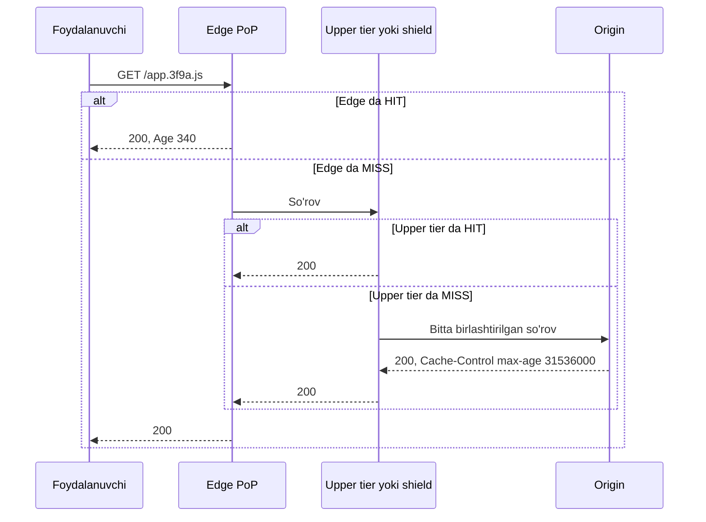

## Bu dars nima uchun kerak

23-24 darslarda data-markaz ichidagi cache ni ko'rdik: so'rov bazaga yetib bormasligi uchun. Lekin foydalanuvchi va data-markaz orasida yana bitta katta xarajat bor - **masofa**. Toshkentdagi foydalanuvchi Frankfurtdagi serverga so'rov yuborsa, yorug'likning optik toladagi tezligi va marshrut tufayli har bir round trip o'nlab millisekund. TLS bilan yangi ulanish bir necha round trip talab qiladi (5 va 7-darslar). 2 MB lik sahifa, 40 ta resurs va har birida masofa - foydalanuvchi soniyalab kutadi.

**CDN (Content Delivery Network)** - foydalanuvchiga yaqin joylarda (edge yoki PoP - point of presence) joylashgan serverlar tarmog'i, ular kontent nusxasini saqlaydi va mijozga yaqindan beradi. CDN bir vaqtning o'zida uchta muammoni hal qiladi: latency (masofa), origin yuklamasi (cache) va hujumlarga chidamlilik (taqsimlangan sig'im).

Bu darsdan keyin siz:

- CDN so'rov yo'lini (DNS yoki anycast, edge, tiered cache, origin) bosqichma-bosqich bilasiz;
- HTTP caching sarlavhalarini (RFC 9111) aniq tushunasiz: max-age, s-maxage, no-cache va no-store farqi, Vary, Age, stale-while-revalidate;
- cache key ni loyihalash va hit ratio ni oshirish usullarini bilasiz;
- purge, versiyali URL va surrogate key orqali invalidatsiyani bilasiz;
- dinamik kontent, API va video uchun CDN dan qanday foydalanishni va qachon foydasizligini bilasiz;
- Netflix Open Connect kabi o'z CDN ini qurish mantiqini tushunasiz.

## CDN qanday ishlaydi

### Foydalanuvchini eng yaqin edge ga yo'naltirish

Ikki asosiy usul:

1. **DNS asosida.** CDN ning authoritative DNS serveri so'rov kelgan resolver manziliga (yoki EDNS Client Subnet ma'lumotiga) qarab eng yaqin PoP ning IP sini qaytaradi. Bu birinchi avlod CDN larida keng tarqalgan yondashuv. Kamchiligi: qaror resolver joylashuviga asoslanadi, foydalanuvchiniki emas, va DNS TTL tufayli o'zgarish sekin tarqaladi (6-dars).
2. **Anycast.** Bitta IP manzil ko'p data-markazdan BGP orqali e'lon qilinadi, va internet routing paketni tarmoq nuqtai nazaridan eng yaqin joyga olib boradi. Cloudflare shu modelda ishlaydi. Afzalligi: DDoS trafigi ham ko'p joyga taqsimlanadi, bitta PoP o'chsa trafik avtomatik qo'shnisiga o'tadi (80-dars). Kamchiligi: o'z tarmoq infratuzilmasi va BGP ni nozik sozlash talab qilinadi; "eng yaqin" BGP ma'nosida, har doim ham latency ma'nosida emas.

### So'rov yo'li



### Tiered cache va origin shield

Agar CDN da 300 ta PoP bo'lsa va har biri mustaqil ravishda origin ga borsa, bitta yangi fayl uchun origin 300 ta so'rov oladi, va kam mashhur kontent har bir PoP da alohida miss beradi. Yechim - **ierarxiya**:

- **Cloudflare Tiered Cache**: pastki (lower) tier PoP lar miss da origin ga emas, yuqori (upper) tier data-markazga murojaat qiladi; faqat yuqori tier origin ga boradi. Smart topology har bir origin uchun eng past latency li bitta upper tier ni avtomatik tanlaydi.
- **AWS CloudFront**: edge location lar va ular orasidagi **regional edge cache** qatlami; ixtiyoriy **Origin Shield** - barcha qatlamlar o'tadigan yagona markaziy cache, siz origin ga eng yaqin AWS Region ni tanlaysiz. Bir xil obyekt uchun parallel so'rovlar birlashtiriladi, shuning uchun origin bitta obyekt uchun bitta so'rov ko'rishi mumkin.

Bu 24-darsdagi request coalescing ning CDN darajasidagi ko'rinishi: mashhur yangi fayl (masalan, mobil ilova yangilanishi) chiqqanda origin stampede dan himoyalanadi.

## HTTP caching sarlavhalari (RFC 9111)

CDN nima va qancha saqlashini asosan origin javobidagi sarlavhalar belgilaydi. Standart - RFC 9111 (2022, RFC 7234 o'rniga).

### Cache-Control direktivalari

| Direktiva | Ma'nosi |
|---|---|
| `max-age=N` | Javob N soniya "yangi" (fresh). Bor bo'lsa, `Expires` e'tiborga olinmaydi |
| `s-maxage=N` | Faqat **shared** cache lar (CDN, proksi) uchun; ular uchun `max-age` va `Expires` dan ustun |
| `no-cache` | Saqlash mumkin, lekin har safar ishlatishdan oldin origin bilan **tekshirish** (revalidation) shart |
| `no-store` | Umuman saqlash taqiqlangan |
| `private` | Faqat shaxsiy cache (brauzer) saqlay oladi, CDN emas |
| `public` | Odatda saqlanmaydigan javobni ham (masalan, Authorization bilan) saqlashga ruxsat |
| `must-revalidate` | Eskirgandan keyin tekshirmasdan ishlatish taqiqlangan |
| `immutable` | Fresh davrida kontent o'zgarmaydi, brauzer qayta tekshirmasin |
| `stale-while-revalidate=N` | Eskirgandan keyin N soniya davomida eski javobni berib, fonda yangilash (RFC 5861) |
| `stale-if-error=N` | Origin 500, 502, 503 yoki 504 qaytarsa, N soniya davomida eski javobni berish (RFC 5861) |

Eng ko'p uchraydigan chalkashlik: **`no-cache` "cache lama" degani emas**, "tekshirmasdan ishlatma" degani. "Cache lama" - `no-store`.

### Freshness va validatsiya

Javob qancha vaqt fresh ekanini cache quyidagi tartibda aniqlaydi: `s-maxage` (faqat shared cache), keyin `max-age`, keyin `Expires - Date`, va hech biri bo'lmasa **evristik** - RFC 9111 (4.2.2-bo'lim) tipik qiymat sifatida `Last-Modified` dan beri o'tgan vaqtning 10% ini keltiradi. Ya'ni sarlavha qo'ymasangiz, CDN yoki brauzer freshness ni o'zi evristik hisoblaydi - bu kutilmagan eskirishning keng tarqalgan sababi.

`Age` sarlavhasi javob origin da yaratilganidan yoki tekshirilganidan beri necha soniya o'tganini ko'rsatadi. Debug da juda foydali: `Age: 0` va `CF-Cache-Status: MISS` - origin dan keldi.

Eskirgan javob **validatsiya** qilinishi mumkin: cache origin ga `If-None-Match: "etag"` yoki `If-Modified-Since` bilan shartli so'rov yuboradi, va o'zgarmagan bo'lsa origin tanasiz `304 Not Modified` qaytaradi. Bu trafikni tejaydi, lekin round trip ni emas.

### stale-while-revalidate hisob misoli

`Cache-Control: max-age=600, stale-while-revalidate=30`:

- 0-600 soniya: javob fresh, cache dan beriladi.
- 600-630 soniya: eski javob darhol beriladi va fonda origin dan yangilanadi. Foydalanuvchi kutmaydi.
- 630 soniyadan keyin: keyingi so'rov origin ni kutadi.

Muhim: yangilash faqat 600-630 oynasida so'rov kelsa boshlanadi. Kam trafikli kontentda oyna qisqa bo'lsa, foyda kam.

`stale-if-error` origin ishdan chiqqanda hayotiy: `max-age=600, stale-if-error=86400` bilan origin bir kun ishlamasa ham, CDN eski sahifani beradi. Bu graceful degradation (64-dars) ning eng arzon shakli.

### Vary va cache key

**Cache key** - cache ichida javobni topish uchun ishlatiladigan identifikator. Odatda: sxema + host + yo'l + query string. `Vary` sarlavhasi kalitga so'rov sarlavhalarini qo'shadi: `Vary: Accept-Encoding` - gzip va brotli versiyalari alohida saqlanadi.

Xavf: `Vary: User-Agent` yoki `Vary: Cookie` - har xil qiymatlar soni minglab, va har biri alohida nusxa. Hit ratio deyarli nolga tushadi. Shu kabi, query string dagi ahamiyatsiz parametrlar (`?utm_source=...`, `?_=timestamp`) har biri alohida kalit hosil qiladi. Ko'p CDN lar cache key ni sozlash imkonini beradi: keraksiz parametrlarni olib tashlash, parametrlarni tartiblash, faqat kerakli sarlavhalarni qo'shish.

### Standart xatti-harakat bilan ehtiyot bo'ling

Har bir CDN ning o'z standartlari bor. Masalan, Cloudflare hujjatiga ko'ra u standart holatda **fayl kengaytmasi** bo'yicha cache laydi (rasm, video, JS, CSS, shrift, arxivlar va h.k.), **HTML va JSON ni standart holatda cache lamaydi**, `Set-Cookie` li javoblarni saqlamaydi, va origin `Cache-Control` bermasa 200 javoblarni 120 daqiqa, 404 ni 3 daqiqa saqlaydi. Ya'ni API javoblari cache lanishi uchun aniq qoida kerak, va aksincha, statik fayl deb hisoblangan narsa siz kutmagan holda cache lanishi mumkin.

## Invalidatsiya: versiyalash, purge, surrogate key

### 1. Versiyali (content-hashed) URL

Eng yaxshi usul - **URL ni o'zgartirish**. Build vaqtida fayl nomiga kontent hash i qo'shiladi: `app.3f9a1c.js`. Bunday fayl hech qachon o'zgarmaydi, shuning uchun:

```
Cache-Control: public, max-age=31536000, immutable
```

Yangi versiya chiqqanda HTML yangi nomga havola qiladi, eskisi o'z-o'zidan ishlatilmay qoladi. Purge kerak emas, brauzer va korporativ proksilardagi nusxalar ham muammo emas. AWS CloudFront hujjati ham tez-tez yangilanadigan fayllar uchun versiyali nomlarni tavsiya qiladi: bu arzonroq, loglarda qaysi versiya berilgani ko'rinadi va rollback oson.

HTML ning o'zi esa qisqa TTL yoki `no-cache` + ETag bilan beriladi, chunki u "kirish nuqtasi" va uning URL i o'zgarmaydi. Next.js kabi framework lar `_next/static/` ostidagi fayllarni aynan shunday nomlaydi.

### 2. Purge (tozalash)

URL o'zgarmaydigan kontent uchun (masalan, `/avatars/42.jpg`) CDN API orqali tozalash:

- **URL bo'yicha** - aniq fayllar.
- **Prefix, hostname yoki hammasi** - keng, lekin xavfli: "purge everything" barcha PoP larda cache ni bo'shatadi va origin ga bir vaqtda katta yuklama tushadi.
- **Tag yoki surrogate key bo'yicha** - origin javobga teg qo'shadi (`Cache-Tag: tenant-7, vehicle-42`), keyin bitta API chaqiruvi bilan shu teg ga tegishli barcha obyektlar tozalanadi. Fastly da bu "surrogate key", Cloudflare da "cache tags", CloudFront da tag invalidation.

Tezlik va cheklovlar: Cloudflare 2024 yilda "Instant Purge" ni e'lon qilgan va teg, hostname va prefix bo'yicha purge uchun global p50 150 ms dan past ekanini yozgan. Lekin purge API lari rate limit ga ega (Cloudflare da plan ga qarab, masalan Free planda teg va prefix purge daqiqasiga 5 ta so'rov). CloudFront da oyiga birinchi 1 000 invalidatsiya yo'li bepul, keyin har bir yo'l uchun to'lov; `/*` wildcard bitta yo'l hisoblanadi.

**Soft purge** (Fastly): obyekt o'chirilmaydi, "eskirgan" deb belgilanadi, keyingi so'rov eski nusxani olib, yangisi fonda yuklanadi. Bu purge dan keyingi origin stampede ni yumshatadi. **Hard purge** - obyekt butunlay o'chiriladi.

### Strategiyalar taqqoslash

| Usul | Tezlik | Origin ga ta'sir | Murakkablik | Qachon |
|---|---|---|---|---|
| Versiyali URL | Darhol (yangi URL) | Faqat yangi fayllar | Build jarayonida | JS, CSS, rasm, build artefaktlari |
| Qisqa TTL | TTL gacha | TTL ga teskari proporsional | Juda oddiy | Tez-tez o'zgaradigan, eskirish chidash mumkin |
| URL purge | Sekundlar va undan tez | Faqat tozalanganlar | API integratsiya | URL o'zgarmaydigan alohida fayllar |
| Tag / surrogate key | Sekundlar va undan tez | Teg doirasida | Teglarni loyihalash | Bog'liq ko'p obyektlar (tenant, mahsulot) |
| Purge everything | Darhol | Butun cache bo'shaydi, stampede | Oddiy | Faqat favqulodda holat |

## Nimani CDN da cache lash mumkin

### Statik kontent

Rasm, JS, CSS, shrift, video segmentlari, dasturiy yangilanishlar. Bu CDN ning asosiy ishi va hit ratio 95-99% ga yetishi mumkin.

### Video

Video streaming (HLS, DASH - 84-dars) segmentlarga bo'lingan: har biri bir necha soniyalik fayl. Segmentlar o'zgarmaydi - ideal cache obyekti. Manifest (`.m3u8`) esa live stream da har bir necha soniyada yangilanadi - qisqa TTL. Trafikning katta qismi aynan video: shuning uchun yirik video platformalar o'z CDN ini quradi.

**Netflix Open Connect** - bunga yaxshi misol. Netflix ISP larga o'z serverlarini (Open Connect Appliance, OCA) bepul beradi, ular ISP tarmog'i ichida turadi. Har bir appliance o'rnatishdan oldin shu hududga mos kontent bilan oldindan to'ldiriladi, keyin har kecha yangilanadi - ya'ni bu reaktiv (miss da yuklash) emas, **proaktiv** cache. 1 000 dan ortiq ISP hamkor. Netflix muhandislari 2017 yilda bitta FreeBSD asosidagi OCA dan 100 Gbps berish maqsadidagi ishni yozgan: 100% TLS trafigida 90 Gbps ga erishilgan, cheklovchi omil esa xotira o'tkazuvchanligi bo'lgan. Mantiq: kontent katalogi oldindan ma'lum va trafik bashorat qilinadigan bo'lsa, eng yaxshi cache - foydalanuvchiga eng yaqin joyda oldindan to'ldirilgan disk.

### Dinamik kontent va API

API javoblari ham ma'lum shartlarda cache lanadi:

- **Hamma uchun bir xil javob** (valyuta kurslari, mahsulot katalogi, ochiq statistika): `s-maxage=30, stale-while-revalidate=60`. Hatto 1 soniyalik TTL ham soniyasiga 10 000 so'rovni origin da 1 ga (har bir PoP uchun) tushiradi - bu "micro-caching".
- **Foydalanuvchiga xos javob**: CDN da cache lanmaydi (`private` yoki `no-store`). Lekin CDN baribir foydali: TLS foydalanuvchiga yaqin joyda tugaydi, edge dan origin gacha esa issiq, uzoq yashovchi va optimallashtirilgan ulanishlar ishlatiladi. Bu "dynamic acceleration".
- **Edge compute** (Cloudflare Workers, CloudFront Functions, Lambda@Edge): autentifikatsiya tekshiruvi, redirect, A/B, header manipulyatsiyasi edge da. Ma'lumot origin da bo'lsa, edge kodi baribir origin ga borishi kerak.

### Xavfsizlik va xususiy kontent

Pullik yoki shaxsiy fayllar (masalan, hisobot PDF lari, video arxiv) CDN orqali **signed URL** yoki **signed cookie** bilan beriladi: URL da muddat va imzo bor, CDN imzoni tekshiradi, origin har bir so'rovda autentifikatsiya qilmaydi. Origin (masalan, S3 bucket) esa faqat CDN dan so'rov qabul qiladigan qilib yopiladi (CloudFront da Origin Access Control), aks holda imzoni chetlab o'tib to'g'ridan-to'g'ri origin dan yuklab olish mumkin.

Eng xavfli xato: foydalanuvchiga xos javobni tasodifan shared cache ga qo'yish. Masalan, `/api/me` javobi `Cache-Control` siz qaytsa va CDN qoidasi "/api/* ni 60 soniya cache la" bo'lsa, bir foydalanuvchining ma'lumoti boshqasiga beriladi. Xavfsizlik adabiyotida bunga yaqin hujum sinfi "web cache deception" deb ataladi: hujumchi CDN ni shaxsiy sahifani statik fayl deb o'ylashga majburlaydi (masalan, `/account/profile.css`).

## Raqamlar: CDN qancha tejaydi

Masala sharti - mobil ilova va veb panel uchun statik fayllar:

- kuniga 200 000 sessiya, har birida 3 MB statik resurs (JS, CSS, rasmlar, xarita tile lari);
- jami: 200 000 × 3 MB = **600 GB/kun**, oyiga ~18 TB;
- CDN hit ratio 95%.

Origin dan chiquvchi trafik: 600 × 0.05 = **30 GB/kun** (~0.9 TB/oy). Origin serverlarining tarmoq va CPU yuklamasi 20 baravar kamaydi. Cho'qqi (shart: trafikning 20% i bir soatda): 120 GB/soat = 33 MB/s ~ 270 Mbit/s CDN da, origin da esa ~13 Mbit/s.

Latency. Hisob uchun shartlar: foydalanuvchidan origin gacha RTT 60 ms, eng yaqin PoP gacha 10 ms. Yangi HTTPS ulanish: TCP handshake 1 RTT, TLS 1.3 handshake 1 RTT, so'rov-javob yana 1 RTT, jami 3 RTT. Origin bilan: 3 × 60 = 180 ms; edge bilan: 3 × 10 = 30 ms. Faqat birinchi so'rovning o'zida 150 ms tejaldi, hit bo'lsa origin ga umuman borilmaydi. Real masofa uchun o'lchov misoli: WonderNetwork ning Toshkent - Frankfurt ping o'lchovlarida (2026 yil oktyabr) o'rtacha RTT 82-85 ms atrofida, alohida o'lchov seriyalarida 135 ms gacha ko'tarilgan.

Narx: CDN va cloud egress narxlari provayder, hudud va hajmga bog'liq, shuning uchun taqqoslashni provayderlarning joriy narx jadvallari asosida, o'z oylik hajmingiz (yuqoridagi 18 TB va 0.9 TB) bilan qiling. Provayder tanlashda uning PoP ro'yxatida foydalanuvchilaringizga eng yaqin nuqtani toping va o'z foydalanuvchilaringiz joylashgan hududdan haqiqiy latency ni o'lchang (masalan, RUM yoki sintetik ping bilan).

## iQuariX kontekstida

Bu misolda iQuariX dispetcher veb paneli (Next.js), mobil ilova va video arxivga ega.

1. **Veb panel statik resurslari.** Next.js build `_next/static/` ostida hash li fayl nomlarini yaratadi: `max-age=31536000, immutable`. HTML: qisqa TTL yoki `no-cache`. Deploy dan keyin purge kerak emas.
2. **Xarita tile lari.** Agar o'z tile serveringiz bo'lsa, tile lar (`/tiles/{z}/{x}/{y}.png`) deyarli o'zgarmaydi va barcha mijozlar uchun bir xil - CDN ga ideal. Bu origin ga eng katta statik yuklama bo'lishi mumkin.
3. **API.** Foydalanuvchiga va tenant ga xos (mashinalar, marshrutlar) - CDN da cache lanmaydi: `Cache-Control: private, no-store`. Lekin TLS ni edge da tugatish va origin ga uzoq ulanish foyda beradi. CDN qoidasida `/api/*` uchun aniq "bypass cache" qo'yish - tasodifiy cache lashga qarshi sug'urta.
4. **Video arxiv.** Kamera yozuvlari S3 da, dispetcher ma'lum vaqt oralig'ini ko'rmoqchi. HLS segmentlari o'zgarmas - CDN da cache lanadi, lekin har bir video faqat bir-ikki marta ko'riladi, shuning uchun hit ratio past bo'ladi. Asosiy foyda - signed URL bilan xavfsiz yetkazish va origin ni yopish. Live video uchun esa manifest TTL 1-2 soniya.
5. **Hisobot PDF lari.** Signed URL, 10-15 daqiqalik muddat, kalitda tenant.
6. **Origin ishdan chiqqanda.** Veb panelning statik qismi `stale-if-error` bilan ochiladi va "tizim vaqtincha ishlamayapti" xabarini ko'rsatadi, oq ekran emas.

Treker telemetriyasi CDN ga aloqasi yo'q: bu yuqoriga yo'nalgan (upload) va har bir paket noyob. Bu yerda anycast va edge ning yagona foydasi - DDoS himoyasi bo'lishi mumkin (80-dars).

## Ko'p uchraydigan xatolar

1. **`no-cache` ni "cache lama" deb ishlatish.** U saqlashga ruxsat beradi; taqiqlash uchun `no-store`.
2. **Foydalanuvchiga xos javobni shared cache ga tushirish.** `private` sarlavhasi yo'q va CDN qoidasi keng - bir foydalanuvchi ma'lumoti boshqasiga ketadi.
3. **Cache-Control umuman qo'ymaslik.** CDN va brauzer evristik freshness ishlatadi va kutilmagan eskirish paydo bo'ladi.
4. **Har deploy da "purge everything".** Barcha PoP bir vaqtda sovuq, origin stampede. Versiyali URL ishlating.
5. **Cache key ni ifloslantirish.** `Vary: User-Agent`, `Vary: Cookie`, tracking query parametrlari - hit ratio yo'qoladi.
6. **Origin ni ochiq qoldirish.** Signed URL ni chetlab o'tib to'g'ridan-to'g'ri S3 yoki origin IP ga murojaat qilish mumkin.
7. **Tiered cache yoki origin shield siz uzun dumli kontent.** Har bir PoP mustaqil miss beradi, origin ko'p takroriy so'rov oladi.
8. **CDN ni faqat statik uchun deb o'ylash.** Micro-caching, stale-if-error va edge TLS dinamik trafikda ham sezilarli foyda beradi.

## Xulosa

- CDN foydalanuvchiga yaqin PoP lardan kontent berib latency, origin yuklamasi va hujum xavfini kamaytiradi. Yo'naltirish DNS yoki anycast orqali.
- Tiered cache va origin shield miss larni birlashtiradi: origin bitta obyekt uchun bir yoki bir necha so'rov ko'radi.
- RFC 9111: `s-maxage` CDN uchun, `max-age` hamma uchun, `no-cache` = tekshirib ishlat, `no-store` = saqlama, `private` = faqat brauzer.
- `stale-while-revalidate` latency ni, `stale-if-error` origin nosozligini yashiradi.
- Eng yaxshi invalidatsiya - versiyali URL va `immutable`. URL o'zgarmasa - teg yoki surrogate key bo'yicha purge.
- Cache key ni ataylab loyihalang: keraksiz parametr va sarlavhalar hit ratio ni o'ldiradi.
- Xususiy kontent: signed URL yoki cookie va origin ni faqat CDN uchun ochish.

## Amaliy topshiriq

Masala sharti: iQuariX Markaziy Osiyo va Rossiyadagi 2 000 korporativ mijozga xizmat qiladi: 15 000 dispetcher, 40 000 haydovchi mobil ilovasi, origin Frankfurtdagi cloud region da.

1. **Kontent inventari**: veb panel, mobil ilova, xarita tile lari, API, video arxiv, hisobot fayllari. Har biri uchun: CDN orqali bo'ladimi, `Cache-Control` qiymati, cache key tarkibi.
2. **Trafik hisobi**: kunlik statik trafik, CDN hit ratio va origin chiquvchi trafigi. Qo'shgan shartlaringizni (sessiya hajmi, hit ratio) ochiq yozing.
3. **Latency hisobi**: Toshkentdagi foydalanuvchi uchun origin va eng yaqin PoP orqali birinchi sahifa yuklanishi qancha round trip va millisekund. Shart: Toshkent - Frankfurt RTT 85 ms (yuqoridagi WonderNetwork o'lchovi), Toshkent - eng yaqin PoP RTT 10 ms.
4. **Invalidatsiya rejasi**: deploy, mashina fotosurati yangilanishi, tenant logotipi o'zgarishi - har biri qanday invalidatsiya qilinadi.
5. **Xavfsizlik**: video arxiv va hisobotlar uchun signed URL dizayni (muddat, nimaga bog'lanadi) va origin ni yopish.
6. **Nosozlik**: origin 30 daqiqa ishlamaydi. Foydalanuvchi nimani ko'radi va qaysi sarlavhalar buni yaxshilaydi?

Yaxshi javobda bo'lishi kerak bo'lgan narsalar:

- statik va dinamik kontentni aniq ajratish, API uchun `private` va CDN da bypass qoidasi;
- hash li fayl nomlari va `immutable`, HTML uchun qisqa TTL;
- trafik hisobida hit ratio dan origin trafigiga o'tish;
- tenant ma'lumotlari hech qachon shared cache ga tushmasligi uchun aniq chora;
- `stale-if-error` va tiered cache yoki origin shield.

Javobni pastdagi maydonga yozib, chatga yuboring.

## Manbalar

- IETF. [RFC 9111: HTTP Caching](https://www.rfc-editor.org/rfc/rfc9111.html), 2022 - Cache-Control direktivalari, freshness, Age, Vary, evristik freshness.
- IETF. [RFC 5861: HTTP Cache-Control Extensions for Stale Content](https://www.rfc-editor.org/rfc/rfc5861.html) - stale-while-revalidate, stale-if-error.
- Cloudflare. [Tiered Cache](https://developers.cloudflare.com/cache/how-to/tiered-cache/), [Default cache behavior](https://developers.cloudflare.com/cache/concepts/default-cache-behavior/), [Purge cache](https://developers.cloudflare.com/cache/how-to/purge-cache/) va [Instant Purge](https://blog.cloudflare.com/instant-purge/) blog posti (2024).
- Cloudflare Learning. [What is an Anycast network?](https://www.cloudflare.com/learning/cdn/glossary/anycast-network/)
- AWS. [CloudFront Origin Shield](https://docs.aws.amazon.com/AmazonCloudFront/latest/DeveloperGuide/origin-shield.html), [Invalidating files](https://docs.aws.amazon.com/AmazonCloudFront/latest/DeveloperGuide/Invalidation.html), [Pay for file invalidation](https://docs.aws.amazon.com/AmazonCloudFront/latest/DeveloperGuide/PayingForInvalidation.html), [Private content](https://docs.aws.amazon.com/AmazonCloudFront/latest/DeveloperGuide/PrivateContent.html).
- Fastly. [Purging](https://www.fastly.com/documentation/guides/concepts/edge-state/cache/purging/) - surrogate key, soft va hard purge.
- WonderNetwork. [Ping time between Tashkent and Frankfurt](https://wondernetwork.com/pings/Tashkent/Frankfurt) - o'lchangan RTT.
- Netflix. [Open Connect](https://openconnect.netflix.com/en/) va Drew Gallatin, [Serving 100 Gbps from an Open Connect Appliance](https://netflixtechblog.com/serving-100-gbps-from-an-open-connect-appliance-cdb51dda3b99), 2017.
