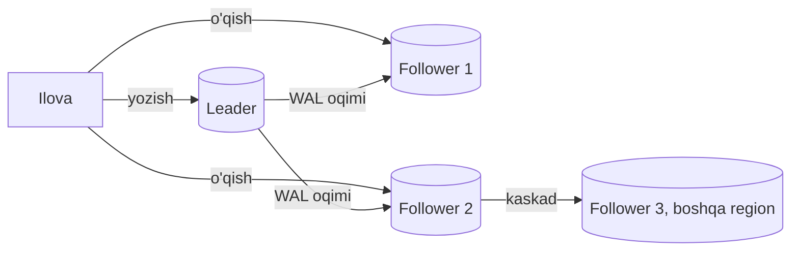
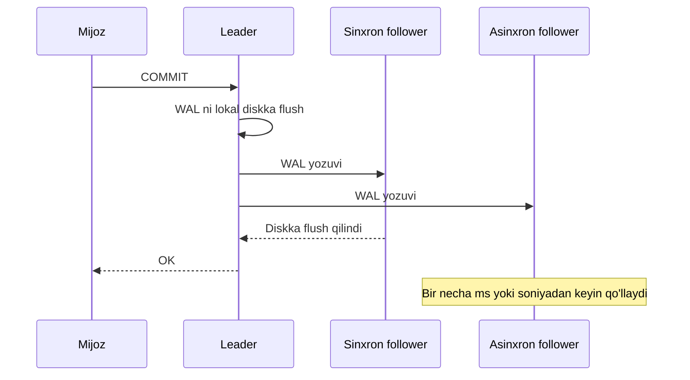

## Bu dars nima uchun kerak

21-darsda stateful qatlamni iloji boricha uzoq vertical o'stirish kerakligini aytdik. Lekin bitta baza serveri - bitta nosozlik nuqtasi (SPOF), va uning o'qish sig'imi cheklangan. Keyingi tabiiy qadam - **replication**: bir xil ma'lumotning nusxalarini bir nechta mashinada saqlash.

Replication uchta maqsadga xizmat qiladi:

1. **Mavjudlik (availability)** - bitta tugun o'lsa, boshqasi xizmatni davom ettiradi.
2. **O'qishni masshtablash** - o'qish so'rovlarini replikalarga taqsimlash.
3. **Latency** - nusxani foydalanuvchiga yaqin joyda saqlash.

Agar ma'lumot hech qachon o'zgarmasa, replication oddiy nusxalash bo'lardi. Butun qiyinchilik **o'zgarishlarni** nusxalarga yetkazishda: qachon, qanday tartibda, va bu jarayonda nimadir buzilsa nima bo'ladi. Kleppmann DDIA 2-nashrida bunga butun bir bob (6-bob, "Replication") ajratadi. Bu darsda eng keng tarqalgan model - **single-leader** ni chuqur ko'ramiz; multi-leader va leaderless 27-darsda.

Bu darsdan keyin siz:

- single-leader replication ning ishlash mexanizmini va replication log turlarini bilasiz;
- sinxron, asinxron va semi-sinxron replication ning durability va latency ga ta'sirini PostgreSQL va MySQL sozlamalari darajasida bilasiz;
- failover ning xavfli joylarini (split brain, yo'qolgan yozuvlar, noto'g'ri timeout) tushunasiz;
- replication lag keltirib chiqaradigan uch anomaliyani (read-your-writes, monotonic reads, consistent prefix) va ularning yechimlarini bilasiz;
- lag ni o'lchash va monitoring qilishni bilasiz.

## Single-leader replication qanday ishlaydi

Bitta tugun **leader** (primary, master) deb tayinlanadi. Barcha yozuvlar faqat unga ketadi. Leader yozuvni o'z saqlashiga yozadi va o'zgarishni **replication log** orqali **follower** larga (replica, standby, secondary) yuboradi. Follower lar o'zgarishlarni leader dagi tartibda qo'llaydi. O'qish leader dan ham, follower lardan ham bo'lishi mumkin.

Bu model PostgreSQL (streaming replication), MySQL, SQL Server Always On, MongoDB replica set, Kafka partition lari (44-dars) va Redis da ishlatiladi.

### Replication log turlari

Leader follower larga aynan nimani yuboradi?

| Usul | Nima yuboriladi | Afzallik | Kamchilik | Misol |
|---|---|---|---|---|
| Statement-based | SQL buyruqlar | Ixcham | `NOW()`, `RANDOM()`, trigger lar turli natija beradi | MySQL ning eski rejimi |
| Physical (WAL shipping) | Disk sahifalaridagi bayt o'zgarishlari | Aniq, tez, butun klasterni nusxalaydi | Versiya va platformaga bog'liq; tanlab nusxalab bo'lmaydi | PostgreSQL streaming replication |
| Logical (row-based) | Qator darajasidagi o'zgarishlar: qaysi jadval, qaysi qator, qanday qiymat | Versiyalar orasida, tanlab, boshqa tizimlarga (CDC) | Biroz kattaroq, DDL ni alohida boshqarish | MySQL row-based binlog, PostgreSQL logical replication |
| Trigger-based | Ilova darajasidagi trigger lar | Juda moslashuvchan | Sekin, xatolarga moyil | Eski ETL vositalari |

PostgreSQL streaming replication WAL ni (14-darsda ko'rilgan write-ahead log) to'g'ridan-to'g'ri follower ga oqim sifatida yuboradi. Follower doimiy "recovery" rejimida: WAL yozuvlarini qayta o'ynatadi. Shuning uchun follower bayt darajasida leader ning nusxasi. Logical replication esa WAL dan qator o'zgarishlarini dekodlaydi - bu CDC ning asosi (48-dars) va major versiya yangilashda ishlatiladi.

### Yangi follower qo'shish

Leader ni to'xtatmasdan yangi follower qo'shish:

1. Leader ning izchil snapshot i olinadi (PostgreSQL da `pg_basebackup`), snapshot WAL dagi aniq pozitsiyaga (LSN) bog'langan.
2. Snapshot follower ga ko'chiriladi.
3. Follower leader dan shu LSN dan keyingi barcha WAL ni so'raydi va "yetib oladi".
4. Shundan keyin oqim real vaqtda davom etadi.

Muammo: 3-qadam davomida leader shu WAL segmentlarini saqlab turishi kerak. PostgreSQL da buni **replication slot** kafolatlaydi: leader follower olmagan WAL ni o'chirmaydi. Lekin follower uzoq vaqt uzilib qolsa, slot WAL ni cheksiz to'playdi va leader ning diski to'ladi. PostgreSQL hujjati aynan shu xavfni ogohlantiradi va `max_slot_wal_keep_size` bilan chegaralashni tavsiya qiladi. Bu production da tez-tez uchraydigan uzilish sababi: "o'lik" replika slot i bilan primary diskini to'ldirish.

## Sinxron va asinxron replication

Asosiy savol: leader mijozga "commit bo'ldi" deb **qachon** javob beradi?

- **Asinxron.** Leader lokal diskka yozgach darhol javob beradi. Tez, follower sekin yoki o'lik bo'lsa ham yozish ishlaydi. Lekin leader o'lsa, follower ga yetib bormagan tasdiqlangan yozuvlar **yo'qoladi**. PostgreSQL streaming replication standart holatda asinxron; hujjatga ko'ra kuchli standby bilan kechikish odatda bir soniyadan kam.
- **Sinxron.** Leader kamida bitta follower yozuvni olganini tasdiqlaguncha javob bermaydi. Tasdiqlangan yozuv kamida ikki joyda. Lekin follower sekinlashsa, **barcha** yozuvlar sekinlashadi, va follower o'lsa, yozuvlar to'xtaydi.
- **Semi-sinxron.** Amaliy murosa: bitta follower sinxron, qolganlari asinxron. Sinxron follower o'lsa, asinxronlardan biri uning o'rniga ko'tariladi.

### PostgreSQL: synchronous_commit darajalari

PostgreSQL da sinxronlik `synchronous_standby_names` (qaysi standby lar sinxron) va `synchronous_commit` (qanchalik kutish) bilan boshqariladi:

| `synchronous_commit` | Leader nimani kutadi | Kafolat |
|---|---|---|
| `off` | Hech narsani (WAL keyinroq flush) | Crash da oxirgi tranzaksiyalar yo'qolishi mumkin, lekin baza izchil qoladi |
| `local` | Lokal WAL flush | Faqat leader da durable |
| `remote_write` | Lokal flush + standby WAL ni OS ga yozdi | Standby dagi PostgreSQL crash dan omon qoladi, OS crash dan emas |
| `on` (standart) | Lokal flush + standby WAL ni diskka flush qildi | Leader va barcha sinxron standby lar diski bir vaqtda buzilmasa, yo'qolmaydi |
| `remote_apply` | Yuqoridagi + standby uni **qo'lladi** | Standby dan o'qish ham darhol yangi qiymatni ko'radi |

Ikki muhim nozik nuqta:

- `synchronous_standby_names` bo'sh bo'lsa (ya'ni sinxron replication yo'q), faqat `on` va `off` farq qiladi.
- Sozlama **tranzaksiya darajasida** o'zgartiriladi: `SET LOCAL synchronous_commit TO off`. Ya'ni muhim to'lov yozuvi `remote_apply` bilan, ahamiyatsiz telemetriya `off` bilan - bitta bazada.

Sinxron standby lar ro'yxati: `FIRST 2 (s1, s2, s3)` - ustuvorlik bo'yicha birinchi ikkitasi sinxron, uchinchisi zaxira; `ANY 2 (s1, s2, s3)` - har qanday ikkitasidan tasdiq (quorum, 27-dars g'oyasiga yaqin). Hujjat ogohlantiradi: talab qilingan sinxron standby lar mavjud bo'lmasa, commit lar **cheksiz kutadi**. Shuning uchun sinxron rejimda kamida bitta ortiqcha nomzod saqlash kerak.

### MySQL semi-sinxron

MySQL semi-sinxron replication da leader kamida bitta replika tranzaksiya event larini relay log ga yozib diskka flush qilganini tasdiqlashini kutadi (replika uni hali bajarmagan bo'lishi mumkin). `AFTER_SYNC` rejimi (standart) tasdiqni storage engine ga commit qilishdan **oldin** kutadi, shuning uchun boshqa mijozlar replika olmagan tranzaksiyani leader da ko'rmaydi. Muhim xususiyat: timeout ichida hech bir replika javob bermasa, leader **asinxron rejimga qaytadi** (MySQL hujjatlariga ko'ra `rpl_semi_sync_source_timeout` standart qiymati 10 soniya). Ya'ni semi-sinxron mavjudlikni durability dan ustun qo'yadi - aynan eng kerakli paytda (replika muammosida) kafolat yo'qoladi.

### Latency hisobi

Sinxron replication har bir commit ga follower gacha bo'lgan round trip va follower dagi fsync ni qo'shadi:

- bitta AZ ichida: RTT ~0.1-0.5 ms + fsync ~0.1-1 ms (NVMe) - commit taxminan 1 ms ga sekinlashadi;
- AZ lar orasida (bir region): RTT odatda 1-2 ms atrofida - commit 2-3 ms;
- regionlar orasida (Frankfurt - Toshkent, masalan, 60-80 ms RTT) - har bir commit ga 60-80 ms.

Bitta sessiyada ketma-ket commit lar: 70 ms latency da bitta ulanish soniyasiga ~14 commit dan oshmaydi. Ko'p parallel ulanish throughput ni saqlaydi (group commit), lekin har bir foydalanuvchi so'rovi sekinlashadi. Shuning uchun **regionlar orasida sinxron replication kamdan-kam ishlatiladi**; odatda sinxron - region ichida boshqa AZ ga, asinxron - boshqa region ga.

Managed xizmatlardan misollar: AWS RDS Multi-AZ (bitta standby) varianti boshqa AZ dagi standby ga sinxron replikatsiya qiladi va bu standby dan o'qib bo'lmaydi - u faqat failover uchun. Aurora esa boshqacha: ma'lumot uchta AZ bo'ylab nusxalanadigan umumiy cluster volume da, klasterda 15 tagacha replika bo'lishi mumkin, va AWS hujjatiga ko'ra replika lag odatda 100 ms dan ancha kam.

## Failover: leader o'lganda

Follower o'lsa, oddiy: qayta tiklanib, uzilgan joydan WAL ni oladi. Leader o'lsa - **failover**: followerlardan biri yangi leader bo'lishi, mijozlar unga yo'naltirilishi va qolgan follower lar undan o'qishi kerak.

Avtomatik failover uch qadam:

1. **Leader o'lganini aniqlash.** Odatda timeout: N soniya javob bo'lmasa, o'lgan deb hisoblanadi.
2. **Yangi leader tanlash.** Odatda eng ko'p ma'lumotga ega (eng katta LSN) follower. Bu aslida consensus muammosi (35-36 darslar).
3. **Tizimni qayta sozlash.** Mijozlar yozuvlarni yangi leader ga yuboradi (DNS, VIP, proksi yoki service discovery orqali), eski leader qaytsa, follower bo'lishi kerak.

### Failover dagi xavflar

**1. Yo'qolgan yozuvlar.** Asinxron replication da yangi leader eski leader ning oxirgi yozuvlarini olmagan bo'lishi mumkin. Eski leader qaytsa, unda yangi leader da yo'q yozuvlar bor - odatda ular **tashlab yuboriladi**. Agar bu yozuvlar boshqa tizimlarda (Redis, tashqi API, email) ishlatilgan bo'lsa, nomuvofiqlik paydo bo'ladi. Kleppmann kitobida GitHub dagi shunday hodisa keltiriladi: eskirgan MySQL follower leader qilib ko'tarilgan va allaqachon ishlatilgan auto-increment ID larni qayta bergan; bu ID lar Redis da ham ishlatilgani uchun ba'zi foydalanuvchilarga boshqa foydalanuvchilarning ma'lumotlari ko'ringan.

**2. Split brain.** Ikki tugun bir vaqtda o'zini leader deb hisoblaydi va ikkalasi ham yozuv qabul qiladi. Ma'lumot ikkiga bo'linadi. Himoya: eski leader ni majburan o'chirish (STONITH - "shoot the other node in the head"), **fencing token** (38-dars), yoki leader faqat ko'pchilik (quorum) bilan aloqada bo'lganda yozishi.

**3. Noto'g'ri timeout.** Qisqa timeout - yuklama cho'qqisi yoki qisqa tarmoq uzilishida keraksiz failover, bu esa vaziyatni yomonlashtiradi (yangi leader sovuq cache bilan, yuklama ostida). Uzun timeout - uzoq downtime.

### Real hodisa: GitHub, 2018 yil 21 oktyabr

GitHub ning post-incident tahlili failover xavflarini yaxshi ko'rsatadi:

- Uskunani almashtirish paytida AQSh sharqiy qirg'og'idagi asosiy data-markaz va tarmoq hub i orasidagi aloqa **43 soniya** uzildi.
- Raft consensus asosida ishlaydigan MySQL failover vositasi Orchestrator g'arbiy qirg'oq va sharqdagi public cloud tugunlari bilan quorum hosil qildi va database klasterlarini g'arbiy qirg'oqqa **failover** qildi.
- Aloqa tiklangach, ilova yangi g'arbiy primary larga yoza boshladi. Sharqiy data-markazda esa g'arbga replikatsiya qilinmagan qisqa vaqt oralig'idagi yozuvlar qolgan edi.
- Ikkala tomonda ham boshqasida yo'q yozuvlar bo'lgani uchun xavfsiz orqaga qaytish (fail back) imkonsiz bo'ldi. Bir muncha vaqt o'tib, g'arbda 30 daqiqadan ortiq yangi yozuv to'plangach, jamoa oldinga davom etishni tanladi.
- Xizmat **24 soat 11 daqiqa** davomida degradatsiyada bo'ldi. Eng band klasterlardan birida ta'sirlangan oynada 954 ta yozuv bo'lgan, ular qo'lda solishtirildi.

Xulosalari orasida: Orchestrator ni regionlar chegarasidan o'tib primary ni ko'tarmaydigan qilib sozlash (qit'alararo latency asosiy omil bo'lgan) va fault injection, chaos engineering ga investitsiya. Saboq: **43 soniyalik uzilish uchun avtomatik failover qilish** 43 soniyalik uzilishdan ancha qimmatga tushdi. Failover qarori "nima qimmatroq: kutishmi yoki ma'lumot bo'linishimi?" degan savolga javob berishi kerak.

## Replication lag va uning anomaliyalari

Asinxron follower doim biroz orqada. Normal holatda bu millisekundlar, lekin yuklama cho'qqisi, uzun tranzaksiya, follower dagi og'ir so'rov yoki tarmoq muammosida soniyalar va hatto daqiqalar bo'lishi mumkin. Bu **eventual consistency**: yozish to'xtasa, follower lar oxir-oqibat yetib oladi. Muammo shundaki, "oxir-oqibat" chegarasiz.

Lag foydalanuvchiga uch turdagi g'alati xatti-harakat sifatida ko'rinadi (Kleppmann tasnifi).

### 1. Read-your-writes (o'z yozuvini o'qish)

Foydalanuvchi mashina nomini o'zgartirdi (leader ga yozuv), sahifa yangilandi (follower dan o'qish) - eski nom ko'rinadi. Foydalanuvchi "saqlanmadi" deb o'ylaydi va qayta bosadi.

Yechimlar:

- foydalanuvchi **o'zi o'zgartirishi mumkin** bo'lgan ma'lumotni (o'z profili, o'z sozlamalari) har doim leader dan o'qish;
- oxirgi yozuvdan keyin ma'lum vaqt (masalan, 10-30 soniya) shu foydalanuvchining barcha o'qishlarini leader ga yuborish;
- mijoz oxirgi yozuvining pozitsiyasini (LSN yoki vaqt belgisi) eslab qoladi, va o'qish faqat shu pozitsiyaga yetib olgan follower dan bajariladi. PostgreSQL da follower da `pg_last_wal_replay_lsn()` ni solishtirish mumkin;
- muhim yozuv uchun `synchronous_commit = remote_apply` (sinxron standby dan o'qish darhol yangi qiymatni ko'radi).

Qiyin holat: foydalanuvchi bir nechta qurilmadan (veb va mobil) ishlasa, "oxirgi yozuv vaqti" markazlashgan bo'lishi kerak.

### 2. Monotonic reads

Foydalanuvchi sahifani ikki marta yangiladi: birinchi so'rov yangi follower ga tushdi (yangi alert ko'rindi), ikkinchisi orqada qolgan follower ga (alert yo'qoldi). Vaqt orqaga ketganday ko'rinadi.

Yechim: bitta foydalanuvchining o'qishlarini doim **bitta** follower ga yuborish (masalan, foydalanuvchi ID si hash i bo'yicha). Follower o'lsa, boshqasiga o'tiladi - lekin bu kamdan-kam.

### 3. Consistent prefix reads

Sabab-oqibat tartibi buziladi: avval natija, keyin sabab ko'rinadi. Masalan, "yoqilg'i to'kildi" alerti va unga dispetcherning izohi - izoh alertdan oldin ko'rinadi. Bu asosan partition langan (sharded) tizimlarda bo'ladi, chunki turli partition lar mustaqil replikatsiya qilinadi va global tartib yo'q. Yechim: sababiy bog'liq yozuvlarni bitta partition ga yozish yoki causal consistency (33-dars).

### Anomaliyalar va yechimlar jadvali

| Anomaliya | Foydalanuvchi ko'radi | Asosiy yechim | Narxi |
|---|---|---|---|
| Read-your-writes | O'z o'zgarishi "yo'qoldi" | O'z ma'lumotini leader dan yoki LSN ga yetgan replikadan o'qish | Leader ga qo'shimcha yuklama |
| Monotonic reads | Ma'lumot paydo bo'lib, yo'qoladi | Foydalanuvchini bitta replikaga bog'lash | Notekis yuklama |
| Consistent prefix | Oqibat sababdan oldin | Bog'liq yozuvlar bitta partition da yoki causal tartib | Partition dizayni cheklanadi |
| Katta lag (daqiqalar) | Hisobot va panel eskirgan | Lag ni kuzatish, chegaradan oshsa replikani chiqarish | Monitoring, routing logikasi |

## Lag ni o'lchash va boshqarish

PostgreSQL da leader tomonda `pg_stat_replication` har bir standby uchun LSN pozitsiyalarini (`sent_lsn`, `write_lsn`, `flush_lsn`, `replay_lsn`) va vaqtdagi lag ni (`write_lag`, `flush_lag`, `replay_lag`) ko'rsatadi. Hujjatga ko'ra `replay_lag` asinxron standby uchun yangi tranzaksiyalar standby so'rovlarida ko'rinishigacha bo'lgan taxminiy vaqt. Baytdagi farq: `pg_wal_lsn_diff(sent_lsn, replay_lsn)`.

Lag ning tipik sabablari:

- **Follower dagi WAL replay bitta process** da bajariladi, leader esa ko'p parallel yozuvni qabul qiladi. Yozuv yuklamasi juda yuqori bo'lsa, follower apparati leader dan kuchsiz bo'lmasligi kerak.
- **Uzun so'rovlar va hot standby konfliktlari.** Follower da uzun hisobot so'rovi ishlayotganda, leader dagi VACUUM shu so'rov ko'rishi kerak bo'lgan qator versiyalarini o'chiradi (19-darsda MVCC). Follower ikki yo'l tanlaydi: WAL replay ni kutishga qo'yish (lag oshadi) yoki so'rovni bekor qilish. `max_standby_streaming_delay` (standart 30 soniya) qancha kutishni belgilaydi. `hot_standby_feedback = on` follower ning eng eski snapshot ini leader ga bildiradi va VACUUM ni ushlab turadi - konflikt kamayadi, lekin **leader da bloat** oshadi.
- **Katta tranzaksiyalar va DDL** - millionlab qatorli `UPDATE` follower da ham xuddi shuncha ish.
- **Tarmoq va disk** - ayniqsa regionlararo.

Amaliy qoidalar:

- lag ni metrika sifatida eksport qilib, alert qo'ying (masalan, 5 soniyadan ortiq - ogohlantirish, 60 soniyadan ortiq - replikani o'qish pool idan chiqarish);
- ilova routing i lag ni bilishi kerak: lag chegaradan oshgan replika "sog'lom, lekin eskirgan" - unga muhim o'qishlarni yubormaslik;
- hisobot va analitika uchun alohida replika (uzun `max_standby_streaming_delay` bilan), HA uchun alohida replika (qisqa delay bilan) - PostgreSQL hujjati ham shunday ajratishni tavsiya qiladi.

## Trade-off: qaysi konfiguratsiya

| Konfiguratsiya | Yozish latency | Leader o'lganda yo'qotish (RPO) | Follower o'lganda | Qachon |
|---|---|---|---|---|
| Faqat asinxron | Eng past | Soniyalar ichidagi oxirgi yozuvlar | Hech narsa | Yo'qotish qabul qilinadi, tezlik muhim |
| Bitta sinxron (AZ ichida) + asinxronlar | +1-3 ms | Nolga yaqin | Sinxron o'lsa yozish to'xtaydi (zaxira nomzod bo'lmasa) | Ko'p OLTP tizimlar uchun standart |
| `ANY 1` dan 2 ta sinxron | +1-3 ms | Nolga yaqin | Bittasi o'lsa ham ishlaydi | Yuqori durability + mavjudlik |
| Semi-sinxron (MySQL) timeout bilan | +1-3 ms | Odatda nol, lekin timeout dan keyin asinxron | Asinxronga tushadi | Mavjudlik ustun |
| Regionlararo sinxron | +60 ms va undan ortiq | Region yo'qolsa ham nol | Yozish to'xtaydi | Juda kamdan-kam, moliya va regulyatsiya |

RPO va RTO tushunchalari 69-darsda batafsil.

## iQuariX kontekstida

Faraz qiling, asosiy PostgreSQL da uch xil ma'lumot bor: mijozlar, mashinalar, foydalanuvchilar (kam yoziladi, juda muhim); hisob-kitob va shartnomalar (kam, eng muhim); va telemetriya agregatlari (ko'p yoziladi, qayta hisoblanadi).

**Topologiya.** Leader bitta AZ da, sinxron standby boshqa AZ da (HA va RPO nolga yaqin), asinxron replika hisobotlar uchun, va asinxron replika boshqa region da (disaster recovery).

**Tranzaksiya darajasidagi sozlama.** Telemetriya agregatlari yozuvchi worker `SET LOCAL synchronous_commit TO local` ishlatishi mumkin (agregat yo'qolsa, xom telemetriyadan qayta hisoblanadi), hisob-kitob yozuvlari esa standart `on` bilan. Bu sinxron standby ga ketadigan yozuv oqimini va latency ni kamaytiradi.

**Read-your-writes.** Dispetcher geofence chizib saqlaydi va darhol xaritada ko'rmoqchi. Agar ro'yxat replikadan o'qilsa, geofence "yo'qolgan"dek ko'rinadi. Yechim: dispetcherning o'zi o'zgartiradigan obyektlar (geofence lar, mashina sozlamalari) uchun yozgandan keyin 30 soniya leader dan o'qish (masalan, sessiyada `last_write_at` saqlab). Hisobot so'rovlari esa doim hisobot replikasidan.

**Hisobot replikasidagi konflikt.** Oylik hisobot 20 daqiqa ishlaydi. Agar `max_standby_streaming_delay` 30 soniya bo'lsa, so'rov leader dagi VACUUM bilan konflikt tufayli bekor qilinadi. Agar `hot_standby_feedback` yoqilsa, leader dagi telemetriya jadvallarida bloat o'sadi. Yaxshiroq: hisobot replikasida uzun delay (lag oshishi qabul qilinadi, chunki bu replika HA uchun emas), yoki og'ir analitikani umuman alohida OLAP tizimiga (16-dars, 81-dars) chiqarish.

**Failover siyosati.** GitHub saboqlari asosida: avtomatik failover faqat region ichida (sinxron standby ga), regionlararo failover esa faqat odam qarori bilan. Failover dan keyin eski leader avtomatik qaytib qo'shilmasin - u follower sifatida, `pg_rewind` yoki qayta nusxalash orqali.

**Replication slot lar.** DR replikasi bir necha soat uzilsa, slot WAL ni to'playdi. Telemetriya agregatlari soatiga o'nlab GB WAL hosil qilsa, leader diski to'lishi mumkin. `max_slot_wal_keep_size` va disk monitoring majburiy.

## Ko'p uchraydigan xatolar

1. **Replikani backup deb hisoblash.** `DROP TABLE` yoki noto'g'ri `UPDATE` ham bir zumda replikaga ketadi. Backup va point-in-time recovery alohida (69-dars).
2. **Lag ni kuzatmaslik.** Replika soatlab orqada qolgan, ilova esa undan "joriy" ma'lumot o'qimoqda.
3. **Read-your-writes ni unutish.** Foydalanuvchi o'zgarishni saqlaydi va ko'rmaydi, qayta saqlaydi, dublikatlar paydo bo'ladi.
4. **Bitta sinxron standby, zaxira nomzodsiz.** Standby o'lsa, barcha yozuvlar to'xtaydi.
5. **Agressiv avtomatik failover.** Qisqa uzilishda failover, split brain va yo'qolgan yozuvlar.
6. **"O'lik" replication slot.** Uzilgan replika slot i leader diskini to'ldiradi.
7. **Semi-sinxronni kafolat deb hisoblash.** Timeout dan keyin u jim asinxronga o'tadi.
8. **Hisobot va HA uchun bitta replika.** Uzun so'rovlar lag ni oshiradi va failover paytida yangi leader orqada bo'ladi.

## Xulosa

- Single-leader: barcha yozuvlar bitta leader ga, follower lar uning logini bir xil tartibda qo'llaydi. PostgreSQL physical (WAL) va logical replication beradi.
- Asinxron - tez, lekin leader o'lganda oxirgi yozuvlar yo'qolishi mumkin. Sinxron - durable, lekin latency va follower ga bog'liqlik. Amalda bitta sinxron (AZ ichida) + asinxronlar.
- PostgreSQL `synchronous_commit` (off, local, remote_write, on, remote_apply) tranzaksiya darajasida durability va o'qish izchilligini tanlash imkonini beradi.
- Failover xavfli: yo'qolgan yozuvlar, split brain, noto'g'ri timeout. GitHub 2018: 43 soniyalik uzilish 24 soatlik degradatsiyaga aylangan.
- Replication lag uch anomaliyani keltiradi: read-your-writes, monotonic reads, consistent prefix. Har birining aniq yechimi bor.
- Lag ni o'lchang (`pg_stat_replication`), alert qo'ying va routing da hisobga oling. HA va hisobot replikalarini ajrating.
- Replika backup emas.

## Amaliy topshiriq

Faraz qiling, iQuariX PostgreSQL klasteri: leader 16 vCPU, yozuv yuklamasi o'rtacha 3 000 tranzaksiya/s (cho'qqida 8 000), o'qish 25 000 so'rov/s. Ma'lumot turlari: (a) mijoz va mashina ma'lumotnomalari, (b) to'lovlar va balans, (c) telemetriya agregatlari, (d) dispetcher geofence va qoidalari.

1. **Topologiya chizing**: nechta replika, qaysi AZ va region da, qaysi biri sinxron, qaysi biri o'qish uchun, qaysi biri hisobot uchun.
2. Har bir ma'lumot turi (a-d) uchun **`synchronous_commit` darajasini** tanlang va asoslang.
3. **Latency hisobi**: AZ lararo RTT 1.5 ms, standby fsync 0.5 ms. Sinxron commit qancha sekinlashadi? Bitta ulanishdan ketma-ket commit lar soniyasiga maksimal nechta?
4. **Read-your-writes**: dispetcher geofence ni o'zgartirganda va mobil ilovadan haydovchi o'z profilini o'zgartirganda qaysi mexanizmni ishlatasiz? Ko'p qurilma holatini hisobga oling.
5. **Failover rejasi**: avtomatik va qo'lda failover chegaralari, timeout qiymati, split brain ga qarshi chora, eski leader bilan nima qilinadi.
6. **Monitoring**: qaysi metrikalar, qanday chegaralar, lag oshganda routing nima qiladi.

Yaxshi javobda bo'lishi kerak bo'lgan narsalar:

- HA replikasi va hisobot replikasi ajratilgan;
- to'lovlar uchun durable, telemetriya agregatlari uchun yengilroq sozlama va bu tranzaksiya darajasida;
- latency hisobi (taxminan 2 ms qo'shimcha, bitta ulanishda bir necha yuz commit/s chegarasi);
- read-your-writes uchun aniq mexanizm (LSN, vaqt oynasi yoki leader dan o'qish) va ko'p qurilma muammosi;
- regionlararo avtomatik failover yo'qligi yoki uning xavflari asoslangan;
- replication slot va disk monitoringi.

Javobni pastdagi maydonga yozib, chatga yuboring.

## Manbalar

- Martin Kleppmann, Chris Riccomini. [Designing Data-Intensive Applications, 2-nashr](https://www.oreilly.com/library/view/designing-data-intensive/9781098119058/), O'Reilly, 2026. 6-bob "Replication": single-leader, sinxron va asinxron, failover, replication lag anomaliyalari, GitHub dagi auto-increment hodisasi.
- PostgreSQL. [Log-Shipping Standby Servers](https://www.postgresql.org/docs/current/warm-standby.html) - streaming replication, replication slot lar, synchronous_standby_names (FIRST, ANY), kaskad.
- PostgreSQL. [Write Ahead Log: synchronous_commit](https://www.postgresql.org/docs/current/runtime-config-wal.html) - durability darajalari jadvali.
- PostgreSQL. [Hot Standby](https://www.postgresql.org/docs/current/hot-standby.html) - so'rov konfliktlari, max_standby_streaming_delay, hot_standby_feedback. [The Cumulative Statistics System: pg_stat_replication](https://www.postgresql.org/docs/current/monitoring-stats.html).
- MySQL 8.4. [Semisynchronous Replication](https://dev.mysql.com/doc/refman/8.4/en/replication-semisync.html) - AFTER_SYNC va asinxronga qaytish.
- GitHub. [October 21 post-incident analysis](https://github.blog/news-insights/company-news/oct21-post-incident-analysis/), 2018.
- AWS. [Replication with Amazon Aurora](https://docs.aws.amazon.com/AmazonRDS/latest/AuroraUserGuide/Aurora.Replication.html) va [Multi-AZ DB instance deployments](https://docs.aws.amazon.com/AmazonRDS/latest/UserGuide/Concepts.MultiAZSingleStandby.html).
