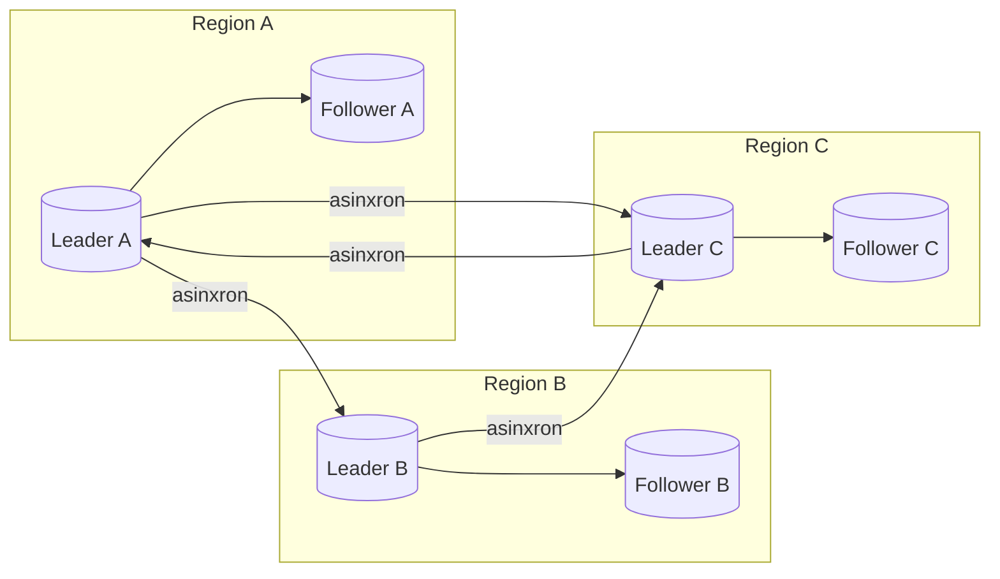
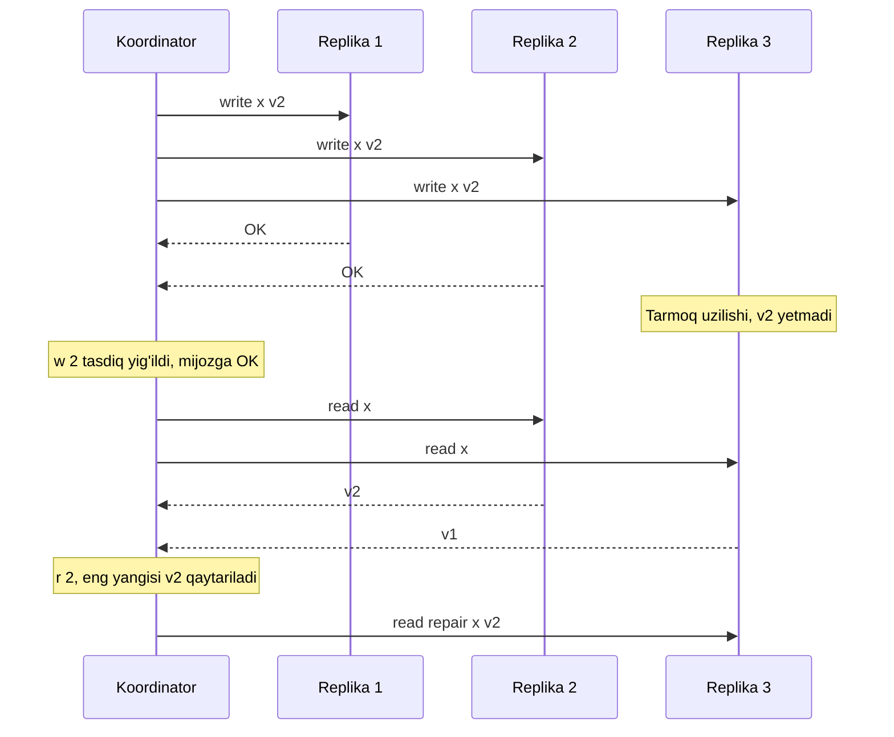

## Bu dars nima uchun kerak

26-darsdagi single-leader modelda barcha yozuvlar bitta tugundan o'tadi. Bu oddiy va izchil, lekin uchta cheklovi bor:

1. **Yozish mavjudligi.** Leader o'lsa, failover tugaguncha yozib bo'lmaydi, failover esa o'zi xavfli (GitHub 2018).
2. **Ko'p regionli latency.** Leader Frankfurtda bo'lsa, Toshkentdagi har bir yozuv kamida bitta qit'alararo round trip.
3. **Oflayn ishlash.** Mobil ilova yoki mashinadagi qurilma tarmoqsiz ham yozishi kerak.

Bu muammolarni hal qilish uchun yozuvni **bir nechta** tugun qabul qiladigan modellar bor: **multi-leader** (bir nechta leader, har biri o'z replikalari bilan) va **leaderless** (leader umuman yo'q, mijoz bir vaqtda bir nechta replikaga yozadi). Ikkalasida ham yangi va qiyin muammo paydo bo'ladi: **parallel yozuvlar konflikti**. Ikki joyda bir vaqtda bitta qator o'zgartirilsa, qaysi biri to'g'ri?

Bu darsdan keyin siz:

- multi-leader topologiyalarini va ularning xavflarini bilasiz;
- konfliktlarni aniqlash va hal qilish usullarini (LWW, merge, siblings, CRDT g'oyasi) va ularning ma'lumot yo'qotishga ta'sirini bilasiz;
- leaderless (Dynamo uslubidagi) replication ni: quorum, read repair, hinted handoff, anti-entropy ni tushunasiz;
- w + r > n shartini hisoblay olasiz va u nimani kafolatlamasligini bilasiz;
- happens-before munosabatini va version vector g'oyasini tushunasiz.

## Multi-leader replication

Har bir data-markazda (yoki har bir qurilmada) o'z leader i bor. Mahalliy yozuvlar mahalliy leader ga, leader lar esa o'zgarishlarni bir-biriga **asinxron** yuboradi.

### Qachon ishlatiladi

- **Ko'p regionli tizim.** Har bir region yozuvni mahalliy qabul qiladi, regionlararo latency foydalanuvchiga ko'rinmaydi, region yo'qolsa qolganlari mustaqil ishlaydi.
- **Oflayn mijozlar.** Har bir qurilma - o'z "data-markazi" bilan leader. Tarmoq bo'lmaganda lokal yozadi, keyin sinxronlaydi. Kalendar ilovalari, eslatmalar, CouchDB/PouchDB uslubidagi sinxronizatsiya.
- **Hamkorlikda tahrirlash** (Google Docs, Figma). Har bir foydalanuvchi o'z nusxasini darhol o'zgartiradi, o'zgarishlar keyin birlashtiriladi (97-dars).

### Topologiyalar

- **Hammasi hammaga (all-to-all)** - eng ishonchli, lekin xabarlar turli yo'llar bilan turli tezlikda yetadi va **tartib buzilishi** mumkin: "UPDATE" uning sababi bo'lgan "INSERT" dan oldin yetib keladi.
- **Halqa (circular)** va **yulduz (star)** - har bir o'zgarish bir nechta tugundan o'tadi. Bitta tugun o'lsa, oqim to'xtaydi. Cheksiz aylanishni oldini olish uchun har bir yozuvga u o'tgan tugunlar identifikatori qo'shiladi.

### Asosiy muammo: konflikt

Misol: mashina nomi `A123` bo'lgan. Region A dagi dispetcher uni `Kamaz-1` ga, xuddi shu paytda Region B dagi dispetcher `Kamaz-01` ga o'zgartirdi. Ikkala leader ham yozuvni qabul qildi va javob qaytardi. Asinxron replikatsiyada ular bir-birining o'zgarishini keyinroq oladi va **konflikt** aniqlanadi. Single-leader da bu bo'lmaydi: ikkinchi yozuv birinchisini kutadi yoki uni ustidan yozadi.

Bundan tashqari, multi-leader da ko'p baza xususiyatlari muammoli bo'ladi: auto-increment ID lar (ikki leader bir xil ID beradi - shuning uchun UUID yoki Snowflake, 57-dars), unique constraint lar (ikki joyda bir xil email bilan ro'yxatdan o'tish), trigger lar, foreign key lar. Kleppmann ta'kidlaydiki, multi-leader ni ko'p bazalarda "qo'shimcha" xususiyat sifatida qo'shilgani uchun u nozik xatolarga moyil va iloji bo'lsa undan qochish kerak.

PostgreSQL ning o'zi built-in multi-master conflict resolution bermaydi: logical replication da obunachi tomonda unique constraint buzilsa, replikatsiya xato bilan **to'xtaydi** va uni qo'lda tuzatish yoki tranzaksiyani o'tkazib yuborish (`ALTER SUBSCRIPTION ... SKIP`) kerak. `track_commit_timestamp` yoqilsa, boshqa origin tomonidan o'zgartirilgan qatorga yozish konflikti logga yoziladi, lekin o'zgarish baribir qo'llanadi.

## Konfliktlarni hal qilish

### 1. Konfliktdan qochish

Eng yaxshi strategiya: bitta yozuvni **doim bitta leader** orqali o'zgartirish. Masalan, tenant ning "uy regioni" bor va uning barcha yozuvlari shu region leader iga ketadi. Foydalanuvchi uchun bu deyarli single-leader, lekin turli tenant lar turli regionlarda. Muammo faqat uy region o'zgarganda (region o'chdi yoki tenant ko'chdi) paydo bo'ladi.

### 2. Last write wins (LWW)

Har bir yozuvga vaqt belgisi qo'yiladi, eng kattasi g'olib, qolganlari **jimgina tashlanadi**. Cassandra shunday ishlaydi: har bir mutatsiya (shu jumladan delete) vaqt belgisiga ega, va eng oxirgisi yutadi. Cassandra hujjati to'g'rilik soatlarning sinxronligiga bog'liq ekanini va NTP ishlatishni ta'kidlaydi. DynamoDB global tables standart (MREC) rejimida ham har bir element uchun LWW ishlatadi.

LWW ning xavfi:

- **Ma'lumot yo'qotadi.** Ikki parallel yozuvdan biri hech qanday ogohlantirishsiz yo'qoladi. Mijoz "OK" olgan bo'lsa ham.
- **Soat noto'g'ri bo'lsa**, "keyinroq" yozuv aslida oldingi bo'lishi mumkin. Soati 2 soniya oldinda bo'lgan tugun 2 soniya davomida boshqa tugunlar yozuvlarini "yutadi". Soatlar muammosi 32-darsda.
- **"Oxirgi" tushunchasi parallel hodisalar uchun ma'nosiz.** Ikki yozuv bir-birini bilmagan holda bo'lsa, ular orasida haqiqiy tartib yo'q, LWW esa tasodifiy tartib o'ylab topadi.

LWW qachon xavfsiz: har bir kalit faqat bir marta yoziladi va o'zgartirilmaydi (masalan, UUID kalit bilan immutable hodisalar), yoki yo'qotish qabul qilinadigan ma'lumot (keshlar, "oxirgi ko'rilgan joylashuv").

### 3. Qiymatlarni birlashtirish (merge)

Ilova konflikt qiymatlarini mantiqan birlashtiradi. Klassik misol - Amazon Dynamo maqolasidagi xarid savati: ikki versiya birlashtirilganda (union), savatga "qo'shish" amali hech qachon yo'qolmaydi. Evaziga, o'chirilgan mahsulotlar qayta paydo bo'lishi mumkin. Buni oldini olish uchun o'chirishni ham yozuv sifatida saqlash kerak (tombstone).

### 4. Siblings (barcha versiyalarni saqlash)

Baza konfliktni o'zi hal qilmaydi, barcha parallel versiyalarni ("siblings") saqlaydi va keyingi o'qishda mijozga qaytaradi. Mijoz birlashtiradi va natijani yozadi. Riak shunday ishlagan. Bu ma'lumotni yo'qotmaydi, lekin har bir mijoz kodida birlashtirish logikasi kerak.

### 5. CRDT

**Conflict-free Replicated Data Types** - matematik jihatdan har qanday tartibda birlashtirilganda bir xil natija beradigan ma'lumot strukturalari: hisoblagichlar, to'plamlar, ro'yxatlar, matn. Cassandra o'z qatorlarini LWW element-set CRDT ko'rinishida hal qiladi. CRDT 40-darsda chuqur ko'riladi.

### Konflikt strategiyalari taqqoslash

| Strategiya | Ma'lumot yo'qotadimi | Ilova murakkabligi | Qachon |
|---|---|---|---|
| Konfliktdan qochish (uy region) | Yo'q | Past | Ko'p regionli SaaS, tenant bo'yicha |
| LWW | Ha, jimgina | Juda past | Immutable yozuvlar, cache, kesh holatlar |
| Merge (union va h.k.) | Kamroq, lekin "tirilish" xavfi | O'rta | Savat, teglar, to'plamlar |
| Siblings | Yo'q | Yuqori (mijoz birlashtiradi) | Muhim, kam o'zgaradigan ma'lumot |
| CRDT | Yo'q (struktura doirasida) | O'rta, cheklangan tiplar | Hisoblagich, to'plam, hamkorlikda tahrirlash |
| Sinxron konflikt tekshiruvi | Yo'q, yozuv rad etiladi | O'rta | Kuchli talab, latency qabul qilinadi |

Oxirgi qatorga misol: DynamoDB global tables ning MRSC (multi-region strong consistency) rejimi. U yozuvni muvaffaqiyatli deb qaytarishdan oldin kamida yana bitta regionga sinxron yetkazadi, va boshqa regionda o'zgartirilayotgan elementga yozish `ReplicatedWriteConflictException` bilan rad etiladi (qayta urinish mumkin). Bu rejim aniq uchta region da joylashadi (uchta replika yoki ikki replika va bitta witness) va RPO nol, lekin yozish latency si yuqori.

## Leaderless replication

Amazon ning Dynamo maqolasi (SOSP 2007) mashhur qilgan yondashuv: **leader yo'q**. Mijoz (yoki koordinator tugun) yozuvni bir vaqtda **barcha** n ta replikaga yuboradi va ulardan w tasi tasdiqlasa, yozuv muvaffaqiyatli. O'qishda r ta replikadan javob kutiladi va eng yangi versiya tanlanadi. Asl Dynamo, Cassandra, ScyllaDB va Riak shu modelda. (E'tibor bering: AWS dagi DynamoDB xizmati nomini Dynamo dan olgan, lekin uning ichki arxitekturasi 2007 yilgi maqoladagidan farq qiladi.)

### Quorum: w + r > n

- n - har bir kalit nechta replikada saqlanadi (replication factor);
- w - yozuv muvaffaqiyatli bo'lishi uchun nechta tasdiq;
- r - o'qishda nechta javob.

Agar **w + r > n** bo'lsa, yozuv tasdiqlagan replikalar to'plami va o'qish so'ralgan replikalar to'plami **kamida bitta tugunda kesishadi**. Demak o'qish kamida bitta yangi qiymatni ko'radi (normal sharoitda).

Dynamo maqolasida tipik konfiguratsiya (n, r, w) = (3, 2, 2). Hisoblaymiz:

| n | w | r | w + r > n? | Nechta tugun o'lsa yozish ishlaydi | O'qish ishlaydi | Izoh |
|---|---|---|---|---|---|---|
| 3 | 2 | 2 | 4 > 3, ha | 1 | 1 | Muvozanatli, standart tanlov |
| 3 | 3 | 1 | 4 > 3, ha | 0 | 2 | Tez o'qish, yozish mo'rt |
| 3 | 1 | 3 | 4 > 3, ha | 2 | 0 | Tez yozish, o'qish mo'rt |
| 3 | 1 | 1 | 2 > 3, yo'q | 2 | 2 | Maksimal mavjudlik, eskirgan o'qish ehtimoli |
| 5 | 3 | 3 | 6 > 5, ha | 2 | 2 | Ikki tugun nosozligiga chidamli |

Umumiy qoida: yozish n - w ta, o'qish n - r ta tugun nosozligiga chidaydi. Cassandra da bu **consistency level** lar orqali har bir so'rov uchun tanlanadi: `ONE`, `QUORUM` (n/2 + 1), `LOCAL_QUORUM` (mahalliy data-markaz ko'pchiligi), `EACH_QUORUM` (har bir data-markazda ko'pchilik), `ALL`. Cassandra hujjatiga ko'ra yozuv **har doim barcha** replikalarga yuboriladi; consistency level faqat koordinator nechta javobni kutishini belgilaydi.

### Replikalar qanday yetib oladi

Leader yo'q, demak "follower log ni qo'llaydi" mexanizmi ham yo'q. Eskirgan replikalarni tuzatishning uch usuli:

1. **Read repair.** O'qishda koordinator eskirgan replikani ko'rsa, unga yangi qiymatni yozadi (diagrammadagi oxirgi qadam). Tez-tez o'qiladigan kalitlar uchun yaxshi, kam o'qiladigan kalitlar uzoq vaqt eskirgan qoladi.
2. **Hinted handoff.** Replika o'lik bo'lsa, boshqa tugun yozuvni "bu replika X uchun" degan belgi (hint) bilan vaqtincha saqlaydi va X qaytganda unga uzatadi. Cassandra da hint lar standart holatda faqat **3 soat** (`max_hint_window`) davomida to'planadi; replika undan uzoq o'lik bo'lsa, u read repair yoki anti-entropy repair gacha nomuvofiq qoladi.
3. **Anti-entropy.** Fon jarayoni replikalarni solishtiradi. Butun ma'lumotni solishtirish qimmat, shuning uchun **Merkle tree** ishlatiladi: har bir kalit diapazoni uchun hash, ularning hash lari daraxt bo'lib yuqoriga. Ikki replika ildiz hash ini solishtiradi, farq bo'lsa - faqat farq qilgan shoxlarga tushadi va faqat farq qilgan diapazonlarni uzatadi. Cassandra da `nodetool repair` (to'liq, sub-range va incremental). Muntazam repair qilinmagan Cassandra klasterida o'chirilgan ma'lumot "tirilishi" mumkin: tombstone barcha replikalarga yetmasdan `gc_grace_seconds` o'tib o'chirilsa.

### Sloppy quorum

Dynamo da yana bir yengillik: agar kalitning "uy" replikalaridan ba'zilari yetib bo'lmasa, yozuv ring dagi keyingi sog'lom tugunlarga yoziladi (hinted handoff bilan) va ular w ga hisoblanadi. Bu **sloppy quorum**: yozish mavjudligini keskin oshiradi, lekin endi w ta tasdiq "uy" replikalaridan emas, shuning uchun r ta uy replikasidan o'qish yangi qiymatni ko'rmasligi mumkin. Ya'ni sloppy quorum bilan w + r > n **kafolat bermaydi** - bu faqat durability ga ishora.

### Quorum nimani kafolatlamaydi

w + r > n ko'pincha "kuchli consistency" deb noto'g'ri tushuniladi. Kleppmann bir nechta holatni keltiradi, ularda eskirgan qiymat qaytishi mumkin:

- **Sloppy quorum** - yuqorida.
- **Parallel yozuvlar** - ikki yozuv bir vaqtda turli replikalarga turli tartibda yetsa, qaysi biri "oxirgi" ekanini aniqlash kerak. LWW bo'lsa, ulardan biri yo'qoladi.
- **Yozuv va o'qish parallel** - yozuv ba'zi replikalarga yetgan, ba'zilariga yo'q; o'qish yangi yoki eski qiymatni olishi mumkin.
- **Muvaffaqiyatsiz yozuv** - yozuv w dan kam replikada muvaffaqiyatli bo'ldi va mijozga xato qaytdi, lekin muvaffaqiyatli bo'lgan replikalarda **orqaga qaytarilmaydi**. Keyingi o'qishlar uni ko'rishi yoki ko'rmasligi mumkin.
- **Yangi qiymatli replika o'lib, eski qiymatli replikadan tiklansa** - yangi qiymat bo'lgan replikalar soni w dan kamayadi.
- **Vaqt bo'yicha omadsizlik** - ikki ketma-ket o'qish turli natija beradi (birinchisi yangi, ikkinchisi eski), ya'ni linearizability yo'q (33-dars).

Xulosa: quorum - **ehtimolni** kamaytiruvchi va mavjudlikni sozlovchi mexanizm, linearizability emas. Linearizable operatsiyalar uchun consensus kerak (Cassandra ning lightweight transactions Paxos asosida, 35-dars).

### Ko'p data-markaz

Cassandra da `NetworkTopologyStrategy` har bir data-markaz uchun alohida replication factor beradi (masalan, DC1: 3, DC2: 3), replikalarni turli rack larga joylaydi. `LOCAL_QUORUM` faqat mahalliy data-markaz ko'pchiligini kutadi - latency past, lekin boshqa data-markazdagi o'qish yangi yozuvni darhol ko'rmasligi mumkin. `EACH_QUORUM` har bir data-markazdan ko'pchilik - kuchliroq, lekin regionlararo latency.

## Parallel yozuvlarni aniqlash: happens-before

Konfliktni to'g'ri hal qilish uchun avval aniqlash kerak: ikki yozuv **ketma-ket** bo'lganmi (biri ikkinchisini bilib yozilgan) yoki **parallel** (bir-birini bilmagan)?

- A **B dan oldin sodir bo'lgan** (A happens-before B), agar B A haqida bilgan bo'lsa yoki A ga tayangan bo'lsa (masalan, B A ning natijasini o'qib, keyin yozgan).
- Agar na A B dan oldin, na B A dan oldin bo'lsa, ular **parallel** (concurrent).

Muhim: "parallel" fizik vaqt bo'yicha bir vaqtda degani emas. Ikki yozuv bir soat farq bilan bo'lishi mumkin, lekin agar ikkinchisini yozgan mijoz birinchisini ko'rmagan bo'lsa (masalan, oflayn bo'lgan), ular parallel.

### Version vector

Har bir replika har bir kalit uchun versiya hisoblagichini yuritadi; replikalar to'plami bo'yicha bu hisoblagichlar vektori **version vector** deyiladi. Algoritm g'oyasi:

1. Mijoz o'qiganda, qiymat bilan birga version vector ni oladi.
2. Yozganda, oxirgi o'qigan version vector ini yuboradi ("men shu holatni ko'rib, ustiga yozyapman").
3. Server yangi yozuv vektorlari bo'yicha ustidan yozilgan versiyalarni o'chiradi, parallel bo'lganlarini esa **siblings** sifatida saqlaydi.

Ikki vektorni solishtirish: agar A ning har bir komponenti B nikidan kichik yoki teng bo'lsa (va kamida bittasi qat'iy kichik), A B dan oldin. Agar ba'zi komponentlar kattaroq, ba'zilari kichikroq bo'lsa - parallel.

Misol: `[R1: 2, R2: 1]` va `[R1: 1, R2: 2]` - parallel, konflikt. `[R1: 2, R2: 1]` va `[R1: 2, R2: 2]` - ikkinchisi birinchisidan keyin, birinchisini tashlab yuborish mumkin.

Dynamo maqolasi buni **vector clock** deb atagan va versiyalar orasidagi sababiy bog'liqlikni kuzatish uchun ishlatgan. Riak 1.0 dan (2011 yil sentabr) vektorlarda mijoz ID lari emas, replika (vnode) ID lari ishlatilgan - vektor kichik bo'lgan, lekin ba'zan ketma-ket yozuvlar "parallel" ko'ringan va siblings ko'payib ketgan (sibling explosion). Riak 2.0 da dotted version vectors (DVV) ixtiyoriy variant sifatida qo'shilgan; Riak hujjatiga ko'ra DVV siblings sonini ancha yaxshi cheklaydi, lekin sibling explosion ni butunlay yo'q qilmaydi - siblings soni baribir parallel yangilanishlar soniga bog'liq. Vector clock va Lamport soatlari 32-darsda chuqur ko'riladi.

## Uch modelni taqqoslash

| Mezon | Single-leader | Multi-leader | Leaderless |
|---|---|---|---|
| Yozuvni kim qabul qiladi | Faqat leader | Har bir leader | Har qanday replika (quorum) |
| Yozish mavjudligi | Leader ga bog'liq, failover kerak | Yuqori, region mustaqil | Yuqori, w ta tugun yetarli |
| Ko'p regionli yozish latency | Uzoq regionda yuqori | Mahalliy | Mahalliy (LOCAL_QUORUM) |
| Konfliktlar | Yo'q | Bor, hal qilish kerak | Bor, hal qilish kerak |
| Consistency | Leader dan o'qishda kuchli | Eventual | Sozlanadi, lekin linearizable emas |
| Failover | Bor va xavfli | Region darajasida | Kerak emas |
| Murakkablik | Past | Yuqori (konflikt, constraint lar) | Yuqori (repair, tombstone, soatlar) |
| Misollar | PostgreSQL, MySQL, MongoDB | Ko'p regionli MySQL sozlamalari, CouchDB, oflayn ilovalar | Cassandra, ScyllaDB, Riak, Dynamo |

## iQuariX kontekstida

Bu misolda iQuariX ikki mintaqada ishlaydi: O'zbekiston (Toshkent data-markazi) va Rossiya (Moskva), va ma'lumot saqlash qonunchiligi (78-dars) har bir mamlakat mijozlarining ma'lumotini o'z hududida saqlashni talab qiladi.

**Konfliktdan qochish orqali "multi-leader".** Har bir tenant ning uy regioni bor. O'zbek mijozlarining barcha yozuvlari Toshkent leader iga, rus mijozlariniki - Moskva leader iga. Bu aslida ikkita mustaqil single-leader klaster. Regionlararo faqat global ma'lumotnomalar (tariflar, qurilma modellari) va ular uchun bitta "egasi" bor. Konflikt amalda yo'q.

**Haydovchi mobil ilovasi - oflayn leader.** Haydovchi tarmoqsiz joyda yo'l varaqasini to'ldiradi, yoqilg'i quyish chekini suratga oladi. Ilova lokal yozadi va keyin sinxronlaydi. Shu paytda dispetcher ham serverda o'sha yo'l varaqasini o'zgartirgan bo'lishi mumkin. Variantlar:

- har bir maydonning "egasi" bor (haydovchi faqat o'z maydonlarini, dispetcher faqat o'zinikini o'zgartiradi) - konfliktdan qochish;
- chek va fotosuratlar immutable hodisalar sifatida (UUID bilan) - konflikt yo'q, faqat qo'shish;
- haqiqiy konflikt bo'lsa, ikkala versiyani saqlab, dispetcherga ko'rsatish (siblings).

LWW bu yerda xavfli: telefon soati noto'g'ri bo'lishi juda keng tarqalgan.

**Treker buferi.** GPS treker tarmoqsiz paytda nuqtalarni xotirasida yig'adi va keyin yuboradi. Har bir nuqta `(device_id, timestamp)` bilan noyob va o'zgarmaydi. Bu yerda replikatsiya konflikti yo'q, faqat **tartibsiz kelish** (keyingi nuqtalar oldingilardan oldin kelishi) - bu event time muammosi (45-dars).

**Telemetriya uchun leaderless?** Agar xom telemetriya uchun Cassandra yoki ScyllaDB tanlansa: n = 3, yozish `LOCAL_QUORUM` (w = 2), o'qish `LOCAL_ONE` - dispetcher xaritasi uchun bir necha soniyalik eskirish muhim emas, hisobotlar uchun esa `LOCAL_QUORUM`. Muntazam `repair` majburiy, aks holda TTL va delete lar bilan "tirilgan" ma'lumot muammosi.

## Ko'p uchraydigan xatolar

1. **Multi-leader ni "ko'p regionli bo'lish" uchun avtomatik tanlash.** Konfliktlar, constraint lar va auto-increment muammolari - ko'pincha tenant bo'yicha uy region yetarli.
2. **LWW ni xavfsiz deb hisoblash.** U tasdiqlangan yozuvlarni jimgina yo'qotadi va soat noto'g'riligiga sezgir.
3. **w + r > n ni linearizability deb o'ylash.** Sloppy quorum, parallel yozuvlar va muvaffaqiyatsiz yozuvlar bilan eskirgan o'qish mumkin.
4. **Cassandra da repair qilmaslik.** Hint lar 3 soatdan keyin to'xtaydi, tombstone lar yo'qolsa, o'chirilgan ma'lumot qaytadi.
5. **Mobil qurilma soatiga ishonish.** Oflayn sinxronizatsiyada qurilma vaqti bo'yicha LWW - noto'g'ri versiya yutadi.
6. **Multi-leader da unique constraint ga tayanish.** Ikki leader bir xil qiymatni mustaqil qabul qiladi, konflikt keyin aniqlanadi.
7. **Konflikt yechimini test qilmaslik.** Konflikt kamdan-kam bo'ladi, shuning uchun uning kodi eng kam tekshirilgan va eng ko'p xatoli kod.

## Xulosa

- Multi-leader: har bir region yoki qurilma o'z leader i bilan; mahalliy yozish va oflayn ishlash, evaziga konfliktlar.
- Eng yaxshi konflikt yechimi - konfliktdan qochish: har bir yozuvning bitta "uy" leader i.
- LWW oddiy, lekin ma'lumot yo'qotadi va soatlarga bog'liq. Merge, siblings va CRDT ma'lumotni saqlaydi, evaziga murakkablik.
- Leaderless: yozuv n replikaga, w tasdiq; o'qish r replikadan. w + r > n kesishishni ta'minlaydi, lekin linearizability emas.
- Eskirgan replikalar read repair, hinted handoff (Cassandra da 3 soat) va Merkle tree li anti-entropy bilan tuzatiladi.
- Sloppy quorum mavjudlikni oshiradi va quorum kafolatini bekor qiladi.
- Happens-before va version vector parallel yozuvlarni ketma-ketlardan ajratadi.

## Amaliy topshiriq

Masala sharti: iQuariX haydovchi mobil ilovasi oflayn rejimni qo'llab-quvvatlashi kerak: haydovchi kun davomida yo'l varaqasini to'ldiradi (yo'nalish, yoqilg'i quyish, chek fotosurati, odometr ko'rsatkichi, izohlar), dispetcher esa serverda shu varaqani o'zgartirishi mumkin (marshrut, izoh, tasdiq holati). Telefon 8 soatgacha oflayn bo'lishi mumkin.

1. **Ma'lumot modelini** konflikt nuqtai nazaridan loyihalang: qaysi maydonlar immutable hodisa, qaysilari o'zgaruvchan, har birining "egasi" kim.
2. Har bir o'zgaruvchan maydon uchun **konflikt strategiyasini** tanlang (egalik, LWW, merge, siblings, CRDT) va asoslang.
3. **Parallel yozuvlarni aniqlash**: version vector yoki boshqa mexanizm. Qaysi aktorlar vektorda bo'ladi? Telefon soatidan foydalanasizmi?
4. **Stsenariy**: haydovchi oflaynda odometrni 152 300 deb yozdi, dispetcher serverda xato deb 152 030 ga tuzatdi, keyin haydovchi onlayn bo'ldi. Sizning dizayningizda nima bo'ladi va foydalanuvchilar nimani ko'radi?
5. Agar server tomonida xom telemetriya uchun Cassandra ishlatilsa: n, w, r va consistency level larni tanlang, 1 tugun va butun rack yo'qolgan holatlar uchun mavjudlikni hisoblang.
6. **Repair rejasi**: hint oynasi, repair chastotasi va gc_grace_seconds orasidagi bog'liqlik.

Yaxshi javobda bo'lishi kerak bo'lgan narsalar:

- fotosurat, chek, yoqilg'i quyish kabi immutable hodisalar va o'zgaruvchan maydonlar ajratilgan;
- telefon soatiga asoslangan LWW dan voz kechish sababi;
- odometr stsenariysida konflikt aniqlanishi va ikkala qiymatni ko'rsatish yoki egalik qoidasi;
- quorum hisobi: n = 3, w = 2, r = 2 da 1 tugun nosozligiga chidamlilik, rack yo'qolishi uchun NetworkTopologyStrategy;
- repair muddati gc_grace_seconds dan qisqa bo'lishi kerakligi.

Javobni pastdagi maydonga yozib, chatga yuboring.

## Manbalar

- Martin Kleppmann, Chris Riccomini. [Designing Data-Intensive Applications, 2-nashr](https://www.oreilly.com/library/view/designing-data-intensive/9781098119058/), O'Reilly, 2026. 6-bob "Replication": multi-leader, leaderless, quorum chegaralari, happens-before, version vector.
- Giuseppe DeCandia va boshq. [Dynamo: Amazon's Highly Available Key-value Store](https://www.allthingsdistributed.com/files/amazon-dynamo-sosp2007.pdf), SOSP 2007 - sloppy quorum, hinted handoff, (3, 2, 2), vector clock, Merkle tree, xarid savati.
- Apache Cassandra. [Dynamo architecture](https://cassandra.apache.org/doc/latest/cassandra/architecture/dynamo.html) - consistency level lar, R + W > RF, read repair, anti-entropy, LWW, NetworkTopologyStrategy. [Hints](https://cassandra.apache.org/doc/latest/cassandra/managing/operating/hints.html) - max_hint_window.
- AWS. [DynamoDB global tables: how it works](https://docs.aws.amazon.com/amazondynamodb/latest/developerguide/V2globaltables_HowItWorks.html) - MREC (LWW) va MRSC rejimlari.
- PostgreSQL. [Logical Replication: Conflicts](https://www.postgresql.org/docs/current/logical-replication-conflicts.html).
- Riak. [Vector Clocks Revisited](https://www.riak.com/posts/technical/vector-clocks-revisited/index.html), 2015 - siblings, vnode aktorlar (1.0), sibling explosion. [Causal Context](https://docs.riak.com/riak/kv/2.2.3/learn/concepts/causal-context/index.html) - dotted version vectors (2.0).
