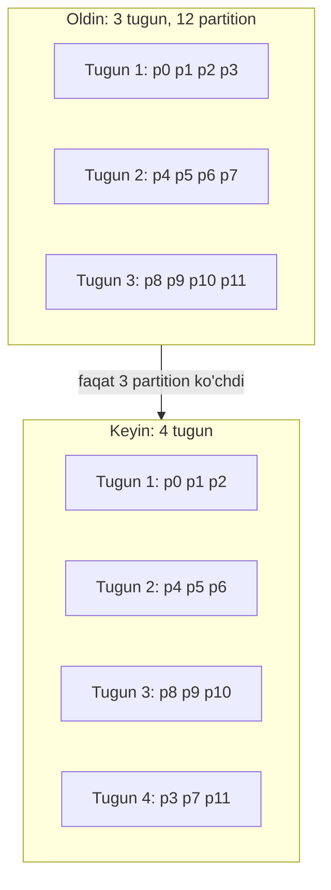

## Bu dars nima uchun kerak

Replication (26-27 darslar) bir xil ma'lumotni ko'p joyda saqlaydi. Bu o'qishni va mavjudlikni masshtablaydi, lekin ikki narsani masshtablamaydi: **yozish** (barcha yozuvlar hamma replikaga tushadi) va **hajm** (har bir replika butun ma'lumotni saqlaydi). Ma'lumot bitta mashina diskiga sig'masa yoki yozuv oqimi bitta leader ko'tara oladigandan oshsa, ma'lumotni **bo'lish** kerak: har bir tugun faqat bir qismini saqlaydi.

Bu **partitioning** yoki **sharding** deyiladi. Nomlar turlicha: MongoDB va Elasticsearch da shard, Cassandra da token range, Bigtable da tablet, CockroachDB da range, TiKV da region, DynamoDB da partition. Kleppmann DDIA 2-nashrida bunga 7-bobni ("Sharding") ajratadi. Partitioning odatda replication bilan birga ishlatiladi: har bir shard ning o'z replikalari bor.

21-darsda aytganimizdek, sharding - qaytarish eng qimmat qarorlardan biri. Figma va Notion kabi kompaniyalar uni faqat vertical scaling, replikalar va vertical partitioning tugagandan keyin qilgan. Shuning uchun bu darsda nafaqat "qanday", balki "qachon" va "qanday xato qilinadi" ham.

Bu darsdan keyin siz:

- vertical va horizontal partitioning ni, partition va shard tushunchalarini ajratasiz;
- key range va hash partitioning ning ichki ishlashini va trade-off larini bilasiz;
- skew va hotspot qanday paydo bo'lishini va kalit dizayni orqali qanday oldini olishni bilasiz;
- rebalancing ning to'rt strategiyasini (mod N, ko'p sonli fixed partition, dinamik split, tugunga proporsional) bilasiz;
- shard kalitini tanlash va mavjud bazani sharding ga ko'chirish jarayonini rejalashtira olasiz.

## Asosiy tushunchalar

**Vertical partitioning** - jadvallarni (yoki ustunlarni) turli bazalarga ajratish: foydalanuvchilar bir bazada, telemetriya boshqasida. Figma ning birinchi qadami shu bo'lgan: bog'liq jadvallar guruhlarini alohida bazalarga ko'chirish. Oddiy, chunki har bir jadval butunligicha bitta joyda qoladi. Lekin bitta jadval o'zi juda katta bo'lsa, yordam bermaydi.

**Horizontal partitioning (sharding)** - bitta jadvalning qatorlarini **partition kaliti** bo'yicha turli tugunlarga bo'lish. Bu darsning asosiy mavzusi.

Maqsad - yuklamani **tekis** taqsimlash. Agar 10 ta tugun bo'lsa, ideal holatda har biri 10% ma'lumot va 10% so'rovni oladi. Agar taqsimot notekis bo'lsa, bu **skew** deyiladi. Haddan tashqari ko'p yuklama olgan partition - **hotspot** (yoki hot partition). Skew bo'lsa, 10 ta tugunning samarasi bittadan sal ko'p bo'lishi mumkin.

Bitta mashina ichida ham partitioning bor: PostgreSQL deklarativ partitioning (range, list, hash) bilan jadvalni bir server ichida bo'laklarga bo'ladi. U masshtablash uchun emas, ko'proq **boshqaruv** uchun: partition pruning (rejalashtiruvchi keraksiz bo'laklarni o'tkazib yuboradi) va eski ma'lumotni `DELETE` o'rniga `DROP` yoki `DETACH PARTITION` bilan bir zumda o'chirish (VACUUM yuklamasisiz). Telemetriya kabi vaqt bo'yicha ma'lumot uchun bu juda foydali (81-dars). Tushunchalar bir xil, shuning uchun bu bilim distributed sharding ga ham to'g'ridan-to'g'ri o'tadi.

## Key range partitioning

Kalitlar tartiblangan va har bir partition **uzluksiz diapazonga** ega: A-F birinchi tugunda, G-M ikkinchisida va h.k. Lug'atdagi jildlar kabi.

Afzalliklari:

- **Range so'rovlar samarali**: "1-martdan 7-martgacha" yoki "prefiks bo'yicha barcha kalitlar" faqat tegishli partition larga ketadi.
- Kalit ichida tartib saqlanadi: partition ichida ham kalitlar tartiblangan (SSTable yoki B-tree, 13-14 darslar).

Kamchiligi: **ketma-ket kalitlarda hotspot**. Kalit vaqt belgisi bo'lsa, barcha yangi yozuvlar oxirgi diapazonga - bitta partition ga tushadi, qolganlari faqat eski ma'lumotni o'qiydi. MongoDB hujjati ham buni aytadi: ranged sharding da monoton o'suvchi kalit (ObjectId, timestamp) bilan barcha yangi yozuvlar yuqori chegarasi MaxKey bo'lgan bitta chunk ga, ya'ni bitta shard ga tushadi.

Diapazon chegaralari qayerda bo'lishi kerak? Ma'lumot taqsimoti notekis (masalan, "S" harfida boshlanadigan nomlar ko'p) bo'lgani uchun chegaralar ma'lumotga moslashishi kerak - qo'lda yoki avtomatik (pastda, dinamik partitioning). Range partitioning ishlatadigan tizimlar: Bigtable va HBase, CockroachDB, TiKV, MongoDB ranged sharding, YugabyteDB ning range rejimi.

### Hotspot ga qarshi kalit dizayni

Google Bigtable hujjati qator kaliti dizayni bo'yicha aniq tavsiyalar beradi:

- vaqt belgisini qator kalitining **boshiga** yoki yolg'iz qo'ymang - ketma-ket yozuvlar bitta tugunga tushadi;
- vaqt kerak bo'lsa, oldiga yuqori kardinallikdagi qiymat qo'ying (masalan, foydalanuvchi yoki qurilma ID si): `device#42#2026-10-20T08:15:00`;
- eng yangi yozuvlarni birinchi o'qish uchun teskari vaqt belgisi (maksimal qiymat minus timestamp), lekin uni ham kalit boshiga qo'ymaslik;
- ketma-ket raqamli ID larni teskari qilish trafikni tekisroq taqsimlaydi.

Shunda yozuvlar barcha qurilmalar bo'yicha taqsimlanadi, bitta qurilmaning vaqt oralig'i esa baribir uzluksiz diapazon bo'lib qoladi - range so'rov saqlanadi. Bu **compound key** naqshi: birinchi qism taqsimlash uchun, ikkinchisi tartib uchun.

## Hash partitioning

Har bir kalitdan hash funksiya hisoblanadi va partition **hash qiymati** bo'yicha tanlanadi. Yaxshi hash (MD5, Murmur3, xxHash - kriptografik kuch shart emas) o'xshash kalitlarni ham tasodifiy tarqatadi, shuning uchun ketma-ket kalitlar hotspot bermaydi.

Muhim: hash funksiya **barqaror** bo'lishi kerak - bir xil kalit har doim, har qanday process da bir xil hash berishi kerak. Ba'zi tillarning o'rnatilgan hash funksiyalari (masalan, Java `Object.hashCode()` ba'zi tiplar uchun yoki Python `hash()` string lar uchun) process lar orasida farq qilishi mumkin, shuning uchun ular sharding uchun yaroqsiz.

Kamchiligi: **range so'rov samaradorligi yo'qoladi**. Qo'shni kalitlar turli partition larda, shuning uchun "barcha mashinalarning 1-7 mart telemetriyasi" kabi so'rov **barcha** partition larga yuboriladi (scatter-gather). MongoDB hujjati ham buni ta'kidlaydi: hashed sharding da tenglik so'rovlari bitta shard ga yo'naltiriladi, range so'rovlar esa ehtimol hamma shard larga broadcast bo'ladi.

**Murosa - compound key.** Cassandra da asosiy kalit ikki qismdan iborat: **partition key** (hash qilinadi, qaysi tugun ekanini belgilaydi) va **clustering columns** (partition ichida tartib). Masalan, `PRIMARY KEY ((device_id), ts)`: har bir qurilma bitta partition da, uning ichida vaqt bo'yicha tartiblangan. "Qurilma 42 ning kechagi treki" - bitta partition ichida samarali range scan; qurilmalar esa tugunlar bo'yicha tekis taqsimlangan. DynamoDB da xuddi shu: partition key + sort key.

### Hash dan partition ga: "hash mod N" tuzog'i

Eng oddiy usul: `partition = hash(key) mod N`, N - tugunlar soni. Muammo: N o'zgarsa, deyarli **barcha** kalitlar boshqa tugunga ko'chadi.

Hisoblaymiz: N 10 dan 11 ga oshdi. Kalit joyida qolishi uchun `h mod 10 = h mod 11` bo'lishi kerak. Tasodifiy h uchun bu taxminan 1/11 ehtimol bilan (aniqrog'i, h ning 110 ga bo'linishdagi qoldig'i 0 dan 9 gacha bo'lganda, ya'ni 10/110). Demak kalitlarning taxminan **91%** i ko'chadi, vaholanki ideal holatda faqat 1/11, ya'ni taxminan **9%** ko'chishi kerak edi (yangi tugun o'z ulushini olishi uchun). 1 TB ma'lumotda bu 910 GB ni tarmoq orqali ko'chirish degani. Shuning uchun mod N deyarli hech qachon ishlatilmaydi. Yechimlar - pastdagi rebalancing strategiyalari va consistent hashing (29-dars).

## Taqqoslash

| Mezon | Key range | Hash | Compound (hash + tartib) |
|---|---|---|---|
| Tekis taqsimot | Kalit taqsimotiga bog'liq, chegaralarni sozlash kerak | Yaxshi (kalitlar ko'p bo'lsa) | Partition key kardinalligiga bog'liq |
| Ketma-ket kalitlarda hotspot | Ha | Yo'q | Partition key ichida emas |
| Range so'rov | Samarali | Barcha partition larga | Partition key ichida samarali |
| Bitta kalitga hotspot (celebrity) | Bor | Bor | Bor |
| Rebalancing | Diapazonlarni bo'lish yoki birlashtirish | Partition larni ko'chirish | Hash qismi bo'yicha |
| Misollar | Bigtable, HBase, CockroachDB, TiKV | MongoDB hashed, Redis Cluster slot | Cassandra, DynamoDB, ScyllaDB |

## Skew va hot key

Hash partitioning **turli kalitlar** bo'yicha yuklamani tekislaydi, lekin **bitta kalit** ga juda ko'p murojaat bo'lsa (millionlab obunachili akkaunt, eng katta mijoz, mashhur mahsulot), u kalit baribir bitta partition da. Bu 24-darsdagi hot key muammosining saqlash qatlamidagi ko'rinishi va 30-darsda chuqur ko'riladi.

DynamoDB raqamlari bu cheklovni aniq ko'rsatadi: hujjatga ko'ra har bir partition soniyasiga 3 000 gacha read unit va 1 000 gacha write unit beradi (1 WCU = 1 KB gacha element uchun soniyasiga bitta yozuv). Ya'ni bitta partition key ga soniyasiga 1 000 dan ortiq 1 KB lik yozuv yuborsangiz, jadvalning umumiy sig'imi qancha bo'lmasin, throttling bo'ladi. Element 20 KB bo'lsa, bitta kuchli consistent o'qish 5 RCU sarflaydi va bitta partition faqat 600 o'qish/s beradi.

Oddiy yechim - kalitga tasodifiy suffiks (**write sharding**): `vehicle#42#0` ... `vehicle#42#9`. Yozuv 10 ta partition ga taqsimlanadi, lekin o'qishda 10 ta kalitni o'qib birlashtirish kerak. Buni faqat haqiqatan hot bo'lgan kalitlar uchun qilish va qaysilar hot ekanini kuzatish kerak.

## Rebalancing: partition larni tugunlarga moslash

Vaqt o'tishi bilan ma'lumot o'sadi, tugunlar qo'shiladi yoki o'ladi. **Rebalancing** - partition larni tugunlar orasida qayta taqsimlash. Talablar:

- rebalancing dan keyin yuklama tekis bo'lsin;
- rebalancing davomida baza o'qish va yozishni qabul qilsin;
- keraksiz ma'lumot ko'chmasin (tarmoq va disk I/O ni tejash).

### 1. Ko'p sonli fixed partition

Tugunlardan **ancha ko'p** partition oldindan yaratiladi (masalan, 10 tugun uchun 1 000 partition, har bir tugunga taxminan 100 tadan). Kalit -> partition xaritasi hech qachon o'zgarmaydi. Yangi tugun qo'shilganda, u mavjud tugunlardan **butun partition larni** "o'g'irlaydi" - partition lar bo'linmaydi, faqat ko'chadi.

Bu modelni ishlatadigan tizimlar:

- **Redis Cluster**: 16 384 hash slot (24-dars), `CRC16(key) mod 16384`. Slot lar tugunlar orasida ko'chiriladi.
- **Elasticsearch**: indeks yaratilganda primary shard lar soni belgilanadi, va shard lar immutable - sonini o'zgartirish uchun split yoki reindex kerak. Elastic hujjati shard hajmini 10-50 GB oralig'ida va bitta shard da 200 million hujjatdan kam ushlashni tavsiya qiladi.
- **Notion** (2021): PostgreSQL ni sharding ga ko'chirishda **480 ta mantiqiy shard** (har biri alohida Postgres schema) 32 ta fizik bazaga (har biriga 15 tadan) taqsimlangan. 480 tanlangani sababi - uning bo'luvchilari ko'p: fizik bazalar sonini 32 dan 40 ga, 48 ga bosqichma-bosqich oshirish mumkin va shard lar baribir tekis taqsimlanadi. 512 kabi ikkining darajasi esa har safar fizik bazalarni ikki baravar oshirishni talab qilardi.
- **Citus** (PostgreSQL kengaytmasi): taqsimlangan jadval shard larga bo'linadi, kichik yuklamalar uchun hujjat 32 shard dan boshlashni taklif qiladi; shard lar worker tugunlar orasida PostgreSQL logical replication orqali ko'chiriladi (11.0 versiyadan community versiyada ko'chirish paytida yozish ham bloklanmaydi).

Asosiy qaror: **partition soni**. Juda kam bo'lsa - kelajakda tugunlar sonidan kam bo'lib qoladi (bitta partition ni ikki tugunga bo'lib bo'lmaydi), va har bir partition juda katta bo'lib, ko'chirish sekinlashadi. Juda ko'p bo'lsa - har bir partition ning boshqaruv xarajati (metama'lumot, ulanishlar, fayllar). Amaliy qoida: kutilayotgan maksimal tugunlar sonidan 10-100 baravar ko'p, va maksimal partition hajmi ko'chirish bir necha daqiqadan oshmaydigan darajada.

### 2. Dinamik partitioning (split va merge)

Range partitioning da oldindan chegaralarni bilish qiyin, shuning uchun partition lar **avtomatik** bo'linadi va birlashadi:

- partition belgilangan hajmdan oshsa, o'rtasidan ikkiga bo'linadi, va yarmi boshqa tugunga ko'chirilishi mumkin;
- juda kichrayib ketsa, qo'shnisi bilan birlashtiriladi.

Raqamlar: CockroachDB da range standart holatda **512 MiB** ga yetganda bo'linadi va 128 MiB dan kichik bo'lsa qo'shnisi bilan birlashadi. TiKV da region hajmi chegarasi standart **256 MiB**. MongoDB da standart range (chunk) hajmi **128 MB**, va balancer ikki shard orasidagi kolleksiya ma'lumoti farqi range hajmining uch baravaridan (standart holatda 384 MB) oshgandagina ko'chirishni boshlaydi; bitta shard bir vaqtda faqat bitta ko'chirishda qatnashadi.

Dinamik partitioning ning muammosi - **bo'sh boshlanish**: yangi jadval bitta partition da, va u bo'linguncha barcha yozuvlar bitta tugunga ketadi. Yechim - **pre-splitting**: oldindan kalit taqsimoti ma'lum bo'lsa, boshlang'ich chegaralarni berish. MongoDB 8.0 dan bo'sh kolleksiyani hashed sharding qilganda har bir shard uchun bittadan chunk yaratadi.

Dinamik partitioning hash partitioning bilan ham ishlaydi: hash qiymatlari diapazoniga range partitioning qo'llanadi (MongoDB hashed sharding shunday).

### 3. Tugunga proporsional partitioning

Partition soni tugunlar soniga proporsional: har bir tugunda belgilangan sondagi partition. Yangi tugun qo'shilganda, u tasodifiy tanlangan partition larni bo'lib, yarmini o'ziga oladi. Cassandra **vnode** lari (token lar) shu g'oyaga yaqin: har bir tugun ring da bir nechta token oladi. Cassandra production hujjati `num_tokens` uchun 1, 4, 8 yoki 16 variantlarini taqqoslaydi: ko'p token - elastiklik va tekislik, lekin har bir token qo'shni tugunlar sonini oshiradi (bitta nosozlik ko'proq diapazonga ta'sir qiladi) va repair sekinlashadi. Consistent hashing va vnode lar 29-darsda chuqur.

### Strategiyalar taqqoslash

| Strategiya | Partition soni | Tugun qo'shilganda | Afzallik | Kamchilik | Misol |
|---|---|---|---|---|---|
| hash mod N | N ga teng | Deyarli hamma kalit ko'chadi | Juda oddiy | Rebalancing imkonsiz darajada qimmat | Faqat statik klasterlar |
| Fixed, ko'p sonli | Doimiy, oldindan | Butun partition lar ko'chadi | Oddiy, oldindan aytib bo'ladi | Sonini oldindan to'g'ri tanlash kerak | Redis Cluster, Elasticsearch, Notion, Citus |
| Dinamik split | Ma'lumot hajmiga moslashadi | Bo'lingan partition lar ko'chadi | Range ga mos, o'z-o'zidan sozlanadi | Bo'sh boshlanish, split bo'roni | CockroachDB, TiKV, HBase, MongoDB |
| Tugunga proporsional | Tugunlar soniga proporsional | Yangi tugun partition larni bo'lib oladi | Tugunlar bilan birga o'sadi | Taqsimot tasodifiy, token tanlash murakkab | Cassandra vnode |

### Avtomatik yoki qo'lda

To'liq avtomatik rebalancing qulay, lekin xavfli: tugun vaqtincha sekinlashsa, tizim uni "o'lik" deb hisoblab, uning partition larini ko'chira boshlaydi. Bu klasterga va tarmoqqa qo'shimcha yuklama tushiradi, qolgan tugunlar sekinlashadi, ular ham "o'lik" ko'rinadi - kaskad. Shuning uchun ko'p tizimlar rebalancing ni **taklif qiladi**, lekin uni bajarishni operatorga qoldiradi yoki ko'chirish tezligini qattiq cheklaydi (MongoDB da bitta shard bir vaqtda bitta ko'chirish).

## Rebalancing mexanikasi: partition qanday ko'chadi

Partition ni ishlayotgan tizimda ko'chirish uchun tipik qadamlar (MongoDB range migration misolida):

1. Balancer manba shard ga ko'chirish buyrug'ini yuboradi.
2. Qabul qiluvchi shard indekslarni yaratadi va diapazondagi hujjatlarni nusxalaydi.
3. Nusxalash davomida kelgan o'zgarishlar sinxronlanadi.
4. Metama'lumot (qaysi diapazon qayerda) yangilanadi - shu paytdan boshlab so'rovlar yangi joyga ketadi.
5. Manba shard eski nusxani o'chiradi.

Xuddi shu naqsh deyarli hamma joyda: **nusxalash + o'zgarishlarni quvib yetish + qisqa almashtirish + tozalash**. Citus logical replication bilan, Notion esa ilova darajasida (pastda) shunday qilgan. Eng nozik joy - 4-qadam: almashtirish paytida eski joyga kelgan yozuvlar yo'qolmasligi kerak (odatda qisqa yozish blokirovkasi yoki versiya tekshiruvi bilan).

Hisob: 200 GB partition, ko'chirish tezligi tizimni ezmaslik uchun 100 MB/s bilan cheklangan. 200 000 MB / 100 MB/s = 2 000 s, ya'ni taxminan **33 daqiqa**, plus quvib yetish. Agar shard larni oldindan kichik (masalan, 10-20 GB) qilib qo'ysangiz, har biri 2-3 daqiqada ko'chadi va rebalancing ni bosqichma-bosqich, xavfsiz bajarish mumkin. Bu "ko'p kichik partition" yondashuvining yana bir sababi.

## Shard kalitini tanlash

Bu qaytarish eng qimmat qaror. Yaxshi kalit:

1. **Yuqori kardinallik** - ko'p turli qiymatlar (mamlakat kodi yomon: 200 ta qiymat va notekis).
2. **Tekis yuklama** - qiymatlar orasida trafik taxminan teng yoki bir nechta katta qiymat ham umumiy sig'imning kichik qismi.
3. **So'rovlarning ko'pchiligi bitta shard da** - eng ko'p bajariladigan so'rovlar kalitni o'z ichiga oladi.
4. **Tranzaksiya va JOIN lar shard ichida** - bir tranzaksiyada o'zgaradigan qatorlar bir xil kalitga ega.
5. **O'zgarmas** - kalit qiymati o'zgarsa, qator boshqa shard ga ko'chishi kerak.

B2B SaaS uchun eng tabiiy kalit - **tenant (mijoz) ID**. Citus blogi B2B ilovalar uchun deyarli barcha jadvallarga `customer_id` ustunini qo'shib, uni distribution column qilishni tavsiya qiladi: ma'lumotning ko'p qismi bitta mijoz atrofida, va bir mijozning jadvallari bitta joyda bo'lgani uchun JOIN, tranzaksiya va foreign key lar ishlayveradi (colocation). Figma da shunga o'xshash g'oya: bir xil sharding kalitini (UserID, FileID, OrgID) baham ko'radigan jadvallar "colo" ga birlashtiriladi, va bitta kalit doirasidagi JOIN va tranzaksiyalar ishlaydi; marshrutlash kalit hash i bo'yicha. Notion uchun kalit - workspace ID, chunki har bir blok aniq bitta workspace ga tegishli.

Tenant kalitining xavfi - **katta tenant**: bitta mijoz qolganlarning hammasidan katta bo'lishi mumkin. Unda u alohida shard (yoki shard lar guruhi) oladi, yoki undagi eng katta jadval ikkinchi darajali kalit bilan (masalan, tenant + vehicle) bo'linadi.

## Mavjud bazani sharding ga ko'chirish

Notion 2021 yilda shunday ko'chgan:

1. **Ikki tomonga yozish (double write)**: yangi yozuvlar eski va yangi bazalarga (ular audit log va catch-up skript orqali);
2. **Backfill**: mavjud ma'lumotni yangi shard larga ko'chirish (katta instance da taxminan 3 kun);
3. **Tekshirish**: namunalar va "dark read" - bir xil so'rovni ikkala bazaga yuborib natijalarni solishtirish;
4. **Almashtirish**: taxminan 5 daqiqalik rejali texnik ishlar oynasi; ular yozganidek, catch-up skript tezroq bo'lganida downtime siz ham bo'lishi mumkin edi.

Figma esa avval "mantiqiy sharding" ni (Postgres view lar orqali, foiz bo'yicha bosqichma-bosqich yoqiladigan va konfiguratsiya o'zgarishi bilan qaytariladigan) qilib, keyin "fizik sharding" ni (ma'lumotni haqiqatan ko'chirish) alohida bajargan. Birinchi gorizontal shard qilingan jadval 2023 yil sentabrida, taxminan 9 oylik ishdan keyin chiqqan.

Umumiy saboq: sharding loyihasining asosiy qismi - ilova kodini kalit bo'yicha so'rovlarga moslash va xavfsiz migratsiya, algoritm emas.

## iQuariX kontekstida

Faraz qiling, telemetriya jadvali `positions` yiliga o'nlab TB ga o'sadi, asosiy relational ma'lumot esa bir necha yuz GB.

**1-qadam: partitioning bitta server ichida.** `positions` ni PostgreSQL da vaqt bo'yicha range partitioning: har kun yoki hafta uchun alohida partition. Eski ma'lumotni saqlash muddati (masalan, 90 kun) o'tganda `DROP TABLE positions_2026_07_15` - bir zumda, VACUUM siz. Partition pruning "kechagi trek" so'rovini faqat 1-2 partition ga cheklaydi. Lekin yozuvlar baribir bitta "bugungi" partition ga tushadi - bu bitta server ichida muammo emas (bu hotspot emas, chunki boshqa server yo'q).

**2-qadam: distributed sharding kerak bo'lganda kalit.** Variantlar:

| Kalit | Yozish taqsimoti | "Mashina X ning kechagi treki" | "Tenant ning barcha mashinalari hozir" | Xavf |
|---|---|---|---|---|
| `ts` (range) | Hammasi bitta shard ga | Bitta shard, lekin hamma qurilmalar aralash | Bitta shard | Yozish hotspot |
| `device_id` (hash) | Tekis | Bitta shard | Hamma shard larga | Tenant so'rovlari scatter-gather |
| `tenant_id` (hash) | Katta tenant ga bog'liq | Bitta shard | Bitta shard | Katta tenant hotspot |
| `(tenant_id, device_id)` hash + `ts` tartib | Tekis | Bitta shard, range scan | Tenant hajmiga qarab 1 yoki bir nechta | Murakkabroq routing |

Xom telemetriya uchun `device_id` partition key va `ts` clustering (Cassandra yoki ScyllaDB uslubida) - eng tabiiy: yozuvlar tekis, eng ko'p so'rov ("qurilmaning vaqt oralig'idagi treki") bitta partition da. "Tenant ning hozirgi holati" esa telemetriya jadvalidan emas, Redis dagi oxirgi holat cache dan (23-dars) o'qiladi.

Partition hajmini tekshiring: bitta qurilma kuniga 8 640 nuqta × 100 bayt = 864 KB, yiliga ~315 MB. Agar partition key faqat `device_id` bo'lsa, bir necha yildan keyin bitta partition gigabaytlarga yetadi - Cassandra uchun juda katta. Yechim - **bucket**: `PRIMARY KEY ((device_id, month), ts)`. Har bir partition bir oylik ma'lumot, ~26 MB.

**Relational qism (mijozlar, shartnomalar, sozlamalar)** uchun shard kaliti - `tenant_id`, Citus uslubida colocation bilan. Lekin bu qism bir necha yuz GB bo'lsa, sharding hali umuman kerak emas - kuchli bitta PostgreSQL va replikalar (21, 26 darslar).

**Partition soni.** Agar o'zingiz ilova darajasida sharding qilsangiz, Notion tajribasidan: mantiqiy shard lar sonini katta va ko'p bo'luvchili tanlang (masalan, 240, 360 yoki 480) va ularni ozroq fizik bazaga joylang.

## Ko'p uchraydigan xatolar

1. **Erta sharding.** Bitta katta server va replikalar yetadigan bosqichda sharding qilish - murakkablikni oldindan to'lash.
2. **hash mod N.** Har bir tugun qo'shilishi deyarli butun ma'lumotni ko'chiradi.
3. **Ketma-ket kalitni (vaqt, auto-increment) range partition kaliti qilish.** Barcha yozuvlar bitta shard ga.
4. **So'rovlarni hisobga olmay kalit tanlash.** Eng ko'p bajariladigan so'rov hamma shard larga ketadi.
5. **Partition sonini juda kam tanlash.** Keyinchalik tugunlar sonidan kam bo'lib qoladi yoki har biri ko'chirib bo'lmas darajada katta.
6. **Chegarasiz o'sadigan partition.** Cassandra da bitta qurilmaning butun tarixi bitta partition da - bucket kerak.
7. **Agressiv avtomatik rebalancing.** Sekin tugun "o'lik" deb topiladi, ko'chirish yuklamasi kaskadga olib keladi.
8. **Katta tenant ni unutish.** Tenant bo'yicha sharding da bitta mijoz bitta shard ni to'liq egallaydi.

## Xulosa

- Partitioning yozish va hajmni masshtablaydi, replication bilan birga ishlatiladi. Bitta server ichidagi partitioning (PostgreSQL) boshqaruv va retention uchun foydali.
- Key range: range so'rovlar samarali, lekin ketma-ket kalitlarda hotspot. Hash: tekis, lekin range so'rovlar hamma partition ga. Compound key ikkalasini birlashtiradi.
- hash mod N rebalancing da deyarli barcha ma'lumotni ko'chiradi.
- Rebalancing strategiyalari: ko'p sonli fixed partition (Redis 16 384 slot, Notion 480 shard), dinamik split (CockroachDB 512 MiB, TiKV 256 MiB, MongoDB 128 MB), tugunga proporsional (Cassandra vnode).
- Ko'chirish: nusxalash + quvib yetish + qisqa almashtirish + tozalash. Kichik partition lar xavfsizroq ko'chadi.
- Shard kaliti: yuqori kardinallik, tekis yuklama, so'rovlar va tranzaksiyalar bitta shard ichida, o'zgarmas. B2B SaaS uchun odatda tenant ID.

## Amaliy topshiriq

Faraz qiling, iQuariX 5 yilda 200 000 qurilmaga yetadi, har biri har 10 soniyada nuqta yuboradi, xom nuqtalar 1 yil saqlanadi. Mijozlar soni 3 000, eng kattasida 15 000 mashina.

1. **Hajm va yozuv hisobi**: soniyasiga nuqtalar, kunlik va yillik hajm (100 bayt/nuqta, replication factor 3 bilan).
2. **Partition kaliti**: xom telemetriya uchun kalitni tanlang va jadvaldagi kabi kamida 3 variant bilan solishtiring. Partition hajmini hisoblang va bucket kerakmi, asoslang.
3. **So'rovlar tahlili**: "mashina treki kun bo'yicha", "tenant ning barcha mashinalari bo'yicha kunlik masofa", "barcha mijozlar bo'yicha oylik statistika" - har biri qancha partition ga tegadi, qanday optimallashtirasiz?
4. **Rebalancing strategiyasi**: partition soni, ularning maksimal hajmi, yangi tugun qo'shilganda nima ko'chadi, ko'chirish vaqti hisobi.
5. **Katta tenant**: 15 000 mashinali mijoz qanday taqsimlanadi?
6. **Migratsiya rejasi**: hozirgi bitta PostgreSQL dagi `positions` jadvalidan yangi tizimga ma'lumotni yo'qotmasdan qanday o'tasiz (double write, backfill, tekshirish, almashtirish)?

Yaxshi javobda bo'lishi kerak bo'lgan narsalar:

- hisob: 20 000 nuqta/s, ~173 GB/kun xom (RF 3 bilan ~518 GB/kun), yiliga o'nlab TB;
- `ts` ni kalit boshiga qo'ymaslik va `(device_id, bucket)` kabi compound kalit;
- partition hajmi hisobi va oylik yoki haftalik bucket;
- tenant darajasidagi agregatlar uchun alohida jadval yoki OLAP, scatter-gather ni hisobga olish;
- kichik va ko'p partition, ko'chirish vaqti hisobi;
- migratsiyada tekshirish (dark read yoki solishtirish) va qaytish rejasi.

Javobni pastdagi maydonga yozib, chatga yuboring.

## Manbalar

- Martin Kleppmann, Chris Riccomini. [Designing Data-Intensive Applications, 2-nashr](https://www.oreilly.com/library/view/designing-data-intensive/9781098119058/), O'Reilly, 2026. 7-bob "Sharding": key range va hash, skew, rebalancing strategiyalari.
- Notion. [Herding elephants: lessons learned from sharding Postgres at Notion](https://www.notion.com/blog/sharding-postgres-at-notion), 2021 - 480 mantiqiy shard, 32 fizik baza, migratsiya.
- Figma. [How Figma's databases team lived to tell the scale](https://www.figma.com/blog/how-figmas-databases-team-lived-to-tell-the-scale/), 2024 - colo, mantiqiy va fizik sharding.
- Citus Data. [Principles of sharding for relational databases](https://www.citusdata.com/blog/2017/08/09/principles-of-sharding-for-relational-databases/) va [Cluster management](https://docs.citusdata.com/en/stable/admin_guide/cluster_management.html) - distribution column, colocation, shard ko'chirish.
- MongoDB. [Balancer](https://www.mongodb.com/docs/manual/core/sharding-balancer-administration/) va [Hashed sharding](https://www.mongodb.com/docs/manual/core/hashed-sharding/).
- Google Cloud. [Bigtable schema design](https://docs.cloud.google.com/bigtable/docs/schema-design) - qator kaliti va hotspot.
- AWS. [DynamoDB partitions](https://docs.aws.amazon.com/amazondynamodb/latest/developerguide/HowItWorks.Partitions.html) va [partition key design](https://docs.aws.amazon.com/amazondynamodb/latest/developerguide/bp-partition-key-design.html) - partition limitlari.
- CockroachDB. [Replication zones: range_max_bytes](https://docs.cockroachlabs.com/docs/stable/configure-replication-zones); TiDB. [TiKV storage](https://docs.pingcap.com/tidb/stable/tidb-storage/); Elastic. [Size your shards](https://www.elastic.co/docs/deploy-manage/production-guidance/optimize-performance/size-shards); PostgreSQL. [Table partitioning](https://www.postgresql.org/docs/current/ddl-partitioning.html).
