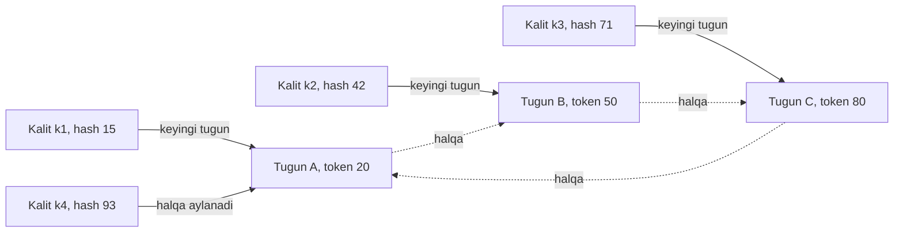

## Bu dars nima uchun kerak

28-darsda `hash(key) mod N` ning asosiy kamchiligini hisobladik: N 10 dan 11 ga oshganda kalitlarning taxminan 91% i boshqa tugunga ko'chadi. Cache klasteri uchun bu bitta server qo'shilganda butun cache bir zumda "sovib qolishi" degani - baza stampede ga uchraydi (24-dars). Saqlash tizimi uchun esa terabaytlab ma'lumotni keraksiz ko'chirish.

**Consistent hashing** - bu muammoning klassik yechimi: tugun qo'shilganda yoki olib tashlanganda o'rtacha faqat **K/N** ta kalit (K - kalitlar, N - tugunlar) ko'chadi, ya'ni faqat yangi tugun olishi kerak bo'lgan ulush. Algoritm 1997 yilda MIT da David Karger va hamkasblari tomonidan veb cache serverlar orasida so'rovlarni taqsimlash uchun taklif qilingan. Maqola mualliflaridan Daniel Lewin va Tom Leighton keyinroq Akamai ni asos solgan. Bugun bu g'oya Dynamo, Cassandra, ScyllaDB, Riak, Discord, load balancer lar (NGINX `hash consistent`, Envoy ring hash va Maglev, 22-dars) va ko'plab cache kutubxonalarida ishlatiladi.

Bu darsdan keyin siz:

- hash ring algoritmini va nima uchun u faqat K/N kalitni ko'chirishini bilasiz;
- virtual node lar notekislikni qanday kamaytirishini raqam bilan ko'rsata olasiz;
- ring da replikalarni joylashtirishni bilasiz;
- muqobil algoritmlarni - rendezvous (HRW), jump consistent hash, Maglev, bounded loads - va ularning trade-off larini bilasiz;
- qaysi holatda consistent hashing, qaysi holatda fixed partition (28-dars) yaxshiroq ekanini tanlay olasiz.

## Hash ring

### Algoritm

1. Hash funksiya qiymatlari maydonini (masalan, 0 dan 2^64 - 1 gacha) **halqa** sifatida tasavvur qiling: maksimal qiymatdan keyin yana 0 keladi.
2. Har bir **tugun** identifikatori (masalan, `"node-A"`) hash qilinadi va halqadagi nuqtaga joylashtiriladi. Bu nuqta **token** deyiladi.
3. Har bir **kalit** ham hash qilinadi va halqaga tushadi.
4. Kalit **soat strelkasi bo'yicha** keyingi birinchi tugunga tegishli.

Natijada har bir tugun halqaning bir **yoyi** (arc) uchun javobgar: o'zidan oldingi tugun tokenidan o'z tokenigacha bo'lgan oraliq.

Misolda halqa 0-99. A tokeni 20, B - 50, C - 80. A ga (80, 20] oraliq tegishli (halqa aylanadi), B ga (20, 50], C ga (50, 80].

### Tugun qo'shilganda

Yangi tugun D tokeni 65 ga tushdi. Endi D ga (50, 65] oraliq tegishli - bu ilgari C niki edi. **Faqat shu kalitlar ko'chadi**: C dan D ga. A va B ning kalitlariga tegilmaydi. Tugun olib tashlanganda ham aksincha: uning yoyi soat strelkasi bo'yicha keyingi tugunga o'tadi.

Taqqoslash: mod N da tugun qo'shilishi deyarli **har bir** kalitning joyini o'zgartiradi, chunki formula N ga bog'liq. Ring da kalit joyi faqat **qo'shni** tokenlarga bog'liq.

### Qidiruv narxi

Tokenlar tartiblangan massivda saqlanadi. Kalit uchun tugunni topish - binary search: O(log T), T - jami tokenlar soni. 100 tugun × 256 token = 25 600 token, log2(25 600) ~ 15 taqqoslash - mikrosekunddan kam. Xotira: har bir token uchun 8 bayt hash + tugun havolasi, ya'ni bir necha yuz KB. Ring odatda har bir mijozda yoki router da cache lanadi va faqat a'zolik o'zgarganda qayta quriladi.

Discord 2017 yildagi postida o'z Elixir klasterini consistent hashing orqali qurganini yozgan: hash ring har bir guild (server) uchun qaysi tugun javobgar ekanini aniqlaydi. Ular katta ring da qidiruvlar soni shunchalik ko'p bo'lganki (o'rtacha foydalanuvchi 5 ta guild da, bitta Erlang VM 500 ming sessiyagacha), qidiruv narxini process ga xabar yuborish (~12 mikrosekund) o'rniga umumiy faqat-o'qish xotirasiga ko'chirib, ~0.3 mikrosekundga tushirgan. Saboq: ring algoritmi oddiy, lekin u issiq yo'lda bo'lsa, uning implementatsiyasi muhim.

## Notekislik muammosi va virtual node

Har bir tugun bitta tasodifiy token olsa, yoylar uzunligi juda turlicha bo'ladi. N ta tasodifiy nuqta halqani N ta bo'lakka bo'lganda, eng katta bo'lak o'rtachadan bir necha baravar katta bo'lishi tabiiy. Bundan tashqari, tugun o'lsa, uning **butun** yuklamasi bitta qo'shnisiga tushadi - qo'shni ikki baravar yuklanadi.

**Virtual node (vnode)** - har bir fizik tugun bitta emas, **V ta** token oladi (`node-A#0`, `node-A#1`, ... hash qilinadi). Natijada:

- har bir fizik tugun ko'p kichik yoylarga ega, ularning yig'indisi o'rtachaga yaqinlashadi (katta sonlar qonuni);
- tugun o'lganda uning yoylari ko'plab **turli** qo'shnilarga taqsimlanadi, bittasiga emas;
- yangi tugun barcha mavjud tugunlardan kichik-kichik bo'laklar oladi;
- kuchliroq mashinaga ko'proq vnode berib, **og'irlik** bilan taqsimlash mumkin.

### Simulyatsiya natijasi

Quyidagi raqamlar ushbu dars uchun qilingan oddiy simulyatsiyadan (Python, MD5 hash, 10 ta tugun, 200 000 tasodifiy kalit): har bir V uchun eng ko'p yuklangan tugunning o'rtachaga nisbati va tugunlar yuklamasining nisbiy standart chetlanishi.

| Tugun boshiga vnode (V) | Eng ko'p yuklangan tugun / o'rtacha | Nisbiy standart chetlanish |
|---|---|---|
| 1 | ~2.0 | ~65% |
| 10 | ~1.7 | ~35% |
| 100 | ~1.17 | ~9% |
| 256 | ~1.09 | ~5.5% |

Xuddi shu simulyatsiyada V = 100 bilan 11-tugun qo'shilganda kalitlarning ~8% i ko'chdi (ideal 1/11 ~ 9%). Raqamlar har bir tasodifiy tanlovda biroz farq qiladi, lekin tendensiya aniq: V bitta bo'lganda eng yuklangan tugun o'rtachadan ikki baravar ko'p ish oladi, ya'ni klaster sig'imining yarmi behuda; V yuzlab bo'lganda notekislik bir necha foizga tushadi. Nazariy jihatdan nisbiy chetlanish taxminan 1/sqrt(V) ga proporsional kamayadi.

### Vnode larning narxi

Ko'p vnode bepul emas. Cassandra hujjati shunday trade-off larni sanaydi: har bir token qo'shimcha ravishda 2 × (RF - 1) tagacha qo'shni tugunni ring ga qo'shadi, shuning uchun token ko'p bo'lganda ikki tugunning bir vaqtda o'lishi **ko'proq** kalit diapazonlarining barcha replikalarini yo'qotishi ehtimoli oshadi (mavjudlik pasayadi); repair kabi butun klaster bo'yicha jarayonlar sekinlashadi; token diapazonlari bo'yicha skanerlash sekinlashadi. Cassandra 2.x da standart 256 tasodifiy token bo'lgan, 3.x dan boshlab deterministik token ajratuvchi algoritm ancha kam token bilan tekis taqsimotni ta'minlaydi. Production hujjati 1, 4, 8, 16 variantlarini taqqoslaydi: 16 - tez-tez kengayadigan va qisqaradigan klasterlar uchun, lekin 50 tugundan katta klasterlarga tavsiya etilmaydi; 4 - 30 tugundan katta klasterlar uchun muvozanat.

Ya'ni "ko'p vnode = yaxshi" emas. Tasodifiy token lar bilan tekislik uchun ko'p token kerak; aqlli token ajratish bilan kamroq token yetadi.

## Replikalarni joylashtirish

Ring replication bilan birga ishlatilganda, kalit replication factor RF ga qarab bir nechta tugunda saqlanadi. Cassandra va Dynamo da: kalitning tokenidan boshlab soat strelkasi bo'yicha yurib, **RF ta turli fizik** tugunni tanlash (vnode lar bilan bir xil fizik tugunning ikkinchi tokeni o'tkazib yuboriladi). Bu tugunlar ro'yxati Dynamo da **preference list** deyiladi.

Data-markaz va rack larni ham hisobga olish kerak: uchala replika bitta rack da bo'lsa, rack quvvati o'chsa kalit butunlay yo'qoladi. Cassandra `NetworkTopologyStrategy` replikalarni turli rack larga joylashtirishga harakat qiladi va har bir data-markaz uchun alohida RF beradi.

## Dynamo dagi evolyutsiya: tokenlardan fixed partition larga

Dynamo maqolasi (2007) amaliy jihatdan juda qimmatli bo'limni o'z ichiga oladi: Amazon uchta partitioning strategiyasini sinagan.

1. **Har bir tugunga T ta tasodifiy token, partition = tokenlar orasidagi oraliq.** Dastlabki production varianti. Muammolar: yangi tugun qo'shilganda boshqa tugunlar o'z ma'lumotlarini skanerlab kerakli kalitlarni topishi kerak edi - bu past ustuvorlikda bajarilgani uchun yuklama yuqori mavsumda deyarli **bir kun** davom etgan; a'zolik o'zgarganda Merkle tree larni qayta hisoblash kerak bo'lgan; butun kalit maydonining snapshot ini olish (arxivlash) qiyin bo'lgan.
2. **T ta tasodifiy token, lekin hash maydoni Q ta teng partition ga bo'lingan.** Partition chegaralari tokenlarga bog'liq emas. O'tish bosqichi bo'lgan, yuklama taqsimoti eng yomoni.
3. **Hash maydoni Q ta teng partition, har bir tugunga Q/S ta partition** (S - tugunlar soni). Eng yaxshi yuklama taqsimoti, a'zolik metama'lumoti birinchi strategiyaga nisbatan taxminan **uch tartib** kichik, har bir partition alohida fayl sifatida saqlanadi va butunligicha ko'chiriladi - bootstrapping va arxivlash oddiylashadi. Kamchiligi: a'zolik o'zgarganda taqsimotni koordinatsiya qilish kerak.

Amazon uchinchisini tanlagan. Diqqat qiling: bu aslida 28-darsdagi **ko'p sonli fixed partition** modeli, consistent hashing esa faqat partition larni tugunlarga moslashda ishlatiladi. Redis Cluster ning 16 384 slot i ham shunday. Ya'ni amaliyotda "sof" hash ring kamroq, "fixed partition + ularni tugunlarga xaritalash" ko'proq uchraydi.

## Muqobil algoritmlar

### Rendezvous hashing (HRW)

David Thaler va Chinya Ravishankar tomonidan 1996 yilda taklif qilingan "highest random weight" hashing. Algoritm juda oddiy: kalit uchun **har bir** tugun bilan juftlikning hash i hisoblanadi, `score = hash(key, node)`, va eng katta score li tugun tanlanadi.

- Tugun o'lsa, faqat uning kalitlari ko'chadi (har bir kalit o'zining ikkinchi eng yaxshi tuguniga).
- Ring, token, vnode kerak emas; taqsimot tabiiy ravishda tekis.
- Replikalar uchun: score bo'yicha eng yaxshi RF ta tugun.
- Og'irlikli varianti bor (score ga logarifmik transformatsiya va og'irlik).
- Narxi: har bir qidiruv **O(N)** hash - tugunlar yuzlab bo'lsa sezilarli, o'nlab bo'lsa ahamiyatsiz.

Wikipedia ga ko'ra GitHub load balancer i, Twitter EventBus va Apache Ignite kabi tizimlarda ishlatiladi.

### Jump consistent hash

John Lamping va Eric Veach (Google, 2014) "A Fast, Minimal Memory, Consistent Hash Algorithm" maqolasida taklif qilgan. Kalit va bucket soni N berilsa, taxminan **5 qatorli** kod bucket raqamini qaytaradi; xotira talab qilmaydi va Karger algoritmidan tez. Asosiy cheklovi: bucket lar **ketma-ket raqamlangan** bo'lishi kerak (0 dan N-1 gacha), shuning uchun ixtiyoriy tugunni o'rtadan olib tashlab bo'lmaydi - faqat oxiridan qo'shish yoki olib tashlash tabiiy. Shuning uchun u tugun nomlari bilan emas, **shard raqamlari** bilan ishlash uchun yaxshi: kalit -> shard raqami (jump hash), shard raqami -> replikalar to'plami (alohida, replikatsiya qilingan xarita).

### Maglev hashing

22-darsda ko'rilgan: Google Maglev load balancer i uchun. Doimiy o'lchamli qidiruv jadvali (Envoy da 65 537 yozuv), har bir backend jadvalni o'z ulushiga mutanosib to'ldiradi. Qidiruv O(1), juda tez va tekis, lekin backend o'zgarganda ring hash ga nisbatan ko'proq kalit ko'chadi (Envoy hujjatiga ko'ra simulyatsiyada taxminan ikki baravar).

### Consistent hashing with bounded loads

Muammo: consistent hashing **kalitlarni** tekis taqsimlaydi, lekin **yuklamani** emas. Agar bitta kalit juda issiq bo'lsa (masalan, mashhur video), uning tuguni ortiqcha yuklanadi. Google tadqiqotchilari Mirrokni, Thorup va Zadimoghaddam (2016) ning yechimi: har bir tugunga sig'im chegarasi - o'rtacha yuklama × (1 + ε). Kalitning birinchi tanlovi to'la bo'lsa, ring bo'yicha keyingi sig'imi bor tugunga yuboriladi. ε kichik - tekisroq, katta - consistent ko'proq.

Google blogiga ko'ra Vimeo muhandisi Andrew Rodland bu algoritmni maqola chiqqandan taxminan uch oy o'tib HAProxy ga implementatsiya qilgan, va Vimeo video cache tizimida cache o'tkazuvchanligi deyarli **8 baravar** kamaygan. HAProxy da bu `hash-balance-factor` parametri: masalan, 150 qiymati hech bir serverga o'rtachadan 1.5 baravardan ko'p bir vaqtdagi so'rov yuborilmasligini bildiradi; hujjat 125 dan 200 gacha qiymatlarni oqilona deb hisoblaydi.

### Taqqoslash

| Algoritm | Qidiruv narxi | Xotira | Tugun o'zgarganda ko'chish | Tekislik | Ixtiyoriy tugunni olib tashlash | Qayerda |
|---|---|---|---|---|---|---|
| mod N | O(1) | Yo'q | Deyarli hammasi | Yaxshi | Ha, lekin qimmat | Statik klasterlar |
| Hash ring + vnode | O(log T) | T ta token | ~K/N | V ga bog'liq | Ha | Cassandra, Dynamo, Riak, Discord |
| Rendezvous (HRW) | O(N) | Yo'q | ~K/N | Yaxshi | Ha | GitHub LB, Ignite |
| Jump hash | O(log N) | Yo'q | ~K/N | Juda yaxshi | Yo'q, faqat oxiridan | Shard raqamlash |
| Maglev | O(1) | Jadval (~65K) | Ring dan ko'proq | Juda yaxshi | Ha | Google Maglev, Envoy, Katran |
| Bounded loads | O(log T) + qayta urinish | Ring + hisoblagichlar | ~K/N + yuklama bo'yicha | Yuklama bo'yicha kafolat | Ha | HAProxy, Vimeo |
| Fixed partition + xarita | O(1) | Partition xaritasi | Faqat ko'chirilgan partition lar | Partition soniga bog'liq | Ha | Redis Cluster, Dynamo 3-strategiya, Notion |

## Raqamlar: cache klasteriga tugun qo'shish

Faraz qiling, 10 ta Redis tugunidan iborat cache klasteri (har biri mustaqil, klient tomonida taqsimlash), 99% hit ratio, cache dan o'qish 50 000 so'rov/s, baza 2 000 so'rov/s gacha ko'taradi.

- **mod N bilan** 11-tugun qo'shildi: ~91% kalit boshqa tugunda, ular u yerda yo'q. Hit ratio bir zumda ~99% dan ~9% ga tushadi. Bazaga ~45 000 so'rov/s - sig'imdan 20 baravardan ko'p. Uzilish.
- **Ring + 100 vnode bilan**: ~9% kalit ko'chadi. Hit ratio ~99% dan ~90% ga tushadi. Bazaga ~5 000 so'rov/s - hali ham sig'imdan oshadi! Demak consistent hashing ham yetarli emas: yangi tugunni **bosqichma-bosqich** qo'shish (avval kamroq vnode bilan, keyin oshirish), oldindan isitish yoki stampede himoyasi (24-dars) kerak.
- **Ring + 100 vnode, tugun o'ldi**: uning ~10% kalitlari yo'qoladi va ~10 ta turli tugunga tarqaladi (har biriga ~1%). Bazaga ~5 000 so'rov/s qo'shimcha miss, lekin har bir qolgan tugunning yuklamasi atigi ~11% oshadi. Vnode siz bo'lsa, bitta qo'shni barcha yuklamani olib, ikki baravar yuklanardi.

Saboq: consistent hashing "ko'chishni minimallashtiradi", lekin "nol" qilmaydi. Hisobni o'z hit ratio va baza sig'imingiz bilan qiling.

## iQuariX kontekstida

Faraz qiling, quyidagi joylarda kalit -> tugun taqsimoti kerak:

**1. Telemetriya ingest gateway lari va qurilmalar.** Trekerlar L4 load balancer orqali ulanadi (22-dars), shuning uchun qaysi gateway ga tushishi tasodifiy. Lekin serverdan qurilmaga buyruq yuborish uchun "qurilma qaysi gateway da" ni bilish kerak. Ikki yo'l: (a) Redis da `device -> gateway` registr (21-dars), yoki (b) qurilmalarni consistent hashing bilan gateway larga oldindan "biriktirish" va LB ni shu hash bo'yicha yo'naltirish. Ikkinchisi registrsiz ishlaydi, lekin gateway qo'shilganda faqat ~1/N qurilma qayta ulanishi kerak - mod N da esa deyarli barchasi.

**2. Stream processing worker lari.** Har bir qurilmaning nuqtalari **bitta** worker da ketma-ket qayta ishlanishi kerak (yo'l masofasi, geofence kirish-chiqish holati - 83-dars - qurilma holatiga bog'liq). Worker lar soni o'zgarganda (autoscaling) holat ko'chishi minimal bo'lishi kerak. Kafka da bu partition va consumer group orqali hal bo'ladi (43-dars); o'z worker laringiz bo'lsa - rendezvous hashing (worker lar o'nlab, O(N) muammo emas) yoki ring.

**3. Video cache.** Kameralardan arxiv videolarni bir nechta cache serverda saqlash: bitta video segmenti faqat bitta cache serverda bo'lsin (xotira tejaladi). Consistent hashing kalit = segment URL. Lekin ba'zi videolar (masalan, avariya yozuvi, uni 50 dispetcher bir vaqtda ochadi) hot key - bounded loads (HAProxy `hash-balance-factor 150`) ortiqcha yuklangan serverdan so'rovlarni qo'shnisiga o'tkazadi.

**4. Relational sharding.** Agar PostgreSQL ni tenant bo'yicha shard qilsangiz, sof ring emas, Notion yoki Citus uslubidagi ko'p sonli fixed shard + xarita yaxshiroq: shard lar butunligicha ko'chadi, katta tenant ni alohida shard ga qo'lda joylashtirish oson.

## Ko'p uchraydigan xatolar

1. **mod N bilan cache klasterini taqsimlash.** Har bir tugun qo'shilishi yoki o'lishi butun cache ni sovutadi.
2. **Vnode siz ring.** Bitta tugun o'rtachadan ikki baravar ko'p yuklama oladi, o'lgan tugun yuklamasi bitta qo'shniga tushadi.
3. **Ko'p vnode ni har doim yaxshi deb hisoblash.** Ko'p token mavjudlikni pasaytirishi va repair ni sekinlashtirishi mumkin.
4. **Beqaror hash funksiya.** Process yoki versiya bo'yicha farq qiladigan hash (tilning o'rnatilgan hash i) turli mijozlarda turli tugunni beradi.
5. **Mijozlarda turli ring.** Ba'zi mijozlar yangi a'zolik ro'yxatini olgan, ba'zilari yo'q - bir kalit ikki joyga yoziladi. A'zolik o'zgarishi izchil tarqatilishi kerak.
6. **Consistent hashing hot key ni hal qiladi deb o'ylash.** U kalitlarni taqsimlaydi, bitta kalitning yuklamasini emas. Bounded loads yoki kalit nusxalash kerak.
7. **"Kam ko'chish"ni "ko'chish yo'q" deb hisoblash.** 9% miss ham bazani yiqitishi mumkin; yangi tugunni bosqichma-bosqich qo'shing.

## Xulosa

- Consistent hashing tugun qo'shilganda yoki olib tashlanganda o'rtacha faqat K/N kalitni ko'chiradi; mod N deyarli hammasini.
- Ring: tugunlar va kalitlar bir hash halqasida, kalit soat strelkasi bo'yicha keyingi tugunga. Qidiruv - binary search.
- Virtual node lar notekislikni ~1/sqrt(V) ga kamaytiradi va o'lgan tugun yuklamasini ko'p qo'shniga tarqatadi; lekin ko'p token mavjudlik va repair narxini oshiradi.
- Replikalar ring bo'yicha keyingi RF ta turli fizik tugunda, rack va data-markaz hisobga olinadi.
- Dynamo tajribasi: tasodifiy tokenlardan teng o'lchamli fixed partition larga o'tilgan - bootstrapping, arxivlash va metama'lumot uchun.
- Muqobillar: rendezvous (oddiy, O(N)), jump hash (xotirasiz, faqat ketma-ket bucket), Maglev (O(1) jadval), bounded loads (yuklama chegarasi, HAProxy).

## Amaliy topshiriq

Faraz qiling, iQuariX video arxivi uchun cache qatlami quriladi: 12 ta cache server (har biri 2 TB SSD), kalit - video segment URL, kuniga 3 million segment so'rovi, hot segmentlar (avariya, o'g'irlik hodisalari) bir vaqtda 50-100 ta dispetcher tomonidan ochiladi. Origin - S3 ga o'xshash object storage.

1. **Algoritm tanlang**: mod N, ring + vnode, rendezvous, Maglev yoki bounded loads. Kamida uchtasini qidiruv narxi, ko'chish va hot key nuqtai nazaridan solishtiring.
2. **Vnode soni**: ring tanlasangiz, nechta va nega. Eng ko'p yuklangan server o'rtachadan qancha ko'p bo'lishini taxminiy baholang.
3. **Server qo'shish hisobi**: 13-server qo'shilganda nechta foiz segment ko'chadi, hit ratio va origin ga trafik qanday o'zgaradi? Agar segment o'rtacha 2 MB va hit ratio 90% bo'lsa, origin trafigi qanchaga oshadi?
4. **Server o'lishi**: bitta server o'lganda yuklama qanday taqsimlanadi va qolgan serverlar yuklamasi qanchaga oshadi?
5. **Hot segment**: bitta segmentga 100 ta parallel so'rov. Sizning dizayningiz bitta serverni ortiqcha yuklashdan qanday himoya qiladi?
6. **A'zolik ro'yxati**: barcha mijozlar (API serverlar) bir xil ring ni qanday ko'radi va server qo'shilganda o'zgarish qanday tarqatiladi?

Yaxshi javobda bo'lishi kerak bo'lgan narsalar:

- mod N nega yaroqsizligi raqam bilan;
- vnode soni va notekislik bahosi (masalan, 100-200 vnode bilan o'rtachadan 10-20% ko'p);
- server qo'shilganda taxminan 1/13 ~ 7.7% segment ko'chishi va origin trafigi hisobi;
- o'lgan server yuklamasining ko'p serverga tarqalishi;
- hot segment uchun bounded loads yoki lokal replikatsiya;
- a'zolik ro'yxatini markazlashgan joydan (masalan, konfiguratsiya xizmati yoki service discovery) izchil tarqatish.

Javobni pastdagi maydonga yozib, chatga yuboring.

## Manbalar

- David Karger va boshq. "Consistent Hashing and Random Trees: Distributed Caching Protocols for Relieving Hot Spots on the World Wide Web", STOC 1997. Tarix va umumiy ko'rinish: [Consistent hashing, Wikipedia](https://en.wikipedia.org/wiki/Consistent_hashing).
- Giuseppe DeCandia va boshq. [Dynamo: Amazon's Highly Available Key-value Store](https://www.allthingsdistributed.com/files/amazon-dynamo-sosp2007.pdf), SOSP 2007 - virtual node lar, uchta partitioning strategiyasi, preference list.
- Apache Cassandra. [Dynamo architecture](https://cassandra.apache.org/doc/latest/cassandra/architecture/dynamo.html) - token ring, vnode trade-off lari; [Production recommendations](https://cassandra.apache.org/doc/latest/cassandra/getting-started/production.html) - num_tokens.
- John Lamping, Eric Veach. [A Fast, Minimal Memory, Consistent Hash Algorithm](https://arxiv.org/abs/1406.2294), 2014 - jump consistent hash.
- Google Research. [Consistent Hashing with Bounded Loads](https://research.google/blog/consistent-hashing-with-bounded-loads/), 2017 - algoritm va Vimeo/HAProxy natijasi. HAProxy [configuration manual](https://github.com/haproxy/haproxy/blob/master/doc/configuration.txt) - hash-balance-factor.
- [Rendezvous hashing, Wikipedia](https://en.wikipedia.org/wiki/Rendezvous_hashing) - HRW algoritmi, Thaler va Ravishankar 1996.
- Discord. [How Discord Scaled Elixir to 5,000,000 Concurrent Users](https://discord.com/blog/how-discord-scaled-elixir-to-5-000-000-concurrent-users), 2017 - hash ring va qidiruv narxi.
- Martin Kleppmann, Chris Riccomini. [Designing Data-Intensive Applications, 2-nashr](https://www.oreilly.com/library/view/designing-data-intensive/9781098119058/), 7-bob "Sharding" - rebalancing va consistent hashing ga tanqidiy qarash.
