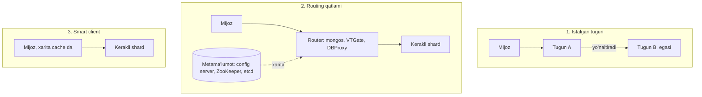

## Bu dars nima uchun kerak

28-29 darslarda ma'lumotni partition larga bo'lish va ularni tugunlarga taqsimlashni ko'rdik. Lekin bu faqat **primary key** bo'yicha so'rovlar uchun oson: kalit ma'lum bo'lsa, partition ham ma'lum. Real ilovada so'rovlarning katta qismi boshqa ustunlar bo'yicha: "davlat raqami 01A123BC bo'lgan mashina", "haydovchi Aliyevning barcha safarlari", "bugun geofence dan chiqqan mashinalar". Bunday so'rovlar uchun **secondary index** kerak, va sharding qilingan tizimda u katta qiyinchilik tug'diradi.

Ikkinchi savol: so'rov qaysi tugunga borishini **kim** hal qiladi? Partition lar ko'chadi (28-dars), tugunlar o'ladi - mijoz buni qanday biladi? Bu **request routing** (yoki service discovery) muammosi.

Uchinchi savol: hash partitioning kalitlarni tekis taqsimlaydi, lekin **bitta** kalit juda mashhur bo'lsa nima qilish kerak? Bu **hot partition** muammosi.

Bu dars 3-modulning yakuni: unda masshtablashning barcha qismlari (LB, cache, replication, sharding) birlashadi. Kleppmann DDIA 2-nashrining 7-bobi ("Sharding") aynan shu mavzular bilan tugaydi.

Bu darsdan keyin siz:

- local (document-partitioned) va global (term-partitioned) secondary index ning ichki ishlashini va trade-off larini bilasiz;
- scatter-gather so'rovlarning tail latency ga ta'sirini hisoblay olasiz;
- request routing ning uch modelini va routing metama'lumotini qayerda saqlashni bilasiz;
- hot partition ni aniqlash va bo'lish usullarini, jumladan DynamoDB adaptive capacity ni bilasiz;
- sharding qilingan tizimda tranzaksiya va JOIN cheklovlarini tushunasiz.

## Secondary index muammosi

Faraz qiling, `vehicles` jadvali `vehicle_id` bo'yicha hash partition langan 8 ta shard ga. "plate = '01A123BC'" so'rovi uchun qaysi shard ga borish kerak? Hash `vehicle_id` dan hisoblangan, `plate` dan emas - demak, hech qanday shard ni aniq bilmaymiz.

Ikki asosiy yondashuv bor.

### 1. Local index (document-partitioned)

Har bir partition **faqat o'z** qatorlari uchun secondary index saqlaydi. Shard 3 dagi `plate` indeksi faqat shard 3 dagi mashinalarni biladi.

- **Yozish oson**: qator va uning indeks yozuvlari bitta partition da, bitta lokal tranzaksiyada yangilanadi. Index har doim izchil.
- **O'qish qimmat**: `plate = X` so'rovi **barcha** partition larga yuborilishi va natijalar birlashtirilishi kerak - **scatter-gather**.

Ko'p tizimlar shunday ishlaydi: MongoDB secondary index lari har bir shard da lokal, va mongos shard kaliti bo'lmagan so'rovni barcha shard larga broadcast qiladi; Elasticsearch har bir shard da o'z Lucene indeksini saqlaydi va qidiruv barcha shard larga ketadi; Cassandra ning native secondary index lari va SAI ham lokal; DynamoDB ning **local secondary index** (LSI) i ham shu turdagi - u asosiy jadval bilan bir xil partition key ga ega.

### 2. Global index (term-partitioned)

Index ning o'zi alohida, **indekslangan qiymat bo'yicha** partition lanadi. `plate` indeksi uchun: A-M bilan boshlanadigan raqamlar index partition 1 da, N-Z - index partition 2 da (yoki qiymat hash i bo'yicha). Har bir index yozuvi "plate X -> vehicle_id Y" ni saqlaydi.

- **O'qish samarali**: `plate = X` faqat bitta index partition ga, keyin topilgan `vehicle_id` bo'yicha bitta ma'lumot partition ga - ikki maqsadli so'rov, scatter-gather yo'q.
- **Yozish murakkab**: bitta qatorni yozish uning index yozuvlarini **boshqa** tugunlarda yangilashni talab qilishi mumkin. Bu yoki distributed tranzaksiya (37-dars), yoki asinxron yangilash.

Amaliyotda global index lar ko'pincha **asinxron**. DynamoDB **global secondary index** (GSI) shunday: AWS hujjatiga ko'ra GSI asosiy jadval bilan asinxron, eventually consistent model bo'yicha sinxronlanadi, o'zgarishlar normal sharoitda soniyaning bir qismida yetadi, lekin GSI dan faqat eventually consistent o'qish mumkin va ilova eskirgan natijaga tayyor bo'lishi kerak. Muhim nozik nuqta: agar GSI ning yozish sig'imi yetarli bo'lmasa, **asosiy jadvalga yozish ham throttling ga uchraydi** - ya'ni index asosiy jadvalga teskari bosim beradi; hujjat GSI yozish sig'imini asosiy jadvalnikidan kam qo'ymaslikni tavsiya qiladi.

DynamoDB LSI va GSI farqi bu ikki yondashuvni yaxshi ko'rsatadi:

| Xususiyat | LSI (local) | GSI (global) |
|---|---|---|
| Partition key | Asosiy jadval bilan bir xil | O'zining, ixtiyoriy atribut |
| Kuchli consistent o'qish | Mumkin | Faqat eventually consistent |
| Qachon yaratiladi | Faqat jadval yaratilganda | Istalgan vaqtda |
| Soni | Jadvalga 5 tagacha | Odatda 20 tagacha (kvota) |
| Hajm cheklovi | Bitta partition key qiymati uchun (asosiy + index elementlar) 10 GB | Yo'q |
| Sig'im | Asosiy jadval sig'imidan | Alohida, lekin yetmasa asosiy yozuvni bloklaydi |

### Taqqoslash

| Mezon | Local index | Global index |
|---|---|---|
| Yozish | Bitta partition, lokal tranzaksiya | Bir nechta tugun, distributed yoki asinxron |
| Index izchilligi | Darhol izchil | Odatda eventual (lag bor) |
| Secondary kalit bo'yicha o'qish | Barcha partition larga (scatter-gather) | 1-2 maqsadli so'rov |
| Tail latency | Eng sekin partition belgilaydi | Bitta yoki ikki tugunga bog'liq |
| Shard qo'shganda | O'qish narxi oshadi (ko'proq shard) | O'zgarmaydi |
| Hot qiymat | Bitta qiymat barcha partition larda tarqoq | Bitta qiymat bitta index partition da (hot spot xavfi) |
| Misollar | MongoDB, Elasticsearch, Cassandra SAI, DynamoDB LSI | DynamoDB GSI, Spanner va CockroachDB global index (sinxron, tranzaksion) |

Ikkinchi qatorda eslatma: CockroachDB, Spanner, TiDB, YugabyteDB kabi distributed SQL bazalari global index ni **sinxron**, tranzaksiya ichida yangilaydi - index darhol izchil, lekin har bir yozuv distributed tranzaksiya (va shuning uchun yuqori latency).

### Shard kalitini secondary so'rovga moslash

Ko'pincha eng yaxshi yechim - index emas, **ma'lumot modelini o'zgartirish**:

- Eng ko'p bajariladigan so'rovlar shard kalitini o'z ichiga olsin. B2B da deyarli barcha so'rovlar tenant doirasida: `WHERE tenant_id = 7 AND plate = '01A123BC'`. Agar shard kaliti `tenant_id` bo'lsa, local index yetarli - so'rov bitta shard ga ketadi (MongoDB terminida targeted operation, chunki so'rov shard kalitini o'z ichiga oladi).
- Kam uchraydigan global qidiruvlar (masalan, superadmin "barcha tenant lar bo'yicha plate qidirish") uchun alohida **lookup jadval** (`plate -> tenant_id, vehicle_id`), yoki qidiruv tizimi (Elasticsearch, 59-dars) CDC orqali to'ldirilgan (48-dars).
- Analitika va hisobotlar uchun - butunlay alohida OLAP saqlash (16-dars).

## Scatter-gather va tail latency

Local index bilan secondary so'rov barcha N shard ga parallel yuboriladi va eng sekin javobni kutadi. Bu **tail latency ni kuchaytiradi**.

Jeffrey Dean va Luiz Barroso ning "The Tail at Scale" (Communications of the ACM, 2013) maqolasidagi klassik misol: server odatda 10 ms da javob beradi, lekin uning 99-percentile latency si 1 soniya. Agar foydalanuvchi so'rovi 100 ta shunday serverdan parallel javob yig'sa, foydalanuvchi so'rovlarining **63%** i 1 soniyadan ko'p davom etadi.

Hisob: bitta server sekin bo'lmaslik ehtimoli 0.99. 100 tasining hammasi tez bo'lishi ehtimoli 0.99^100 ~ 0.366. Demak 1 - 0.366 ~ **63%** so'rovda kamida bittasi sekin.

| Shard soni N | Hech bo'lmasa bitta shard p99 dumiga tushish ehtimoli |
|---|---|
| 1 | 1% |
| 8 | 1 - 0.99^8 ~ 7.7% |
| 32 | 1 - 0.99^32 ~ 27.5% |
| 100 | 1 - 0.99^100 ~ 63% |

Ya'ni shard lar ko'paygan sari scatter-gather so'rovlarining **odatiy** latency si bitta shard ning **p99** latency siga yaqinlashadi. Shuningdek har bir scatter-gather so'rov barcha N shard ni yuklaydi: shard qo'shish bunday so'rovlar uchun throughput ni oshirmaydi.

Yumshatish usullari (Dean va Barroso):

- **Hedged requests** - so'rov kutilgan 95-percentile vaqtdan uzoq javobsiz qolsa, xuddi shu so'rovni boshqa replikaga yuborish va birinchi kelgan javobni olish. Qo'shimcha yuklama taxminan 5% bilan cheklanadi. Maqoladagi BigTable benchmark ida (100 serverdan 1 000 kalit o'qish) 10 ms kechikish bilan hedging 99.9-percentile latency ni 1 800 ms dan 74 ms ga tushirgan va atigi 2% qo'shimcha so'rov yuborgan.
- **Replika tanlash** - eng tez javob berayotgan replikaga yuborish. Elasticsearch standart holatda **adaptive replica selection** ishlatadi: oldingi so'rovlar javob vaqti, tugundagi qidiruv vaqti va qidiruv thread pool navbati asosida shard nusxasini tanlaydi.
- **Qisman natija** - qidiruv kabi holatlarda, barcha shard larni kutmasdan, timeout gacha kelgan natijalarni qaytarish (aniqlik evaziga latency).
- **Scatter-gather sonini kamaytirish** - routing (masalan, Elasticsearch da custom routing qiymati bilan indekslangan hujjatlar bitta shard ga tushadi va shu qiymat bilan qidiruv faqat o'sha shard ga ketadi).

## Request routing

Mijoz `vehicle_id = 42` ni o'qimoqchi. Qaysi IP ga ulanish kerak? Uch model:

1. **Istalgan tugunga ulanish.** Mijoz tasodifiy tugunga (masalan, round-robin LB orqali) ulanadi. Tugun so'rovni o'zi bajaradi yoki tegishli tugunga yo'naltiradi. Cassandra shunday: har bir tugun **koordinator** bo'la oladi va gossip orqali butun ring ni biladi. Redis Cluster da tugun mijozni to'g'ri tugunga `MOVED` javobi bilan qayta yo'naltiradi (24-dars).
2. **Routing qatlami.** Alohida, partition larni biladigan proksi: mijoz unga ulanadi, u so'rovni to'g'ri shard ga yuboradi. MongoDB da **mongos** - ilovalar shard larga to'g'ridan-to'g'ri ulanmaydi, mongos config server lardagi metama'lumotni cache laydi va unga asoslanib yo'naltiradi; mongos ning o'zi doimiy holat saqlamaydi. Vitess da VTGate, Figma da DBProxy (Go da yozilgan servis, ilova va PgBouncer orasida, so'rovni parse qilib to'g'ri shard ga yuboradi).
3. **Mijoz biladi (smart client).** Mijoz kutubxonasi partition xaritasini o'zi saqlaydi va to'g'ridan-to'g'ri kerakli tugunga ulanadi. Redis Cluster klientlari slot -> tugun xaritasini cache laydi va faqat `MOVED` olganda yangilaydi. Ko'p Cassandra drayverlari "token-aware" - so'rovni to'g'ridan-to'g'ri replika tuguniga yuboradi.

### Routing metama'lumoti qayerda

Hamma model uchun asosiy savol: "partition X hozir qaysi tugunda?" degan xaritaning **haqiqat manbai** qayerda va o'zgarish qanday tarqaladi?

- **Alohida koordinatsiya servisi** (ZooKeeper, etcd, Consul): tugunlar o'zini ro'yxatdan o'tkazadi, xarita u yerda, router va mijozlar o'zgarishlarga obuna bo'ladi. HBase, Kafka ning eski versiyalari, Vitess shunday ishlaydi. Bu servislar consensus (Raft, ZAB) asosida, shuning uchun xarita izchil (35-36, 38 darslar).
- **Bazaning o'z config server lari** - MongoDB config server replica set i.
- **Gossip** - Cassandra, Redis Cluster: har bir tugun holatni qo'shnilariga tarqatadi. Markaziy servis yo'q, lekin xarita **eventually consistent** - bir muddat turli tugunlar turli ko'rinishga ega.
- **Ichki meta range lar** - CockroachDB da range lar joylashuvi ham range larda (`meta1`, `meta2` ikki darajali indeks) saqlanadi; tugunlar meta2 qidiruvlarini cache laydi.

### Eskirgan xarita

Partition ko'chganda, ba'zi mijoz yoki router lar eski xaritani ishlatishda davom etadi. Tizim buni sezishi kerak: eski tugun "bu partition endi menda emas" deb javob beradi (`MOVED`, stale config xatosi, versiya mos kelmasligi), va mijoz xaritani yangilab qayta urinadi. Har bir so'rov bilan **xarita versiyasi** (epoch) yuborilishi va tugun uni tekshirishi - xavfsiz naqsh. Aks holda eski tugunga yozilgan ma'lumot yo'qolishi mumkin (fencing g'oyasi, 38-dars).

| Model | Qo'shimcha hop | Mijoz murakkabligi | Qo'shimcha komponent | Misol |
|---|---|---|---|---|
| Istalgan tugun | Ba'zan 1 | Past | Yo'q (gossip) | Cassandra, Redis Cluster (MOVED) |
| Routing qatlami | Har doim 1 | Juda past | Router flot va metama'lumot servisi | MongoDB mongos, Vitess, Figma DBProxy |
| Smart client | 0 | Yuqori (har bir tilda kutubxona) | Metama'lumot manbai | Redis Cluster klientlari, token-aware Cassandra drayverlari |

## Hot partition

Hash partitioning turli kalitlarni tekis taqsimlaydi. Lekin yuklama kalitlar orasida tekis bo'lmasa (va real hayotda deyarli hech qachon tekis emas), bitta partition boshqalardan ko'p yuklama oladi. Sabablar:

1. **Mashhur kalit (celebrity).** Millionlab obunachili akkaunt, viral mahsulot, eng katta mijoz.
2. **Ketma-ket kalit range partitioning da** - barcha yangi yozuvlar oxirgi partition ga (28-dars).
3. **Vaqtga bog'liq cho'qqi** - barcha mashinalar soat 8:00 da ishga tushadi, barcha kassalar oy oxirida hisobot chiqaradi.
4. **Notekis taqsimlangan tenant** - bitta mijoz qolganlarning hammasidan katta.

### Aniqlash

- partition yoki shard bo'yicha so'rov/s, CPU, I/O metrikalari - o'rtachadan ancha baland bo'lgan bitta qator;
- kalit bo'yicha namuna olib hisoblash (top-K);
- managed xizmatlar vositalari: DynamoDB da CloudWatch Contributor Insights, Bigtable da Key Visualizer.

### DynamoDB qanday yumshatadi

DynamoDB hujjatlari hot partition muammosini ochiq ko'rsatadi va bir nechta avtomatik mexanizm beradi:

- har bir partition chegarasi: soniyasiga 3 000 RCU va 1 000 WCU - bu adaptive capacity bilan ham **shift** (yuqori chegara);
- **burst capacity** - ishlatilmagan sig'imning 300 soniyagacha bo'lgan qismi saqlanadi va qisqa cho'qqilarda sarflanadi;
- **adaptive capacity** - jadvalning umumiy sig'imi doirasida ko'proq trafik olayotgan partition larga avtomatik ko'proq sig'im beradi;
- **ko'p murojaat qilinadigan elementlarni ajratish (split for heat)** - issiq elementlar bir partition ni baham ko'rmasligi uchun partition lar qayta bo'linadi; juda issiq bitta element o'zi alohida partition olishi mumkin. Lekin trafik sort key bo'yicha monoton o'sayotgan bo'lsa (masalan, vaqt belgisi), bunday bo'lish yordam bermaydi, va jadvalda LSI bo'lsa element to'plamlari partition lar bo'yicha bo'linmaydi.

Ya'ni avtomatik mexanizmlar tekis bo'lmagan yuklamani yumshatadi, lekin **bitta kalit** baribir bitta partition chegarasidan oshmaydi.

### Ilova darajasidagi yechimlar

1. **Kalitni bo'lish (write sharding / salting).** Issiq kalitga suffiks: `tenant#7#0` ... `tenant#7#9`. Yozish 10 ta partition ga tarqaladi; o'qishda 10 ta kalitni o'qib birlashtirish (yoki agregatni alohida saqlash). Faqat haqiqatan issiq kalitlar uchun - aks holda barcha o'qishlar 10 baravar qimmatlashadi. Bu ro'yxatni (qaysi kalitlar bo'lingan) ham saqlash kerak.
2. **Vaqt bucket.** Vaqt bo'yicha issiqlik uchun kalitga bucket qo'shish: `(device_id, hour)` - partition lar o'sishi va issiqligi cheklanadi.
3. **O'qish uchun cache va replikalar.** O'qishda issiq kalit - cache (24-dars: lokal L1, kalit nusxalari) yoki replikalar orqali o'qish.
4. **Yozish uchun buferlash.** Issiq hisoblagichlarni xotirada yig'ib, davriy ravishda bitta yozuv bilan flush qilish (write-back, 23-dars) yoki CRDT hisoblagich (40-dars).
5. **Katta tenant ni ajratish.** Bitta mijoz alohida shard yoki shard lar guruhini oladi ("tenant isolation"), uning ichida esa ikkinchi darajali kalit bilan bo'linadi.
6. **Bounded load routing** (29-dars) - cache va stateless qayta ishlash qatlamlarida.

## Sharding va tranzaksiyalar, JOIN lar

Sharding qilingan tizimda bitta shard ichidagi operatsiyalar oson: lokal tranzaksiya, lokal JOIN. Shard lar orasida esa:

- **Tranzaksiya** - distributed tranzaksiya (2PC, 37-dars) yoki saga (49-dars) talab qiladi. Ikkalasi ham qimmat va murakkab.
- **JOIN** - scatter-gather yoki ma'lumotni ilovada birlashtirish.
- **Unique constraint** - faqat shard kaliti bo'yicha kafolatlanadi. "Email unique bo'lsin" talabi, agar email shard kaliti bo'lmasa, global lookup jadvalni yoki boshqa mexanizmni talab qiladi.
- **Auto-increment ID** - har bir shard o'z ketma-ketligini yaratadi; global noyob ID uchun UUIDv7 yoki Snowflake (57-dars).

Shuning uchun Figma o'z DBProxy si orqali faqat bitta "colo" (bir xil sharding kalitini baham ko'radigan jadvallar guruhi) va sharding kaliti doirasidagi JOIN va tranzaksiyalarga ruxsat bergan. Citus da ham bir xil distribution column li jadvallar colocation qilinadi va ular orasidagi JOIN lar lokal. Dizayn qoidasi: **eng muhim tranzaksiyalar bitta shard ichida bo'lsin**. Bu shard kalitini tanlashning eng muhim mezoni (28-dars).

## iQuariX kontekstida

Faraz qiling, 28-darsdagi kabi relational ma'lumot `tenant_id` bo'yicha shard langan (Citus uslubida), telemetriya esa `(device_id, oy)` bo'yicha alohida tizimda.

**Secondary so'rovlar.**

| So'rov | Chastota | Yechim |
|---|---|---|
| Tenant ichida plate bo'yicha mashina | Juda tez-tez | `tenant_id` shard kaliti + lokal index `(tenant_id, plate)` - bitta shard |
| Tenant ichida haydovchining safarlari | Tez-tez | Lokal index `(tenant_id, driver_id, started_at)` |
| Superadmin: plate bo'yicha barcha tenant lar orasida | Kam | Global lookup jadval `plate -> tenant_id, vehicle_id`, asinxron to'ldiriladi |
| Qurilma IMEI bo'yicha (treker ulanganda) | Juda tez-tez, ingest yo'lida | Lookup `imei -> tenant_id, vehicle_id` Redis da cache bilan |
| Barcha mijozlar bo'yicha oylik statistika | Kam, og'ir | OLAP (ClickHouse yoki shunga o'xshash), CDC orqali |

Muhim: IMEI lookup ingest ning **issiq yo'lida** - har bir treker ulanishida. Agar u scatter-gather bo'lsa (IMEI bo'yicha barcha shard larni so'rash), har bir ulanish N ta so'rov. Shuning uchun global lookup, va u kamdan-kam o'zgaradi - ideal cache nomzodi.

**Routing.** Ilova NestJS dan Citus koordinator tuguniga ulanadi (routing qatlami modeli): koordinator so'rovdagi `tenant_id` ni ko'rib, uni bitta worker ga yo'naltiradi. Agar so'rovda `tenant_id` bo'lmasa, u barcha worker larga ketadi - shuning uchun ORM qatlamida (Prisma yoki Kysely) har bir so'rovga `tenant_id` filtrini **majburiy** qo'shadigan middleware - ham xavfsizlik (73-dars), ham performance uchun.

**Hot partition.** Eng katta mijoz 15 000 mashinaga ega, qolganlari o'rtacha 30 ta. Agar shard lar 64 ta bo'lsa va tenant lar hash bo'yicha taqsimlansa, bu mijozning shard i qolganlardan bir necha baravar katta. Yechimlar: uni alohida worker ga ajratish (Citus da tenant ni o'z shard iga izolyatsiya qilish mumkin), yoki uning eng katta jadvallarini ikkinchi darajali kalit bilan bo'lish. Telemetriya tomonda bu muammo yo'q, chunki u `device_id` bo'yicha bo'lingan va bitta mijozning 15 000 qurilmasi barcha partition larga tarqalgan.

**Vaqt bo'yicha issiqlik.** Har kuni soat 8:00 da minglab mashina bir vaqtda ishga tushadi va ularning trekerlari bir vaqtda qayta ulanadi: ingest gateway larga, IMEI lookup ga va oxirgi holat cache iga cho'qqi. Bu partition muammosi emas, lekin xuddi shunday tahlil qilinadi: qaysi kalit yoki qaysi resurs bir vaqtda hammaga kerak? Jitter bilan qayta ulanish (62-dars) va cache ni oldindan isitish.

## Ko'p uchraydigan xatolar

1. **Shard kalitisiz so'rovlarni issiq yo'lda ishlatish.** Har bir so'rov barcha shard larga ketadi; shard qo'shish bu so'rovlarni tezlashtirmaydi, aksincha.
2. **Scatter-gather ning tail latency sini hisobga olmaslik.** 32 shard da so'rovlarning ~27% i bitta shard ning p99 dumiga tushadi.
3. **Global index ni sinxron deb hisoblash.** DynamoDB GSI va boshqa asinxron index lardan o'qish eskirgan natija qaytarishi mumkin.
4. **Index sig'imini past qo'yish.** GSI throttling asosiy jadvalga yozishni ham to'xtatadi.
5. **Routing xaritasini versiyasiz ishlatish.** Partition ko'chganda eski tugunga yozuvlar yo'qoladi.
6. **Hot kalitni avtomatik mexanizmlar hal qiladi deb o'ylash.** Bitta kalit baribir bitta partition chegarasidan oshmaydi.
7. **Barcha kalitlarni salting qilish.** Faqat issiq kalitlar uchun kerak; aks holda barcha o'qishlar N baravar qimmatlashadi.
8. **Shard lararo tranzaksiyani normal holat deb loyihalash.** Muhim invariant lar bitta shard ichida bo'lishi kerak.

## Xulosa

- Local index: yozish oson va izchil, secondary so'rov barcha partition larga (scatter-gather). Global index: o'qish maqsadli, yozish distributed yoki asinxron.
- DynamoDB LSI va GSI bu ikki modelning aniq misoli: LSI kuchli consistent va bir partition key ichida, GSI eventually consistent va o'z kaliti bilan.
- Scatter-gather tail latency ni kuchaytiradi: 100 shard va 1% sekin javobda so'rovlarning 63% i sekin. Hedged requests va adaptive replica selection yumshatadi.
- Routing: istalgan tugun, routing qatlami yoki smart client. Xarita izchil manbada (ZooKeeper, etcd, config server) yoki gossip orqali; har bir so'rovda xarita versiyasi.
- Hot partition: celebrity kalit, ketma-ket kalit, vaqt cho'qqisi, katta tenant. Yechimlar: salting, bucket, cache, buferlash, tenant izolyatsiyasi.
- Eng muhim tranzaksiya va JOIN lar bitta shard ichida bo'lishi uchun shard kalitini tanlang.

## Amaliy topshiriq

Faraz qiling, iQuariX relational bazasi 64 shard ga `tenant_id` bo'yicha bo'lingan. Quyidagi talablar paydo bo'ldi:

- (a) treker ulanganda IMEI bo'yicha qurilmani topish - cho'qqida 2 000 ulanish/s;
- (b) dispetcher tenant ichida plate yoki haydovchi ismi bo'yicha qidiradi - 500 so'rov/s;
- (c) qo'llab-quvvatlash xizmati barcha tenant lar orasida telefon raqami bo'yicha haydovchini qidiradi - 2 so'rov/s;
- (d) eng katta mijoz (15 000 mashina) kunlik hisobotlarni soat 9:00 da bir vaqtda 200 ta foydalanuvchi bilan ochadi;
- (e) "barcha tenant lar bo'yicha bugungi yoqilg'i sarfi" boshqaruv paneli - har 5 daqiqada.

1. Har bir so'rov (a-e) uchun **qaysi yondashuv**: shard kaliti + local index, global lookup, cache, qidiruv tizimi yoki OLAP. Asoslang.
2. (c) ni scatter-gather bilan qilsangiz, shard p99 si 200 ms va p50 si 10 ms bo'lsa, so'rovning **tipik latency si** qanday bo'ladi? Hisoblang.
3. **Global lookup** (a uchun) qanday to'ldiriladi va qanday izchil saqlanadi? Qurilma boshqa tenant ga o'tkazilganda nima bo'ladi?
4. **Routing**: ilova so'rovni qaysi shard ga yuborishini qanday biladi? `tenant_id` siz so'rovlarni qanday bloklaysiz yoki aniqlaysiz?
5. **Hot partition** (d): eng katta mijozning shard ini qanday himoya qilasiz?
6. Shard lararo tranzaksiya talab qiladigan bitta stsenariyni toping (masalan, qurilmani bir tenant dan boshqasiga o'tkazish) va uni qanday hal qilishni yozing.

Yaxshi javobda bo'lishi kerak bo'lgan narsalar:

- (a) uchun global lookup + cache, (c) uchun qidiruv tizimi yoki lookup, (e) uchun OLAP;
- tail latency hisobi: 64 shard da 1 - 0.99^64 ~ 47% so'rovlar kamida bitta shard ning p99 iga duch keladi, tipik latency 200 ms ga yaqinlashadi;
- lookup asinxron (CDC yoki outbox) to'ldirilishi va eskirish oynasi tahlili;
- `tenant_id` filtrini majburlovchi middleware;
- katta tenant uchun alohida shard yoki cache bilan himoya;
- tenant o'tkazish uchun saga yoki ikki bosqichli jarayon (48-49 darslarga havola bilan).

Javobni pastdagi maydonga yozib, chatga yuboring.

## Manbalar

- Martin Kleppmann, Chris Riccomini. [Designing Data-Intensive Applications, 2-nashr](https://www.oreilly.com/library/view/designing-data-intensive/9781098119058/), O'Reilly, 2026. 7-bob "Sharding": secondary index lar (local va global), request routing, skew va hot spot lar.
- Jeffrey Dean, Luiz Andre Barroso. [The Tail at Scale](https://cacm.acm.org/research/the-tail-at-scale/), Communications of the ACM, 2013 - fan-out va hedged requests.
- AWS. [DynamoDB global secondary indexes](https://docs.aws.amazon.com/amazondynamodb/latest/developerguide/GSI.html), [local secondary indexes](https://docs.aws.amazon.com/amazondynamodb/latest/developerguide/LSI.html), [burst and adaptive capacity](https://docs.aws.amazon.com/amazondynamodb/latest/developerguide/burst-adaptive-capacity.html).
- MongoDB. [mongos: sharded cluster query routing](https://www.mongodb.com/docs/manual/core/sharded-cluster-query-router/) - targeted va broadcast operatsiyalar.
- Elastic. [Search shard routing](https://www.elastic.co/docs/reference/elasticsearch/rest-apis/search-shard-routing) - adaptive replica selection, custom routing.
- CockroachDB. [Distribution layer](https://docs.cockroachlabs.com/docs/stable/architecture/distribution-layer) - meta range lar va routing.
- Figma. [How Figma's databases team lived to tell the scale](https://www.figma.com/blog/how-figmas-databases-team-lived-to-tell-the-scale/), 2024 - DBProxy, colo, shard ichidagi JOIN va tranzaksiyalar.
- Redis. [Scale with Redis Cluster](https://redis.io/docs/latest/operate/oss_and_stack/management/scaling/) - klient tomonidagi slot xaritasi.
