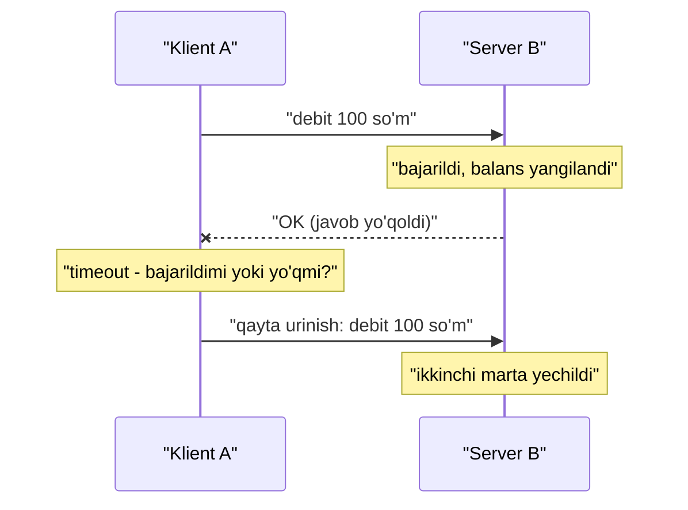

## Bu dars nima uchun kerak

3-modulda biz tizimni kengaytirdik: replication (26-27 darslar), sharding (28-30 darslar), load balancer (22-dars). Natijada bitta jarayon emas, tarmoq orqali gaplashadigan o'nlab jarayon paydo bo'ldi. Bu darsdan boshlab savol o'zgaradi: "qanday kengaytiramiz?" emas, "bir nechta mashina birgalikda **to'g'ri** ishlashi uchun nimaga tayana olamiz?"

Bitta mashinada dastur odatda deterministik: yo ishlaydi, yo butunlay qulaydi (kernel panic, OOM). Taqsimlangan tizimda esa uchinchi holat bor - **qisman ishdan chiqish (partial failure)**: tizimning bir qismi ishlaydi, bir qismi yo'q, va siz qaysi qismi ekanini aniq bila olmaysiz. Butun 4-modul (consensus, Raft, 2PC, lock, CRDT) aynan shu noaniqlikka javob sifatida paydo bo'lgan.

Bu darsdan keyin siz:

- partial failure nima ekanini va nega u bitta mashinadagi xatolardan sifat jihatidan farq qilishini tushuntira olasiz;
- so'rovga javob kelmaganda yuz bergan bo'lishi mumkin bo'lgan 6 xil holatni ajrata olasiz va nega ularni farqlab bo'lmasligini bilasiz;
- timeout qiymatini raqamlar asosida tanlay olasiz va uning ikki tomonlama narxini bilasiz;
- system model (synchronous, partially synchronous, asynchronous; crash-stop, crash-recovery, Byzantine) tushunchalarini bilasiz - keyingi darslardagi algoritmlar shularga tayanadi;
- failure detector, shu jumladan phi accrual, qanday ishlashini va gray failure nima ekanini bilasiz;
- process pause (GC, VM) nega "o'lik" va "sekin" ni yanada aralashtirib yuborishini tushunasiz.

## Bitta mashina va ko'p mashina: sifat farqi

Bitta kompyuterda apparat xatosi odatda butun mashinani to'xtatadi. Bu dizayn tanlovi: noto'g'ri natija berishdan ko'ra qulash yaxshiroq. Shu sababli bitta mashinadagi dastur "ideal" model ichida yashaydi: xotiraga yozilgan qiymat o'qiladi, funksiya chaqirilsa natija qaytadi yoki exception tashlanadi.

Taqsimlangan tizimda bu kafolatlar yo'q:

- xabar yetib bormasligi, kechikishi, takrorlanishi yoki tartibi buzilishi mumkin;
- uzoqdagi tugun ishlayotgan, o'lgan, sekin yoki vaqtincha "muzlagan" bo'lishi mumkin;
- har bir tugunning o'z soati bor va ular bir-biriga mos kelmaydi (32-dars);
- bir tugun boshqa tugun haqida bilgan narsa doim **eskirgan** bo'ladi, chunki ma'lumot tarmoq orqali keldi.

Kleppmann DDIA 2-nashrida (9-bob, "The Trouble with Distributed Systems") asosiy g'oyani shunday beradi: taqsimlangan tizimda partial failure **nodeterministik**. Bir xil operatsiya ba'zan ishlaydi, ba'zan yo'q, va siz hatto u muvaffaqiyatli bo'lganini ham bilmasligingiz mumkin. Biz ishonchsiz komponentlardan ishonchli tizim qurishimiz kerak - xuddi TCP ishonchsiz IP paketlari ustida ishonchli oqim qurgani kabi.

### Taqsimlangan hisoblashning 8 ta adashuvi

1994 yilda Sun Microsystems'da L. Peter Deutsch dasturchilar tarmoq haqida qiladigan yetti noto'g'ri taxminni ro'yxatga oldi, taxminan 1997 yilda James Gosling sakkizinchisini qo'shdi:

1. Tarmoq ishonchli.
2. Latency nolga teng.
3. Bandwidth cheksiz.
4. Tarmoq xavfsiz.
5. Topologiya o'zgarmaydi.
6. Administrator bitta.
7. Transport narxi nolga teng.
8. Tarmoq bir jinsli (homogeneous).

Ro'yxat eskirgan emas. Masalan, Kubernetes'da pod IP manzillari doimiy o'zgaradi (5-adashuv), cloud'da regionlararo trafik pullik (7-adashuv), mobil trekerlar 2G/4G orqali ulanadi (8-adashuv). Bu darsda asosan 1 va 2-adashuvlar bilan ishlaymiz.

## Tarmoq haqiqatan ishonchsizmi: raqamlar

"Bizda data-markaz ichida tarmoq ishonchli" degan gapni ko'p eshitasiz. Peter Bailis va Kyle Kingsbury 2014 yilda ACM Queue / CACM'da "The Network is Reliable" maqolasida real hodisalarni to'plashgan. Ba'zilari:

- **Microsoft data-markazlari** (Gill, Jain, Nagappan, SIGCOMM 2011): kuniga o'rtacha 5.2 ta qurilma va 40.8 ta link nosozligi; tiklash vaqtining medianasi taxminan 5 daqiqa, maksimal bir hafta; har bir nosozlikda medianasi taxminan 59 000 paket yo'qolgan. Tarmoq redundancy (zaxira yo'llar) median trafikni faqat 43% ga yaxshilagan - ya'ni zaxira har doim ham qutqarmaydi.
- **Google Chubby**: bir nechta klasterda 700 kun ichida 61 ta uzilish; 30 soniyadan uzun 9 ta uzilishning 4 tasi tarmoq texnik xizmati, 2 tasi tarmoq ulanishi muammosi sabab.
- **GitHub, 2012-dekabr**: switch dasturini yangilash 90 soniyalik network partition keltirib chiqargan; fileserver juftliklari bir-birini "o'lik" deb hisoblab, bir-birini o'chirishga urinishgan (STONITH), tiklash 5 soat davom etgan.
- **AWS, 2011-aprel**: US East'dagi noto'g'ri tarmoq o'zgarishi EBS tugunlarini izolyatsiya qilgan; EBS 80 soatdan ko'proq ishlamagan yoki sekinlashgan.

Yana bir yorqin misol - **GitHub, 2018-yil 21-oktabr**. Optik uskunani almashtirish paytida US East Coast tarmoq hubi va asosiy data-markaz orasidagi aloqa **43 soniya** uzilgan. Shu 43 soniyada Orchestrator (MySQL failover vositasi) West Coast'dagi replikalarni primary qilib ko'targan. Natijada East Coast'dagi ilovalar har bir yozuvda qit'alararo round-trip'ga duch kelgan, ba'zi yozuvlar West Coast'ga yetib bormagan (bitta klasterda 954 ta), va xizmat **24 soat 11 daqiqa** degradatsiyada bo'lgan. 43 soniyalik tarmoq muammosi bir kunlik incident'ga aylandi - partial failure'ning narxi shunday.

Saboq: network partition - nazariy holat emas, oddiy ish kuni. Dizayn uni "bo'lishi mumkin" emas, "bo'ladi" deb hisoblashi kerak.

## Javob kelmadi: nima bo'ldi?

Klient A serverga B ga so'rov yubordi va javob kelmadi. Sababi quyidagilardan biri bo'lishi mumkin:

1. So'rov tarmoqda yo'qoldi (kabel, switch, bufer to'lishi).
2. So'rov navbatda turibdi va keyinroq yetkaziladi (tarmoq yoki B ning o'zi ortiqcha yuklangan).
3. B qulab tushgan yoki o'chgan.
4. B vaqtincha javob bermayapti (GC pause, swap, VM migratsiyasi) va keyinroq davom etadi.
5. B so'rovni **bajardi**, lekin javob tarmoqda yo'qoldi.
6. B bajardi va javob yuborildi, lekin u kechikmoqda.

A nuqtai nazaridan bu oltita holat **bir xil ko'rinadi**: jimlik. Klient hech qachon "so'rov bajarilmadi" va "bajarildi, lekin javob yo'qoldi" ni ajrata olmaydi. Diagrammadagi holat - 5-holat - eng xavflisi: qayta urinish operatsiyani ikki marta bajaradi. Shuning uchun retry qilinadigan har bir yozuv operatsiyasi idempotent bo'lishi kerak (9-darsdagi idempotency key; 39-darsda chuqur ko'riladi).

Yagona amaliy vosita - **timeout**: ma'lum vaqtdan keyin javobni kutishni to'xtatib, "nimadir bo'ldi" deb qaror qilish. Lekin timeout faqat "javob kelmadi" ni aytadi, "nima uchun" ni emas.

TCP bu yerda yordam bermaydi. TCP paketni qayta yuboradi va tartibni saqlaydi, lekin u ilova darajasida "B so'rovni bajardimi?" ga javob bermaydi. Bundan tashqari, Linux'da standart sozlamalar juda uzun: kernel hujjatiga ko'ra `tcp_retries2=15` taxminan **924.6 soniya** (15 daqiqadan ortiq) gipotetik timeout beradi, `tcp_syn_retries=6` bilan yangi ulanish urinishi taxminan 131 soniyadan keyin to'xtaydi, `tcp_keepalive_time` esa standart holatda 2 soat. Ilova darajasida o'z timeout'ingiz bo'lmasa, "osilib qolgan" so'rov daqiqalab resursni band qiladi.

## Timeout: qancha kutish kerak

### Nazariy chegara: 2d + r

Agar tarmoq har bir paketni ko'pi bilan `d` vaqtda yetkazishni kafolatlasa, va ishlayotgan tugun so'rovni ko'pi bilan `r` vaqtda qayta ishlasa, unda `2d + r` ichida javob kelmasa, tugun yoki tarmoq albatta nosoz deb aytish mumkin bo'lardi. Muammo: Ethernet va IP asosidagi tarmoqlarda bunday kafolat **yo'q**. Kechikish chegarasiz (unbounded): paket switch buferida, kernel navbatida, hypervisor'da, TCP retransmission'da kutishi mumkin. Server tomonda `r` ham chegarasiz: GC, disk, lock kutish.

Demak "to'g'ri" timeout yo'q. Faqat trade-off bor.

### Ikki tomonlama narx

| Timeout | Afzallik | Kamchilik |
|---|---|---|
| Qisqa (masalan p99 ga yaqin) | Nosozlik tez aniqlanadi, klient kam kutadi, resurslar tez bo'shaydi | Sekin, lekin tirik tugun "o'lik" deb e'lon qilinadi; retry qo'shimcha yuklama beradi; ortiqcha failover |
| Uzun (daqiqalar) | Noto'g'ri aniqlash kam | Haqiqiy nosozlikda foydalanuvchi uzoq kutadi; thread/connection pool to'lib qoladi; cascading failure |
| Adaptiv (o'lchangan latency'ga qarab) | Tarmoq holatiga moslashadi | Murakkabroq; latency sekin o'sganda moslashib "ko'r" bo'lib qolishi mumkin |

Noto'g'ri "o'lik" deb e'lon qilish ayniqsa xavfli. Tugun aslida ortiqcha yuklangani uchun sekin javob bergan bo'lsa, uni klasterdan chiqarish uning yukini boshqa tugunlarga o'tkazadi, ular ham sekinlashadi va zanjir boshlanadi. Bunday cascading failure 64-darsda chuqur ko'riladi.

### Amaliy usul: percentile'dan

AWS Builders' Library'dagi "Timeouts, retries and backoff with jitter" maqolasida (Marc Brooker) tavsiya etilgan yondashuv: qabul qilinadigan "noto'g'ri timeout" ulushini tanlang, masalan 0.1%, va downstream servisning shunga mos percentile latency'sini oling - bu holda p99.9. Qo'shimcha shartlar: klient internet orqali uzoqdan ulansa tarmoq zaxirasini qo'shing; agar p99.9 p50 ga juda yaqin bo'lsa, kichik tebranishda ommaviy timeout bo'lmasligi uchun zaxira qo'shing; timeout DNS va TLS handshake'ni ham qamrab olishini tekshiring.

**Misol hisob.** Deylik, ichki "geocoding" servisi uchun o'lchovlar: p50 = 12 ms, p99 = 80 ms, p99.9 = 220 ms. 0.1% noto'g'ri timeout'ga rozimiz, demak timeout taxminan 220-250 ms. Agar 1 000 ms qo'ysak, haqiqiy nosozlikda har bir so'rov 1 soniya ushlab turadi. 500 RPS da Little qonuniga ko'ra (3-dars) bir vaqtda ochiq so'rovlar: 500 × 1.0 = 500 ta. 250 ms timeout bilan: 500 × 0.25 = 125 ta. Connection pool hajmi 100 bo'lsa, ikkala holatda ham pool to'ladi, lekin qisqa timeout bilan tizim tezroq tiklanadi va 250 ms li variantda pool'ni 150 ga oshirish yetarli.

### Retry kuchaytiradi

Brooker maqolasidagi misol: 5 qavatli chaqiruv stekida har bir qavat 3 marta urinsa, eng pastdagi baza nosoz bo'lganda yuklama 3^5 = **243 marta** oshadi. Shu sababli retry faqat bitta qavatda, exponential backoff va jitter bilan, va retry budget bilan qilinadi (62-dars).

## System model: algoritm nimaga tayanadi

Keyingi darslardagi har bir algoritm (Paxos, Raft, 2PC) aniq **system model** ichida isbotlanadi. Model - "qanday nosozliklar bo'lishi mumkin" degan rasmiy taxmin. Uni bilmasangiz, algoritm kafolatini noto'g'ri tushunasiz.

### Vaqt bo'yicha modellar

- **Synchronous** - tarmoq kechikishi, jarayon tezligi va soat xatosi chegaralangan. Real tizimlarda deyarli yo'q.
- **Asynchronous** - hech qanday vaqt taxmini yo'q: xabar ixtiyoriy uzoq kechikishi mumkin, soat umuman yo'q deb hisoblanadi. Eng kuchsiz taxmin. 35-darsdagi FLP natijasi aynan shu modelda consensus deterministik yechilmasligini ko'rsatadi.
- **Partially synchronous** - tizim ko'pincha synchronous kabi ishlaydi, lekin vaqti-vaqti bilan chegaralardan chiqadi. Real tizimlar uchun eng realistik model; Raft va Paxos'ning liveness'i shunga tayanadi, safety'si esa hatto asynchronous'da ham buzilmaydi.

### Tugun nosozligi bo'yicha modellar

- **Crash-stop** - tugun to'xtaydi va hech qachon qaytmaydi.
- **Crash-recovery** - tugun to'xtaydi, keyin qayta ishga tushadi; diskdagi ma'lumot qoladi, xotiradagi yo'qoladi. Real serverlar uchun eng mos model. Raft aynan shu sabab `currentTerm` va `votedFor` ni diskka yozadi (36-dars).
- **Byzantine** - tugun ixtiyoriy narsa qilishi mumkin, shu jumladan yolg'on gapirish. Blockchain va aviatsiya uchun muhim; bitta tashkilot boshqaradigan data-markazda odatda taxmin qilinmaydi. Byzantine tolerance uchun odatda `3f + 1` tugun kerak (f - nosoz tugunlar soni), crash uchun esa `2f + 1`.

### Safety va liveness

Algoritm xossalari ikki turga bo'linadi:

- **Safety** - "yomon narsa hech qachon bo'lmaydi". Masalan: ikki xil qiymat commit qilinmaydi; fencing token takrorlanmaydi. Buzilsa, uni aniq bir vaqt nuqtasiga bog'lash mumkin va buzilish qaytarilmaydi.
- **Liveness** - "yaxshi narsa oxir-oqibat bo'ladi". Masalan: so'rovga oxir-oqibat javob keladi; lider oxir-oqibat saylanadi.

Qoida: safety **har doim**, hatto barcha tugunlar qulaganda yoki tarmoq cheksiz kechikkanda ham saqlanishi kerak. Liveness esa shartli bo'lishi mumkin: "agar ko'pchilik tugun tirik va tarmoq oxir-oqibat tiklansa". Bu farq 35-36 darslarda markaziy rol o'ynaydi.

## Failure detection: kim o'lik?

Bitta tugunning boshqasini "o'lik" deb qaror qilishi - **failure detector**. Ikki asosiy xossa:

- **Completeness** - haqiqatan o'lgan tugun oxir-oqibat aniqlanadi.
- **Accuracy** - tirik tugun noto'g'ri "o'lik" deb e'lon qilinmaydi.

Asynchronous tarmoqda ikkalasini mukammal ta'minlab bo'lmaydi, shuning uchun amaliy detector'lar ehtimollik bilan ishlaydi.

### Heartbeat va qattiq timeout

Eng oddiy usul: har bir tugun har T ms da heartbeat yuboradi; K × T vaqt ichida heartbeat kelmasa - o'lik. Masalan Raft'da follower election timeout ichida liderdan xabar olmasa, saylov boshlaydi (36-dars). Kamchiligi: qiymat qattiq, tarmoq holatiga moslashmaydi.

### Phi accrual failure detector

Hayashibara, Défago, Yared va Katayama (2004) taklif qilgan g'oya: "o'lik/tirik" ikkilik javob o'rniga **shubha darajasi** φ (phi) qaytarish. Detector so'nggi heartbeat oraliqlarining sliding window'ini saqlaydi, ular normal taqsimotda deb faraz qilib o'rtacha va dispersiyani hisoblaydi. Oxirgi heartbeat'dan t vaqt o'tganda, keyingi heartbeat hali ham kelish ehtimoli P bo'lsa:

φ = -log10(P)

Talqin: φ = 1 - taxminan 10% xato ehtimoli, φ = 2 - 1%, φ = 3 - 0.1%. Cassandra'da `phi_convict_threshold` standart qiymati **8**, ya'ni taxminan 10^-8 xato ehtimoli chegarasi. Afzalligi: tarmoq "shovqinli" bo'lsa (heartbeat oraliqlari keng tarqalgan), detector avtomatik ravishda ko'proq kutadi; barqaror tarmoqda tezroq aniqlaydi. Akka Cluster ham shu detector'dan foydalanadi.

**Hisob misoli.** Heartbeat har 1 s, o'lchangan o'rtacha oraliq 1 000 ms, standart og'ish 100 ms. Oxirgi heartbeat'dan 1 300 ms o'tdi: bu 3 sigma, normal taqsimotda dumi P ≈ 0.00135, φ ≈ 2.9. Hali chegaradan (8) ancha uzoq. Endi xuddi shu kechikish, lekin standart og'ish 20 ms bo'lgan barqaror tarmoqda: 300 ms = 15 sigma, P juda kichik, φ chegaradan oshadi va tugun shubhali deb belgilanadi. Bir xil kechikish - kontekstga qarab har xil qaror.

### Gray failure

Microsoft Research (Huang va boshq., HotOS 2017) Azure tajribasi asosida **gray failure** tushunchasini kiritdi: komponent ishlayotgandek ko'rinadi, lekin aslida degradatsiyada - sekin disk, tasodifiy paket yo'qolishi, memory thrashing, fatal bo'lmagan exception'lar. Ular buni **differential observability** deb ta'riflaydi: kamida bitta klient tizimni nosoz deb ko'radi, failure detector esa sog'lom deb ko'radi.

Maqoladagi misollar:

- VM tarmog'i jiddiy muammoda, lekin heartbeat host agenti orqali o'tadi va detector "hammasi joyida" deydi.
- Ko'p core switch'lardan bittasi jimgina paket tashlaydi; fan-out katta bo'lgani uchun deyarli har bir so'rov sekinlashadi - ko'proq redundancy kamroq mavjudlikka olib keladi.
- Ortiqcha yuklangan storage server qayta-qayta qulaydi, detector uni chiqaradi, yuk qolganlarga o'tadi va cascading failure boshlanadi.

Amaliy xulosa: health check'ni klient haqiqatan bajaradigan yo'lga yaqin qiling. `GET /health` 200 qaytarishi - bu "jarayon tirik" degani, "foydalanuvchiga xizmat ko'rsatyapti" degani emas. Klient tomondagi xato va latency metrikasi ham failure detection'ning bir qismi bo'lishi kerak.

## Process pause: o'lik emas, sekin ham emas - muzlagan

Bitta tugun ichida ham kutilmagan to'xtashlar bo'ladi:

- **Stop-the-world GC** - JVM yoki boshqa runtime'da yuzlab millisekunddan soniyalargacha. Node.js'da V8 GC odatda qisqaroq, lekin katta heap'da sezilarli bo'lishi mumkin.
- **VM suspend va live migration** - hypervisor VM'ni boshqa hostga ko'chirayotganda.
- **Swap va disk IO** - xotira yetmasa, sahifalar diskdan o'qiladi.
- **Noisy neighbor, CPU steal** - cloud'da boshqa VM'lar CPU'ni oladi.
- **SIGSTOP**, noutbuk "uyqu" rejimi va h.k.

Xavfli stsenariy: tugun lider yoki lock egasi deb o'ylaydi, `if (leaseValid()) { write() }` tekshiruvini o'tadi, shu ikki qator orasida 15 soniyalik GC pause bo'ladi, lease tugaydi, boshqa tugun lider bo'ladi, keyin birinchi tugun "uyg'onib" yozadi. U o'zining eskirganini bilmaydi. Bu muammo va uning yechimi - **fencing token** - 38-darsda chuqur ko'riladi.

Bu yerdan muhim tamoyil kelib chiqadi: **tugun o'zi haqidagi haqiqatga ham ishona olmaydi**. "Men liderman" degan ishonch boshqa tugunlarning ko'pchiligi (quorum) tasdiqlamasa hech narsa anglatmaydi. Kleppmann buni "haqiqatni ko'pchilik belgilaydi" deb ifodalaydi. Quorum va consensus aynan shu tamoyilga quriladi (27, 35-36 darslar).

## Nosozlik turlari: umumiy jadval

| Nosozlik | Qanday ko'rinadi | Aniqlash qiyinligi | Odatiy himoya |
|---|---|---|---|
| Crash | Ulanish rad etiladi yoki jimlik | O'rtacha | Heartbeat, replication, failover |
| Omission (xabar yo'qolishi) | Jimlik | Yuqori | Retry + idempotency |
| Timing (sekinlik, pause) | Kechikkan javob | Juda yuqori | Timeout, hedged request, fencing |
| Network partition | Ikki guruh bir-birini o'lik deb biladi | Juda yuqori | Quorum, majority |
| Gray failure | Detector "sog'lom", klient "nosoz" | Eng yuqori | Klient tomon metrikasi, ko'p nuqtali health check |
| Byzantine | Noto'g'ri yoki ziddiyatli javob | Juda yuqori | Checksum, imzo, BFT protokollar |

## Real tizimlardan misollar

- **Cassandra** - gossip orqali heartbeat va phi accrual detector, `phi_convict_threshold: 8`. Tugun "down" deb belgilanganda unga yo'naltirilgan yozuvlar hinted handoff sifatida saqlanadi.
- **Raft asosidagi tizimlar (etcd, Consul)** - heartbeat va randomizatsiyalangan election timeout bilan lider nosozligini aniqlaydi (36-dars).
- **GitHub 2018** - avtomatik failover tizimi (Orchestrator) qisqa partition'ga to'g'ri reaksiya qildi, lekin topologiya va latency talablarini hisobga olmagani uchun natija partition'ning o'zidan yomonroq bo'ldi. Saboq: failure detection'dan keyingi **harakat** ham dizayn qilinishi kerak.
- **AWS** - timeout'ni downstream percentile'idan tanlash va retry'ni bitta qavatda cheklash bo'yicha ochiq tavsiyalar beradi.

## iQuariX kontekstida

Faraz qiling, iQuariX'da quyidagi oqim bor: treker TCP orqali ingest gateway'ga nuqta yuboradi, gateway navbatga yozadi va trekerga ACK qaytaradi.

**1. ACK yo'qolishi.** Treker nuqtani yubordi, gateway navbatga yozdi, ACK esa mobil tarmoqda yo'qoldi. Treker uni qayta yuboradi - dublikat. Yechim: nuqtaning tabiiy kaliti `(device_id, timestamp, seq)` bo'yicha deduplication. Bu idempotency (39-dars).

**2. Trekerning "o'lik" yoki "tunnelda" ekanini aniqlash.** Treker har 10 s nuqta yuboradi. Dispetcher UI'da "aloqa yo'q" statusini qachon ko'rsatish kerak? Qattiq 30 s qo'ysak, tog'li yo'lda yoki tunnelda ko'p false alarm bo'ladi. Phi accrual g'oyasi bu yerda tabiiy: har bir qurilma uchun so'nggi oraliqlar statistikasini yuritib, shubha darajasini hisoblash. Doimiy shahar ichidagi treker uchun 40 s jimlik shubhali, tez-tez uzilib turadigan magistral yo'ldagi treker uchun esa normal.

**3. Oflayn bufer.** Treker aloqa yo'qligida nuqtalarni xotirasida to'playdi va keyin paket bilan yuboradi. Server tomonda bu "kechikkan, tartibi buzilgan xabar" holati: 2 soatlik nuqtalar birdan keladi. Event time va processing time farqi 45-darsda ko'riladi.

**4. Ichki servis timeout'lari.** Deylik, alert servisi yoqilg'i hodisasini aniqlash uchun ДУТ kalibrlash servisiga murojaat qiladi. Kalibrlash servisining p99.9 = 150 ms bo'lsa, timeout 200 ms, bitta retry jitter bilan, va kalibrlash ma'lumoti cache'da. Agar timeout 30 s (ko'p HTTP klientlarning standarti) qolsa, kalibrlash servisi sekinlashganda alert servisining barcha worker'lari osilib qoladi.

**5. Ikki gateway, bitta treker.** Load balancer orqasida ikki gateway. Treker TCP ulanishi uzildi va boshqa gateway'ga qayta ulandi. Eski gateway ulanish hali tirik deb o'ylab, `device_id -> gateway` xaritasida o'zini saqlab turibdi. Dispetcherdan trekerga yuboriladigan komanda (masalan, dvigatelni bloklash) eski gateway'ga ketadi va yo'qoladi. Yechim: ulanish egaligini versiya yoki lease bilan saqlash (38-dars).

## Ko'p uchraydigan xatolar

1. **Timeout'siz tarmoq chaqiruvi.** Ko'p HTTP va DB klientlarida standart timeout yo'q yoki juda uzun. Har bir chaqiruvga aniq connect va request timeout qo'ying.
2. **Timeout'ni "xato" deb talqin qilish.** Timeout "bajarilmadi" degani emas, "bilmayman" degani. Yozuv operatsiyasidan keyin timeout bo'lsa, natijani tekshirish yoki idempotent retry kerak.
3. **Idempotent bo'lmagan operatsiyani retry qilish.** To'lov, SMS, komanda yuborish - ikki marta bajarilishi mumkin.
4. **Har qavatda retry.** 3^5 = 243 baravar yuklama. Retry'ni bitta qavatda qiling.
5. **Health check = "jarayon tirik".** Gray failure'ni ko'rmaydi. Klient tomondagi xato ulushi va latency'ni kuzating.
6. **Juda agressiv failover.** Qisqa partition yoki GC pause'da lider almashtirish ko'pincha muammoning o'zidan qimmat (GitHub 2018).
7. **Tugunning o'z holatiga ishonishi.** "Men liderman" yoki "lock menda" degan lokal ishonch pause'dan keyin noto'g'ri bo'lishi mumkin.
8. **Algoritmni system model'ni bilmasdan tanlash.** Masalan, crash-stop uchun isbotlangan algoritmni diskni yo'qotadigan crash-recovery muhitida ishlatish.

## Xulosa

- Taqsimlangan tizimning asosiy farqi - partial failure: tizimning bir qismi ishlaydi, bir qismi yo'q, va buni aniq bilib bo'lmaydi.
- Javob kelmasa, so'rov yo'qolganini, server o'lganini, sekinligini yoki javob yo'qolganini ajratib bo'lmaydi. Yagona vosita - timeout, va u "bilmayman" degani.
- To'g'ri timeout yo'q, faqat trade-off bor. Amaliy usul - downstream'ning qabul qilingan xato ulushiga mos percentile'i (masalan p99.9).
- System model (sync/partial sync/async va crash-stop/crash-recovery/Byzantine) algoritm kafolatlari qaysi sharoitda ishlashini belgilaydi.
- Safety har doim saqlanadi, liveness shartli bo'lishi mumkin.
- Failure detector'lar ehtimollik bilan ishlaydi: phi accrual shubha darajasini hisoblaydi; gray failure - detector va klient ko'rinishi farqi.
- Process pause tugunning o'zi haqidagi bilimini ham eskirtiradi, shuning uchun qarorlar quorum orqali qabul qilinadi.

## Amaliy topshiriq

Faraz qiling: iQuariX'da **"dvigatelni masofadan bloklash"** funksiyasi bor. Dispetcher UI'da tugmani bosadi, API servis komandani trekerga ulangan gateway orqali yuboradi, treker bajarib, tasdiq qaytaradi. Bu xavfsizlik uchun muhim operatsiya: bajarilmay qolishi ham, noto'g'ri mashinada yoki ikki marta bajarilishi ham yomon.

1. Komanda yo'lidagi har bir bo'g'in (UI, API, gateway, mobil tarmoq, treker) uchun "javob kelmadi" holatining mumkin bo'lgan sabablarini sanab chiqing. Qaysilari klient uchun bir-biridan farqlanmaydi?
2. Har bir bo'g'in uchun timeout qiymatini taklif qiling va asoslang. Mobil tarmoq qismi uchun RTT taxminini ochiq yozing.
3. Komanda takrorlanganda ikki marta bajarilmasligini qanday ta'minlaysiz? Komanda ID'si qayerda yaratiladi, treker qanday dedup qiladi?
4. Dispetcherga qanday holatlarni ko'rsatasiz? "Bajarildi" va "xato" dan tashqari "noma'lum" holati kerakmi va undan keyin nima bo'ladi?
5. Gateway ulanish egaligi eskirgan holatda (treker boshqa gateway'ga o'tgan) komanda yo'qolmasligi uchun nima qilasiz?
6. Bu dizayn qaysi system model'ga tayanadi (vaqt va nosozlik bo'yicha)? Qaysi xossa safety, qaysi liveness?

Yaxshi javobda bo'lishi kerak bo'lgan narsalar:

- "timeout - bilmayman" tamoyili va "noma'lum" holat aniq ishlangan;
- komanda ID'si klient tomonda yaratilgan va trekerda dedup qilingan;
- timeout qiymatlari raqam bilan, mobil tarmoq kechikishini hisobga olgan holda;
- retry faqat bitta qavatda, backoff bilan;
- safety ("bitta komanda ikki marta bajarilmaydi") va liveness ("oxir-oqibat natija ma'lum bo'ladi") ajratilgan.

Javobni pastdagi maydonga yozib, chatga yuboring.

## Manbalar

- Martin Kleppmann, Chris Riccomini. [Designing Data-Intensive Applications, 2-nashr](https://www.oreilly.com/library/view/designing-data-intensive/9781098119058/), O'Reilly, 2026. 9-bob "The Trouble with Distributed Systems" (unreliable networks, timeout, process pauses, system models, safety va liveness). 1-nashrda bu 8-bob.
- Peter Bailis, Kyle Kingsbury. [The Network is Reliable](https://cacmb4.acm.org/magazines/2014/9/177925-the-network-is-reliable), Communications of the ACM, 2014-sentabr - real network partition hodisalari to'plami.
- Ryan Huang va boshq. [Gray Failure: The Achilles' Heel of Cloud-Scale Systems](https://www.microsoft.com/en-us/research/publication/gray-failure-achilles-heel-cloud-scale-systems/), HotOS 2017 - differential observability.
- Marc Brooker. [Timeouts, retries and backoff with jitter](https://aws.amazon.com/builders-library/timeouts-retries-and-backoff-with-jitter/), AWS Builders' Library - timeout'ni percentile'dan tanlash, retry kuchayishi.
- GitHub. [October 21 post-incident analysis](https://github.blog/2018-10-30-oct21-post-incident-analysis/), 2018 - 43 soniyalik partition va 24 soatlik degradatsiya.
- [Fallacies of distributed computing](https://en.wikipedia.org/wiki/Fallacies_of_distributed_computing), Wikipedia - ro'yxat tarixi (Deutsch 1994, Gosling).
- [Phi accrual failure detection](https://arpitbhayani.me/blogs/phi-accrual) (Hayashibara va boshq. 2004 maqolasi tushuntirmasi) va [Cassandra nodetool failuredetector](https://docs.axonops.com/data-platforms/cassandra/operations/nodetool/failuredetector) - `phi_convict_threshold` standarti.
- [Linux kernel: ip-sysctl](https://docs.kernel.org/networking/ip-sysctl.html) - `tcp_retries2`, `tcp_syn_retries`, `tcp_keepalive_time` standart qiymatlari.
