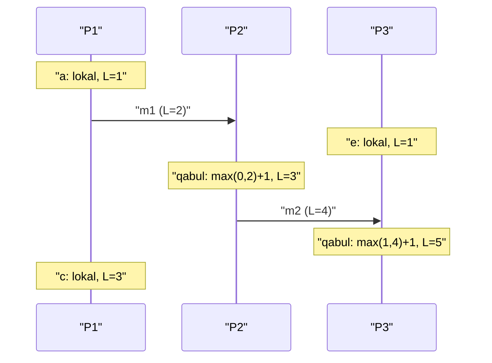
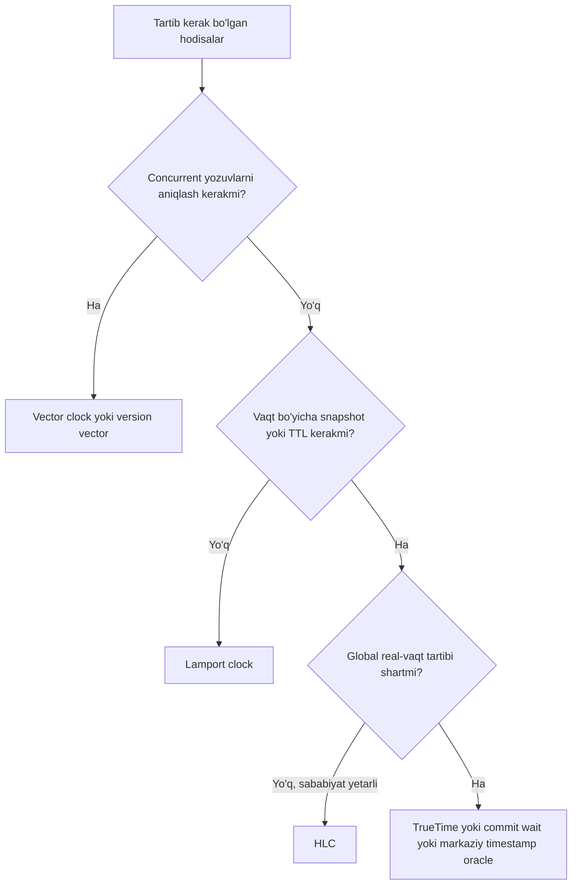

## Bu dars nima uchun kerak

31-darsda ko'rdik: taqsimlangan tizimda tugunlar faqat tarmoq orqali gaplashadi, xabarlar kechikadi va yo'qoladi. Endi yana bir "ishonchli" deb o'ylangan narsani buzamiz - **vaqt**. Har bir mashinaning o'z soati bor, ular har xil tezlikda yuradi, ba'zan orqaga sakraydi. Natijada "qaysi hodisa oldin bo'ldi?" degan oddiy savol taqsimlangan tizimda eng qiyin savollardan biriga aylanadi.

Bu savol hamma joyda chiqadi: last-write-wins replication'da (27-dars) qaysi yozuv yutadi, lease qachon tugaydi (38-dars), log'larni qanday tartiblash, snapshot isolation uchun qaysi versiyani o'qish (19-dars), lider qachon eskirgan deb hisoblanadi.

Bu darsdan keyin siz:

- time-of-day clock va monotonic clock farqini va qaysi biri nimaga ishlatilishini bilasiz;
- NTP qanday ishlashini, uning aniqligi va xatolik manbalarini (drift, asimmetrik yo'l, leap second) tushunasiz;
- happened-before munosabati va concurrency tushunchasini aniq ta'riflay olasiz;
- Lamport clock, vector clock va Hybrid Logical Clock (HLC) algoritmlarini qadam-baqadam bajara olasiz va ularning cheklovlarini bilasiz;
- Spanner TrueTime va CockroachDB qanday qilib fizik vaqtni xavfsiz ishlatishini tushunasiz.

## Ikki xil soat

Har bir zamonaviy OS kamida ikki xil soat beradi va ular butunlay boshqa maqsadlar uchun.

### Time-of-day (wall-clock) soat

Linux'da `clock_gettime(CLOCK_REALTIME)`, JavaScript'da `Date.now()`. Epoch'dan (1970-01-01 UTC) beri o'tgan vaqtni qaytaradi. Bu soat NTP orqali sinxronlanadi va shuning uchun **sakrashi mumkin**: agar mahalliy soat juda oldinda bo'lsa, NTP uni orqaga qaytaradi. Leap second ham shu soatda muammo beradi.

Xulosa: wall-clock ikki mashina orasida faqat sinxronizatsiya xatosi aniqligida taqqoslanadi, lekin bitta mashinada ham **davomiylikni o'lchash uchun yaroqsiz**.

### Monotonic soat

Linux'da `CLOCK_MONOTONIC`, Node.js'da `process.hrtime.bigint()` yoki `performance.now()`. Faqat oldinga yuradi, absolyut qiymati ma'nosiz (masalan, boot'dan beri). NTP uning tezligini biroz o'zgartirishi mumkin (slew), lekin sakratmaydi.

Xulosa: timeout, latency, rate limiter oynasi, lease davomiyligi - hammasi monotonic soat bilan o'lchanadi. Turli mashinalarning monotonic qiymatlarini taqqoslash ma'nosiz.

### Real hodisa: Cloudflare, 2017-yil 1-yanvar

Leap second (23:59:60) paytida Cloudflare'ning Go'da yozilgan RRDNS servisida upstream resolver javob vaqti `time.Now()` farqi bilan o'lchangan. Soat orqaga yurganda farq **manfiy** bo'lib chiqdi, manfiy qiymat o'rtachaga kirib, keyin `rand.Int63n()` ga uzatildi va u manfiy argumentda panic qildi. Cloudflare hisobotiga ko'ra, cho'qqida DNS so'rovlarining 0.2% ga yaqini ta'sirlangan. O'sha paytda Go'da monotonic vaqt manbai yo'q edi; keyinroq Go 1.9 `time.Now()` ichiga monotonic qiymatni qo'shdi. Saboq: davomiylikni hech qachon wall-clock farqi bilan o'lchamang.

## Fizik soatlar qanchalik noto'g'ri

### Drift

Serverlardagi kvars generatori aniq emas va tezligi haroratga bog'liq. Google Spanner maqolasida (OSDI 2012) TrueTime eng yomon holat uchun soat drift'ini 200 µs/s, ya'ni 200 ppm (million ulushiga 200) deb hisoblaydi. Shu qiymat bilan hisoblaymiz:

- 200 ppm = har soniyada 200 mikrosoniya xato;
- 30 soniyada: 30 × 200 µs = **6 ms**;
- bir kunda: 86 400 × 200 µs = 17.28 s, ya'ni taxminan **17 soniya**.

Ya'ni sinxronizatsiyasiz qolgan server bir kunda 17 soniyaga adashishi mumkin.

### NTP qanday ishlaydi

NTP (Network Time Protocol) ierarxik: stratum 0 - atom soat yoki GPS qabul qilgich, stratum 1 - ularga to'g'ridan-to'g'ri ulangan serverlar, stratum 2 - stratum 1 dan tarmoq orqali sinxronlanganlar va h.k. (stratum 16 - sinxronlanmagan).

Bitta almashuvda to'rtta vaqt belgisi olinadi: t0 (klient yubordi), t1 (server oldi), t2 (server javob yubordi), t3 (klient oldi). Unda:

- offset θ = ((t1 - t0) + (t2 - t3)) / 2
- round-trip delay δ = (t3 - t0) - (t2 - t1)

**Misol.** t0 = 100.000, t1 = 100.060, t2 = 100.061, t3 = 100.041 (soniyada, har biri o'z soati bo'yicha). θ = ((0.060) + (0.020)) / 2 = 0.040 s - klient soati 40 ms orqada. δ = 0.041 - 0.001 = 0.040 s.

Muhim taxmin: borish va qaytish yo'li **simmetrik**. Agar borish 30 ms, qaytish 10 ms bo'lsa, offset'da (30 - 10)/2 = 10 ms sistematik xato paydo bo'ladi va NTP buni bila olmaydi.

Amaliy aniqlik (Wikipedia'dagi NTP maqolasi bo'yicha): NTP ochiq internetda odatda o'nlab millisekund, ideal LAN'da 1 ms dan yaxshiroq; asimmetrik yo'l yoki tirbandlikda 100 ms va undan ortiq xato bo'lishi mumkin. Cloud'da yaxshiroq: AWS 2023 yilda Amazon Time Sync Service uchun NTP orqali odatda 100 µs dan kam, PTP hardware clock bilan esa 40 µs dan kam xatolik chegarasi haqida e'lon qildi.

### Qo'shimcha xavflar

- NTP serveriga ulanib bo'lmasa, soat jimgina drift qiladi va hech kim ogohlantirmaydi.
- Firewall NTP trafikini bloklashi mumkin.
- VM to'xtatilib davom ettirilganda soat sakraydi.
- **Leap second**: UTC ga vaqti-vaqti bilan bir soniya qo'shiladi. Google buni "leap smear" bilan hal qiladi: 24 soat davomida (UTC peshindan peshingacha) har bir soniya 11.6 µs uzunroq qilinadi (11.6 ppm), maksimal farq UTC dan 0.5 s dan biroz kam. 2022-yil 18-noyabrda CGPM 4-rezolyutsiyasi bilan UTC va UT1 orasidagi ruxsat etilgan farqni 2035 yilda yoki undan oldin oshirishga qaror qildi; yangi chegara hali belgilanmagan, lekin u amalga oshsa, leap second qo'shish ko'p o'n yilliklarga to'xtaydi.

### Soat ishonchliligi bilan bog'liq dizayn xulosasi

Wall-clock vaqt belgisi aniq qiymat emas, **ishonch oralig'i**: "hozir 10:00:00.000 ± 50 ms". Ko'p API buni yashiradi. Shunday tizimlar bor-ki, bu oraliqni ochiq qiladi: Spanner TrueTime va AWS ClockBound.

## Last-write-wins va soat xatosi

Leaderless va multi-leader replication'da (27-dars) konfliktni hal qilishning oddiy usuli - **last-write-wins (LWW)**: har bir yozuvga wall-clock vaqt belgisi qo'yiladi, kattasi yutadi. Cassandra standart holatda shunday ishlaydi.

Muammo stsenariy: A tugun soati B dan 30 ms oldinda.

1. Klient 1 A orqali `x = 1` yozadi, vaqt belgisi 10:00:00.040 (A soati bo'yicha).
2. 10 ms keyin klient 2 bu qiymatni o'qiydi va B orqali `x = 2` yozadi, vaqt belgisi 10:00:00.020 (B soati bo'yicha).
3. LWW `x = 1` ni tanlaydi, chunki 0.040 > 0.020.

Klient 2 ning yozuvi **sababiy jihatdan keyin** bo'lgan, lekin jimgina yo'qoldi. Hech qanday xato chiqmaydi. Bu LWW + wall-clock'ning asosiy xavfi: soat xatosi ichidagi yozuvlarni tartiblash tasodifiy.

Demak bizga fizik vaqtga bog'liq bo'lmagan tartiblash usuli kerak.

## Happened-before va concurrency

Leslie Lamport 1978 yilda "Time, Clocks, and the Ordering of Events in a Distributed System" maqolasida (Communications of the ACM, 21-jild, 7-son) **happened-before** munosabatini (→) ta'rifladi:

1. Agar a va b bitta jarayonda va a b dan oldin bo'lsa, a → b.
2. Agar a - xabar yuborish, b - shu xabarni qabul qilish bo'lsa, a → b.
3. Tranzitivlik: a → b va b → c bo'lsa, a → c.

Agar na a → b, na b → a bo'lsa, a va b **concurrent** (a ∥ b). Bu "bir vaqtda" degani emas: ular bir-biri haqida bilmagan holda sodir bo'lgan. Ular orasida soniyalar o'tgan bo'lishi mumkin.

Bu munosabat **qisman tartib** (partial order): har ikki hodisani taqqoslab bo'lmaydi. Aynan shu "sababiyat" (causality) - foydalanuvchi uchun muhim bo'lgan tartib. 33-darsdagi causal consistency shu munosabatga quriladi.

## Lamport clock

Har bir jarayon bitta butun son hisoblagich `L` saqlaydi.

Algoritm:

1. Har bir lokal hodisadan oldin: `L = L + 1`.
2. Xabar yuborishda: `L = L + 1`, xabarga `L` ni qo'shish.
3. Xabar qabul qilishda (xabardagi qiymat `Lm`): `L = max(L, Lm) + 1`.

Kafolat (Lamport'ning "Clock Condition"i): agar a → b bo'lsa, L(a) < L(b).

**Teskarisi to'g'ri emas**: L(a) < L(b) bo'lishi a → b ni anglatmaydi, a va b concurrent bo'lishi mumkin. Ya'ni Lamport clock **concurrency'ni aniqlay olmaydi**.

Umumiy tartib (total order) uchun teng qiymatlarda jarayon ID bo'yicha tie-break qilinadi: `(L, processId)` juftligi. Bu tartib sababiyatga mos keladi, lekin concurrent hodisalar orasida u ixtiyoriy.

**Misol.** Uch jarayon P1, P2, P3, hammasi L = 0 dan boshlaydi.

Bu yerda P1 dagi `c` (L=3) va P2 dagi m1 qabul qilish (L=3) - teng qiymat, ular concurrent. P3 dagi `e` (L=1) va P1 dagi `a` (L=1) ham concurrent. Lekin P1 dagi `c` (L=3) va P3 dagi `e` (L=1): L(e) < L(c), shunga qaramay e → c emas - ular concurrent. Lamport clock buni ko'rsata olmaydi.

Qayerda ishlatiladi: umumiy tartib kerak, lekin concurrency'ni aniqlash shart bo'lmagan joyda. Masalan, Lamport'ning o'zi maqolada distributed mutual exclusion'ni shu tartib bilan hal qiladi. Raft'dagi `term` ham Lamport clock'ga o'xshash mantiqiy soat: har bir xabar term'ni olib yuradi, kattaroq term ko'rgan tugun o'z term'ini yangilaydi (36-dars).

## Vector clock

Concurrency'ni aniqlash uchun har bir jarayon **barcha** jarayonlar bo'yicha hisoblagichlar vektorini saqlaydi. N jarayon uchun `V[1..N]`. Vector clock'ni 1988 yilda Colin Fidge va Friedemann Mattern mustaqil ravishda formallashtirgan; o'xshash g'oyalar (masalan 1983 yildagi "version vector") undan oldin ham bo'lgan.

Algoritm (jarayon i uchun):

1. Lokal hodisa: `V[i] = V[i] + 1`.
2. Yuborish: `V[i] = V[i] + 1`, xabarga butun `V` ni qo'shish.
3. Qabul qilish (`Vm`): har bir k uchun `V[k] = max(V[k], Vm[k])`, keyin `V[i] = V[i] + 1`.

Taqqoslash:

- `V(a) ≤ V(b)` - har bir komponent bo'yicha `V(a)[k] ≤ V(b)[k]`.
- `a → b` faqat va faqat `V(a) ≤ V(b)` va `V(a) ≠ V(b)`.
- Ikkalasi ham bajarilmasa - **concurrent**.

Bu "faqat va faqat" - asosiy farq: vector clock sababiyatni to'liq aks ettiradi.

**Misol** (P1, P2, P3):

- P1 lokal hodisa: P1 = [1,0,0].
- P1 P2 ga yuboradi: P1 = [2,0,0], xabarda [2,0,0].
- P3 lokal hodisa: P3 = [0,0,1].
- P2 qabul qiladi: max([0,0,0],[2,0,0]) = [2,0,0], keyin P2 komponenti +1: P2 = [2,1,0].
- P2 P3 ga yuboradi: P2 = [2,2,0].
- P3 qabul qiladi: max([0,0,1],[2,2,0]) = [2,2,1], +1: P3 = [2,2,2].

Endi taqqoslaymiz: P3 dagi birinchi hodisa [0,0,1] va P1 dagi [2,0,0]. 0 ≤ 2, lekin 1 > 0 - hech biri ikkinchisidan kichik emas, demak **concurrent**. P1 [2,0,0] va P3 oxirgi [2,2,2]: har komponent kichik yoki teng - P1 hodisasi oldin bo'lgan.

### Version vector va siblings

Ma'lumotlar bazasida (Dynamo uslubidagi tizimlar) vektor jarayonlar emas, **replikalar** bo'yicha saqlanadi va har bir kalit uchun alohida - bu **version vector** deyiladi. Ikki yozuv concurrent bo'lsa, baza ikkalasini ham saqlaydi (siblings) va o'qishda klientga qaytaradi; klient yoki dastur ularni birlashtiradi. Riak shunday ishlaydi; Riak 2.0 da "sibling explosion" (hal qilinmagan siblings tez to'planib qolishi) muammosini kamaytirish uchun dotted version vectors (DVV) qo'shildi va hujjatga ko'ra yaratilgan har bir bucket type'da `dvv_enabled` standart holatda yoqilgan. Siblings'ni avtomatik birlashtirishning tizimli yo'li - CRDT, 40-darsda.

### Narxi

Vektor hajmi jarayonlar soniga proporsional. 5 replika uchun 5 ta son - arzon. Lekin har bir klientni "jarayon" deb hisoblasak, 1 million klientda vektor 1 million elementli bo'ladi. Shu sabab amaliyotda vektor serverlar (replikalar) bo'yicha yuritiladi va eski yozuvlar kesiladi (pruning), bu esa ba'zan aniqlikni yo'qotadi.

## Hybrid Logical Clock (HLC)

Lamport clock va vector clock fizik vaqtdan butunlay ajralgan: "L = 4573" qachon bo'lganini bilmaysiz. Bu snapshot o'qishlar uchun noqulay ("10:00:00 holatidagi ma'lumotni ber" degan so'rovni bajarib bo'lmaydi). Fizik soat esa sababiyatni buzadi. Kulkarni, Demirbas va hammualliflar 2014 yilda **Hybrid Logical Clock** taklif qilishdi: ikkalasini birlashtirish.

HLC vaqt belgisi - juftlik `(l, c)`:

- `l` - shu paytgacha ko'rilgan eng katta fizik vaqt (o'zimizniki yoki boshqalardan kelgan);
- `c` - `l` bir xil qolganda hodisalarni ajratuvchi kichik hisoblagich.

Algoritm (`pt` - lokal fizik soat):

**Yuborish yoki lokal hodisa:**

1. `l' = l`
2. `l = max(l', pt)`
3. agar `l == l'` bo'lsa `c = c + 1`, aks holda `c = 0`

**Qabul qilish (xabardagi `l_m`, `c_m`):**

1. `l' = l`
2. `l = max(l', l_m, pt)`
3. agar `l == l' == l_m` bo'lsa `c = max(c, c_m) + 1`;
   aks holda agar `l == l'` bo'lsa `c = c + 1`;
   aks holda agar `l == l_m` bo'lsa `c = c_m + 1`;
   aks holda `c = 0`.

Xossalari:

- a → b bo'lsa, HLC(a) < HLC(b) (Lamport kafolati saqlanadi).
- `l` fizik soatdan ko'pi bilan soat sinxronizatsiyasi xatosi ε ga farq qiladi, ya'ni HLC "deyarli fizik vaqt".
- Maqolada 64 bit'ga joylash taklif qilingan: `l` uchun fizik vaqtning yuqori 48 biti, `c` uchun 16 bit. Bu NTP vaqt formatiga mos keladi.
- HLC concurrency'ni aniqlamaydi (vector clock emas), lekin umumiy tartib va vaqtga yaqin snapshot beradi.

**Misol.** A tugun: pt = 100, holati (100, 0). B tugunning soati orqada: pt = 95, holati (95, 0).

- A xabar yuboradi: pt = 101, l = max(100, 101) = 101, c = 0. Xabar (101, 0).
- B qabul qiladi, uning pt = 96: l = max(95, 101, 96) = 101. l faqat l_m ga teng, demak c = 0 + 1 = 1. B holati (101, 1).
- B darhol lokal hodisa qiladi, pt = 96: l = max(101, 96) = 101, o'zgarmadi, c = 2. B holati (101, 2).

B ning fizik soati orqada bo'lsa ham, uning hodisalari A dan keyingi vaqt belgisini oldi - sababiyat saqlandi. pt 101 dan oshganda c yana 0 ga tushadi.

Qayerda ishlatiladi: CockroachDB hujjatiga ko'ra tranzaksiya vaqt belgilari HLC qiymatlari; MongoDB cluster-wide causal consistency uchun HLC asosidagi "cluster time"dan foydalanadi (Tyulenev va boshq., SIGMOD 2019); YugabyteDB ham MVCC uchun hybrid time ishlatadi.

## Soatlarni taqqoslash

| Xossa | Wall-clock | Lamport | Vector clock | HLC | TrueTime |
|---|---|---|---|---|---|
| a → b dan T(a) < T(b) | Kafolatlanmaydi | Ha | Ha | Ha | Commit wait bilan ha |
| Concurrency'ni aniqlaydi | Yo'q | Yo'q | Ha | Yo'q | Yo'q |
| Fizik vaqtga yaqin | Ha (± skew) | Yo'q | Yo'q | Ha (± ε) | Ha (aniq oraliq) |
| Hajmi | 64 bit | 64 bit | N ta son | 64 bit | 2 × 64 bit |
| Maxsus apparat | Yo'q | Yo'q | Yo'q | Yo'q | GPS + atom soat |
| Tipik foydalanish | Log, UI | Umumiy tartib, Raft term | Siblings, CRDT | Tranzaksiya timestamp | Global tashqi consistency |

## TrueTime va commit wait

Google Spanner (OSDI 2012) teskari yo'lni tanladi: soat xatosini yashirish o'rniga uni **o'lchash va chegaralash**. TrueTime API `TT.now()` bitta qiymat emas, oraliq qaytaradi: `[earliest, latest]`. Har bir data-markazda GPS qabul qilgichlar va atom soatli "time master"lar bor, shuning uchun noaniqlik ε kichik: Spanner maqolasiga ko'ra ε har poll oralig'ida (30 s) 1 dan 7 ms gacha arra shaklida o'zgaradi va ko'p vaqt 4 ms ga yaqin bo'ladi.

**Commit wait** qoidasi: tranzaksiya vaqt belgisi `s = TT.now().latest` olinadi, keyin `TT.now().earliest > s` bo'lguncha kutiladi va shundan keyingina commit ko'rinadi. Natija: agar T1 commit'i T2 boshlanishidan oldin tugagan bo'lsa (real vaqtda), T1 ning vaqt belgisi T2 nikidan albatta kichik. Bu **external consistency** (linearizability'ning tranzaksiyalar uchun varianti, 33-dars).

Narxi: maqolaga ko'ra commit wait'ning kutilgan davomiyligi kamida 2ε; ε = 4 ms da bu kamida 2 × 4 = 8 ms. Maqola qayd etadiki, bu kutish odatda Paxos replikatsiyasi bilan parallel o'tadi, shuning uchun klient ko'radigan qo'shimcha latency undan kam bo'lishi mumkin. ε oshsa, yozish latency'si oshadi, lekin to'g'rilik buzilmaydi.

### CockroachDB: TrueTime'siz

CockroachDB maxsus apparatsiz ishlaydi, shuning uchun HLC va **maksimal soat farqi** (`--max-offset`, standart 500 ms) taxminidan foydalanadi. O'qish tranzaksiyasi `[ts, ts + max_offset]` "noaniqlik oynasi"ga tushgan yozuvni ko'rsa, u oldin yoki keyin bo'lganini bilmaydi va o'qishni kattaroq vaqt belgisi bilan qayta boshlaydi (read restart). Agar tugun soati klasterning yarmidan ko'proq tugunlariga nisbatan max-offset'ning 80% idan (standartda 400 ms) ko'proq farq qilsa, tugun o'zini o'chiradi. Ya'ni consistency soat taxminiga bog'liq va bu taxmin buzilsa, tizim to'xtashni afzal ko'radi.

Oxirgi variantda "markaziy timestamp oracle" - masalan TiDB'dagi Placement Driver (PD) kabi bitta xizmat monoton vaqt belgisi (TSO) beradi; TiDB hujjatiga ko'ra TSO hech qachon orqaga qaytmaydi. Bu oddiy, lekin har bir tranzaksiya unga murojaat qiladi.

## iQuariX kontekstida

Quyidagi vaziyatlar masala sharti sifatida berilgan (iQuariX'ning real ichki arxitekturasi emas).

**1. Trekerning vaqt belgisi.** Treker GPS'dan vaqt oladi - GPS vaqti juda aniq (GPS o'zi atom soatlarga asoslangan). Lekin GPS signali yo'q bo'lsa (yer osti avtoturargoh), treker ichki RTC'ga o'tadi va u drift qiladi. Shuning uchun har bir nuqtada ikki vaqt saqlash foydali: `device_time` (event time) va `received_at` (server qabul qilgan vaqt). Agar `device_time` server vaqtidan, masalan, 5 daqiqadan ko'proq kelajakda bo'lsa - shubhali deb belgilanadi. Event time va processing time farqi 45-darsda chuqur ko'riladi.

**2. Ketma-ketlik raqami.** Treker har bir nuqtaga monoton `seq` qo'shadi. Bu bitta qurilma ichidagi Lamport clock'ning eng oddiy shakli: vaqt sakrasa ham tartib saqlanadi, dublikat va bo'shliq (yo'qolgan nuqta) aniqlanadi.

**3. Dispetcher va mobil ilova bir vaqtda tahrirlaydi.** Masalan, mashina kartochkasini (haydovchi, marshrut) dispetcher veb-panelda, menejer esa oflayn mobil ilovada o'zgartirdi. Wall-clock bilan LWW qilsak, telefon soati noto'g'ri bo'lsa, yangi o'zgarish yo'qoladi. Har bir maydon uchun version vector `{server: n, mobile_123: m}` saqlansa, concurrent o'zgarishlar aniqlanadi va foydalanuvchiga ko'rsatiladi yoki CRDT bilan birlashtiriladi (40-dars).

**4. Hisobot vaqtlari.** "Soat 08:00 dan 18:00 gacha yoqilg'i sarfi" hisoboti uchun ma'lumot bir nechta servisdan (telemetriya, ДУТ, ish smenalari) keladi. Servislar serverlarining soati 200 ms farq qilsa, chegaradagi nuqtalar noto'g'ri smenaga tushishi mumkin. Shuning uchun hisobot qurilma `device_time` bo'yicha, server soati bo'yicha emas, quriladi.

**5. Ichki servislar.** Barcha serverlarda chrony yoki cloud provayderning vaqt servisi, monitoring'da soat offset metrikasi va alert (masalan, 50 ms dan oshsa). Kod ichida: timeout va latency faqat `process.hrtime.bigint()` yoki `performance.now()` bilan.

## Ko'p uchraydigan xatolar

1. **Davomiylikni `Date.now()` farqi bilan o'lchash.** NTP sakrashi manfiy yoki ulkan qiymat beradi. Monotonic soat ishlating.
2. **LWW'ni wall-clock bilan, soat xatosini hisobga olmasdan ishlatish.** Sababiy jihatdan keyingi yozuv jimgina yo'qoladi.
3. **Lamport clock concurrency'ni aniqlaydi deb o'ylash.** L(a) < L(b) dan a → b kelib chiqmaydi.
4. **Turli mashinalarning vaqt belgilarini aniq deb solishtirish.** Har bir vaqt belgisi ± skew oralig'i.
5. **Vector clock'ni har bir klient bo'yicha yuritish.** Vektor cheksiz o'sadi. Replikalar bo'yicha yuriting.
6. **Soat offset'ini kuzatmaslik.** NTP to'xtab qolsa, drift sutkasiga soniyalarga yetadi va hech kim bilmaydi.
7. **Qurilma vaqtiga ko'r-ko'rona ishonish.** Treker yoki telefon soati noto'g'ri bo'lishi mumkin; server qabul vaqtini ham saqlang.
8. **Leap second va vaqt zonalarini e'tiborsiz qoldirish.** Ichkarida doim UTC, ko'rsatishda mahalliy vaqt.

## Xulosa

- Ikki xil soat bor: wall-clock (sakraydi, mashinalararo faqat sinxronizatsiya xatosi aniqligida taqqoslanadi) va monotonic (faqat oldinga, faqat davomiylik uchun).
- NTP aniqligi internetda o'nlab ms, LAN'da 1 ms gacha; asimmetrik yo'l sistematik xato beradi. Har bir vaqt belgisi - oraliq.
- Happened-before qisman tartib; concurrent - "bir-birini bilmagan", "bir vaqtda" emas.
- Lamport clock: a → b dan L(a) < L(b), lekin concurrency'ni aniqlamaydi.
- Vector clock sababiyatni to'liq aks ettiradi va concurrency'ni aniqlaydi, lekin hajmi tugunlar soniga proporsional.
- HLC: Lamport kafolati + fizik vaqtga yaqinlik, 64 bit. CockroachDB, MongoDB, YugabyteDB ishlatadi.
- TrueTime soat xatosini o'lchab, commit wait bilan global tartib beradi; narxi - har yozuvda kamida 2ε kutish.

## Amaliy topshiriq

Masala sharti: iQuariX'da **ikki regionli** (Toshkent va Frankfurt) deployment rejalashtirilmoqda va ikkalasida ham "haydovchi tayinlash" yozuvlari qabul qilinadi (multi-leader). Bitta mashinaga bir vaqtda ikki dispetcher har xil haydovchi tayinlashi mumkin.

1. Wall-clock asosidagi LWW bilan qanday aniq stsenariyda to'g'ri yozuv yo'qolishini ko'rsating. Shartlar: regionlar orasidagi soat farqi 20 ms, RTT 70 ms.
2. Version vector yechimini loyihalang: vektor elementlari nima (regionlar, foydalanuvchilar, qurilmalar)? Concurrent tayinlash aniqlanganda nima bo'ladi?
3. HLC qo'llansa nima yaxshilanadi va nima yaxshilanmaydi? Concurrent tayinlashni HLC aniqlay oladimi?
4. Treker nuqtalari uchun qaysi vaqt (GPS, treker RTC, server) hisobotlarda ishlatiladi va qachon unga ishonmaslik kerak? Aniq qoida yozing.
5. Monitoring: soat offset uchun qanday metrika va qanday chegarada alert qo'yasiz? Chegarani LWW xavfi bilan bog'lab asoslang.

Yaxshi javobda bo'lishi kerak bo'lgan narsalar:

- LWW stsenariysida sababiy bog'liq ikki yozuv va soat farqi hisob bilan ko'rsatilgan;
- version vector elementlari replikalar (regionlar) bo'yicha va siblings bilan ishlash rejasi;
- HLC concurrency'ni aniqlamasligi aniq aytilgan;
- qurilma vaqti uchun aniq "ishonmaslik" qoidasi (masalan kelajak chegarasi, GPS fix yo'qligi);
- alert chegarasi raqam bilan va asoslangan.

Javobni pastdagi maydonga yozib, chatga yuboring.

## Manbalar

- Leslie Lamport. [Time, Clocks, and the Ordering of Events in a Distributed System](https://amturing.acm.org/p558-lamport.pdf), Communications of the ACM 21(7), 1978 - happened-before, logical clock, IR1/IR2.
- Friedemann Mattern. [Virtual Time and Global States of Distributed Systems](https://courses.csail.mit.edu/6.895/fall02/papers/Mattern/VirtTime_GlobState.pdf), 1988 - vector time. Tarixi uchun: Lindsey Kuper, [Who invented vector clocks?](https://decomposition.al/blog/2023/04/08/who-invented-vector-clocks/).
- Sandeep Kulkarni, Murat Demirbas va boshq. [Logical Physical Clocks](https://www.cse.buffalo.edu//~demirbas/publications/hlc.pdf), 2014 - HLC algoritmi, 48+16 bit kodlash.
- Martin Kleppmann, Chris Riccomini. [Designing Data-Intensive Applications, 2-nashr](https://www.oreilly.com/library/view/designing-data-intensive/9781098119058/), O'Reilly, 2026. 9-bob, "Unreliable Clocks" bo'limi (monotonic vs time-of-day, drift, LWW xavfi).
- Cockroach Labs. [Clock management in CockroachDB](https://www.cockroachlabs.com/blog/clock-management-cockroachdb/), 2025 - max-offset 500 ms, uncertainty interval, self-termination.
- Cloudflare. [How and why the leap second affected Cloudflare DNS](https://blog.cloudflare.com/how-and-why-the-leap-second-affected-cloudflare-dns/), 2017.
- Google. [Leap Smear](https://developers.google.com/time/smear) - 24 soatlik chiziqli smear.
- AWS. [It's About Time: Microsecond-Accurate Clocks on Amazon EC2 Instances](https://aws.amazon.com/blogs/compute/its-about-time-microsecond-accurate-clocks-on-amazon-ec2-instances/), 2023 - ClockBound va PHC.
- James Corbett va boshq. [Spanner: Google's Globally-Distributed Database](https://static.googleusercontent.com/media/research.google.com/en//archive/spanner-osdi2012.pdf), OSDI 2012 - 5.3 bo'lim: ε arra shakli, 200 µs/s drift, commit wait.
- [Network Time Protocol](https://en.wikipedia.org/wiki/Network_Time_Protocol) va [Leap second](https://en.wikipedia.org/wiki/Leap_second), Wikipedia - NTP aniqligi, CGPM 2022 4-rezolyutsiyasi.
- [Riak: Causal Context](https://docs.riak.com/riak/kv/latest/learn/concepts/causal-context/index.html) - DVV va sibling explosion; [CockroachDB: Transaction layer](https://docs.cockroachlabs.com/docs/stable/architecture/transaction-layer) - HLC vaqt belgilari; [TiDB TSO](https://docs.pingcap.com/tidb/stable/tso).
