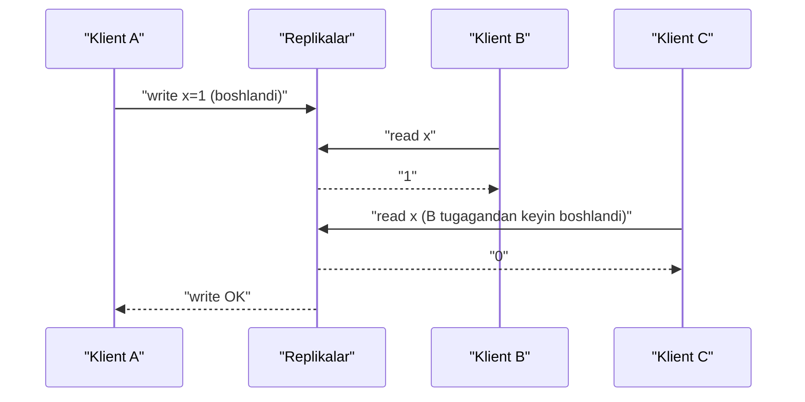
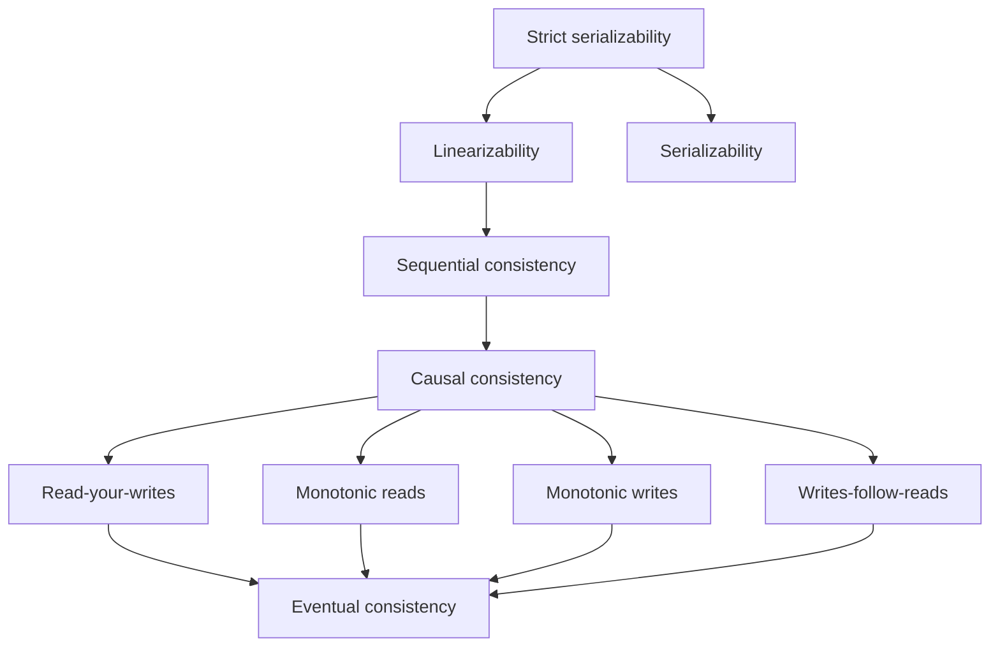

## Bu dars nima uchun kerak

26-27 darslarda replication'ni ko'rdik: ma'lumot bir nechta nusxada yashaydi va nusxalar vaqtincha farq qiladi. 32-darsda hodisalarni tartiblash usullarini ko'rdik. Endi savol: **klient bu nusxalardan nimani ko'rishi kafolatlanadi?** Shu kafolatlar to'plami - **consistency model**.

Bu so'z eng ko'p chalkashtiriladigan terminlardan biri. ACID'dagi "C" (17-dars) - ilova invariantlari haqida. CAP'dagi "C" (34-dars) - linearizability. Kafka, DynamoDB, MongoDB hujjatlarida "strong", "eventual", "session", "causal" so'zlari turli ma'nolarda ishlatiladi. Bu darsning maqsadi - bu modellarni aniq ta'riflash, ularni bir-biridan farqlay olish va har birining narxini (latency, mavjudlik) tushunish.

Bu darsdan keyin siz:

- consistency model nima ekanini "ruxsat etilgan tarixlar to'plami" sifatida tushunasiz;
- linearizability'ning aniq ta'rifini bilasiz va berilgan tarixning linearizable yoki yo'qligini tekshira olasiz;
- linearizability va serializability'ning farqini, strict serializability nima ekanini bilasiz;
- sequential, causal, session kafolatlari (read-your-writes, monotonic reads, monotonic writes, writes-follow-reads) va eventual consistency'ni ajrata olasiz;
- har bir model network partition paytida mavjud bo'lib qola oladimi yoki yo'qmi, bilasiz;
- real tizimlar (PostgreSQL, DynamoDB, etcd, S3, MongoDB) qaysi kafolatni beradi va uni qanday yoqish mumkinligini bilasiz.

## Consistency model nima

Taqsimlangan tizimdagi operatsiyalar vaqt bo'yicha **oraliq**: klient so'rov yuboradi (invocation), keyinroq javob oladi (response). Bir nechta klient bir vaqtda ishlasa, operatsiyalar oraliqlari ustma-ust tushadi. Bunday operatsiyalar ketma-ketligi **tarix** (history) deyiladi.

Consistency model - qaysi tarixlar "to'g'ri" deb hisoblanishi haqidagi qoida. Kuchli model kamroq tarixga ruxsat beradi (klient uchun soddaroq), lekin tugunlar orasida ko'proq koordinatsiya talab qiladi (sekinroq, kamroq mavjud). Kuchsiz model aksincha.

Ikki o'q bor va ularni aralashtirmaslik kerak:

- **Bitta obyekt (register, kalit) ustidagi alohida operatsiyalar** - linearizability, sequential, causal, eventual. Replication nazariyasidan keladi.
- **Bir nechta obyektni o'z ichiga olgan tranzaksiyalar** - serializability, snapshot isolation, read committed. Bazalar nazariyasidan keladi (18-19 darslar).

Bu ikki o'qning kesishmasi - **strict serializability**.

## Linearizability

Herlihy va Wing 1990 yilda (ACM TOPLAS, 12-jild, 3-son) ta'riflagan: har bir operatsiya o'zining invocation va response oraliqlari ichidagi **bitta nuqtada bir zumda** bajarilgandek ko'rinishi kerak, va bu nuqtalar tartibi operatsiyalarning real vaqt tartibiga mos bo'lishi kerak.

Sodda tilda: tizim xuddi ma'lumotning **bitta nusxasi** bor va hamma operatsiyalar unga atomik ta'sir qiladigandek ishlaydi. Replikalar borligi klientga ko'rinmaydi.

Muhim natija - **recency guarantee**: yozuv tugagandan (javob qaytgandan) keyin boshlangan har qanday o'qish shu yozuvni yoki undan yangisini ko'radi. Va bitta klient yangi qiymatni ko'rgandan keyin, undan keyin boshlangan boshqa klientlarning o'qishlari ham eskisini ko'rmaydi.

### Misol: linearizable emas

Uch klient, `x` boshlang'ich qiymati 0.

A ning yozuvi hali tugamagan, B o'qishi 1 ni ko'rdi - bu ruxsat etiladi, chunki yozuv oraliqlari ustma-ust tushadi va yozuv "B o'qishidan oldingi nuqtada" bajarilgan deb hisoblash mumkin. Lekin C o'qishi B tugagandan **keyin** boshlangan va 0 ni ko'rdi. Agar yozuv B dan oldin bajarilgan bo'lsa, C ham 1 ni ko'rishi kerak edi. Bu tarix linearizable emas. Real hayotda bu holat B lider bilan sinxron replikadan, C esa hali yangilanmagan async replikadan o'qiganda paydo bo'ladi.

### Qayerda linearizability shart

- **Lock va leader election.** Ikki tugun bir vaqtda lockni "olgan" deb o'ylasa - split brain. etcd, ZooKeeper, Consul shu sabab yozuvlarni consensus orqali bitta umumiy tartibda bajaradi (38-dars).
- **Uniqueness constraint.** Bitta username yoki bitta joyni (chipta) ikki kishiga bermaslik - aslida linearizable compare-and-set.
- **Kanallararo bog'liqlik.** Rasm yuklandi, keyin navbatga "resize qil" xabari yuborildi. Worker xabarni oldi va storage'dan rasmni o'qiydi. Agar storage linearizable bo'lmasa, worker eski rasmni yoki hech narsani o'qishi mumkin, chunki xabar navbat orqali replikatsiyadan tezroq yetib keldi.

### Narxi

Linearizability uchun har bir operatsiya (yoki kamida yozuvlar va "yangi" o'qishlar) tugunlar orasida koordinatsiya talab qiladi. Kleppmann "A Critique of the CAP Theorem" maqolasida Attiya va Welch natijasiga tayanib ko'rsatadi: linearizable o'qish ham, yozish ham latency'si tarmoq kechikishi d ga bog'liq - O(d). Causal consistency esa ikkalasini ham O(1) da, ya'ni tarmoqni kutmasdan bajarishga imkon beradi.

Hisob misoli: Toshkent va Frankfurt orasida RTT taxminan 70-80 ms deylik. Ikki regionda linearizable yozuv har bir operatsiyada kamida bitta regionlararo round-trip kutadi: yozish p50 kamida 70-80 ms. Lokal (bitta region ichidagi) yozuv 1-5 ms. 15-20 baravar farq - faqat consistency tanlovi uchun.

Bundan tashqari, partition paytida linearizability'ni saqlash uchun minority tomondagi tugunlar so'rovlarga javob berishni to'xtatishi kerak (34-dars, CAP).

### Linearizability'ni qanday tizimlar beradi

- Single-leader replication, agar o'qish ham liderdan qilinsa va lider o'zi hali liderligini tasdiqlasa (aks holda 31-darsdagi "eskirgan lider" muammosi). Async replikalardan o'qish linearizable emas.
- Consensus algoritmlari (Raft, Paxos) - 35-36 darslar. etcd standart holatda o'qishlarni ham linearizable bajaradi; `serializable` rejimida esa lokal (eskirgan bo'lishi mumkin) o'qish qiladi, lekin tezroq.
- Leaderless (Dynamo uslubi) quorum bilan **odatda emas**: hatto w + r > n bo'lsa ham, sloppy quorum, LWW va concurrent yozuvlar linearizability'ni buzadi (27-dars).
- Multi-leader - yo'q.

## Linearizability va serializability

Bu ikki termin juda ko'p aralashtiriladi.

| | Linearizability | Serializability | Strict serializability |
|---|---|---|---|
| Nimaga tegishli | Bitta obyekt, alohida operatsiyalar | Ko'p obyektli tranzaksiyalar | Ko'p obyektli tranzaksiyalar |
| Kafolat | Real vaqt tartibiga mos bitta tartib | Qandaydir ketma-ket tartibga ekvivalent | Real vaqt tartibiga mos ketma-ket tartib |
| Real vaqt cheklovi | Ha | Yo'q | Ha |
| Misol | etcd kaliti, ZooKeeper znode | PostgreSQL SERIALIZABLE (SSI), bitta tugunda | Spanner (external consistency), FoundationDB |

Serializability real vaqtni hisobga olmaydi: nazariy jihatdan read-only tranzaksiyani "o'tmishga" qo'yish mumkin va u eski snapshot'ni ko'radi - bu serializable, lekin linearizable emas. Bitta tugunli PostgreSQL'da amalda bu bo'lmaydi, lekin taqsimlangan bazalarda bu real farq. Kingsbury ta'kidlaganidek, ko'p SQL bazalaridagi "SERIALIZABLE" sozlamasi aslida undan ham kuchsizroq daraja (masalan snapshot isolation) beradi (19-dars).

## Sequential consistency

Lamport 1979 yilda (IEEE Transactions on Computers) multiprocessor xotira uchun ta'riflagan: barcha operatsiyalar qandaydir bitta umumiy tartibda bajarilgandek ko'rinadi va har bir jarayonning operatsiyalari shu tartibda o'z dasturidagi tartibda keladi. Real vaqt cheklovi **yo'q**: yozuv tugagandan keyin boshqa klient hali eski qiymatni ko'rishi mumkin, lekin hamma bir xil tartibni ko'radi.

Misol: ZooKeeper hujjati o'z kafolatini "sequential consistency" deb ataydi: klient yozuvlari yuborilgan tartibda qo'llanadi, yozuvlar lider orqali bitta umumiy tartibda o'tadi, o'qishlar esa ulangan serverdan lokal bajariladi va eskirgan bo'lishi mumkin (hujjatda "o'nlab soniyalar" tartibidagi chegara aytilgan). Eng yangi qiymat kerak bo'lsa, o'qishdan oldin `sync()` chaqiriladi.

## Causal consistency

Faqat **sababiy bog'liq** operatsiyalar tartibi kafolatlanadi (32-darsdagi happened-before). Concurrent operatsiyalarni turli replikalar turli tartibda ko'rishi mumkin.

Klassik misol: Alisa post yozadi, Bobur uni ko'rib, izoh qoldiradi. Causal consistency kafolati: hech kim Boburning izohini Alisaning posti yo'q holda ko'rmaydi. Lekin bir-biridan bexabar ikki boshqa izohning tartibi turli foydalanuvchilarda farq qilishi mumkin.

Nega bu model muhim:

- Kleppmann va boshqa tadqiqotchilar ko'rsatganidek, causal consistency (convergence bilan birga) - tarmoqni kutmasdan (O(1) latency) erishish mumkin bo'lgan eng kuchli modellardan biri. Kingsbury ham "causal'dan kuchliroq hech qanday model to'liq mavjud bo'la olmaydi" deb yozadi.
- Ya'ni partition paytida ham har bir replika lokal javob berishda davom etib, sababiyatni saqlay oladi.

Amalga oshirish: har bir yozuv o'z bog'liqliklarini (vector clock, yoki "men shu versiyani ko'rganman" belgisi) olib yuradi; replika bog'liqliklari kelmaguncha yozuvni ko'rinmas qilib turadi. MongoDB "causally consistent sessions" ni HLC asosidagi cluster time bilan amalga oshiradi: klient oxirgi ko'rgan `operationTime` ni keyingi so'rovga qo'shadi va server shu nuqtagacha yetib olgandan keyingina javob beradi.

## Session kafolatlari

Werner Vogels 2008 yilda (All Things Distributed, keyinroq ACM Queue) eventual consistency'ning amaliy variantlarini sanab o'tgan. Bular bitta klient (sessiya) nuqtai nazaridan kafolatlar va causal consistency'ning tarkibiy qismlari:

| Kafolat | Ma'nosi | Buzilsa nima ko'rinadi |
|---|---|---|
| Read-your-writes | Klient o'z yozuvini keyingi o'qishlarda ko'radi | Profilni saqladim, sahifa yangilandi - eski ma'lumot |
| Monotonic reads | Klient yangi qiymatni ko'rgandan keyin eskisini ko'rmaydi | Sahifani yangilasam izoh yo'qolib, keyin qaytadi |
| Monotonic writes | Bitta klientning yozuvlari tartibda qo'llanadi | "Parolni o'zgartir" va "eski parolni o'chir" teskari tartibda |
| Writes-follow-reads | Klient o'qigan qiymatdan keyin yozgan yozuvi o'sha qiymatdan keyin tartiblanadi | Izohga javob asl izohdan oldin paydo bo'ladi |

Amaliy yechimlar:

- **Read-your-writes**: foydalanuvchi oxirgi N soniyada yozgan bo'lsa, liderdan o'qish; yoki klient oxirgi yozuv LSN/versiyasini saqlab, replika shu nuqtagacha yetib kelganini tekshirish. PostgreSQL'da `pg_last_wal_replay_lsn()` bilan solishtirish mumkin.
- **Monotonic reads**: foydalanuvchini bitta replikaga "yopishtirish" (sticky routing, masalan user_id hash bo'yicha). Replika o'lsa, kafolat yo'qolishi mumkin.

Bu kafolatlar "sticky available": klient doim bitta replika bilan ishlasa, partition paytida ham saqlanadi.

## Eventual consistency

Eng kuchsiz amaliy kafolat: yangi yozuvlar to'xtasa, **oxir-oqibat** barcha replikalar bir xil qiymatga keladi (convergence). Qachon - aytilmaydi. Oraliqda nima o'qilishi haqida hech qanday kafolat yo'q: eski qiymat, yangi qiymat, ular aralashmasi.

Bu "kafolat" ancha kuchsiz, lekin tizim uchun eng arzoni: har bir replika lokal javob beradi, partition bo'lsa ham. DNS, CDN cache, ko'pchilik qidiruv indekslari, DynamoDB standart o'qishlari - eventual.

**Strong eventual consistency** - qo'shimcha talab: bir xil yozuvlar to'plamini olgan ikki replika (qaysi tartibda olganidan qat'i nazar) darhol bir xil holatda bo'ladi. Bu CRDT kafolati (40-dars).

## Modellar ierarxiyasi

Strelka "kuchliroq model kuchsizrog'ining barcha kafolatlarini o'z ichiga oladi" degan ma'noda. Linearizability va sequential "partition paytida mavjud bo'lolmaydi" zonasida, causal va undan pastdagilar partition paytida ham mavjud bo'la oladi (session kafolatlari klient bitta replikaga yopishgan sharti bilan).

## Modellarni taqqoslash

| Model | Yozish latency | O'qish latency | Partition'da mavjudmi | Tipik misol |
|---|---|---|---|---|
| Linearizable | O(d) - quorum yoki lider | O(d) - quorum yoki lease | Yo'q (minority tomonda) | etcd, ZooKeeper yozuvlari, Spanner |
| Sequential | O(d) | O(1) | Yo'q | ZooKeeper (sync'siz o'qishlar bilan) |
| Causal | O(1) | O(1) | Ha | MongoDB causal sessions, COPS tadqiqot tizimi |
| Session (RYW, MR) | O(1) | O(1) | Ha, sticky klient bilan | Sticky routing, LSN token |
| Eventual | O(1) | O(1) | Ha | DNS, Cassandra ONE, DynamoDB standart o'qish |

## Real tizimlardan misollar

- **PostgreSQL streaming replication.** Rasmiy hujjat standby'dagi ma'lumotni primary bilan "eventually consistent" deb ataydi. `synchronous_commit = remote_apply` bilan commit sinxron standby'larda **qo'llanib, ko'rinadigan bo'lguncha** kutadi - shunda shu standby'dan o'qish read-your-writes beradi, lekin commit latency sezilarli oshadi (hujjat buni WAL replay'ni kutish bilan izohlaydi).
- **DynamoDB.** Standart o'qish eventually consistent; `ConsistentRead=true` - strongly consistent, lekin ikki barobar qimmatroq (RCU bo'yicha). GSI va Streams faqat eventual. Global tables'da standart MREC (odatda bir soniya ichida replikatsiya), MRSC rejimi esa yozuvni boshqa regionga sinxron replikatsiya qiladi.
- **Amazon S3.** 2020-yil 1-dekabrdan boshlab barcha GET, PUT, LIST uchun strong read-after-write consistency, qo'shimcha to'lovsiz va performance ta'sirisiz. Bungacha ustiga yozish va o'chirish eventual edi, va Hadoop ekotizimi uchun S3Guard kabi qo'shimcha qatlamlar kerak bo'lgan.
- **etcd.** Standart holatda barcha operatsiyalar linearizable; `serializable` o'qish rejimi eskirgan qiymat qaytarishi mumkin, lekin consensus kutishini olib tashlaydi.
- **Jepsen.** Kyle Kingsbury'ning testlari ko'p bazalarda e'lon qilingan consistency darajasi partition va crash'da buzilishini ko'rsatgan. Saboq: hujjatdagi so'zga emas, test qilingan kafolatga ishoning.

## iQuariX kontekstida

Faraz qiling, iQuariX'da turli ma'lumotlar uchun turli consistency talab qilinadi. Hammasiga bitta model qo'llash - yo ortiqcha qimmat, yo xavfli.

**Mashinaning oxirgi joylashuvi (xarita).** Eventual consistency yetarli. Dispetcher 1-2 soniya eski nuqtani ko'rsa, zarar yo'q. Lekin **monotonic reads** muhim: sahifani yangilaganda mashina "orqaga sakrab" ketsa, dispetcher chalkashadi. Yechim: oxirgi joylashuv yozuvida `device_time` bo'yicha "faqat yangisi bilan almashtir" qoidasi va klient tomonda ham eski nuqtani rad etish.

**Mijoz sozlamalari (geozona, ogohlantirish chegaralari).** Read-your-writes kerak: menejer geozonani saqlab, ro'yxatga qaytganda uni ko'rishi shart. Yechim: yozuvdan keyingi 10 soniya davomida shu foydalanuvchining o'qishlari primary'dan, yoki javobda LSN qaytarib, keyingi o'qishda replika shu LSN gacha yetganini tekshirish.

**Geozona qoidalarini qo'llovchi worker.** Menejer geozonani o'zgartirdi, keyin navbat orqali "qoidalarni qayta yukla" xabari ketdi. Worker replikadan o'qisa va replika orqada bo'lsa, eski geozonani yuklab oladi - kanallararo bog'liqlik muammosi. Yechim: xabarga versiya raqamini qo'shish va worker shu versiyadan eskisini o'qisa, qayta urinish.

**Yoqilg'i kartasi limiti yoki komanda yuborish.** "Bitta mashinaga bir vaqtda faqat bitta faol komanda" yoki "kunlik limit oshmasin" - bu linearizable compare-and-set talab qiladi. Yechim: shu ma'lumotni bitta liderli PostgreSQL'da tranzaksiya bilan, yoki etcd kabi consensus asosidagi xizmatda saqlash. Bu operatsiyalar soni kam, shuning uchun narxi qabul qilinadi.

**Hisobotlar va analitika (ClickHouse).** Eventual - bir necha daqiqa kechikish odatiy.

Umumiy tamoyil: **har bir ma'lumot turi uchun alohida consistency talabini yozing** va eng kuchli modelni faqat haqiqatan kerak bo'lgan kichik qismga qo'llang.

## Ko'p uchraydigan xatolar

1. **"Strong consistency" ni aniqlashtirmasdan ishlatish.** Linearizable'mi, serializable'mi, read-after-write'mi - so'rang.
2. **Linearizability va serializability'ni aralashtirish.** Biri bitta obyekt va real vaqt, ikkinchisi tranzaksiyalar va real vaqtsiz.
3. **Quorum (w + r > n) linearizability beradi deb o'ylash.** Sloppy quorum, LWW va concurrent yozuvlar buni buzadi.
4. **Async replikadan o'qib, read-your-writes'ni unutish.** "Saqladim, lekin ko'rinmayapti" turidagi bug'larning eng keng tarqalgan sababi.
5. **Kanallararo bog'liqlikni ko'rmaslik.** Navbat xabari replikatsiyadan tezroq yetib keladi.
6. **Hamma narsaga eng kuchli modelni qo'llash.** Har bir yozuv regionlararo round-trip kutadi va partition'da tizim to'xtaydi.
7. **Eventual consistency'da "oxir-oqibat" qanchalik tez ekanini o'lchamaslik.** Replication lag metrikasi va alert bo'lishi kerak (26-dars).
8. **Hujjatga ko'r-ko'rona ishonish.** Jepsen natijalarini va konfiguratsiya shartlarini tekshiring.

## Xulosa

- Consistency model - qaysi operatsiya tarixlari ruxsat etilganini belgilovchi kontrakt. Kuchliroq model - soddaroq dasturlash, lekin ko'proq koordinatsiya.
- Linearizability: bitta nusxa illyuziyasi va real vaqt tartibi. Lock, uniqueness, leader election uchun shart. Narxi - O(d) latency va partition'da minority tomonda mavjud emaslik.
- Serializability tranzaksiyalar haqida va real vaqtni hisobga olmaydi; ikkalasining birlashmasi - strict serializability.
- Causal consistency sababiyatni saqlaydi va partition'da ham mavjud bo'la oladi - mavjud bo'lib qoladigan eng kuchli modellardan biri.
- Session kafolatlari (RYW, monotonic reads va h.k.) foydalanuvchi tajribasi uchun ko'pincha yetarli va arzon.
- Eventual consistency faqat convergence'ni kafolatlaydi; lag'ni o'lchash kerak.
- Real tizimda bitta model emas, ma'lumot turiga qarab bir nechta model ishlatiladi.

## Amaliy topshiriq

Faraz qiling: iQuariX'ning **mijoz kabineti va dispetcher paneli** quyidagi ma'lumotlar bilan ishlaydi: (a) mashinalarning oxirgi joylashuvi, (b) geozonalar va ogohlantirish sozlamalari, (c) haydovchini mashinaga tayinlash (bitta mashinada bir vaqtda bitta haydovchi), (d) yoqilg'i kartasining kunlik limiti, (e) oylik hisobotlar. Ma'lumotlar bitta PostgreSQL primary + 2 async replika, Redis va ClickHouse'da.

1. Har bir ma'lumot turi (a-e) uchun kerakli minimal consistency modelini tanlang va bir gap bilan asoslang.
2. (b) uchun read-your-writes'ni qanday amalga oshirasiz? Ikki variant taklif qiling va trade-off'ini yozing.
3. (c) uchun linearizable compare-and-set'ni qanday ta'minlaysiz? SQL darajasida aniq yondashuvni yozing.
4. Replication lag 3 soniyaga chiqdi. Har bir ma'lumot turida foydalanuvchi nimani ko'radi? Qaysi joyda bu bug bo'ladi?
5. Geozona o'zgarishidan keyin worker eski versiyani yuklab olmasligi uchun xabar formatini loyihalang.

Yaxshi javobda bo'lishi kerak bo'lgan narsalar:

- har bir ma'lumot turiga alohida model, eng kuchlisi faqat (c) va (d) da;
- read-your-writes uchun LSN yoki versiya token va "primary'dan o'qish oynasi" variantlari, ularning narxi bilan;
- (c) uchun unique constraint yoki `UPDATE ... WHERE` shartli yozuv, replikadan o'qimaslik;
- monotonic reads xarita uchun alohida tilga olingan;
- kanallararo bog'liqlik versiya raqami bilan hal qilingan.

Javobni pastdagi maydonga yozib, chatga yuboring.

## Manbalar

- Maurice Herlihy, Jeannette Wing. [Linearizability: A Correctness Condition for Concurrent Objects](https://cs.brown.edu/~mph/HerlihyW90/p463-herlihy.pdf), ACM TOPLAS 12(3), 1990 - asl ta'rif.
- Martin Kleppmann, Chris Riccomini. [Designing Data-Intensive Applications, 2-nashr](https://www.oreilly.com/library/view/designing-data-intensive/9781098119058/), O'Reilly, 2026. 10-bob "Consistency and Consensus" (linearizability, uning narxi, causal ordering); 6-bob (replication lag, read-your-writes, monotonic reads).
- Martin Kleppmann. [A Critique of the CAP Theorem](https://www.cl.cam.ac.uk/research/dtg/www/files/publications/public/mk428/cap-critique.pdf), 2015 - modellarning latency chegaralari (1-jadval).
- Kyle Kingsbury. [Strong consistency models](https://aphyr.com/posts/313-strong-consistency-models) - linearizable, sequential, causal, serializable, strict serializable.
- Werner Vogels. [Eventually Consistent - Revisited](https://www.allthingsdistributed.com/2008/12/eventually_consistent.html), 2008 - session kafolatlari.
- PostgreSQL. [Hot Standby](https://www.postgresql.org/docs/current/hot-standby.html) va [synchronous_commit](https://www.postgresql.org/docs/current/runtime-config-wal.html) - remote_apply.
- AWS. [DynamoDB read consistency](https://docs.aws.amazon.com/amazondynamodb/latest/developerguide/HowItWorks.ReadConsistency.html) va [Amazon S3 strong read-after-write consistency](https://aws.amazon.com/blogs/aws/amazon-s3-update-strong-read-after-write-consistency/), 2020.
- etcd. [API guarantees](https://etcd.io/docs/v3.5/learning/api_guarantees/) - linearizable va serializable o'qishlar.
