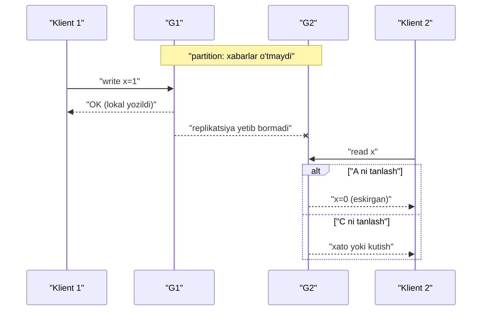
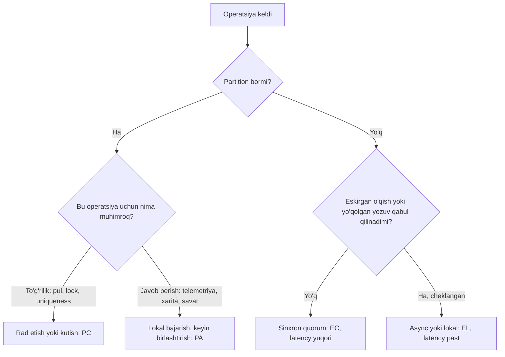

## Bu dars nima uchun kerak

CAP teoremasi - system design'dagi eng mashhur va eng noto'g'ri tushuniladigan g'oya. "C, A, P dan ikkitasini tanlang" degan iborani deyarli har bir intervyuda eshitasiz va u deyarli har doim noto'g'ri ishlatiladi. 31-darsda partition muqarrar ekanini, 33-darsda linearizability nima ekanini ko'rdik. Endi shu ikkisini birlashtirib, CAP aslida nimani isbotlaganini, nimani isbotlamaganini va kundalik dizayn qarorlari uchun undan ko'ra foydaliroq freymvork - PACELC'ni ko'ramiz.

Bu darsdan keyin siz:

- CAP'ning formal ta'rifini (Gilbert va Lynch, 2002) va undagi C, A, P ning aniq ma'nosini bilasiz;
- isbotning g'oyasini o'z so'zlaringiz bilan tushuntira olasiz;
- "2 dan 3" iborasi nega chalg'ituvchi ekanini va "CA tizim" nega deyarli ma'nosiz ekanini tushunasiz;
- PACELC bilan normal ish paytidagi latency va consistency trade-off'ini tahlil qila olasiz;
- real tizimlarni (Cassandra, DynamoDB, Spanner, PostgreSQL, MongoDB) to'g'ri tavsiflay olasiz va partition paytida nima qilish kerakligini loyihalay olasiz.

## CAP tarixi va formal ta'rifi

Eric Brewer bu g'oyani 1998 yil kuzida shakllantirgan, 1999 yilda nashr qilgan va 2000 yilda PODC konferensiyasida keynote sifatida taqdim etgan - hipoteza (conjecture) sifatida. 2002 yilda Seth Gilbert va Nancy Lynch uni ACM SIGACT News'da formallashtirib, isbotlashdi. Isbotlangan versiya juda tor:

- **C (Consistency)** - **linearizability** (33-dars), ular buni "atomic consistency" deb ataydi: har bir operatsiya so'rov va javob orasidagi bitta nuqtada, bitta markaziy server bajargandek ko'rinadi. Bu ACID'dagi "C" emas.
- **A (Availability)** - ishdan chiqmagan **har bir** tugunga kelgan har bir so'rov oxir-oqibat javob oladi (xato emas, haqiqiy javob). "Oxir-oqibat" - vaqt chegarasi yo'q.
- **P (Partition tolerance)** - tarmoq ixtiyoriy xabarlarni yo'qotishi mumkin, tugunlar guruhlarga bo'linib, bir-biri bilan aloqa qila olmasligi mumkin.

**Teorema:** asynchronous tarmoqda, xabarlar yo'qolishi mumkin bo'lsa, bitta read/write register uchun linearizability va availability'ni bir vaqtda kafolatlab bo'lmaydi.

### Isbot g'oyasi

Ikki tugun G1 va G2, ikkalasida `x = 0`. Ular orasida partition: hech qanday xabar o'tmaydi.

1. Klient G1 ga `x = 1` yozadi. A talabi bo'yicha G1 javob berishi shart, va u G2 bilan gaplasha olmaydi - demak lokal yozib, "OK" qaytaradi.
2. Shundan keyin boshqa klient G2 dan `x` ni o'qiydi. A talabi bo'yicha G2 javob berishi shart. U G1 dagi yozuv haqida bilmaydi va `0` qaytaradi.
3. Yozuv tugagandan keyin boshlangan o'qish eski qiymatni ko'rdi - linearizability buzildi.

Uchta yo'l bor: G2 javob bermaydi (A buziladi), G2 eski qiymat qaytaradi (C buziladi), yoki partition bo'lmaydi deb hisoblanadi (P ni rad etish). Uchinchisi real tarmoqda imkonsiz.

## "2 dan 3" nega noto'g'ri

### P - tanlov emas

Partition - tarmoq xossasi, siz uni "tanlamaysiz". 31-darsda ko'rdik: Microsoft data-markazlarida kuniga o'nlab link nosozligi, GitHub'da 43 soniyalik partition. Taqsimlangan tizim partition bo'lishini qabul qilishi shart. Demak haqiqiy savol: **partition paytida** C yoki A dan qaysi biri qurbon qilinadi?

"CA tizim" faqat bitta tugunli tizim yoki partition hech qachon bo'lmaydi degan shartga qurilgan tizim uchun ma'noli. Ikkinchi holatda partition bo'lganda tizim kafolatsiz xatti-harakat qiladi - bu "CA" emas, "aniqlanmagan".

### Tanlov faqat partition paytida

Brewer o'zining 2012 yildagi "CAP Twelve Years Later" maqolasida ta'kidlaydi: teorema faqat partition paytidagi ideal C va ideal A ni taqiqlaydi. Partition bo'lmaganda ikkalasiga ham ega bo'lish mumkin. Partition esa kamdan-kam: tizim vaqtining katta qismi normal rejimda o'tadi.

### Tanlov bitta tizim ichida ham har xil

Bitta tizim ba'zi operatsiyalarda C ni, ba'zilarida A ni tanlashi mumkin. Brewer'ning misoli: bankomat partition paytida kichik summani berishni davom ettiradi (A), lekin katta summani rad etadi (C). Har bir ma'lumot va operatsiya uchun alohida qaror.

### C va A ikkilik emas

CAP'dagi A "har bir tirik tugun javob beradi" degan juda qattiq ta'rif. Real dunyoda "availability" - SLA ichida javob bergan so'rovlar ulushi (65-dars). Linearizability'ni tanlagan tizim ham partition paytida **ko'pchilik tomonda** to'liq ishlaydi va faqat minority tomondagi klientlar ta'sirlanadi. Bu CAP ma'nosida "mavjud emas", lekin amalda juda yuqori mavjudlikka ega bo'lishi mumkin: Brewer 2017 yilda Spanner (texnik jihatdan CP) uchun beshta to'qqizdan yaxshiroq mavjudlikni keltiradi (pastda).

### Partition aslida timeout

Brewer'ning yana bir muhim fikri: partition - bu aslida timeout. Tugun boshqasiga xabar yubordi va javob kelmadi. Endi u qaror qiladi: operatsiyani bekor qilish (A ni yo'qotish) yoki baribir davom etish (C ni xavf ostiga qo'yish). Cheksiz qayta urinish - bu C ni tanlash. Shuning uchun CAP tanlovi aslida 31-darsdagi timeout qarori bilan bir xil.

## Kleppmann tanqidi: "CP" va "AP" yorliqlari

Kleppmann 2015 yilda "Please stop calling databases CP or AP" maqolasida va "A Critique of the CAP Theorem" ishida shunday dalillar keltiradi:

- **Ko'p real tizim na CP, na AP.** Async replikatsiyali single-leader baza (masalan standart PostgreSQL yoki MySQL): minority tomonda yozish mumkin emas - CAP-available emas; follower'dan o'qish eskirgan - linearizable emas. Ya'ni ikkalasi ham emas.
- **Konfiguratsiyaga bog'liq.** Cassandra yoki Riak R=W=1 bilan CAP-available, lekin QUORUM bilan minority tomonda mavjud emas - va baribir linearizable emas (LWW, sloppy quorum).
- **ZooKeeper** standart holatda o'qishlarni linearizable bajarmaydi (sync'siz), minority tomonda yozish mumkin emas. Kleppmann xulosasi: standart sozlamada ZooKeeper na CP, na AP - "aslida faqat P", garchi u kuchli kafolatlar bersa ham.
- **CAP faqat bitta register va faqat partition haqida**: tranzaksiyalar, boshqa nosozliklar (crash, disk) va latency'ni qamramaydi.

Tavsiya: tizimni bitta harf bilan emas, aniq kafolatlar bilan tavsiflang: "linearizable yozuvlar, follower'dan o'qishda 1 soniyagacha eskirish, partition'da minority tomon yozishni rad etadi".

## PACELC

Daniel Abadi 2010-yil aprelda "Problems with CAP, and Yahoo's little known NoSQL system" blog postida taklif qilgan, 2012 yilda IEEE Computer jurnalida ("Consistency Tradeoffs in Modern Distributed Database System Design") nashr qilgan:

> Agar **P**artition bo'lsa - **A**vailability va **C**onsistency orasida tanlov; **E**lse (aks holda, normal ishda) - **L**atency va **C**onsistency orasida tanlov.

Asosiy g'oya: CAP faqat kamdan-kam bo'ladigan partition haqida gapiradi, lekin tizim dizaynini ko'proq **har kungi** trade-off belgilaydi. Replikatsiya bo'lgan har qanday tizimda, partition bo'lmasa ham, yozuvni boshqa replikalarga sinxron yetkazish (C) latency'ni oshiradi; asinxron yetkazish (L) esa eskirgan o'qishga yo'l ochadi.

Abadi'ning tasnifi (2012, standart konfiguratsiyalar uchun):

| Tizim | Partition'da | Normal ishda | Izoh |
|---|---|---|---|
| Dynamo, Cassandra, Riak | PA | EL | Har bir tugun lokal javob beradi, async replikatsiya |
| BigTable, HBase | PC | EC | Har bir qism bitta server tomonidan boshqariladi |
| VoltDB/H-Store, Megastore | PC | EC | To'liq ACID |
| MongoDB | PA | EC | Abadi tasnifi: normal ishda primary orqali |
| PNUTS (Yahoo) | PC | EL | Partition'da bazaviy consistency'ni pasaytirmaydi |

Bu jadval 2012 yildagi standart sozlamalarni aks ettiradi. Zamonaviy tizimlarda ko'p narsa sozlanadi (MongoDB write/read concern, Cassandra consistency level). Shuning uchun PACELC'ni "tizim yorlig'i" emas, **har bir operatsiya uchun savol** sifatida ishlating.

## PACELC hisob-kitobda

Masala sharti: uchta replika - Toshkent, Olmaota, Frankfurt. Hisob uchun RTT: Toshkent-Olmaota 25 ms, Toshkent-Frankfurt 80 ms (bu masala shartlari; real loyihada RTT o'lchab olinadi). Yozuv Toshkentdagi liderga keladi. Replika ichidagi lokal commit 1-2 ms.

| Yozuv strategiyasi | Normal ishda yozish latency | Lider o'lsa yo'qolishi mumkin bo'lgan ma'lumot | PACELC |
|---|---|---|---|
| Faqat lokal commit, async replikatsiya | 1-2 ms | Replikatsiya lag'i ichidagi yozuvlar | EL |
| Majority (2 dan 3): eng yaqin replika tasdiqlaydi | 25 ms + commit | Yo'q | EC |
| Barcha replikalar tasdiqlashi | 80 ms + commit (eng uzoq) | Yo'q, lekin bitta replika sekinlashsa hamma sekinlashadi | EC, past availability |

Majority quorum'ning qiziq xossasi: latency eng **sekin** emas, eng yaqin quorum a'zosi bilan belgilanadi. 3 dan 2 bo'lsa - lider + eng yaqin replika. Shuning uchun Raft va Paxos asosidagi tizimlar replikalarni ikki yaqin va bitta uzoq qilib joylashtirishni yaxshi ko'radi.

O'qish uchun ham shunday: linearizable o'qish liderdan (yoki lider lease bilan) - lider Frankfurtdagi klientdan uzoqda bo'lsa, 80 ms; lokal replikadan - 1 ms atrofida, lekin eskirgan bo'lishi mumkin.

## Partition paytida: partition mode va tiklanish

Brewer 2012 yilgi maqolasida partition'ni "uch bosqichli" boshqarishni taklif qiladi:

1. **Partition'ni aniqlash.** Timeout orqali (31-dars). Turli tugunlar partition bor-yo'qligi haqida turlicha fikrda bo'lishi mumkin.
2. **Partition rejimiga o'tish.** Ba'zi operatsiyalar cheklanadi (masalan katta to'lovlar), ba'zilari davom etadi, lekin keyin tekshirish uchun yoziladi.
3. **Tiklanish.** Aloqa qaytgach, ikki tomon holati birlashtiriladi va partition paytidagi xatolar **kompensatsiya** qilinadi. Brewer bu yerda version vector va CRDT (40-dars) hamda kompensatsiya qiluvchi harakatlarni (masalan aviakompaniyada overbooking'dan keyin yo'lovchiga kompensatsiya) tilga oladi.

Bu yondashuv "C yoki A" ikkilik tanlovidan ko'ra amaliyroq: A ni tanlab, oqibatlarini biznes darajasida boshqarish.

## Real tizimlardan misollar

- **Cassandra** - har bir operatsiya uchun consistency level: ONE, TWO, THREE, QUORUM, ALL, LOCAL_ONE, LOCAL_QUORUM, EACH_QUORUM va yozuvlar uchun ANY. QUORUM - n/2 + 1 replika (RF=3 da 2 ta). Yozuv baribir barcha replikalarga yuboriladi, level faqat nechta javob kutilishini belgilaydi. Konfliktlar ustun darajasida LWW vaqt belgisi bilan hal qilinadi, shuning uchun hujjat NTP ishlatishni tavsiya qiladi (32-dars). Ya'ni bitta klasterda ham PA/EL (ONE), ham kuchliroq (QUORUM) operatsiyalar bo'ladi.
- **DynamoDB global tables** - standart MREC rejimi: replikatsiya regionlar orasida asinxron, odatda bir soniya ichida (EL). MRSC rejimi: yozuv qaytishidan oldin boshqa regionga sinxron replikatsiya qilinadi va istalgan replikadan strongly consistent o'qish eng yangi versiyani qaytaradi (EC).
- **Google Spanner** - Brewer 2017 yilda yozganidek, texnik jihatdan CP: partition paytida consistency'ni tanlaydi. Lekin ichki mavjudlik beshta to'qqizdan yaxshi va Spanner incident'larining 8% dan kamrog'i (7.6%) tarmoq bilan bog'liq, shu jumladan konfiguratsiya xatolari. Sabab - Google'ning xususiy global tarmog'i: har bir data-markaz odatda kamida uchta mustaqil optik tola orqali ulangan. Brewer shuning uchun Spanner'ni "amalda CA" deyish mumkin, chunki foydalanuvchilar uning uzilishlarini amalda hisobga olmaydi, deb yozadi. Saboq: CAP chegarasini aylanib o'tib bo'lmaydi, lekin partition ehtimolini infratuzilma bilan keskin kamaytirish mumkin.
- **PostgreSQL** - standart async replikatsiya: normal ishda EL (commit lokal), failover paytida oxirgi yozuvlar yo'qolishi mumkin. `synchronous_commit` va `synchronous_standby_names` bilan EC ga o'tadi, lekin sinxron standby yo'q bo'lsa, primary commit'larni kutib qoladi.

## Tizimni tavsiflash uchun savollar ro'yxati

"CP" yoki "AP" yorlig'i o'rniga, baza yoki servisni tanlashda (yoki o'z servisingizni hujjatlashtirishda) quyidagi savollarga javob yozing. Bu Kleppmann tavsiyasining amaliy shakli:

1. **Yozuv qachon "muvaffaqiyatli" deb qaytariladi?** Lokal diskka yozilgandami, bitta replikaga yetgandami, majority'ga yetgandami? Bu PACELC'ning E qismi.
2. **O'qish qayerdan bajariladi?** Liderdanmi, istalgan replikadanmi? Eskirish chegarasi bormi (masalan, "lag 5 soniyadan oshsa replika o'qishdan chiqariladi")?
3. **Partition'da minority tomon nima qiladi?** Yozuvni rad etadimi, qabul qilib keyin birlashtiradimi, eskirgan o'qishga ruxsat beradimi?
4. **Lider o'zgarganda tasdiqlangan yozuv yo'qolishi mumkinmi?** Async replikatsiyada - ha, oxirgi bir necha soniya. Buni RPO sifatida yozing (69-dars).
5. **Konfliktlar qanday hal qilinadi?** LWW, version vector va siblings, CRDT yoki konfliktning o'zi imkonsiz (single leader)?
6. **Bu xatti-harakat sozlanadimi va har bir operatsiya uchun alohidami?** Cassandra consistency level, DynamoDB `ConsistentRead`, PostgreSQL `synchronous_commit` kabi.
7. **Bu kafolatlar mustaqil test qilinganmi?** Jepsen kabi partition va crash in'ektsiyasi bilan.

Bu yetti savolga javob - tizimning haqiqiy "consistency pasporti". Ikki harfli yorliq esa ularning hech biriga javob bermaydi.

## iQuariX kontekstida

Masala sharti (iQuariX'ning real arxitekturasi emas): tizim ikki data-markazda (masalan, Toshkentdagi ikkita mustaqil joy) ishlaydi va ular orasida partition bo'ldi. Har bir funksiya uchun PACELC qarori:

**Telemetriya qabul qilish (PA/EL).** Trekerdan kelgan nuqtani rad etish - ma'lumot yo'qotish (treker buferi cheklangan). Har ikki tomon lokal navbatga yozadi, partition tugagach birlashtiriladi. Nuqtalar `(device_id, device_time, seq)` bo'yicha idempotent, shuning uchun birlashtirish oddiy - konflikt deyarli yo'q.

**Xaritadagi oxirgi joylashuv (PA/EL).** Har tomon o'z bilganini ko'rsatadi. Birlashtirishda `device_time` kattasi yutadi - bu yerda LWW xavfsiz, chunki vaqt bitta manbadan (trekerning GPS'i) keladi, turli server soatlaridan emas.

**Dvigatelni bloklash komandasi (PC/EC).** Minority tomondagi dispetcher komanda yubora olmasligi kerak: ikki tomondan qarama-qarshi komandalar (blokla va blokdan chiqar) kelishi xavfli. Bu operatsiya consensus asosidagi saqlashda va UI "hozir mavjud emas" deb ko'rsatadi.

**Yoqilg'i kartasi limiti (PC yoki cheklangan PA).** Brewer'ning bankomat misoli kabi: partition paytida har tomon limitning yarmigacha ruxsat beradi (escrow), tiklanishda hisob-kitob qilinadi. Bu A ni saqlab, xavfni chegaralaydi.

**Hisobotlar (PA/EL).** Partition paytida "ma'lumot to'liq bo'lmasligi mumkin" belgisi bilan ko'rsatiladi.

Normal ishda (E qismi): telemetriya yozuvi async replikatsiya bilan (L), haydovchi tayinlash va komandalar sinxron quorum bilan (C). Bu bitta tizim ichida turli operatsiyalar uchun turli tanlov.

## Ko'p uchraydigan xatolar

1. **"Biz CA tizim qurdik".** Bir nechta tugun bo'lsa, partition bo'ladi. CA - bu "partition'da nima bo'lishini o'ylamadik" degani.
2. **CAP'dagi C ni ACID'dagi C bilan aralashtirish.** CAP'da C - linearizability.
3. **Tizimga bitta yorliq yopishtirish.** "MongoDB - CP", "Cassandra - AP" - konfiguratsiya va operatsiyaga bog'liq.
4. **Faqat partition haqida o'ylash.** Kundalik trade-off - latency va consistency (PACELC'ning E qismi). Partition kamdan-kam hodisa, latency esa har so'rovda to'lanadi.
5. **Partition'dan keyingi tiklanishni rejalashtirmaslik.** A ni tanlasangiz, konfliktlarni birlashtirish va kompensatsiya mexanizmi kerak.
6. **CAP-availability'ni SLA availability bilan aralashtirish.** CP tizim ham amalda juda yuqori mavjudlikka ega bo'lishi mumkin (Spanner - beshta to'qqizdan yaxshi).
7. **Quorum replikalarini noto'g'ri joylashtirish.** Uchta replikani uchta uzoq regionga qo'yish har yozuvni eng uzoq ikkinchi replika bilan sekinlashtiradi.

## Xulosa

- CAP (Gilbert va Lynch, 2002) aniq va tor: asynchronous tarmoqda partition bo'lganda bitta register uchun linearizability va har bir tugunning javob berishini birga kafolatlab bo'lmaydi.
- P - tanlov emas. Haqiqiy savol: partition paytida har bir operatsiya uchun C mi yoki A mi.
- Ko'p real tizimlar na CP, na AP; ularni aniq kafolatlar bilan tavsiflang.
- PACELC normal ishdagi latency va consistency trade-off'ini qo'shadi - bu kundalik dizaynda muhimroq.
- Majority quorum latency'si eng yaqin quorum a'zosiga bog'liq; replikalarni joylashtirish latency'ni belgilaydi.
- Partition'ni boshqarish: aniqlash, partition rejimi, tiklanish va kompensatsiya.
- Spanner misoli: CAP chegarasi qoladi, lekin partition ehtimolini infratuzilma bilan kamaytirish mumkin.

## Amaliy topshiriq

Masala sharti: iQuariX Toshkent (asosiy) va Almati (ikkinchi) regionlarida ishlay boshlaydi, chunki Qozog'istondagi mijozlar uchun past latency kerak. Regionlar orasidagi RTT - 30 ms.

1. Quyidagi operatsiyalar uchun PACELC jadvalini to'ldiring (partition'da PA yoki PC, normal ishda EL yoki EC): telemetriya qabul qilish, oxirgi joylashuvni o'qish, geozona yaratish, haydovchi tayinlash, dvigatelni bloklash komandasi, oylik hisobot. Har biri uchun bir gap asos.
2. EC tanlagan operatsiyalar uchun yozish latency'sini hisoblang: quorum qanday tuzilgan (nechta replika, qayerda), lider qayerda?
3. 10 daqiqalik partition stsenariysini yozing: har bir tomonda foydalanuvchi nimani ko'radi, qaysi operatsiyalar rad etiladi?
4. Partition tugagandan keyingi tiklanish rejasini yozing: qaysi ma'lumotlar qanday birlashtiriladi, qayerda konflikt bo'lishi mumkin va u qanday hal qilinadi?
5. Qaysi operatsiya uchun Brewer'ning "bankomat" uslubidagi cheklangan rejim (escrow, limit) mos keladi? Raqamlar bilan loyihalang.

Yaxshi javobda bo'lishi kerak bo'lgan narsalar:

- har bir operatsiyaga alohida qaror, tizimga bitta yorliq emas;
- EC latency hisobi replika joylashuvi va RTT bilan;
- partition'da minority tomon xatti-harakati aniq tasvirlangan;
- tiklanishda idempotent birlashtirish va haqiqiy konfliktlar ajratilgan;
- kamida bitta operatsiya uchun kompensatsiya yoki limit mexanizmi.

Javobni pastdagi maydonga yozib, chatga yuboring.

## Manbalar

- Seth Gilbert, Nancy Lynch. [Brewer's Conjecture and the Feasibility of Consistent, Available, Partition-Tolerant Web Services](https://groups.csail.mit.edu/tds/papers/Gilbert/Brewer6.pdf), ACM SIGACT News, 2002 - atomic consistency va availability ta'riflari, 1-teorema (formal isbot). Mualliflarning keyingi sharhi: [Perspectives on the CAP Theorem](https://groups.csail.mit.edu/tds/papers/Gilbert/Brewer2.pdf), 2012.
- Daniel Abadi. [Problems with CAP, and Yahoo's little known NoSQL system](https://dbmsmusings.blogspot.com/2010/04/problems-with-cap-and-yahoos-little.html), 2010 - PACELC'ning birinchi bayoni.
- Eric Brewer. [CAP Twelve Years Later: How the "Rules" Have Changed](https://www.infoq.com/articles/cap-twelve-years-later-how-the-rules-have-changed/), IEEE Computer, 2012 - "2 dan 3" tanqidi, partition rejimi va tiklanish.
- Daniel Abadi. [Consistency Tradeoffs in Modern Distributed Database System Design](https://www.cs.umd.edu/~abadi/papers/abadi-pacelc.pdf), IEEE Computer, 2012 - PACELC va tizimlar tasnifi.
- Martin Kleppmann. [Please stop calling databases CP or AP](https://martin.kleppmann.com/2015/05/11/please-stop-calling-databases-cp-or-ap.html), 2015 va [A Critique of the CAP Theorem](https://www.cl.cam.ac.uk/research/dtg/www/files/publications/public/mk428/cap-critique.pdf).
- Eric Brewer. [Spanner, TrueTime and the CAP Theorem](https://static.googleusercontent.com/media/research.google.com/en//pubs/archive/45855.pdf), Google, 2017 - "texnik jihatdan CP, amalda CA", incident statistikasi.
- Apache Cassandra. [Dynamo architecture: tunable consistency](https://cassandra.apache.org/doc/latest/cassandra/architecture/dynamo.html) - consistency level'lar va LWW.
- AWS. [DynamoDB read consistency va global tables (MREC, MRSC)](https://docs.aws.amazon.com/amazondynamodb/latest/developerguide/HowItWorks.ReadConsistency.html).
- Martin Kleppmann, Chris Riccomini. [Designing Data-Intensive Applications, 2-nashr](https://www.oreilly.com/library/view/designing-data-intensive/9781098119058/), O'Reilly, 2026. 10-bob, "The Cost of Linearizability" va CAP bo'limi.
