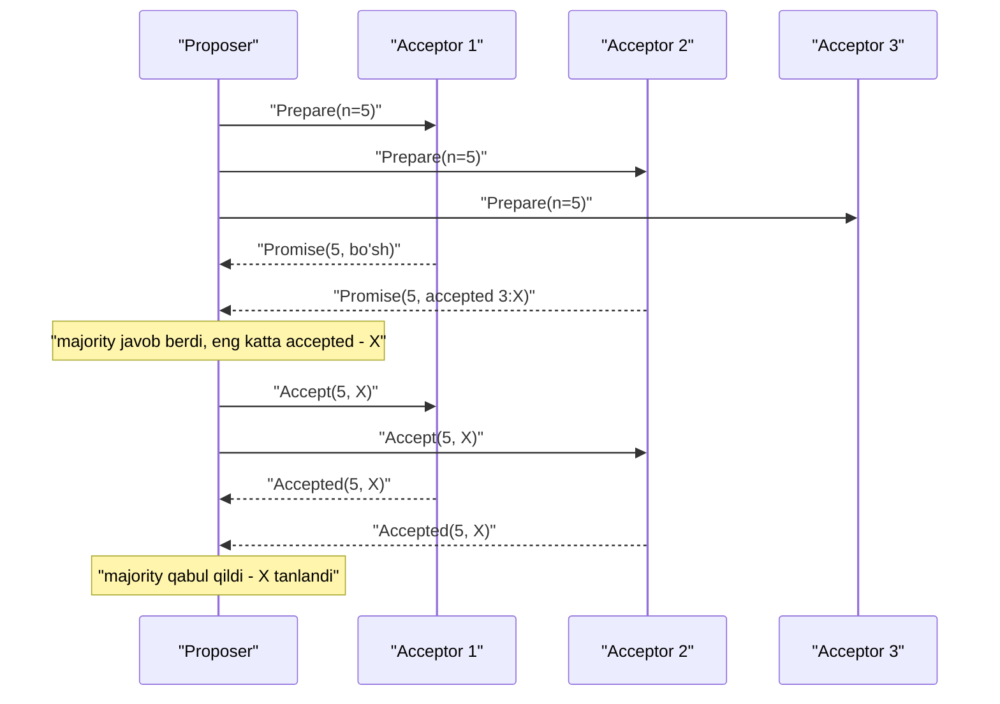

## Bu dars nima uchun kerak

Oldingi darslarda bir necha marta "bu yerda consensus kerak" deb o'tib ketdik: failover'da kim yangi lider bo'ladi (26-dars), lock kimda (38-dars), linearizable yozuv qanday ta'minlanadi (33-dars), partition'da qaysi tomon ishlashda davom etadi (34-dars). Bu savollarning hammasi bitta fundamental masalaga keladi: **bir nechta tugun, ba'zilari qulashi va tarmoq ishonchsiz bo'lishi mumkin bo'lgan sharoitda, bitta qiymat ustida qanday kelishib olish mumkin?**

Bu dars uch qismdan iborat: consensus masalasining aniq ta'rifi va u nega shuncha ko'p joyda kerak; FLP natijasi - nima uchun bu masala nazariy jihatdan "yechib bo'lmaydigan" va amaliyotda qanday aylanib o'tiladi; Paxos - birinchi amaliy algoritm va uning ichki mantig'i. 36-darsda Raft'ni batafsil ko'ramiz; Paxos g'oyasini tushunish Raft'ni chuqurroq tushunishga yordam beradi.

Bu darsdan keyin siz:

- consensus xossalarini (agreement, validity, termination) aniq ayta olasiz;
- leader election, atomic commit, total order broadcast, linearizable compare-and-set nima uchun consensus bilan ekvivalent yoki unga tayanishini tushunasiz;
- FLP teoremasi nimani isbotlagan va nimani isbotlamaganini bilasiz;
- nega crash nosozligiga chidash uchun 2f + 1 tugun kerakligini hisoblay olasiz;
- single-decree Paxos'ning ikki fazasini qadam-baqadam bajara olasiz va safety nega saqlanishini tushuntira olasiz;
- Multi-Paxos va real tizimlarda (Chubby, Spanner) Paxos qanday ishlatilishini bilasiz.

## Consensus masalasi

N ta jarayon bor, har biri qandaydir qiymat taklif qiladi. Ular bitta qiymatga **qaror** qilishi kerak. Rasmiy xossalar:

- **Agreement (kelishuv)** - ikki to'g'ri jarayon turli qiymatga qaror qilmaydi.
- **Validity (asoslilik)** - qaror qilingan qiymat qaysidir jarayon tomonidan taklif qilingan bo'lishi kerak. Bu "doim 0 deb qaror qil" kabi trivial yechimni taqiqlaydi.
- **Integrity** - har bir jarayon ko'pi bilan bir marta qaror qiladi, qaror o'zgarmaydi.
- **Termination (yakunlanish)** - qulamagan har bir jarayon oxir-oqibat qaror qiladi.

Agreement, validity va integrity - **safety** xossalari (31-dars): "yomon narsa bo'lmaydi". Termination - **liveness**: "yaxshi narsa oxir-oqibat bo'ladi". Bu ajratish FLP va Paxos'ni tushunish uchun kalit.

### Nega consensus hamma joyda

Ko'p amaliy masalalar consensus'ga keltiriladi yoki undan quriladi:

- **Leader election** - "kim lider?" degan savolga bitta javob. Ikki lider - split brain.
- **Atomic commit** - taqsimlangan tranzaksiyada hamma commit qiladimi yoki hamma abort (37-dars). Bu consensus'ning bir varianti, lekin qo'shimcha cheklov bilan: biror ishtirokchi "yo'q" desa, natija albatta abort.
- **Total order broadcast (atomic broadcast)** - barcha tugunlarga xabarlarni bir xil tartibda yetkazish. Kleppmann DDIA'da ko'rsatganidek, bu consensus bilan ekvivalent: har bir log pozitsiyasi uchun "bu yerda qaysi xabar turadi" degan consensus instance. Replicated log (Raft, Kafka KRaft, etcd) aynan shu.
- **Linearizable compare-and-set** - "agar qiymat X bo'lsa, Y ga o'zgartir" operatsiyasi ham consensus bilan ekvivalent.
- **Uniqueness constraint** - ikki kishi bir xil username'ni bir vaqtda olmasligi.

**State machine replication** g'oyasi: agar barcha replikalar bir xil deterministik buyruqlarni bir xil tartibda bajarsa, ular bir xil holatga keladi. Tartibni consensus beradi. Shuning uchun consensus - taqsimlangan tizimlarning "poydevor" algoritmi.

## Kvorum arifmetikasi: nega 2f + 1

Crash nosozligida (Byzantine emas) f ta tugun qulashiga chidash uchun N ≥ 2f + 1 tugun kerak. Sabab - **kvorumlar kesishishi**.

Qaror ko'pchilik (majority) tasdiqlaganda qabul qilinadi: Q = floor(N/2) + 1. Har qanday ikki majority kamida bitta umumiy tugunga ega, chunki Q + Q > N. Bu umumiy tugun avvalgi qarorni "eslab qoladi" va ziddiyatli qaror qabul qilinishiga yo'l qo'ymaydi.

Hisob:

| N | Kvorum Q | Chidaydigan nosozlik f | Izoh |
|---|---|---|---|
| 1 | 1 | 0 | Hech qanday tolerance yo'q |
| 2 | 2 | 0 | Bittasi o'lsa - to'xtaydi, 1 dan yaxshi emas |
| 3 | 2 | 1 | Eng keng tarqalgan minimal |
| 4 | 3 | 1 | 3 dan yaxshi emas, lekin yozuvda bitta ko'proq tasdiq kerak |
| 5 | 3 | 2 | Bitta texnik xizmat + bitta kutilmagan nosozlik |
| 7 | 4 | 3 | Kamdan-kam; har yozuvda ko'proq tarmoq trafiki |

Juft son foydasiz: 4 tugun 3 tugundek faqat bitta nosozlikka chidaydi, lekin kvorum kattaroq. Shuning uchun etcd, ZooKeeper, Consul klasterlari odatda 3 yoki 5 tugundan iborat.

Byzantine nosozlikda (tugun yolg'on gapirishi mumkin) chegara N ≥ 3f + 1 (31-dars). Bu darsda faqat crash-recovery modelini ko'ramiz.

Network partition'da: agar 5 tugun 3 + 2 ga bo'linsa, 3 lik tomon kvorum hosil qiladi va ishlashda davom etadi; 2 lik tomon yangi qaror qabul qila olmaydi. Bu 34-darsdagi "minority tomonda mavjud emas" ning aniq mexanizmi.

## FLP natijasi

1985 yilda Fischer, Lynch va Paterson Journal of the ACM'da (32-jild, 2-son) "Impossibility of Distributed Consensus with One Faulty Process" maqolasini nashr qilishdi. Teorema:

> To'liq asynchronous tizimda, hatto bitta jarayon crash bo'lishi mumkin bo'lsa ham, har qanday ijroda agreement va termination'ni kafolatlaydigan **deterministik** consensus algoritmi mavjud emas.

### Model taxminlari

- **Asynchronous:** jarayonlar tezligi va xabar kechikishi chegaralanmagan.
- **Soat yo'q, timeout yo'q:** jarayon boshqasining o'lganini yoki sekinligini ajrata olmaydi (31-darsdagi asosiy muammo).
- **Xabarlar ishonchli:** har bir xabar oxir-oqibat aniq bir marta yetkaziladi, faqat ixtiyoriy kechikish bilan. E'tibor bering - bu juda **saxiy** model. Hatto xabar yo'qolmasa ham imkonsiz.
- **Nosozlik:** ko'pi bilan bitta jarayon to'xtaydi (crash).

### Isbot g'oyasi

Asosiy tushuncha - **bivalent konfiguratsiya**: tizim holati, undan hali ham 0 ga ham, 1 ga ham qaror qilish mumkin. **Univalent** - faqat bitta natija mumkin.

1. Boshlang'ich holatlar orasida kamida bittasi bivalent ekanini ko'rsatish mumkin (aks holda bitta jarayonning kiritish qiymatini o'zgartirish natijani o'zgartirmasligi kerak, lekin u jarayon qulasa, boshqalar farqni bilmaydi).
2. Har qanday bivalent holatdan, xabarlarni yetkazish tartibini "dushman" tanlab, yana bivalent holatga o'tish mumkin. Kalit: qaror qiluvchi bitta qadam bitta jarayonga bog'liq bo'lsa, shu jarayonni "juda sekin" qilib qo'yish (asynchronous'da bu crash'dan farqlanmaydi) qolganlarni noaniq holatda ushlab turadi.
3. Demak cheksiz ijro mavjud, unda tizim doim bivalent qoladi va hech kim qaror qilmaydi.

### FLP nimani anglatadi va nimani anglatmaydi

- Bu **safety** imkonsiz degani emas. Agreement'ni har doim saqlash mumkin.
- Bu consensus "hech qachon" erishilmaydi degani emas. Imkonsiz narsa - **har bir** ijroda chegaralangan vaqtda yakunlanishni kafolatlash.
- Muammo patologik vaqt jadvallarida. Real tizimlarda ular kamdan-kam.

### FLP'ni amalda qanday aylanib o'tiladi

1. **Partial synchrony.** Dwork, Lynch va Stockmeyer (1988) ko'rsatdi: agar tizim oxir-oqibat yetarlicha uzoq synchronous bo'lib tursa, consensus yechiladi - crash uchun nosoz tugunlar n/2 dan kam bo'lsa. Paxos va Raft aynan shunday: safety har qanday sharoitda, liveness esa tarmoq "tinchlanganda".
2. **Failure detector va timeout.** Timeout real tizimda ishlatiladi, u ba'zan noto'g'ri bo'ladi, lekin algoritm safety'ni buzmaydi.
3. **Randomizatsiya.** Ben-Or protokoli ko'rsatganidek, tasodifiy tanlov bilan termination ehtimoli 1 ga yaqinlashadi. Raft'ning randomizatsiyalangan election timeout'i shu g'oyaning amaliy ko'rinishi.

Amaliy xulosa: har qanday consensus tizimi (etcd, ZooKeeper, Consul) noqulay tarmoq sharoitida **vaqtincha progress qilmay qolishi mumkin** - bu bug emas, FLP'ning oqibati. Muhimi, bunday paytda u noto'g'ri javob bermaydi.

## Paxos g'oyasi

Leslie Lamport Paxos'ni 1989 yilda yozgan va "The Part-Time Parliament" nomi bilan yuborgan; maqola Gretsiyadagi xayoliy Paxos orolidagi parlament hikoyasi shaklida bo'lgan, unda deputatlar zalga kirib-chiqib turadi. U faqat 1998 yilda ACM Transactions on Computer Systems'da chiqdi. Tushunish qiyin bo'lgani uchun Lamport 2001 yilda "Paxos Made Simple" yozdi, uning annotatsiyasi bitta gap: Paxos oddiy ingliz tilida bayon qilinsa, juda oddiy.

### Rollar

- **Proposer** - qiymat taklif qiladi.
- **Acceptor** - takliflarga ovoz beradi. Acceptor'lar kvorumi qarorni "eslab qoladi".
- **Learner** - qaysi qiymat tanlanganini bilib oladi.

Bitta jarayon bir nechta rolni bajarishi mumkin (odatda har bir server uchalasi).

### Taklif raqamlari

Har bir taklifning noyob raqami n bor, va raqamlar umumiy tartiblangan. Odatda `(round, serverId)` juftligi: round oshib boradi, teng bo'lsa server ID bo'yicha. Bu 32-darsdagi Lamport clock g'oyasining aynan o'zi.

### Acceptor holati (diskda saqlanadi)

- `promised_n` - va'da qilingan eng katta raqam;
- `accepted_n`, `accepted_v` - qabul qilingan eng katta raqamli taklif va uning qiymati.

Bu holat **diskka** yozilishi shart: acceptor qulab qayta tursa va va'dasini unutsa, safety buziladi (crash-recovery modeli).

### 1-faza: Prepare / Promise

1. Proposer yangi raqam n tanlaydi va acceptor'larga `Prepare(n)` yuboradi.
2. Acceptor, agar n > `promised_n` bo'lsa: `promised_n = n` qiladi, diskka yozadi va `Promise(n, accepted_n, accepted_v)` qaytaradi. Ya'ni "n dan kichik takliflarni endi qabul qilmayman, va mana men avval qabul qilgan narsa". Aks holda rad etadi (yoki javob bermaydi).

### 2-faza: Accept / Accepted

3. Proposer **majority**dan Promise olsa, qiymat v ni tanlaydi:
   - agar kamida bitta Promise'da `accepted_v` bo'lsa - **eng katta `accepted_n` ga ega** qiymatni olishi shart;
   - aks holda - o'z qiymatini.
4. Proposer `Accept(n, v)` yuboradi.
5. Acceptor, agar n ≥ `promised_n` bo'lsa: `accepted_n = n`, `accepted_v = v` qiladi, diskka yozadi va `Accepted(n, v)` qaytaradi.
6. Majority acceptor bitta (n, v) ni qabul qilsa - v **tanlandi** (chosen). Learner'lar buni bilib oladi.

### Nega bu xavfsiz

Asosiy invariant (Lamport'ning P2 shartlari): agar v qiymati n raqamli taklif bilan tanlangan bo'lsa, n dan katta raqamli **har bir** taklif ham v qiymatiga ega bo'ladi.

Intuitsiya: v tanlangan bo'lsa, majority M1 uni qabul qilgan. Keyinroq n' > n raqamli proposer 1-fazada majority M2 dan Promise oladi. M1 va M2 kesishadi - kamida bitta acceptor v ni qabul qilganini aytadi. Proposer eng katta `accepted_n` qiymatini olishga majbur, va (induksiya bo'yicha) bu v. Shuning uchun yangi proposer o'z qiymatini "sotib kirita" olmaydi - u allaqachon tanlangan qiymatni davom ettiradi.

Diagrammadagi misolda proposer o'z qiymati Y ni taklif qilmoqchi edi, lekin A2 avval X ni qabul qilganini aytdi. Proposer X ni davom ettirdi. Ehtimol X allaqachon tanlangan (A2 va boshqa birov qabul qilgan) - proposer buni bilmaydi, lekin ehtiyot uchun X ni tanlaydi.

### Liveness muammosi: duelli proposer'lar

Ikki proposer navbatma-navbat bir-biriga xalaqit berishi mumkin:

1. P1 `Prepare(1)` - majority va'da berdi.
2. P2 `Prepare(2)` - majority va'da berdi (endi 1 raqamli Accept rad etiladi).
3. P1 `Accept(1, ...)` - rad etildi. P1 `Prepare(3)`.
4. P2 `Accept(2, ...)` - rad etildi. P2 `Prepare(4)`.
5. ... cheksiz.

Safety buzilmaydi - hech narsa tanlanmaydi, lekin progress ham yo'q. Bu aynan FLP'ning amaliy ko'rinishi. Lamport'ning yechimi: **bitta ajratilgan proposer (lider)** saylash. Lider saylovining o'zi asynchronous tizimda deterministik ishonchli bo'la olmaydi, shuning uchun timeout yoki tasodifiylik ishlatiladi - lekin safety lider saylovining to'g'riligiga bog'liq emas. Ikki "lider" bo'lsa ham, eng yomoni - progress sekinlashadi.

## Multi-Paxos va replicated log

Single-decree Paxos bitta qiymat ustida kelishadi. Amaliy tizimga ketma-ket buyruqlar logi kerak: 1-slot, 2-slot, 3-slot va h.k., har biri uchun alohida Paxos instance.

Optimallashtirish (Lamport "Paxos Made Simple"da ham tasvirlaydi): barqaror lider **1-fazani bir marta**, barcha kelajak slotlar uchun bajaradi. Shundan keyin har bir yangi buyruq faqat 2-faza - bitta round-trip majority'ga. Lider o'zgarganda yangi lider 1-fazani qayta bajaradi va bo'sh qolgan slotlarni no-op bilan to'ldiradi.

| Jihat | Single-decree Paxos | Multi-Paxos | Raft (36-dars) |
|---|---|---|---|
| Nima ustida kelishadi | Bitta qiymat | Buyruqlar logi | Buyruqlar logi |
| Normal ishda round-trip | 2 (prepare + accept) | 1 (faqat accept) | 1 (AppendEntries) |
| Lider | Shart emas, liveness uchun foydali | Amalda bor | Majburiy, kuchli lider |
| Log bo'shliqlari | Yo'q | Bo'lishi mumkin, no-op bilan to'ldiriladi | Yo'q, log ketma-ket |
| Spetsifikatsiya to'liqligi | To'liq | Ko'p detallar ochiq qolgan | To'liq, shu jumladan membership |
| Tushunish | O'rtacha | Qiyin | Maqsadli ravishda oson |

## Paxos amalda

Google'ning "Paxos Made Live" maqolasi (Chandra, Griesemer, Redstone, PODC 2007) Chubby uchun Paxos'ni production'da qurish tajribasini tasvirlaydi va nazariya bilan amaliyot orasidagi bo'shliqni ko'rsatadi:

- **Disk buzilishi.** Acceptor diskidagi holat yo'qolsa, u avvalgi va'dalarini buzadi. Ular checksum va maxsus marker ishlatishgan; diskni yo'qotgan replika to'liq tiklanguncha ovoz bermaydigan a'zo sifatida qatnashadi.
- **Master lease.** Har bir o'qish uchun Paxos instance o'tkazmaslik uchun lider lease oladi va o'qishlarni lokal bajaradi. Lider soat drift'ini hisobga olib, replikalardan qisqaroq timeout ishlatadi (32 va 38-darslar).
- **Epoch raqamlari.** Liderlik almashganda o'zgaradigan global raqam; operatsiyalar shu raqamga shartlanadi - bu fencing token'ning bir shakli (38-dars).
- **Snapshot.** Log cheksiz o'smasligi uchun snapshot va log kesish.
- **Group membership.** Klaster a'zolarini o'zgartirish adabiyotda to'liq ishlab chiqilmagan, ular o'zlari to'ldirishgan.
- **Test.** Takrorlanadigan, seed asosidagi tasodifiy testlar: crash, partition, disk buzilishi in'ektsiyasi.

Paxos ishlatadigan tizimlar (Wikipedia'dagi Paxos maqolasi ro'yxati bo'yicha): Google Chubby (OSDI 2006, Mike Burrows - Bigtable undan foydalanadi), Spanner va Megastore ichki replikatsiya uchun; Apache Cassandra'ning lightweight transactions (`IF NOT EXISTS`) Paxos asosida; Ceph monitorlari (qaysi OSD'lar ishlayotgani haqida kelishish uchun). Zamonaviy ochiq manbali tizimlarning ko'pchiligi esa Raft'ga o'tgan (etcd, Consul, CockroachDB, TiKV, Kafka KRaft) - sababi 36-darsda.

## iQuariX kontekstida

Quyidagi holatlar masala sharti sifatida berilgan (iQuariX'ning real arxitekturasi emas): consensus quyidagi joylarda paydo bo'ladi. Muhim tamoyil: **consensus'ni o'zingiz yozmang** - tayyor tizimni (etcd, PostgreSQL + Patroni, Kafka KRaft) ishlating, lekin uning qaysi kafolatni berishini tushuning.

**1. PostgreSQL failover.** Primary qulasa, qaysi replika yangi primary bo'ladi? Agar ikki replika "men primary" desa - split brain va ma'lumot ziddiyati. Patroni kabi vositalar bu qarorni etcd yoki Consul'dagi consensus orqali qabul qiladi: lider kaliti TTL bilan, faqat bitta tugun uni ushlab tura oladi.

**2. Ingest gateway'lar konfiguratsiyasi.** Qaysi treker qaysi gateway'ga biriktirilgan, qaysi mijoz qaysi shard'da - kichik, lekin muhim metadata. etcd 3 tugunda: bitta tugun texnik xizmatda bo'lsa ham ishlaydi.

**3. Kvorum hajmini tanlash.** Bitta data-markazda 3 tugunli etcd - bitta nosozlikka chidaydi. Agar texnik xizmat paytida (bitta tugun o'chirilgan) yana bittasi qulasa - klaster yozishni to'xtatadi. Agar bu qabul qilinmasa, 5 tugun. Ikki data-markaz bo'lsa: 2 + 1 joylashtirish - 2 tugunli joy qulasa, qolgan 1 tugun kvorum hosil qila olmaydi. Shuning uchun uchinchi joy (hatto kichik "tiebreaker" tugun) kerak. Hisob: 2 + 2 + 1 (5 tugun, uch joyda) - istalgan bitta joy qulasa, kamida 3 tugun qoladi.

**4. Nima uchun telemetriyaga consensus kerak emas.** Shart: oqim 10 000 nuqta/s. Har bir GPS nuqtasini consensus orqali o'tkazish - ortiqcha: 10 000 nuqta/s × (majority round-trip + fsync). Nuqtalar idempotent va tartib `device_time` bilan beriladi. Consensus faqat **qaror** kerak bo'lgan kichik metadata uchun.

## Ko'p uchraydigan xatolar

1. **Consensus'ni o'zi yozish.** "Paxos Made Live" ko'rsatganidek, hatto Google muhandislari uchun ham nazariyadan production'gacha masofa katta. Tayyor, Jepsen bilan tekshirilgan tizim ishlating.
2. **Juft sonli klaster.** 4 tugun 3 tugundan ko'p nosozlikka chidamaydi, lekin sekinroq.
3. **FLP'ni "consensus imkonsiz" deb talqin qilish.** Imkonsiz - har doim chegaralangan vaqtda yakunlanish kafolati. Safety saqlanadi.
4. **Acceptor holatini diskka yozmaslik yoki fsync'ni o'chirish.** Crash'dan keyin va'da unutiladi va safety buziladi.
5. **Ikki data-markazga 2 + 2 yoki 2 + 1 joylashtirish.** Bitta joy qulasa kvorum yo'qoladi. Uchinchi joy kerak.
6. **Hamma narsani consensus orqali o'tkazish.** Yuqori throughput ma'lumot uchun consensus juda qimmat; faqat metadata va qarorlar uchun.
7. **Consensus progress qilmay qolishini bug deb o'ylash.** Partition yoki noqulay vaqt jadvalida bu kutilgan xatti-harakat.

## Xulosa

- Consensus: agreement, validity, integrity (safety) va termination (liveness).
- Leader election, total order broadcast, atomic commit, linearizable CAS - consensus bilan bog'liq yoki ekvivalent. State machine replication consensus ustiga quriladi.
- Crash nosozligida f ga chidash uchun 2f + 1 tugun: ikki majority doim kesishadi.
- FLP (1985): asynchronous tizimda bitta crash bilan ham deterministik algoritm har doim yakunlanishni kafolatlay olmaydi. Amalda partial synchrony, timeout va randomizatsiya bilan aylanib o'tiladi; safety saqlanadi.
- Paxos: 1-faza (prepare/promise) avvalgi qarorlarni topadi, 2-faza (accept) qiymatni majority'ga yozadi. Proposer eng katta raqamli qabul qilingan qiymatni davom ettirishga majbur.
- Duelli proposer'lar liveness'ni buzadi; yechim - lider. Multi-Paxos barqaror liderda har buyruq uchun bitta round-trip.
- Production'da asosiy murakkablik algoritmda emas, uning atrofida: disk, lease, snapshot, membership, test.

## Amaliy topshiriq

Masala sharti: iQuariX ikki data-markazda (DC-A va DC-B, Toshkentda) va bitta cloud regionida (Frankfurt) ishlaydi. Siz PostgreSQL failover va servis konfiguratsiyasi uchun etcd klasterini loyihalayapsiz. Shartlar: RTT DC-A va DC-B orasida 2 ms, har biridan Frankfurtgacha 75 ms.

1. Tugunlar soni va joylashuvini taklif qiling (3 yoki 5, qaysi joyda nechta). Har bir joy alohida qulasa nima bo'lishini jadval bilan ko'rsating.
2. Normal ishda yozish latency'sini hisoblang: lider qayerda bo'lishi kerak va majority qaysi tugunlardan tuziladi?
3. DC-A va DC-B orasidagi aloqa uzildi, lekin ikkalasi ham Frankfurt bilan bog'langan. Kim yozishni davom ettiradi? Agar Frankfurt bilan aloqa ham uzilsa-chi?
4. Ikki operator bir vaqtda turli tugunlarda etcd'ga "primary = db-2" va "primary = db-3" yozmoqchi. Paxos/Raft mantig'iga tayanib, nega ikkalasi bir vaqtda muvaffaqiyatli bo'la olmasligini tushuntiring.
5. Qaysi iQuariX ma'lumotlari bu etcd'ga **yozilmasligi** kerak va nima uchun? Raqam bilan asoslang.

Yaxshi javobda bo'lishi kerak bo'lgan narsalar:

- toq sonli tugunlar va uch joyga taqsimlash, har bir joy qulashi uchun natija;
- latency hisobida majority eng yaqin tugunlardan tuzilishi;
- partition stsenariysida qaysi tomon majority'ga ega ekani aniq;
- kvorumlar kesishishi orqali ikki ziddiyatli yozuvning imkonsizligi;
- telemetriya kabi yuqori throughput ma'lumotni consensus'dan tashqarida qoldirish.

Javobni pastdagi maydonga yozib, chatga yuboring.

## Manbalar

- Michael Fischer, Nancy Lynch, Michael Paterson. [Impossibility of Distributed Consensus with One Faulty Process](https://groups.csail.mit.edu/tds/papers/Lynch/jacm85.pdf), Journal of the ACM 32(2), 1985 - FLP teoremasi, bivalent konfiguratsiya.
- Leslie Lamport. [Paxos Made Simple](https://lamport.azurewebsites.net/pubs/paxos-simple.pdf), 2001 - rollar, ikki faza, P1/P2 invariantlari, distinguished proposer, state machine.
- Tushar Chandra, Robert Griesemer, Joshua Redstone. [Paxos Made Live - An Engineering Perspective](https://www.read.seas.harvard.edu/~kohler/class/08w-dsi/chandra07paxos.pdf), PODC 2007 - production muammolari.
- Mike Burrows. [The Chubby lock service for loosely-coupled distributed systems](https://research.google/pubs/the-chubby-lock-service-for-loosely-coupled-distributed-systems/), OSDI 2006.
- Martin Kleppmann, Chris Riccomini. [Designing Data-Intensive Applications, 2-nashr](https://www.oreilly.com/library/view/designing-data-intensive/9781098119058/), O'Reilly, 2026. 10-bob "Consistency and Consensus" (total order broadcast va consensus ekvivalentligi, FLP).
- [Paxos (computer science)](https://en.wikipedia.org/wiki/Paxos_(computer_science)), Wikipedia - tarix (1989 yuborilgan, 1998 nashr) va production'dagi foydalanishlar.
- Seth Gilbert, Nancy Lynch. [Perspectives on the CAP Theorem](https://groups.csail.mit.edu/tds/papers/Gilbert/Brewer2.pdf), 2012 - partial synchrony va consensus natijalari (Dwork, Lynch, Stockmeyer) sharhi.
