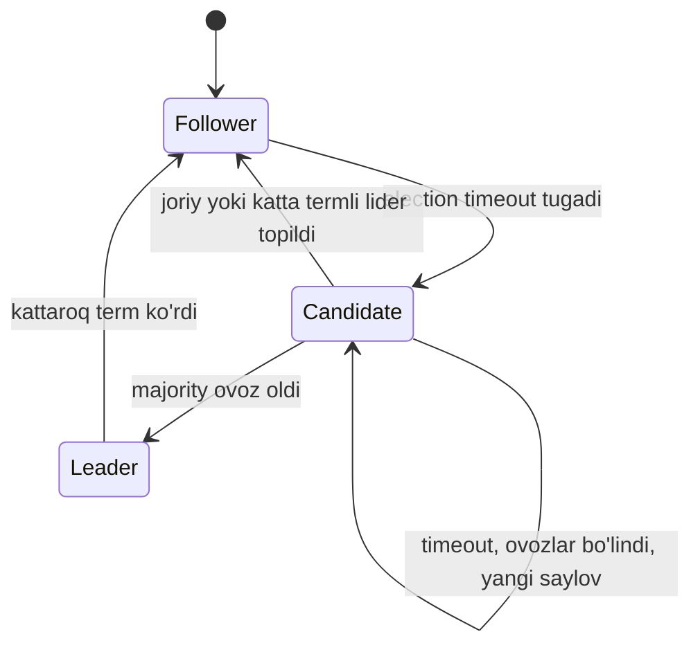
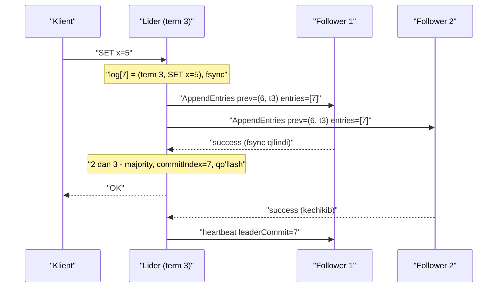

## Bu dars nima uchun kerak

35-darsda consensus masalasini, FLP chegarasini va Paxos g'oyasini ko'rdik. Paxos to'g'ri, lekin uni tushunish va, eng muhimi, to'liq tizim sifatida amalga oshirish qiyin: Multi-Paxos'ning ko'p detallari (lider, log bo'shliqlari, membership) asl maqolalarda ochiq qolgan. 2014 yilda Diego Ongaro va John Ousterhout (Stanford) shu muammoni hal qilish uchun **Raft**ni taqdim etishdi - asosiy maqsadi **tushunarlilik** bo'lgan consensus algoritmi.

Bugun Raft - eng keng tarqalgan consensus algoritmi: etcd (va demak Kubernetes), Consul, CockroachDB, TiKV, Kafka KRaft (Kafka 4.0 dan boshlab ZooKeeper'siz). Bu tizimlarni ishlatayotganda yuz beradigan muammolar - "leader election tez-tez bo'lyapti", "yozish sekin", "klaster qotib qoldi" - Raft mexanikasini bilmasdan tushunib bo'lmaydi.

Bu darsdan keyin siz:

- Raft'ning uchta holatini, term tushunchasini va har bir server diskda nimani saqlashini bilasiz;
- leader election jarayonini qadam-baqadam tushuntira olasiz, randomizatsiyalangan timeout nega kerakligini bilasiz;
- AppendEntries orqali log replikatsiyasi, nomuvofiq loglarni tuzatish va commit qoidasini bilasiz;
- beshta safety xossasini va ayniqsa election restriction va "faqat joriy term yozuvlarini sanab commit qilish" qoidasini tushunasiz;
- linearizable o'qish, snapshot, membership o'zgarishi va PreVote kabi amaliy kengaytmalarni bilasiz;
- etcd timing parametrlarini raqamlar bilan sozlay olasiz.

## Raft dizayn tamoyillari

Ongaro va Ousterhout maqolasi ("In Search of an Understandable Consensus Algorithm", USENIX ATC 2014) Raft'ni Paxos bilan fault tolerance va performance bo'yicha ekvivalent deb ta'riflaydi. Farqi - tuzilma:

1. **Masalani bo'laklarga ajratish:** leader election, log replication, safety - alohida-alohida.
2. **Holat fazosini kamaytirish:** loglarda bo'shliq bo'lmaydi; loglar faqat bitta yo'nalishda - liderdan follower'larga - oqadi.
3. **Kuchli lider:** barcha yozuvlar faqat lider orqali. Follower'lar passiv.

Mualliflar tushunarlilikni o'lchash uchun tajriba o'tkazishgan: Stanford va UC Berkeley'dan 43 talaba ikkala algoritm bo'yicha test topshirgan. O'rtacha ball (60 dan) Raft bo'yicha 25.7, Paxos bo'yicha 20.8; 43 talabadan 33 tasi Raft bo'yicha yuqoriroq ball olgan.

## Holatlar va term

Har bir server uchta holatdan birida:

- **Follower** - passiv: RPC'larga javob beradi, o'zi hech narsa boshlamaydi.
- **Candidate** - lider bo'lish uchun saylov o'tkazmoqda.
- **Leader** - klient so'rovlarini qabul qiladi, logni replikatsiya qiladi, heartbeat yuboradi.

**Term** - mantiqiy vaqt birligi, monoton oshib boruvchi butun son. Har bir term saylov bilan boshlanadi; saylovda g'olib bo'lsa, term oxirigacha u lider. Ovozlar bo'linib ketsa, term lidersiz tugaydi va yangisi boshlanadi. Har bir termda **ko'pi bilan bitta lider** bo'ladi.

Term - bu 32-darsdagi Lamport clock'ning aynan o'zi: har bir RPC jo'natuvchining term'ini olib yuradi; server kattaroq term ko'rsa, o'z `currentTerm`ini yangilaydi va (lider yoki candidate bo'lsa) darhol follower'ga qaytadi. Kichikroq termli so'rov rad etiladi. Shunday qilib eskirgan lider (masalan GC pause'dan uyg'ongan) birinchi javobdayoq o'zining eskirganini bilib oladi.

### Server holati

**Diskda (har bir RPC javobidan oldin fsync):**

- `currentTerm` - ko'rilgan eng katta term;
- `votedFor` - joriy termda kimga ovoz berilgan (yoki null);
- `log[]` - yozuvlar, har biri: buyruq + qaysi termda liderga kelgani. Indeks 1 dan.

**Xotirada:**

- `commitIndex` - commit qilingani ma'lum eng katta indeks;
- `lastApplied` - state machine'ga qo'llangan eng katta indeks;
- faqat liderda: har bir follower uchun `nextIndex[]` (keyingi yuboriladigan yozuv) va `matchIndex[]` (shu follower'da replikatsiya qilingani ma'lum eng katta indeks).

Nega `votedFor` diskda: server ovoz berib, qulab, qayta tursa va `votedFor` ni unutsa, shu termda boshqa candidate'ga ham ovoz berishi mumkin - bitta termda ikki lider. Bu 35-darsdagi Paxos acceptor holatining diskda saqlanishi bilan bir xil sabab.

## Leader election

Raft faqat ikki asosiy RPC'dan foydalanadi: **RequestVote** va **AppendEntries** (heartbeat ham bo'sh AppendEntries). Snapshot uchun uchinchisi - InstallSnapshot.

### Jarayon

1. Follower **election timeout** davomida liderdan hech narsa olmasa, lider o'lgan deb hisoblaydi.
2. U `currentTerm` ni 1 ga oshiradi, candidate'ga o'tadi, o'ziga ovoz beradi (`votedFor = o'zi`, diskka) va barcha serverlarga `RequestVote(term, candidateId, lastLogIndex, lastLogTerm)` yuboradi.
3. Uch natijadan biri:
   - **majority ovoz oldi** - lider bo'ladi va darhol heartbeat yuborib, yangi saylovlarni to'xtatadi;
   - **boshqa server lider bo'lganini bildi** (term ≥ o'zinikidan AppendEntries keldi) - follower'ga qaytadi;
   - **timeout yana tugadi, g'olib yo'q** (ovozlar bo'lindi) - termni oshirib, qaytadan.

### RequestVote qabul qiluvchining qoidasi

Ovoz beriladi, agar:

- candidate termi ≥ `currentTerm`;
- shu termda hali hech kimga ovoz berilmagan yoki aynan shu candidate'ga berilgan;
- candidate logi **kamida ovoz beruvchinikidek yangi** (election restriction - pastda).

Har bir server bitta termda ko'pi bilan bitta ovoz beradi, birinchi kelganga. Shuning uchun ikki candidate bitta termda majority ololmaydi - **Election Safety**.

### Randomizatsiyalangan timeout

Agar hamma bir xil timeout ishlatsa, lider o'lganda barcha follower'lar bir vaqtda candidate bo'ladi va ovozlar cheksiz bo'linadi (35-darsdagi duelli proposer'lar). Raft yechimi: har bir server timeout'ni intervaldan **tasodifiy** tanlaydi, masalan 150-300 ms. Odatda bitta server boshqalardan oldin uyg'onadi va ular uyg'ongunga qadar g'olib bo'ladi.

Maqoladagi 5 serverli tajriba natijalari:

- tasodifiylik yo'q - ovozlar tez-tez bo'linib, saylov 10 soniyadan oshgan holatlar bo'lgan;
- atigi 5 ms tasodifiylik - median uzilish 287 ms;
- 50 ms tasodifiylik - 1000 sinovda eng yomon holat 513 ms.

Bu FLP'ni amalda aylanib o'tishning klassik misoli: deterministik kafolat yo'q, lekin ehtimollik bilan tez yakunlanadi.

### Timing talabi

Raft safety vaqtga bog'liq emas, lekin liveness bog'liq:

**broadcastTime ≪ electionTimeout ≪ MTBF**

- broadcastTime - barcha serverlarga parallel RPC yuborib javob olish vaqti (diskka yozish bilan). Maqolada 0.5-20 ms.
- electionTimeout - maqolada 10-500 ms oralig'ida.
- MTBF - bitta serverning nosozliklar orasidagi o'rtacha vaqti, odatda oylar.

**etcd misoli.** Standart: heartbeat 100 ms, election timeout 1000 ms. Hujjat tavsiyasi: heartbeat taxminan RTT ning 0.5-1.5 baravari, election timeout kamida 10 × RTT, maksimal 50 000 ms (faqat global klasterlar uchun). Hisob: data-markaz ichida RTT 1 ms bo'lsa, standart qiymatlar katta zaxira bilan ishlaydi. Agar etcd tugunlari Toshkent va Frankfurtda bo'lsa (RTT taxminan 75 ms), election timeout kamida 750 ms, heartbeat 75-110 ms. Standart 1000 ms chegarada; disk sekin bo'lsa (fsync 50-100 ms), soxta saylovlar boshlanadi. Bunday holatda timeout'ni 2000-3000 ms ga oshirish kerak, buning narxi - haqiqiy lider qulaganda 2-3 soniya yozuvsiz qolish.

## Log replication

### Normal oqim

1. Klient liderga buyruq yuboradi.
2. Lider buyruqni o'z logiga qo'shadi (indeks i, joriy term T).
3. Lider barcha follower'larga parallel `AppendEntries(term, leaderId, prevLogIndex, prevLogTerm, entries[], leaderCommit)` yuboradi.
4. Follower tekshiradi: `prevLogIndex` pozitsiyasida termi `prevLogTerm` bo'lgan yozuv bormi? Bo'lsa - yozuvlarni qo'shadi, diskka yozadi, `success = true`. Bo'lmasa - `false`.
5. Yozuv majority serverlarda (lider o'zi ham sanaladi) saqlangach, lider uni **committed** deb belgilaydi, `commitIndex` ni oshiradi, state machine'ga qo'llaydi va klientga javob beradi.
6. Keyingi AppendEntries'da (yoki heartbeat'da) `leaderCommit` orqali follower'lar ham commit haqida bilib oladi va o'z state machine'lariga qo'llaydi.

Latency hisobi: klient uchun yozish vaqti = liderdagi fsync + eng tez follower'gacha round-trip + uning fsync'i (parallel). Data-markaz ichida RTT 0.5 ms, NVMe fsync 0.1-1 ms bo'lsa, bir necha millisekund. HDD yoki tarmoq diskida fsync 10 ms dan oshishi mumkin - va u har bir yozuvda. Shuning uchun etcd hujjatlari tez disk talab qiladi.

### Log Matching xossasi

Raft ikki faktni kafolatlaydi:

1. Ikki logda bir xil indeks va bir xil termli yozuv bo'lsa, ular **bir xil buyruqni** saqlaydi (lider bitta termda bitta indeksga bitta yozuv yaratadi va uni hech qachon o'zgartirmaydi).
2. Ikki logda bir xil indeks va bir xil termli yozuv bo'lsa, shu indeksgacha loglar **butunlay bir xil**.

Ikkinchisi AppendEntries'dagi `prevLogIndex/prevLogTerm` tekshiruvidan kelib chiqadi: follower faqat oldingi yozuv mos kelsa yangi yozuvni qabul qiladi. Bu induksiya: har bir muvaffaqiyatli AppendEntries follower logi lider logi bilan shu nuqtagacha bir xil ekanini tasdiqlaydi.

### Nomuvofiq loglarni tuzatish

Lider va follower nosozliklar natijasida turli loglarga ega bo'lishi mumkin: follower'da yozuvlar yetishmasligi yoki ortiqcha commit qilinmagan yozuvlar bo'lishi mumkin. Raft'ning yondashuvi oddiy: **lider logi - haqiqat**, follower'lar unga moslashadi.

1. Yangi lider har bir follower uchun `nextIndex` ni o'z logining oxiri + 1 ga o'rnatadi.
2. AppendEntries rad etilsa, lider `nextIndex` ni kamaytirib, qayta urinadi.
3. Moslik nuqtasi topilgach, follower undan keyingi barcha ziddiyatli yozuvlarni **o'chiradi** va lider yozuvlarini qo'shadi.

Lider o'z logini hech qachon o'chirmaydi yoki ustiga yozmaydi (**Leader Append-Only**). Optimallashtirish: follower rad etishda ziddiyatli yozuv termi va shu termning birinchi indeksini qaytaradi, lider bir termni bitta qadamda o'tkazib yuboradi.

Savol: follower'dan yozuvlarni o'chirish xavfli emasmi? Yo'q - faqat **commit qilinmagan** yozuvlar o'chiriladi. Bunga safety qoidalari kafolat beradi.

## Safety

Maqolada beshta xossa sanaladi:

| Xossa | Ma'nosi |
|---|---|
| Election Safety | Bitta termda ko'pi bilan bitta lider |
| Leader Append-Only | Lider o'z logini o'chirmaydi va ustiga yozmaydi |
| Log Matching | Bir xil (indeks, term) - shu nuqtagacha bir xil log |
| Leader Completeness | Biror termda commit qilingan yozuv barcha keyingi termlar liderlari logida bor |
| State Machine Safety | Bitta indeksda ikki server turli buyruqni qo'llamaydi |

Leader Completeness ikki qoida bilan ta'minlanadi.

### 1. Election restriction

Candidate'ning logi ovoz beruvchinikidan **eskiroq** bo'lsa, ovoz berilmaydi. "Yangiroq" quyidagicha aniqlanadi:

- oxirgi yozuvlar termi solishtiriladi - kattaroq termli log yangiroq;
- termlar teng bo'lsa - uzunroq log yangiroq.

Mantiq: commit qilingan yozuv majority'da bor. Candidate g'olib bo'lish uchun majority'dan ovoz olishi kerak. Ikki majority kesishadi (35-dars), demak kamida bitta ovoz beruvchida commit qilingan yozuv bor va u, agar candidate logi eskiroq bo'lsa, ovoz bermaydi. Shuning uchun commit qilingan yozuvga ega bo'lmagan server lider bo'la olmaydi.

**Misol.** 5 server, oxirgi yozuvlar (indeks, term): S1 (10, 4), S2 (10, 4), S3 (9, 4), S4 (11, 3), S5 (8, 4). S4 eng uzun logga ega, lekin oxirgi termi 3 - u S1, S2, S3, S5 dan eskiroq va ulardan ovoz ololmaydi. S3 S1 dan ovoz ololmaydi (term teng, S3 qisqaroq), lekin S4 va S5 dan oladi. S1 hammadan ovoz olishi mumkin.

### 2. Faqat joriy term yozuvlarini sanab commit qilish

Bu Raft'ning eng nozik joyi. Lider **oldingi** termdagi yozuvni faqat majority'da saqlangani uchun commit deb hisoblay olmaydi. U faqat **o'z joriy termidagi** yozuvni replikalar sonini sanab commit qiladi; oldingi yozuvlar Log Matching orqali bilvosita commit bo'ladi.

Nega - maqoladagi 8-rasm stsenariysi:

1. S1 term 2 da lider, indeks 2 ga yozuvni faqat S1 va S2 ga yozdi va qulab tushdi.
2. S5 term 3 da S3, S4 va o'z ovozi bilan lider bo'ladi, indeks 2 ga **boshqa** yozuv yozadi, faqat o'ziga, va qulaydi.
3. S1 qayta turib, term 4 da lider bo'ladi va term 2 dagi yozuvni S3 ga ham ko'chiradi. Endi u S1, S2, S3 da - majority.
4. Agar S1 shu paytda "majority'da bor, demak commit" deb hisoblasa va qulasa: S5 (oxirgi termi 3, term 2 dan kattaroq) S2, S3, S4 dan ovoz olib lider bo'lishi mumkin va indeks 2 ni o'zining term 3 yozuvi bilan **ustiga yozadi**. Commit qilingan deb hisoblangan yozuv yo'qoldi.
5. To'g'ri yo'l: S1 avval o'z term 4 dagi yozuvini majority'ga yozadi. Shundan keyin S5 ning logi (oxirgi term 3) eskiroq bo'lib qoladi va u lider bo'la olmaydi - term 2 yozuvi ham xavfsiz.

Amaliy natija: yangi lider o'z termi boshida **bo'sh no-op yozuvni** commit qiladi. Bu oldingi termlardan qolgan yozuvlarni commit qiladi va lider qaysi yozuvlar commit qilinganini bilib oladi.

## Klient bilan ishlash va linearizable o'qish

### Dublikatlar

Lider buyruqni commit qilib, javob yuborishdan oldin qulasa, klient timeout oladi va qayta yuboradi (31-dars). Buyruq ikki marta bajariladi. Raft maqolasidagi yechim: klient har bir buyruqqa noyob seriya raqamini beradi; state machine har bir klient uchun oxirgi bajarilgan raqam va javobni saqlaydi va takroriy buyruqqa saqlangan javobni qaytaradi. Bu idempotency'ning aynan o'zi (39-dars).

### Linearizable o'qish

O'qishni log orqali o'tkazmaslik tez, lekin xavfli: eskirgan lider (partition'ning minority tomonida qolgan) o'zini hali lider deb o'ylab, eski ma'lumot qaytarishi mumkin. Raft maqolasi ikki ehtiyot chorasini talab qiladi:

1. Yangi lider termi boshida no-op commit qiladi (yuqorida) - u qaysi yozuvlar commit qilinganini bilishi uchun.
2. O'qishga javob berishdan oldin lider majority bilan heartbeat almashib, hali ham lider ekanini tasdiqlaydi (etcd'da bu **ReadIndex** deyiladi).

Alternativa - **leader lease**: lider oxirgi heartbeat'ga majority javob bergandan keyin election timeout'dan kichik vaqt davomida o'zini lider deb hisoblaydi va heartbeat almashinuvisiz o'qiydi. Tezroq, lekin safety endi **soat tezligi farqi chegaralangan** degan taxminga bog'liq (32-dars). Maqola ham shuni ogohlantiradi.

## Amaliy kengaytmalar

### Snapshot va log compaction

Log cheksiz o'sa olmaydi. Har bir server mustaqil ravishda commit qilingan holatning snapshot'ini oladi va shu nuqtagacha logni o'chiradi. Snapshot oxirgi kiritilgan indeks, term va klaster konfiguratsiyasini saqlaydi. Juda orqada qolgan yoki yangi follower'ga lider **InstallSnapshot** RPC orqali snapshot'ni bo'laklab yuboradi. etcd'da `--snapshot-count` standart 100 000 commit qilingan tranzaksiya.

### Membership o'zgarishi

3 serverdan 5 ga o'tishda hamma serverlar bir vaqtda yangi konfiguratsiyaga o'ta olmaydi. Oraliqda eski konfiguratsiyadagi majority (3 dan 2) va yangi konfiguratsiyadagi majority (5 dan 3) bir-biridan mustaqil bo'lishi va bitta termda ikki lider paydo bo'lishi mumkin. Raft maqolasi **joint consensus** ishlatadi: oraliq konfiguratsiya C(old,new), unda saylov va commit uchun eski va yangi konfiguratsiyalarning **ikkalasidan** alohida majority kerak. Ongaro dissertatsiyasida (2014) soddaroq usul - bir vaqtda faqat **bitta** serverni qo'shish yoki olib tashlash - tasvirlangan; keyinroq unda nozik bug topilgan va dissertatsiya errata'sida oddiy tuzatish berilgan. Saboq: membership o'zgarishi consensus'ning eng xavfli qismlaridan biri.

### PreVote

Partition'dan qaytgan server (masalan, tarmoqdan uzilgan follower) o'z termini qayta-qayta oshirib, saylov o'tkazishga uringan bo'ladi. Qaytganida uning termi katta va u barqaror liderni "ag'darib" yuboradi - keraksiz saylov. PreVote: haqiqiy saylovdan oldin candidate termni oshirmasdan "agar saylov o'tkazsam, ovoz berasizmi?" deb so'raydi; majority lider bilan aloqada bo'lsa, rad etadi. etcd'da `--pre-vote` standart yoqilgan.

### Kuzatuvchi (learner) a'zolar

Yangi server avval ovoz bermaydigan a'zo sifatida qo'shiladi va logni yetkazib olgandan keyin ovoz beruvchiga aylanadi - aks holda u kvorumni sekinlashtiradi.

## Raft va Paxos: amaliy taqqoslash

| Jihat | Raft | Multi-Paxos |
|---|---|---|
| Lider | Majburiy, kuchli; faqat u yozadi | Optimallashtirish sifatida |
| Lider bo'lish sharti | Logi eng kamida yangi bo'lishi (election restriction) | Istalgan server; 1-fazada yetishmayotganlarni o'rganadi |
| Log | Bo'shliqsiz, ketma-ket | Bo'shliqlar bo'lishi mumkin |
| Yozuv yo'nalishi | Faqat liderdan follower'larga | Turli yo'nalishlar |
| Membership | Spetsifikatsiyada (joint consensus) | Asl maqolalarda to'liq emas |
| Formal tekshiruv | TLA+ spetsifikatsiya mavjud | Mavjud (turli variantlar) |
| Amaliy tizimlar | etcd, Consul, CockroachDB, TiKV, Kafka KRaft | Chubby, Spanner, Cassandra LWT |

## Real tizimlarda Raft

- **etcd** - Kubernetes'ning barcha holati shu yerda. Standart heartbeat 100 ms, election timeout 1000 ms, PreVote yoqilgan. Linearizable o'qish standart (ReadIndex), `serializable` rejimda lokal (33-dars).
- **Consul** - server tugunlari Raft ishlatadi; hujjatda serverlar soni va nosozlikka chidamlilik jadvali beriladi (3 server - 1 nosozlik, 5 - 2, 7 - 3) va production uchun 3 yoki 5 tavsiya etiladi.
- **CockroachDB** - "multi-raft": ma'lumot range'larga bo'lingan va har bir range o'z Raft guruhiga ega. Leaseholder (o'qishlarga xizmat qiladi) odatda Raft lideri bilan bitta replikada joylashadi; yangi "leader leases" mexanizmi lease'ni Raft liderligi bilan bog'laydi.
- **Kafka KRaft** - Kafka 4.0 (2025-mart) ZooKeeper'siz ishlaydigan birinchi asosiy reliz. Metadata controller'lar kvorumida Raft asosidagi protokol bilan replikatsiya qilinadi (44-dars).

## iQuariX kontekstida

Faraz qiling, iQuariX Kubernetes'da ishlaydi va PostgreSQL'ni Patroni bilan boshqaradi. Ikkalasi ham etcd'ga tayanadi - ya'ni Raft sizning tizimingizning yuragida, siz uni bevosita yozmasangiz ham.

**1. Soxta lider saylovlari.** Monitoring'da etcd lider har bir necha daqiqada almashayotgani ko'rinmoqda va Kubernetes API sekinlashmoqda. Raft bilimi bilan diagnostika: election timeout (1000 ms) ichida heartbeat yetib kelmayapti. Sabablar: etcd tugunlari sekin disk'da (fsync p99 yuzlab ms), CPU'ni boshqa podlar egallagan, yoki tarmoq. Yechim tartibi: etcd uchun alohida tez SSD, `wal_fsync_duration` metrikasini kuzatish, kerak bo'lsa timeout'ni oshirish - lekin bu failover'ni sekinlashtirishini bilgan holda.

**2. Konfiguratsiya xizmati.** Deylik, iQuariX'da "qaysi mijozning trekerlari qaysi ingest shard'ga biriktirilgan" xaritasi etcd'da saqlanadi. Gateway'lar uni `watch` bilan kuzatadi. Raft kafolati: barcha gateway'lar o'zgarishlarni bir xil tartibda ko'radi (replicated log). Lekin ular har xil **vaqtda** ko'radi - shuning uchun xaritaga revision raqami qo'shiladi va gateway eski revision bo'yicha ish qilayotganini bilishi mumkin.

**3. Yozuv hajmi.** etcd kichik metadata uchun: hujjatga ko'ra bitta so'rov standart 1.5 MiB gacha, saqlash hajmi standart 2 GiB (`--quota-backend-bytes`), normal muhitda 8 GiB dan oshirmaslik tavsiya etiladi. GPS nuqtalari, ДУТ o'qishlari, video metadata - etcd'ga emas, Kafka va time-series bazaga. Hisob: 10 000 nuqta/s × 100 bayt = 1 MB/s, har biri Raft commit va fsync - etcd buning uchun mo'ljallanmagan.

**4. Ikki data-markaz.** 35-darsdagi kabi: etcd'ni 2 + 1 joylashtirish katta joy qulaganda klasterni to'xtatadi. Agar uchinchi joy bo'lmasa, etcd va unga bog'liq Kubernetes control plane bitta data-markazda, ikkinchisida esa mustaqil klaster va ma'lumot replikatsiyasi - bu ko'pincha sodda va ishonchliroq.

## Ko'p uchraydigan xatolar

1. **etcd'ni sekin diskda ishlatish.** Har bir yozuv va saylov fsync'ga bog'liq; sekin disk soxta saylovlarga olib keladi.
2. **Election timeout'ni RTT'ni hisobga olmasdan sozlash.** Kamida 10 × RTT; regionlararo klasterda standart qiymat yetmaydi.
3. **Oldingi term yozuvini majority'da bor deb commit qilish.** O'z implementatsiyangizda 8-rasm stsenariysini unutmang (yaxshisi - o'z Raft'ingizni yozmang).
4. **Lider logidan "tez" o'qish.** ReadIndex yoki lease'siz lokal o'qish partition'da eskirgan ma'lumot beradi.
5. **Lease'ga soat taxminisiz ishonish.** Leader lease soat tezligi farqi chegaralangan bo'lishiga tayanadi.
6. **Membership'ni bir vaqtda bir nechta server bilan o'zgartirish.** Joint consensus yoki bitta-bitta qo'shish.
7. **Raft klasterini yuqori throughput ma'lumot ombori sifatida ishlatish.** Raft har yozuvni majority fsync bilan o'tkazadi; u metadata va qarorlar uchun.
8. **Dublikat buyruqlarni hisobga olmaslik.** Lider commit qilib, javobdan oldin qulasa, klient qayta yuboradi; seriya raqami yoki idempotent buyruqlar kerak.

## Xulosa

- Raft - tushunarlilik uchun loyihalangan consensus: election, replication, safety alohida; kuchli lider; bo'shliqsiz log.
- Term - Lamport clock: kattaroq term ko'rgan server darhol follower'ga qaytadi. Har termda ko'pi bilan bitta lider.
- Saylov: randomizatsiyalangan timeout, majority ovozi, har server bitta termda bitta ovoz. `currentTerm`, `votedFor`, log - diskda.
- Replikatsiya: AppendEntries prevLogIndex/prevLogTerm tekshiruvi bilan; lider logi haqiqat, follower'ning ziddiyatli commit qilinmagan yozuvlari o'chiriladi.
- Safety kaliti - election restriction (eskirgan logli server lider bo'lmaydi) va faqat joriy term yozuvlarini sanab commit qilish (yangi lider no-op commit qiladi).
- Linearizable o'qish uchun ReadIndex (majority bilan tasdiq) yoki lease (soat taxmini bilan).
- Timing: broadcastTime ≪ electionTimeout ≪ MTBF; etcd standarti 100 ms / 1000 ms, election timeout kamida 10 × RTT.

## Amaliy topshiriq

Faraz qiling: iQuariX uchun ichki "qurilma registri" xizmati loyihalanmoqda: qurilma ID, mijoz, biriktirilgan ingest shard, faollik holati. Yozuvlar kam (kuniga bir necha ming), lekin har bir o'zgarish barcha gateway'larga bir xil tartibda yetishi va hech qachon yo'qolmasligi kerak. Siz uni etcd ustiga quryapsiz.

1. Klaster hajmi va joylashuvini tanlang. Data-markaz ichida RTT 0.5 ms, disk fsync p99 2 ms. heartbeat va election timeout qiymatlarini hisob bilan asoslang.
2. Normal ishda bitta yozuv latency'sini hisoblang (lider fsync, tarmoq, follower fsync).
3. Lider qulagan paytdan yangi lider yozuv qabul qila boshlaguncha qancha vaqt o'tishini baholang (eng yaxshi va eng yomon holat).
4. Gateway qurilma registridan o'qiydi. Qaysi o'qishlar linearizable bo'lishi kerak, qaysilari `serializable` (lokal) bo'lishi mumkin? Har biri uchun misol keltiring.
5. Admin panel "qurilmani boshqa shard'ga ko'chirish" buyrug'ini yubordi, javob o'rniga timeout oldi. Buyruq bajarilganmi yoki yo'qmi - qanday aniqlaysiz va qayta yuborishni qanday xavfsiz qilasiz?
6. Agar regionlararo (Toshkent - Frankfurt, RTT 75 ms) bitta etcd klasteri qilinsa, 1-3 qadamlardagi raqamlar qanday o'zgaradi? Bu qarorni tavsiya qilasizmi?

Yaxshi javobda bo'lishi kerak bo'lgan narsalar:

- toq sonli klaster va timeout'lar etcd tavsiyasi (heartbeat ~ RTT, election ≥ 10 × RTT) va disk latency'si bilan asoslangan;
- yozuv latency hisobida majority va parallel fsync;
- failover vaqti election timeout va tasodifiy oraliq orqali baholangan;
- linearizable va serializable o'qishlar aniq ajratilgan;
- timeout'dan keyin revision yoki idempotent buyruq bilan tekshirish;
- regionlararo variantda latency va soxta saylov xavfi raqam bilan.

Javobni pastdagi maydonga yozib, chatga yuboring.

## Manbalar

- Diego Ongaro, John Ousterhout. [In Search of an Understandable Consensus Algorithm (Extended Version)](https://raft.github.io/raft.pdf), USENIX ATC 2014 - 2-rasm (holat va RPC'lar), 3-rasm (safety xossalari), 5.4 bo'lim (election restriction, 8-rasm), 6-bo'lim (membership), 7-8 bo'limlar (snapshot, klient bilan ishlash), 9-bo'lim (saylov tajribalari).
- [raft.github.io](https://raft.github.io/) - vizualizatsiya, ma'ruzalar va TLA+ spetsifikatsiya.
- Diego Ongaro. [Consensus: Bridging Theory and Practice](https://github.com/ongardie/dissertation), PhD dissertatsiya, Stanford, 2014 - bitta serverli membership o'zgarishi, errata.
- etcd. [Tuning](https://etcd.io/docs/v3.5/tuning/) (heartbeat va election timeout), [Configuration flags](https://etcd.io/docs/v3.5/op-guide/configuration/) (`--pre-vote`, `--snapshot-count`) va [System limits](https://etcd.io/docs/v3.5/dev-guide/limit/).
- HashiCorp. [Consul consensus protocol](https://developer.hashicorp.com/consul/docs/architecture/consensus) - serverlar soni va nosozlikka chidamlilik jadvali.
- Cockroach Labs. [Replication layer](https://docs.cockroachlabs.com/docs/stable/architecture/replication-layer) - multi-raft, leaseholder va leader leases.
- Apache Kafka. [Kafka 4.0.0 Release Announcement](https://kafka.apache.org/blog/2025/03/18/apache-kafka-4.0.0-release-announcement/), 2025 - ZooKeeper'siz KRaft.
- Martin Kleppmann, Chris Riccomini. [Designing Data-Intensive Applications, 2-nashr](https://www.oreilly.com/library/view/designing-data-intensive/9781098119058/), O'Reilly, 2026. 10-bob - consensus amalda.
