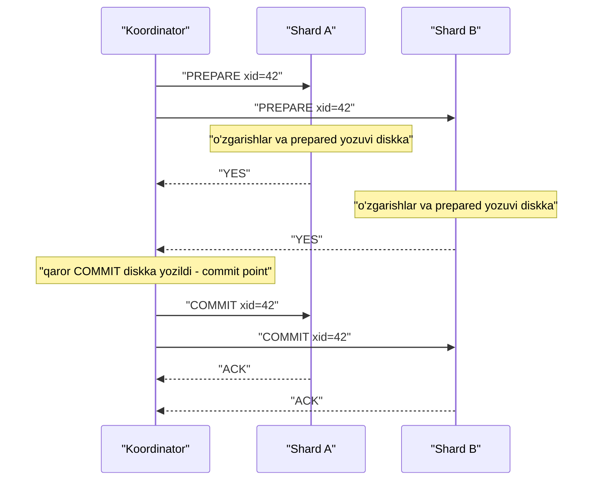

## Bu dars nima uchun kerak

17-19 darslarda tranzaksiyalarni bitta baza ichida ko'rdik: atomicity, isolation, MVCC. 28-30 darslarda ma'lumotni shard'larga bo'ldik. Endi ikkalasi to'qnashadi: bitta biznes operatsiya **bir nechta** tugundagi ma'lumotni o'zgartirishi kerak. Masalan: hisobdan pul yechish bir shard'da, boshqa hisobga qo'shish boshqa shard'da; buyurtmani yaratish bir servisda, omborni kamaytirish boshqasida.

Atomicity talabi o'zgarmaydi: yo hamma joyda commit, yo hech qayerda. Lekin endi har bir tugun o'z qarorini mustaqil qabul qiladi, tugunlar quladi, tarmoq xabarlarni yo'qotadi (31-dars). Bu muammoning klassik yechimi - **two-phase commit (2PC)**. U to'g'ri ishlaydi, lekin og'ir narx bilan, va bu narxni tushunish mikroservislar davrida juda muhim: ko'p jamoalar 2PC'dan qochib Saga'ga (49-dars) o'tadi, ba'zilari esa noto'g'ri sabablar bilan.

Bu darsdan keyin siz:

- atomic commit masalasi va uning consensus'dan farqini bilasiz;
- 2PC'ning ikki fazasini, har bir qadamda diskka nima yozilishini va nima uchunligini bilasiz;
- har bir nuqtada nosozlik bo'lsa nima bo'lishini, ayniqsa "in-doubt" holatni va blocking muammosini tushuntira olasiz;
- 2PC'ning latency, lock va mavjudlik narxini hisoblay olasiz;
- XA, PostgreSQL `PREPARE TRANSACTION`, Spanner'dagi "2PC over Paxos" va DynamoDB tranzaksiyalarini bilasiz;
- qachon 2PC o'rinli, qachon boshqa yondashuv (bitta shard'ga joylash, Saga, outbox) yaxshiroq ekanini aniqlay olasiz.

## Atomic commit masalasi

Bir nechta ishtirokchi (participant) bitta tranzaksiyaning qismlarini bajaradi. Talablar:

- **Agreement** - barcha ishtirokchilar bir xil natijaga keladi: hamma commit yoki hamma abort.
- **Validity** - agar biror ishtirokchi "yo'q" desa (constraint buzildi, lock ololmadi, diskda joy yo'q), natija albatta abort. Hamma "ha" desa va nosozlik bo'lmasa - commit.
- **Termination** - oxir-oqibat natijaga erishiladi.

Bu 35-darsdagi consensus'ga o'xshaydi, lekin farqi bor: consensus'da **istalgan** taklif qilingan qiymat tanlanishi mumkin; atomic commit'da esa bitta "yo'q" ovozi **veto** - u natijani majburan abort qiladi. Shuning uchun majority ovoz yetmaydi: **hamma** ishtirokchining roziligi kerak.

### Nega oddiy yondashuv ishlamaydi

Eng sodda usul: koordinator har bir shard'ga "commit" yuboradi. Lekin:

- birinchi shard commit qildi, ikkinchisi constraint buzilishi tufayli rad etdi - birinchisini endi qaytarib bo'lmaydi (commit qilingan ma'lumotni boshqa tranzaksiyalar allaqachon o'qigan bo'lishi mumkin);
- birinchi shard commit qildi, ikkinchisiga xabar yetib bormadi va u timeout bilan abort qildi.

Commit qaytarilmas qadam. Demak har bir ishtirokchi, qaytarilmas qadamdan **oldin**, commit qila olishini kafolatlashi kerak. 2PC'ning butun g'oyasi shu.

## 2PC qanday ishlaydi

Rollar:

- **Koordinator (transaction manager)** - tranzaksiyani boshqaradi, odatda ilova serveri ichidagi kutubxona yoki alohida servis.
- **Ishtirokchilar (participants, resource managers)** - bazalar yoki shard'lar.

Avval odatdagidek ish bajariladi: koordinator global tranzaksiya ID'si (XID) yaratadi, har bir ishtirokchida shu ID bilan lokal tranzaksiya ochiladi va o'zgarishlar yoziladi. Keyin commit vaqti keladi.

### 1-faza: Prepare (ovoz berish)

1. Koordinator barcha ishtirokchilarga `PREPARE(xid)` yuboradi.
2. Har bir ishtirokchi tekshiradi: barcha constraint'lar bajariladimi, lock'lar olinganmi, hamma narsa yozilganmi. Agar commit qila olsa:
   - tranzaksiyaning barcha o'zgarishlarini va "prepared" belgisini **diskka yozadi** (WAL, fsync);
   - "YES" javob beradi.
   Shu paytdan boshlab ishtirokchi **va'da beradi**: koordinator nima desa, shuni bajaradi - hatto qulab qayta tursa ham. U endi o'z ixtiyori bilan abort qila olmaydi.
3. Agar commit qila olmasa - lokal abort va "NO".

### Qaror nuqtasi (commit point)

4. Koordinator **barcha** ishtirokchidan YES olsa, qaror - COMMIT. Kamida bitta NO yoki timeout bo'lsa - ABORT.
5. Koordinator qarorni **o'z diskiga yozadi** (commit log). Bu tranzaksiyaning haqiqiy commit nuqtasi: shu yozuvdan keyin qaror qaytarilmas.

### 2-faza: Commit yoki Abort

6. Koordinator barcha ishtirokchilarga qarorni yuboradi.
7. Ishtirokchi qarorni qo'llaydi, lock'larni bo'shatadi va ACK qaytaradi.
8. Agar ishtirokchi javob bermasa, koordinator **cheksiz qayta urinadi** - commit qarori qaytarilmas, va prepared ishtirokchi uni rad eta olmaydi.
9. Barcha ACK kelgach, koordinator tranzaksiya yozuvini tozalashi mumkin.

Ikkita "qaytarilmaslik nuqtasi" bor: ishtirokchi YES deganda o'z abort huquqidan voz kechadi; koordinator qarorni yozganda natija qat'iylashadi. Kleppmann DDIA'da buni nikoh marosimiga o'xshatadi: ikkalasi "ha" deydi, keyin rasmiy e'lon - qaytarib bo'lmaydi.

## Nosozliklar va in-doubt holat

Har bir nuqtada nosozlik bo'lsa nima bo'lishini ko'ramiz.

| Qachon | Nima bo'ldi | Natija |
|---|---|---|
| Prepare'dan oldin ishtirokchi quladi | Koordinator YES olmaydi | Timeout, ABORT - xavfsiz |
| Ishtirokchi NO dedi | | ABORT - xavfsiz |
| Ishtirokchi YES dedi, keyin quladi | Diskda prepared yozuvi bor | Qayta turgach koordinatordan qarorni so'raydi va bajaradi |
| Koordinator qarorni yozishdan oldin quladi | Ishtirokchilar prepared, qaror yo'q | Koordinator tiklanganda yozuv yo'q - ABORT (presumed abort) |
| Koordinator qarorni yozgandan keyin, yuborishdan oldin quladi | Ishtirokchilar prepared, qarorni bilmaydi | **In-doubt**: ishtirokchilar kutadi |
| 2-fazada xabar yo'qoldi | Ba'zi ishtirokchilar qarorni oldi, ba'zilari yo'q | Koordinator qayta yuboradi; olmaganlar kutadi |

### In-doubt (noaniq) holat

Eng og'ir holat: ishtirokchi YES dedi va kutmoqda, koordinator esa jim. Ishtirokchi nima qila oladi?

- **O'zi abort qila olmaydi** - ehtimol koordinator COMMIT qaror qilgan va boshqa ishtirokchi allaqachon commit qilgan. Abort qilsa, atomicity buziladi.
- **O'zi commit qila olmaydi** - ehtimol boshqa ishtirokchi NO degan va qaror ABORT.
- **Boshqa ishtirokchilardan so'rash** ba'zan yordam beradi (kimdir qarorni olgan bo'lsa), lekin hammasi prepared bo'lib, hech kim qarorni olmagan bo'lsa - yordam bermaydi.

Ishtirokchi **koordinator tiklanguncha kutishga majbur**. Bu vaqt davomida u tranzaksiya o'zgartirgan qatorlardagi **lock'larni ushlab turadi**. Shu qatorlarga murojaat qiladigan boshqa tranzaksiyalar ham bloklanadi. Koordinator diski butunlay yo'qolsa - qaror hech qachon kelmaydi va administrator qo'lda hal qilishi kerak (heuristic decision), bu esa atomicity'ni buzish xavfini tug'diradi.

Bu - 2PC'ning asosiy kamchiligi: u **blocking protocol**. Bitta tugun (koordinator) nosozligi butun tizimni to'xtatishi mumkin. 35-darsdagi tilda: 2PC safety'ni saqlaydi, lekin koordinator nosozligida liveness'ni yo'qotadi va u **majority bilan emas, bitta tugunga bog'liq**.

### Presumed abort optimallashtiruvi

Abort uchun koordinator diskka hech narsa yozmasligi mumkin: tiklanganda yozuv topilmasa, "abort bo'lgan" deb hisoblanadi. Bu abort holatlarida fsync va xabarlarni tejaydi. Commit qarori esa albatta yoziladi.

## 2PC narxi: raqamlar

### Latency

Bitta shard'li tranzaksiyada commit = 1 ta fsync. 2PC'da:

1. Prepare so'rovi va javobi: 1 round-trip + har bir ishtirokchida fsync (parallel).
2. Koordinatorda qaror fsync.
3. Commit so'rovi: yana 1 round-trip (klientga javobni qarordan keyin berish mumkin, lekin lock'lar 2-faza tugaguncha ushlanadi).

**Misol.** Data-markaz ichida RTT 0.5 ms, fsync 1 ms. Klientga javob: prepare RTT 0.5 + ishtirokchi fsync 1 + koordinator fsync 1 = taxminan 2.5 ms, bitta shard'dagi 1 ms ga nisbatan. Lock ushlanish vaqti: yuqoridagi + commit RTT 0.5 + ishtirokchi commit yozuvi 1 = taxminan 4 ms.

Regionlararo (RTT 80 ms): javob taxminan 80 + 1 + 1 = 82 ms, lock esa kamida 160 ms ushlanadi.

### Lock'lar va throughput

Issiq qator (masalan, bitta ombor qoldig'i) ustidagi tranzaksiyalar ketma-ket bajariladi. Lock 4 ms ushlansa, bitta qator uchun maksimal throughput taxminan 1000 / 4 = 250 tranzaksiya/s. Regionlararo 160 ms bilan - taxminan 6 tranzaksiya/s. Bitta shard ichida (lock 1 ms) - 1000/s. Ya'ni 2PC issiq qatorlar uchun throughput'ni bir necha baravar kamaytiradi.

### Mavjudlik

Tranzaksiya barcha N ishtirokchi va koordinator ishlaganda muvaffaqiyatli. Har biri 99.9% mavjud bo'lsa, 3 ishtirokchi + koordinator: 0.999^4 ≈ 99.6%. Ya'ni distributed tranzaksiyaning mavjudligi eng zaif ishtirokchidan ham past. Bu "har bir ishtirokchi veto huquqiga ega" ekanining oqibati.

### Kuchaytirish (amplification)

Kleppmann DDIA'da keltiradi: koordinator ko'pincha ilova serverining o'zida ishlaydi. Agar ilova serveri stateless deb hisoblanib, Kubernetes'da istalgan paytda o'chirilsa va koordinator logi uning lokal diskida bo'lsa - in-doubt tranzaksiyalar "yetim" qoladi. Koordinator logi ham replikatsiyalangan va ishonchli bo'lishi kerak - aslida u ham bazaning bir qismiga aylanadi.

## 2PC variantlari va yaxshilanishlar

### Three-phase commit (3PC)

Dale Skeen 1982 yilda taklif qilgan: prepare va commit orasiga "pre-commit" fazasi qo'shiladi, shunda koordinator o'lsa, ishtirokchilar o'zaro natijani aniqlay oladi. Muammo: 3PC chegaralangan tarmoq kechikishi va chegaralangan javob vaqtini taxmin qiladi. Chegarasiz kechikish va process pause bo'lgan real tarmoqda (31-dars) u atomicity'ni kafolatlay olmaydi. Shuning uchun amaliyotda deyarli ishlatilmaydi.

### 2PC + consensus: koordinatorni replikatsiya qilish

Blocking'ning ildizi - koordinatorning yagona nusxasi. Yechim: koordinator holatini va har bir ishtirokchi holatini **consensus guruhi** (Paxos/Raft) orqali replikatsiya qilish. Shunda bitta tugun qulashi qarorni yo'qotmaydi - guruhning yangi lideri davom ettiradi.

**Google Spanner** (OSDI 2012) aynan shunday: har bir shard - Paxos guruhi. Read-write tranzaksiya bir nechta guruhga tegsa, ulardan biri koordinator bo'ladi. Ishtirokchi guruh liderlari write lock oladi, prepare yozuvini **Paxos orqali** loglaydi va koordinatorga prepare vaqt belgisini yuboradi. Koordinator commit vaqt belgisini tanlaydi (32-dars, TrueTime), commit yozuvini Paxos orqali loglaydi, commit wait'ni bajaradi va natijani yuboradi. Maqola xulosasi: Paxos ustida 2PC mavjudlik muammolarini yumshatadi. Narxi - har bir 2PC qadami endi bitta fsync emas, majority replikatsiyasi.

Gray va Lamport'ning "Consensus on Transaction Commit" ishi (Paxos Commit) xuddi shu g'oyani nazariy jihatdan rasmiylashtiradi.

CockroachDB, YugabyteDB, TiDB ham shu oilaga kiradi: har bir range/tablet o'z Raft guruhiga ega, tranzaksiya holati esa maxsus "transaction record" sifatida Raft orqali saqlanadi.

## Heterogen 2PC: XA

**X/Open XA** - turli tizimlar (bazalar, message broker'lar) o'rtasida 2PC uchun standart interfeys. Koordinator (transaction manager) ilova tarafida, ishtirokchilar - resource manager'lar.

- **MySQL** InnoDB uchun XA'ni qo'llab-quvvatlaydi: `XA START`, `XA END`, `XA PREPARE`, `XA COMMIT` / `XA ROLLBACK`. Hujjat ta'kidlaydi: distributed tranzaksiyalarda REPEATABLE READ yetarli bo'lmasligi mumkin.
- **PostgreSQL** `PREPARE TRANSACTION 'id'` va keyin istalgan sessiyadan `COMMIT PREPARED` yoki `ROLLBACK PREPARED`. Standartda `max_prepared_transactions = 0`, ya'ni o'chirilgan. Hujjat ogohlantirishlari: prepared tranzaksiya barcha lock'larini ushlab turadi; uzoq qolsa VACUUM'ga xalaqit beradi va o'ta holatda transaction ID wraparound'ning oldini olish uchun baza o'chishiga olib kelishi mumkin; agar tashqi transaction manager bo'lmasa, funksiyani o'chiq qoldirish tavsiya etiladi.

XA'ning amaliy muammolari:

- Koordinator ko'pincha ilova jarayonida - yuqorida aytilgan "yetim" tranzaksiyalar xavfi.
- Eng kichik umumiy maxraj: XA deadlock aniqlash yoki SSI kabi ilg'or mexanizmlarni tizimlararo qamrab olmaydi.
- Barcha ishtirokchilar XA'ni qo'llab-quvvatlashi kerak. Ko'p zamonaviy tizimlar (masalan Kafka) XA ishtirokchisi bo'la olmaydi.

## Qaror qabul qilish: 2PC yoki boshqa yo'l

| Yondashuv | Atomicity | Isolation | Latency va mavjudlik | Qachon |
|---|---|---|---|---|
| Ma'lumotni bitta shard'ga joylash | To'liq, lokal | To'liq | Eng yaxshi | Tranzaksiya chegarasini shard kaliti bilan moslash mumkin bo'lsa |
| 2PC (XA, PREPARE TRANSACTION) | To'liq | To'liq (lock'lar bilan) | Ko'p round-trip, blocking, past mavjudlik | Kam ishtirokchi, bitta data-markaz, ishonchli koordinator |
| 2PC + consensus (Spanner, CockroachDB) | To'liq | Serializable yoki kuchliroq | Yuqori latency, lekin blocking yo'q | Global tranzaksiyalar kerak va tayyor bazadan foydalanish |
| Saga (49-dars) | Kompensatsiya bilan, oraliq holatlar ko'rinadi | Yo'q | Har qadam lokal, yuqori mavjudlik | Mikroservislar, uzoq jarayonlar |
| Transactional outbox + idempotent consumer (48, 39-darslar) | Oxir-oqibat | Yo'q | Lokal commit | "Bazaga yoz va event yubor" holati |

Birinchi qoida: **distributed tranzaksiyadan qochishning eng yaxshi usuli - unga ehtiyoj qoldirmaslik**. Shard kalitini shunday tanlangki, ko'pchilik tranzaksiya bitta shard ichida bo'lsin (28-30 darslar). Masalan, multi-tenant SaaS'da `tenant_id` bo'yicha sharding - bitta mijozning barcha ma'lumoti bitta shard'da va deyarli barcha tranzaksiyalar lokal.

## Real tizimlardan misollar

- **Google Spanner** - Paxos guruhlari ustida 2PC, TrueTime bilan external consistency. TrueTime noaniqligi ε har poll oralig'ida taxminan 1 dan 7 ms gacha arra shaklida o'zgaradi va ko'p vaqt taxminan 4 ms.
- **DynamoDB transactions** - `TransactWriteItems` bitta akkaunt va region ichida 100 tagacha element, umumiy hajm 4 MB gacha. Har bir element uchun ikki marta yozish (prepare va commit), ya'ni WCU sarfi ikki baravar. `ClientRequestToken` 10 daqiqa davomida idempotency beradi. Ziddiyat bo'lsa - `TransactionCanceledException`, SDK avtomatik qayta urinmaydi.
- **PostgreSQL** - `PREPARE TRANSACTION`, standartda o'chiq; tashqi transaction manager uchun mo'ljallangan.
- **Kafka transactions** - bir nechta partition'ga atomik yozish uchun transaction coordinator va ikki bosqichli protokol ishlatadi; bu 39 va 44-darslarda ko'riladi.

## iQuariX kontekstida

Faraz qiling, iQuariX'da quyidagi operatsiya bor: **"Yoqilg'i quyish hodisasini tasdiqlash"**. U uchta joyga ta'sir qiladi: (1) yoqilg'i hodisalari jadvali (PostgreSQL, telemetriya shard'i), (2) mijozning yoqilg'i kartasi balansi (billing servisi bazasi), (3) hisobot uchun event (Kafka).

**Variant A: 2PC.** Uchala tizim XA ishtirokchisi bo'lishi kerak - Kafka buni qilmaydi. PostgreSQL'da `max_prepared_transactions` ni yoqish va koordinatorni ishonchli qilish kerak. Agar koordinator (NestJS servisi ichida) prepared holatda o'lsa, karta balansi qatori qulflanib qoladi va shu kartadagi barcha operatsiyalar to'xtaydi. Mavjudlik: 0.999^3 ≈ 99.7%.

**Variant B: Tranzaksiya chegarasini qayta ko'rish.** Yoqilg'i hodisasi va balans o'zgarishi bitta biznes-faktmi? Agar billing mijoz bo'yicha bo'lsa, ikkala jadvalni bitta bazada, `tenant_id` bo'yicha shard'da saqlash mumkin - lokal ACID tranzaksiya. Kafka event'i esa **transactional outbox** orqali: event jadvalga shu tranzaksiya ichida yoziladi, keyin alohida jarayon Kafka'ga yuboradi (48-dars).

**Variant C: Saga.** Agar billing alohida servis va alohida jamoa bo'lsa: avval hodisa "kutilmoqda" holatida yoziladi, billing'ga buyruq yuboriladi, natijaga qarab hodisa "tasdiqlandi" yoki "rad etildi" bo'ladi. Oraliq holat foydalanuvchiga ko'rinadi, lekin hech narsa qulflanib qolmaydi (49-dars).

Ko'p hollarda B eng sodda va ishonchli. 2PC faqat haqiqatan bir nechta mustaqil bazani atomik o'zgartirish shart bo'lganda va ular bitta data-markazda bo'lganda.

## Ko'p uchraydigan xatolar

1. **2PC'ni "ikki marta commit qilish" deb tushunish.** Birinchi faza commit emas, va'da: ishtirokchi commit qila olishini diskka yozib kafolatlaydi.
2. **Koordinator logini ishonchsiz joyda saqlash.** Stateless pod'ning lokal diski - in-doubt tranzaksiyalar yetim qoladi.
3. **Prepared tranzaksiyalarni monitoring qilmaslik.** PostgreSQL'da `pg_prepared_xacts` ni kuzating; unutilgan prepared tranzaksiya lock va VACUUM muammosi.
4. **In-doubt holatda ishtirokchini "qo'lda" abort qilish.** Boshqa ishtirokchilar commit qilgan bo'lsa, atomicity buziladi.
5. **3PC blocking'ni hal qiladi deb o'ylash.** Faqat chegaralangan kechikishli tarmoqda; real tarmoqda emas.
6. **Mikroservislar orasida 2PC.** Har bir servis veto va blocking manbaiga aylanadi, mavjudlik ko'paytma bo'yicha pasayadi.
7. **Tranzaksiya chegarasini sharding'dan keyin o'ylash.** Shard kaliti tranzaksiya chegaralari bilan mos kelmasa, distributed tranzaksiyalar ko'payadi.

## Xulosa

- Atomic commit - consensus'ga o'xshash, lekin har bir ishtirokchi veto huquqiga ega: hamma "ha" demasa, abort.
- 2PC: prepare (ishtirokchi diskka yozib, commit qila olishini va'da qiladi), koordinator qarorni diskka yozadi (commit point), keyin qarorni tarqatadi va cheksiz qayta uradi.
- Asosiy muammo - blocking: koordinator qarordan keyin o'lsa, prepared ishtirokchilar in-doubt holatda lock'larni ushlab kutadi.
- Narxi: qo'shimcha round-trip va fsync, uzoqroq lock, mavjudlik ishtirokchilar mavjudliklari ko'paytmasi.
- 3PC real tarmoqda yordam bermaydi; amaliy yechim - koordinator va ishtirokchilarni consensus guruhlari bilan replikatsiya qilish (Spanner, CockroachDB).
- XA heterogen tizimlar uchun, lekin cheklangan; PostgreSQL'da `PREPARE TRANSACTION` standartda o'chiq.
- Eng yaxshi distributed tranzaksiya - kerak bo'lmagan tranzaksiya: shard kaliti, outbox, Saga.

## Amaliy topshiriq

Faraz qiling: iQuariX'da **"mashinani boshqa mijozga o'tkazish"** operatsiyasi bor (masalan, lizing kompaniyasi mashinani boshqa korxonaga bergan). Ma'lumotlar `tenant_id` bo'yicha shard'langan PostgreSQL'da. Operatsiya: (1) eski mijoz shard'ida mashina va treker yozuvini "o'tkazildi" deb belgilash, (2) yangi mijoz shard'ida mashina va treker yozuvini yaratish, (3) treker biriktirilgan ingest shard xaritasini yangilash (etcd), (4) ikki mijozning billing'iga o'zgarish.

1. Bu operatsiyani 2PC bilan loyihalang: kim koordinator, ishtirokchilar kimlar, har fazada nima diskka yoziladi?
2. Koordinator qarorni yozgandan keyin, yuborishdan oldin qulasa, har bir ishtirokchi qanday holatda bo'ladi va qaysi foydalanuvchi operatsiyalari bloklanadi?
3. Latency va lock vaqtini hisoblang: RTT 0.5 ms, fsync 1 ms, etcd yozuvi 3 ms.
4. Muqobil dizayn taklif qiling (Saga, outbox, oraliq holatlar) va uning oraliq holatlarini sanab chiqing. Foydalanuvchi oraliq holatda nimani ko'radi?
5. Qaysi variantni tanlaysiz va nima uchun? Qaysi shartda qarorni qayta ko'rib chiqasiz?

Yaxshi javobda bo'lishi kerak bo'lgan narsalar:

- 2PC'da ikki qaytarilmaslik nuqtasi aniq ko'rsatilgan;
- in-doubt holatda qulflangan qatorlar va bloklangan operatsiyalar sanab chiqilgan;
- hisob-kitobda round-trip, fsync va lock ushlanish vaqti alohida;
- etcd va billing XA ishtirokchisi bo'la olmasligi kabi amaliy cheklovlar tilga olingan;
- muqobil dizaynda har bir qadam idempotent va kompensatsiya qadamlari bor.

Javobni pastdagi maydonga yozib, chatga yuboring.

## Manbalar

- Martin Kleppmann, Chris Riccomini. [Designing Data-Intensive Applications, 2-nashr](https://www.oreilly.com/library/view/designing-data-intensive/9781098119058/), O'Reilly, 2026. Distributed transactions bo'limi: atomic commit, 2PC, koordinator nosozligi, XA cheklovlari (1-nashrda 9-bob).
- James Corbett va boshq. [Spanner: Google's Globally-Distributed Database](https://static.googleusercontent.com/media/research.google.com/en//archive/spanner-osdi2012.pdf), OSDI 2012 - 4.2.1 bo'lim: Paxos guruhlari ustida 2PC; TrueTime ε.
- PostgreSQL. [PREPARE TRANSACTION](https://www.postgresql.org/docs/current/sql-prepare-transaction.html) va [max_prepared_transactions](https://www.postgresql.org/docs/current/runtime-config-resource.html).
- MySQL. [XA Transactions](https://dev.mysql.com/doc/refman/8.4/en/xa.html) - X/Open XA, RM va TM rollari.
- AWS. [Amazon DynamoDB Transactions: How it works](https://docs.aws.amazon.com/amazondynamodb/latest/developerguide/transaction-apis.html) - 100 element, 4 MB, ikki baravar WCU, idempotency token.
- [Two-phase commit protocol](https://en.wikipedia.org/wiki/Two-phase_commit_protocol) va [Three-phase commit protocol](https://en.wikipedia.org/wiki/Three-phase_commit_protocol), Wikipedia - blocking, presumed abort, Skeen 1982.
- Jim Gray, Leslie Lamport. "Consensus on Transaction Commit" - Paxos Commit (koordinatorni consensus bilan replikatsiya qilish g'oyasining nazariy asosi).
