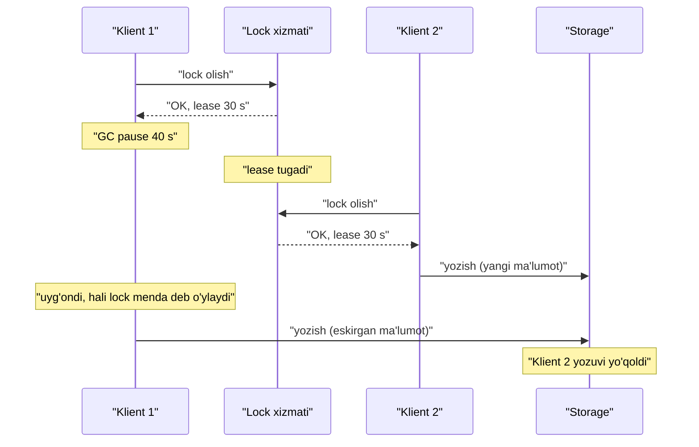
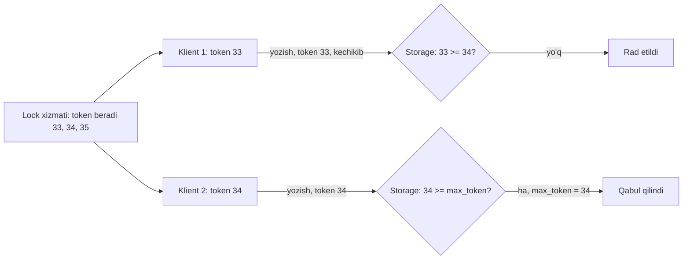

## Bu dars nima uchun kerak

Ko'p tizimlarda "faqat bitta" talabi bor: faqat bitta cron worker hisobotni generatsiya qilsin, faqat bitta servis instance'i Kafka partition'ini o'qisin, faqat bitta tugun PostgreSQL primary bo'lsin, faqat bitta jarayon fayl yoki qatorni o'zgartirsin. Bitta mashinada buni mutex hal qiladi. Taqsimlangan tizimda esa mutex'ning o'rnini **distributed lock** va **leader election** egallaydi - va bu yerda 31-36 darslardagi barcha muammolar bir joyga to'planadi: timeout noaniq, soatlar ishonchsiz, process pause tugunni "muzlatadi", consensus qimmat.

Ko'p jamoalar `SET lock NX PX 30000` yozib, muammo hal bo'ldi deb o'ylaydi. Bu darsda nega bu ko'pincha yetarli emasligini, **fencing token** nima uchun kerakligini va lock'ni to'g'ri qanday qurishni ko'ramiz.

Bu darsdan keyin siz:

- leader election va distributed lock aslida bitta masala ekanini tushunasiz;
- lease (muddatli lock) nima uchun kerak va u qaysi taxminlarga tayanishini bilasiz;
- GC pause va tarmoq kechikishi lease'ni qanday buzishini qadam-baqadam ko'rsata olasiz;
- fencing token qanday ishlashini va uni qayerda tekshirish kerakligini bilasiz;
- Redis (bitta instance va Redlock), ZooKeeper, etcd, PostgreSQL advisory lock va Kubernetes Lease'ni taqqoslay olasiz;
- "samaradorlik uchun lock" va "to'g'rilik uchun lock" ni ajratib, mos vositani tanlay olasiz.

## Bitta masala, ikki nom

- **Distributed lock** - "resurs X ga hozir faqat bitta jarayon kirsin".
- **Leader election** - "bu vazifani hozir faqat bitta jarayon bajarsin". Lider - bu "lider" degan lock'ni ushlab turgan jarayon.

Ikkalasi ham linearizable compare-and-set ga keltiriladi: "agar lock bo'sh bo'lsa, uni menga ber" - atomik, va bir vaqtda faqat bittasi muvaffaqiyatli. 35-darsda ko'rdikki, bu consensus bilan ekvivalent. Demak to'g'ri distributed lock consensus asosidagi tizimda (etcd, ZooKeeper, Consul) yoki linearizable bazada quriladi.

### Ikki maqsad

Kleppmann 2016 yildagi "How to do distributed locking" maqolasida lock'larni ikki turga ajratadi:

| | Samaradorlik (efficiency) | To'g'rilik (correctness) |
|---|---|---|
| Maqsad | Bir xil ishni ikki marta qilmaslik | Ma'lumot buzilishining oldini olish |
| Lock buzilsa | Ortiqcha xarajat, ikki marta email yoki hisob | Ma'lumot yo'qolishi, ikki marta to'lov, buzilgan fayl |
| Yetarli vosita | Bitta Redis instance, `SET NX PX` | Consensus tizimi + fencing token |
| Misol | Kunlik hisobotni bitta worker generatsiya qilsin | Bitta hisob balansini o'zgartirish, faylga yozish |

Birinchi qadam - lock'ingiz qaysi turdaligini aniqlash. Kleppmann ta'kidlaganidek, samaradorlik uchun Redlock kabi murakkab algoritm ortiqcha, to'g'rilik uchun esa u yetarli emas.

## Lease: nega lock muddatli bo'lishi kerak

Oddiy lock: jarayon lock oladi, ishni bajaradi, lock'ni bo'shatadi. Agar jarayon lock ushlab turganda qulasa - lock hech qachon bo'shamaydi (deadlock). Shuning uchun taqsimlangan lock deyarli har doim **lease** - muddatli lock: "lock senda 30 soniyaga". Muddat tugasa, lock avtomatik bo'shaydi. Lease tushunchasi Gray va Cheriton'ning 1989 yildagi SOSP maqolasidan (taqsimlangan fayl cache consistency uchun) keng tarqalgan.

Lease egasi ish uzoq davom etsa, uni **yangilab** turadi (heartbeat). Yangilay olmasa (qulagan, tarmoqdan uzilgan), boshqa jarayon lease'ni oladi.

Lease ikki narsaga tayanadi:

1. Lock xizmati va egasi vaqtni taxminan bir xil o'lchaydi (soat tezligi farqi kichik).
2. Ega lease tugaganini **o'z vaqtida** biladi va ishni to'xtatadi.

Ikkinchisi taqsimlangan tizimda kafolatlanmaydi.

## Muammo: process pause va kechikkan yozuv

Klassik stsenariy:

1. Klient 1 lease oladi (30 s).
2. Klient 1 `if (lease hali amal qiladi)` tekshiruvidan o'tadi va storage'ga yozishga tayyorlanadi.
3. Shu paytda Klient 1'da **stop-the-world GC** boshlanadi va 40 soniya davom etadi (yoki VM migratsiyasi, swap, CPU throttling - 31-dars).
4. Lease muddati tugaydi. Klient 2 lease oladi, ma'lumotni o'qiydi, o'zgartiradi va yozadi.
5. Klient 1 uyg'onadi. U o'zining "muzlaganini" bilmaydi - uning nuqtai nazaridan bir lahza o'tdi. U eski ma'lumot asosida yozadi.
6. Klient 2 ning yozuvi yo'qoldi. Mutual exclusion buzildi.



Kleppmann bu xatoning HBase'da real bo'lganini va stop-the-world GC pause'lar ba'zan bir necha daqiqa davom etganini keltiradi. Tarmoq ham xuddi shunday ta'sir qiladi: so'rov tarmoqda kechikib, lease tugagandan keyin yetib kelishi mumkin; u GitHub'da paketlar taxminan 90 soniya kechikkan holatni misol qiladi.

Muhim: **yozishdan oldin lease'ni tekshirish yordam bermaydi**. Pause tekshiruv va yozuv orasida bo'lishi mumkin. Klient tomonda bu muammoni hal qilib bo'lmaydi.

## Fencing token

Yechim - tekshiruvni **storage tomoniga** ko'chirish.

1. Lock xizmati har bir lock berishda **monoton o'suvchi raqam** (fencing token) qaytaradi: 33, 34, 35, ...
2. Klient storage'ga har bir yozuvda token'ni yuboradi.
3. Storage shu resurs uchun ko'rgan eng katta token'ni eslab qoladi va **kichikroq token bilan kelgan yozuvni rad etadi**.

Yuqoridagi stsenariyda: Klient 1 token 33 oldi, Klient 2 token 34 oldi. Klient 2 34 bilan yozdi - storage endi 34 ni eslaydi. Klient 1 uyg'onib 33 bilan yozmoqchi - rad etildi.



### Token qayerdan olinadi

- **ZooKeeper** - `zxid` (har bir tranzaksiyaning global monoton ID'si) yoki znode versiyasi.
- **etcd** - kalitning `mod_revision` yoki `create_revision` (klaster bo'yicha monoton). etcd'ning lock API'si qaytaradigan kalitning revision'i token sifatida ishlatiladi.
- **Raft yoki Paxos asosidagi tizimlar** - lider termi (36-dars) yoki epoch. "Paxos Made Live" maqolasida Chubby'ning epoch raqami shu vazifani bajaradi (35-dars).
- **PostgreSQL** - sequence yoki versiya ustuni.

### Storage token'ni qanday tekshiradi

Bu dizaynning eng ko'p e'tibordan chetda qoladigan qismi: storage o'zi **shartli yozuvni** qo'llab-quvvatlashi kerak.

```sql
UPDATE vehicles
SET assigned_driver = $1, fence_token = $2
WHERE id = $3 AND fence_token < $2;
-- 0 qator yangilansa - token eskirgan, yozuv rad etildi
```

S3 da shartli yozuv (`If-Match` ETag bilan), DynamoDB'da `ConditionExpression`, Kafka'da producer epoch - hammasi bir xil g'oya. Agar storage hech qanday shartli operatsiyani qo'llab-quvvatlamasa (masalan, oddiy fayl tizimi yoki tashqi API), fencing'ni to'liq qo'llab bo'lmaydi va operatsiyani idempotent qilish kerak (39-dars).

### Fencing Byzantine emas

Fencing token tasodifiy eskirgan klientlardan himoya qiladi, yolg'onchi klientdan emas. Agar klient ataylab katta token yuborsa, himoya yo'q. Data-markaz ichida bu odatda qabul qilinadi (31-darsdagi Byzantine muhokamasi).

## Redis bilan lock

### Bitta instance

Redis hujjatidagi pattern:

```
SET resource_name <tasodifiy_qiymat> NX PX 30000
```

- `NX` - kalit yo'q bo'lsagina o'rnatish;
- `PX 30000` - 30 soniyalik muddat (lease);
- tasodifiy qiymat - har bir klient va har bir urinish uchun noyob (hujjat `/dev/urandom` dan 20 bayt taklif qiladi).

Bo'shatish faqat qiymat **o'ziniki** bo'lsa: oddiy `DEL` boshqa klientning lock'ini o'chirishi mumkin (agar sizniki allaqachon tugagan va boshqa birov olgan bo'lsa). Redis 8.4 dan oldin Lua skript bilan, 8.4 dan boshlab `DELEX key IFEQ value` bilan.

Cheklovlar:

- Redis replikatsiyasi asinxron. Master lock'ni yozib, replikaga yetkazishdan oldin qulasa, ko'tarilgan replika lock haqida bilmaydi va ikkinchi klientga beradi.
- Tasodifiy qiymat monoton emas - uni fencing token sifatida ishlatib bo'lmaydi. `INCR` bilan alohida hisoblagich qilish mumkin, lekin u ham failover'da yo'qolishi mumkin.

Xulosa: bitta Redis instance - **samaradorlik lock'i** uchun yaxshi va sodda.

### Redlock

Redis mualliflari taklif qilgan algoritm: N ta (odatda 5) **mustaqil** Redis master, replikatsiyasiz.

1. Joriy vaqt T1 ni yozib olish.
2. Barcha N instance'da parallel `SET key value NX PX ttl`, har biriga qisqa timeout bilan (masalan 10 soniyalik TTL uchun 5-50 ms).
3. Kamida N/2 + 1 (5 dan 3) instance'da muvaffaqiyatli bo'lsa **va** o'tgan vaqt TTL dan kichik bo'lsa - lock olindi.
4. Haqiqiy amal qilish vaqti = TTL - o'tgan vaqt - soat drift'i uchun zaxira.
5. Muvaffaqiyatsiz bo'lsa - barcha instance'larda bo'shatish.

Hujjatning o'zi qayd etadi: Redis TTL muddati monotonic soatda emas, wall-clock'da hisoblanadi; soat sakrasa, bir nechta jarayon lock olishi mumkin. Hujjat yana bir narsani tan oladi: istalgan distributed lock bilan fencing token ishlatish kerak.

**Kleppmann tanqidi** (2016):

- **Soat sakrashi.** 5 nodadan C ning soati oldinga sakraydi, lock C da muddatidan oldin tugaydi. Klient 1 A, B, C da lock olgan; C dagi lock yo'qolgach Klient 2 C, D, E da oladi. Ikkalasi ham "majority'da lock bor" deb hisoblaydi.
- **Process pause.** Klient so'rovlarni yuborib, javoblarni olishdan oldin muzlaydi; lock hamma joyda tugaydi, keyin u buferda qolgan "OK" javoblarni o'qib, lock unda deb o'ylaydi.
- **Fencing token yo'q.** Redlock'ning tasodifiy qiymati monoton emas; monoton hisoblagich esa yana consensus talab qiladi.
- Natija: Redlock'ning xavfsizligi chegaralangan tarmoq kechikishi, chegaralangan pause va chegaralangan soat xatosiga, ya'ni synchronous modelga (31-dars) tayanadi.

Redis muallifi Salvatore Sanfilippo (antirez) "Is Redlock safe?" degan javob maqolasini yozgan va ba'zi dalillarga qarshi chiqqan; Redis hujjati ikkala maqolaga ham havola beradi. Bahs ochiq, lekin amaliy konsensus shunday: **to'g'rilik uchun lock kerak bo'lsa - consensus tizimi va fencing token; samaradorlik uchun - bitta Redis yetarli; Redlock ikkalasining o'rtasida noqulay joyda**.

## Consensus asosidagi lock: ZooKeeper va etcd

### ZooKeeper

ZooKeeper'ning lock retsepti:

1. Lock tuguni ostida **ephemeral sequential** znode yaratish (`lock-0000000042`).
2. Barcha bolalar ro'yxatini olish.
3. Agar o'z tuguningiz eng kichik raqamli bo'lsa - lock sizda.
4. Aks holda - **faqat o'zingizdan bitta oldingi** tugunga watch qo'yish va o'chirilishini kutish.

Ephemeral tugun klient sessiyasi tugaganda (heartbeat to'xtasa) avtomatik o'chadi - bu lease. Faqat oldingi tugunni kuzatish "herd effect"ni oldini oladi: lock bo'shaganda faqat bitta kutuvchi uyg'onadi, hammasi emas. Leader election retsepti ham xuddi shunday. Fencing token sifatida tugun yaratilgan `zxid` ishlatiladi.

Muhim nozik joy: ZooKeeper sessiyasi tugaganini **klient** server bilganidan kechroq bilishi mumkin (klient tomoni pause). Shuning uchun bu yerda ham fencing kerak.

### etcd

etcd'da lease alohida obyekt: `LeaseGrant(ttl)`, keyin kalit shu lease'ga bog'lanadi, `LeaseKeepAlive` bilan yangilanadi. Lease tugasa, unga bog'langan kalitlar o'chadi. etcd'ning `concurrency` paketi Lock va Election'ni shu ustiga quradi: har bir kutuvchi o'z kalitini yaratadi, eng kichik `create_revision`ga ega bo'lgan - egasi; qolganlar o'zidan oldingisini kuzatadi. Revision - tabiiy fencing token.

Yozuvni "agar men hali lider bo'lsam" sharti bilan bajarish uchun etcd tranzaksiyasi (`Txn`) ishlatiladi: `If(lock kaliti create_revision == mening revision) Then(yozish)`. Bu fencing'ni etcd ichidagi ma'lumot uchun to'liq hal qiladi; tashqi storage uchun esa token'ni o'sha storage'ga uzatish kerak.

### Kubernetes Lease

Kubernetes `coordination.k8s.io` API guruhidagi `Lease` obyektlaridan ikki maqsadda foydalanadi:

- **Node heartbeat** - har bir node uchun `kube-node-lease` namespace'ida Lease; kubelet `renewTime` ni yangilab turadi, control plane shu orqali node tirikligini aniqlaydi (hujjatdagi misolda `leaseDurationSeconds: 40`).
- **Leader election** - kube-controller-manager va kube-scheduler bir nechta replikada ishlaydi, lekin faqat Lease egasi faol. Ularning `--leader-elect-lease-duration`, `--leader-elect-renew-deadline`, `--leader-elect-retry-period` flaglari odatda 15 s, 10 s va 2 s atrofida (aniq qiymatni o'z versiyangiz hujjatidan tekshiring).

O'z servisingizda ham shu mexanizmni client-go yoki boshqa kutubxona orqali ishlatish mumkin. Lease obyektining `resourceVersion` maydoni optimistik concurrency uchun ishlatiladi (etcd revision'iga asoslangan).

## PostgreSQL bilan lock

Agar ma'lumot baribir PostgreSQL'da bo'lsa, ko'pincha alohida lock xizmati kerak emas:

- **Advisory lock** - `pg_try_advisory_lock(key)` sessiya darajasida yoki `pg_try_advisory_xact_lock(key)` tranzaksiya darajasida. Ulanish uzilsa, lock avtomatik bo'shaydi. Lekin ulanish "tirik" bo'lib, ilova muzlagan bo'lsa (pause), lock ushlanib qoladi; aksincha, pooler (PgBouncer transaction mode) orqali sessiya lock'lari kutilmagan xatti-harakat qiladi.
- **Qatorni qulflash** - `SELECT ... FOR UPDATE` yoki `FOR UPDATE SKIP LOCKED` (navbat uchun klassik pattern). Lock tranzaksiya bilan birga yashaydi va ma'lumot o'zgarishi bilan **bitta atomik tranzaksiyada** - bu fencing'ga ehtiyojni yo'qotadi, chunki lock va yozuv bitta tizimda.
- **Versiya ustuni** - optimistik lock: `UPDATE ... WHERE version = $old`. Aslida bu fencing token'ning o'zi.

Asosiy tamoyil: **lock va himoyalanayotgan ma'lumot bitta linearizable tizimda bo'lsa, muammolarning katta qismi yo'qoladi**. Muammo lock bir joyda, ma'lumot boshqa joyda bo'lganda paydo bo'ladi.

## Vositalarni taqqoslash

| Vosita | Xavfsizlik asosi | Fencing token | Lease | Qachon |
|---|---|---|---|---|
| Redis bitta instance | Bitta jarayon, async replika | Yo'q (alohida INCR bilan cheklangan) | PX TTL | Samaradorlik lock'i |
| Redlock | Vaqt taxminlari (synchronous model) | Yo'q | PX TTL, majority | Tavsiya etilmaydi; samaradorlik uchun ortiqcha, to'g'rilik uchun yetarli emas |
| ZooKeeper | ZAB consensus | zxid yoki versiya | Sessiya, ephemeral znode | To'g'rilik lock'i, leader election |
| etcd | Raft | revision | Lease + KeepAlive | To'g'rilik lock'i, Kubernetes ekotizimi |
| PostgreSQL | Bitta primary, tranzaksiya | Versiya ustuni, sequence | Ulanish yoki tranzaksiya | Ma'lumot ham PostgreSQL'da bo'lsa |
| Kubernetes Lease | etcd orqali | resourceVersion | leaseDurationSeconds | K8s ichidagi controller'lar |

## Lease parametrlarini hisoblash

Lease muddatini tanlash - 31-darsdagi timeout trade-off'ining o'zi.

- **Qisqa lease** (masalan 5 s) - ega o'lganda tez almashinadi, lekin GC pause yoki tarmoq tebranishida soxta almashinuvlar ko'p.
- **Uzun lease** (masalan 60 s) - kam soxta almashinuv, lekin ega o'lganda 60 s davomida hech kim ishlamaydi.

**Misol.** Leader election: lease 15 s, yangilash har 2 s, renew deadline 10 s. Lider o'lsa, eng yomon holatda yangi lider 15 s + retry oralig'i 2 s ≈ 17 s ichida ishga tushadi. Agar bu vazifa "har daqiqada bir marta" ishlaydigan job bo'lsa, 17 s uzilish ahamiyatsiz. Agar real-time stream processor bo'lsa - 17 s kechikish ko'rinadi.

Ega o'z lease'ini **xizmat lease'idan oldin** tugagan deb hisoblashi kerak: yangilash renew deadline (10 s) ichida muvaffaqiyatsiz bo'lsa, ega ishni to'xtatadi, garchi xizmatda lease yana 5 s amal qilsa ham. Bu zaxira soat tezligi farqi va kechikishlarni qoplaydi. "Paxos Made Live" ham xuddi shunday qiladi: master replikalardan qisqaroq timeout ishlatadi. Lekin bu zaxira GC pause'ni qoplamaydi - shuning uchun fencing baribir kerak.

## iQuariX kontekstida

Faraz qiling, iQuariX'da quyidagi "faqat bitta" vazifalar bor.

**1. Kunlik yoqilg'i hisoboti generatsiyasi (samaradorlik).** Cron har kecha ishga tushadi, 3 ta replika bor. Ikki replika bir vaqtda ishlasa - ikki marta hisoblash va ehtimol ikkita bir xil email. Yechim: bitta Redis `SET report:2026-10-20 <uuid> NX PX 3600000`; natija jadvalga `(tenant_id, date)` unique kaliti bilan yoziladi - shunda lock buzilsa ham ikkinchi yozuv rad etiladi. Email yuborish idempotency kaliti bilan (39-dars).

**2. Trekerga komanda yuborish (to'g'rilik).** "Dvigatelni bloklash" komandasi trekerga ulangan gateway orqali ketadi. Treker bir vaqtda faqat bitta gateway'ga ulangan bo'lishi kerak. Treker qayta ulanganda yangi gateway etcd'dan `device/<id>/owner` lease kalitini oladi va revision - token. Komanda yuborishda gateway token'ni ham yuboradi; registr servisi `WHERE fence_token <= $token` bilan tekshiradi. Eski gateway (ulanish hali yopilmagan deb o'ylagan) komanda yuborsa, uning token'i eski - rad etiladi.

**3. Kafka consumer'lar.** Partition egaligi consumer group protokoli bilan beriladi va generation ID fencing vazifasini bajaradi (44-dars). O'z lock'ingizni qo'shish shart emas.

**4. Mashinaga haydovchi tayinlash.** Lock kerak emas: PostgreSQL'da `UPDATE vehicles SET driver_id = $1, version = version + 1 WHERE id = $2 AND version = $3`. Lock va ma'lumot bitta tizimda.

**5. Geozona hisoblash worker'i.** Har bir mijoz uchun geozona qoidalarini faqat bitta worker hisoblasin (holatli stream). Kubernetes Lease bilan leader election har mijoz guruhi uchun, natijalar esa `(event_id)` bo'yicha idempotent yoziladi.

## Ko'p uchraydigan xatolar

1. **Lock'ni oddiy `DEL` bilan bo'shatish.** Boshqa klientning lock'ini o'chirasiz. Qiymatni tekshirib o'chiring.
2. **Lease'siz lock.** Ega qulasa, lock abadiy qoladi.
3. **"Yozishdan oldin lease'ni tekshiraman" - yetarli deb o'ylash.** Pause tekshiruv va yozuv orasida bo'ladi. Fencing storage tomonda.
4. **Redlock'ni to'g'rilik lock'i sifatida ishlatish.** Uning xavfsizligi vaqt taxminlariga bog'liq va fencing token bermaydi.
5. **Fencing token yaratib, storage'da tekshirmaslik.** Token faqat qabul qiluvchi uni rad eta olsa foydali.
6. **Lock va ma'lumotni turli tizimlarda saqlash, garchi bittasi yetarli bo'lsa.** PostgreSQL'dagi ma'lumot uchun ko'pincha `FOR UPDATE` yoki versiya ustuni yetarli.
7. **Lease muddatini o'ylamasdan tanlash.** Juda qisqa - soxta almashinuvlar; juda uzun - uzoq uzilish.
8. **Lider o'z liderligini tekshirmasdan ishlashi.** Lider har bir muhim harakatdan oldin yoki token bilan liderlikni tasdiqlashi kerak.

## Xulosa

- Distributed lock va leader election - bitta masala: linearizable compare-and-set, ya'ni consensus.
- Lock'lar ikki xil: samaradorlik (buzilsa ortiqcha ish) va to'g'rilik (buzilsa ma'lumot buziladi). Vositani shunga qarab tanlang.
- Lease ega qulaganda lock'ni bo'shatadi, lekin ega lease tugaganini o'z vaqtida bilishini kafolatlay olmaydi (GC pause, tarmoq kechikishi).
- Fencing token: lock xizmati monoton raqam beradi, storage eng kattasini eslab, kichikini rad etadi. Tekshiruv storage tomonda bo'lishi shart.
- Bitta Redis - samaradorlik lock'i uchun; Redlock vaqt taxminlariga tayanadi va token bermaydi; ZooKeeper va etcd consensus va tabiiy token (zxid, revision) beradi.
- Ma'lumot va lock bitta linearizable tizimda bo'lsa (PostgreSQL `FOR UPDATE`, versiya ustuni), alohida lock xizmati ko'pincha keraksiz.

## Amaliy topshiriq

Faraz qiling: iQuariX'da **"yoqilg'i kartasi limitlarini sinxronlash"** worker'i bor. U har 5 daqiqada yoqilg'i provayderining tashqi API'sidan tranzaksiyalarni oladi, har bir karta uchun sarflangan summani hisoblaydi va limit oshsa kartani provayder API orqali bloklaydi. Worker 3 replikada ishlaydi, faqat bittasi faol bo'lishi kerak. Provayder API shartli yozuvni qo'llab-quvvatlamaydi, lekin har bir so'rovga `request_id` qabul qiladi va takrorlarni 24 soat davomida aniqlaydi.

1. Bu lock samaradorlik uchunmi yoki to'g'rilik uchunmi? Ikkala holatni ham ko'rib chiqing: hisoblash va bloklash alohida.
2. Leader election vositasini tanlang (Redis, etcd, Kubernetes Lease, PostgreSQL advisory lock) va asoslang.
3. Lease muddati, yangilash oralig'i va renew deadline'ni tanlang. Lider o'lganda eng yomon holatdagi uzilishni hisoblang.
4. GC pause stsenariysini yozing: eski lider uyg'onib, kartani bloklash so'rovini yuboradi. Provayder API fencing'ni qo'llab-quvvatlamasa, zararni qanday cheklaysiz?
5. iQuariX'ning o'z bazasidagi holat (karta "bloklangan" belgisi, sarflangan summa) uchun fencing'ni SQL darajasida qanday amalga oshirasiz?

Yaxshi javobda bo'lishi kerak bo'lgan narsalar:

- hisoblash (samaradorlik) va bloklash (to'g'rilik) ajratilgan;
- tanlangan vosita fencing token bera oladi va u qayerda tekshirilishi aniq;
- lease parametrlari raqam bilan va uzilish vaqti hisoblangan;
- tashqi API uchun idempotent `request_id` (masalan karta + davr + harakat asosida deterministik) ishlatilgan;
- o'z bazasida `fence_token` yoki versiya ustuni bilan shartli UPDATE.

Javobni pastdagi maydonga yozib, chatga yuboring.

## Manbalar

- Martin Kleppmann. [How to do distributed locking](https://martin.kleppmann.com/2016/02/08/how-to-do-distributed-locking.html), 2016 - samaradorlik va to'g'rilik, GC pause, fencing token, Redlock tanqidi.
- Redis. [Distributed Locks with Redis](https://redis.io/docs/latest/develop/clients/patterns/distributed-locks/) - `SET NX PX`, xavfsiz bo'shatish, Redlock algoritmi va uning taxminlari.
- Apache ZooKeeper. [Recipes and Solutions](https://zookeeper.apache.org/doc/current/recipes.html) - lock va leader election retseptlari, herd effect.
- Kubernetes. [Leases](https://kubernetes.io/docs/concepts/architecture/leases/) - node heartbeat va leader election.
- Martin Kleppmann, Chris Riccomini. [Designing Data-Intensive Applications, 2-nashr](https://www.oreilly.com/library/view/designing-data-intensive/9781098119058/), O'Reilly, 2026. 9-bob, "Knowledge, Truth, and Lies": haqiqatni ko'pchilik belgilaydi, lider va lock'lar, fencing token.
- [Lease (computer science)](https://en.wikipedia.org/wiki/Lease_(computer_science)), Wikipedia - Gray va Cheriton, SOSP 1989.
- Tushar Chandra va boshq. [Paxos Made Live](https://www.read.seas.harvard.edu/~kohler/class/08w-dsi/chandra07paxos.pdf), PODC 2007 - master lease va epoch raqamlari.
