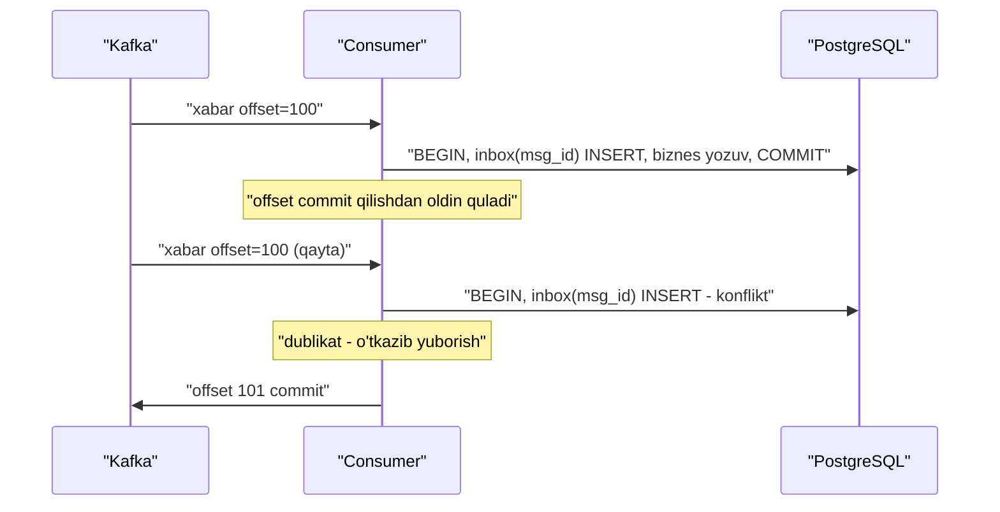
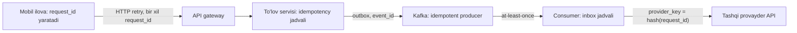

## Bu dars nima uchun kerak

31-darsda asosiy noaniqlikni ko'rdik: so'rovga javob kelmasa, operatsiya bajarilganmi yoki yo'qmi - bilib bo'lmaydi. Yagona amaliy javob - qayta urinish (retry). Lekin retry operatsiyani ikki marta bajarishi mumkin. 36-darsda Raft klient seriya raqamlari bilan, 37-darsda DynamoDB idempotency token bilan, 38-darsda fencing token bilan shu muammoga qayta-qayta duch keldik.

Bu dars shu ipni bir joyga yig'adi. Biz ikki savolga javob beramiz:

1. Operatsiyani qanday qilib **xavfsiz takrorlanadigan** (idempotent) qilish mumkin?
2. Ko'p tizimlar va'da qiladigan **"exactly-once"** aslida nimani anglatadi va nimani anglatmaydi?

Bu mavzu Kafka (43-44 darslar), outbox (48-dars), Saga (49-dars), retry (50, 62-darslar) va to'lov tizimlari (88-dars) uchun poydevor.

Bu darsdan keyin siz:

- idempotency'ning matematik va amaliy ta'rifini bilasiz, tabiiy idempotent va idempotent bo'lmagan operatsiyalarni ajrata olasiz;
- at-most-once, at-least-once, exactly-once yetkazib berish semantikalarini va ular orasidagi farqni bilasiz;
- nima uchun tarmoq ustida "exactly-once delivery" imkonsiz, lekin "exactly-once processing" (effectively-once) mumkin ekanini tushuntira olasiz;
- idempotency key bilan API'ni loyihalay olasiz: saqlash, atomiklik, parallel so'rovlar, TTL, parametr nomuvofiqligi;
- consumer tomonda deduplication'ni (inbox jadvali, tabiiy kalitlar, upsert) to'g'ri qura olasiz;
- Kafka'ning idempotent producer va transaction mexanizmi qaysi chegarada exactly-once beradi, bilasiz.

## Idempotency ta'rifi

Matematikada f idempotent, agar f(f(x)) = f(x). Tizimlarda: operatsiyani bir yoki bir necha marta bajarish **bir xil natija holatini** beradi.

Tabiiy idempotent operatsiyalar:

- `SET x = 5` - necha marta bajarilsa ham x = 5;
- `DELETE WHERE id = 42` - birinchi marta o'chiradi, keyingisi hech narsa qilmaydi;
- `PUT /vehicles/42 {...}` - to'liq holatni yozish;
- HTTP semantikasi bo'yicha GET, PUT, DELETE idempotent; POST va PATCH esa umuman olganda yo'q.

Idempotent **bo'lmagan** operatsiyalar:

- `x = x + 1`, `balance = balance - 100` - har takror natijani o'zgartiradi;
- `INSERT` avtomatik ID bilan - har safar yangi qator;
- "email yubor", "SMS yubor", "kartadan pul yech", "trekerga komanda yubor" - tashqi side effect;
- `POST /orders` - har safar yangi buyurtma.

### Ikki nozik joy

**1. Natija holati vs javob.** `DELETE` ikkinchi marta 404 qaytarishi mumkin - javob boshqacha, lekin holat bir xil. Bu idempotent. Lekin klient uchun qulayroq: AWS Builders' Library maqolasida (Malcolm Featonby) **semantik ekvivalentlik** tavsiya etiladi - takroriy so'rov birinchisi bilan bir xil ma'nodagi javobni olishi kerak, shunda SDK retry'lari ilova kodi uchun ko'rinmas bo'ladi.

**2. Oraliq operatsiyalar.** `SET x = 5` idempotent, lekin quyidagi ketma-ketlikda emas: klient A `SET x = 5` yubordi (kechikdi), klient B `SET x = 7` yozdi, keyin A ning **takroriy** so'rovi keldi va x yana 5 bo'ldi. Idempotency faqat "bir xil operatsiyani takrorlash" ga kafolat beradi, boshqa yozuvlar bilan aralashganda tartibni emas. Buni versiya yoki fencing token (38-dars) hal qiladi.

## Yetkazib berish semantikalari

Xabar (yoki so'rov) jo'natuvchidan qabul qiluvchiga boradi. Uchta kafolat darajasi:

| Semantika | Mexanizm | Xavf | Qachon yetarli |
|---|---|---|---|
| At-most-once | Bir marta yubor, retry yo'q | Xabar yo'qolishi mumkin | Metrika, log namunalari, real-time video kadr |
| At-least-once | Tasdiq kelmaguncha retry | Dublikatlar | Ko'pchilik tizimlar - lekin consumer idempotent bo'lishi shart |
| Exactly-once | At-least-once + deduplication yoki atomik commit | Murakkablik, latency | Pul, inventar, hisob-kitob |

**Muhim:** tarmoq ustida, jo'natuvchi va qabul qiluvchi alohida qulashi mumkin bo'lgan sharoitda, xabarni **fizik jihatdan** aniq bir marta yetkazish imkonsiz. Sabab - 31-darsdagi "javob yo'qoldi" muammosi: jo'natuvchi tasdiq olmasa, qayta yuborishi (dublikat xavfi) yoki yubormasligi (yo'qotish xavfi) kerak. Uchinchi yo'l yo'q.

Shuning uchun "exactly-once" deyilganda aslida **exactly-once processing** yoki **effectively-once** nazarda tutiladi:

> **exactly-once = at-least-once yetkazish + idempotent qayta ishlash (yoki deduplication)**

Xabar ikki marta kelishi mumkin, lekin uning **ta'siri** bir marta.

## Idempotency key: API tomonida

Tabiiy idempotent bo'lmagan operatsiyalar uchun (`POST /payments`) klient har bir mantiqiy operatsiyaga noyob kalit beradi va retry'larda **o'sha kalitni** qayta yuboradi. Server kalit bo'yicha takrorni taniydi.

Bu pattern'ni Stripe ommalashtirgan (Brandur Leach, 2017). Stripe hujjatiga ko'ra (API v1):

- kalit `Idempotency-Key` sarlavhasida, 255 belgigacha; V4 UUID yoki yetarli entropiyali tasodifiy satr tavsiya etiladi; shaxsiy ma'lumotni kalit sifatida ishlatmaslik kerak;
- endpoint bajarilishi **boshlangandan keyin** birinchi so'rovning status kodi va javob tanasi saqlanadi; takrorlar shu javobni oladi, hatto u 500 bo'lsa ham;
- kalitlar kamida 24 soatdan keyin o'chirilishi mumkin; shundan keyin bir xil kalit yangi so'rov hisoblanadi;
- kelgan parametrlar asl so'rov parametrlari bilan solishtiriladi; farq bo'lsa - xato;
- validatsiyadan o'tmagan yoki parallel bajarilayotgan so'rov bilan to'qnashgan so'rovlar uchun natija saqlanmaydi - ularni qayta yuborish mumkin;
- GET va DELETE uchun kalit kerak emas - ular ta'rifi bo'yicha idempotent.

IETF'da `Idempotency-Key` HTTP sarlavhasi uchun httpapi ishchi guruhining draft'i bor (draft-ietf-httpapi-idempotency-key-header, oxirgi versiya 07, 2025-yil 15-oktabr). Datatracker'ga ko'ra draft 2026-aprelda muddati o'tib "Expired" holatiga tushgan va RFC bo'lmagan, shuning uchun uni standart emas, keng tarqalgan konvensiyaning tavsifi sifatida qabul qiling. Unda xato kodlari taklif qilingan: kalit yo'q bo'lsa 400, bir xil kalit boshqa payload bilan 422, birinchi so'rov hali bajarilayotgan bo'lsa 409.

### Server tomonida qanday qurish

Idempotency jadvali (PostgreSQL misolida):

```sql
CREATE TABLE idempotency_keys (
  tenant_id     bigint      NOT NULL,
  key           text        NOT NULL,
  request_hash  bytea       NOT NULL,
  status        text        NOT NULL,  -- 'in_progress' | 'completed'
  response_code int,
  response_body jsonb,
  created_at    timestamptz NOT NULL DEFAULT now(),
  PRIMARY KEY (tenant_id, key)
);
```

Algoritm:

1. So'rov keldi: `(tenant_id, key, hash(parametrlar))`.
2. `INSERT ... ON CONFLICT DO NOTHING` bilan `in_progress` yozuvini yaratishga urinish.
3. Yozuv yaratildi - biz birinchimiz. Biznes operatsiyani bajaramiz.
4. Yozuv allaqachon bor:
   - `request_hash` farq qiladi - 422 (parametr nomuvofiqligi);
   - `status = completed` - saqlangan javobni qaytarish;
   - `status = in_progress` - 409 (hali bajarilmoqda, keyinroq qayta urinib ko'ring).
5. Biznes operatsiya tugagach - javobni saqlab, `completed` qilish.

**Kalit nuqta - atomiklik.** AWS maqolasi ta'kidlaganidek, token yozuvi va biznes o'zgarish **birga** muvaffaqiyatli yoki birga muvaffaqiyatsiz bo'lishi kerak. Eng yaxshi holat: idempotency yozuvi va biznes ma'lumot **bitta bazada, bitta tranzaksiyada**:

```sql
BEGIN;
INSERT INTO idempotency_keys (...) VALUES (...);   -- konflikt bo'lsa - takror
INSERT INTO fuel_events (...) VALUES (...);
UPDATE fuel_cards SET spent = spent + $amount WHERE id = $card;
UPDATE idempotency_keys SET status = 'completed', response_body = $resp WHERE ...;
COMMIT;
```

Agar idempotency jadvali Redis'da, biznes ma'lumot esa PostgreSQL'da bo'lsa, ular orasida "bo'shliq" paydo bo'ladi: Redis'ga yozildi, PostgreSQL commit bo'lmadi (yoki aksincha). Bu 37-darsdagi distributed tranzaksiya muammosining kichik nusxasi.

### Tashqi side effect bo'lsa

Agar operatsiya tashqi tizimni chaqirsa (to'lov provayderi, SMS gateway), lokal tranzaksiya uni qamray olmaydi. Brandur Leach'ning "Implementing Stripe-like Idempotency Keys in Postgres" (2017) maqolasida tasvirlangan yondashuv - **atomik fazalar va recovery point'lar**: operatsiya bir nechta lokal tranzaksiyalarga bo'linadi, har biri oxirida "qayerga yetdik" belgisi saqlanadi; tashqi chaqiruv o'z idempotency kaliti bilan qilinadi (masalan, bizning kalitimizdan deterministik hosil qilingan). Qayta urinishda jarayon oxirgi recovery point'dan davom etadi.

### Kalit qayerda yaratiladi

Kalit **klient tomonda**, mantiqiy operatsiya boshlanganda yaratiladi va barcha retry'larda o'zgarmaydi. Server tomonda yaratilgan kalit foydasiz: klient javobni olmasa, kalitni ham bilmaydi. AWS SDK'lari klient token'ni foydalanuvchi bermasa avtomatik yaratadi va retry'larda qayta ishlatadi.

Ba'zan tasodifiy kalit o'rniga **deterministik** kalit yaxshiroq: `hash(card_id, billing_period, "block")`. Shunda hatto jarayon qayta ishga tushib, xotiradagi UUID'ni yo'qotsa ham, bir xil mantiqiy operatsiya bir xil kalitni oladi.

## Consumer tomonida deduplication

Message broker'lar (Kafka, RabbitMQ, SQS standart navbatlari) odatda at-least-once beradi. Consumer quyidagi stsenariyda dublikat ko'radi: xabarni qayta ishladi, natijani bazaga yozdi, lekin offset/ack'ni commit qilishdan oldin quladi. Qayta ishga tushganda xabar yana keladi.



Usullar:

1. **Inbox (processed messages) jadvali.** Har bir xabarning noyob ID'si biznes yozuv bilan **bitta tranzaksiyada** `processed_messages` jadvaliga yoziladi. Unique constraint dublikatni rad etadi. Bu 48-darsdagi transactional outbox'ning "ko'zgu" pattern'i.
2. **Tabiiy kalit va upsert.** Agar xabar o'zi noyob tabiiy kalitga ega bo'lsa (`device_id, device_time, seq`), `INSERT ... ON CONFLICT DO NOTHING` yetarli - alohida jadval kerak emas.
3. **Offset'ni natija bilan birga saqlash.** Consumer offset'ni Kafka'ga emas, natija bilan bitta bazaga bitta tranzaksiyada yozadi; qayta ishga tushganda offset'ni bazadan o'qiydi. Bu Kafka hujjatida ham tasvirlangan klassik yondashuv.
4. **Versiyalangan yozuvlar.** `UPDATE ... WHERE version < $msg_version` - eski yoki takroriy xabar ta'sir qilmaydi.
5. **Kommutativ yoki CRDT operatsiyalar.** Agar operatsiyalar tartib va takrordan qat'i nazar bir xil natija bersa (masalan, to'plamga qo'shish), deduplication shart emas (40-dars).

### Dedup oynasi

Dublikatlarni qancha vaqt eslab qolish kerak? Bu retry va qayta yetkazishning maksimal kechikishiga bog'liq.

**Hisob.** Masala sharti: consumer kuniga 50 million xabar qayta ishlaydi; inbox yozuvi indeks bilan birga 60 bayt deb olinadi (PostgreSQL'da faqat qator sarlavhasi 23 bayt va line pointer 4 bayt, shuning uchun real qiymatni o'z sxemangizda o'lchang). 7 kunlik oyna: 50M × 7 × 60 B = 21 GB. 1 kunlik oyna: 50M × 60 B = 3 GB. Agar Kafka retention 7 kun va consumer bir hafta orqaga "qayta o'ynatilishi" mumkin bo'lsa, oyna ham 7 kun bo'lishi kerak. Muqobil: tabiiy kalit (alohida jadvalsiz) yoki partition bo'yicha "oxirgi qayta ishlangan offset" ni saqlash - bitta qator per partition.

## Kafka'da exactly-once

Kafka 0.11 (2017) exactly-once semantikasini (EOS) qo'shdi. Ikki mexanizm:

**1. Idempotent producer.** Producer'ga ID beriladi va har bir partition'ga yuborilgan har bir batch ketma-ket raqamga ega. Broker oxirgi raqamni eslab, takroriy batch'ni rad etadi. Bu "producer retry dublikatlari"ni yo'q qiladi. Raqam replikatsiyalangan logda saqlanadi, shuning uchun yangi lider ham dublikatni taniydi. KIP-679 bo'yicha Kafka 3.0.0 dan boshlab producer standarti `acks=all` (avval `acks=1`) va `enable.idempotence=true` ga o'zgardi. Lekin Kafka upgrade notes'ga ko'ra, 3.0.0 va 3.1.0 da bug (KAFKA-13598) tufayli idempotence standarti amalda qo'llanmagan - u faqat 3.0.1, 3.1.1 va 3.2.0 dan boshlab to'g'ri ishlaydi; `acks=all` o'zgarishiga bu bug ta'sir qilmagan. Istisno: 3.0.2 dan boshlab Kafka Connect o'z producer'larida idempotence'ni standart holatda o'chirib qo'yadi.

**2. Transactions.** Producer bir nechta partition'ga yozuvlarni va consumer offset commit'ini **bitta atomik tranzaksiyada** bajaradi (`transactional.id` bilan). Consumer'lar `isolation.level=read_committed` bilan faqat commit qilingan xabarlarni ko'radi. Bu "o'qi - qayta ishla - yoz" (consume-transform-produce) zanjirini atomik qiladi. Kafka Streams'da `processing.guarantee=exactly_once` shu ustiga quriladi.

Narxi (Confluent 2017 maqolasidagi Kafka 0.11 benchmark'i, 1 KB xabarlar, 100 ms tranzaksiyalar): producer throughput `acks=all`, `max.in.flight.requests.per.connection=1` bilan solishtirganda 3% ga, o'sha paytdagi standart `acks=1`, `max.in.flight.requests.per.connection=5` bilan solishtirganda 20% ga pasaygan. Kafka Streams'da 100 ms commit oralig'i bilan throughput 1 KB xabarlarda 15% ga, 100 baytli xabarlarda 30% ga tushgan; 30 soniyalik oraliqda 1 KB va undan katta xabarlar uchun qo'shimcha yuk bo'lmagan.

**Chegara.** Confluent maqolasi aniq aytadi: kafolat Kafka ichidagi holat va Kafka Streams qayta ishlashini qamraydi; **tashqi side effect'lar** (RPC chaqiruvi, tashqi bazaga yozish, email) qamrab olinmaydi. Consumer API bilan tashqi bazaga yozsangiz, idempotency'ni o'zingiz ta'minlashingiz kerak (inbox jadvali yoki offset'ni bazada saqlash). Kafka mexanizmi 43-44 darslarda batafsil ko'riladi.

## End-to-end argument

Saltzer, Reed va Clark'ning klassik "end-to-end argument" g'oyasi bu yerda juda aniq ko'rinadi: TCP paketlarni deduplikatsiya qiladi, Kafka producer batch'larni deduplikatsiya qiladi, lekin foydalanuvchi "To'lash" tugmasini ikki marta bossa yoki mobil ilova so'rovni qayta yuborsa - bu qatlamlarning hech biri yordam bermaydi. Dublikatlarni faqat **operatsiyaning o'zi darajasida**, uchidan-uchiga idempotency kaliti bilan to'liq hal qilish mumkin. Kleppmann DDIA'ning 13-bobida ("The End-to-End Argument for Databases") ham shu fikrni ta'kidlaydi: past qatlamdagi kafolatlar foydali optimallashtirish, lekin ilova darajasidagi idempotency o'rnini bosmaydi.



Har bir bo'g'in o'z dedup mexanizmiga ega, lekin ularni bitta **mantiqiy operatsiya ID'si** bog'laydi.

## Real tizimlardan misollar

- **Stripe** - barcha POST so'rovlar `Idempotency-Key` qabul qiladi, 24 soatlik saqlash, parametr nomuvofiqligi xatosi; API v2 da retry muvaffaqiyatsiz yoki qisman bajarilgan ishni oxirigacha yetkazishga harakat qiladi.
- **AWS EC2** - `ClientToken` (64 ASCII belgigacha; bir xil token boshqa parametr bilan kelsa `IdempotentParameterMismatch`); Featonby maqolasiga ko'ra SDK va CLI token berilmasa uni avtomatik yaratadi va retry'larda qayta ishlatadi, EC2 esa uni resurs hayoti va qo'shimcha oraliq davomida saqlaydi.
- **DynamoDB** - `TransactWriteItems` uchun `ClientRequestToken` 10 daqiqa (37-dars).
- **Kafka** - idempotent producer va transactions (0.11 dan), `read_committed` consumer'lar.
- **Raft** - klient seriya raqamlari bilan state machine darajasida dedup (36-dars).

## iQuariX kontekstida

Quyidagi oqimlar masala sharti sifatida berilgan (iQuariX'ning real arxitekturasi emas).

**1. GPS nuqtalari (tabiiy kalit).** Treker ACK olmasa, nuqtani qayta yuboradi. Har bir nuqta `(device_id, device_time, seq)` ga ega. Time-series jadvalda shu uchlik bo'yicha unique kalit va `ON CONFLICT DO NOTHING` (ClickHouse'da `ReplacingMergeTree` kabi dvigatel bilan "oxir-oqibat" dedup). Alohida idempotency jadvali kerak emas.

**2. Yoqilg'i quyish hodisasi va SMS ogohlantirish.** Hodisa detektori Kafka'dan nuqtalarni o'qiydi va "to'kib olish" hodisasini aniqlaydi. Consumer qayta ishga tushsa, bir xil hodisa ikki marta aniqlanishi va menejerga ikkita SMS ketishi mumkin. Yechim: hodisa ID'si deterministik - `hash(device_id, window_start, event_type)`; hodisa jadvalida unique; SMS yuborish outbox orqali, SMS provayderiga hodisa ID'sidan hosil qilingan kalit bilan.

**3. Dispetcher "Dvigatelni bloklash" tugmasi.** Frontend tugma bosilganda `command_id` (UUIDv7) yaratadi va so'rov qayta yuborilsa ham o'shani ishlatadi. API `(tenant_id, command_id)` bo'yicha idempotency jadvali bilan. Gateway trekerga komandani `command_id` bilan yuboradi; treker oxirgi N ta `command_id` ni eslab, takrorni bajarmaydi (31-darsdagi topshiriq bilan bog'liq).

**4. Oylik billing.** "Mijozga oylik hisob yaratish" operatsiyasi `(tenant_id, billing_month)` deterministik kalit bilan; job ikki marta ishga tushsa ham ikkinchi hisob yaratilmaydi.

**5. Mobil ilova oflayn rejimi.** Haydovchi ilovasi oflayn paytda "smena boshlandi" kabi hodisalarni navbatga qo'yadi va aloqa tiklanganda yuboradi; har birining `client_event_id` si bor. Server qabul qilganini eslaydi - ilova bir xil paketni qayta yuborsa ham dublikat yaratilmaydi.

## Ko'p uchraydigan xatolar

1. **Server tomonda idempotency kalitini yaratish.** Klient javobni olmasa, kalitni bilmaydi. Kalit klient tomonda, retry'lar orasida o'zgarmas.
2. **Idempotency yozuvi va biznes o'zgarishni alohida tranzaksiyalarda saqlash.** Ular orasidagi qulash dublikat yoki "yutilgan" operatsiyaga olib keladi.
3. **Parallel takrorlarni hisobga olmaslik.** Birinchi so'rov hali bajarilayotganda ikkinchisi keladi - `in_progress` holati va 409 kerak.
4. **Parametrlarni solishtirmaslik.** Bir xil kalit boshqa summa bilan kelsa, eski javobni qaytarish xato.
5. **"Kafka exactly-once beradi, demak bizning tizim exactly-once" deb o'ylash.** Tashqi bazaga yozish va tashqi API chaqiruvlari qamrab olinmaydi.
6. **Dedup oynasini retention va replay'dan qisqa qilish.** Eski xabarlar qayta o'ynatilganda dublikatlar o'tib ketadi.
7. **Inkrement operatsiyalarni retry qilish.** `balance = balance - 100` ni idempotency kalitisiz retry - ikki marta yechish.
8. **Idempotency'ni tartib bilan aralashtirish.** Takroriy eski so'rov yangi yozuvning ustiga yozishi mumkin; versiya yoki fencing kerak.

## Xulosa

- Idempotent operatsiya bir necha marta bajarilsa ham natija holati bir xil. Retry faqat idempotent operatsiyalar uchun xavfsiz.
- Tarmoq ustida aniq bir marta yetkazish imkonsiz; amalda exactly-once = at-least-once + idempotent qayta ishlash (effectively-once).
- Idempotency key: klient yaratadi, retry'larda o'zgarmaydi; server javobni saqlaydi, parametrlarni solishtiradi, parallel takrorlarni boshqaradi, kalitlarni TTL bilan o'chiradi.
- Kalit yozuvi va biznes o'zgarish bitta tranzaksiyada bo'lishi kerak.
- Consumer tomonda: inbox jadvali, tabiiy kalit bilan upsert, offset'ni natija bilan birga saqlash yoki versiyalash.
- Kafka EOS (idempotent producer + transactions) Kafka ichida exactly-once beradi; tashqi side effect'lar uchun ilova darajasidagi idempotency shart.
- End-to-end argument: dublikatlarni to'liq faqat operatsiya darajasidagi ID bilan hal qilish mumkin.

## Amaliy topshiriq

Masala sharti: iQuariX **"yoqilg'i to'kib olish ogohlantirishi"** zanjirini qurmoqda: (1) treker nuqtalari Kafka'ga keladi; (2) detektor servisi Kafka'dan o'qib, to'kib olish hodisasini aniqlaydi va PostgreSQL'ga yozadi; (3) notification servisi menejerga SMS va push yuboradi; (4) dispetcher panelida hodisani "ko'rib chiqildi" deb belgilash tugmasi bor.

1. Har bir bo'g'inda (treker - ingest, ingest - Kafka, Kafka - detektor, detektor - bazaga yozuv, notification - SMS provayder, UI - API) qaysi yetkazish semantikasi bor va dublikat qayerdan paydo bo'lishi mumkin?
2. Hodisa ID'sini qanday yaratasiz, shunda detektor qayta ishga tushsa ham bir xil hodisa bir xil ID oladi? Formulani yozing va chegaraviy holatlarni (oyna chegarasi, kechikkan nuqtalar) muhokama qiling.
3. Detektor uchun deduplication strategiyasini tanlang (inbox, tabiiy kalit, offset bazada). SQL sxemasini yozing.
4. SMS provayderi `request_id` ni 24 soat eslaydi. Notification servisi qulab, 30 soatdan keyin qayta ishga tushsa nima bo'ladi? Qanday himoyalanasiz?
5. "Ko'rib chiqildi" tugmasi uchun idempotent API'ni loyihalang: sarlavha, server jadvali, parallel so'rov va boshqa parametr bilan takror holatlari.
6. Dedup jadvallari hajmini hisoblang. Shartlar: kuniga 2 000 hodisa va 50 million GPS nuqtasi.

Yaxshi javobda bo'lishi kerak bo'lgan narsalar:

- har bir bo'g'in uchun semantika va dublikat manbai aniq;
- deterministik hodisa ID'si va uning chegaraviy holatlari;
- dedup yozuvi biznes yozuv bilan bitta tranzaksiyada;
- tashqi provayder dedup oynasidan uzun uzilish uchun o'z "yuborildi" holati;
- 409 va 422 holatlari ajratilgan;
- hajm hisobida GPS nuqtalari uchun alohida jadval emas, tabiiy kalit.

Javobni pastdagi maydonga yozib, chatga yuboring.

## Manbalar

- Stripe. [Idempotent requests](https://docs.stripe.com/api/idempotent_requests) - kalit uzunligi, 24 soat, javobni saqlash, parametr solishtirish.
- Brandur Leach. [Designing robust and predictable APIs with idempotency](https://stripe.com/blog/idempotency), Stripe, 2017 va [Implementing Stripe-like Idempotency Keys in Postgres](https://brandur.org/idempotency-keys), 2017 - atomik fazalar va recovery point'lar.
- Malcolm Featonby. [Making retries safe with idempotent APIs](https://aws.amazon.com/builders-library/making-retries-safe-with-idempotent-APIs/), AWS Builders' Library - client token, semantik ekvivalentlik, atomik yozish, parametr nomuvofiqligi.
- IETF. [The Idempotency-Key HTTP Header Field](https://www.ietf.org/archive/id/draft-ietf-httpapi-idempotency-key-header-07.html), draft-07, 2025 - 400, 409, 422 xato kodlari.
- Neha Narkhede, Guozhang Wang. [Exactly-once Semantics are Possible: Here's How Apache Kafka Does it](https://www.confluent.io/blog/exactly-once-semantics-are-possible-heres-how-apache-kafka-does-it/), Confluent, 2017 - idempotent producer, transactions, performance raqamlari, kafolat chegarasi.
- Apache Kafka. [KIP-679: Producer will enable the strongest delivery guarantee by default](https://cwiki.apache.org/confluence/display/KAFKA/KIP-679%3A+Producer+will+enable+the+strongest+delivery+guarantee+by+default).
- Martin Kleppmann, Chris Riccomini. [Designing Data-Intensive Applications, 2-nashr](https://www.oreilly.com/library/view/designing-data-intensive/9781098119058/), O'Reilly, 2026. 8-bob ("Exactly-Once Message Processing Revisited"), 12-bob "Stream Processing" (Fault Tolerance), 13-bob ("The End-to-End Argument for Databases").
- Apache Kafka. [Upgrade notes, 3.0 branch](https://github.com/apache/kafka/blob/3.0/docs/upgrade.html) ("Notable changes in 3.0.0 / 3.0.1 / 3.0.2") - KIP-679 standartlari, KAFKA-13598 bug'i va 3.0.1/3.1.1/3.2.0 tuzatishi, Connect istisnosi.
- AWS. [Ensuring idempotency in Amazon EC2 API requests](https://docs.aws.amazon.com/ec2/latest/devguide/ec2-api-idempotency.html) - ClientToken qoidalari.
