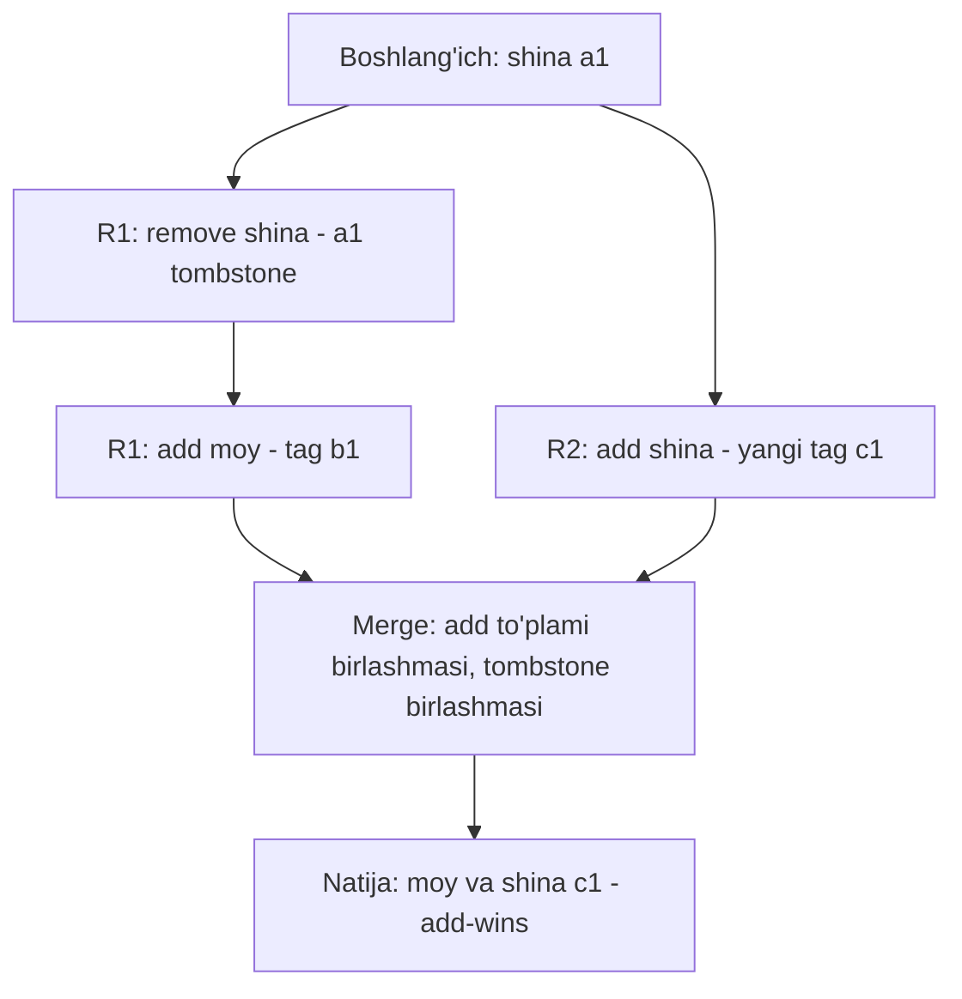

## Bu dars nima uchun kerak

27-darsda multi-leader va leaderless replication'ni ko'rdik: bir nechta replika bir vaqtda yozuv qabul qiladi va ular orasida **konfliktlar** paydo bo'ladi. 32-darsda vector clock bilan concurrent yozuvlarni aniqlashni, 33-34 darslarda esa partition paytida mavjud bo'lib qolish uchun kuchli consistency'dan voz kechish kerakligini ko'rdik. Endi oxirgi savol qoldi: **concurrent yozuvlar aniqlangandan keyin ularni qanday birlashtirish kerak**, shunda barcha replikalar bir xil natijaga kelsin va hech qanday ma'lumot jimgina yo'qolmasin?

Eng sodda javob - last-write-wins (LWW) - ma'lumotni yo'qotadi. Qo'lda birlashtirish (siblings'ni foydalanuvchiga ko'rsatish) murakkab. **CRDT** (Conflict-free Replicated Data Type) - matematik jihatdan kafolatlangan uchinchi yo'l: ma'lumot turini shunday loyihalash-ki, birlashtirish **avtomatik** va **har doim bir xil natija** beradigan bo'lsin.

Bu 4-modulning yakuniy darsi. 35-37 darslarda koordinatsiya (consensus, 2PC) orqali kelishuvga erishdik; bu darsda koordinatsiyasiz kelishuvni ko'ramiz.

Bu darsdan keyin siz:

- konflikt nima ekanini va uni hal qilishning asosiy strategiyalarini (LWW, siblings, ilova logikasi, CRDT) bilasiz;
- strong eventual consistency (SEC) ta'rifini va u oddiy eventual consistency'dan nimasi bilan kuchliroq ekanini bilasiz;
- state-based va operation-based CRDT'larning matematik shartlarini (semilattice, commutativity) tushunasiz;
- G-Counter, PN-Counter, G-Set, 2P-Set, LWW-Register, OR-Set ni qadam-baqadam qurib, birlashtira olasiz;
- "add-wins" va "remove-wins" semantikasi farqini tushunasiz;
- CRDT'ning narxi (metadata, tombstone'lar) va cheklovlarini (invariantlar) bilasiz;
- Redis Active-Active, Riak, Figma va local-first ilovalar konfliktlarni qanday hal qilishini bilasiz.

## Konflikt nima

Ikki yozuv **concurrent** bo'lsa (32-dars: hech biri ikkinchisini "ko'rmagan") va ular bir xil ma'lumotni turlicha o'zgartirsa - konflikt. Masalan:

- Toshkent replikasida mashina nomi "Isuzu-01" ga, Olmaota replikasida "Isuzu NPR" ga o'zgartirildi;
- telefon oflayn holatda vazifalar ro'yxatiga "moy almashtirish" qo'shdi, veb-panel esa ro'yxatdan "shina tekshirish" ni o'chirdi;
- ikki replikada bir vaqtda hisoblagichga 1 qo'shildi.

### Hal qilish strategiyalari

| Strategiya | Qanday ishlaydi | Kamchilik | Misol |
|---|---|---|---|
| LWW (last-write-wins) | Vaqt belgisi kattasi yutadi | Concurrent yozuvlardan biri jimgina yo'qoladi; soat xatosiga bog'liq (32-dars) | Cassandra, Redis Active-Active string'lari |
| Siblings (barcha versiyalarni saqlash) | Baza concurrent versiyalarni saqlaydi, klient birlashtiradi | Har bir klient birlashtirish kodini yozishi kerak | Riak, Dynamo |
| Ilova logikasi (custom merge) | Biznes qoidasi bo'yicha birlashtirish | Har bir tur uchun alohida kod, xato qilish oson | Dynamo savatchasi (birlashma) |
| CRDT | Ma'lumot turi o'zi birlashishni kafolatlaydi | Metadata, cheklangan operatsiyalar | Riak data types, Redis counter va set'lar, Automerge |
| Konfliktdan qochish | Har bir yozuvni bitta "uy" replikasiga yo'naltirish | Uy replikasi o'lsa yoki foydalanuvchi ko'chsa - muammo | Foydalanuvchi bo'yicha region |

### Dynamo savatchasi misoli

Amazon Dynamo maqolasi (SOSP 2007) klassik misol beradi: savatcha versiyalari birlashtirilganda (to'plamlar birlashmasi) "savatga qo'shish" operatsiyasi hech qachon yo'qolmaydi, lekin **o'chirilgan elementlar qayta paydo bo'lishi mumkin**. Sabab: oddiy birlashma "bu element hech qachon bo'lmagan" va "bu element o'chirilgan" ni farqlay olmaydi. Bu muammoni to'g'ri hal qilish - OR-Set (pastda). Dynamo maqolasida yana bir detal: vector clock 10 juftlikka yetganda eng eski juftlik olib tashlanadi - hajmni cheklash uchun, lekin bu sababiyatni aniqlash aniqligini pasaytiradi.

## Strong eventual consistency

33-darsda eventual consistency'ni ko'rdik: yozuvlar to'xtasa, replikalar **oxir-oqibat** bir xil bo'ladi. Bu kafolat juda kuchsiz: qanday qilib bir xil bo'lishi aytilmaydi, ehtimol konfliktni hal qilish uchun qo'shimcha koordinatsiya kerak bo'ladi.

**Strong eventual consistency (SEC)** - Shapiro, Preguiça, Baquero va Zawirski 2011 yilda CRDT'larni formal ta'riflaganda kiritgan tushuncha:

1. **Eventual delivery** - bitta to'g'ri replikaga yetgan har bir yangilanish oxir-oqibat barcha to'g'ri replikalarga yetadi.
2. **Termination** - har bir operatsiya yakunlanadi.
3. **Strong convergence** - **bir xil yangilanishlar to'plamini** olgan ikki replika (qaysi tartibda olganidan qat'i nazar) **darhol** bir xil holatda bo'ladi. Qo'shimcha konflikt hal qilish raundi yo'q.

SEC partition paytida ham har bir replikaga lokal yozishga ruxsat beradi (34-dars: PA/EL) va shunga qaramay convergence matematik jihatdan kafolatlangan. Bu 33-darsdagi "causal consistency partition'da mavjud bo'la oladi" degan natija bilan yaxshi birikadi.

## Ikki turdagi CRDT

### State-based (CvRDT, convergent)

Har bir replika to'liq holatni saqlaydi va vaqti-vaqti bilan uni boshqa replikalarga yuboradi. Qabul qiluvchi `merge(lokal, kelgan)` funksiyasini qo'llaydi. Shart - `merge`:

- **kommutativ**: merge(a, b) = merge(b, a) - tartib muhim emas;
- **assotsiativ**: merge(merge(a, b), c) = merge(a, merge(b, c)) - guruhlash muhim emas;
- **idempotent**: merge(a, a) = a - bir holatni ikki marta olish zarar qilmaydi.

Matematik tilda: holatlar **join-semilattice** hosil qiladi, merge - eng kichik yuqori chegara (least upper bound), va har bir lokal yangilanish holatni faqat "yuqoriga" siljitadi (monoton).

Afzalligi: tarmoq ham dublikat, ham tartibsiz, ham yo'qotuvchi bo'lishi mumkin - gossip bilan baribir ishlaydi. Idempotentlik tufayli 39-darsdagi dedup kerak emas. Kamchiligi: har safar butun holatni yuborish qimmat (delta-state CRDT'lar shu muammoni kamaytiradi - faqat o'zgargan qismini yuborish).

### Operation-based (CmRDT, commutative)

Replika har bir operatsiyani (masalan "inc", "add(x)") boshqalarga yuboradi. Shartlar:

- **concurrent operatsiyalar kommutativ** bo'lishi kerak;
- yetkazib berish **exactly-once** (dublikatsiz) va odatda **causal tartibda** bo'lishi kerak.

Afzalligi: xabarlar kichik. Kamchiligi: ishonchli causal broadcast kerak - bu 39-darsdagi barcha dedup muammolarini qaytarib olib keladi.

Ikkala tur ham bir-birini emulyatsiya qila oladi (Shapiro va boshq. 2011 ekvivalentlikni ko'rsatgan), shuning uchun tanlov - tarmoq va narx masalasi.

## Asosiy CRDT'lar

### G-Counter (faqat o'suvchi hisoblagich)

Muammo: oddiy `counter = counter + 1` ni ikki replikada bajarib, keyin LWW bilan birlashtirsak, bitta inkrement yo'qoladi. Hatto ikkala qiymatni qo'shsak ham - takroriy merge'da ikki marta sanaladi (idempotent emas).

Yechim: har bir replika uchun **alohida** slot. Holat - vektor `P[1..N]`.

- `inc()` replika i da: `P[i] = P[i] + 1`.
- `value()`: barcha slotlar yig'indisi.
- `merge(A, B)`: har bir slot bo'yicha **maksimum**: `P[k] = max(A[k], B[k])`.

**Misol.** Uch replika R1, R2, R3, boshlang'ich [0,0,0].

- R1 da 3 marta inc: R1 = [3,0,0].
- R2 da 2 marta inc: R2 = [0,2,0].
- R1 va R2 holat almashadi: max -> [3,2,0], ikkalasida value = 5.
- R3 da 1 marta inc: R3 = [0,0,1].
- R3 R1 dan holat oladi: [3,2,1], value = 6.
- R1 ning eski holati [3,0,0] tarmoqda kechikib R3 ga yana keldi: max([3,2,1],[3,0,0]) = [3,2,1]. O'zgarmadi - idempotent.

Max kommutativ, assotsiativ va idempotent - shartlar bajarildi.

### PN-Counter (kamayadigan hisoblagich)

Ikkita G-Counter: P (qo'shishlar) va N (ayirishlar). `value = sum(P) - sum(N)`. Merge - ikkalasi ham alohida max bilan.

Muhim cheklov: PN-Counter "qiymat 0 dan pastga tushmasin" kabi **invariantni** ta'minlay olmaydi. Ikki replika bir vaqtda oxirgi 1 birlikni ayirsa, natija -1. Bu CRDT'larning fundamental chegarasi - pastda qaytamiz.

### G-Set va 2P-Set

- **G-Set** - faqat qo'shiladigan to'plam. Merge - birlashma (union). Trivial, lekin foydali: masalan "ko'rilgan hodisa ID'lari".
- **2P-Set** (two-phase set) - ikkita G-Set: qo'shilganlar A va o'chirilganlar R (tombstone). Element bor, agar A da bor va R da yo'q bo'lsa. **Remove-wins**: concurrent qo'shish va o'chirishda o'chirish yutadi. Kamchilik: o'chirilgan elementni **qayta qo'shib bo'lmaydi** - u R da abadiy qoladi.

### LWW-Register va LWW-Element-Set

- **LWW-Register** - bitta qiymat va vaqt belgisi `(value, timestamp, replicaId)`. Merge: kattaroq `(timestamp, replicaId)` yutadi (teng bo'lsa replica ID - 32-darsdagi Lamport tie-break). Bu CRDT - convergence kafolatlangan, lekin concurrent yozuvlardan biri yo'qoladi. Vaqt belgisi sifatida HLC (32-dars) ishlatish wall-clock'dan xavfsizroq.
- **LWW-Element-Set** - har bir element uchun qo'shish va o'chirish vaqt belgilari; qaysi biri keyinroq bo'lsa, shu holat. 2P-Set'dan farqli, qayta qo'shish mumkin. Lekin soat xatosi muammosi qoladi.

### OR-Set (Observed-Remove Set)

Eng amaliy to'plam CRDT'si. G'oya: har bir **qo'shish** noyob tag oladi (masalan, `(replicaId, counter)` yoki UUID). O'chirish faqat o'chiruvchi **ko'rgan** tag'larni o'chiradi.

- `add(e)`: yangi noyob tag t yaratib, `(e, t)` ni qo'shilganlar to'plamiga qo'shish.
- `remove(e)`: lokal ko'rinadigan barcha `(e, t)` tag'larni o'chirilganlar to'plamiga ko'chirish.
- `lookup(e)`: e ning kamida bitta tag'i qo'shilganlarda bor va o'chirilganlarda yo'q bo'lsa - bor.
- `merge`: ikkala to'plam bo'yicha birlashma.

Natija - **add-wins** semantikasi: concurrent `add(e)` va `remove(e)` bo'lsa, `remove` yangi tag'ni ko'rmagan, shuning uchun u o'chirilmaydi va element qoladi.

**Misol.** Vazifalar ro'yxati. R1 va R2 da boshlang'ich holat: {"shina" tag a1}.

- R1 (oflayn telefon): `remove("shina")` - a1 ni o'chiradi. Keyin `add("moy")` - tag b1.
- R2 (veb-panel), concurrent: `add("shina")` - yangi tag c1 (masalan, dispetcher yana qo'shdi).
- Merge: qo'shilganlar {shina:a1, moy:b1, shina:c1}, o'chirilganlar {shina:a1}.
- Natija: {"moy", "shina"} - chunki shina:c1 o'chirilmagan.

Dynamo savatchasidagi muammo hal bo'ldi: o'chirilgan element qaytib kelmaydi (a1 o'chirildi), concurrent yangi qo'shish esa saqlanadi.

Redis Active-Active'ning set'lari aynan shunday ishlaydi - hujjatda: o'chirish faqat o'zi ko'rgan nusxalarni o'chiradi, qolgan barcha holatlarda qo'shish yutadi.

### Murakkabroq CRDT'lar

- **Map** - kalitlar bo'yicha ichki CRDT'lar (masalan, har bir kalit - OR-Set yoki LWW-Register). Riak'ning data types'i va Redis Active-Active'ning hash'lari (maydon darajasida konflikt hal qilish) shunday.
- **Sequence CRDT'lar** - matnni hamkorlikda tahrirlash uchun: Treedoc, RGA, WOOT, Logoot, LSEQ. Har bir belgi noyob identifikator va tartib ma'lumotiga ega. Automerge va Yjs kabi kutubxonalar shu oilaga kiradi. Bu 97-darsda (collaborative editing) chuqur ko'riladi.

## CRDT'ning narxi va cheklovlari

### Metadata va tombstone'lar

- G-Counter vektori replikalar soniga proporsional: 5 replika - 5 son, arzon. Lekin har bir **klient** (masalan, 100 000 mobil ilova) replika bo'lsa, har bir hisoblagich 100 000 slotli bo'ladi.
- OR-Set har bir qo'shish uchun tag va har bir o'chirish uchun tombstone saqlaydi. O'chirilgan ma'lumot "yo'qolmaydi".

**Hisob.** Har bir mashina uchun "faol ogohlantirishlar" OR-Set'i. Kuniga 20 ta ogohlantirish qo'shilib, o'chiriladi; har tag + tombstone taxminan 32 bayt. 10 000 mashina, 1 yil: 10 000 × 20 × 365 × 32 B ≈ 2.3 GB faqat tombstone'lar uchun, holbuki faol ogohlantirishlar bor-yo'g'i bir necha MB. Shuning uchun tombstone'larni tozalash (garbage collection) kerak - lekin buni xavfsiz qilish uchun **barcha replikalar** tombstone'ni ko'rganini bilish kerak, bu esa koordinatsiya talab qiladi.

### Invariantlar

CRDT'lar konfliktsiz birlashadi, lekin **global invariantlarni** kafolatlay olmaydi:

- "Balans 0 dan past bo'lmasin" - ikki replika bir vaqtda oxirgi pulni yechadi.
- "Username noyob bo'lsin" - ikki replika bir xil nomni beradi.
- "Mashinada bir vaqtda faqat bitta haydovchi" - ikki replika ikki haydovchini tayinlaydi.

Bular 33-darsda ko'rganimizdek linearizable operatsiyalar va koordinatsiya (consensus) talab qiladi. Amaliy murosaga misol - **escrow / bounded counter**: umumiy limitni replikalar orasida oldindan taqsimlash (34-darsdagi Brewer'ning bankomat misoli). Har bir replika o'z ulushi doirasida lokal ishlaydi; ulush tugasa, boshqalardan so'raydi (bu yerda koordinatsiya kerak).

### Semantik kutilmagan natijalar

CRDT "to'g'ri" birlashtiradi, lekin natija har doim foydalanuvchi kutganidek emas. Masalan, ikki kishi bir vaqtda matndagi bir xil so'zni turli so'zga almashtirsa, sequence CRDT ikkala so'zni ham saqlab, "AliVali" ni berishi mumkin. Matematik convergence semantik to'g'rilik degani emas.

## Strategiyalarni taqqoslash

| Jihat | LWW | Siblings + ilova merge | CRDT | Consensus (koordinatsiya) |
|---|---|---|---|---|
| Ma'lumot yo'qolishi | Ha, jimgina | Yo'q | Yo'q (semantika bo'yicha) | Yo'q |
| Partition'da yozish | Ha | Ha | Ha | Faqat majority tomonda |
| Yozish latency | Lokal | Lokal | Lokal | Majority round-trip |
| Invariantlar | Yo'q | Ilova kodiga bog'liq | Yo'q (escrow'siz) | Ha |
| Murakkablik | Juda past | Yuqori (har klientda) | O'rta (tayyor kutubxona bilan) | Infratuzilmada |
| Metadata | Vaqt belgisi | Vector clock | Vektor, tag, tombstone | Log |

## Real tizimlardan misollar

- **Redis Enterprise Active-Active** - geo-taqsimlangan bazada faqat CRDT'lar ishlatiladi va hujjat modelni strong eventual consistency deb ataydi. String'lar va bitfield'lar LWW (OS wall-clock vaqt belgisi bilan); `INCR` / `INCRBY` bilan ishlatilgan string'lar esa hisoblagich sifatida semantik birlashtiriladi - barcha regionlardagi operatsiyalar yig'iladi (hujjatdagi misolda 7 + 3 - 3 + 6 = 13). Set'lar - observed-remove, add-wins.
- **Riak** - CRDT asosidagi data types (counter, set, map, register, flag). Wikipedia ma'lumotiga ko'ra League of Legends o'yin chatida Riak CRDT'laridan foydalangan - 7.5 million bir vaqtdagi foydalanuvchi va soniyasiga 11 000 xabar.
- **SoundCloud Roshi** - Redis ustidagi LWW-element-set, stream uchun ochiq manbali.
- **Apple Notes** - Wikipedia ma'lumotiga ko'ra qurilmalar orasida oflayn tahrirlarni sinxronlash uchun CRDT ishlatadi.
- **Figma** - sof CRDT emas. Figma muhandislik blogiga ko'ra, server markaziy avtoritet bo'lgani uchun ular CRDT g'oyalaridan ilhomlanib, soddaroq tizim qurishgan: har bir hujjat alohida server jarayonida; konflikt **obyekt xususiyati** darajasida LWW (turli xususiyatlarni o'zgartirish konflikt emas); tartib uchun "fractional indexing" - har bir bola 0 va 1 orasidagi kasr pozitsiyaga ega, ikki obyekt orasiga qo'shish o'rta qiymatni oladi. Saboq: markaziy server bo'lsa, to'liq CRDT shart emas.
- **Local-first software** - Kleppmann, Wiggins, van Hardenberg va McGranaghan (Onward! 2019) maqolasi: ma'lumot avval foydalanuvchi qurilmasida, sinxronizatsiya CRDT (Automerge) orqali. Mualliflar CRDT'larni local-first'ning poydevori bo'lishi mumkin deb hisoblaydi, lekin uzoq tarix bilan performance muammolarini ham qayd etadi.

## iQuariX kontekstida

Faraz qiling, iQuariX **haydovchi mobil ilovasi** ishlab chiqmoqda. Haydovchilar ko'pincha qishloq yo'llarida, mobil aloqa yo'q joylarda bo'ladi. Ilova oflayn ishlashi va keyin server bilan sinxronlashishi kerak. Server tomonda esa dispetcher veb-paneli ham shu ma'lumotlarni o'zgartiradi.

**1. Reys check-list'i (OR-Set).** "Reys oldidan tekshiruv" ro'yxati: shina, moy, chiroqlar, hujjatlar. Haydovchi oflayn holatda bandlarni belgilaydi, dispetcher esa shu payt yangi band qo'shadi ("sovutgich harorati"). OR-Set bilan: haydovchining belgilashlari ham, dispetcherning qo'shgan bandi ham saqlanadi. LWW bilan butun ro'yxat bitta qiymat sifatida yozilsa - biri ikkinchisini o'chirib yuboradi.

**2. Probeg va voqealar hisoblagichi (G-Counter / PN-Counter).** "Bugun nechta yetkazib berish bajarildi" - har bir qurilma (haydovchi telefoni, treker, dispetcher korreksiyasi) o'z slotiga ega. Oflayn telefon 5 ta yetkazib berishni sanadi, dispetcher qo'lda 1 ta qo'shdi - sinxronlashdan keyin 6, ikki marta sinxronlansa ham 6.

**3. Mashina kartochkasi maydonlari (maydon bo'yicha LWW-Register, HLC bilan).** Haydovchi "izoh" maydonini, dispetcher "marshrut" maydonini o'zgartirsa - konflikt yo'q (Figma kabi xususiyat darajasida). Ikkalasi bir maydonni o'zgartirsa - kechroq HLC yutadi va UI'da "boshqa foydalanuvchi o'zgartirgan" belgisi ko'rsatiladi.

**4. Nima CRDT bilan qilinmaydi.** Yoqilg'i kartasi limiti va "mashinada bitta faol haydovchi" - invariantlar. Ular server tomonda linearizable tranzaksiya bilan (33, 38-darslar). Oflayn ilova bu operatsiyani "so'rov" sifatida navbatga qo'yadi va server tasdiqlaguncha "kutilmoqda" ko'rsatadi.

**5. Tombstone tozalash.** Check-list har bir reys bilan yangilanadi. Reys yopilgandan keyin (server uni yakunlangan deb belgilagach) uning OR-Set metadata'si arxivlanadi - bu tabiiy "barcha replikalar ko'rdi" nuqtasi.

## Ko'p uchraydigan xatolar

1. **LWW'ni "konflikt hal qilish" deb hisoblash.** U konfliktni hal qilmaydi, concurrent yozuvlardan birini jimgina tashlaydi.
2. **Hisoblagichni oddiy son sifatida replikatsiya qilish.** Ikki replika inkrementi LWW'da biri yo'qoladi, yig'ishda esa takroriy merge ikki marta sanaydi.
3. **2P-Set'ni qayta qo'shish kerak bo'lgan joyda ishlatish.** O'chirilgan element abadiy o'chirilgan qoladi.
4. **CRDT bilan invariantni saqlashga urinish.** Balans, noyoblik, "bitta faol" - koordinatsiya yoki escrow kerak.
5. **Tombstone va metadata o'sishini hisobga olmaslik.** Uzoq yashaydigan obyektlarda metadata ma'lumotdan kattalashadi.
6. **Har bir klientni vektor slotiga aylantirish.** Vektor hajmi klientlar soniga teng bo'lib ketadi.
7. **Op-based CRDT'ni dedup'siz tarmoqda ishlatish.** Op-based CRDT exactly-once va causal yetkazishni talab qiladi.
8. **Matematik convergence'ni semantik to'g'rilik deb o'ylash.** Natijani foydalanuvchi nuqtai nazaridan tekshiring.

## Xulosa

- Konflikt - concurrent yozuvlar bir ma'lumotni turlicha o'zgartirganda. Strategiyalar: LWW, siblings, ilova merge, CRDT, konfliktdan qochish.
- Strong eventual consistency: bir xil yangilanishlarni olgan replikalar tartibdan qat'i nazar darhol bir xil holatda.
- State-based CRDT: merge kommutativ, assotsiativ, idempotent (semilattice) - dublikat va tartibsiz tarmoqqa chidamli. Op-based: concurrent operatsiyalar kommutativ, lekin exactly-once causal yetkazish kerak.
- G-Counter (slot bo'yicha max), PN-Counter (ikki G-Counter), G-Set, 2P-Set (remove-wins, qayta qo'shib bo'lmaydi), LWW-Register, OR-Set (noyob tag'lar, add-wins).
- CRDT'ning narxi - metadata va tombstone'lar; asosiy chegarasi - global invariantlarni ta'minlay olmaydi.
- Redis Active-Active, Riak, Apple Notes CRDT ishlatadi; Figma markaziy server bilan soddalashtirilgan xususiyat darajasidagi LWW ishlatadi.
- To'g'ri arxitektura ko'pincha aralash: CRDT konfliktsiz birlashadigan ma'lumot uchun, consensus invariantlar uchun.

## Amaliy topshiriq

Faraz qiling: iQuariX **"oflayn-first haydovchi ilovasi"** uchun sinxronizatsiya qatlamini loyihalayapsiz. Ma'lumotlar: (a) reys check-list'i, (b) haydovchi izohlari (erkin matn, bitta maydon), (c) bajarilgan yetkazib berishlar soni, (d) yuk ro'yxati (mijoz qo'shishi yoki olib tashlashi mumkin), (e) yoqilg'i kartasi limiti, (f) "smena boshlandi/tugadi" holati. Har bir ma'lumotni haydovchi telefoni (oflayn bo'lishi mumkin) va dispetcher veb-paneli o'zgartira oladi.

1. Har bir ma'lumot (a-f) uchun konflikt strategiyasini tanlang (LWW, CRDT turi, consensus) va asoslang.
2. (c) uchun G-Counter yoki PN-Counter'ni loyihalang: slotlar kim (qurilma, foydalanuvchi, server)? 3 qurilma va 2 sinxronlash bilan misolni qadam-baqadam hisoblang.
3. (d) uchun OR-Set'ni loyihalang. Stsenariy: haydovchi oflayn holatda "A yuk" ni olib tashladi, dispetcher bir vaqtda "A yuk" ni yangi miqdor bilan qayta qo'shdi. Natija qanday bo'ladi va bu biznes uchun to'g'rimi?
4. Tombstone va metadata hajmini hisoblang: 5 000 haydovchi, kuniga 3 reys, har reysda 15 band check-list va 10 yuk. Tozalash qachon va qanday xavfsiz?
5. (e) va (f) uchun oflayn holatda foydalanuvchi tajribasini loyihalang: telefon nima ko'rsatadi, server qachon tasdiqlaydi, rad etilsa nima bo'ladi?

Yaxshi javobda bo'lishi kerak bo'lgan narsalar:

- invariantli ma'lumot (e, f) CRDT'dan ajratilgan va koordinatsiya bilan hal qilingan;
- G-Counter hisobida slot bo'yicha max va idempotent takroriy merge ko'rsatilgan;
- OR-Set stsenariysida add-wins natijasi va uning biznes ma'nosi muhokama qilingan;
- metadata hajmi raqam bilan va tombstone tozalash uchun "hamma ko'rdi" nuqtasi aniqlangan;
- LWW tanlangan joyda HLC yoki server vaqti ishlatilgan va ma'lumot yo'qolishi ochiq tan olingan.

Javobni pastdagi maydonga yozib, chatga yuboring.

## Manbalar

- Marc Shapiro, Nuno Preguiça, Carlos Baquero, Marek Zawirski. "Conflict-free Replicated Data Types", SSS 2011 - SEC, state-based va op-based CRDT ta'riflari va ekvivalentligi. Umumiy sharh va turlar katalogi: [Conflict-free replicated data type](https://en.wikipedia.org/wiki/Conflict-free_replicated_data_type), Wikipedia.
- Giuseppe DeCandia va boshq. [Dynamo: Amazon's Highly Available Key-value Store](https://www.allthingsdistributed.com/files/amazon-dynamo-sosp2007.pdf), SOSP 2007 - savatcha birlashtirish va vector clock kesish.
- Redis. [Active-Active databases](https://redis.io/docs/latest/operate/rs/databases/active-active/), [Strings and counters](https://redis.io/docs/latest/operate/rs/databases/active-active/develop/data-types/strings/) va [Sets](https://redis.io/docs/latest/operate/rs/databases/active-active/develop/data-types/sets/) - LWW string'lar, semantik counter'lar, observed-remove set'lar.
- Figma. [How Figma's multiplayer technology works](https://www.figma.com/blog/how-figmas-multiplayer-technology-works/) - markaziy server, xususiyat darajasidagi LWW, fractional indexing.
- Martin Kleppmann, Adam Wiggins, Peter van Hardenberg, Mark McGranaghan. [Local-first software: you own your data, in spite of the cloud](https://www.inkandswitch.com/essay/local-first/), Onward! 2019 - CRDT va Automerge amaliyoti.
- Martin Kleppmann, Chris Riccomini. [Designing Data-Intensive Applications, 2-nashr](https://www.oreilly.com/library/view/designing-data-intensive/9781098119058/), O'Reilly, 2026. 6-bob (multi-leader va leaderless replication'da konfliktlarni hal qilish, CRDT).
- Eric Brewer. [CAP Twelve Years Later](https://www.infoq.com/articles/cap-twelve-years-later-how-the-rules-have-changed/), 2012 - partition'dan keyin tiklanishda CRDT va version vector'lar.
