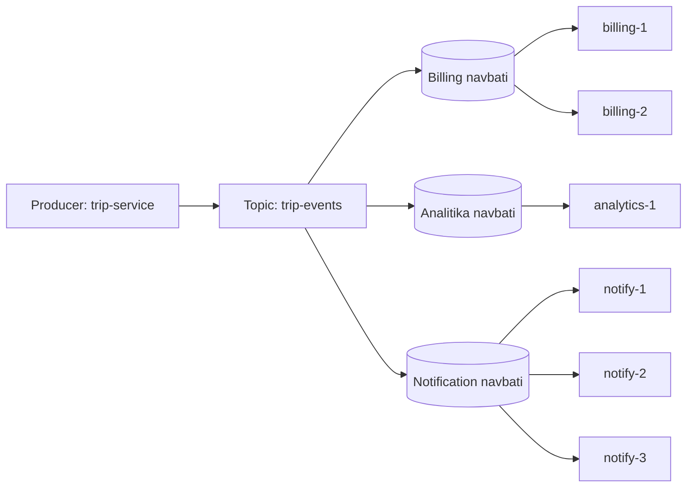
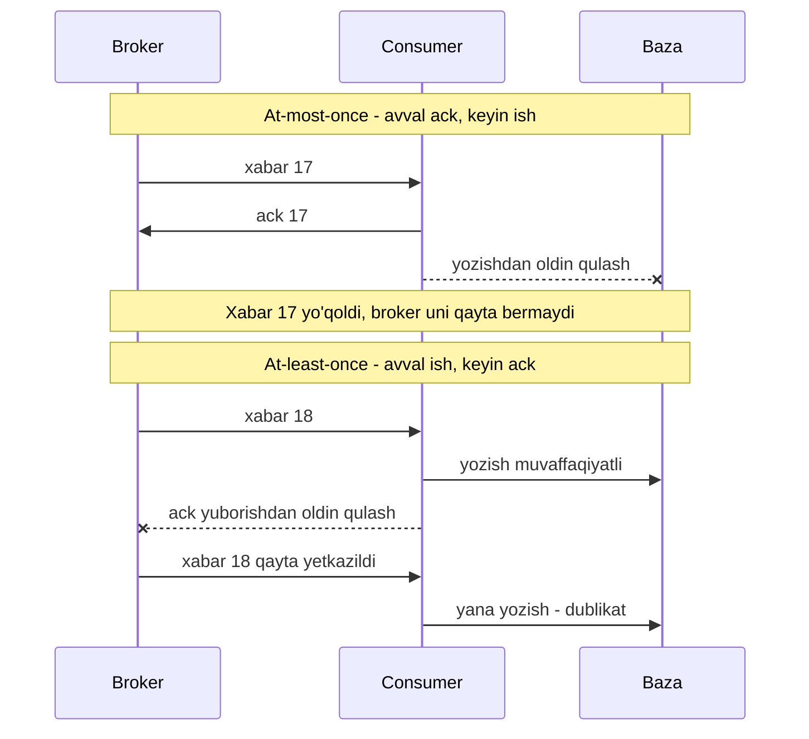

## Bu dars nima uchun kerak

Shu paytgacha ko'rgan tizimlarimizning ko'pchiligi sinxron edi: mijoz so'rov yuboradi, servis javob qaytarguncha kutadi. Bu model sodda, lekin uchta jiddiy cheklovi bor:

1. **Temporal coupling (vaqt bo'yicha bog'liqlik).** Chaqiruvchi va chaqiriluvchi bir vaqtda ishlab turishi shart. Notification servisi 2 daqiqa o'chsa, "safar yakunlandi" hodisasini yuboruvchi servis ham xato qaytaradi yoki o'zi retry qilishi kerak.
2. **Cho'qqi yuklama to'g'ridan-to'g'ri pastga uzatiladi.** Ertalab 8:00 da 10 ming treker birdan ulansa, ularning har bir yozuvi bazaga darhol tushadi. Baza 3 ming yozuv/s ko'tarsa, ortig'i timeout bo'ladi.
3. **Fan-out qimmat.** Bitta hodisani 5 ta servis bilishi kerak bo'lsa, ishlab chiqaruvchi 5 ta servisni bilishi, 5 ta chaqiruv qilishi va har birining xatosini boshqarishi kerak.

Message queue (xabar navbati) bu uchala muammoni bitta g'oya bilan yechadi: ishlab chiqaruvchi xabarni **broker**ga beradi va ketadi, iste'molchi uni o'zi tayyor bo'lganda oladi. Lekin bepul hech narsa yo'q: endi "xabar yetib bordimi", "ikki marta yetib bormadimi", "tartib saqlandimi" degan savollar paydo bo'ladi. 31-darsda ko'rganimizdek, tarmoqda javob kelmasa, so'rov bajarilganmi yoki yo'qmi, bilib bo'lmaydi. Navbat bu muammoni yo'qotmaydi, uni boshqa joyga ko'chiradi.

Bu darsdan keyin siz:

- sinxron va asinxron aloqaning qachon qaysi biri to'g'ri ekanini asoslab bera olasiz;
- point-to-point (competing consumers) va publish/subscribe modellarini va ularning gibridlarini ajrata olasiz;
- push va pull iste'mol modellarining trade-offlarini bilasiz;
- at-most-once, at-least-once va exactly-once semantikasi ack qayerda bo'lishiga qanday bog'liqligini sequence diagramda ko'rsata olasiz;
- "exactly-once" marketing da'vosini qanday tekshirishni bilasiz;
- navbat hajmi va bo'shash (drain) vaqtini hisoblay olasiz.

## Asosiy tushunchalar va so'zlar

- **Producer (ishlab chiqaruvchi, publisher)** - xabarni yuboradigan tomon.
- **Consumer (iste'molchi, subscriber)** - xabarni oladigan va qayta ishlaydigan tomon.
- **Broker** - xabarlarni qabul qiladigan, saqlaydigan va tarqatadigan oraliq servis: RabbitMQ, Kafka, Amazon SQS, Google Pub/Sub, NATS.
- **Message (xabar)** - payload (bayt massivi) va metadata (header, kalit, vaqt belgisi, ID).
- **Channel / queue / topic** - xabarlar yuboriladigan nomlangan manzil. Har bir broker bu so'zlarni biroz boshqacha ishlatadi, shuning uchun brokerga xos ma'noni har doim tekshiring.
- **Acknowledgement (ack)** - consumer brokerga "bu xabar bilan ishim tugadi" deydi. Delivery semantikasining hammasi aynan ack qachon yuborilishiga bog'liq.

Ikki xil "xabar" turini ajratish foydali:

- **Command (buyruq)** - "buni bajar": `SendSms`, `GenerateReport`. Odatda bitta qabul qiluvchisi bor va u bajarishi kutiladi.
- **Event (hodisa)** - "bu sodir bo'ldi": `TripCompleted`, `FuelDropDetected`. Producer kim tinglashini bilmaydi va bilishi ham shart emas. Event-driven arxitektura 46-darsda chuqur ko'riladi.

Buyruqlar ko'proq point-to-point modelga, hodisalar pub/sub ga tabiiy mos keladi.

## Asinxron aloqa nima beradi

### Load leveling (yuklamani tekislash)

Navbat - bu bufer. Producer tezligi λ_in, consumer tezligi μ bo'lsa, λ_in > μ bo'lgan har bir soniyada navbat (λ_in - μ) ta xabarga o'sadi. Cho'qqi o'tgach, λ_in < μ bo'lganda navbat bo'shaydi. Consumer'larni o'rtacha yuklamaga qarab o'lchash mumkin, cho'qqiga emas.

**Hisob-kitob.** Deylik, ertalab 1 soat davomida trekerlar 5 000 xabar/s yuboradi, consumer'lar esa 2 000 xabar/s qayta ishlay oladi.

- Navbat o'sish tezligi: 5 000 - 2 000 = 3 000 xabar/s.
- 1 soatdan keyin navbatda: 3 000 × 3 600 = **10.8 mln xabar**.
- Har bir xabar 300 bayt bo'lsa: 10.8 mln × 300 B = taxminan **3.24 GB**. Broker buni saqlay olishi kerak (diskda yoki xotirada - bu broker turiga bog'liq).
- Cho'qqidan keyin kiruvchi oqim 500 xabar/s ga tushsa, bo'shash tezligi 2 000 - 500 = 1 500 xabar/s. Bo'shash vaqti: 10.8 mln ÷ 1 500 = 7 200 s = **2 soat**.

Demak cho'qqi tugagandan keyin ham ma'lumot 2 soat kechikib qayta ishlanadi. Agar "xaritadagi joylashuv 5 soniyadan ko'p kechikmasin" degan NFR bo'lsa, bu dizayn uni buzadi. Navbat **yo'qotishni** kechikishga aylantiradi, lekin kechikishning o'zi ham NFR buzilishi bo'lishi mumkin. Shuning uchun consumer lag (navbatdagi xabarlar soni yoki eng eski xabar yoshi) eng muhim metrikalardan biri.

### Little qonuni bilan bog'liqlik

3-darsda ko'rgan Little qonuni: L = λ × W. Navbatda o'rtacha L ta xabar turgan bo'lsa va kirish tezligi λ bo'lsa, xabarning navbatda o'rtacha kutish vaqti W = L ÷ λ. Masalan, barqaror holatda navbatda 60 000 xabar, λ = 2 000 xabar/s bo'lsa, W = 30 s. Bu oddiy formula monitoringda juda foydali: navbat uzunligi va kirish tezligini bilsangiz, foydalanuvchi ko'radigan kechikishni darhol baholaysiz.

### Decoupling va mustaqil masshtablash

- Producer consumer'ning manzilini, sonini va holatini bilmaydi.
- Consumer'lar sonini navbat uzunligiga qarab avtomatik oshirish mumkin (76-dars: autoscaling).
- Consumer o'chsa, xabarlar yo'qolmaydi, navbatda kutadi (broker ularni ishonchli saqlasa).

### Narxi

- **Murakkablik:** yana bitta tizim - deploy, monitoring, upgrade, disk.
- **Kechikish:** har bir xabar qo'shimcha tarmoq hop va saqlash bosqichidan o'tadi.
- **Javob yo'q:** producer natijani darhol bilmaydi. Natija kerak bo'lsa, request-reply patterni (javob navbati va correlation ID) yoki keyinroq so'rash kerak.
- **Eventual consistency:** tizimning turli qismlari bir vaqtda turli holatni ko'radi.
- **Debugging qiyinroq:** bitta so'rov o'nlab servis orqali asinxron o'tadi. Distributed tracing kerak bo'ladi (66-dars).

Qoida: agar foydalanuvchi natijani hozir kutayotgan bo'lsa (login, balansni ko'rish) - sinxron. Agar natijani keyinroq bilish yetarli yoki ishni bir nechta mustaqil tomon qilishi kerak bo'lsa (email yuborish, hisobot, analitika, indekslash) - asinxron. Bu tanlov 53-darsda servislar aloqasi kontekstida yana ko'riladi.

## Point-to-point va publish/subscribe

### Point-to-point (competing consumers)

"Enterprise Integration Patterns" (Hohpe va Woolf) ta'rifi bo'yicha point-to-point channel har bir xabar **faqat bitta** qabul qiluvchi tomonidan iste'mol qilinishini kafolatlaydi. Bir nechta consumer ulansa, ular bir-biri bilan muvofiqlashmasdan parallel ishlaydi, lekin har bir xabarni faqat bittasi oladi. Bu **competing consumers** (raqobatlashuvchi iste'molchilar) deyiladi.

Bu model **ish taqsimlash** uchun: video transcoding vazifalari, SMS yuborish, hisobot generatsiyasi. Consumer qo'shsangiz, throughput oshadi.

### Publish/subscribe

Pub/sub channel har bir xabarning nusxasini **har bir** obunachiga yetkazadi. Producer bitta xabar yuboradi, 5 ta obunachi bo'lsa, 5 ta nusxa yetkaziladi. Bu model **hodisani tarqatish** uchun: `TripCompleted` hodisasini billing, analitika va notification servislari mustaqil ravishda olishi kerak.

### Gibrid: har bir obunachi ichida competing consumers

Real tizimlarda ikkalasi birlashadi: hodisa har bir **servisga** (obunachi guruhiga) bir martadan yetkaziladi, servis ichida esa uning bir nechta instansi xabarlarni o'zaro bo'lishadi.

Har bir broker buni o'z yo'li bilan qiladi:

| Broker | Pub/sub qanday | Servis ichida competing consumers qanday |
|---|---|---|
| RabbitMQ | Fanout yoki topic exchange har bir bog'langan navbatga nusxa beradi | Bitta navbatga bir nechta consumer ulanadi |
| Amazon SNS + SQS | SNS topic har bir obuna bo'lgan SQS navbatiga nusxa beradi | Bir nechta worker bitta SQS navbatidan o'qiydi |
| Kafka | Har bir consumer group butun topicni mustaqil o'qiydi | Group ichida partitionlar consumer'lar orasida bo'linadi |
| Google Pub/Sub | Har bir subscription topicning to'liq nusxasini oladi | Bitta subscription'dan bir nechta subscriber o'qiydi |
| MQTT 5.0 | Har bir obuna topic filtrga mos xabarni oladi | Shared subscription: xabar guruhdagi faqat bitta sessiyaga boradi |

RabbitMQ va SQS 42-darsda, Kafka consumer group 43-darsda batafsil ko'riladi.

## Push va pull

Broker xabarni consumer'ga qanday yetkazadi?

**Push** - broker xabarni o'zi yuboradi (RabbitMQ `basic.consume`, Google Pub/Sub push subscription, webhook). Afzalligi: past kechikish, consumer'da so'rov tsikli kerak emas. Xavfi: broker consumer'ni bosib qo'yishi mumkin. Shuning uchun push modelda **oqim nazorati** shart: RabbitMQ'da bu `prefetch` (bir consumer'da bir vaqtda ack qilinmagan xabarlar soni chegarasi). RabbitMQ hujjati 100-300 oralig'idagi prefetch odatda optimal throughput berishini, 1 esa eng konservativ qiymat ekanini aytadi.

**Pull** - consumer o'zi so'raydi (Kafka `poll`, SQS `ReceiveMessage`). Kafka'ning 2011 yilgi maqolasida pull tanlovi aniq asoslangan: har bir consumer o'z tezligida o'qiydi, broker uni bosib qo'ymaydi, va consumer orqaga qaytib qayta o'qishi oson. Kamchiligi - navbat bo'sh bo'lsa, behuda so'rovlar. Yechim: **long polling** - so'rov xabar paydo bo'lguncha yoki timeout'gacha ochiq turadi. SQS'da maksimal kutish 20 soniya.

Push modelda backpressure broker tomonidan prefetch orqali, pull modelda esa tabiiy ravishda (consumer olishni to'xtatadi) amalga oshadi. Backpressure 50-darsda chuqur ko'riladi.

## Delivery semantics: ack qayerda bo'lsa, kafolat shunday

Bu darsning eng muhim qismi. Xabar yo'lida ikki "qo'l uzatish" bor: producer dan brokerga va brokerdan consumer'ga. Har birida tarmoq uzilishi yoki jarayon qulashi mumkin.

### Producer tomoni

Producer xabar yubordi, lekin brokerdan tasdiq (publisher confirm, PUBACK, `acks`) kelmadi. Ikki variant bor:

- **Qayta yubormaslik** - xabar yo'qolishi mumkin (broker uni olmagan bo'lsa).
- **Qayta yuborish** - xabar dublikat bo'lishi mumkin (broker olgan, faqat javob yo'qolgan bo'lsa).

31-darsdagi ikki general muammosiga o'xshash: javob kelmagani "bajarilmadi" degani emas. Dublikatni yo'qotish uchun broker producer'ni tanishi va har bir xabarga tartib raqami berishi kerak. Kafka buni 0.11.0.0 versiyadan beri **idempotent producer** orqali qiladi: har bir producer ID oladi, broker har bir xabarning sequence raqamini tekshiradi va dublikatni tashlab yuboradi. SQS FIFO esa 5 daqiqalik deduplication oynasi ichida bir xil `MessageDeduplicationId` bilan kelgan xabarni qayta qo'shmaydi.

### Consumer tomoni

Bu yerda tanlov oddiy va qat'iy: **ack ni qayta ishlashdan oldin yoki keyin yuborasizmi?**

Kafka hujjati buni aniq bayon qiladi: offset'ni qayta ishlashdan **oldin** saqlash at-most-once beradi (qulash xabarlarni o'tkazib yuboradi), **keyin** saqlash at-least-once beradi (qulash qayta ishlashga olib keladi).

### Uchta semantika

| Semantika | Ma'nosi | Qanday erishiladi | Narxi | Qayerda mos |
|---|---|---|---|---|
| At-most-once | Yo'qolishi mumkin, dublikat yo'q | Retry yo'q, ack oldin | Eng arzon, eng past kechikish | Metrikalar, tez-tez yangilanadigan joylashuv, log sampling |
| At-least-once | Yo'qolmaydi, dublikat mumkin | Retry bor, ack keyin | Dublikatni consumer hal qilishi kerak | Deyarli hamma biznes hodisalari (default tanlov) |
| Exactly-once (effectively-once) | Natija xuddi bir marta qayta ishlangandek | At-least-once + idempotency yoki atomik commit | Kechikish, murakkablik, cheklangan ko'lam | To'lovlar, hisob-kitob, agregatlar |

MQTT protokoli ham shu uchta darajani QoS sifatida belgilaydi: QoS 0 "at most once" (spetsifikatsiya buni yo'qolishi mumkin bo'lgan datchik o'qishlari uchun misol qiladi), QoS 1 "at least once" (PUBACK bilan), QoS 2 "exactly once" (PUBREC, PUBREL, PUBCOMP to'rt bosqichli almashuv bilan). E'tibor bering: MQTT QoS 2 faqat **bitta hop** - mijoz va broker orasidagi - kafolat. Broker dan keyingi servis xabarni bazaga yozishda qulasa, QoS 2 bunga yordam bermaydi.

### Exactly-once haqida haqiqat

"Exactly-once delivery" so'zma-so'z ma'noda - xabar consumer'ga fizik jihatdan aniq bir marta yetkazilishi - umumiy holatda mumkin emas, chunki consumer ack yuborishdan oldin qulasa, broker xabar qayta ishlanganmi yoki yo'qmi, bila olmaydi. Amalda "exactly-once" degan narsa doim quyidagilardan biri:

1. **At-least-once + idempotent consumer.** Xabar ikki marta kelishi mumkin, lekin ikkinchisi hech narsani o'zgartirmaydi. Masalan, `event_id` ni unique kalit bilan saqlash yoki `INSERT ... ON CONFLICT DO NOTHING`. Bu 39-darsdagi asosiy g'oya.
2. **Atomik commit: natija va offset bitta tranzaksiyada.** Kafka Streams natijani va consumer offset'ini bitta Kafka tranzaksiyasida yozadi. Lekin hujjat ochiq aytadi: tashqi tizim (masalan, PostgreSQL) uchun bu hamkorlikni talab qiladi - yo idempotent yozuv, yo offset'ni natija bilan birga o'sha bazada saqlash.

Saltzer, Reed va Clark'ning "End-to-End Arguments in System Design" (1984) maqolasidagi g'oya aynan shu: to'g'rilik kafolatini faqat oxirgi nuqtadagi ilova to'liq bera oladi. Pastki qatlam (broker) yordam berishi mumkin, lekin uni almashtira olmaydi.

Real misol - Google Cloud Pub/Sub exactly-once delivery rejimi. Hujjatda kafolatlar ham, cheklovlar ham ochiq yozilgan: kafolat faqat **bitta region ichida** amal qiladi, faqat pull subscription'lar uchun ishlaydi (push uchun emas), muvaffaqiyatli ack dan keyin qayta yetkazish bo'lmaydi, lekin ack deadline o'tib ketsa yoki nack bo'lsa, qayta yetkazish "to'g'ri" hisoblanadi. Publish tomonidagi dublikatlar (mijoz retry'i boshqa message ID oladi) baribir yetib kelishi mumkin. Va bu rejimda kechikish oddiy subscription'dan sezilarli yuqori. Ya'ni bu ham ilova darajasida idempotency'ni bekor qilmaydi.

Amaliy qoida: **har doim at-least-once deb hisoblang va consumer'ni idempotent qiling.** Broker exactly-once va'da qilsa ham, uning chegarasini (qaysi hop, qaysi region, qaysi muddat) aniq bilib oling.

## Tartib (ordering)

Navbat FIFO degan tasavvur ko'pincha noto'g'ri. Tartib kafolati odatda uch darajada bo'ladi:

- **Tartib yo'q yoki best-effort.** SQS standard navbati: hujjatga ko'ra xabarlar vaqti-vaqti bilan tartibsiz kelishi mumkin, broker faqat "imkon qadar" tartibni saqlashga harakat qiladi.
- **Kalit (guruh) bo'yicha tartib.** Kafka faqat bitta partition ichida tartibni kafolatlaydi. SQS FIFO esa `MessageGroupId` ichida qat'iy tartib beradi, turli guruhlar esa parallel qayta ishlanadi.
- **Global tartib.** Bitta partition yoki bitta guruh. Bu parallelizmni bitta consumer'ga tushiradi.

Tartib va parallelizm o'rtasida fundamental trade-off bor. Bitta navbatga 10 ta competing consumer qo'ysangiz, ular xabarlarni turli tezlikda qayta ishlaydi - 5-xabar 4-xabardan oldin tugashi mumkin. Retry ham tartibni buzadi: 4-xabar xato berib qayta navbatga qaytsa, 5-xabar undan oldin bajariladi.

Yechim deyarli har doim bir xil: **tartib kerak bo'lgan birlikni kalit qiling** (masalan, `vehicle_id`), shu kalit bo'yicha xabarlarni bitta partition yoki guruhga yo'naltiring, turli kalitlarni esa parallel qayta ishlang. Bitta mashinaning nuqtalari tartib bilan, turli mashinalar parallel.

## Durability: xabar qachon "xavfsiz"

Broker producer'ga "qabul qilindi" degan paytda xabar qayerda?

- Faqat bitta tugun xotirasida - tugun qulasa, yo'qoladi.
- Bitta tugun diskida (fsync bilan yoki faqat OS page cache'da) - disk buzilsa, yo'qoladi.
- Bir nechta tugunga replikatsiya qilingan - ko'pchilik tugun bir vaqtda o'chmaguncha saqlanadi.

Turli brokerlar bu yerda turlicha:

- SQS hujjatiga ko'ra `SendMessage` tasdiqlanishidan oldin xabar bir nechta availability zone'da ortiqcha nusxada saqlanadi.
- RabbitMQ quorum queue'larida publisher confirm xabar Raft ko'pchiligi (quorum) tomonidan qabul qilingandan keyin yuboriladi.
- Kafka'da bu `acks` sozlamasi va `min.insync.replicas` ga bog'liq (44-darsda chuqur ko'riladi).

Qoida: producer tomonidagi "qabul qilindi" signali faqat broker xabarni sizning NFR ga mos darajada saqlagandan **keyin** kelishi kerak. Aks holda "xabar yo'qolmaydi" degan talab qog'ozda qoladi.

## Ikki xil broker: queue va log

Brokerlarning ichki modeli ikki oilaga bo'linadi va bu farq keyingi darslarning asosi:

| Xususiyat | Klassik queue (RabbitMQ classic/quorum, SQS) | Log-based (Kafka, RabbitMQ streams, Pulsar) |
|---|---|---|
| Ack dan keyin xabar | O'chiriladi (destructive read) | Qoladi, retention tugaguncha |
| Consumer holati | Broker har bir xabar holatini kuzatadi | Consumer faqat offset (bitta son) saqlaydi |
| Qayta o'qish (replay) | Mumkin emas yoki qiyin | Offset'ni orqaga surish bilan oson |
| Alohida xabarni ack/retry | Oson, har bir xabar alohida | Qiyin, offset ketma-ket siljiydi |
| Parallelizm birligi | Consumer'lar soni | Partitionlar soni |
| Tartib | Odatda zaif yoki guruh bo'yicha | Partition ichida qat'iy |
| Yangi obunachi tarixni oladimi | Yo'q | Ha, boshidan o'qishi mumkin |

Kleppmann DDIA ning 12-bobida ("Stream Processing") aynan shu ikki yondashuvni taqqoslaydi. Taxminiy qoida: har bir xabar qayta ishlash qimmat va mustaqil bo'lsa, tartib muhim bo'lmasa - queue. Throughput yuqori, har bir xabar arzon, tartib va replay muhim bo'lsa - log. Kafka 4.0 dan boshlab bu chegara biroz xiralashdi: Kafka share groups (KIP-932, "Queues for Kafka") log ustida queue semantikasini beradi. Bu 43-darsda ko'riladi.

## iQuariX kontekstida qo'llanish

Faraz qiling, platformada quyidagi oqimlar bor:

1. **Telemetriya qabul qilish.** Trekerlardan har 10 soniyada GPS nuqtasi. Bu yuqori throughput, har bir nuqta arzon, bitta mashina ichida tartib muhim (marshrut chizish, masofa hisoblash), turli servislar bir xil oqimni o'qiydi (oxirgi joylashuv, time-series yozish, geofence tekshiruvi). Bu log-based broker uchun klassik holat, kalit - `device_id`.
2. **Ogohlantirishlarni tarqatish.** "Yoqilg'i keskin tushdi" hodisasi notification servisi, hodisalar jurnali va analitika tomonidan olinishi kerak. Bu pub/sub. Notification servisi ichida esa SMS va push yuborish vazifalari competing consumers bilan taqsimlanadi.
3. **Og'ir vazifalar.** Oylik hisobot PDF generatsiyasi yoki video klipni kesib olish. Har bir vazifa 10 soniyadan 5 daqiqagacha davom etadi, mustaqil, tartib ahamiyatsiz, alohida retry kerak. Bu klassik work queue.

Delivery semantikasini tanlash:

- Oxirgi joylashuv cache'i uchun at-most-once ham qabul qilinadi: bitta nuqta yo'qolsa, 10 soniyadan keyin yangisi keladi.
- Yoqilg'i to'kish ogohlantirishi uchun at-least-once shart, consumer esa `alert_id` bo'yicha idempotent: SMS ikki marta ketmasligi uchun "yuborildi" holati unique kalit bilan saqlanadi.
- Kunlik yurilgan masofa agregati uchun effectively-once kerak: nuqta ikki marta hisoblansa, masofa noto'g'ri chiqadi. Bu yerda `(device_id, timestamp)` bo'yicha dedup yoki natija bilan offset'ni bitta tranzaksiyada saqlash kerak.

## Ko'p uchraydigan xatolar

1. **"Navbat qo'ydik, endi xabar yo'qolmaydi" deb o'ylash.** Producer confirm'ni kutmasa, broker xabarni replikatsiya qilmasa yoki consumer auto-ack ishlatsa, xabar baribir yo'qoladi.
2. **Consumer'ni idempotent qilmaslik.** At-least-once tizimda dublikat - normal holat, xato emas. Uni "kamdan-kam bo'ladi" deb e'tiborsiz qoldirish to'lovlarda ikki marta yechish bilan tugaydi.
3. **Exactly-once va'dasiga ko'r-ko'rona ishonish.** Har doim so'rang: qaysi hop uchun, qaysi chegara ichida, tashqi baza bilan qanday?
4. **Global tartib talab qilish.** Aslida tartib faqat bitta obyekt (mashina, buyurtma) ichida kerak. Global tartib parallelizmni o'ldiradi.
5. **Consumer lag ni kuzatmaslik.** Navbat jim o'sib boradi, foydalanuvchi esa soatlab eskirgan ma'lumot ko'radi. Navbat uzunligi va eng eski xabar yoshiga alert qo'ying.
6. **Sinxron javob kerak bo'lgan joyga navbat qo'yish.** Foydalanuvchi natijani hozir kutayotgan bo'lsa, navbat faqat kechikish va murakkablik qo'shadi.
7. **Navbatni ma'lumotlar bazasi o'rnida ishlatish.** Klassik queue'da ack qilingan xabar yo'qoladi. Hodisalar tarixi kerak bo'lsa, uni alohida saqlang yoki log-based broker tanlang.
8. **Zahar xabar (poison message) ni hisobga olmaslik.** Har safar consumer'ni yiqitadigan xabar cheksiz retry bo'ladi va navbatni to'sib qo'yadi. Delivery limit va DLQ kerak (50-dars).

## Xulosa

- Message queue temporal coupling'ni yo'qotadi, cho'qqi yuklamani tekislaydi va fan-out'ni arzonlashtiradi, evaziga kechikish, eventual consistency va operatsion murakkablik qo'shadi.
- Point-to-point - ishni taqsimlash, pub/sub - hodisani tarqatish. Real tizimlarda ikkalasi birlashadi: har bir servisga bir nusxa, servis ichida competing consumers.
- Push past kechikish beradi, lekin prefetch bilan oqim nazorati shart. Pull consumer'ga tezlikni nazorat qilish va replay imkonini beradi.
- Delivery semantikasi ack qachon yuborilishiga bog'liq: oldin - at-most-once, keyin - at-least-once.
- Exactly-once amalda at-least-once + idempotency yoki natija va offset'ni atomik commit qilish demak. Har doim uning chegarasini tekshiring.
- Tartib odatda faqat kalit ichida kafolatlanadi. Tartib kerak bo'lgan birlikni kalit qiling.
- Navbat hajmi va bo'shash vaqtini oldindan hisoblang. Consumer lag - asosiy metrika.

## Amaliy topshiriq

iQuariX ga **"haydovchi xavfli manevr" moduli** qo'shilmoqda deb faraz qiling: trekerdagi akselerometr keskin tormoz, keskin burilish va zarba hodisalarini aniqlaydi. Har bir hodisa: (a) dispetcherga real vaqtda ko'rsatilishi, (b) haydovchi skoringiga qo'shilishi, (c) zarba bo'lsa, menejerga SMS yuborilishi, (d) oylik hisobotda ko'rinishi kerak.

1. **Model.** Har bir iste'molchi (dispetcher UI, skoring, SMS, hisobot) uchun point-to-point, pub/sub yoki gibrid tanlang. Diagramma chizing (5-12 blok).
2. **Delivery semantikasi.** Har bir iste'molchi uchun at-most-once, at-least-once yoki effectively-once ni tanlang va asoslang. Effectively-once tanlaganingizda idempotency kalitini aniq ko'rsating.
3. **Tartib.** Qaysi iste'molchiga tartib kerak, qaysi biriga kerak emas? Kalit nima bo'ladi?
4. **Hisob-kitob.** 20 000 mashina, har biri kuniga o'rtacha 15 ta hodisa, hodisalarning 70% i ish soatlarining 4 soatiga to'g'ri keladi. Cho'qqi xabar/s ni hisoblang. Skoring servisi 2 soat o'chib qolsa, navbatda nechta xabar to'planadi va 50 xabar/s qayta ishlaydigan bitta consumer bilan qancha vaqtda bo'shaydi?
5. **Nosozlik.** SMS servisi xabarni yubordi, lekin ack yuborishdan oldin qulab tushdi. Menejer nechta SMS oladi va buni qanday oldini olasiz?

Yaxshi javobda bo'lishi kerak bo'lgan narsalar:

- pub/sub va competing consumers birgalikda ishlatilgan va har biri asoslangan;
- SMS uchun at-least-once va idempotency kaliti (masalan, `event_id`) bilan "yuborildi" holati saqlanishi;
- skoring uchun dublikat hodisa ballni ikki marta kamaytirmasligi ko'rsatilgan;
- hisob-kitobda cho'qqi o'rtachadan alohida, bo'shash vaqti kiruvchi oqimni hisobga olgan holda hisoblangan;
- tartib faqat bitta mashina ichida talab qilingani va kalit `vehicle_id` ekani;
- tashqi SMS provayderda dublikatni to'liq yo'qotib bo'lmasligi (end-to-end argument) tan olingan.

Javobni pastdagi maydonga yozib, chatga yuboring.

## Manbalar

- Martin Kleppmann, Chris Riccomini. [Designing Data-Intensive Applications, 2-nashr](https://www.oreilly.com/library/view/designing-data-intensive-applications/9781098119058/), O'Reilly, 2026. 12-bob "Stream Processing": "Messaging Systems" va "Log-Based Message Brokers" bo'limlari; 8-bob "Exactly-Once Message Processing Revisited".
- Gregor Hohpe, Bobby Woolf. Enterprise Integration Patterns. [Point-to-Point Channel](https://www.enterpriseintegrationpatterns.com/patterns/messaging/PointToPointChannel.html) va [Publish-Subscribe Channel](https://www.enterpriseintegrationpatterns.com/patterns/messaging/PublishSubscribeChannel.html).
- Apache Kafka. [Design: Message Delivery Semantics](https://kafka.apache.org/43/design/design/) - at-most/at-least/exactly-once, idempotent producer, offset commit vaqti.
- Jay Kreps, Neha Narkhede, Jun Rao. [Kafka: a Distributed Messaging System for Log Processing](https://people.csail.mit.edu/matei/courses/2015/6.S897/readings/kafka.pdf), NetDB 2011 - 3-bo'lim: pull modeli va consumer group asoslari.
- Google Cloud. [Pub/Sub exactly-once delivery](https://docs.cloud.google.com/pubsub/docs/exactly-once-delivery) - kafolatlar va cheklovlar ro'yxati.
- AWS. [Amazon SQS standard queues](https://docs.aws.amazon.com/AWSSimpleQueueService/latest/SQSDeveloperGuide/standard-queues.html) va [FIFO exactly-once processing](https://docs.aws.amazon.com/AWSSimpleQueueService/latest/SQSDeveloperGuide/FIFO-queues-exactly-once-processing.html).
- OASIS. [MQTT Version 5.0](https://docs.oasis-open.org/mqtt/mqtt/v5.0/os/mqtt-v5.0-os.html) - 4.3-bo'lim "Quality of Service levels and protocol flows".
- J. H. Saltzer, D. P. Reed, D. D. Clark. [End-to-End Arguments in System Design](https://web.mit.edu/Saltzer/www/publications/endtoend/endtoend.txt), ACM TOCS, 1984.
