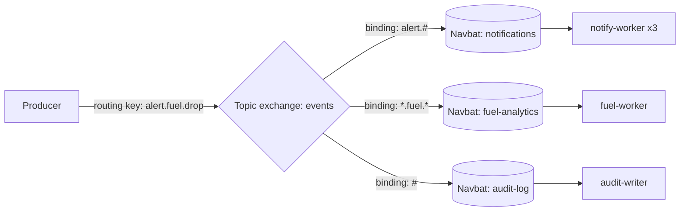
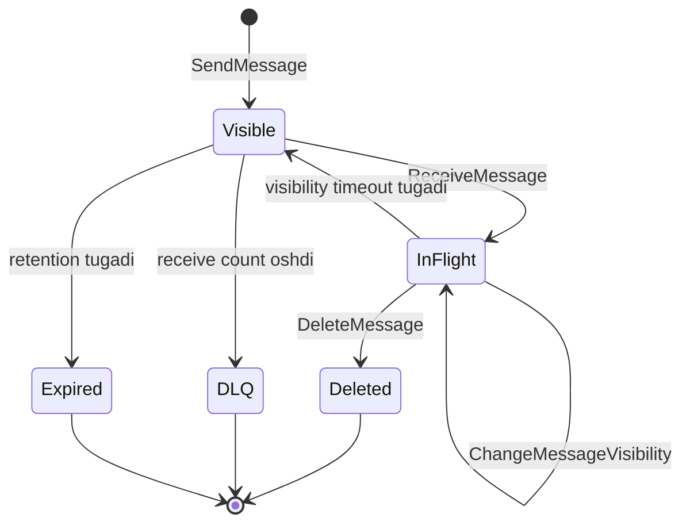

## Bu dars nima uchun kerak

41-darsda navbatning umumiy nazariyasini ko'rdik: point-to-point va pub/sub, push va pull, ack qayerda bo'lsa semantika shunday. Endi ikkita eng ko'p ishlatiladigan "klassik queue" brokerining ichiga kiramiz. Ular bir xil muammoni ikki qarama-qarshi falsafa bilan yechadi:

- **RabbitMQ** - o'zingiz boshqaradigan, boy marshrutlash (routing) modeliga ega broker. Xabar exchange orqali kiradi, binding qoidalari bo'yicha navbatlarga tarqaladi va consumer'larga push qilinadi. Hamma narsa sozlanadi, lekin hamma narsa sizning javobgarligingizda.
- **Amazon SQS** - to'liq boshqariladigan (managed) servis. Marshrutlash yo'q, server yo'q, sig'im rejasi deyarli yo'q. Faqat navbat, `SendMessage`, `ReceiveMessage`, `DeleteMessage` va visibility timeout. Soddalik evaziga moslashuvchanlikni berasiz.

Bu ikkisining ichki mexanikasini tushunish nafaqat ulardan birini tanlash, balki boshqa brokerlarni (Azure Service Bus, Google Pub/Sub, NATS JetStream) tez tushunish uchun ham kerak: ularning hammasi shu ikki modelning variatsiyalari.

Bu darsdan keyin siz:

- RabbitMQ'ning AMQP 0-9-1 modelini (exchange, binding, routing key, queue) va to'rt exchange turini bilasiz;
- classic, quorum queue va stream'ning farqini va RabbitMQ 4.x da nima o'zgarganini bilasiz;
- prefetch, manual ack, publisher confirm, delivery limit va dead lettering qanday ishlashini tushunasiz;
- SQS'ning visibility timeout modeli, standard va FIFO navbatlar, message group va deduplication'ni bilasiz;
- SQS chegaralari (1 MiB xabar, 12 soat visibility, 14 kun retention) va narxini hisob-kitobda ishlata olasiz;
- RabbitMQ va SQS ni talab asosida tanlay olasiz.

## RabbitMQ: AMQP 0-9-1 modeli

RabbitMQ'ning klassik protokoli AMQP 0-9-1. Uning asosiy g'oyasi: **producer hech qachon to'g'ridan-to'g'ri navbatga yozmaydi.** U xabarni **exchange**ga beradi, exchange esa **binding**lar bo'yicha qaysi navbat(lar)ga nusxa berishni hal qiladi.

Asosiy tushunchalar:

- **Connection** - uzoq yashaydigan TCP ulanish (TLS bilan bo'lishi mumkin). Har bir xabar uchun yangi ulanish ochish - klassik xato.
- **Channel** - bitta connection ichidagi yengil virtual sessiya. Hamma operatsiyalar channel orqali bajariladi. Odatda har bir thread o'z channel'ini ishlatadi.
- **Virtual host** - bitta broker ichidagi izolyatsiya qilingan muhit (o'z exchange, navbat va ruxsatlari bilan). Multi-tenancy yoki muhitlarni (dev, staging) ajratish uchun.
- **Exchange** - xabarni qabul qiladi va marshrutlaydi. Xabarni saqlamaydi.
- **Queue** - xabarlarni saqlaydi va consumer'larga beradi.
- **Binding** - exchange va navbat orasidagi qoida, odatda binding key bilan.

### To'rt exchange turi

| Tur | Marshrutlash qoidasi | Tipik ishlatish |
|---|---|---|
| Direct | Routing key binding key bilan aynan teng bo'lgan navbatlarga | Vazifa turini aniq navbatga yo'naltirish |
| Fanout | Routing key e'tiborsiz, barcha bog'langan navbatlarga nusxa | Broadcast, pub/sub |
| Topic | Nuqta bilan ajratilgan so'zlar, `*` aynan bitta so'z, `#` nol yoki ko'p so'z | Tanlab obuna: `alert.fuel.*`, `tenant42.#` |
| Headers | Routing key emas, header qiymatlari bo'yicha (`x-match: all` yoki `any`) | Ko'p o'lchovli filtr |

Topic exchange'da routing key 255 baytgacha bo'lishi mumkin. Hech qaysi binding'ga mos kelmagan xabar tashlab yuboriladi yoki (publisher `mandatory` bayrog'ini qo'ysa) producer'ga qaytariladi. Bu nozik joy: noto'g'ri yozilgan routing key bilan yuborilgan xabar jim yo'qoladi.

**Default exchange** - nomsiz direct exchange. Har bir navbat unga avtomatik ravishda o'z nomi bilan bog'langan, shuning uchun "navbat nomi bilan yuborish" aslida default exchange orqali yuborish.

Bu model pub/sub va competing consumers'ni (41-dars) tabiiy birlashtiradi: fanout yoki topic exchange har bir servis navbatiga bitta nusxa beradi, bitta navbatga ulangan bir nechta consumer esa ishni bo'lishadi.

## RabbitMQ navbat turlari

RabbitMQ 4.0 (2024-yil sentyabr) muhim chegarani belgiladi: uch yil deprecated bo'lib turgan **classic mirrored queue'lar butunlay olib tashlandi**. Endi navbat turlari:

| Tur | Replikatsiya | Asosiy xususiyat | Qachon |
|---|---|---|---|
| Classic | Yo'q (4.x da faqat bitta tugunda) | Eng past kechikish, vaqtinchalik, exclusive, server-named navbatlar | Vaqtinchalik navbatlar, RPC javob navbatlari, ma'lumot yo'qolishi qabul qilinadigan joylar |
| Quorum | Raft asosida, default 3 a'zo | Ma'lumot xavfsizligi, delivery limit, poison message himoyasi | Muhim biznes xabarlari - default tanlov |
| Stream | Replikatsiya qilingan append-only log | Non-destructive o'qish, offset, replay, katta fan-out | Ko'p million xabarli backlog, replay, katta fan-out |

### Quorum queue ichida

Quorum queue Raft consensus algoritmi (36-dars) ustiga qurilgan. Har bir navbatning bitta lideri va followerlari bor. Xabar ko'pchilik a'zo (N/2 + 1) tomonidan qabul qilinganda xavfsiz hisoblanadi va **publisher confirm faqat shundan keyin yuboriladi**. Hujjatga ko'ra:

- default a'zolar soni 3, har bir a'zo alohida tugunda; 3 a'zo 1 ta, 5 a'zo 2 ta, 7 a'zo 3 ta tugun nosozligiga chidaydi. Juft son qo'shimcha chidamlilik bermaydi. 7 dan ortiq tugunda ishlatish tavsiya etilmaydi;
- har bir navbatdagi xabar uchun xotirada kamida 32 bayt indeks kerak, ya'ni taxminan har 30 000 xabarga 1 MB, xabar hajmidan qat'i nazar;
- WAL hajmi chegarasi default 512 MiB, va tugun xotirasiga effektiv WAL chegarasining kamida 3 baravari (boshlang'ich nuqta sifatida 4 baravari) ajratilishi tavsiya etiladi;
- quorum queue doim durable; exclusive, non-durable va global QoS prefetch qo'llab-quvvatlanmaydi;
- qachon **ishlatmaslik** kerak: vaqtinchalik va tez yaratilib o'chiriladigan navbatlar, eng past kechikish talabi, juda uzun backlog (hujjat 5 mln+ xabar uchun stream'ni taklif qiladi) va katta fan-out.

**Delivery limit.** RabbitMQ 4.0 dan boshlab quorum queue'larda default `delivery-limit` 20. Xabar shuncha marta muvaffaqiyatsiz qaytarilsa, u tashlab yuboriladi yoki DLX sozlangan bo'lsa dead-letter qilinadi. Qayta urinishlar soni `x-delivery-count` header'ida ko'rinadi. Bu zahar xabar (poison message) muammosiga tayyor himoya.

**Delayed retry (4.3+).** RabbitMQ 4.3 (2026-yil aprel) da quorum queue'lar qaytarilgan xabarni darhol emas, kechiktirib qayta yetkazishni o'rgandi: kechikish chiziqli o'sadi, `min(delayed-retry-min × delivery-count, delayed-retry-max)`. Masalan, min = 1 s, max = 30 s bo'lsa, 1, 2, 3, ... soniya, 30 dan keyin esa 30 s da qoladi. Shu versiyada 32 darajali qat'iy prioritet qo'shildi, 32 KiB gacha xabarlar uchun xabar boshiga xotira sarfi ikki barobar kamaydi, va metadata uchun Mnesia butunlay olib tashlanib, faqat Khepri (Raft asosidagi metadata ombori) qoldi. Shu bilan birga jamoatchilik tomonidan yozilgan `rabbitmq-delayed-message-exchange` plagini deprecated qilindi.

### Stream

Stream - RabbitMQ ichidagi Kafka'ga o'xshash log: xabar o'qilgandan keyin o'chirilmaydi, faqat retention (`max-age` yoki `max-length-bytes`, segment darajasida) bo'yicha o'chadi. Consumer qayerdan boshlashni `x-stream-offset` bilan tanlaydi: `first`, `last`, `next`, aniq offset yoki vaqt belgisi. Super stream - katta stream'ni bir nechta partition stream'ga bo'lish (Kafka partition'lariga o'xshash). Muhim nozik joy: hujjatga ko'ra stream ma'lumotni aniq fsync qilmaydi, shuning uchun eng kuchli durability kerak bo'lsa quorum queue afzal. Log modeli 43-44-darslarda Kafka misolida chuqur ko'riladi.

## RabbitMQ'da ishonchli yetkazish

41-darsdagi semantikaning RabbitMQ'dagi aniq mexanizmlari:

### Consumer tomoni: manual ack va prefetch

- **Automatic ack** rejimida xabar yuborilishi bilan yetkazilgan hisoblanadi. Hujjat bu rejimni ko'p ish yuklamalari uchun "xavfli" deb ataydi - bu at-most-once.
- **Manual ack** rejimida consumer ishni tugatgach `basic.ack` yuboradi. Xato bo'lsa, `basic.nack` yoki `basic.reject`: `requeue=true` bilan navbatga qaytariladi, `requeue=false` bilan DLX ga yuboriladi yoki tashlanadi.
- Channel yoki connection yopilsa, ack qilinmagan barcha xabarlar avtomatik qayta navbatga qo'yiladi va `redelivered` bayrog'i bilan keladi. Demak consumer idempotent bo'lishi kerak.
- **Prefetch** (`basic.qos`) bitta consumer'da bir vaqtda ack qilinmagan xabarlar sonini cheklaydi. 0 - cheklov yo'q (xavfli: bitta sekin consumer butun navbatni o'ziga olib qo'yishi mumkin). Hujjat 100-300 oralig'ini odatda optimal deb ko'rsatadi.

**Prefetch hisob-kitobi.** Consumer bitta xabarni 20 ms da qayta ishlaydi, broker bilan round-trip 2 ms. Prefetch = 1 bo'lsa, har bir xabar uchun 20 + 2 = 22 ms, ya'ni taxminan 45 xabar/s. Prefetch katta bo'lsa, keyingi xabar allaqachon consumer bufferida turadi va RTT yashiriladi: taxminan 1 000 / 20 = 50 xabar/s. Bu yerda farq kichik (taxminan 10%), chunki ish vaqti RTT dan ancha katta. Lekin ish 1 ms, RTT 2 ms bo'lsa, prefetch = 1 bilan 333 xabar/s, katta prefetch bilan esa 1 000 xabar/s gacha - uch baravar. Xulosa: prefetch tez ishlaydigan consumer'lar uchun kritik, sekin consumer'lar uchun esa katta prefetch faqat xabarlarni bitta consumer'da "qamab" qo'yadi va boshqalari bo'sh turadi. Uzoq ishlar uchun prefetch kichik bo'lsin.

**Consumer timeout.** Consumer xabarni olib, uzoq vaqt ack qilmasa, RabbitMQ uni osilib qolgan deb hisoblaydi. Default `consumer_timeout` 30 daqiqa. 4.3 dan boshlab bu tekshiruv quorum queue'larga ko'chirildi va muddati o'tgan xabar navbatga qaytariladi. 30 daqiqadan uzoq davom etadigan ishni RabbitMQ xabari ichida bajarmang - uni alohida holat jadvaliga yozib, ack qiling.

### Producer tomoni: publisher confirms

`confirm.select` dan keyin broker har bir xabarga `basic.ack` (yoki kamdan-kam `basic.nack`) bilan javob beradi. Persistent xabar durable navbatga yo'naltirilgan bo'lsa, ack diskka yozilgandan keyin, quorum queue uchun esa quorum qabul qilgandan keyin keladi. Confirm'lar tartibsiz kelishi mumkin. Confirm'siz publish - "yubordim va umid qildim" degani.

### Navbat uzunligi va overflow

Navbatga `max-length` yoki `max-length-bytes` qo'yish mumkin. To'lganda xatti-harakat `overflow` bilan belgilanadi:

- `drop-head` (default) - eng eski xabarlar tashlanadi yoki dead-letter qilinadi;
- `reject-publish` - yangi xabarlar rad etiladi, producer confirm yoqilgan bo'lsa `basic.nack` oladi;
- `reject-publish-dlx` - rad etiladi va dead-letter qilinadi.

`reject-publish` - backpressure'ning broker darajasidagi shakli: producer sekinlashishi kerakligini bilib oladi (50-dars).

### Dead lettering

Xabar quyidagi holatlarda dead-letter exchange (DLX) ga yuboriladi: `requeue=false` bilan reject/nack, TTL tugashi, uzunlik chegarasi (`maxlen`) va quorum queue'da delivery limit oshishi. `x-death` header'i sabab, navbat, son va vaqtni saqlaydi. Muhim nozik joy: default holatda dead lettering **at-most-once** - xabar ichki confirm'siz qayta publish qilinadi va maqsad navbat mavjud bo'lmasa yo'qolishi mumkin. Quorum queue'lar uchun `dead-letter-strategy=at-least-once` bor, lekin u `overflow=reject-publish` ni talab qiladi va ko'proq resurs sarflaydi.

### Tartib

Hujjatga ko'ra navbat FIFO, bitta channel'dan publish qilingan xabarlar tartibi saqlanadi. Lekin tartib prioritetlar, bir nechta faol consumer va qayta yetkazish (requeue) tufayli buziladi. Qat'iy tartib kerak bo'lsa: **single active consumer** (`x-single-active-consumer=true` - bir vaqtda faqat bitta consumer oladi, u o'lsa keyingisi avtomatik faollashadi) yoki stream. Har bir obyekt bo'yicha tartib va parallelizm uchun hujjat consistent hash exchange'ni (`x-modulus-hash`) tavsiya qiladi.

## Amazon SQS: boshqacha falsafa

SQS 2006-yil 13-iyulda EC2 va S3 bilan birga AWS'ning birinchi uchta servislaridan biri sifatida ishga tushgan. Uning modeli juda kichik API ustiga qurilgan:

- `SendMessage` - xabar qo'shish.
- `ReceiveMessage` - 1-10 ta xabar olish (pull). Xabar navbatdan o'chirilmaydi, faqat **ko'rinmas** bo'ladi.
- `DeleteMessage` - ish tugagach xabarni o'chirish (bu - ack).
- `ChangeMessageVisibility` - ko'rinmaslik muddatini uzaytirish yoki qisqartirish.

Exchange, binding, routing yo'q. Pub/sub kerak bo'lsa, oldiga **SNS** topic qo'yiladi va har bir servis o'z SQS navbatini SNS'ga obuna qiladi (SNS to SQS fanout).

### Visibility timeout

Bu SQS'ning markaziy mexanizmi va RabbitMQ'dagi "ack qilinmagan xabar" holatining analogi.

- Consumer xabarni olganda, u navbatda qoladi, lekin boshqa consumer'larga **visibility timeout** davomida ko'rinmaydi (default 30 s, maksimum 12 soat).
- Bu muddat ichida `DeleteMessage` chaqirilmasa, xabar yana ko'rinadigan bo'ladi va boshqa (yoki o'sha) consumer uni oladi. Bu at-least-once'ning manbai.
- `ChangeMessageVisibility` bilan muddatni uzaytirish mumkin (heartbeat patterni). Lekin umumiy chegara - xabar **birinchi marta olingan paytdan** 12 soat, uzaytirish bu chegarani qayta boshlamaydi. Undan uzoq ishlar uchun AWS Step Functions yoki ishni bo'laklarga bo'lishni tavsiya qiladi.
- `VisibilityTimeout=0` bilan xabarni darhol qaytarish mumkin (bu - nack).
- Juda qisqa timeout - ish tugamasdan xabar boshqa consumer'ga ketadi va ikki marta qayta ishlanadi. Juda uzun timeout - consumer qulasa, retry juda kech bo'ladi.

**Hisob-kitob.** Hisobot generatsiyasi p99 da 4 daqiqa davom etadi. Visibility timeout'ni 5 daqiqa qo'ysangiz, p99.9 holatlarda (masalan, 6 daqiqa) dublikat ishlov bo'ladi. Statik katta qiymat o'rniga: timeout = 2 daqiqa, har 60 soniyada heartbeat bilan yana 2 daqiqaga uzaytirish. Consumer qulasa, xabar ko'pi bilan 2 daqiqada qaytadi, uzoq ish esa uzilmaydi.

### Polling

- **Short polling** (`WaitTimeSeconds=0`, default) - SQS serverlarning bir qismini (weighted random) tekshiradi va darhol javob beradi, hatto bo'sh bo'lsa ham. "Yolg'on bo'sh" javoblar bo'lishi mumkin.
- **Long polling** (`WaitTimeSeconds` 1-20) - barcha serverlar tekshiriladi, xabar paydo bo'lishi bilan yoki muddat tugaganda javob qaytadi. Bo'sh so'rovlar va narx kamayadi. Deyarli har doim long polling ishlating.

### Standard va FIFO navbatlar

| Xususiyat | Standard | FIFO |
|---|---|---|
| Yetkazish | At-least-once, dublikat mumkin | Producer dublikatlari 5 daqiqalik oynada filtrlanadi |
| Tartib | Best-effort | `MessageGroupId` ichida qat'iy |
| Throughput | Hujjatga ko'ra deyarli cheklanmagan API chaqiruvlari | High throughput rejimida har bir partition uchun 300 xabar/s, batch bilan 3 000; partitionlar avtomatik qo'shiladi |
| Nom | Istalgan | `.fifo` bilan tugashi shart |
| Narx (us-east-1, 2026) | $0.40 / mln so'rov (birinchi 100 mlrd) | $0.50 / mln so'rov |

Standard navbat `SendMessage` ni tasdiqlashdan oldin xabarni bir nechta availability zone'da saqlaydi. Uning "taqsimlangan" tabiati dublikat va tartibsizlikning sababi.

**FIFO va message group.** Har bir FIFO xabarda `MessageGroupId` bo'lishi shart. Bitta guruh ichidagi xabarlar qat'iy tartibda beriladi, va bu guruhdan olingan xabar in-flight bo'lib turganda, **shu guruhning keyingi xabarlari berilmaydi** (o'chirilguncha yoki timeout tugaguncha). Boshqa guruhlar esa parallel ishlaydi. Demak parallelizm darajasi faol guruhlar soni bilan cheklangan. FIFO'da throughput'ni oshirish uchun hujjat ko'p sonli turli group ID ishlatishni tavsiya qiladi: SQS group ID ni hash qilib partitionni tanlaydi.

**Deduplication.** Producer `MessageDeduplicationId` beradi yoki navbatda content-based dedup yoqiladi (xabar tanasining SHA-256 hash'i, atributlar hisobga olinmaydi). 5 daqiqa ichida bir xil ID bilan kelgan xabar qayta qo'shilmaydi. E'tibor bering: bu **producer tomonidagi** dublikatni yo'qotadi. Consumer visibility timeout ichida ishni tugatmasa, xabar baribir qayta beriladi, shuning uchun "exactly-once processing" degan nom ostida ham consumer idempotent bo'lishi kerak.

**Fair queues (2025-yil iyul).** Standard navbatlarda ham `MessageGroupId` (tenant ID) berilsa, SQS bitta "shovqinli qo'shni" tenant boshqalarini kechiktirishiga yo'l qo'ymaydi, consumer tomonda o'zgarish kerak emas. Bu multi-tenant SaaS (73-dars) uchun muhim: bitta katta mijozning 1 mln xabarlik to'lqini kichik mijozlarning xabarlarini soatlab orqada qoldirmaydi. Narx: guruh ID li so'rovlarga standart narx ustiga taxminan $0.10 / mln qo'shiladi.

### Chegaralar

| Parametr | Qiymat |
|---|---|
| Xabar hajmi | 1 bayt dan 1 MiB gacha (2025-yil avgustgacha 256 KiB edi); kattaroq payload uchun Extended Client Library orqali S3 (2 GB gacha) |
| Retention | Default 4 kun, 60 s dan 14 kungacha |
| Visibility timeout | Default 30 s, 0 dan 12 soatgacha |
| Delay | 0 dan 15 daqiqagacha |
| Long polling kutish | Maksimum 20 s |
| Batch | 10 ta xabar |
| In-flight xabarlar | Standard: taxminan 120 000; FIFO: 120 000 |
| Backlog | Cheksiz |

**Narx hisob-kitobi va 64 KB qoidasi.** SQS'da har bir 64 KB payload bo'lagi alohida so'rov sifatida hisoblanadi: 1 MiB xabar = 16 so'rov. Deylik, 10 000 treker har 10 soniyada 300 baytlik nuqta yuboradi, har biri SQS standard orqali:

- Xabarlar: 1 000 / s × 86 400 × 30 = 2.59 mlrd / oy.
- Har bir xabar uchun kamida 3 so'rov (send, receive, delete), batch'siz: 7.78 mlrd so'rov.
- 7 780 mln × $0.40 / mln = **taxminan $3 110 / oy**.
- 10 talik batch bilan (send, receive va delete batch): so'rovlar soni taxminan 10 baravar kamayadi, **taxminan $311 / oy**. 10 ta 300 baytlik xabar 3 KB, 64 KB dan kichik, shuning uchun batch bitta so'rov hisoblanadi.

Saboq: SQS'da batch - bu optimallashtirish emas, majburiyat. Va yuqori chastotali telemetriya uchun SQS iqtisodiy jihatdan Kafka'ga yutqazishi mumkin: so'rov boshiga to'lov xabar soni bilan chiziqli o'sadi.

### Dead-letter queue

`RedrivePolicy` dagi `maxReceiveCount` - xabar necha marta olingandan keyin DLQ ga ko'chirilishini belgilaydi. DLQ manba navbat bilan bir xil account va region'da bo'lishi kerak. Nozik joy: standard navbatda xabar DLQ ga o'tganda uning enqueue vaqti o'zgarmaydi, shuning uchun DLQ retention'i manba navbatnikidan uzunroq bo'lishi kerak, aks holda xabar DLQ da kutilgandan oldin o'chadi. FIFO'da esa vaqt qayta boshlanadi. DLQ redrive - xabarlarni tuzatishdan keyin manba navbatga qaytarish. Batafsil 50-darsda.

## RabbitMQ va SQS taqqoslash

| Mezon | RabbitMQ (quorum queue) | Amazon SQS |
|---|---|---|
| Boshqaruv | O'zingiz (yoki Amazon MQ, CloudAMQP) | To'liq managed |
| Marshrutlash | Exchange, binding, topic pattern, headers | Yo'q, SNS yoki EventBridge orqali |
| Yetkazish modeli | Push (prefetch bilan), pull ham bor | Faqat pull (long polling) |
| Ack | Manual ack/nack, delivery limit | DeleteMessage, visibility timeout, maxReceiveCount |
| Tartib | Navbat FIFO, single active consumer, stream | Standard: best-effort; FIFO: group ichida |
| Kechikish | Past, bir xil tarmoqdagi TCP ulanish orqali push | Yuqoriroq: har bir operatsiya HTTPS API chaqiruvi, pull |
| Throughput chegarasi | Navbat bitta Raft lideri bilan cheklangan; ko'p navbat yoki super stream bilan kengayadi | Standard deyarli cheksiz, FIFO partition va guruhlar bilan |
| Protokollar | AMQP 0-9-1, AMQP 1.0, MQTT, STOMP, stream protokoli | AWS HTTPS API |
| Replay | Faqat stream'da | Yo'q |
| Narx modeli | Server, disk, operatsiya vaqti | So'rov boshiga |
| Vendor lock-in | Ochiq kod, ochiq protokollar | AWS |

Qaror qoidalari:

- AWS ichida bo'lsangiz, murakkab marshrutlash kerak bo'lmasa va xabar soni o'rtacha bo'lsa - **SQS**. Operatsion xarajat deyarli nol.
- Murakkab marshrutlash, past kechikish, MQTT/AMQP qurilmalari, on-premise yoki bulutdan mustaqillik kerak bo'lsa - **RabbitMQ**.
- Juda yuqori throughput, replay, ko'p mustaqil consumer group'lar, uzoq retention kerak bo'lsa - ikkalasi ham emas, **log-based broker** (43-dars).

## Real tizimlardan misollar

- **AWS ichki ishlatishi.** SQS'ning 20 yilligi haqidagi AWS blogida FIFO high throughput rejimi 2021-yilda 3 000 TPS bilan GA bo'lgani va keyin bosqichma-bosqich 70 000 TPS gacha (ba'zi regionlarda, har bir API amali uchun) oshirilgani yozilgan. Bu "FIFO sekin" degan eski tasavvur endi to'g'ri emasligini ko'rsatadi, lekin faqat guruhlar ko'p bo'lsa.
- **RabbitMQ 4.0 va mirrored queue'lar.** Mirrored queue'lar uch yil deprecated holatda turgach, 4.0 da butunlay olib tashlandi va replikatsiya uchun faqat Raft asosidagi quorum queue va stream qoldi. Ya'ni RabbitMQ jamoasi ad-hoc replikatsiya o'rniga isbotlangan consensus algoritmini tanladi - bu 36-darsdagi nazariyaning amaliy natijasi.
- **Kafka 2011 maqolasi.** Kafka mualliflari o'z tizimini ActiveMQ va RabbitMQ 2.4 bilan taqqoslab, Kafka producer tomonida 50 talik batch bilan soniyasiga taxminan 400 ming xabar yuborganini, RabbitMQ esa kamida 2 baravar sekin bo'lganini yozgan. Lekin mualliflar o'zlari ta'kidlaganidek, bu boshqa tizimlar yomon degani emas: RabbitMQ ko'proq imkoniyat (per-message ack, marshrutlash) beradi va buning narxi bor.

## iQuariX kontekstida qo'llanish

Faraz qiling, iQuariX on-premise yoki o'z bulutida ishlaydi va quyidagi oqimlar bor:

**1. Ogohlantirishlarni marshrutlash (RabbitMQ topic exchange).** Routing key formati: `<tenant>.<turi>.<daraja>`, masalan `t42.fuel.critical`, `t42.geofence.info`. Bindinglar:

- `*.*.critical` - SMS va qo'ng'iroq navbati;
- `*.fuel.*` - yoqilg'i analitikasi;
- `t42.#` - katta mijoz uchun alohida webhook integratsiyasi;
- `#` - audit log.

Navbatlar quorum, delivery limit 5, DLX sozlangan, delayed retry min 2 s, max 60 s. SMS consumer'i `alert_id` bo'yicha idempotent.

**2. Og'ir vazifalar (agar AWS'da bo'lsa, SQS).** Oylik PDF hisobot va video klip kesish vazifalari: SQS standard + DLQ (`maxReceiveCount = 3`), visibility timeout 2 daqiqa + heartbeat, fair queue bilan `MessageGroupId = tenant_id` - 500 mashinali mijozning oy oxiridagi hisobotlari 20 mashinali mijozni kutib qoldirmasin.

**3. GPS telemetriya.** Na RabbitMQ classic/quorum queue, na SQS bu yerda eng yaxshi tanlov emas: soniyasiga minglab kichik xabar, bir nechta mustaqil o'quvchi, tarixni qayta o'qish ehtiyoji. Yuqoridagi hisob ko'rsatganidek, SQS'da bu oyiga yuzlab dollar faqat so'rovlar uchun. Bu log-based broker (Kafka yoki RabbitMQ stream) uchun holat.

## Ko'p uchraydigan xatolar

1. **Auto-ack ishlatish** va keyin "RabbitMQ xabar yo'qotdi" deyish. Auto-ack - at-most-once.
2. **Prefetch'ni cheklamaslik (0).** Bitta consumer minglab xabarni xotirasiga oladi, boshqalari bo'sh turadi, consumer qulasa hammasi birdan qayta navbatga qaytadi.
3. **Publisher confirm'siz publish.** Broker xabarni olmagan bo'lishi mumkin, producer esa "yuborildi" deb hisoblaydi.
4. **Har bir xabar uchun yangi connection ochish.** TCP va TLS handshake har safar. Connection uzoq yashashi, channel'lar esa thread'lar orasida bo'linmasligi kerak.
5. **SQS visibility timeout'ni ish vaqtidan qisqa qo'yish.** Natija - jim dublikatlar va ikki baravar resurs sarfi.
6. **SQS'da batch ishlatmaslik.** Narx 10 baravargacha oshadi.
7. **DLQ retention'ini manba navbat bilan bir xil qo'yish** (standard navbat). Xabarlar DLQ da kutilgandan oldin yo'qoladi.
8. **FIFO'da bitta `MessageGroupId` ishlatish.** Butun navbat bitta consumer tezligiga tushadi va bitta "osilgan" xabar hammasini to'xtatadi.

## Xulosa

- RabbitMQ: producer exchange'ga yozadi, exchange binding bo'yicha navbatlarga marshrutlaydi, navbat consumer'larga prefetch bilan push qiladi.
- RabbitMQ 4.x da replikatsiya uchun faqat quorum queue (Raft) va stream. Classic mirrored queue'lar olib tashlangan. Quorum queue - muhim xabarlar uchun default.
- Ishonchlilik uch qismdan iborat: publisher confirm, durable/quorum navbat, manual ack. Bittasi yo'q bo'lsa, kafolat yo'q.
- SQS: pull, visibility timeout, `DeleteMessage` = ack. Timeout ish vaqtiga mos bo'lsin, uzoq ish uchun heartbeat.
- SQS standard - at-least-once va best-effort tartib; FIFO - guruh ichida tartib va 5 daqiqalik producer dedup. Ikkalasida ham consumer idempotent bo'lishi kerak.
- SQS narxi so'rov soniga bog'liq: batch va long polling majburiy. Yuqori chastotali kichik xabarlar uchun log-based broker arzonroq bo'lishi mumkin.

## Amaliy topshiriq

iQuariX uchun **geofence hodisalari** quvurini loyihalang (faraziy): har bir mashina zonaga kirsa yoki chiqsa hodisa hosil bo'ladi. 30 000 mashina, kuniga har biri o'rtacha 40 ta geofence hodisasi, 400 ta mijoz (tenant). Iste'molchilar: dispetcher bildirishnomasi, mijoz webhook'lari (har bir mijozning o'z URL i bor, ba'zilari sekin yoki tez-tez ishlamaydi), kunlik hisobot agregatori.

1. **Broker tanlovi.** RabbitMQ yoki SQS (+SNS) - tanlang va 3 ta sabab bilan asoslang. Ikkinchisini tanlaganda nima yo'qotishingizni yozing.
2. **Marshrutlash.** RabbitMQ bo'lsa - exchange turi, routing key formati va bindinglarni yozing. SQS bo'lsa - SNS topic, filtr va navbatlar tuzilmasini yozing.
3. **Sekin webhook muammosi.** Bitta mijozning webhook'i 30 soniya javob bermasa, boshqa 399 mijozning webhook'lari kechikmasligi uchun nima qilasiz? (Fair queue, mijoz bo'yicha alohida navbat, prefetch, timeout - variantlarni solishtiring.)
4. **Retry va DLQ.** Webhook xatosida necha marta, qanday kechikish bilan qayta urinasiz? Delivery limit/maxReceiveCount qiymati va DLQ retention'ini hisoblang.
5. **Narx yoki resurs hisob-kitobi.** SQS bo'lsa - oylik so'rovlar soni va narxi (batch bilan va batch'siz). RabbitMQ bo'lsa - xabar/s cho'qqisi va quorum queue xotira indeksi hajmi (1 soatlik backlog uchun).

Yaxshi javobda bo'lishi kerak bo'lgan narsalar:

- tanlov texnologiya emas, talablar (marshrutlash, operatsiya, narx, platforma) asosida asoslangan;
- noisy neighbor muammosi aniq tilga olingan va yechim (fair queue, tenant bo'yicha izolyatsiya yoki per-tenant concurrency limit) berilgan;
- retry'larda kechikish o'sib boradi va cheksiz emas, DLQ ga tushgan xabarni qayta yuborish (redrive) rejasi bor;
- webhook consumer'i idempotent, mijozga `event_id` yuboriladi;
- hisob-kitobda cho'qqi va o'rtacha alohida, 64 KB qoidasi yoki xotira indeksi hisobga olingan.

Javobni pastdagi maydonga yozib, chatga yuboring.

## Manbalar

- RabbitMQ. [AMQP 0-9-1 Model Explained](https://www.rabbitmq.com/tutorials/amqp-concepts) - exchange turlari, binding, default exchange, prefetch.
- RabbitMQ. [Quorum Queues](https://www.rabbitmq.com/docs/quorum-queues) - Raft, delivery limit, delayed retry, xotira talablari, qachon ishlatmaslik.
- RabbitMQ. [Consumer Acknowledgements and Publisher Confirms](https://www.rabbitmq.com/docs/confirms) va [Dead Letter Exchanges](https://www.rabbitmq.com/docs/dlx).
- RabbitMQ blog. [RabbitMQ 4.3 release](https://www.rabbitmq.com/blog/2026/04/23/rabbitmq-4.3-release) va [What's new in 4.0](https://blog.rabbitmq.com/docs/whats-new) - mirrored queue'lar olib tashlanishi, Khepri.
- AWS. [Amazon SQS visibility timeout](https://docs.aws.amazon.com/AWSSimpleQueueService/latest/SQSDeveloperGuide/sqs-visibility-timeout.html), [message quotas](https://docs.aws.amazon.com/AWSSimpleQueueService/latest/SQSDeveloperGuide/quotas-messages.html), [FIFO delivery logic](https://docs.aws.amazon.com/AWSSimpleQueueService/latest/SQSDeveloperGuide/FIFO-queues-understanding-logic.html), [dead-letter queues](https://docs.aws.amazon.com/AWSSimpleQueueService/latest/SQSDeveloperGuide/sqs-dead-letter-queues.html).
- AWS News Blog. [Amazon SQS turns 20](https://aws.amazon.com/blogs/aws/amazon-sqs-turns-20-two-decades-of-reliable-messaging-at-scale/) - tarix, 1 MiB xabar hajmi, fair queues, FIFO throughput evolyutsiyasi.
- CloudBurn. [Amazon SQS Pricing: The 64 KB Rule](https://cloudburn.io/blog/amazon-sqs-pricing) - narx jadvali va 64 KB bo'laklab hisoblash.
- Jay Kreps, Neha Narkhede, Jun Rao. [Kafka: a Distributed Messaging System for Log Processing](https://people.csail.mit.edu/matei/courses/2015/6.S897/readings/kafka.pdf), NetDB 2011 - 5-bo'lim: RabbitMQ va ActiveMQ bilan taqqoslash.
