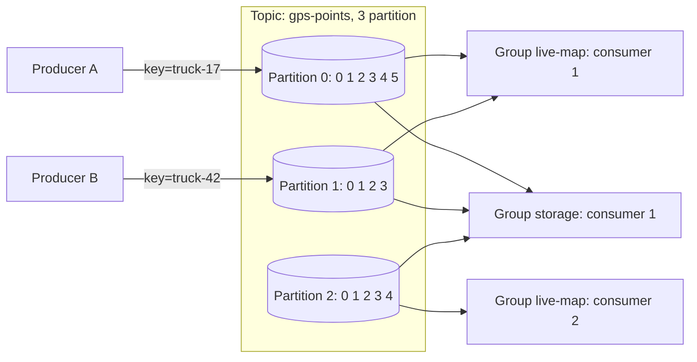
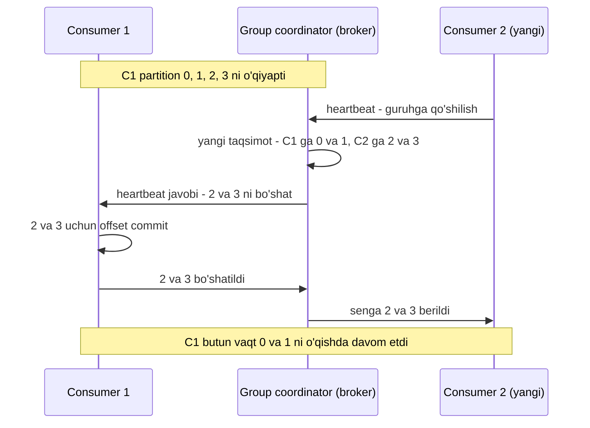

## Bu dars nima uchun kerak

41-42-darslarda klassik navbatni ko'rdik: xabar qayta ishlangach o'chiriladi, broker har bir xabarning holatini kuzatadi. Bu model vazifalarni taqsimlash uchun yaxshi, lekin uchta joyda sinadi:

- **Throughput.** Har bir xabar uchun alohida ack, alohida holat va alohida o'chirish - bu soniyasiga yuz minglab xabarda qimmat.
- **Ko'p o'quvchi.** Bir xil oqimni 10 ta servis o'qishi kerak bo'lsa, klassik navbatda 10 ta nusxa saqlanadi.
- **Tarix.** Yangi servis kecha yoki o'tgan haftadagi hodisalarni o'qiy olmaydi: ular allaqachon o'chirilgan.

Kafka bu muammolarni bitta g'oya bilan yechadi: broker - bu **navbat emas, log**. Xabarlar diskdagi append-only faylga ketma-ket yoziladi va o'qilgandan keyin ham saqlanadi. O'quvchi esa faqat bitta son - **offset** - ni eslab qoladi. Jay Kreps (Kafka mualliflaridan biri) 2013-yilgi "The Log" maqolasida buni shunday asoslagan: log - vaqt bo'yicha to'liq tartiblangan, faqat oxiriga yoziladigan yozuvlar ketma-ketligi, va u ma'lumotlar integratsiyasi, replikatsiya va stream processing uchun yagona asos bo'la oladi.

Bu dars Kafka'ning **mantiqiy modeli**ga bag'ishlangan: topic, partition, offset, producer partitionlash, consumer group va rebalance. Replikatsiya, ISR, `acks`, retention va compaction 44-darsda chuqur ko'riladi.

Bu darsdan keyin siz:

- Kafka nega diskda ishlasa ham tez ekanini (ketma-ket IO, page cache, zero-copy, batch) tushuntira olasiz;
- partition'ning ichki tuzilishini (segment fayllar, indeks) bilasiz;
- partition kalitini tanlash va partitionlar sonini hisoblashni bilasiz;
- consumer group, offset commit va rebalance qanday ishlashini va KIP-848 yangi protokoli nimani o'zgartirganini bilasiz;
- Kafka 4.x dagi asosiy o'zgarishlarni (KRaft, ZooKeeper'siz ishlash, share groups) bilasiz.

## Kafka qisqa tarixi va hozirgi holati

Kafka LinkedIn'da yaratilgan va 2011-yilda NetDB konferensiyasida Jay Kreps, Neha Narkhede va Jun Rao maqolasi bilan taqdim etilgan. Maqolaga ko'ra o'shanda LinkedIn'da Kafka kuniga milliardga yaqin xabar va yuzlab gigabayt yangi ma'lumotni qayta ishlagan. 2013-yil dekabrdagi "The Log" maqolasida bu raqam kuniga 60 milliarddan ortiq yozuvga yetgan.

Hozirgi holat (2026-yil oktyabr):

- **Kafka 4.0** (2025-yil mart) - ZooKeeper'siz to'liq ishlaydigan birinchi major versiya. Metadata endi faqat **KRaft** (Kafka ichidagi Raft) orqali boshqariladi.
- **Kafka 4.2** (2026-yil fevral) - "Queues for Kafka" (share groups, KIP-932) production-ready deb e'lon qilindi.
- **Kafka 4.3** (4.3.0 - 2026-yil 22-may) - joriy minor liniya, 4.3.1 patch (2026-yil 25-iyun) bilan.

## Asosiy tushunchalar

- **Record (event, message)** - kalit, qiymat, vaqt belgisi va ixtiyoriy header'lar.
- **Topic** - nomlangan hodisalar oqimi. Hodisalar o'qilgandan keyin o'chirilmaydi, retention sozlamasi bo'yicha saqlanadi.
- **Partition** - topicning bo'lagi. Har bir partition - alohida, tartiblangan, append-only log. Partitionlar brokerlar bo'ylab taqsimlanadi va parallelizm birligi hisoblanadi.
- **Offset** - partition ichidagi yozuvning tartib raqami (64-bitli). Offset faqat bitta partition ichida ma'noga ega: "offset 5" deyish mumkin emas, "partition 2, offset 5" deyish kerak.
- **Broker** - Kafka serveri. Klaster bir nechta brokerdan iborat.
- **Replication factor** - har bir partitionning nechta nusxasi borligi. Kafka hujjati production uchun 3 ni tavsiya qiladi (44-dars).
- **Producer** va **consumer** - mijoz kutubxonalari. Producer consumer'ni kutmaydi va u haqda bilmaydi.

**Tartib kafolati:** bitta partition ichida consumer yozuvlarni ular yozilgan tartibda o'qiydi. Partitionlar orasida tartib kafolati **yo'q**.

## Nima uchun disk ustidagi log tez

"Diskka yozadigan tizim xotiradagi navbatdan tezroq" degan gap g'alati eshitiladi. Kafka dizayn hujjati bunga to'rtta sabab keltiradi.

### 1. Ketma-ket IO

Hujjatda keltirilgan misol: oltita 7200 rpm SATA diskdan iborat RAID-5 massivda chiziqli yozish taxminan 600 MB/s, tasodifiy yozish esa atigi taxminan 100 KB/s - 600 000 ÷ 100 = 6 000 baravar farq. Log faqat oxiriga yoziladi va odatda ketma-ket o'qiladi, shuning uchun disk eng tez rejimida ishlaydi (4-dars: sequential va random IO). Bundan tashqari log'da har bir xabar uchun B-tree kabi indeks tuzilmasi yo'q, shuning uchun yozish va o'qish O(1) va ma'lumot hajmi o'sishi bilan sekinlashmaydi. Shu sababli Kafka ma'lumotni bir hafta va undan ko'p saqlay oladi.

### 2. Page cache

Kafka JVM ichida o'z cache'ini saqlamaydi, OS page cache'iga tayanadi. Bu ma'lumotni ikki marta (JVM heap va page cache'da) saqlashdan va garbage collector yukidan qutqaradi. Hujjatdagi misol: 32 GB xotirali mashinada 28-30 GB page cache bo'lishi mumkin. Consumer'lar odatda "dum"ni (eng so'nggi yozuvlarni) o'qigani uchun, ular deyarli har doim page cache'dan, ya'ni diskdan emas, RAM'dan o'qiydi. Broker qayta ishga tushganda ham page cache "issiq" qoladi.

### 3. Zero-copy (sendfile)

An'anaviy yo'lda fayldan socket'ga ma'lumot yuborish to'rt nusxa va ikki system call talab qiladi: disk dan page cache'ga, page cache'dan foydalanuvchi bufferiga, bufferdan socket bufferiga, socket bufferidan tarmoq kartasiga. `sendfile` bilan OS ma'lumotni page cache'dan to'g'ridan-to'g'ri tarmoqqa yuboradi. Bu faqat broker ma'lumotni **o'zgartirmasdan** uzatgani uchun mumkin: producer, broker va consumer bir xil binar formatdan foydalanadi. Muhim istisno: TLS yoqilganda `sendfile` ishlatilmaydi, chunki shifrlash foydalanuvchi maydonida bajariladi. Shu sababli TLS li Kafka klasterlarida CPU yuki sezilarli oshadi.

### 4. Batch va end-to-end siqish

Producer xabarlarni partition bo'yicha batch'larga yig'adi (`batch.size` default 16 KiB, `linger.ms` default Kafka 4.0 dan beri 5 ms; avval 0 edi). Batch butunligicha siqiladi (gzip, snappy, lz4, zstd), brokerda siqilgan holda saqlanadi va consumer'ga siqilgan holda yuboriladi. Ko'p o'xshash JSON xabarlarni birga siqish har birini alohida siqishdan ancha samarali.

**Hisob-kitob: batch ta'siri.** 2011-yilgi maqolada bitta producer 200 baytlik xabarlarni batch hajmi 1 bilan soniyasiga taxminan 50 ming, batch hajmi 50 bilan taxminan 400 ming yuborgan - 8 baravar farq. Sabab: har bir so'rovning qat'iy xarajati (tarmoq round-trip, system call, header) ko'p xabarga bo'linadi.

## Partition ichida: segmentlar va indeks

Har bir partition diskda alohida katalog (`gps-points-0`, `gps-points-1`). Katalog ichida log bitta katta fayl emas, **segmentlar**ga bo'lingan:

- Har bir segment fayli o'zidagi birinchi yozuvning offset'i bilan nomlanadi: `00000000000000000000.log`, `00000000000005367851.log` va h.k.
- Yozish faqat oxirgi (faol) segmentga bo'ladi. Segment `segment.bytes` (default 1 GiB) yoki `segment.ms` (default 7 kun) chegarasiga yetganda yangi segment ochiladi.
- Har bir segment yonida offset indeksi (`.index`) va vaqt indeksi (`.timeindex`) bor. Indeks siyrak (sparse): har bir yozuv uchun emas, taxminan har `index.interval.bytes` (default 4 KiB) da bitta yozuv.
- Offset bo'yicha o'qish: (1) segment nomlari ro'yxatida binary search bilan kerakli segment topiladi; (2) segment indeksida binary search bilan eng yaqin oldingi pozitsiya topiladi; (3) shu pozitsiyadan ketma-ket skan qilinadi.
- Retention butun segmentlarni o'chirish orqali ishlaydi, alohida yozuvlarni emas. Bu juda arzon: bitta fayl o'chiriladi. Faol segment o'chirilmaydi.

Bu tuzilma 12-darsdagi append-only log va hash index g'oyasining amaliy davomi.

## Producer: kalit va partitionlash

Producer har bir yozuv uchun partitionni tanlaydi:

- **Kalit bor bo'lsa** - kalitning hash'i bo'yicha partition tanlanadi. Java mijozining manba kodida (`BuiltInPartitioner.partitionForKey`) bu aniq shunday: `Utils.toPositive(Utils.murmur2(serializedKey)) % numPartitions`, ya'ni seriyalashtirilgan kalit baytlarining murmur2 hash'i, musbatga keltirilib, partitionlar soniga modul. Bir xil kalitli yozuvlar har doim bitta partitionga tushadi, demak ular tartib bilan o'qiladi. Muhim natija: boshqa tildagi mijoz (masalan, boshqa hash ishlatadigan kutubxona) bir xil kalitni boshqa partitionga yuborishi mumkin - aralash mijozli tizimda partitioner moslashuvini tekshiring.
- **Kalit yo'q bo'lsa** - "sticky" partitioner: bitta partitionga `batch.size` bayt yuborilguncha yozadi, keyin boshqasiga o'tadi (manba kodiga ko'ra joriy batch hali tayyor bo'lmasa o'tish kechiktiriladi, lekin 2 × `batch.size` da majburiy). Bu batch'larni to'liqroq qiladi. `partitioner.adaptive.partitioning.enable` (default `true`) bilan mijoz keyingi partitionni navbat uzunligiga qarab tanlaydi: tezroq brokerlardagi partitionlarga ko'proq yuboradi.

### Kalitni tanlash - eng muhim dizayn qarori

Kalit ikki narsani belgilaydi: **tartib birligi** va **yuklama taqsimoti**.

- Kalit = `vehicle_id`. Bitta mashinaning nuqtalari tartib bilan. 20 000 mashina yetarlicha tekis taqsimlanadi.
- Kalit = `tenant_id`. Bitta mijozning hamma hodisalari tartib bilan, lekin 5 000 mashinali mijoz bitta partitionni bo'g'ib qo'yadi - **hot partition** (30-dars).
- Kalit yo'q. Eng tekis taqsimot, lekin hech qanday tartib yo'q.

Qoida: kalit tartib kerak bo'lgan **eng kichik** birlik bo'lsin. Undan kattaroq kalit hot partition xavfini oshiradi.

### Partitionlar sonini o'zgartirish xavfi

`hash(key) mod N` formulasi N o'zgarganda deyarli hamma kalitni boshqa partitionga ko'chiradi (29-darsdagi oddiy modulo hashing muammosi). Kafka mavjud ma'lumotni ko'chirmaydi: partition qo'shilgandan keyin `truck-17` ning eski yozuvlari partition 0 da, yangilari esa partition 5 da bo'lishi mumkin. Shu paytda tartib buziladi. Shuning uchun partitionlar sonini boshidan zaxira bilan tanlash odatiy amaliyot. Partitionlar sonini kamaytirish esa umuman mumkin emas.

### Partitionlar sonini hisoblash

Klassik formula: kerakli throughput T, bitta partitionga producer yozish tezligi p, bitta consumer bitta partitiondan o'qish tezligi c bo'lsa, partitionlar soni kamida `max(T / p, T / c)`.

Masala sharti. Telemetriya: 100 000 qurilma, har 10 s da 1 nuqta, 300 bayt, cho'qqi o'rtachadan 3 baravar.

- T = 10 000 yozuv/s = 3 MB/s. Cho'qqida 3 baravar: 30 000 yozuv/s, 9 MB/s.
- Bitta partitionga yozish o'nlab MB/s bo'lishi mumkin, demak producer tomoni cheklov emas.
- Cheklov - consumer. Masala sharti: har bir nuqta uchun geofence tekshiruvi va bazaga yozish bilan bitta consumer instansi 2 000 yozuv/s qayta ishlaydi (bu raqam o'z tizimingizda yuklama testi bilan o'lchanadi). 30 000 / 2 000 = **15 consumer**, demak kamida 15 partition.
- 3 yillik o'sish uchun 2-3 baravar zaxira: **48 partition** (brokerlar soniga bo'linadigan son tanlash qulay).

Ko'p partition ham bepul emas: har bir partition - fayl dekriptorlari, xotiradagi buffer'lar, replikatsiya oqimi va leader election vaqti. Har bir topicga "har ehtimolga qarshi" 1 000 partition qo'yish klassik xato.

## Consumer group

Consumer group - Kafka'da pub/sub va competing consumers'ni (41-dars) birlashtiradigan mexanizm:

- Har bir **group** topicni mustaqil o'qiydi va o'z offset'larini saqlaydi. `live-map` va `storage` guruhlari bir-biriga xalaqit bermaydi - bu pub/sub.
- **Guruh ichida** har bir partition bir vaqtda faqat **bitta** consumer'ga biriktiriladi - bu competing consumers. Bitta consumer bir nechta partitionni o'qishi mumkin.

Bundan muhim natija chiqadi: **guruhdagi faol consumer'lar soni partitionlar sonidan oshmaydi.** 12 partitionli topicda 20 ta consumer bo'lsa, 8 tasi bo'sh turadi. Partitionlar soni parallelizmning yuqori chegarasi.

Bu dizayn tanlovining sababi 2011-yilgi maqolada aniq yozilgan: partition'ni faqat bitta consumer o'qisa, consumer'lar orasida qulflash va har bir xabar holatini kuzatish kerak emas. Consumer holati - partition boshiga bitta son.

### Offset commit

Consumer o'z pozitsiyasini Kafka'ning ichki `__consumer_offsets` topicida saqlaydi: "group X, topic Y, partition Z uchun keyingi o'qiladigan offset N". Committed offset - **keyingi** o'qiladigan yozuv, oxirgi o'qilgani emas.

| Usul | Qanday | Natija |
|---|---|---|
| Auto commit (`enable.auto.commit=true`, default) | Har 5 s da (`auto.commit.interval.ms`) fonda `poll()` qaytargan oxirgi offset commit qilinadi | Qulashda ham dublikat, ham (ish fonda asinxron davom etsa) yo'qotish mumkin |
| Ishdan keyin sinxron commit | Batch qayta ishlangach `commitSync()` | At-least-once, har commit'da kechikish |
| Ishdan keyin asinxron commit | `commitAsync()`, yopilishda `commitSync()` | At-least-once, tezroq |
| Natija bilan bitta tranzaksiyada | Offset'ni natija bilan birga o'sha bazada saqlash yoki Kafka tranzaksiyasi | Effectively-once (39, 44-darslar) |

Auto commit nozik joyi: commit `poll()` ichida bo'ladi va oldingi `poll()` qaytargan offset'larni commit qiladi. Agar siz yozuvlarni boshqa thread'ga berib, darhol yana `poll()` chaqirsangiz, hali qayta ishlanmagan yozuvlar commit qilinadi - at-most-once'ga o'tib qolasiz.

**`auto.offset.reset`** (default `latest`) - group uchun committed offset bo'lmasa (yangi group yoki offset retention'dan eskirgan) qayerdan boshlash. `latest` bilan yangi guruh faqat bundan keyingi hodisalarni ko'radi. Ko'p jamoalar buni bilmasdan "nega yangi servis eski ma'lumotni ko'rmayapti" deb hayron bo'ladi. Tarixni o'qish kerak bo'lsa - `earliest`.

### Consumer lag

Lag = partitionning oxirgi offset'i (log end offset) minus committed offset. Bu Kafka'dagi eng muhim operatsion metrika: guruh orqada qolyaptimi va qancha. Lag'ni yozuvlar sonida emas, **vaqtda** ham o'lchang: "lag 50 000 yozuv" emas, "eng eski qayta ishlanmagan yozuv 25 soniya oldin yozilgan".

## Rebalance

Guruhga consumer qo'shilganda, chiqib ketganda yoki o'lganda partitionlarni qayta taqsimlash kerak. Bu **rebalance**.

### Klassik protokol va uning muammosi

Klassik protokolda taqsimotni mijoz tomonidagi lider-consumer hisoblaydi va jarayon global sinxronizatsiya to'sig'i (barrier) orqali o'tadi. Eski "eager" rejimda rebalance paytida **hamma** consumer'lar hamma partitionlarni bo'shatadi va yangi taqsimotni kutadi - "stop-the-world". 100 consumer'li guruhda bitta pod qayta ishga tushsa, butun guruh bir necha soniya to'xtaydi. Cooperative sticky assignor buni yumshatgan (faqat ko'chadigan partitionlar bo'shatiladi), lekin barrier saqlangan.

Consumer o'lganini aniqlash ikki mexanizm bilan:

- **Heartbeat va session timeout.** Klassik protokolda `session.timeout.ms` default 45 s, `heartbeat.interval.ms` 3 s.
- **`max.poll.interval.ms`** (default 5 daqiqa). Consumer bu muddat ichida `poll()` chaqirmasa, u o'lgan deb guruhdan chiqariladi. Uzoq qayta ishlash (masalan, sekin tashqi API) shu sababli tez-tez rebalance'ga olib keladi: consumer tirik, lekin poll qilmayapti, guruhdan chiqariladi, uning partitionlari boshqaga beriladi, u esa commit qila olmaydi va ish ikki marta bajariladi. Yechim: `max.poll.records` (default 500) ni kamaytirish yoki ishni tezlashtirish.

### KIP-848: yangi consumer rebalance protokoli

Kafka 4.0 da GA bo'lgan yangi protokol taqsimot mantiqini serverga, group coordinator'ga ko'chirdi:

- protokol to'liq inkremental, global barrier yo'q: har bir consumer heartbeat orqali o'z maqsadli taqsimotini oladi va unga mustaqil yaqinlashadi;
- assignor serverda (`uniform` default yoki `range`), heartbeat va session timeout ham server tomonidan boshqariladi;
- broker tomonida 4.0 dan default yoqilgan, mijozda esa `group.protocol=consumer` bilan yoqiladi (4.x da mijoz default'i hali `classic`). Hujjatdagi reja: 5.0 da mijoz default'i yangi protokol bo'ladi, 6.0 da mijoz faqat yangi protokolni qo'llab-quvvatlaydi.

### Static membership

Kubernetes'da pod qayta ishga tushganda yangi member ID oladi va ikki rebalance bo'ladi (chiqish va qo'shilish). `group.instance.id` bilan consumer doimiy identifikatorga ega bo'ladi va session timeout ichida qaytsa, rebalance bo'lmaydi.

## Share groups: Kafka ustida navbat

Klassik consumer group'ning ikki cheklovi bor: parallelizm partitionlar soni bilan cheklangan, va bitta sekin yozuv butun partitionni to'xtatadi (offset faqat ketma-ket siljiydi, "17-yozuvni keyinroq qayta urinaman, 18-ga o'taman" deb bo'lmaydi). KIP-932 "Queues for Kafka" share groups bilan buni yechadi:

- consumer yozuvni olganda vaqtinchalik **acquisition lock** oladi (default 30 s, `share.record.lock.duration.ms`) - SQS visibility timeout'iga juda o'xshash;
- har bir yozuv alohida tasdiqlanadi: **accept** (muvaffaqiyat), **release** (vaqtinchalik xato, qayta urinish), **reject** (doimiy xato, qayta yetkazilmaydi);
- har bir yetkazishda delivery count oshadi, default 5 urinishdan keyin yozuv arxivlanadi (poison message himoyasi);
- share group'dagi consumer'lar soni **partitionlar sonidan oshishi mumkin**;
- tartib kafolati yo'q (faqat bitta batch ichida offset o'sish tartibida).

Kafka 4.2 da bu imkoniyat production-ready deb e'lon qilindi va lock muddatini uzaytirish uchun `RENEW` tasdiqlash turi qo'shildi. Bu 41-darsdagi "queue va log" chegarasini xiralashtiradi: bitta topicni bir guruh tartib bilan stream sifatida, boshqa guruh esa vazifa navbati sifatida o'qishi mumkin.

| Xususiyat | Consumer group | Share group |
|---|---|---|
| Parallelizm chegarasi | Partitionlar soni | Partitionlardan ko'p consumer mumkin |
| Tartib | Partition ichida qat'iy | Kafolat yo'q |
| Tasdiqlash | Offset (ketma-ket) | Har bir yozuv alohida |
| Sekin yozuv | Partitionni to'sadi | Faqat o'zini kechiktiradi |
| Poison message | Ilova o'zi hal qiladi | Delivery count chegarasi |
| Qachon | Stream processing, tartib muhim | Work queue, mustaqil vazifalar |

## KRaft: ZooKeeper'siz Kafka

Kafka 4.0 gacha klaster metadata'si (brokerlar ro'yxati, topiclar, partition liderlari, ISR) alohida ZooKeeper klasterida saqlanardi. Endi u Kafka'ning o'zidagi **KRaft** controller quorum'ida - Raft algoritmi (36-dars) bilan replikatsiya qilinadigan `__cluster_metadata` log'ida.

- Har bir server `process.roles` bilan `broker`, `controller` yoki ikkalasi bo'ladi.
- Hujjat 3 yoki 5 controller tavsiya qiladi: N ta bir vaqtdagi nosozlikka chidash uchun 2N + 1 controller kerak.
- Combined rejim (bitta jarayon ham broker, ham controller) kichik yoki dev muhitlar uchun; hujjatga ko'ra muhim production muhitda tavsiya etilmaydi.

Amaliy ma'nosi: bitta tizim kamroq (ZooKeeper yo'q), metadata o'zgarishlari va controller failover tezroq, va metadata ham log sifatida saqlanadi - Kafka o'z g'oyasini o'ziga qo'llagan.

## Real tizimlardan misollar

- **LinkedIn.** "The Log" maqolasida (2013) LinkedIn Kafka orqali kuniga 60 milliarddan ortiq yozuv yozgani (data-markazlar orasidagi mirroring bilan bir necha yuz milliard) va har bir data-markazda 75 TB dan ortiq ma'lumot saqlagani keltirilgan. Maqolaning asosiy g'oyasi: har bir ma'lumot manbasi log sifatida modellashtirilsa, N ta tizimni N × N ta alohida quvur bilan bog'lash o'rniga, har bir tizim bitta umumiy log'ni o'z tezligida o'qiydi.
- **Table va log ikkiligi.** O'sha maqolada aytilganidek, o'zgarishlar log'ini tartib bilan qo'llab jadval holatini qurish mumkin, va jadval o'z o'zgarishlarini log sifatida chiqarishi mumkin. Bu g'oya CDC (48-dars), event sourcing (46-dars) va Kafka Streams'ning asosi.

## iQuariX kontekstida qo'llanish

O'quv misoli (iQuariX haqidagi real ichki ma'lumot emas): telemetriya quvuri Kafka ustida:

- Topic `gps-points`: kalit `device_id`, 48 partition, replication factor 3.
- Topic `fuel-readings`: kalit `device_id` (yoqilg'i va GPS bir xil kalit bilan - keyinchalik ularni stream processing'da birlashtirish oson, chunki bir xil partition raqamiga tushadi, agar partitionlar soni teng bo'lsa).
- Consumer group'lar:
  - `live-location` - oxirgi joylashuvni Redis'ga yozadi. At-most-once ham qabul qilinadi, `auto.offset.reset=latest`.
  - `ts-writer` - time-series bazaga batch bilan yozadi. Offset batch yozilgandan keyin commit qilinadi, yozuv `(device_id, ts)` bo'yicha idempotent.
  - `geofence` - zona kirish-chiqishini aniqlaydi, holat bitta mashina bo'yicha saqlanadi, shuning uchun partition ichidagi tartib muhim.
  - `trip-report` (share group) - har bir yakunlangan safar uchun PDF hisobot vazifasi. Vazifalar mustaqil, 2-30 soniya davom etadi, consumer'lar partitionlardan ko'p bo'lishi mumkin.
- Yangi analitika servisi qo'shilganda u `earliest` bilan butun retention muddatidagi (masalan, 7 kun) tarixni qayta o'qiydi - klassik navbatda bu mumkin emas edi.

Qurilma oflayn bo'lib, 2 soatlik nuqtalarni birdan yuborsa, ular bitta partitionga tushadi (kalit `device_id`), tartib saqlanadi, lekin event vaqti eski bo'ladi. Buni qanday hisobga olish 45-darsda (event time va watermark).

## Ko'p uchraydigan xatolar

1. **Partitionlar sonini kam tanlash va keyin oshirish.** Kalit bo'yicha tartib buziladi, mavjud ma'lumot ko'chmaydi.
2. **Consumer'larni partitionlardan ko'p qo'yish** va throughput oshishini kutish. Ortiqcha consumer'lar bo'sh turadi.
3. **Kalit sifatida juda katta birlik (`tenant_id`)** tanlash. Hot partition, bitta consumer bo'g'iladi.
4. **Auto commit va asinxron qayta ishlash.** Qayta ishlanmagan yozuvlar commit qilinadi va qulashda yo'qoladi.
5. **`max.poll.interval.ms` ni e'tiborsiz qoldirish.** Sekin ish - consumer guruhdan chiqariladi - rebalance - dublikat - yana sekin. Cheksiz tsikl.
6. **`auto.offset.reset` ni bilmaslik.** Yangi guruh `latest` bilan tarixni ko'rmaydi, yoki offset retention'dan eskirgan eski guruh kutilmaganda boshidan qayta o'qiydi.
7. **Partitionlar orasida tartib kutish.** Global tartib faqat bitta partition bilan mumkin.
8. **Kafka'ni har bir xabarni alohida retry qilinadigan navbat sifatida ishlatish** (share group'siz). Bitta zahar yozuv butun partitionni to'xtatadi.

## Xulosa

- Kafka - navbat emas, partitionlangan, replikatsiya qilinadigan append-only log. Yozuvlar o'qilgandan keyin ham retention bo'yicha saqlanadi.
- Tezlik manbalari: ketma-ket IO, page cache, zero-copy (TLS siz), batch va end-to-end siqish.
- Partition - tartib va parallelizm birligi. Kalit tartib kerak bo'lgan eng kichik birlik bo'lsin. Partitionlar sonini zaxira bilan tanlang, uni keyin o'zgartirish og'riqli.
- Consumer group: guruhlar orasida pub/sub, guruh ichida har bir partition bitta consumer'da. Faol consumer'lar soni partitionlar sonidan oshmaydi.
- Offset - keyingi o'qiladigan pozitsiya. Commit qachon qilinishi delivery semantikasini belgilaydi.
- KIP-848 rebalance'ni serverga ko'chirib, stop-the-world'ni yo'qotdi. Share groups Kafka'ga per-record ack li navbat semantikasini qo'shdi.
- Kafka 4.x ZooKeeper'siz, metadata KRaft quorum'ida.

## Amaliy topshiriq

iQuariX uchun **video hodisalar quvuri**ni loyihalang (faraziy): 8 000 mashinada kamera bor. Har bir kamera AI hodisasini (haydovchi telefonda gaplashmoqda, uxlayapti, xavfsizlik kamari yo'q) aniqlaganda metadata yuboradi (1 KB) va 15 soniyalik klipni alohida object storage'ga yuklaydi. Kuniga har bir kamera o'rtacha 30 ta hodisa, cho'qqi soatida o'rtachadan 4 baravar ko'p.

1. **Topic va kalit.** Nechta topic bo'ladi? Har birining kaliti nima va nega? `tenant_id`, `vehicle_id`, `driver_id` variantlarini tartib va yuklama nuqtai nazaridan solishtiring.
2. **Partitionlar soni.** Cho'qqi yozuv/s ni hisoblang. Eng sekin consumer (masalan, klipni AI modeli bilan qayta tekshirish, bitta instans 20 hodisa/s) asosida partitionlar sonini 3 yillik 3x o'sish bilan hisoblang.
3. **Consumer group'lar.** Kamida 3 ta iste'molchi uchun (real vaqt dispetcher ogohlantirishi, haydovchi skoringi, AI qayta tekshiruv) consumer group yoki share group ni tanlang va asoslang.
4. **Offset strategiyasi.** Har bir guruh uchun commit qachon va qanday bo'lishini, `auto.offset.reset` qiymatini va dublikatni qanday hal qilishni yozing.
5. **Nosozlik.** AI qayta tekshiruv servisi 10 daqiqa poll qilmasdan bitta og'ir klipni qayta ishlaydi. Nima bo'ladi va qanday tuzatasiz?

Yaxshi javobda bo'lishi kerak bo'lgan narsalar:

- kalit tanlovi tartib talabidan kelib chiqqan va hot partition xavfi baholangan;
- partitionlar hisobi ochiq: cho'qqi, consumer tezligi, zaxira, va partitionlarni keyin oshirish muammosi tilga olingan;
- AI qayta tekshiruv uchun share group (yoki partition ichidagi sekin yozuv muammosiga boshqa yechim) asoslangan;
- `max.poll.interval.ms` va rebalance tsikli tushuntirilgan;
- klip Kafka'da emas, object storage'da, Kafka'da faqat havola (60-dars) ekanligi.

Javobni pastdagi maydonga yozib, chatga yuboring.

## Manbalar

- Apache Kafka. [Introduction](https://kafka.apache.org/43/getting-started/introduction/) va [Design](https://kafka.apache.org/43/design/design/) - "Persistence", "Efficiency", "The Consumer", "Message Delivery Semantics" bo'limlari.
- Apache Kafka. [Log implementation](https://kafka.apache.org/43/implementation/log/) - segmentlar, offset bo'yicha qidiruv, retention.
- Apache Kafka. [Consumer rebalance protocol (KIP-848)](https://kafka.apache.org/43/operations/consumer-rebalance-protocol/) va [KRaft](https://kafka.apache.org/43/operations/kraft/).
- Apache Kafka. [Producer configs](https://kafka.apache.org/43/configuration/producer-configs/) va [Consumer configs](https://kafka.apache.org/43/configuration/consumer-configs/) - default qiymatlar.
- Apache Kafka manba kodi. [BuiltInPartitioner.java](https://github.com/apache/kafka/blob/trunk/clients/src/main/java/org/apache/kafka/clients/producer/internals/BuiltInPartitioner.java) - `partitionForKey` (murmur2), sticky partition almashuvi va adaptive tanlov.
- [KIP-932: Queues for Kafka](https://cwiki.apache.org/confluence/display/KAFKA/KIP-932%3A+Queues+for+Kafka) va [Kafka 4.2.0 release announcement](https://kafka.apache.org/blog/2026/02/17/apache-kafka-4.2.0-release-announcement/).
- Jay Kreps, Neha Narkhede, Jun Rao. [Kafka: a Distributed Messaging System for Log Processing](https://people.csail.mit.edu/matei/courses/2015/6.S897/readings/kafka.pdf), NetDB 2011.
- Jay Kreps. [The Log: What every software engineer should know about real-time data's unifying abstraction](https://engineering.linkedin.com/distributed-systems/log-what-every-software-engineer-should-know-about-real-time-datas-unifying), LinkedIn Engineering, 2013.
- Martin Kleppmann, Chris Riccomini. [Designing Data-Intensive Applications, 2-nashr](https://www.oreilly.com/library/view/designing-data-intensive-applications/9781098119058/), O'Reilly, 2026. 12-bob, "Log-Based Message Brokers".
