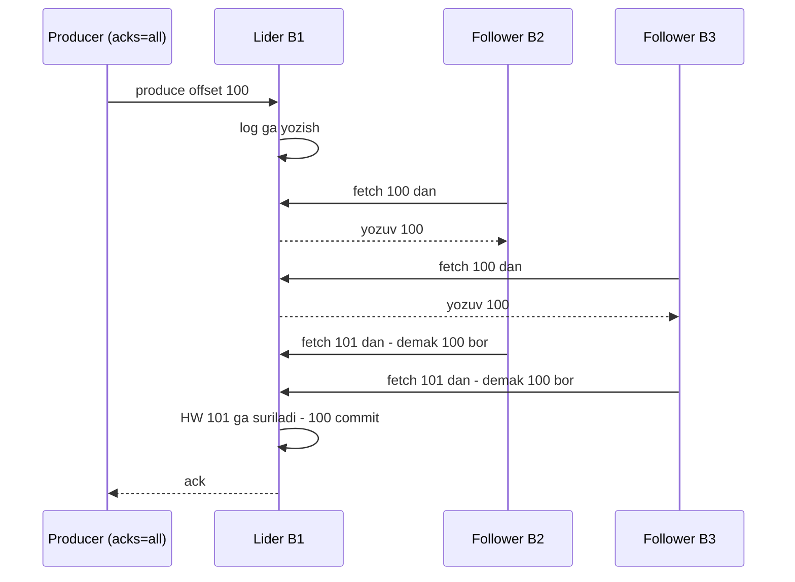
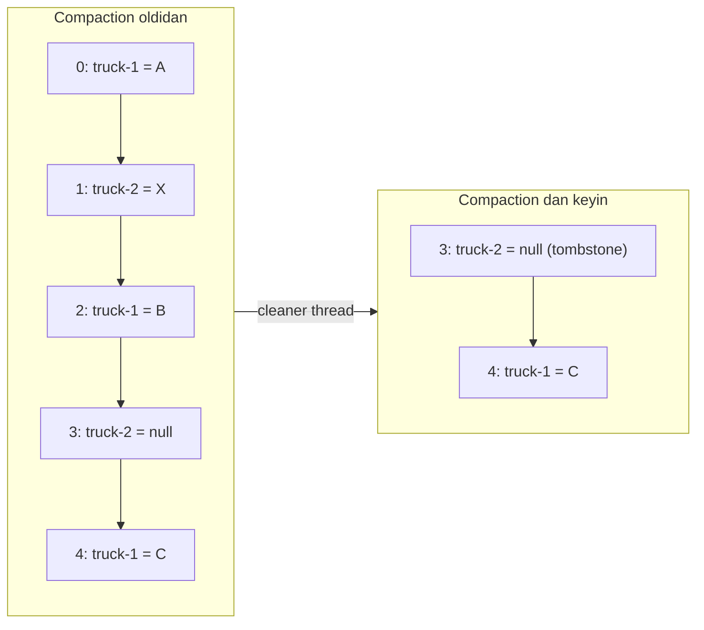

## Bu dars nima uchun kerak

43-darsda Kafka'ning mantiqiy modelini ko'rdik: topic, partition, offset, consumer group. Lekin "xabar yozildi" degani nimani anglatadi? Broker diski yonib ketsa-chi? Lider o'lsa, qaysi replika yangi lider bo'ladi va u hamma ma'lumotga egami? Disk 7 kundan keyin to'lib qolmaydimi? Bu dars Kafka'ning **ishonchlilik va saqlash** qatlamiga bag'ishlangan.

Bu yerda 26-darsdagi replikatsiya, 33-darsdagi consistency, 36-darsdagi Raft va 39-darsdagi idempotency nazariyalari bitta real tizimda uchrashadi. Kafka'ning qiziq tomoni shundaki, u ma'lumot replikatsiyasi uchun klassik majority quorum'dan **foydalanmaydi**, o'zining ISR modelini ishlatadi, va buning aniq sabablari va narxi bor.

Bu darsdan keyin siz:

- leader/follower replikatsiyasi, ISR va high watermark qanday ishlashini bilasiz;
- `acks`, `min.insync.replicas` va replication factor kombinatsiyalari qanday durability va availability berishini hisoblay olasiz;
- unclean leader election va Eligible Leader Replicas (KIP-966) nima uchun kerakligini tushunasiz;
- idempotent producer va tranzaksiyalar ichki mexanikasini bilasiz;
- time/size retention, log compaction va tiered storage'ni to'g'ri tanlay olasiz;
- klaster disk hajmini hisoblay olasiz.

## Replikatsiya modeli

Har bir partitionning bitta **lider** replikasi va nol yoki bir nechta **follower** replikasi bor. Replikalar turli brokerlarda joylashadi.

- Barcha yozuvlar (va default holatda o'qishlar) liderga boradi.
- Follower'lar liderdan oddiy consumer kabi **pull** qiladi va yozuvlarni bir xil offset'lar bilan o'z log'iga qo'shadi. Pull tabiiy batch beradi.
- Bu 26-darsdagi single-leader replikatsiya, lekin har bir **partition** uchun alohida: 48 partitionli topicda 48 ta mustaqil lider bor va ular brokerlar bo'ylab taqsimlangan. Yuklama shu yo'l bilan tekislanadi.

### ISR (in-sync replicas)

ISR - lider bilan "sinxron" deb hisoblanadigan replikalar to'plami (lider ham kiradi). Kafka hujjatiga ko'ra replika ISR da qoladi, agar controller bilan faol sessiyasi bo'lsa va liderdan `replica.lag.time.max.ms` (default 30 s) dan ortiq orqada qolmasa. Sekin yoki o'lik follower ISR dan chiqariladi, yetib olgach qaytariladi.

Asosiy qoidalar:

- Yozuv **commit qilingan** hisoblanadi, qachonki uni ISR dagi barcha replikalar yozib olgan bo'lsa.
- Faqat ISR a'zosi lider bo'lishi mumkin (clean leader election).
- Consumer faqat commit qilingan yozuvlarni ko'radi.
- Commit qilingan yozuv kamida bitta ISR replikasi tirik ekan yo'qolmaydi.

**High watermark (HW)** - partitionda commit qilingan oxirgi pozitsiya. Lider follower'larning fetch so'rovlaridan ular qayergacha yetib olganini biladi va HW ni ISR dagi eng kichik pozitsiyaga suradi. Consumer HW gacha o'qiy oladi, undan keyingisini emas. Lider almashganda, yangi liderdan oldinda bo'lgan follower'lar o'z log'ini kesadi (truncate) - commit qilinmagan yozuvlar shu yo'l bilan yo'qolishi mumkin, commit qilinganlar esa yo'q.

### Nima uchun majority quorum emas

Raft yoki Paxos kabi majority-vote tizimlari f ta nosozlikka chidash uchun 2f + 1 replika talab qiladi. Kafka hujjati ISR yondashuvini shunday asoslaydi: ISR bilan **f + 1** replika f ta nosozlikda commit qilingan ma'lumotni yo'qotmaydi. Ya'ni 3 replika bilan 2 ta broker o'lsa ham ma'lumot saqlanadi; Raft'da buning uchun 5 replika kerak.

Hujjat adolatli ravishda narxini ham aytadi: ikkala yondashuv ham f ta nosozlikka chidash uchun bir xil miqdordagi ack'ni kutadi, lekin majority vote **eng sekin** serverlarni kutmasdan commit qila oladi. ISR'da bitta sekin follower ISR dan chiqarilguncha (`replica.lag.time.max.ms`) butun partitionning yozish kechikishini oshiradi.

ISR modelining yana bir xavfli tomoni: ISR bitta replikaga (faqat liderga) qisqarishi mumkin. Shunda "commit" bitta diskdagi yozuv degani. Buni `min.insync.replicas` boshqaradi.

### Kafka nega har bir yozuvda fsync qilmaydi

`log.flush.interval.messages` default qiymati amalda cheksiz: Kafka yozuvni OS page cache'iga beradi va fsync'ni OS ga qoldiradi. Jack Vanlightly'ning tahliliga ko'ra bu xavfsiz, chunki Kafka'da lider tanlash log yaxlitligiga bog'liq emas: ma'lumot yo'qotib qayta ishga tushgan broker ISR dan chiqariladi, yetishmagan yozuvlarni liderdan qayta oladi va faqat yetib olgach ISR ga qaytadi. Jarayon qulashi (process crash) page cache'dagi ma'lumotni yo'qotmaydi; butun mashina o'chsa yo'qotadi. Shuning uchun xavf - **korrelyatsiyalangan** nosozlik: hamma replikalar bir vaqtda elektrsiz qolsa. Brokerlarni turli availability zone'larga joylashtirish buni amalda kamaytiradi. Raft esa aksincha fsync'siz xavfsiz emas, chunki uning saylov qoidasi har bir tugun log'i yaxlit ekaniga tayanadi.

## acks va min.insync.replicas

Producer `acks` sozlamasi bilan qachon "yozildi" javobini olishni tanlaydi:

- `acks=0` - producer javob kutmaydi. Eng tez, yo'qotish mumkin.
- `acks=1` - faqat lider yozgach javob. Lider ack dan keyin, follower'lar ko'chirib olishidan oldin o'lsa, yozuv yo'qoladi.
- `acks=all` (yoki `-1`) - lider joriy ISR dagi hamma replikalarni kutadi.

Kafka 3.0 dan beri producer default'i `acks=all` va `enable.idempotence=true` (KIP-679). Avval `acks=1` edi.

Muhim nozik joy: `acks=all` "**joriy** ISR dagi hamma" degani. ISR bitta liderga qisqargan bo'lsa, `acks=all` ham amalda `acks=1` ga teng. Shu yerda `min.insync.replicas` kerak: `acks=all` bilan yozishda ISR hajmi shu qiymatdan kichik bo'lsa, broker yozishni rad etadi (`NotEnoughReplicas`). Bu availability'ni durability'ga almashtiradi.

Ehtiyot bo'ling: broker default'lari xavfsiz emas - `default.replication.factor=1` va `min.insync.replicas=1`. Ichki topiclar uchun esa xavfsizroq: `offsets.topic.replication.factor=3`, `transaction.state.log.replication.factor=3`, `transaction.state.log.min.isr=2`. Production topiclar uchun RF va min ISR ni aniq belgilang.

### Kombinatsiyalar jadvali

| RF | min.insync.replicas | acks | Yozish davom etadi, agar o'lsa | Commit qilingan ma'lumot yo'qolmaydi, agar o'lsa | Izoh |
|---|---|---|---|---|---|
| 3 | 1 | 1 | 2 broker | 0 (lider ack dan keyin o'lsa yo'qoladi) | Tez, xavfli |
| 3 | 1 | all | 2 broker | ISR 1 ga qisqargan bo'lsa 0 | ISR qisqarishi yashirin xavf |
| 3 | 2 | all | 1 broker | 1 broker (kafolatli), odatda 2 | Klassik production sozlama |
| 3 | 3 | all | 0 broker | 2 broker | Bitta broker o'chishi yozishni to'xtatadi |
| 5 | 3 | all | 2 broker | 2 broker (kafolatli) | Muhim ma'lumot, qimmat |

Qoida: `min.insync.replicas = RF - 1` va `acks=all`. RF = 3, min ISR = 2 - bitta broker rolling restart yoki nosozlikda yozish to'xtamaydi va har bir commit qilingan yozuv kamida ikki diskda.

**Hisob-kitob: kechikish.** `acks=1` da produce kechikishi taxminan lider diskka (page cache'ga) yozish vaqti. `acks=all` da esa qo'shimcha ravishda eng sekin ISR follower'ning keyingi fetch'i va javob. Masala sharti: brokerlar uch AZ da, AZ lar orasidagi RTT 1-2 ms. U holda `acks=all` kamida bitta qo'shimcha AZ lararo round-trip (follower fetch javobi va keyingi fetch) qo'shadi, ya'ni bir necha millisekund. Lekin bitta follower GC pauzasi yoki disk muammosi tufayli 20 soniya sekinlashsa, u ISR dan chiqarilguncha (`replica.lag.time.max.ms` = 30 s) shu partitionga yozishlar sekinlashadi. p99.9 produce latency'dagi "dum"lar ko'pincha shu yerdan.

## Lider tanlash va uning xavflari

Lider o'lganda KRaft controller yangi liderni ISR dan tanlaydi. ISR bo'sh bo'lsa-chi (hamma ISR replikalari o'lgan, faqat orqada qolgan replika tirik)? Hujjat buni availability va consistency o'rtasidagi oddiy trade-off deb ataydi:

- **Kutish** (default, `unclean.leader.election.enable=false`, 0.11.0.0 dan beri) - ISR replikasi qaytguncha partition ishlamaydi. Ma'lumot yo'qolmaydi.
- **Unclean leader election** (`true`) - orqada qolgan replika lider bo'ladi. Partition darhol ishlaydi, lekin commit qilingan yozuvlar yo'qoladi va boshqa replikalar ularni truncate qiladi.

Bu 34-darsdagi CAP/PACELC'ning bitta konfiguratsiya bayrog'ida ifodalanishi. Metrikalar yoki loglar uchun unclean election qabul qilinishi mumkin, to'lov hodisalari uchun - hech qachon.

### Last replica standing va ELR (KIP-966)

KIP-966 hal qiladigan nozik muammo: ISR bitta replikaga qisqargan, u esa toza bo'lmagan holda o'chadi (unclean shutdown) va page cache'dagi commit qilingan yozuvlarni yo'qotadi. Qayta ishga tushganda u yagona ISR a'zosi sifatida yana lider bo'lishi mumkin, boshqa follower'lar unga moslashib o'z log'larini kesadi - mahalliy yo'qotish **global** yo'qotishga aylanadi.

**Eligible Leader Replicas (ELR)** - ISR dan tashqarida bo'lgan, lekin high watermark gacha ma'lumotga ega ekani ma'lum replikalar to'plami. ELR faqat ISR `min.insync.replicas` dan kichik bo'lganda mavjud va ELR a'zolari ham clean leader election'da qatnasha oladi. Toza bo'lmagan o'chishdan keyin qaytgan broker ELR va ISR dan chiqariladi. Shuningdek ISR min ISR dan kichik bo'lganda high watermark surilmaydi. ELR Kafka 4.0 da kiritilgan va 4.1 dan boshlab **yangi** klasterlarda default yoqilgan.

## Idempotent producer va tranzaksiyalar

### Idempotent producer

Producer retry qilganda dublikat yozmasligi uchun (41-dars): har bir producer ishga tushganda **PID** (producer ID) oladi, har bir partition uchun sequence raqami 0 dan boshlab oshib boradi. Broker har bir (PID, partition) uchun oxirgi sequence'larni eslab qoladi va dublikatni tashlaydi, bo'shliqni esa jiddiy xato deb hisoblaydi. Idempotence `max.in.flight.requests.per.connection <= 5` va `acks=all` ni talab qiladi, va shu cheklov ichida retry'lar tartibni ham buzmaydi.

Cheklov: kafolat faqat **bitta producer sessiyasi** ichida. Producer qayta ishga tushsa, yangi PID oladi va eski xabarni qayta yuborsa, broker uni dublikat deb tanimaydi.

### Tranzaksiyalar (KIP-98)

Tranzaksiya bir nechta partitionga yozishni atomik qiladi va - eng muhimi - **consume-transform-produce** tsiklini effectively-once qiladi:

1. Producer barqaror `transactional.id` bilan ishga tushadi. `initTransactions()` epoch'ni oshiradi: eski "zombie" instans (masalan, tarmoq uzilishi tufayli o'lgan deb hisoblangan, lekin hali ishlayotgan) shu ID bilan yoza olmaydi - bu 38-darsdagi fencing token g'oyasi. Eski instansning tugallanmagan tranzaksiyasi tugatiladi yoki bekor qilinadi.
2. Transaction coordinator (broker tomonidagi komponent) tranzaksiya holatini ichki replikatsiya qilinadigan transaction log topicida saqlaydi.
3. Producer chiqish topiclariga yozadi va `sendOffsetsToTransaction()` bilan kirish offset'larini ham **shu tranzaksiyaga** qo'shadi.
4. Commit'da coordinator har bir ishtirok etgan partitionga COMMIT yoki ABORT **control marker** yozadi.
5. `isolation.level=read_committed` consumer faqat commit qilingan tranzaksiyalarni ko'radi va **last stable offset (LSO)** dan nariga o'tmaydi. Default `read_uncommitted` - bekor qilingan tranzaksiyalarning yozuvlari ham ko'rinadi.

Natija: kirishni o'qish, natijani yozish va offset'ni siljitish yo hammasi bo'ladi, yo hech biri. Lekin bu faqat **Kafka ichida**. Natija PostgreSQL ga yoki tashqi API ga ketsa, Kafka tranzaksiyasi uni qamrab olmaydi - 41-darsdagi end-to-end argument. Kafka 4.0 da KIP-890 ning ikkinchi bosqichi har bir tranzaksiyada epoch'ni oshirib, zombie tranzaksiyalar ehtimolini yanada kamaytirdi.

Narxi: har bir commit qo'shimcha round-trip va markerlar; `read_committed` consumer ochiq tranzaksiya tugaguncha kutadi, shuning uchun uzoq tranzaksiyalar end-to-end kechikishni oshiradi. Tranzaksiyani kichik va qisqa saqlang (odatda yuzlab millisekundlar).

## Retention: qancha saqlash

`cleanup.policy=delete` (default) bilan eski segmentlar o'chiriladi:

- `retention.ms` - default 7 kun (604 800 000 ms).
- `retention.bytes` - default -1 (cheklov yo'q). Bu **partition** boshiga chegara, topic boshiga emas.
- O'chirish butun segment bo'yicha: segment ichidagi eng katta vaqt belgisi retention'dan eski bo'lganda. Faol segment o'chirilmaydi. Shuning uchun haqiqiy saqlash muddati `retention.ms` dan biroz ko'proq (bir segmentgacha).

Consumer offset'lari ham abadiy emas: `offsets.retention.minutes` default 7 kun. Guruh uzoq vaqt faol bo'lmasa, uning offset'lari o'chadi va qaytganda `auto.offset.reset` qo'llaniladi (43-dars).

### Disk hajmi hisob-kitobi

Masala sharti (43-darsdagi misol): o'rtacha 10 000 yozuv/s, 300 bayt, retention 7 kun, RF = 3, siqish koeffitsiyenti 4, disklar 65% gacha to'ldiriladi, 6 broker.

- Xom oqim: 10 000 × 300 B = 3 MB/s.
- Kuniga: 3 MB × 86 400 = 259.2 GB.
- 7 kun retention: 259.2 × 7 = 1.81 TB.
- RF = 3: 1.81 × 3 = **5.44 TB** klaster bo'yicha.
- Siqish koeffitsiyenti 4 (shart): 5.44 / 4 = **1.36 TB**.
- 65% to'ldirish chegarasi (shart): 1.36 / 0.65 = **2.09 TB** xom disk, 6 broker bo'lsa har biriga 2.09 / 6 = 349 GB.

Siqish koeffitsiyenti ma'lumot formati va batch hajmiga kuchli bog'liq, shuning uchun u bu yerda shart sifatida berildi va o'z ma'lumotingizda o'lchanishi kerak. Real o'lchov uchun mo'ljal: Cloudflare 2018-yilda Kafka'dagi Cap'n Proto formatidagi HTTP log xabarlarida (o'rtacha 1 594 bayt) gzip bilan 3.58x, snappy bilan 2.35x, lz4 bilan 1.81x siqish o'lchagan; zstd'ni esa faqat bitta ajratib olingan batch ustida lzbench bilan sinab, 3.79x olgan. Agar koeffitsiyent 4 emas, 2 bo'lsa, disk ikki baravar ko'p kerak bo'ladi: 4.18 TB.

Bu hisob yana bir narsani ko'rsatadi: retention'ni 30 kunga oshirish diskni 4 baravar oshiradi. Uzoq retention kerak bo'lsa - tiered storage.

### Tiered storage

KIP-405: log ikki qatlamga bo'linadi - mahalliy broker diski va masofaviy ombor (S3, HDFS). Yopilgan segmentlar masofaviy omborga ko'chiriladi, `local.retention.ms` (yoki `.bytes`) dan keyin mahalliy nusxa o'chiriladi, umumiy retention esa `retention.ms` bilan belgilanadi. Kafka 3.9 da production-ready deb e'lon qilingan. Cheklovlar: compacted topiclar qo'llab-quvvatlanmaydi; Kafka masofaviy ombor uchun tayyor production implementatsiya bermaydi (`RemoteStorageManager` plagini kerak).

Foyda: broker diski faqat "issiq" ma'lumot uchun (masalan, 1 kun), sovuq tarix esa arzon object storage'da. Broker almashtirish yoki qayta balanslash tezroq, chunki ko'chiriladigan mahalliy ma'lumot kam. Narxi: eski ma'lumotni o'qish sekinroq va object storage so'rovlari uchun to'lov.

## Log compaction

`cleanup.policy=compact` - butunlay boshqa semantika: Kafka har bir **kalit** uchun kamida oxirgi qiymatni saqlaydi, eskilarini esa fonda o'chiradi. Topic "o'zgarishlar oqimi"dan "kalit-qiymat holati"ga aylanadi.

Mexanika:

- Log **dum** (tail, allaqachon tozalangan qism) va **bosh** (head, oxirgi tozalashdan keyin yozilgan) qismlarga bo'linadi. Cleaner thread'lar boshdagi kalitlar xaritasini quradi va segmentlarni qayta nusxalab, eskirgan qiymatlarni tashlaydi.
- **Offset'lar o'zgarmaydi** va tartib saqlanadi. Tozalangan offset'lar shunchaki "bo'shliq" bo'ladi.
- Faol segment hech qachon tozalanmaydi.
- `min.cleanable.dirty.ratio` (default 0.5) - log'ning "iflos" (tozalanmagan) qismi shu ulushdan oshgandagina tozalanadi. `min.compaction.lag.ms` yozuv kamida qancha vaqt tozalanmasligini, `max.compaction.lag.ms` esa ko'pi bilan qancha vaqt tozalanmay qolishini belgilaydi.
- **Tombstone** - kalit va `null` qiymatli yozuv, "bu kalit o'chirildi" degani. Tombstone'ning o'zi `delete.retention.ms` (default 1 kun) dan keyin o'chiriladi. Bundan uzoqroq orqada qolgan consumer o'chirish markerini ko'rmay qolishi mumkin - va o'zining lokal holatida o'chirilgan kalitni abadiy saqlab qoladi.
- Kafolat: boshidan o'qigan consumer har bir kalitning **yakuniy** holatini ko'radi.
- `cleanup.policy=compact,delete` - ikkalasi birga: kalit bo'yicha siqish va baribir eski segmentlarni muddat bo'yicha o'chirish.

Qayerda ishlatiladi:

- Kafka'ning o'zi `__consumer_offsets` uchun - har bir (group, topic, partition) uchun faqat oxirgi offset kerak.
- Kafka Streams state store changelog'lari - instans qayta ishga tushganda holatni qayta tiklash uchun.
- CDC jadval oqimlari (48-dars) - jadvalning joriy holatini boshidan qayta qurish.
- Konfiguratsiya va "oxirgi holat" topiclari: har bir mashinaning oxirgi joylashuvi yoki qurilma sozlamalari.

## Trade-off jadvali: sozlamalar xulosasi

| Maqsad | Sozlama | Narxi |
|---|---|---|
| Maksimal durability | RF=3, min ISR=2, acks=all, unclean election o'chiq | Yozish kechikishi, bitta broker qolsa yozish to'xtaydi |
| Maksimal throughput | acks=1, katta batch.size, linger.ms 10-50 ms, lz4/zstd | Lider o'lganda yo'qotish, kechikish ortadi |
| Producer dublikatsiz | enable.idempotence=true (default) | Deyarli yo'q |
| Kafka ichida effectively-once | transactional.id, read_committed, sendOffsetsToTransaction | Kechikish, murakkablik |
| Uzoq tarix arzon | Tiered storage | Eski ma'lumotni o'qish sekin, compaction bilan ishlamaydi |
| Joriy holat oqimi | cleanup.policy=compact | Cleaner CPU/IO, tombstone nozikliklari |

## Real tizimlardan misollar

- **Kafka'ning o'zi.** Consumer offset'lari compacted topicda, cluster metadata KRaft log'ida, tranzaksiya holati replikatsiya qilinadigan ichki topicda. Ya'ni Kafka o'z ichki holatini ham log sifatida saqlaydi - Kreps'ning "jadval va log ikkiligi" g'oyasining amaliy namunasi.
- **Kafka 4.x evolyutsiyasi.** 4.0 da ZooKeeper olib tashlandi, KIP-890 tranzaksiya himoyasi kuchaytirildi (4.0 producer mijozlari har bir tranzaksiyada epoch'ni oshiradi) va ELR (KIP-966 1-qism) kiritildi, 4.1 da ELR yangi klasterlarda default bo'ldi. Vanlightly'ning 2023 yilgi tahlilida Kafka 3.5 holatida ochiq qolgan "last replica standing" chekka holati aynan KIP-966 bilan yopilishi qayd etilgan.

## iQuariX kontekstida qo'llanish

O'quv misoli (iQuariX haqidagi real ichki ma'lumot emas): Kafka klasteri 6 broker, uch AZ (yoki uch alohida server xonasi). Topiclar uchun sozlamalar:

| Topic | RF | min ISR | acks | cleanup | Retention | Sabab |
|---|---|---|---|---|---|---|
| `gps-points` | 3 | 2 | all | delete | 3 kun mahalliy, 30 kun tiered | Asosiy ma'lumot, qayta o'qish kerak |
| `live-location` | 3 | 2 | all | compact | - | Har mashinaning oxirgi joylashuvi, yangi servis tez yuklaydi |
| `fuel-alerts` | 3 | 2 | all, tranzaksiya | delete | 30 kun | Effectively-once: ogohlantirish va offset birga |
| `debug-telemetry` | 2 | 1 | 1 | delete | 1 kun | Diagnostika, yo'qotish qabul qilinadi |
| `device-config` | 3 | 2 | all | compact | - | Qurilma sozlamalari: oxirgi qiymat, tombstone bilan o'chirish |

`live-location` compacted topicidan foydalanish: yangi dispetcher servisi ishga tushganda butun topicni boshidan o'qib, 100 000 mashinaning oxirgi joylashuvini bir necha soniyada xotiraga yuklaydi va keyin real vaqtda yangilanishlarni oladi. Bu bazaga 100 000 so'rov yubormasdan "issiq start" beradi.

Yoqilg'i to'kish aniqlash servisi `fuel-readings` dan o'qiydi, `fuel-alerts` ga yozadi va offset'ni shu tranzaksiyada commit qiladi. Lekin SMS yuboruvchi keyingi servis tashqi provayderga murojaat qiladi - u yerda tranzaksiya yo'q, shuning uchun `alert_id` bo'yicha idempotency jadvali kerak.

## Ko'p uchraydigan xatolar

1. **Broker default'larida qolish:** `default.replication.factor=1`, `min.insync.replicas=1`. Bitta disk buzilsa - ma'lumot yo'q.
2. **`acks=all` ni yetarli deb hisoblash.** ISR bitta replikaga qisqarsa, u `acks=1` ga teng. `min.insync.replicas >= 2` kerak.
3. **`min.insync.replicas = RF`** qo'yish. Bitta broker rolling restart'ida yozish to'xtaydi.
4. **Unclean leader election'ni "availability uchun" yoqish** muhim topiclarda. Commit qilingan ma'lumot jim yo'qoladi.
5. **Kafka tranzaksiyasi tashqi bazani ham qamrab oladi deb o'ylash.** Faqat Kafka ichidagi o'qish-yozish atomik.
6. **`read_committed` siz tranzaksion producer.** Consumer bekor qilingan yozuvlarni ham ko'radi.
7. **Compacted topicda tombstone'ni hisobga olmaslik.** `delete.retention.ms` dan uzoq orqada qolgan consumer o'chirilgan kalitlarni ko'rmay qoladi.
8. **Disk hisobida RF va siqishni unutish** yoki diskni 90% gacha to'ldirish. To'lgan disk broker'ni to'xtatadi.

## Xulosa

- Har bir partitionning lideri va follower'lari bor, follower'lar pull qiladi. Commit - ISR dagi hamma replikalar yozib olgan yozuv, high watermark - commit chegarasi.
- ISR modeli f + 1 replika bilan f ta nosozlikda commit qilingan ma'lumotni saqlaydi, lekin eng sekin ISR follower'ni kutadi.
- `acks=all` + `min.insync.replicas = RF - 1` + unclean election o'chiq - standart xavfsiz sozlama.
- ELR (4.1 dan yangi klasterlarda default) last replica standing muammosini yopadi.
- Idempotent producer bitta sessiya ichida dublikatni yo'qotadi; tranzaksiyalar va `read_committed` Kafka ichida effectively-once beradi, tashqi tizimlar uchun emas.
- Retention segment bo'yicha ishlaydi; disk = throughput × retention × RF ÷ siqish ÷ to'ldirish ulushi. Uzoq tarix uchun tiered storage.
- Compaction har bir kalitning oxirgi qiymatini saqlaydi: offset'lar, changelog'lar, CDC va "joriy holat" topiclari uchun.

## Amaliy topshiriq

iQuariX uchun Kafka klasterini **o'lchang va sozlang** (faraziy): 60 000 qurilma, har 10 s da GPS nuqta (350 bayt), har 30 s da yoqilg'i datchigi (200 bayt), kuniga har bir mashinadan o'rtacha 50 ta hodisa (1 KB). Cho'qqi o'rtachadan 3 baravar. Talab: GPS tarixi 30 kun Kafka'dan qayta o'qilishi mumkin, hodisalar 90 kun.

1. **Throughput.** Har bir topic uchun o'rtacha va cho'qqi yozuv/s va MB/s ni hisoblang.
2. **Disk.** RF = 3, siqish 4 baravar (GPS va yoqilg'i), 2 baravar (hodisalar), diskni 65% gacha to'ldirish bilan umumiy disk hajmini hisoblang. Keyin tiered storage bilan mahalliy retention 2 kun bo'lsa, mahalliy disk qanchaga kamayishini hisoblang.
3. **Durability sozlamalari.** Har bir topic uchun RF, `min.insync.replicas`, `acks`, `cleanup.policy` ni tanlang va jadvalda asoslang.
4. **Nosozlik stsenariylari.** (a) Bitta broker o'chdi, (b) bitta AZ (2 broker) o'chdi, (c) 3 ta replikadan 2 tasi o'chdi va qolgani orqada qolgan. Har birida yozish va o'qish nima bo'ladi va ma'lumot yo'qoladimi?
5. **Compaction.** Qaysi ma'lumot uchun compacted topic yaratasiz? Tombstone qachon yuboriladi va `delete.retention.ms` ni qanday tanlaysiz?

Yaxshi javobda bo'lishi kerak bo'lgan narsalar:

- hisob-kitoblar ochiq, o'rtacha va cho'qqi alohida, RF va siqish to'g'ri qo'llangan;
- `acks=all` va `min.insync.replicas` birgalikda asoslangan, broker default'lari xavfli ekani tilga olingan;
- AZ nosozligida replikalar AZ bo'ylab taqsimlangani (rack awareness) muhimligi ko'rsatilgan;
- (c) stsenariyda unclean leader election trade-off'i va ELR tilga olingan;
- tiered storage compacted topiclar bilan ishlamasligi hisobga olingan;
- compacted topic uchun aniq misol (oxirgi joylashuv, qurilma sozlamalari) va tombstone muddati consumer'larning maksimal orqada qolishidan uzun.

Javobni pastdagi maydonga yozib, chatga yuboring.

## Manbalar

- Apache Kafka. [Design](https://kafka.apache.org/43/design/design/) - "Replication", "Replicated Logs: Quorums, ISRs, and State Machines", "Unclean leader election", "Log Compaction" bo'limlari.
- Apache Kafka. [Topic configs](https://kafka.apache.org/43/configuration/topic-configs/) va [Broker configs](https://kafka.apache.org/43/configuration/broker-configs/) - retention, compaction va replikatsiya default'lari.
- Apache Kafka. [Tiered Storage](https://kafka.apache.org/43/operations/tiered-storage/) va [3.9 upgrade notes](https://kafka.apache.org/39/getting-started/upgrade/) - production-ready holati.
- [KIP-98: Exactly Once Delivery and Transactional Messaging](https://cwiki.apache.org/confluence/display/KAFKA/KIP-98+-+Exactly+Once+Delivery+and+Transactional+Messaging) - PID, sequence, transaction coordinator, control marker, LSO.
- [KIP-966: Eligible Leader Replicas](https://cwiki.apache.org/confluence/display/KAFKA/KIP-966%3A+Eligible+Leader+Replicas) va [Kafka 4.1 upgrade notes](https://kafka.apache.org/41/getting-started/upgrade/) - ELR default holati.
- [KIP-679: Producer will enable the strongest delivery guarantee by default](https://cwiki.apache.org/confluence/spaces/KAFKA/pages/165221843/KIP-679+Producer+will+enable+the+strongest+delivery+guarantee+by+default) va [Kafka 3.0 upgrade notes](https://kafka.apache.org/30/getting-started/upgrade/).
- Jack Vanlightly. [Why Apache Kafka doesn't need fsync to be safe](https://jack-vanlightly.com/blog/2023/4/24/why-apache-kafka-doesnt-need-fsync-to-be-safe), 2023.
- Ivan Babrou. [Squeezing the firehose: getting the most from Kafka compression](https://blog.cloudflare.com/squeezing-the-firehose/), Cloudflare blog, 2018 - production'da o'lchangan gzip, snappy, lz4 siqish koeffitsiyentlari.
- Martin Kleppmann, Chris Riccomini. [Designing Data-Intensive Applications, 2-nashr](https://www.oreilly.com/library/view/designing-data-intensive-applications/9781098119058/), O'Reilly, 2026. 6-bob (Replication) va 12-bob (Log-Based Message Brokers).
