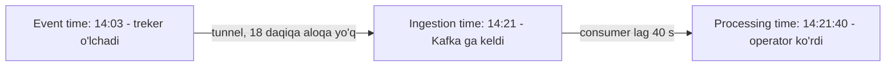
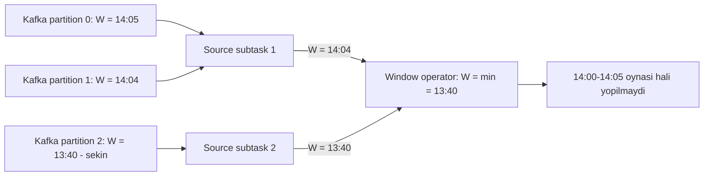

## Bu dars nima uchun kerak

43-44-darslarda Kafka hodisalarni ishonchli **tashishini** ko'rdik. Lekin ko'pincha hodisalarni shunchaki ko'chirish yetarli emas, ularni **hisoblash** kerak: "oxirgi 5 daqiqada har bir mashinaning o'rtacha tezligi", "har soatda yoqilg'i sarfi", "haydovchi 4 soatdan ortiq dam olmasdan haydadimi". Bu stream processing - cheksiz (unbounded) ma'lumot oqimi ustida uzluksiz hisob-kitob.

Batch processing'da (58-dars) masala oddiyroq: kecha tunda kunlik fayl tayyor, unda hamma ma'lumot bor, uni bir marta o'qib natija chiqarasiz. Stream'da esa ikki fundamental muammo bor:

1. **Ma'lumot hech qachon tugamaydi.** "Hamma ma'lumot keldi" degan payt yo'q, shuning uchun agregatni qachon "yakuniy" deb e'lon qilish kerakligini bilish qiyin.
2. **Ma'lumot tartibsiz keladi.** Treker tunnelda 20 daqiqa aloqasiz yurdi, keyin 120 ta nuqtani birdan yubordi. Bu nuqtalar 14:00-14:20 da sodir bo'lgan, lekin tizimga 14:21 da keldi. Ularni qaysi 5 daqiqalik oynaga qo'shasiz?

Google'dagi Dataflow jamoasi (Tyler Akidau va boshqalar, VLDB 2015) bu muammoni shunday ifodalagan: cheksiz, tartibsiz ma'lumotda **to'g'rilik, kechikish va narx**ni bir vaqtda maksimal qilib bo'lmaydi, shuning uchun tizim ularning o'rtasidagi trade-off'ni ochiq tanlash imkonini berishi kerak. Bu dars shu trade-off'ni boshqaradigan tushunchalarga bag'ishlangan.

Bu darsdan keyin siz:

- event time, ingestion time va processing time farqini va qachon qaysi biri kerakligini bilasiz;
- tumbling, sliding, session va global oynalarni va har birining xotira narxini bilasiz;
- watermark nima, u qanday hosil qilinadi va parallel oqimlarda qanday tarqalishini tushunasiz;
- kechikkan ma'lumotni qanday boshqarish (allowed lateness, grace period, side output, trigger'lar va accumulation rejimlari) mumkinligini bilasiz;
- stateful stream processing'da holat va checkpoint qanday ishlashini va "exactly-once" bu yerda nimani anglatishini bilasiz;
- stream processing quvurini iQuariX kabi telemetriya tizimi uchun loyihalay olasiz.

## Stream processing nima qiladi

Stream operatsiyalari ikki turga bo'linadi:

- **Stateless** - har bir hodisa mustaqil: filtrlash (`speed > 120`), o'zgartirish (koordinatani H3 katakka aylantirish), boyitish (`device_id` dan `tenant_id` ni lokal jadvaldan topish). Masshtablash oson, vaqt muammosi yo'q.
- **Stateful** - natija oldingi hodisalarga bog'liq: agregatlar (sum, count, avg), oynalar, join'lar, pattern aniqlash ("yoqilg'i 5 daqiqada 15% tushdi va mashina to'xtab turgan edi"). Holat saqlash, vaqt va nosozlikdan tiklanish kerak.

Bu darsning deyarli hammasi stateful qismga tegishli.

Tipik ishlatishlar:

- real vaqtda agregatlar va dashboard;
- murakkab hodisalarni aniqlash (CEP): firibgarlik, yoqilg'i o'g'irligi, xavfli haydash;
- materialized view'larni yangilab borish (47-dars: CQRS);
- stream-stream va stream-table join (GPS oqimini mashina ma'lumotnomasi bilan boyitish);
- ETL: tozalash, formatlash va boshqa omborlarga yozish.

Asosiy dvigatellar: **Apache Flink** (alohida klaster, eng boy vaqt modeli), **Kafka Streams** (ilovangiz ichidagi Java kutubxonasi, tashqi bog'liqligi faqat Kafka), **Spark Structured Streaming** (micro-batch asosida), **Google Cloud Dataflow / Apache Beam** (Dataflow modeli asosida yagona API).

## Uch xil vaqt

Har bir hodisa bilan bir necha vaqt belgisi bog'liq:

- **Event time** - hodisa manbada sodir bo'lgan vaqt. GPS nuqtasi uchun - treker o'lchagan vaqt.
- **Ingestion time** - hodisa tizimga (masalan, Kafka brokeriga) kelgan vaqt.
- **Processing time** - stream operatori hodisani qayta ishlayotgan paytdagi mashina soati.

Flink hujjati farqni aniq ifodalaydi: processing time eng tez va eng past kechikishli, lekin **deterministik emas** - natija kelish tezligi, operator tezligi va uzilishlarga bog'liq. Event time esa natijani ma'lumotning o'ziga bog'laydi: tartibsiz yoki kechikkan hodisalarda ham bir xil natija beradi, lekin tizim kechikuvchilarni ma'lum vaqt **kutishi** kerak.

### Event time va processing time orasidagi farq (skew)

Akidau "Streaming 101" maqolasida bu farqning sabablarini sanab o'tadi: tarmoq muammolari, apparat, yuklama va - eng muhimi - ma'lumotni keyinroq yuboradigan qurilmalar (uning misolida, samolyot rejimidan chiqqan telefon). Farq doimiy emas, u vaqt bo'yicha o'zgarib turadi. Fleet tizimida bu juda yaqqol: tunnel, qishloq joylar, qurilma qayta yuklanishi, SIM-karta balansi tugashi.

Processing time bo'yicha oyna qilsangiz, 14:03 dagi nuqta 14:20-14:25 oynasiga tushadi - bu noto'g'ri. Shuning uchun **biznes ma'nosi bo'lgan hisob-kitoblar** (masofa, sarf, tezlik buzilishi) deyarli har doim event time'da bo'lishi kerak. Processing time faqat tizimning o'zi haqidagi metrikalar uchun (masalan, "soniyasiga nechta xabar qayta ishlayapmiz") yoki kechikish muhimroq va taxminiy natija qabul qilinadigan joyda mos.

Ehtiyot bo'ling: event time manbaning soatidan keladi va manba soati noto'g'ri bo'lishi mumkin (32-dars). GPS trekerlari odatda vaqtni GNSS signalidan oladi, lekin signal yo'q paytda ichki soatga tayanishi mumkin, va ichki soat siljiydi. Kelajakdan kelgan (masalan, 2038-yildagi) vaqt belgilari watermark'ni oldinga "otib yuborishi" mumkin, shuning uchun kirishda vaqtni tekshirish va shubhali qiymatlarni tuzatish yoki ajratish kerak.

## Oynalar (windowing)

Cheksiz oqimda agregat hisoblash uchun uni chekli bo'laklarga - oynalarga bo'lish kerak.

| Oyna turi | Ta'rif | Hodisa nechta oynaga tushadi | Misol |
|---|---|---|---|
| Tumbling | Qat'iy o'lchamli, bir-birini yopmaydigan | 1 | Har 5 daqiqalik o'rtacha tezlik |
| Sliding (hopping) | O'lcham W, har S da yangi oyna boshlanadi, S < W bo'lsa ustma-ust | W / S | Oxirgi 10 daqiqadagi yoqilg'i tushishi, har 1 daqiqada yangilanadi |
| Session | Faollik bo'shliq (gap) bilan ajratiladi, o'lcham dinamik | 1 (oynalar birlashishi mumkin) | Safar: mashina 10 daqiqadan ko'p to'xtasa, safar tugadi |
| Global | Kalit bo'yicha bitta cheksiz oyna, maxsus trigger kerak | 1 | "Har 1 000 ta hodisada" kabi hisoblar |

### Xotira narxi hisob-kitobi

Sliding oyna yashirin qimmat. Deylik, 100 000 mashina, oyna W = 10 daqiqa, qadam S = 10 soniya.

- Har bir hodisa W / S = 600 / 10 = **60 ta oynaga** tushadi.
- Agar har bir oyna barcha nuqtalarni saqlasa: 100 000 mashina, har 10 s da 1 nuqta, 10 daqiqada 60 nuqta, har nuqta 60 oynada - 100 000 × 60 × 60 = 360 mln yozuv holatda. 100 bayt bilan 36 GB.
- Agar oyna faqat **inkremental agregat** (sum, count, min, max - har biri 8 bayt) saqlasa: har bir mashina uchun bir vaqtda 60 ta ochiq oyna × taxminan 32 bayt = 1.9 KB, 100 000 mashina uchun taxminan **192 MB**.

Saboq: oynada iloji boricha xom hodisalarni emas, inkremental (birlashtiriladigan) agregatni saqlang. Mediana yoki percentile kabi inkremental bo'lmagan funksiyalar uchun taxminiy sketch'lar (t-digest, HyperLogLog) ishlating. Sliding oynada qadamni keraksiz kichik qilmang.

### Session oynasi

Session oynasining o'ziga xosligi: uning chegaralari ma'lumotdan chiqadi. Gap = 10 daqiqa bo'lsa, 14:00 va 14:08 dagi hodisalar bitta sessiyada, 14:24 dagisi yangi sessiyada. Lekin kechikib kelgan 14:15 dagi hodisa ikki sessiyani **birlashtiradi** (14:08 dan 7 daqiqa, 14:24 gacha 9 daqiqa). Ya'ni allaqachon "yakunlangan" ikki safar bitta safarga aylanishi kerak. Shu sababli session oynalari kechikkan ma'lumotga eng sezgir va natijani qayta chiqarish (retraction) talab qilishi mumkin.

## Watermark: "vaqt qayergacha yetdi"

Event time'da oynani qachon yopish kerak? 14:00-14:05 oynasi uchun 14:05 dan keyin kelgan hodisa hali 14:04 dagi bo'lishi mumkin. Abadiy kutib bo'lmaydi. Javob - **watermark**.

Watermark(t) - oqimda "vaqt belgisi t dan kichik yoki teng hodisalar endi kelmaydi" degan tasdiq. Akidau "Streaming 102" da buni kiritilgan ma'lumotning event time bo'yicha **to'liqlik bahosi** deb ta'riflaydi. Operator watermark kelganda o'z event-time soatini suradi va oxiri watermark'dan oldin bo'lgan oynalarni yopib, natijani chiqaradi.

### Mukammal va evristik watermark

- **Mukammal (perfect) watermark** - manba haqida to'liq bilim bo'lsa (masalan, har bir partitionda vaqt qat'iy o'sib boradi). Kechikkan ma'lumot bo'lmaydi.
- **Evristik (heuristic) watermark** - taxmin. Amalda deyarli har doim shunday. Eng keng tarqalgan strategiya - **bounded out-of-orderness**: watermark = ko'rilgan eng katta vaqt belgisi - B (ruxsat etilgan tartibsizlik). Flink'da `WatermarkStrategy.forBoundedOutOfOrderness(Duration.ofSeconds(20))`.

Evristik watermark ikki xil xato qilishi mumkin:

- **Juda sekin** - B katta, natija keraksiz kechikadi. Bitta sekin manba butun oqimni ushlab turadi.
- **Juda tez** - B kichik, oyna yopilgandan keyin ham uning hodisalari keladi. Ular "kechikkan" bo'ladi va noto'g'ri natija beradi.

Akidau'ning xulosasi: faqat to'liqlik tushunchasi bilan ham past kechikish, ham to'g'rilikka erishib bo'lmaydi. Shu sababli trigger'lar kerak (pastda).

### Parallel oqimlarda watermark

Flink hujjatiga ko'ra har bir parallel manba subtask'i o'z watermark'ini hosil qiladi, va bir nechta kirishli operator (union, `keyBy` dan keyingi operator) o'z event time'i sifatida kirishlar watermark'larining **minimumini** oladi.

Bu minimum qoidasi ikki amaliy muammoni keltirib chiqaradi:

1. **Bo'sh (idle) partition.** Bitta partitionga hodisa kelmay qo'ysa (masalan, kechasi kichik mijozning hamma mashinalari o'chiq), uning watermark'i oldinga yurmaydi va butun quvurning watermark'ini to'xtatadi. Flink'da `withIdleness(Duration.ofMinutes(1))` - manba ma'lum vaqt jim bo'lsa, u minimum hisobidan chiqariladi.
2. **Sekin partition.** Bitta partition katta lag bilan qayta o'qilayotgan bo'lsa (masalan, qurilmalar bir soatlik buferni yuborayotgan bo'lsa), boshqalar oldinga ketadi va operator ularning hodisalarini buferda saqlashi kerak. Flink'dagi watermark alignment bitta manba boshqalardan maksimal qancha oldinga keta olishini cheklaydi.

Kafka manbasida Flink watermark'larni har bir partition uchun alohida hosil qiladi va birlashtiradi. Agar partition ichida vaqt o'sish tartibida bo'lsa, umumiy watermark aniq bo'ladi. Bu 43-darsdagi kalit tanlovi bilan bog'liq: kalit `device_id` bo'lsa, bitta qurilmaning nuqtalari bitta partitionda va odatda vaqt tartibida.

## Kechikkan ma'lumot bilan ishlash

Watermark oynaning oxiridan o'tgandan keyin kelgan hodisa - **kechikkan (late)**. Variantlar:

1. **Tashlab yuborish.** Flink'da `allowedLateness` default 0: watermark oyna oxiridan o'tgach kelgan hodisalar tashlanadi. Eng arzon, lekin jim ma'lumot yo'qotish.
2. **Allowed lateness / grace period.** Oyna holati watermark oxiridan o'tgandan keyin ham ma'lum muddat saqlanadi, kechikkan hodisa oynani **qayta hisoblaydi** va yangilangan natija chiqadi. Flink'da oyna watermark `oyna oxiri + allowed lateness` dan o'tgandagina o'chiriladi. Kafka Streams'da bu **grace period**: oyna oxiri + grace'dan keyin kelgan yozuvlar tashlanadi.
3. **Side output.** Hatto allowed lateness'dan ham kechikkanlarni tashlamasdan alohida oqimga chiqarish (Flink `sideOutputLateData`). Keyin ularni batch tuzatish jarayoni bilan qayta ishlash yoki hech bo'lmasa sanash va alert berish.

Har bir variantning narxi bor: allowed lateness 1 soat bo'lsa, har bir oynaning holati 1 soat ortiq xotirada turadi. 5 daqiqalik tumbling oynada bu bir vaqtda 12 baravar ko'p ochiq oyna degani.

### Trigger'lar va accumulation rejimlari

Dataflow modeli to'rt savol bilan ish ko'radi:

| Savol | Javob beruvchi mexanizm |
|---|---|
| **What** - nima hisoblanadi? | Transformatsiyalar (sum, count, join) |
| **Where** - event time'ning qayerida? | Oynalar |
| **When** - processing time'ning qachonida natija chiqariladi? | Watermark va trigger'lar |
| **How** - bir oynaning ketma-ket natijalari bir-biriga qanday bog'liq? | Accumulation rejimi |

**Trigger** oyna natijasi qachon chiqarilishini belgilaydi va bir necha marta ishlashi mumkin. Akidau tavsiya qilgan namuna:

- **early** - watermark'dan oldin, masalan, har daqiqada taxminiy natija (dashboard bo'sh turmasin);
- **on-time** - watermark oyna oxiridan o'tganda asosiy natija;
- **late** - har bir kechikkan hodisada tuzatilgan natija.

Bu "juda sekin" va "juda tez" watermark muammolarining ikkalasini yumshatadi: foydalanuvchi tez taxmin ko'radi, keyin aniq natija, keyin tuzatish.

Ketma-ket natijalar o'zaro qanday bog'liq?

- **Discarding** - har bir natija faqat oxirgi trigger'dan keyingi yangi ma'lumot. Downstream o'zi yig'adi.
- **Accumulating** - har bir natija oynadagi hamma ma'lumot, oldingisini almashtiradi. Key-value omborga `UPSERT` qilish uchun qulay.
- **Accumulating and retracting** - yangi natija bilan birga eski natijani bekor qilish signali. Session oynalari birlashganda yoki natija qayta guruhlanganda kerak, eng qimmat rejim.

Kafka Streams'da agregatlar har doim KTable hosil qiladi: kechikkan yozuv kelsa, shu kalit uchun yangilangan natija oldingisini **ustidan yozadi** - bu amalda accumulating rejim. Shuning uchun downstream tizim natijani `INSERT` emas, `UPSERT` qilishi kerak.

## Holat, checkpoint va exactly-once

Stateful operator holatni (oynalar, agregatlar, join buferlari) lokal saqlaydi: xotirada yoki diskda (Flink'da RocksDB state backend - holat hajmi xotira emas, disk bilan cheklanadi, lekin har bir o'qish-yozish serializatsiya talab qiladi va sekinroq). Operator o'lsa, holatni qanday tiklash kerak?

**Flink checkpoint'lari.** Flink Chandy-Lamport algoritmining varianti - asinxron barrier snapshot'idan foydalanadi:

1. Checkpoint koordinatori manbalarga o'z pozitsiyasini (Kafka offset'larini) yozib qo'yishni va oqimga raqamlangan **barrier** qo'shishni buyuradi.
2. Barrier oqim bo'ylab hodisalar bilan birga oqadi. Har bir operator barrier'ni olganda o'z holatining snapshot'ini saqlaydi.
3. Bir nechta kirishli operator barcha kirishlardan barrier kelishini kutadi (alignment), keyin snapshot oladi.
4. Hamma operatorlar snapshot'ni tugatgach, checkpoint yakunlangan hisoblanadi.

Nosozlikda hamma operatorlar oxirgi checkpoint holatiga qaytariladi, manbalar esa o'sha offset'lardan qayta o'qiydi.

Bu yerdagi "exactly-once" ning aniq ma'nosi: Flink hujjatiga ko'ra bu har bir hodisa Flink boshqaradigan **holatga** aniq bir marta ta'sir qiladi degani, har bir hodisa fizik ravishda bir marta qayta ishlanadi degani emas. Checkpoint'dan keyingi hodisalar qayta o'qiladi va qayta ishlanadi. **End-to-end** exactly-once uchun ikki shart: qayta o'qiladigan manba (Kafka) va tranzaksion yoki idempotent sink. Bu 41-darsdagi xulosaning xuddi o'zi.

**Kafka Streams.** Holat lokal state store'larda, ular Kafka'dagi changelog topiclari bilan zaxiralanadi (stream-table ikkiligi, 44-darsdagi compaction). `processing.guarantee` default `at_least_once`; `exactly_once_v2` yoqilsa, kirish offset'lari, state store yangilanishlari va chiqish yozuvlari Kafka tranzaksiyasi bilan atomik commit qilinadi (44-dars).

## Real tizimlardan misollar

- **Google Dataflow / Apache Beam.** Dataflow maqolasi (VLDB 2015) aynan Google ichidagi cheksiz, tartibsiz ma'lumotlar (veb loglar, mobil statistika, datchik tarmoqlari) tajribasidan kelib chiqqan. Uning asosiy pozitsiyasi: cheksiz ma'lumotni chekli "to'liq" bo'laklarga majburan bo'lishni to'xtatish va hech qachon hamma ma'lumot kelganini bilmasligimizni, eski ma'lumot qayta ko'rib chiqilishi mumkinligini qabul qilish. Beam API shu modelni Flink, Spark va Dataflow ustida yagona interfeys sifatida beradi.
- **Lambda arxitekturasidan voz kechish.** Akidau "Streaming 101" da parallel ravishda batch va streaming quvurlarini yuritishni (Lambda) qo'llab-quvvatlash og'irligini tanqid qiladi va yaxshi loyihalangan streaming tizimi batch qila oladigan hamma narsani qila olishi kerakligini ta'kidlaydi - buning sharti kuchli consistency (exactly-once holat) va vaqt haqida fikrlash vositalari.
- **Kafka Streams.** Ilova ichidagi kutubxona sifatida: alohida klaster kerak emas, masshtablash - ilova instanslarini ko'paytirish. Vaqt belgisi `TimestampExtractor` orqali tanlanadi: default Kafka yozuvidagi vaqt, maxsus extractor esa payload'dan event time'ni oladi.

## Taqqoslash: qaysi dvigatel

| Mezon | Kafka Streams | Apache Flink | Spark Structured Streaming |
|---|---|---|---|
| Joylashuv | Ilova ichidagi kutubxona | Alohida klaster (JobManager, TaskManager) | Spark klasteri |
| Manba va sink | Faqat Kafka | Ko'p turli konnektorlar | Ko'p turli konnektorlar |
| Vaqt modeli | Event time, grace period | Eng boy: watermark strategiyalari, idleness, alignment, trigger'lar | Watermark, micro-batch |
| Holat | Lokal store + Kafka changelog | Heap yoki RocksDB + checkpoint | State store + checkpoint |
| Kechikish | Past | Past | Micro-batch tufayli odatda yuqoriroq |
| Operatsion murakkablik | Eng past | Eng yuqori | O'rtacha (Spark bo'lsa) |
| Qachon | Kafka ichidagi servis-darajadagi hisoblar | Murakkab, katta holatli, ko'p manbali quvurlar | Spark ekotizimi bor, batch va stream bitta kodda |

## iQuariX kontekstida qo'llanish

Faraz qiling, iQuariX'da Kafka `gps-points` va `fuel-readings` topiclari bor (kalit `device_id`) va quyidagi stream hisoblari kerak:

**1. Har 5 daqiqalik masofa va o'rtacha tezlik (tumbling, event time).**

- Watermark: bounded out-of-orderness 30 s (oddiy tarmoq jitter'i uchun).
- Allowed lateness 2 soat: tunnel yoki qishloqda aloqasiz qolgan mashinalar keyinroq yuboradi. Natija `UPSERT` bilan ClickHouse/TimescaleDB jadvaliga yoziladi (accumulating).
- 2 soatdan kechikkanlar - side output'ga, u yerdan kechasi batch qayta hisoblash.
- Idleness 1 daqiqa: tunda faqat bir nechta mashina ishlayotganda bo'sh partitionlar watermark'ni ushlab turmasin.

Xotira bahosi: 100 000 mashina, oyna boshiga 4 ta raqam (count, sum_speed, sum_distance, oxirgi nuqta koordinatasi) taxminan 48 bayt. 2 soatlik allowed lateness bilan har bir mashina uchun bir vaqtda 24 + 1 = 25 ta ochiq oyna: 100 000 × 25 × 48 B = **120 MB**. Bemalol sig'adi.

**2. Yoqilg'i to'kish aniqlash (sliding yoki maxsus holat).**

Qoida: 10 daqiqa ichida yoqilg'i sathi 15% dan ko'p tushdi va shu vaqtda tezlik 0 edi. Sliding oyna (W = 10 daqiqa, S = 1 daqiqa) yoki har bir mashina uchun keyed state'da oxirgi 10 daqiqalik o'qishlar. Bu yerda **early trigger** muhim: dispetcher ogohlantirishni oyna yopilishini kutmasdan olishi kerak. Lekin datchik shovqini tufayli (yoqilg'i chayqalishi) bitta o'qish emas, median yoki silliqlangan qiymat bilan ishlash kerak.

**3. Safarlarni aniqlash (session oynasi).**

Gap = 10 daqiqa (dvigatel o'chirilgan yoki tezlik 0). Kechikkan nuqta ikki safarni birlashtirishi mumkin, shuning uchun safar hisobotlari "yakuniy" deb belgilanishidan oldin allowed lateness tugashini kutish yoki retraction'ni qo'llab-quvvatlash kerak. Mijozga "safar #1234" ID sini allowed lateness tugagandan keyin bering, yoki ID ni birinchi nuqta vaqti va `device_id` dan deterministik hosil qiling.

## Ko'p uchraydigan xatolar

1. **Biznes agregatlarini processing time'da hisoblash.** Consumer lag yoki qayta o'qish natijani o'zgartiradi, oflayn qurilmalarning ma'lumoti noto'g'ri oynaga tushadi.
2. **Event time'ga ko'r-ko'rona ishonish.** Noto'g'ri soatli qurilma kelajakdagi vaqt bilan watermark'ni oldinga surib, hamma boshqa hodisalarni "kechikkan" qiladi.
3. **Idle partition'larni hisobga olmaslik.** Tunda watermark to'xtaydi, natijalar chiqmaydi, holat o'sib boradi.
4. **Allowed lateness 0 (default) bilan qolish** va kechikkan ma'lumot jim yo'qolayotganini sezmaslik. Hech bo'lmasa side output va hisoblagich qo'ying.
5. **Sliding oynada xom hodisalarni saqlash.** Xotira W / S baravar ko'payadi. Inkremental agregat ishlating.
6. **Natijani `INSERT` qilish.** Kechikkan ma'lumot yoki qayta ishga tushish bir oyna uchun bir nechta natija beradi. Sink `UPSERT` (oyna kaliti bo'yicha) yoki idempotent bo'lishi kerak.
7. **"Exactly-once" ni tashqi tizimga ham tegishli deb hisoblash.** Flink/Kafka Streams kafolati ichki holat uchun. Sink tranzaksion yoki idempotent bo'lmasa, dublikatlar bo'ladi.
8. **Juda kichik watermark chegarasi bilan "real vaqt" ga intilish.** Ko'p hodisa kechikkan bo'ladi va natijalar doimiy tuzatiladi. Early trigger + realistik watermark yaxshiroq.

## Xulosa

- Stream processing cheksiz, tartibsiz oqimda hisob qiladi. To'g'rilik, kechikish va narx o'rtasida doim trade-off bor.
- Event time - hodisa sodir bo'lgan vaqt, processing time - qayta ishlangan vaqt. Biznes hisoblari event time'da.
- Oynalar: tumbling (1 oyna), sliding (W / S oyna, xotira qimmat), session (dinamik, birlashadi), global (maxsus trigger).
- Watermark - "bundan oldingi hodisalar endi kelmaydi" degan evristik baho. Parallel oqimda minimum olinadi, shuning uchun idle va sekin partitionlar butun quvurni ushlab turadi.
- Kechikkan ma'lumot: tashlash, allowed lateness/grace period bilan qayta hisoblash, side output. Trigger'lar early/on-time/late natija beradi.
- Stateful operatorlar checkpoint orqali tiklanadi. Ichki exactly-once - holatga bir marta ta'sir; end-to-end uchun qayta o'qiladigan manba va tranzaksion/idempotent sink kerak.

## Amaliy topshiriq

iQuariX uchun **"haydovchi dam olish rejimi"** monitoringini loyihalang (faraziy): qoida bo'yicha haydovchi 4.5 soat uzluksiz haydagach kamida 45 daqiqa dam olishi kerak. Ma'lumot: GPS nuqtalari (har 10 s), dvigatel holati hodisalari (on/off), haydovchi kartasi hodisalari (karta qo'yildi/olindi). 40 000 mashina, ba'zilari uzoq yo'llarda soatlab aloqasiz qoladi.

1. **Vaqt.** Qaysi hisoblar event time, qaysilari processing time'da bo'ladi? Qurilma soati noto'g'ri bo'lsa, qanday himoyalanasiz?
2. **Oyna turi.** "Uzluksiz haydash" davrini qanday oyna yoki holat bilan aniqlaysiz (session, sliding, keyed state + timer)? Gap qiymatini asoslang.
3. **Watermark va kechikish.** Bounded out-of-orderness, allowed lateness va idleness qiymatlarini tanlang. Mashina 3 soat aloqasiz bo'lib, keyin hamma nuqtalarni yuborsa nima bo'ladi?
4. **Natija va trigger'lar.** Dispetcherga qachon ogohlantirish chiqadi (early trigger)? Keyingi ma'lumot ogohlantirishni bekor qilsa-chi? Natija qaysi accumulation rejimida va sink'ka qanday yoziladi?
5. **Holat hajmi va tiklanish.** Har bir haydovchi uchun holatda nima saqlanadi va jami xotirani hisoblang. Operator qulasa, qanday tiklanadi va dublikat ogohlantirish bo'lmasligi uchun nima qilasiz?

Yaxshi javobda bo'lishi kerak bo'lgan narsalar:

- biznes qoidasi event time'da, kirishda vaqt tekshiruvi bor;
- session gap va dam olish qoidasi (45 daqiqa) o'rtasidagi bog'liqlik to'g'ri aniqlangan;
- uzoq oflayn qurilmalar uchun allowed lateness va side output, idleness sozlamasi bor;
- early ogohlantirish va keyin tuzatish (retraction yoki holat yangilanishi) ko'rsatilgan;
- holat hajmi inkremental (davr boshlanishi, oxirgi hodisa, jami vaqt), raqam bilan;
- tiklanishda checkpoint va idempotent ogohlantirish kaliti (`driver_id` + davr boshlanishi).

Javobni pastdagi maydonga yozib, chatga yuboring.

## Manbalar

- Tyler Akidau va boshq. [The Dataflow Model: A Practical Approach to Balancing Correctness, Latency, and Cost in Massive-Scale, Unbounded, Out-of-Order Data Processing](https://research.google/pubs/the-dataflow-model-a-practical-approach-to-balancing-correctness-latency-and-cost-in-massive-scale-unbounded-out-of-order-data-processing/), PVLDB 8, 2015.
- Tyler Akidau. [Streaming 101: The world beyond batch](https://www.oreilly.com/radar/the-world-beyond-batch-streaming-101/) va [Streaming 102](https://www.oreilly.com/radar/the-world-beyond-batch-streaming-102/), O'Reilly Radar, 2015 - vaqt turlari, oynalar, watermark, trigger, accumulation.
- Apache Flink hujjatlari: [Timely Stream Processing](https://github.com/apache/flink/blob/master/docs/content/docs/concepts/time.md), [Windows](https://github.com/apache/flink/blob/master/docs/content/docs/dev/datastream/operators/windows.md), [Generating Watermarks](https://github.com/apache/flink/blob/master/docs/content/docs/dev/datastream/event-time/generating_watermarks.md), [Fault Tolerance](https://github.com/apache/flink/blob/master/docs/content/docs/learn-flink/fault_tolerance.md).
- Apache Kafka. [Kafka Streams Core Concepts](https://kafka.apache.org/43/streams/core-concepts/) - stream-table ikkiligi, vaqt semantikasi, grace period, exactly_once_v2.
- Martin Kleppmann, Chris Riccomini. [Designing Data-Intensive Applications, 2-nashr](https://www.oreilly.com/library/view/designing-data-intensive-applications/9781098119058/), O'Reilly, 2026. 12-bob: "Processing Streams" va "Reasoning About Time".
