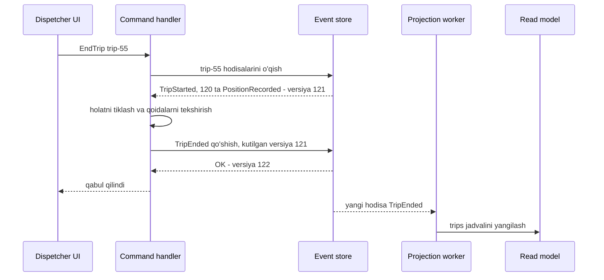

## Bu dars nima uchun kerak

41-45-darslarda xabarlarni qanday **tashish** (navbat, Kafka) va qanday **hisoblash** (stream processing) mumkinligini ko'rdik. Endi arxitektura darajasiga ko'tarilamiz: servislar bir-biri bilan hodisalar orqali gaplashsa, tizim qanday ko'rinadi? Va bir qadam chuqurroq: agar hodisalar nafaqat aloqa vositasi, balki **ma'lumotning o'zi** bo'lsa-chi?

"Event-driven" so'zi juda ko'p narsani anglatadi va bu chalkashlik ko'p xatolarga sabab bo'ladi. Martin Fowler 2017-yilda bu so'z ostida aslida to'rtta turli pattern yashiringanini ko'rsatgan: event notification, event-carried state transfer, event sourcing va CQRS. Ularning har biri boshqa muammoni yechadi va boshqa narx so'raydi. Bu darsda birinchi uchtasini ko'ramiz, CQRS esa 47-darsda.

Bu darsdan keyin siz:

- event, command va query o'rtasidagi farqni aniq ajrata olasiz;
- event notification va event-carried state transfer'ni va ularning trade-offlarini bilasiz;
- choreography ko'rinishidagi event-driven tizimda "yashirin oqim" muammosini tushunasiz;
- event sourcing qanday ishlashini: event store, aggregate, rehydration, optimistic concurrency, snapshot va projection'larni bilasiz;
- event schema evolution, GDPR va tashqi tizimlar bilan replay muammolarini qanday hal qilishni bilasiz;
- event sourcing qachon kerak va qachon ortiqcha ekanini asoslay olasiz.

## Command, event, query

Uchta xabar turi:

| Tur | Ma'nosi | Nomlash | Qabul qiluvchi | Rad etilishi mumkinmi |
|---|---|---|---|---|
| Command | "Buni bajar" - niyat | Buyruq maylida: `AssignDriver`, `StartTrip` | Odatda bitta, aniq | Ha, validatsiyadan o'tmasligi mumkin |
| Event | "Bu sodir bo'ldi" - fakt | O'tgan zamonda: `DriverAssigned`, `TripStarted` | Noma'lum, nol yoki ko'p | Yo'q, bu o'tmish |
| Query | "Menga ayt" | `GetTripById` | Bitta | Holatni o'zgartirmaydi |

Greg Young CQRS hujjatlarida hodisalarni har doim o'tgan zamondagi fe'l bilan nomlashni talab qiladi (`CustomerRelocated`). Bu shunchaki uslub emas: event - o'zgarmas fakt. Uni "bekor qilib" bo'lmaydi, faqat yangi kompensatsiya hodisasi (`TripCancelled`) bilan to'g'irlash mumkin.

Hodisa **biznes niyatini** ifodalashi kerak, faqat natija holatini emas. Microsoft arxitektura qo'llanmasidagi misol: `SeatsReserved` yaxshi hodisa, `RemainingSeatsChanged to 42` esa yomon - ikkinchisidan nima uchun o'zgargani noma'lum va undan keyin yangi read model qurib bo'lmaydi.

## Event notification

Servis o'z domenidagi o'zgarish haqida xabar beradi, lekin ma'lumotning o'zini yubormaydi:

```json
{ "type": "VehicleUpdated", "vehicleId": "v-17", "at": "2026-10-20T09:00:00Z" }
```

Qiziqqan servis kerak bo'lsa, manba servisga qaytib so'raydi (`GET /vehicles/v-17`).

- **Afzalligi:** past bog'liqlik, sodda. Producer kim tinglashini bilmaydi.
- **Kamchiligi:** har bir hodisa qaytma so'rovga aylanadi. 10 ta consumer bo'lsa, bitta o'zgarish manba servisga 10 ta so'rov. Manba servis o'chsa, consumer'lar ham ishlay olmaydi - temporal coupling qisman qaytadi.

Fowler bu yerda muhim xavfni ta'kidlaydi: bir nechta notification'lardan iborat katta mantiqiy oqim kodda **ko'rinmaydi**. `OrderPlaced` ni A servis tinglaydi va `PaymentRequested` chiqaradi, uni B tinglab `PaymentCompleted` chiqaradi, uni C tinglaydi... Biznes jarayoni hech qaysi joyda yozilmagan, u servislar orasidagi obunalardan "paydo bo'ladi". Debugging va o'zgartirish qiyinlashadi. Bu choreography muammosi 49-darsda (Saga) chuqur ko'riladi.

Ikkinchi xavf: hodisa niqoblangan **command** bo'lib qolishi. `SendWelcomeEmail` nomli "hodisa" aslida bitta aniq qabul qiluvchiga buyruq. Hodisa nomi producer domenidagi faktni bildirishi kerak (`CustomerRegistered`), consumer qanday reaksiya qilishini emas.

## Event-carried state transfer

Hodisa o'zgargan ma'lumotni o'zi bilan olib keladi, consumer o'zining lokal nusxasini yangilaydi va manba servisga hech qachon so'rov yubormaydi:

```json
{
  "type": "VehicleUpdated", "vehicleId": "v-17", "version": 42,
  "plate": "01A123BC", "tenantId": "t-9", "fuelTankLiters": 300, "sensorModel": "LLS-5"
}
```

- **Afzalligi:** consumer manba o'chiq bo'lsa ham ishlaydi, qo'shimcha tarmoq so'rovi yo'q (kechikish kamayadi), manba servisga yuklama tushmaydi.
- **Kamchiligi:** ma'lumot ko'p joyda nusxalanadi, va har bir nusxa **eventual consistent**. Consumer o'z nusxasini to'g'ri saqlashi kerak: tartibsiz kelgan hodisalarni `version` bo'yicha e'tiborsiz qoldirish, dublikatlarni idempotent qayta ishlash.

Bu pattern Kafka compacted topic (44-dars) bilan juda yaxshi ishlaydi: `vehicles` topicida har bir mashinaning oxirgi holati saqlanadi, yangi servis uni boshidan o'qib, butun ma'lumotnomani lokal bazasiga yuklaydi.

### Taqqoslash

| Mezon | Sinxron so'rov (REST/gRPC) | Event notification | Event-carried state transfer |
|---|---|---|---|
| Manba o'chsa consumer ishlaydimi | Yo'q | Yo'q (qaytma so'rov kerak) | Ha |
| Ma'lumot yangiligi | Har doim eng yangi | Eng yangi (so'rov paytida) | Eventual, lag bilan |
| Manbaga yuklama | Har bir o'qishda | Har bir hodisa va consumer'da | Faqat yozishda |
| Ma'lumot nusxalari | Bitta | Bitta | Ko'p |
| Payload hajmi | - | Kichik | Katta |
| Murakkablik | Past | Past | O'rtacha: versiya, tartib, dedup |

## Event sourcing

Yuqoridagi patternlarda hodisa - aloqa vositasi, haqiqat manbasi esa hali ham servis bazasidagi jadval. Event sourcing buni teskari qiladi: **hodisalar ketma-ketligi - haqiqat manbasi**, joriy holat esa undan hosil qilinadigan narsa.

Bank hisobvarag'i klassik misol: bank "balans = 1 500" deb saqlamaydi, u har bir kirim va chiqimni saqlaydi va balans ulardan hisoblanadi. Greg Young aynan shu buxgalteriya kitobi (ledger) analogiyasini keltiradi va xatoni tuzatish uchun yozuvni o'chirmasdan, teskari yozuv qo'shish kerakligini ta'kidlaydi. To'lov tizimlarida bu double-entry ledger (88-dars) shaklida uchraydi.

### Asosiy tushunchalar

- **Aggregate** - izchillik chegarasi bo'lgan domen obyekti (DDD tushunchasi, 52-dars): `Trip`, `FuelCard`, `Vehicle`. Har bir aggregate'ning o'z **event stream**'i bor.
- **Event store** - append-only ombor. Greg Young'ning minimal sxemasi: hodisalar jadvali (`aggregate_id`, `version`, `data`) va ikkita operatsiya - "aggregate'ning barcha hodisalarini olish" va "yangi hodisalarni saqlash".
- **Rehydration** - aggregate'ning joriy holatini uning hodisalarini boshidan (yoki snapshot'dan) qayta qo'llash orqali tiklash.
- **Projection (read model)** - hodisalardan quriladigan, so'rovlar uchun optimallashtirilgan ko'rinish. 47-darsda chuqur ko'riladi.

### Command qayta ishlash jarayoni



1. Command handler aggregate stream'ini o'qiydi va holatni tiklaydi.
2. Biznes qoidalarini tekshiradi ("safar allaqachon yakunlanganmi?").
3. Yangi hodisa(lar)ni hosil qiladi.
4. Ularni **kutilgan versiya** bilan saqlaydi.
5. Projection'lar asinxron yangilanadi.

### Optimistic concurrency

Ikki dispetcher bir vaqtda bitta safarga turli buyruq yuborsa-chi? Event store qo'shishda **kutilgan versiyani** tekshiradi: handler 121-versiyani o'qigan va 122 ni yozmoqchi, lekin boshqa jarayon allaqachon 122 ni yozgan bo'lsa, saqlash rad etiladi (concurrency exception). Handler stream'ni qayta o'qiydi, qoidalarni qayta tekshiradi va qayta urinadi. Greg Young'ning sxemasida bu bitta tranzaksiyada: versiyani solishtirish, hodisalarni ketma-ket versiyalar bilan qo'shish va aggregate versiyasini yangilash.

PostgreSQL'da bu oddiy: `UNIQUE (aggregate_id, version)` cheklovi. Ikki jarayon bir xil versiyani yozmoqchi bo'lsa, ikkinchisi unique constraint xatosini oladi. Bu 18-darsdagi lost update muammosining event sourcing'dagi yechimi. Qulfsiz, faqat aggregate ichida - shuning uchun aggregate chegarasi to'g'ri tanlanishi muhim: juda katta aggregate (masalan, butun tenant) doimiy concurrency konfliktlariga olib keladi.

### Snapshot'lar

Aggregate'da 100 000 hodisa bo'lsa, har bir command'da hammasini qayta qo'llash sekin. **Snapshot** - aggregate holatining ma'lum versiyadagi serializatsiya qilingan nusxasi. Tiklash: oxirgi snapshot'ni yuklash va faqat undan keyingi hodisalarni qo'llash.

Greg Young tavsiyalari: snapshot'larni hodisalar log'ida emas, alohida jadvalda saqlang; ularni fonda asinxron "snapshotter" yaratsin, aggregate oxirgi snapshot'dan keyin ma'lum sondan ko'p hodisa to'plaganda; va avval snapshot'siz ishlab ko'ring, keyin kerak bo'lsa qo'shing. Snapshot - cache, haqiqat manbasi emas: uni istalgan vaqtda stream'dan qayta yaratish mumkin.

**Hisob-kitob.** Masala sharti: bitta hodisani o'qish, deserializatsiya qilish va aggregate'ga qo'llash 5 mikrosekund oladi (bu universal raqam emas - u hodisa hajmi, format va omborga bog'liq, o'z tizimingizda benchmark bilan o'lchanadi). Aggregate'da 100 000 hodisa: 100 000 × 5 µs = 500 ms, bu har bir command uchun qabul qilinmaydi. Har 500 hodisada snapshot olinsa, eng yomon holatda 1 ta snapshot + 499 hodisa: snapshot yuklash va 499 × 5 µs = 2.5 ms. Lekin avval so'rang: nega bitta aggregate'da 100 000 hodisa? Ko'pincha bu aggregate juda katta yoki uzoq yashaydigan qilib tanlanganini ko'rsatadi (masalan, `Vehicle` ning butun umri o'rniga har bir `Trip` alohida aggregate).

### Event sourcing nima beradi

Fowler va Microsoft qo'llanmasi bo'yicha:

- **To'liq audit** - har bir o'zgarish, kim va nima uchun qilgani bilan. Bu qo'shimcha audit jadvali emas, ma'lumotning o'zi.
- **Temporal query** - "kecha soat 14:00 da bu safarning holati qanday edi?" - hodisalarni shu vaqtgacha qayta qo'llash.
- **To'liq qayta qurish** - joriy holatni tashlab, log'dan qayta yaratish. Projection'dagi bug tuzatilsa, uni noldan qayta qurish mumkin.
- **Yangi read model'lar** - bugun kerak bo'lgan yangi hisobotni o'tgan yillar hodisalari ustida qurish.
- **Yozishda kamroq contention** - joyida yangilash (UPDATE) yo'q, faqat qo'shish.

### Event sourcing nima talab qiladi

**1. Schema evolution.** Hodisalar o'zgarmas va yillab saqlanadi, kod esa o'zgaradi. 2024-yilgi `FuelRefilled v1` 2027-yilgi kod tomonidan o'qilishi kerak. Strategiyalar (Microsoft qo'llanmasi bo'yicha):

- **tolerant deserialization** - noma'lum maydonlarni e'tiborsiz qoldirish, yo'q maydonlarga default berish (qo'shimcha o'zgarishlar uchun);
- **versiya** - hodisa konvertida yoki tur nomida (`FuelRefilledV2`);
- **upcasting** - o'qishda eski versiyani joriy sxemaga aylantirish, saqlangan hodisalarni o'zgartirmasdan;
- **joyida migratsiya** - eng oxirgi chora, chunki o'zgarmaslik va auditni buzadi.

Bu 10-darsdagi Avro/Protobuf schema evolution qoidalarining to'g'ridan-to'g'ri qo'llanishi.

**2. Tashqi tizimlar va replay.** Fowler bu muammoni batafsil yoritadi. Hodisalarni qayta qo'llaganda tashqi effektlar (SMS, to'lov, webhook) **qayta bajarilmasligi** kerak. Yechim: tashqi tizimlarni replay paytida o'chiriladigan gateway'lar ortiga yashirish. Teskari muammo: hodisa qayta ishlanganda tashqi ma'lumot (valyuta kursi, yoqilg'i narxi) o'zgargan bo'lishi mumkin. Yechim: tashqi so'rov natijasini hodisaning o'ziga yozish (`FuelPurchased { liters: 50, pricePerLiter: 12 900 }`) yoki gateway javoblarini log qilib, replay'da qayta ishlatish.

**3. Eventual consistency.** Projection'lar event store'dan orqada qoladi. Foydalanuvchi safarni yakunlab, ro'yxatni yangilasa, u hali "faol" ko'rinishi mumkin. UI va mahsulot buni hisobga olishi kerak (47-dars).

**4. Idempotent handler'lar.** Projection va integratsiya handler'lari hodisalarni at-least-once oladi. Har bir consumer uchun oxirgi qayta ishlangan pozitsiyani saqlang va undan oldingilarni o'tkazib yuboring.

**5. O'chirish va GDPR.** Append-only ombor "unutilish huquqi" bilan ziddiyatda. Ikkita amaliy yechim: shaxsiy ma'lumotni event store'dan tashqarida saqlab, hodisada faqat ID ga havola qilish; yoki **crypto-shredding** - har bir shaxsning ma'lumotini alohida kalit bilan shifrlash va o'chirish talabida kalitni yo'q qilish. Data lifecycle 78-darsda.

**6. So'rov qilish qiyin.** Event store'da "tezligi 120 dan oshgan barcha safarlar" deb SQL so'rov yozib bo'lmaydi. Har qanday so'rov uchun projection kerak - bu esa CQRS'ga olib keladi.

### Event store sifatida nima ishlatish

- **Maxsus event store'lar** (masalan, KurrentDB, avvalgi nomi EventStoreDB): stream bo'yicha o'qish, kutilgan versiya bilan yozish, obunalar tayyor.
- **Relational baza** (PostgreSQL): `events (stream_id, version, type, data jsonb, created_at)` jadvali, `UNIQUE (stream_id, version)`, global tartib uchun `bigserial`. Ko'p jamoalar uchun eng pragmatik tanlov: tranzaksiya, backup va jamoaning tajribasi allaqachon bor.
- **Kafka** - Microsoft qo'llanmasi ta'kidlaganidek, Kafka kabi brokerlar event store'ning o'rnini bosmaydi, ular tarqatish qatlami. Sabab: Kafka'da bitta aggregate stream'ini samarali o'qish (millionlab aggregate, har biriga topic yoki partition bo'lmaydi) va kutilgan versiya bilan shartli yozish yo'q. Tipik yechim: event store PostgreSQL'da, hodisalar Kafka'ga outbox yoki CDC orqali nashr qilinadi (48-dars).

## Qachon event sourcing, qachon yo'q

| Holat | Event sourcing | Oddiy CRUD + hodisa nashr qilish |
|---|---|---|
| Moliyaviy ledger, to'lovlar, balanslar | Tabiiy mos | Audit alohida quriladi |
| Huquqiy audit talabi (kim, qachon, nima uchun) | Mos | Audit jadvali yetarli bo'lishi mumkin |
| Murakkab domen, holat mashinasi, ko'p biznes qoidalari | Mos | Mumkin |
| Oddiy ma'lumotnoma (foydalanuvchi profili, sozlamalar) | Ortiqcha | Mos |
| Juda yuqori chastotali telemetriya (GPS nuqtalari) | Odatda noto'g'ri (pastga qarang) | Time-series ombori |
| Prototip, MVP | Ortiqcha | Mos |
| Jamoada tajriba yo'q | Xavfli | Mos |

Microsoft qo'llanmasining maslahati: event sourcing'ni **tanlab** qo'llang - yuqori qiymatli sohalarda (to'lov ledger'i, buyurtma oqimi), oddiy sohalarda esa CRUD.

## Real tizimlardan misollar

- **Fowler tasnifi (2017).** "What do you mean by Event-Driven?" maqolasining asosiy kuzatuvi: odamlar "event-driven" deganda butunlay boshqa narsalarni nazarda tutadi, va bu to'rt pattern turli xossalarga ega. Amaliy saboq - arxitektura muhokamasida qaysi patternni nazarda tutayotganingizni aniq ayting.
- **Kafka va "jadval-log ikkiligi".** Kreps'ning "The Log" maqolasida (43-dars) aytilganidek, o'zgarishlar log'i jadvalni qayta qura oladi va jadval o'zgarishlarini log sifatida chiqara oladi. Event sourcing bu g'oyani domen darajasiga ko'taradi: log'dagi yozuvlar texnik `UPDATE` lar emas, biznes hodisalari.
- **Kafka Streams'dagi KTable** - stream-table ikkiligining amaliy shakli: hodisalar oqimidan holat jadvali quriladi va holat yana oqimga aylanadi (45-dars).

## iQuariX kontekstida qo'llanish

O'quv misoli (iQuariX haqidagi real ichki ma'lumot emas): platformada uch xil soha bor va har biri uchun turli yondashuv to'g'ri:

**1. GPS telemetriya - event sourcing EMAS.** Har bir GPS nuqtasi texnik jihatdan "hodisa", lekin bu yerda aggregate, biznes qoidasi va concurrency konflikti yo'q. Kuniga yuz millionlab nuqtani event store'da aggregate stream'lari sifatida saqlash qimmat va ma'nosiz. To'g'ri joy - Kafka + time-series ombori (81-dars). "Hamma narsa hodisa, demak hamma narsa event sourcing" - klassik xato.

**2. Yoqilg'i karta tranzaksiyalari va yoqilg'i balansi - event sourcing mos.** Aggregate `FuelCard`. Hodisalar: `CardIssued`, `LimitSet { monthlyLiters: 500 }`, `FuelPurchased { liters, stationId, pricePerLiter }`, `PurchaseReversed`, `CardBlocked { reason }`. Afzalliklari:

- audit: mijoz "nega kartam bloklandi?" desa, to'liq tarix bor;
- temporal query: "oy oxirida qolgan limit qancha edi?";
- yangi read model: bir yildan keyin "haydovchi bo'yicha AZS lardagi anomaliyalar" hisobotini o'tgan hodisalar ustida qurish;
- tashqi narx hodisaga yozilgan, shuning uchun replay natijani o'zgartirmaydi.

`FuelPurchased` ni qayta qo'llash SMS yubormasligi uchun bildirishnomalar alohida integratsiya handler'ida, u esa faqat yangi hodisalarga reaksiya qiladi (o'z pozitsiyasini saqlaydi).

**3. Mashina va haydovchi ma'lumotnomasi - CRUD + event-carried state transfer.** `vehicles` jadvali oddiy PostgreSQL'da, har bir o'zgarishda `VehicleUpdated` (to'liq holat va versiya bilan) Kafka compacted topicga outbox orqali chiqariladi. Geofence, skoring va hisobot servislari o'z lokal nusxasini saqlaydi va mashina servisi o'chiq bo'lsa ham ishlaydi.

## Ko'p uchraydigan xatolar

1. **"Event-driven" so'zini aniqlashtirmasdan ishlatish.** Notification, state transfer va event sourcing turli narsalar.
2. **Hodisani niqoblangan buyruq qilish** (`SendInvoiceEmail`). Hodisa producer domenidagi fakt bo'lishi kerak.
3. **Faqat natija holatini yozish** (`BalanceChanged to 420`). Niyat yo'qoladi va yangi read model qurib bo'lmaydi.
4. **Butun tizimni event sourcing qilish.** Oddiy CRUD sohalarda bu faqat murakkablik qo'shadi.
5. **Kafka'ni event store sifatida ishlatish.** Aggregate bo'yicha o'qish va kutilgan versiya bilan yozish yo'q.
6. **Replay paytida tashqi effektlarni qayta bajarish.** Mijozga 10 000 ta eski SMS ketadi.
7. **Schema evolution rejasisiz boshlash.** Bir yildan keyin eski hodisalarni o'qib bo'lmay qoladi.
8. **Juda katta aggregate.** Doimiy concurrency konfliktlari va uzun stream'lar. Aggregate - eng kichik izchillik birligi.

## Xulosa

- Command - niyat, rad etilishi mumkin; event - o'tgan zamondagi o'zgarmas fakt; query - holatni o'zgartirmaydi.
- Event notification - sodda, past bog'liqlik, lekin qaytma so'rovlar va yashirin oqim. Event-carried state transfer - mustaqillik va tezlik evaziga ma'lumot nusxalari va eventual consistency.
- Event sourcing'da hodisalar log'i haqiqat manbasi, holat undan hosil qilinadi. Aggregate stream'i, kutilgan versiya bilan optimistic concurrency, snapshot - cache.
- Afzalliklari: audit, temporal query, qayta qurish, yangi read model'lar. Narxi: schema evolution, replay va tashqi tizimlar, eventual consistency, GDPR, so'rov qilish qiyinligi.
- Event store sifatida maxsus ombor yoki PostgreSQL; Kafka - tarqatish qatlami.
- Event sourcing'ni tanlab, yuqori qiymatli domenlarda qo'llang.

## Amaliy topshiriq

iQuariX uchun **"texnik xizmat va ta'mirlash" moduli**ni loyihalang (faraziy): mashina servisga yuboriladi, mexanik ishlarni qayd qiladi, ehtiyot qismlar sarflanadi, xarajat mijoz hisobiga yoziladi, mashina qayta liniyaga chiqadi. Talablar: to'liq audit (kim, qachon, nima uchun), "o'tgan oyda ushbu mashina qaysi holatda edi" so'rovi, xarajatlar bo'yicha mijoz bilan nizolarni hal qilish.

1. **Yondashuv tanlovi.** Bu modul uchun event sourcing'mi yoki CRUD + audit jadvalimi? 3 ta argument bilan asoslang.
2. **Aggregate va hodisalar.** Aggregate(lar)ni aniqlang (`MaintenanceOrder`? `Vehicle`?) va kamida 8 ta hodisani o'tgan zamonda, kerakli maydonlari bilan yozing. Har bir hodisa biznes niyatini ifodalasin.
3. **Concurrency.** Ikki mexanik bir vaqtda bitta buyurtmaga ish qo'shsa nima bo'ladi? Event store jadvali sxemasini va kutilgan versiya tekshiruvini yozing.
4. **Boshqa servislar bilan aloqa.** Qaysi hodisalar boshqa servislarga (hisob-faktura, dispetcher, ombor) nashr qilinadi? Notification yoki state transfer - har biri uchun tanlang.
5. **Evolution va replay.** Bir yildan keyin `PartUsed` hodisasiga `warrantyCovered` maydoni qo'shiladi. Eski hodisalarni qanday o'qiysiz? Projection'ni qayta qurishda mijozga xabarlar qayta ketmasligini qanday ta'minlaysiz?

Yaxshi javobda bo'lishi kerak bo'lgan narsalar:

- tanlov talablardan (audit, temporal query, nizolar) kelib chiqqan, ortiqcha murakkablik tan olingan;
- hodisalar niyatni ifodalaydi, tashqi qiymatlar (narx, valyuta kursi) hodisaning ichida;
- `UNIQUE (stream_id, version)` yoki shunga o'xshash optimistic concurrency mexanizmi;
- integratsiya hodisalari ichki hodisalardan ajratilgan yoki aniq tanlangan;
- upcasting yoki tolerant deserialization, va replay paytida tashqi effektlarni o'chirish mexanizmi;
- shaxsiy ma'lumot (mexanik ismi, telefon) uchun GDPR yondashuvi tilga olingan.

Javobni pastdagi maydonga yozib, chatga yuboring.

## Manbalar

- Martin Fowler. [What do you mean by "Event-Driven"?](https://martinfowler.com/articles/201701-event-driven.html), 2017 - to'rt pattern tasnifi.
- Martin Fowler. [Event Sourcing](https://martinfowler.com/eaaDev/EventSourcing.html) - rebuild, temporal query, replay, tashqi tizimlar bilan muammolar.
- Microsoft Azure Architecture Center. [Event Sourcing pattern](https://learn.microsoft.com/en-us/azure/architecture/patterns/event-sourcing) - versioning, snapshot, idempotency, GDPR, qachon ishlatmaslik.
- Greg Young. [CQRS Documents](https://cqrs.wordpress.com/wp-content/uploads/2010/11/cqrs_documents.pdf), 2010 - event store tuzilmasi, optimistic concurrency, rolling snapshots.
- Jay Kreps. [The Log](https://engineering.linkedin.com/distributed-systems/log-what-every-software-engineer-should-know-about-real-time-datas-unifying), 2013 - jadval va log ikkiligi.
- Martin Kleppmann, Chris Riccomini. [Designing Data-Intensive Applications, 2-nashr](https://www.oreilly.com/library/view/designing-data-intensive-applications/9781098119058/), O'Reilly, 2026. 3-bob "Event Sourcing and CQRS" va 5-bob "Event-Driven Architectures".
