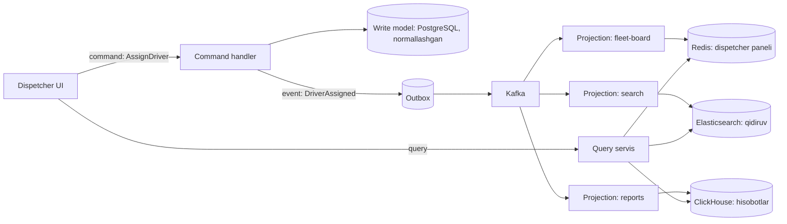

## Bu dars nima uchun kerak

Ko'p tizimlarda bitta ma'lumot modeli ikki xil vazifani bajarishga majbur: **yozish** (biznes qoidalarini tekshirish, tranzaksiya, izchillik) va **o'qish** (ekranga mos shakl, filtrlash, qidiruv, agregatlar). Bu ikki vazifaning talablari ko'pincha qarama-qarshi:

- Yozish normallashtirilgan sxemani, qat'iy cheklovlarni va kichik tranzaksiyalarni xohlaydi.
- O'qish denormallashtirilgan, oldindan JOIN qilingan, ekranga to'g'ridan-to'g'ri mos keladigan ma'lumotni xohlaydi.
- O'qishlar odatda yozishlardan ko'p marta ko'p (1-darsdagi Twitter misolida ikki tartib farq).

Natijada bitta model ikkalasini ham yomon bajaradi: dispetcher ekrani 7 ta jadvalni JOIN qiladigan so'rov bilan sekin ochiladi, yozish modeli esa faqat o'qish uchun qo'shilgan maydonlar va indekslar bilan og'irlashadi.

**CQRS (Command Query Responsibility Segregation)** - yozish va o'qish uchun **alohida modellar** ishlatish. G'oya sodda, lekin uning ta'siri va narxi juda keng. Martin Fowler bu patternni birinchi marta Greg Young'dan eshitganini yozadi va darhol ogohlantiradi: ko'p tizimlar uchun CQRS xavfli murakkablik qo'shadi.

Bu dars 46-darsdagi event sourcing bilan chambarchas bog'liq, lekin ular **alohida** patternlar: CQRS event sourcing'siz ham, event sourcing esa (amalda kamdan-kam) CQRS'siz ham ishlatilishi mumkin.

Bu darsdan keyin siz:

- CQS va CQRS farqini bilasiz;
- CQRS ning bir bazali va ko'p bazali variantlarini va ular orasidagi trade-off'ni bilasiz;
- projection/read model qanday quriladi, yangilanadi va qayta quriladi - bilasiz;
- read-your-writes va eskirgan o'qish (stale read) muammolarini hal qilish usullarini bilasiz;
- CQRS qachon foydali va qachon zararli ekanini asoslay olasiz.

## CQS dan CQRS gacha

**CQS (Command Query Separation)** - Bertrand Meyer "Object Oriented Software Construction" kitobida kiritgan tamoyil: obyekt metodlari ikki turga bo'linadi - **query** natija qaytaradi va kuzatiladigan holatni o'zgartirmaydi, **command** (Fowler "modifier" deb ataydi) holatni o'zgartiradi va qiymat qaytarmaydi. Afzalligi: query'larni istalgan joyda, istalgan tartibda xavfsiz chaqirish mumkin. Fowler istisno sifatida `stack.pop()` ni keltiradi - u ham qiymat qaytaradi, ham holatni o'zgartiradi, va bu foydali.

**CQRS** bu tamoyilni metod darajasidan **arxitektura** darajasiga ko'taradi: alohida metodlar emas, alohida **modellar** (va ehtimol alohida jarayonlar, alohida bazalar). Fowler ta'rifi: yangilash va o'qish uchun turli modellar ishlatish, bitta model ikkalasini ham yomon bajaradigan murakkab modelga aylanmasligi uchun.

## Arxitektura

### Yozish tomoni (command side)

- **Command'lar biznes vazifasini** ifodalaydi, past darajadagi yangilashni emas. Microsoft qo'llanmasi misoli: "Book hotel room" yaxshi, "Set ReservationStatus to Reserved" yomon. iQuariX uchun: `AssignDriverToVehicle`, `CloseTrip`, `ApproveFuelExpense` - `UPDATE vehicles SET driver_id = ...` emas.
- Domen modeli faqat invariantlarni (biznes qoidalarini) saqlash uchun: "bitta haydovchi bir vaqtda ikki mashinaga biriktirilmaydi", "yopilgan safarga xarajat qo'shib bo'lmaydi".
- Command handler odatda hech narsa qaytarmaydi yoki faqat ID va versiya qaytaradi.

### O'qish tomoni (query side)

- Query'lar ma'lumotni o'zgartirmaydi va domen mantig'iga ega emas.
- Natija ekranga mos DTO. Microsoft qo'llanmasi buni "materialized view" deb ataydi: murakkab JOIN va ORM xaritalashlarisiz, oldindan hisoblangan.
- Bir nechta read model bo'lishi mumkin, har biri o'z so'rov turiga: panel uchun Redis, matnli qidiruv uchun Elasticsearch (59-dars), analitika uchun ClickHouse (16, 81-darslar).

## Ikki variant: bitta baza yoki alohida bazalar

Fowler ham, Microsoft ham ta'kidlaydi: CQRS alohida bazalarni **talab qilmaydi**.

| Mezon | Bitta baza, alohida modellar | Alohida bazalar |
|---|---|---|
| Read model qanday | View, materialized view, alohida denormalized jadvallar | Boshqa texnologiyadagi ombor |
| Yangilanish | Bir tranzaksiyada yoki trigger/refresh bilan | Hodisalar orqali asinxron |
| Consistency | Kuchli (bir tranzaksiyada yangilansa) | Eventual |
| Mustaqil masshtablash | Cheklangan (read replica bilan qisman) | To'liq |
| Texnologiya tanlovi | Bitta | Har bir so'rov turi uchun eng mosi |
| Operatsion murakkablik | Past | Yuqori: broker, outbox, projection worker'lar, qayta qurish |
| Qachon | Ko'p hollarda boshlash uchun yetarli | O'qish yuklamasi yoki so'rov turi bitta bazaga sig'maganda |

### Bitta bazali variant: oddiy boshlanish

PostgreSQL ichida:

- yozish: normallashgan `trips`, `trip_events`, `vehicles`, `drivers` jadvallari;
- o'qish: `fleet_board` denormalized jadvali, command handler uni **o'sha tranzaksiyada** yangilaydi. Kuchli consistency, lekin yozish biroz sekinlashadi.
- yoki `MATERIALIZED VIEW`. PostgreSQL'da `REFRESH MATERIALIZED VIEW` butun tarkibni qayta hisoblaydi (inkremental yangilash yo'q). `CONCURRENTLY` bilan o'qishlar bloklanmaydi, lekin view'da ustunlarga asoslangan, `WHERE` siz `UNIQUE` indeks bo'lishi shart. Katta view'larni tez-tez yangilash qimmat, shuning uchun bu soatlik yoki kunlik hisobotlarga mos, real vaqt paneliga emas.

Ko'p jamoalar uchun bu - to'g'ri birinchi qadam: modellar ajratiladi, lekin infratuzilma qo'shilmaydi.

### Alohida bazali variant: hodisalar orqali

Write model o'zgarganda hodisa chiqaradi, projection worker'lar uni o'qib read model'larni yangilaydi. Microsoft qo'llanmasi ikki muhim shartni ta'kidlaydi:

1. **Transactional outbox** - holat o'zgarishi va hodisa atomik saqlanishi kerak, chunki baza va broker o'rtasida umumiy tranzaksiya yo'q. "Bazaga yozdim, keyin Kafka'ga yubordim" orasida qulash bo'lsa, read model abadiy eskirib qoladi (dual write muammosi). Bu 48-darsda chuqur ko'riladi.
2. **Idempotent consumer** - hodisalar dublikat kelishi mumkin.

## Projection: read model'ni qurish

Projection - hodisalar oqimini read model'ga aylantiradigan funksiya. U deterministik va idempotent bo'lishi kerak.

### Idempotency va tartib

Har bir projection uchun:

- **Pozitsiyani saqlash.** Projection o'zi qayergacha o'qiganini (Kafka offset, event store global pozitsiyasi) read model bilan **bitta tranzaksiyada** saqlaydi. Read model PostgreSQL'da bo'lsa: `UPDATE fleet_board ...; UPDATE projection_checkpoints SET position = 1234 WHERE name = 'fleet_board';` - bitta tranzaksiya. Qayta ishga tushganda shu pozitsiyadan davom etadi, dublikat bo'lmaydi.
- **Versiya bilan himoya.** Read model ombori tranzaksiyani qo'llamasa (Redis, Elasticsearch), har bir yozuvda aggregate versiyasini saqlang va faqat kattaroq versiyani qabul qiling: `if incoming.version > stored.version then write`.
- **Tartib.** Bitta aggregate hodisalari tartib bilan kelishi kerak - Kafka'da kalit = aggregate ID (43-dars).

### Qayta qurish (rebuild)

CQRS + event sourcing'ning eng kuchli tomoni: read model - **bir martalik** narsa. Bug tuzatilsa yoki yangi read model kerak bo'lsa:

1. Yangi read model'ni bo'sh holda yarating (`fleet_board_v2`).
2. Projection'ni boshidan (event store yoki Kafka'ning `earliest` offset'idan) ishga tushiring.
3. Yetib olgach (lag nolga yaqin), query servisni yangi read model'ga o'tkazing.
4. Eskisini o'chiring.

Bu blue-green deploy (68-dars) ning ma'lumotlar uchun varianti. Shart: hodisalar tarixi saqlangan bo'lishi kerak - event store'da yoki yetarli retention'li Kafka topicida. Agar Kafka retention 7 kun bo'lsa va event store bo'lmasa, 7 kundan eski hodisalardan read model'ni qayta qurib bo'lmaydi.

**Hisob-kitob: qayta qurish vaqti.** Masala sharti: event store'da 2 mlrd hodisa, bitta projection worker Elasticsearch'ga bulk bilan 20 000 hodisa/s yozadi, qayta qurish paytida yangi hodisalar 500/s tezlikda kelib turadi.

- Yangi hodisalarsiz: 2 000 000 000 ÷ 20 000 = 100 000 s = 27.8 soat, ya'ni taxminan **28 soat**.
- Yangi hodisalar bilan yetib olish tezligi 20 000 - 500 = 19 500/s: 2 000 000 000 ÷ 19 500 = 102 564 s = 28.5 soat.
- 8 ta parallel projection worker (aggregate ID bo'yicha bo'lingan, tartib aggregate ichida saqlanadi), Elasticsearch 8 × 20 000 = 160 000 yozuv/s ko'tarsa: 2 000 000 000 ÷ (160 000 - 500) = 12 539 s = **3.5 soat**.

Saboq: qayta qurish vaqti - real operatsion parametr. Uni oldindan bilish va parallellashtirish yo'lini dizaynga qo'shish kerak. Ba'zan to'liq qayta qurish o'rniga snapshot'dan (masalan, kechagi read model nusxasi) boshlash yetarli.

## Eventual consistency va foydalanuvchi tajribasi

Alohida bazali CQRS'da read model write model'dan orqada qoladi. Odatda millisekundlar yoki soniyalar, lekin projection worker to'xtasa - daqiqalar yoki soatlar. Klassik muammo: dispetcher haydovchini biriktiradi, sahifa yangilanadi - va haydovchi hali "bo'sh" ko'rinadi. Foydalanuvchi qayta bosadi, ikkinchi command yuboriladi.

Yechimlar (33-darsdagi read-your-writes consistency):

| Yondashuv | Qanday | Narxi |
|---|---|---|
| Optimistic UI | Command qabul qilingach, UI o'zgarishni lokal ko'rsatadi | Command rad etilsa, UI ni qaytarish kerak |
| Versiya bilan kutish | Command javobida yangi versiya qaytadi, query `minVersion` bilan so'raydi va read model shu versiyaga yetguncha (timeout bilan) kutadi | Query kechikishi, murakkablik |
| O'z yozuvini write model'dan o'qish | Muallif o'zgartirgan obyektni qisqa vaqt write model'dan o'qish | Write model'ga qo'shimcha yuklama |
| Push yangilanish | Read model yangilanganda WebSocket/SSE orqali UI ga xabar (8-dars) | Real-time infratuzilma |
| Bitta tranzaksiyada yangilash | Read model'ni command bilan birga yangilash (bitta baza) | Mustaqil masshtablash yo'q |

Muhim nozik joy: command tomoni **hech qachon** read model'ga tayanib qaror qabul qilmasligi kerak. "Haydovchi bo'shmi?" degan tekshiruv read model'dan emas, write model'dan (aggregate holatidan) bo'lishi shart. Aks holda eskirgan ma'lumot asosida invariant buziladi: ikki dispetcher bir haydovchini ikki mashinaga biriktiradi.

## Trade-off: CQRS nima beradi va nima oladi

| Beradi | Oladi |
|---|---|
| O'qish va yozishni mustaqil masshtablash | Ko'proq harakatlanuvchi qism: broker, outbox, worker'lar |
| Har bir so'rov turi uchun optimal ombor | Eventual consistency va stale read'lar |
| Sodda query'lar (oldindan hisoblangan) | Ma'lumot nusxalari, disk va sinxronlash narxi |
| Yozish modeli faqat invariantlarga e'tibor beradi | Ikki model - ikki baravar kod va testlar |
| Yangi read model'ni tarixdan qurish (event sourcing bilan) | Qayta qurish vaqti va operatsiyasi |
| Yozish va o'qish uchun alohida xavfsizlik | ORM generatorlari ishlamaydi, ko'proq qo'lda kod |

## Qachon ishlatish kerak

Microsoft qo'llanmasi va Fowler'ning tavsiyalarini birlashtirsak:

**Mos:**

- O'qish va yozish yuklamasi yoki shakli juda farq qiladi (o'qishlar 100x ko'p, yoki o'qish to'liq matnli qidiruv, yozish esa tranzaksion).
- Murakkab domen, task-based UI, ko'p biznes qoidalari yozish tomonida.
- Bir xil ma'lumotni ko'p foydalanuvchi bir vaqtda o'zgartiradi.
- Turli jamoalar write model va read model/UI ustida mustaqil ishlaydi.
- Event sourcing ishlatilmoqda (u holda CQRS deyarli majburiy, chunki event store'ni so'rov qilib bo'lmaydi).

**Mos emas:**

- Oddiy CRUD domen. Fowler ko'p tizimlar CRUD modeliga mos ekanini va shunday qolishi kerakligini aytadi.
- Real vaqtda kuchli consistency kerak bo'lgan ekranlar va jamoa eventual consistency'ni boshqarishga tayyor emas.

Fowler'ning eng muhim maslahati: CQRS'ni butun tizimga emas, faqat ma'lum **bounded context**ga (52-dars) qo'llang. U ko'rgan CQRS loyihalarining ko'pchiligi muvaffaqiyatsiz bo'lganini va bu pattern hatto kuchli jamoalarning ham samaradorligini jiddiy pasaytirishi mumkinligini yozadi. Murakkab hisobot so'rovlari uchun u CQRS o'rniga oddiy **reporting database** (alohida hisobot bazasi) ni taklif qiladi.

## Real tizimlardan misollar

- **Read replica'lar - eng oddiy "CQRS".** 26-darsda ko'rgan PostgreSQL read replica'lari model ajratmaydi, lekin o'qish yuklamasini ajratadi va xuddi shunday replication lag (eventual consistency) muammosini keltirib chiqaradi. Microsoft qo'llanmasi ham read store sifatida read-only replica'ni variant sifatida ko'rsatadi.
- **Qidiruv indekslari.** Ko'p kompaniyalarda asosiy ma'lumot relational bazada, qidiruv esa Elasticsearch'da - bu amalda CQRS: alohida read model, CDC yoki hodisalar orqali yangilanadi (48-dars), qidiruv natijalari bir necha soniya eskirgan bo'lishi mumkin.
- **1-darsdagi Twitter home timeline.** Fan-out on write - har bir foydalanuvchi uchun oldindan qurilgan timeline cache - bu o'qish uchun optimallashtirilgan read model. Yozish modeli (tvitlar jadvali) va o'qish modeli (har bir foydalanuvchining tayyor lentasi) butunlay boshqa shaklda.

## iQuariX kontekstida qo'llanish

O'quv misoli (iQuariX haqidagi real ichki ma'lumot emas): dispetcher paneli 500 ta mashinali park uchun quyidagilarni ko'rsatadi: har bir mashinaning oxirgi joylashuvi, holati (harakatda, to'xtagan, oflayn), biriktirilgan haydovchi, joriy safar, bugungi yurilgan masofa, yoqilg'i sathi va faol ogohlantirishlar soni. Panel har 5 soniyada yangilanadi va bir vaqtda 2 000 dispetcher ochiq.

**Muammo:** bu ma'lumot 6 ta servisdan keladi (telemetriya, safarlar, haydovchilar, yoqilg'i, ogohlantirishlar, mashinalar). Har yangilanishda JOIN yoki 6 ta servisga so'rov: 2 000 ÷ 5 s = 400 panel so'rovi/s, har biri 500 mashina × 6 manba.

**CQRS yechimi:**

- **Write model'lar** o'z servislarida qoladi (har biri o'z bazasi bilan).
- **Read model** `fleet_board`: Redis'da har bir tenant uchun hash, kalit `vehicle_id`, qiymat - panel uchun tayyor JSON (hisob uchun shart: 400 bayt).
- **Projection worker** Kafka'dagi `live-location` (compacted), `trip-events`, `driver-assignments`, `fuel-levels`, `alerts` topiclaridan o'qib, Redis'dagi yozuvlarni yangilaydi. Har bir maydon uchun manba versiyasi yoki vaqt belgisi saqlanadi, eskisi yangisini ustidan yozmaydi.
- **Query:** `HGETALL tenant:42:board` - bitta so'rov, 500 × 400 B = 200 KB. Yoki undan yaxshisi - o'zgarishlarni WebSocket orqali push qilish.

Xotira: 100 000 mashina × 400 B = 40 MB. Redis uchun arzimas. Qayta qurish: compacted topiclarni boshidan o'qish, bir necha daqiqa.

**Muhim chegara:** "haydovchini biriktirish" command'i haydovchining bandligini `fleet_board` dan emas, haydovchi servisining write model'idan tekshiradi. Panel 2 soniya eskirgan bo'lishi qabul qilinadi, ikki marta biriktirish esa yo'q.

**CQRS kerak bo'lmagan joy:** tenant sozlamalari, foydalanuvchilar ro'yxati, mashina kartochkasi - oddiy CRUD, bitta PostgreSQL, alohida read model shart emas.

## Ko'p uchraydigan xatolar

1. **Butun tizimga CQRS qo'llash.** Oddiy CRUD sohalar ham ikki model, broker va projection'larga ega bo'ladi. Fowler ogohlantirgan "xavfli murakkablik".
2. **CQRS = event sourcing deb o'ylash.** Ular mustaqil. CQRS ni bitta baza ichida, hodisalarsiz boshlash mumkin.
3. **Dual write.** Bazaga yozib, keyin alohida brokerga yuborish. Qulashda read model abadiy sinxronlashmaydi. Outbox yoki CDC kerak (48-dars).
4. **Command tomonida read model'dan o'qib qaror qabul qilish.** Eskirgan ma'lumot bilan invariant buziladi.
5. **Projection'ni idempotent qilmaslik.** Qayta ishga tushish yoki dublikat hodisa read model'ni buzadi (masalan, hisoblagich ikki marta oshadi).
6. **Qayta qurish rejasisizligi.** Hodisalar tarixi saqlanmagan yoki qayta qurish 3 kun davom etadi va buni hech kim bilmaydi.
7. **Read-your-writes'ni e'tiborsiz qoldirish.** Foydalanuvchi o'z o'zgarishini ko'rmaydi va takroriy command yuboradi.
8. **Read model'ni "haqiqat manbasi" deb hisoblash** va unga to'g'ridan-to'g'ri yozish. Read model faqat projection tomonidan yangilanadi.

## Xulosa

- CQS - metod darajasida, CQRS - arxitektura darajasida o'qish va yozishni ajratish.
- Write model invariantlarni saqlaydi, command'lar biznes vazifasini ifodalaydi. Read model ekranga mos, oldindan hisoblangan va domen mantig'isiz.
- CQRS alohida bazalarni talab qilmaydi. Bitta baza ichida boshlash ko'pincha yetarli; alohida bazalar mustaqil masshtablash va texnologiya tanlovini beradi, evaziga eventual consistency va operatsion murakkablik.
- Projection'lar idempotent, pozitsiyasini read model bilan atomik saqlaydi va qayta qurilishi mumkin. Qayta qurish vaqtini oldindan hisoblang.
- Eventual consistency UX muammosi: optimistic UI, versiya bilan kutish, push yangilanish. Command hech qachon read model'ga tayanmaydi.
- CQRS'ni faqat foyda aniq bo'lgan bounded context'da qo'llang.

## Amaliy topshiriq

iQuariX uchun **"haydovchi reytingi va skoring" moduli**ga CQRS qo'llashni baholang va loyihalang (faraziy). Yozish: har bir xavfli manevr, tezlik buzilishi, yoqilg'i anomaliyasi haydovchi balliga ta'sir qiladi (kuniga 3 mln hodisa). O'qish: (a) haydovchi mobil ilovasida o'z balli va oxirgi 30 kunlik tarixi, (b) menejer uchun parkdagi 1 000 haydovchining reyting jadvali saralash va filtrlash bilan, (c) oylik HR hisoboti, (d) "eng xavfli 10 haydovchi" real vaqtda.

1. **CQRS kerakmi?** O'qish va yozish shakli, yuklamasi va consistency talablarini tahlil qilib, ha yoki yo'q deb javob bering. Ha bo'lsa - bitta bazali yoki alohida bazali variant?
2. **Write model.** Command'lar va invariantlarni yozing (masalan, ball qayta hisoblash, apellyatsiya - haydovchi ogohlantirishga e'tiroz bildiradi va menejer uni bekor qiladi).
3. **Read model'lar.** (a)-(d) har biri uchun ombor turini (PostgreSQL jadvali, Redis sorted set, ClickHouse, va h.k.) tanlang va sxemasini yozing.
4. **Projection'lar.** Idempotency va tartibni qanday ta'minlaysiz? Apellyatsiya qabul qilinganda o'tgan 30 kunlik ball qanday qayta hisoblanadi?
5. **Consistency va UX.** Menejer apellyatsiyani qabul qilgach, reyting jadvalida o'zgarish darhol ko'rinishi kerakmi? Qaysi read-your-writes yondashuvini tanlaysiz?
6. **Qayta qurish.** Skoring formulasi o'zgardi. Barcha read model'larni 1 yillik hodisalardan qayta qurish vaqtini hisoblang (o'z taxminlaringiz bilan) va qayta qurish paytida eski va yangi reytinglar qanday ko'rsatiladi?

Yaxshi javobda bo'lishi kerak bo'lgan narsalar:

- CQRS qarori yuklama va so'rov shakllari raqamlari bilan asoslangan;
- har bir read model so'rov turiga mos tanlangan (masalan, "top 10" uchun sorted set);
- apellyatsiya kompensatsiya hodisasi sifatida modellashtirilgan, tarix o'chirilmaydi;
- projection pozitsiyasi va read model yangilanishi atomik yoki versiya bilan himoyalangan;
- qayta qurish vaqti hisoblangan va blue-green tarzida o'tish rejasi bor;
- command tomoni read model'ga tayanmasligi aniq ko'rsatilgan.

Javobni pastdagi maydonga yozib, chatga yuboring.

## Manbalar

- Martin Fowler. [CQRS](https://martinfowler.com/bliki/CQRS.html), 2011 - ta'rif, bounded context, ogohlantirishlar.
- Martin Fowler. [CommandQuerySeparation](https://martinfowler.com/bliki/CommandQuerySeparation.html) - Meyer'ning CQS tamoyili.
- Microsoft Azure Architecture Center. [CQRS pattern](https://learn.microsoft.com/en-us/azure/architecture/patterns/cqrs) - bitta va alohida ombor, outbox, idempotent consumer, qachon ishlatish.
- Greg Young. [CQRS Documents](https://cqrs.wordpress.com/wp-content/uploads/2010/11/cqrs_documents.pdf), 2010 - command va query tomonlari, thin read layer.
- Martin Fowler. [What do you mean by "Event-Driven"?](https://martinfowler.com/articles/201701-event-driven.html), 2017 - CQRS bo'limi.
- PostgreSQL 18. [REFRESH MATERIALIZED VIEW](https://www.postgresql.org/docs/current/sql-refreshmaterializedview.html) - CONCURRENTLY va uning talablari.
- Martin Kleppmann, Chris Riccomini. [Designing Data-Intensive Applications, 2-nashr](https://www.oreilly.com/library/view/designing-data-intensive-applications/9781098119058/), O'Reilly, 2026. 3-bob "Event Sourcing and CQRS".
