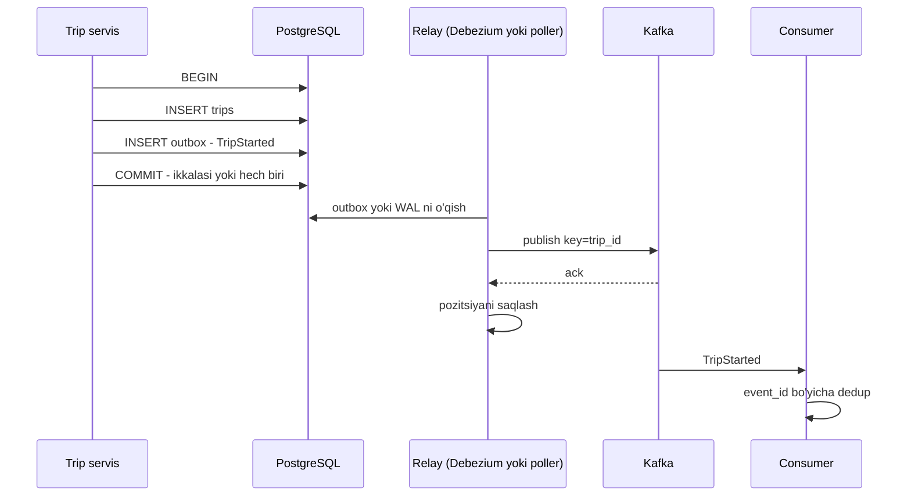

## Bu dars nima uchun kerak

46-47-darslarda bir xil savol bir necha marta chiqdi: servis o'z bazasini yangiladi, endi boshqa servislar (read model, qidiruv indeksi, analitika, notification) bu haqda qanday bilib oladi? Eng oddiy javob - "bazaga yozamiz, keyin Kafka'ga yuboramiz" - ishlab chiqarishda jim ma'lumot yo'qotishning eng keng tarqalgan sabablaridan biri. Bu **dual write** (ikki tomonlama yozish) muammosi.

Bu dars ikki o'zaro bog'liq yechimga bag'ishlangan:

- **Transactional outbox** - hodisani biznes ma'lumoti bilan **bitta tranzaksiyada** bazaning o'ziga yozish, keyin alohida jarayon uni brokerga yetkazadi.
- **CDC (Change Data Capture)** - bazaning tranzaksiya log'ini (PostgreSQL'da WAL) o'qib, har bir o'zgarishni hodisa sifatida oqimga chiqarish.

Ikkalasi birgalikda microservice'lar orasidagi ishonchli ma'lumot almashinuvining standart asosi. Ular 37-darsdagi 2PC'ga muqobil: distributed tranzaksiyasiz, lekin "hammasi yoki hech narsa" kafolati bilan.

Bu darsdan keyin siz:

- dual write muammosining barcha variantlarini va nima uchun ularni retry bilan tuzatib bo'lmasligini tushuntira olasiz;
- outbox jadvalini va relay'ning ikki turini (polling va log tailing) loyihalay olasiz;
- PostgreSQL logical decoding, replication slot va Debezium qanday ishlashini bilasiz;
- CDC'ning xavflarini (WAL o'sishi, schema o'zgarishi, failover) va ularni qanday boshqarishni bilasiz;
- outbox va "xom" CDC o'rtasida to'g'ri tanlov qila olasiz.

## Dual write muammosi

Servis kodi:

```ts
await db.transaction(async (tx) => {
  await tx.insert(trips).values(trip);
});
await kafka.send({ topic: "trip-events", key: trip.id, value: TripStarted(trip) });
```

Nima noto'g'ri bo'lishi mumkin:

1. **Baza commit qilindi, Kafka'ga yuborishdan oldin jarayon qulab tushdi** (deploy, OOM, pod evict). Safar bazada bor, hodisa yo'q. Read model, billing va notification bu safarni hech qachon ko'rmaydi.
2. **Kafka vaqtincha ishlamayapti.** Retry qilasiz - lekin qancha? Jarayon retry paytida qulasa, 1-holatga qaytdik.
3. **Tartibni teskari qilsak** - avval Kafka, keyin baza: hodisa ketdi, baza tranzaksiyasi esa rollback bo'ldi (constraint buzilishi, deadlock). Consumer'lar mavjud bo'lmagan safar haqida bilib oldi.
4. **Hodisani tranzaksiya ichida yuborish** - commit'dan oldin. Commit muvaffaqiyatsiz bo'lsa - 3-holat. Bundan tashqari tranzaksiya tarmoq so'rovi davomida ochiq turadi va qulflarni ushlab turadi.
5. **Ikki parallel so'rov** bir obyektni yangilaydi: bazada A keyin B tartibida commit, Kafka'ga esa B keyin A tartibida yetib boradi. Consumer'lar noto'g'ri yakuniy holatni ko'radi.

microservices.io (Chris Richardson) bu muammoni shunday ifodalaydi: baza va broker yozuvlarini 2PC'siz atomik qilib bo'lmaydi, 2PC esa ko'pincha baza yoki broker tomonidan qo'llab-quvvatlanmaydi va servisni ikkalasiga qattiq bog'laydi. Kafka XA tranzaksiyalarida ishtirok etmaydi.

Muammoning ildizi: **ikki mustaqil tizimga yozish** bor va ular orasida atomiklik yo'q. Yechim - faqat **bitta** tizimga yozish va ikkinchisini birinchisidan ishonchli hosil qilish.

## Transactional outbox

G'oya: hodisani brokerga emas, **o'sha bazadagi** `outbox` jadvaliga, biznes ma'lumoti bilan **bitta tranzaksiyada** yozish. Keyin alohida jarayon (**message relay**) outbox'ni o'qib, brokerga yetkazadi.



Kafolatlar:

- Hodisa **faqat** tranzaksiya commit qilingandagina mavjud. Rollback'da outbox yozuvi ham yo'qoladi.
- Commit qilingan har bir hodisa **ertami-kechmi** yetkaziladi: relay qulasa ham, qayta ishga tushganda outbox'da qolganini yuboradi.
- Hodisalar ilova ularni hosil qilgan tartibda yuboriladi.

Narx:

- **Dublikatlar.** Relay xabarni yuborib, "yuborildi" deb belgilashdan oldin qulasa, qayta yuboradi. Consumer idempotent bo'lishi shart (41, 39-darslar) - odatda bu baribir talab qilinadi, chunki brokerlarning o'zi ham qayta yetkazadi.
- **Kechikish.** Hodisa yaratilishi va yetkazilishi orasida relay sikli qo'shiladi.
- **Unutish xavfi.** Richardson ta'kidlaganidek, dasturchi outbox'ga yozishni unutishi mumkin. Buni domen kutubxonasi yoki repository qatlamida majburiy qilish kerak.

### Outbox jadvali

Debezium Outbox Event Router kutgan standart tuzilma:

```sql
CREATE TABLE outbox (
  id            uuid PRIMARY KEY,         -- hodisa ID, consumer'da dedup uchun
  aggregatetype text NOT NULL,            -- 'trip' - qaysi topicga
  aggregateid   text NOT NULL,            -- 'trip-55' - Kafka kaliti, tartib uchun
  type          text NOT NULL,            -- 'TripStarted'
  payload       jsonb NOT NULL,
  created_at    timestamptz NOT NULL DEFAULT now()
);
```

- `aggregateid` Kafka kaliti bo'ladi: bitta aggregate'ning barcha hodisalari bitta partitionga tushadi va tartib saqlanadi (43-dars).
- `aggregatetype` topicni belgilaydi (Debezium default'i `outbox.event.<aggregatetype>`).
- `id` consumer'ga header sifatida boradi va dedup kaliti bo'ladi.
- Debezium hujjatiga ko'ra outbox navbat kabi ishlaydi: yozuvlarni **yangilash** (UPDATE) mumkin emas, faqat qo'shish.

**Outbox hodisasi nimani o'z ichiga oladi.** Bu **integratsiya hodisasi** - boshqa servislar uchun ochiq kontrakt (9-dars: API dizayn). U ichki jadval tuzilmasini emas, barqaror, versiyalangan sxemani ifodalashi kerak. Ichki ustunni qayta nomlash consumer'larni buzmasligi kerak.

### Relay variant 1: polling publisher

```sql
-- relay sikli
SELECT * FROM outbox
WHERE published_at IS NULL
ORDER BY created_at
LIMIT 500
FOR UPDATE SKIP LOCKED;
-- Kafka'ga yuborish, ack kutish
UPDATE outbox SET published_at = now() WHERE id = ANY($1);
```

- **Afzalligi:** sodda, qo'shimcha infratuzilma yo'q, istalgan bazada ishlaydi.
- **Kamchiligi:** bazaga doimiy so'rov yuklamasi; kechikish = polling intervali; `created_at` bo'yicha tartib parallel tranzaksiyalarda ishonchli emas (pastga qarang); jadval o'sadi va tozalash kerak; `published_at` UPDATE'lari jadvalni "shishiradi" (PostgreSQL'da dead tuple'lar, VACUUM yuki).

**Tartib tuzog'i.** Tranzaksiya A `created_at = 10:00:00.100` bilan boshlandi, lekin 10:00:00.500 da commit qildi. Tranzaksiya B 10:00:00.200 da boshlanib, 10:00:00.300 da commit qildi. Poller 10:00:00.400 da so'rov qiladi va faqat B ni ko'radi, uni yuboradi va `created_at > 10:00:00.200` dan davom etadi deb hisoblasa, A ni **o'tkazib yuboradi**. Shuning uchun "oxirgi ko'rilgan vaqtdan keyin" emas, `published_at IS NULL` bo'yicha so'rov qiling, yoki tartib faqat aggregate ichida muhim bo'lsa, aggregate bo'yicha tartiblang. `bigserial` ID ham xuddi shu muammoga ega: ketma-ketlik qiymati commit tartibida emas, olinish tartibida beriladi.

### Relay variant 2: transaction log tailing (CDC)

Relay outbox **jadvalini** emas, bazaning **tranzaksiya log'ini** o'qiydi. PostgreSQL'da bu WAL va logical decoding; MySQL'da binlog.

- **Afzalligi:** bazaga so'rov yuklamasi yo'q, past kechikish (deyarli real vaqt), tartib **commit tartibida** (log aynan shunday yoziladi), polling tartib tuzog'i yo'q.
- **Kamchiligi:** CDC infratuzilmasi (Debezium, Kafka Connect), replication slot boshqaruvi, ko'proq operatsion bilim.

Gunnar Morling (Debezium) 2019-yilgi maqolasida chiroyli hiyla tasvirlaydi: servis outbox yozuvini **qo'shadi va darhol o'chiradi** - bitta tranzaksiyada. WAL'da INSERT qayd etilgan, Debezium uni hodisa sifatida chiqaradi, DELETE esa e'tiborsiz qoldiriladi (Outbox Event Router outbox jadvalidagi DELETE'larni filtrlaydi). Natijada outbox jadvali **doim bo'sh**, o'smaydi va tozalash jobi kerak emas.

## CDC: bazaning log'ini oqimga aylantirish

CDC faqat outbox uchun emas. U istalgan jadvalning o'zgarishlarini oqimga chiqaradi. 43-darsdagi Kreps'ning "jadval va log ikkiligi" g'oyasi: baza ichida allaqachon log bor (WAL) - uni tashqariga ochib berish kifoya.

### PostgreSQL ichida qanday ishlaydi

- **WAL** (14-dars) - har bir o'zgarish avval yoziladigan log. Odatda u crash recovery va fizik replikatsiya uchun.
- **Logical decoding** - WAL'dagi fizik o'zgarishlarni mantiqiy o'zgarishlarga ("jadval X, qator Y, eski qiymat, yangi qiymat") aylantirish. `wal_level = logical` talab qilinadi.
- **Output plugin** - mantiqiy o'zgarishlarni formatlaydi. `pgoutput` PostgreSQL 10 dan beri o'rnatilgan.
- **Publication** - qaysi jadvallar o'zgarishlari chiqarilishi.
- **Replication slot** - consumer qayergacha o'qiganini eslab qoladigan server tomonidagi obyekt. U consumer hali o'qimagan WAL'ni o'chirilishdan **saqlab turadi**.

PostgreSQL hujjatidagi ikki muhim fakt:

1. Slot'ning pozitsiyasi faqat checkpoint'da diskka yoziladi, shuning uchun qulashdan keyin slot oldingi LSN ga qaytishi va so'nggi o'zgarishlarni **qayta yuborishi** mumkin. CDC - at-least-once. Hujjat consumer'ga oxirgi ko'rilgan LSN ni yozib, takrorlarni o'tkazib yuborishni tavsiya qiladi.
2. Bitta slot'dan bir vaqtda faqat bitta qabul qiluvchi o'qiy oladi.

### Debezium

Debezium - Kafka Connect ustidagi CDC platformasi. PostgreSQL konnektori (hujjatning joriy versiyasi 3.7):

- har bir qator darajasidagi INSERT, UPDATE, DELETE uchun bitta hodisa chiqaradi; default holatda har bir jadval uchun alohida topic (`prefix.schema.table`);
- birinchi ulanishda jadvallarning **izchil snapshot**'ini oladi (`snapshot.mode=initial` default), keyin snapshot boshlangan WAL pozitsiyasidan oqimni davom ettiradi. Snapshot kerak, chunki PostgreSQL eski WAL'ni o'chirib yuboradi - tarixni faqat WAL'dan tiklab bo'lmaydi;
- har bir hodisa uchun LSN ni yozib boradi va qayta ishga tushganda shu joydan davom etadi;
- inkremental snapshot - oqimni to'xtatmasdan, bo'laklar bilan (default 1 024 qator) jadvalni qayta o'qish, signal jadvali yoki Kafka signal topici orqali ishga tushiriladi.

Hodisa tuzilmasi:

```json
{
  "before": { "id": 17, "status": "active" },
  "after":  { "id": 17, "status": "closed" },
  "op": "u",
  "source": { "lsn": 2389475, "txId": 8812, "table": "trips" },
  "ts_ms": 1771234567890
}
```

- `op`: `c` (create), `u` (update), `d` (delete), `r` (snapshot read).
- `before` to'liq bo'lishi uchun jadvalga `REPLICA IDENTITY FULL` kerak. Default holatda `before` da faqat primary key bor. Primary key'siz jadvallar uchun default holatda delete hodisalarida `before` umuman bo'lmaydi.
- Har bir DELETE dan keyin Debezium shu kalit bilan **tombstone** (null qiymat) chiqaradi - Kafka compaction (44-dars) eski yozuvlarni tozalashi uchun.
- Logical decoding DDL o'zgarishlarini chiqarmaydi, ya'ni `ALTER TABLE` hodisa sifatida kelmaydi.

## CDC xavflari va operatsiyasi

### 1. WAL o'sishi - eng katta xavf

Replication slot consumer o'qimagan WAL'ni ushlab turadi. Debezium to'xtasa (bug, konfiguratsiya xatosi, Kafka Connect klasteri o'chgan), WAL to'xtovsiz o'sadi. PostgreSQL hujjati ogohlantiradi: slot ulanish bo'lmasa ham resurslarni ushlab turadi - WAL ham, VACUUM tozalay olmaydigan katalog qatorlari ham - va o'ta holatlarda baza transaction ID wraparound'dan himoyalanish uchun o'chib qolishi mumkin.

**Hisob-kitob.** Masala sharti: baza kuniga 200 GB WAL hosil qiladi (yozish og'ir telemetriya metadata'si bilan). Debezium juma kechqurun 18:00 da to'xtadi va hech kim sezmadi. Bazada 400 GB bo'sh joy.

- WAL tezligi: 200 GB ÷ 24 soat = 8.33 GB/soat.
- Disk to'lishi: 400 ÷ 8.33 = **48 soat** - juma 18:00 dan yakshanba 18:00 gacha. Dushanba ertalab asosiy baza disk to'lib, yozishni to'xtatgan.

Himoya choralari:

- `pg_replication_slots` dagi har bir slot uchun ushlab turilgan WAL hajmiga alert (masalan, 20 GB va 50 GB da):

```sql
SELECT slot_name, active,
       pg_size_pretty(pg_wal_lsn_diff(pg_current_wal_lsn(), restart_lsn)) AS retained_wal
FROM pg_replication_slots;
```

- `max_slot_wal_keep_size` (default -1, cheksiz) - slot ushlab turadigan WAL'ga chegara. Oshsa, slot invalid bo'ladi: baza qutqariladi, lekin CDC endi davom eta olmaydi va to'liq qayta snapshot kerak. Bu ataylab tanlanadigan trade-off: "CDC'ni yo'qotish" vs "asosiy bazani yo'qotish".
- `idle_replication_slot_timeout` - uzoq vaqt nofaol slot'larni avtomatik invalid qilish (default o'chiq).
- Ishlatilmaydigan slot'larni darhol o'chiring.
- Kam yoziladigan jadvallarni kuzatayotgan slot'da muammo: kuzatilayotgan jadvallarda o'zgarish bo'lmasa, slot pozitsiyasi oldinga yurmaydi, bazaning boshqa jadvallaridagi yozishlar esa WAL hosil qilib turadi. Debezium'ning heartbeat mexanizmi aynan shu holat uchun.

### 2. Failover

Primary o'chib, replica primary bo'lsa, logical replication slot yangi primary'da mavjudmi? PostgreSQL hujjati `failover` opsiyasi bilan yaratilgan slot'larni standby'ga sinxronlash mexanizmini (`sync_replication_slots = on` va boshqa sozlamalar bilan) tavsiflaydi; faqat standby'da `synced = true` holatiga yetgan doimiy slot'lar failover'dan keyin ishlatilishi mumkin. Bu sozlanmagan bo'lsa, failover'dan keyin CDC'ni qayta snapshot bilan boshlash kerak bo'ladi. Boshqariladigan bazalar (RDS, Cloud SQL) bu masalani turlicha hal qiladi - provayder hujjatini tekshiring.

### 3. Schema o'zgarishi

Xom CDC jadval tuzilmasini oqimga **sizdiradi**. Ustunni qayta nomlash yoki turini o'zgartirish barcha downstream consumer'larni buzadi. Avro/Protobuf va schema registry (10-dars) yordam beradi, lekin asosiy muammo semantik: ichki jadval - bu ommaviy API emas.

### 4. Tranzaksiya chegaralari

CDC qator darajasida ishlaydi. Bitta biznes operatsiyasi 3 ta jadvalga yozsa, consumer 3 ta alohida hodisa oladi va ularni qayta birlashtirishi kerak. Debezium ixtiyoriy tranzaksiya metadata hodisalarini chiqarishi mumkin, lekin ularni hisobga olish consumer zimmasida.

## Outbox yoki xom CDC: tanlov

| Mezon | Xom CDC (jadval o'zgarishlari) | Outbox + CDC |
|---|---|---|
| Hodisa ma'nosi | Texnik: "qator o'zgardi" | Domen: `TripClosed` |
| Kontrakt | Ichki sxema oshkor | Barqaror, versiyalangan |
| Ilova kodi o'zgarishi | Yo'q | Har bir yozishda outbox yozuvi |
| Eski (legacy) tizim | Ishlaydi, kodga tegmasdan | Kod o'zgarishi kerak |
| Bir operatsiya, ko'p jadval | Ko'p qator hodisasi | Bitta yaxlit hodisa |
| `before` qiymatlari | REPLICA IDENTITY FULL bilan | Payload'da kerakli narsa |
| Tipik ishlatish | Qidiruv indeksi, DWH, cache invalidation, bazani migratsiya qilish | Servislar o'rtasidagi integratsiya hodisalari |

Qoida: **o'z servisingiz ichidagi** read model'lar va texnik replikatsiya uchun (Elasticsearch, ClickHouse, cache) xom CDC qulay va arzon. **Boshqa jamoalar** iste'mol qiladigan hodisalar uchun - outbox: ichki sxemani o'zgartirish erkinligi saqlanadi.

## Polling va log tailing taqqoslash

| Mezon | Polling publisher | Log tailing (Debezium) |
|---|---|---|
| Infratuzilma | Faqat ilova va baza | Kafka Connect, Debezium, slot |
| Bazaga yuklama | Doimiy so'rovlar, UPDATE, VACUUM | WAL o'qish, so'rov yo'q |
| Kechikish | Polling intervali (yuzlab ms - soniyalar) | Odatda past, deyarli real vaqt |
| Tartib | Ehtiyotkorlik talab qiladi (commit tartibi emas) | Commit tartibida |
| Outbox jadvali hajmi | O'sadi, tozalash kerak | Insert+delete hiylasi bilan bo'sh |
| Asosiy xavf | Sekin so'rovlar, o'tkazib yuborish | WAL o'sishi, slot va failover |
| Qachon | Kichik hajm, oddiy stack | Yuqori hajm, Kafka allaqachon bor |

## Consumer tomoni: inbox va idempotency

Ikkala relay ham at-least-once. Consumer tomonida **inbox** patterni (outbox'ning ko'zgu tasviri):

```sql
CREATE TABLE processed_events (
  event_id     uuid PRIMARY KEY,
  processed_at timestamptz NOT NULL DEFAULT now()
);
```

Har bir hodisa uchun bitta tranzaksiyada: `INSERT INTO processed_events` (konfliktda - hodisa allaqachon qayta ishlangan, o'tkazib yuborish) va biznes o'zgarishi. Morling maqolasida ta'kidlanganidek, bu jadvalni vaqti-vaqti bilan tozalash kerak - masalan, Kafka retention'idan uzunroq muddatdan eski yozuvlarni o'chirish, chunki undan eski hodisa qayta kelmaydi.

Shunday qilib to'liq zanjir: **outbox (producer atomikligi) + broker (at-least-once) + inbox (consumer idempotency) = effectively-once** - 2PC'siz.

## Real tizimlardan misollar

- **Debezium.** Outbox patterni Debezium'ning birinchi darajali qo'llab-quvvatlaydigan ishlatish usuli: maxsus Outbox Event Router SMT topicni `aggregatetype` bo'yicha tanlaydi va `aggregateid` ni Kafka kaliti qiladi.
- **Kreps'ning "The Log" g'oyasi.** LinkedIn tajribasidan kelib chiqqan asosiy tamoyil: har bir ma'lumot tizimini N × N quvurlar bilan bog'lash o'rniga, o'zgarishlarni markaziy log'ga chiqarish va har bir tizim uni o'z tezligida o'qishi. CDC - mavjud bazalarni bu modelga ulashning eng kam invaziv yo'li.
- **DDIA 12-bob.** Kleppmann "Change Data Capture" bo'limida CDC'ni hosila tizimlarni (qidiruv indeksi, cache, DWH) asosiy baza bilan sinxron saqlashning ishonchli usuli sifatida ko'radi va dual write'ning race condition muammolarini tahlil qiladi.

## iQuariX kontekstida qo'llanish

O'quv misoli (iQuariX haqidagi real ichki ma'lumot emas): asosiy PostgreSQL bazasida `trips`, `vehicles`, `drivers`, `fuel_transactions` jadvallari bor, va bir nechta iste'molchi:

**1. Billing servisi (boshqa jamoa) - outbox.** Safar yopilganda `TripClosed { tripId, vehicleId, tenantId, distanceKm, durationMin, closedAt, version }` hodisasi. Trip servis safarni yopadigan tranzaksiyada outbox'ga yozadi (insert + delete hiylasi bilan). Debezium Outbox Event Router `trip` topiciga, kalit `tripId`. Billing'da `processed_events` inbox jadvali - safar ikki marta hisoblanmaydi.

**2. Qidiruv va dispetcher paneli (o'z jamoasi) - xom CDC.** `vehicles` va `drivers` jadvallaridan Debezium Elasticsearch'ga (59-dars) va Redis panelga (47-dars). Bu ichki read model'lar, sxema o'zgarsa, ular bir jamoa tomonidan bir vaqtda yangilanadi.

**3. Analitika (ClickHouse) - xom CDC.** `fuel_transactions` jadvalining barcha o'zgarishlari ClickHouse'ga. Debezium'ning boshlang'ich snapshot'i tarixiy ma'lumotni yuklaydi, keyin oqim davom etadi.

**Operatsion himoya:**

- har bir slot uchun ushlab turilgan WAL > 20 GB - ogohlantirish, > 60 GB - kritik (navbatchi chaqiriladi);
- `max_slot_wal_keep_size` bazaning bo'sh diskining yarmiga teng qilib qo'yiladi (bu misoldagi siyosat tanlovi) - asosiy bazani CDC uchun qurbon qilmaslik;
- GPS telemetriya CDC orqali **o'tmaydi**: u to'g'ridan-to'g'ri Kafka'ga keladi (43-dars). Telemetriyani avval PostgreSQL'ga yozib, keyin CDC bilan Kafka'ga chiqarish - WAL hajmini va bazadagi yuklamani keraksiz oshiradi.

## Ko'p uchraydigan xatolar

1. **Dual write'ni retry bilan "tuzatish".** Jarayon retry paytida qulasa, hodisa baribir yo'qoladi.
2. **Hodisani tranzaksiya ichida, commit'dan oldin yuborish.** Rollback'da "arvoh" hodisa, va tarmoq so'rovi qulflarni ushlab turadi.
3. **Polling relay'da `created_at > oxirgi` yoki `id > oxirgi`** bilan o'qish. Kech commit qilingan tranzaksiyalarning hodisalari o'tkazib yuboriladi.
4. **Replication slot monitoringisiz CDC.** Debezium to'xtaydi, WAL diskni to'ldiradi, asosiy baza to'xtaydi.
5. **Ichki jadvalni xom CDC orqali boshqa jamoalarga kontrakt sifatida berish.** Har bir ustun o'zgarishi boshqa servislarni buzadi.
6. **Consumer'ni idempotent qilmaslik.** Outbox ham, CDC ham at-least-once; relay yoki slot qulashidan keyin dublikatlar normal.
7. **Failover rejasisiz CDC.** Primary almashganda slot yo'q, CDC qayta snapshot bilan soatlab tiklanadi.
8. **Outbox jadvalini cheksiz o'stirish** (polling variantida tozalash jobi yo'q).

## Xulosa

- Dual write - bazaga va brokerga alohida yozish - atomik emas va retry bilan tuzatilmaydi.
- Transactional outbox: hodisa biznes ma'lumoti bilan bitta tranzaksiyada bazaga yoziladi, relay uni brokerga yetkazadi. Commit qilinmagan hodisa ketmaydi, commit qilingani ertami-kechmi yetkaziladi.
- Relay - polling (sodda, lekin yuklama va tartib tuzog'i) yoki log tailing (past kechikish, commit tartibi, lekin CDC operatsiyasi).
- CDC bazaning log'ini oqimga aylantiradi: PostgreSQL'da logical decoding, `pgoutput`, publication va replication slot; Debezium snapshot va oqimni birlashtiradi.
- CDC'ning asosiy xavfi - to'xtagan slot tufayli WAL o'sishi. Monitoring, `max_slot_wal_keep_size` va failover slot'lari majburiy.
- Boshqa jamoalar uchun - outbox (domen hodisalari, barqaror kontrakt); o'z read model'laringiz uchun - xom CDC.
- Outbox + at-least-once broker + inbox (idempotent consumer) = 2PC'siz effectively-once.

## Amaliy topshiriq

iQuariX uchun **yoqilg'i karta tranzaksiyalarini integratsiya qilish** quvurini loyihalang (faraziy). AZS'dagi har bir yoqilg'i sotib olish `fuel_transactions` jadvaliga yoziladi (kuniga 150 000 tranzaksiya, cho'qqi soatida 40 tranzaksiya/s). Iste'molchilar: (a) mijozning buxgalteriya tizimiga webhook (boshqa kompaniya), (b) yoqilg'i anomaliya detektori (Kafka consumer, o'z jamoangiz), (c) ClickHouse analitikasi, (d) mijozning oylik limitini hisoblaydigan servis (boshqa jamoa).

1. **Har bir iste'molchi uchun mexanizm.** Outbox, xom CDC yoki boshqa (to'g'ridan-to'g'ri so'rov)? Har birini asoslang.
2. **Outbox sxemasi va hodisalar.** Outbox jadvalini va kamida 3 ta integratsiya hodisasini (masalan, `FuelPurchased`, `FuelPurchaseReversed`) maydonlari va versiyasi bilan yozing. Kalit nima bo'ladi va nega?
3. **Relay tanlovi.** Polling yoki Debezium? Hajm, kechikish talabi va jamoangizdagi infratuzilmani hisobga olib tanlang. Polling bo'lsa, tartib tuzog'ini qanday hal qilasiz?
4. **WAL xavfi hisob-kitobi.** Baza soatiga 5 GB WAL hosil qiladi, bo'sh disk 300 GB. Debezium to'xtasa, qancha vaqtda disk to'ladi? Qaysi alert chegaralari va `max_slot_wal_keep_size` qiymatini qo'yasiz va bu qiymat oshib ketsa, qanday tiklanasiz?
5. **Consumer idempotency.** Webhook va limit servisi dublikatni qanday hal qiladi? Inbox jadvali qachon tozalanadi?
6. **Teskari tranzaksiya.** AZS tranzaksiyani bekor qildi. Bu qanday hodisa sifatida oqadi va limit servisi uni qanday qo'llaydi (va tartibsiz kelsa-chi)?

Yaxshi javobda bo'lishi kerak bo'lgan narsalar:

- boshqa jamoa va tashqi kompaniyalar uchun outbox, ichki analitika uchun xom CDC - asoslangan;
- kalit tartib kerak bo'lgan birlik (masalan, `card_id` yoki `tenant_id` + limit hisobi) bo'yicha tanlangan va hot partition baholangan;
- WAL hisobi ochiq (300 / 5 = 60 soat), alert chegaralari va slot invalid bo'lganda qayta snapshot rejasi bor;
- inbox jadvali va uning tozalash muddati broker retention bilan bog'langan;
- bekor qilish kompensatsiya hodisasi sifatida, versiya yoki `transactionId` bo'yicha tartibsizlikka chidamli;
- tashqi webhook uchun `event_id` mijozga yuboriladi (end-to-end idempotency).

Javobni pastdagi maydonga yozib, chatga yuboring.

## Manbalar

- Chris Richardson. [Pattern: Transactional outbox](https://microservices.io/patterns/data/transactional-outbox.html), microservices.io - muammo, yechim, polling publisher va log tailing.
- Gunnar Morling. [Reliable Microservices Data Exchange With the Outbox Pattern](https://debezium.io/blog/2019/02/19/reliable-microservices-data-exchange-with-the-outbox-pattern/), Debezium blog, 2019 - insert+delete hiylasi, tartib, idempotent consumer.
- Debezium 3.7. [PostgreSQL connector](https://debezium.io/documentation/reference/stable/connectors/postgresql.html) - logical decoding, snapshot, hodisa tuzilmasi, REPLICA IDENTITY.
- Debezium. [Outbox Event Router](https://debezium.io/documentation/reference/stable/transformations/outbox-event-router.html) - outbox jadvali tuzilmasi va marshrutlash.
- PostgreSQL 18. [Logical Decoding Concepts](https://www.postgresql.org/docs/current/logicaldecoding-explanation.html) - replication slot, WAL saqlash, qayta yuborish, failover slot'lar.
- PostgreSQL 18. [Replication configuration](https://www.postgresql.org/docs/current/runtime-config-replication.html) - `max_slot_wal_keep_size`, `idle_replication_slot_timeout`.
- Martin Kleppmann, Chris Riccomini. [Designing Data-Intensive Applications, 2-nashr](https://www.oreilly.com/library/view/designing-data-intensive-applications/9781098119058/), O'Reilly, 2026. 12-bob "Change Data Capture".
