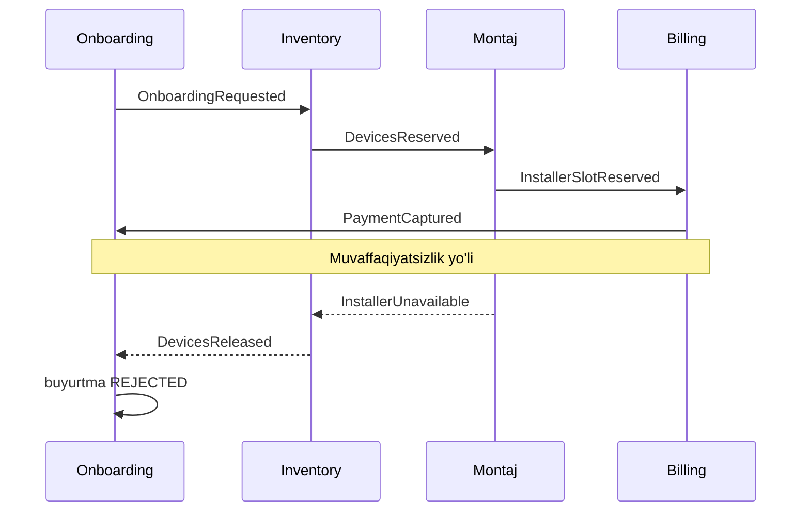
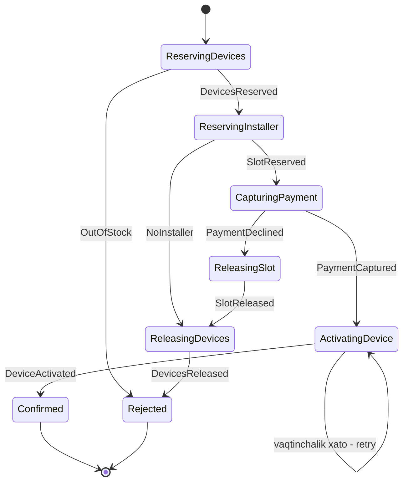

## Bu dars nima uchun kerak

Bitta bazada biznes operatsiyasi oddiy: `BEGIN; ... COMMIT;` - hammasi yoki hech narsa (17-dars). Lekin har bir servis o'z bazasiga ega bo'lganda (database per service, 51-dars), bitta biznes jarayoni bir nechta servisni qamrab oladi. Masalan, mijoz yangi mashinani tizimga ulamoqchi:

1. **Billing** - obuna to'lovini yechish;
2. **Inventory** - ombordan GPS treker va yoqilg'i datchigini band qilish;
3. **Montaj** - montajchi va vaqt slotini band qilish;
4. **Devices** - trekerni mijoz akkauntiga biriktirish va SIM'ni faollashtirish.

3-qadamda bo'sh montajchi topilmasa-chi? To'lov yechilgan, qurilmalar band qilingan. Ularni qaytarish kerak.

37-darsda ko'rdikki, 2PC buni atomik qila oladi, lekin qimmat: koordinator nosozligida ishtirokchilar qulf ushlab "osilib" qoladi, hamma ishtirokchilar XA ni qo'llab-quvvatlashi kerak, va Kafka yoki tashqi to'lov API kabi tizimlar unda umuman ishtirok eta olmaydi. **Saga** - boshqa yo'l: atomiklikdan voz kechib, uning o'rniga **kompensatsiya** bilan izchillikka erishish.

Bu dars 46-darsdagi event-driven arxitekturani, 48-darsdagi outbox'ni va 39-darsdagi idempotency'ni bitta amaliy patternda birlashtiradi.

Bu darsdan keyin siz:

- saga'ning asl ta'rifini (Garcia-Molina va Salem, 1987) va uning kafolatini bilasiz;
- compensable, pivot va retryable qadamlarni ajrata olasiz va qadamlarni to'g'ri tartibda joylashtira olasiz;
- choreography va orchestration'ni taqqoslab, qachon qaysi biri kerakligini asoslay olasiz;
- izolyatsiya yo'qligi tufayli paydo bo'ladigan anomaliyalarni va ularga qarshi choralarni (semantic lock va boshqalar) bilasiz;
- orchestrator'ni ishonchli qilish (holat saqlash, durable execution, Temporal, Step Functions) yo'llarini bilasiz.

## Saga nima

Saga tushunchasi Hector Garcia-Molina va Kenneth Salem'ning 1987-yilgi "Sagas" maqolasidan keladi. Ularning muammosi microservice emas, **uzoq yashaydigan tranzaksiyalar** edi: soatlab davom etadigan tranzaksiya resurslarni (qulflarni) uzoq ushlab, qisqa tranzaksiyalarni to'sib qo'yadi. Yechim: uzoq tranzaksiyani T1, T2, ..., Tn **mustaqil** tranzaksiyalarga bo'lish, va har bir Ti uchun uning ta'sirini **semantik** bekor qiladigan **kompensatsiya** Ci yozish.

**Kafolat:** yo T1, T2, ..., Tn hammasi bajariladi, yo biror j uchun T1, ..., Tj bajariladi va keyin Cj, ..., C1 bajariladi.

Muhim nozikliklar (maqoladan):

- Kompensatsiya bazani **avvalgi holatiga qaytarmaydi**, faqat Ti ning biznes ta'sirini semantik bekor qiladi. Oradagi vaqtda boshqa tranzaksiyalar bog'liq ma'lumotni o'zgartirgan bo'lishi mumkin. To'lov "bekor qilinmaydi", uning o'rniga **refund** qilinadi - va bu bank ko'chirmasida ikkala yozuv ham ko'rinadi.
- Boshqa tranzaksiyalar saga'ning **oraliq natijalarini ko'radi**, va kompensatsiya bo'lganda ularga xabar berilmaydi. Ya'ni ACID'dagi "I" (izolyatsiya) yo'q.
- **Backward recovery** - kompensatsiyalar bilan orqaga qaytish. **Forward recovery** - savepoint'dan qayta boshlab, qolgan qadamlarni oxirigacha yetkazish (qadamlar oxir-oqibat muvaffaqiyatli bo'lishi ma'lum bo'lganda).

Chris Richardson microservices.io'da zamonaviy ta'rifni beradi: saga - ishonchli muvofiqlashtirilgan **lokal tranzaksiyalar ketma-ketligi**. Har bir lokal tranzaksiya o'z servisining bazasini yangilaydi va keyingi qadamni ishga tushiradigan xabar yoki hodisani chiqaradi. Bu yerda 48-darsdagi masala qaytadi: servis bazani yangilash va xabar yuborishni **atomik** qilishi kerak - outbox yoki event sourcing orqali. Outbox'siz saga - dual write muammolarining zanjiri.

## Qadam turlari va tartib

Microsoft arxitektura qo'llanmasi qadamlarni uch turga ajratadi:

- **Compensable (kompensatsiyalanadigan)** - teskari ta'sirli tranzaksiya bilan bekor qilinadi. Masalan, "qurilmani band qilish" - "bandni bekor qilish".
- **Pivot** - qaytish nuqtasi. U muvaffaqiyatli bo'lgach, kompensatsiya endi qo'llanmaydi va qolgan qadamlar **albatta** bajarilishi kerak. Pivot o'zi kompensatsiyalanmaydigan bo'lishi mumkin (SMS yuborildi, pul tashqi bankka o'tkazildi).
- **Retryable (qayta urinib bo'ladigan)** - pivot'dan keyingi qadamlar. Ular idempotent va oxir-oqibat muvaffaqiyatli bo'lishi kafolatlangan bo'lishi kerak: vaqtinchalik xatoda cheksiz (backoff bilan) qayta urinish.

Bundan amaliy dizayn qoidasi chiqadi: **eng ko'p muvaffaqiyatsiz bo'lishi mumkin bo'lgan qadamlarni oldinga qo'ying, qaytarib bo'lmaydigan qadamni (pivot) iloji boricha oxirroqqa, va pivot'dan keyin faqat albatta muvaffaqiyatli bo'ladigan qadamlarni qoldiring.**

Misolimizda tartib:

| # | Qadam | Servis | Tur | Kompensatsiya |
|---|---|---|---|---|
| 1 | Ulanish buyurtmasini `PENDING` holatda yaratish | Onboarding | Compensable | Buyurtmani `REJECTED` qilish |
| 2 | Qurilmalarni band qilish | Inventory | Compensable | Bandni bekor qilish |
| 3 | Montajchi slotini band qilish | Montaj | Compensable | Slotni bo'shatish |
| 4 | Obuna to'lovini yechish | Billing | **Pivot** | (refund mumkin, lekin biznes jihatdan istalmaydi) |
| 5 | Trekerni akkauntga biriktirish | Devices | Retryable | - |
| 6 | SIM'ni faollashtirish (operator API) | Devices | Retryable | - |
| 7 | Buyurtmani `CONFIRMED` qilish, mijozga xabar | Onboarding | Retryable | - |

Nega to'lov 4-qadamda, 1-da emas? Agar avval pul yechib, keyin montajchi topilmasa, refund kerak bo'ladi: mijoz ko'chirmada ikki operatsiyani ko'radi, to'lov provayderi komissiya oladi, refund bir necha kun davom etishi mumkin. Band qilish esa arzon va ko'rinmas tarzda bekor qilinadi. 5-7-qadamlar texnik operatsiyalar: ular vaqtincha muvaffaqiyatsiz bo'lishi mumkin, lekin biznes jihatdan rad etilmaydi, shuning uchun ular retry qilinadi, kompensatsiya qilinmaydi.

## Choreography

Markaziy boshqaruvchi yo'q. Har bir servis hodisa chiqaradi, keyingi servis unga obuna bo'lib o'z qadamini bajaradi (46-darsdagi event notification).

**Afzalliklari:**

- markaziy komponent yo'q, demak uning nosozligi ham yo'q;
- servislar mustaqil, producer kim tinglashini bilmaydi;
- 2-4 qadamli oddiy oqimlar uchun sodda.

**Kamchiliklari:**

- **Oqim hech qayerda yozilmagan.** Fowler event notification haqida ogohlantirganidek (46-dars), jarayon servislar orasidagi obunalardan "paydo bo'ladi". "Ulanish jarayoni qanday ishlaydi?" degan savolga javob berish uchun 4 ta repozitoriyni o'qish kerak.
- **Siklik bog'liqliklar.** Inventory Montaj hodisasini tinglaydi, Montaj esa Inventory hodisasini - servislar bir-birini bilib qoladi.
- **"Saga qayerda turibdi?"** degan savolga javob yo'q. Mijoz qo'llab-quvvatlash xizmatiga qo'ng'iroq qilsa, holatni 4 ta servis bazasidan yig'ish kerak.
- **Integratsion test** uchun barcha servislar ishga tushirilishi kerak.
- Yangi qadam qo'shish bir nechta servisdagi obunalarni o'zgartirishni talab qiladi.

Netflix'ning 2016-yilgi Conductor maqolasi aynan shu muammolarni tasvirlaydi: kontent platformasi jamoasi uzoq (ba'zilari bir necha kun) davom etadigan jarayonlarni pub/sub, REST chaqiruvlari va holat uchun bazadan iborat ad-hoc choreography bilan qurgan edi. Microservice'lar ko'paygan sari jarayon oqimlari bir nechta ilovalar kodiga singib ketgan, o'zgarishga moslashish qiyinlashgan va "filmni tayyorlash uchun yana nima qolganini" tizimli ko'rishning deyarli imkoni bo'lmagan. Javob - markaziy orchestrator (Conductor). Maqola chop etilganda Conductor Netflix'da qariyb bir yil ishlatilgan va 2.6 milliondan ortiq jarayonni boshqargan.

## Orchestration

Markaziy **orchestrator** saga'ning holat mashinasini saqlaydi va har bir ishtirokchiga **command** yuboradi ("qurilmani band qil"), javobini kutadi va keyingi qadamni tanlaydi.

**Afzalliklari:**

- butun jarayon **bitta joyda** ko'rinadi va o'zgartiriladi;
- holat aniq: "saga 1234 hozir `CapturingPayment` da, 3-urinish";
- ishtirokchilar bir-birini bilmaydi, faqat orchestrator'dan command oladi - siklik bog'liqlik yo'q;
- timeout, retry, kompensatsiya mantiqi markazlashgan;
- test qilish osonroq: orchestrator'ni ishtirokchilarning mock'lari bilan test qilish mumkin.

**Kamchiliklari:**

- orchestrator - yana bir komponent va potensial **single point of failure** (uni ishonchli qilish kerak - pastga qarang);
- mantiqning orchestrator'ga ortiqcha ko'chishi xavfi: ishtirokchilar "ahmoq CRUD" ga aylanib, biznes qoidalari orchestrator'da to'planadi. Orchestrator faqat **ketma-ketlikni** bilishi kerak, har bir qadamning biznes qoidalari esa servisning o'zida qoladi.

### Taqqoslash

| Mezon | Choreography | Orchestration |
|---|---|---|
| Boshqaruv | Taqsimlangan, hodisalar orqali | Markaziy, command va javoblar orqali |
| Oqim ko'rinishi | Kodda yo'q, obunalardan paydo bo'ladi | Bitta joyda: kod yoki holat mashinasi |
| Saga holati | Bir nechta servis bo'ylab tarqalgan | Orchestrator'da aniq |
| Bog'liqlik | Servislar bir-birining hodisalarini biladi, sikl xavfi | Ishtirokchilar faqat orchestrator'ni biladi |
| Nosozlik nuqtasi | Markaziy nuqta yo'q | Orchestrator (ishonchli qilinishi kerak) |
| Yangi qadam qo'shish | Bir necha servisni o'zgartirish | Asosan orchestrator'ni o'zgartirish |
| Timeout va monitoring | Har bir servisda alohida | Markazlashgan |
| Qachon | 2-4 qadam, oddiy, barqaror oqim | Ko'p qadam, shartli tarmoqlar, uzoq davom etadigan jarayonlar |

Amalda ko'p tizimlar ikkalasini aralashtiradi: bounded context **ichidagi** murakkab jarayon - orchestration, bounded context'lar **orasida** esa hodisalar (choreography). Masalan, onboarding saga'si orchestrated, uning yakunidagi `VehicleOnboarded` hodisasini esa billing, analitika va CRM o'zlari tinglaydi.

## Izolyatsiya yo'qligi va anomaliyalar

Saga'ning eng nozik tomoni: oraliq holatlar boshqalarga **ko'rinadi**. Microsoft qo'llanmasi uchta anomaliyani sanaydi:

- **Lost update** - bir saga boshqasining o'zgarishini ustidan yozadi yoki yo'qotadi.
- **Dirty read** - saga boshqa saga o'zgartirgan, lekin hali yakunlanmagan (va keyinroq kompensatsiya qilinishi mumkin) ma'lumotni o'qiydi.
- **Fuzzy (nonrepeatable) read** - bir saga'ning turli qadamlari bir xil ma'lumotni turli qiymatda o'qiydi, chunki oralig'ida boshqa yangilanish bo'ldi.

Misol: Inventory'da oxirgi 1 ta treker bor. Saga A uni band qildi (2-qadam). Hisobot "omborda 0 ta treker" ko'rsatadi va xarid bo'limi yangi partiya buyurtma qiladi. Keyin Saga A 4-qadamda (to'lov rad etildi) kompensatsiya qilinadi va treker qaytadi. Xarid bo'limi dirty read asosida qaror qabul qildi.

### Qarshi choralar (countermeasures)

Microsoft qo'llanmasi va Richardson'ning tavsiyalari:

- **Semantic lock** - ilova darajasidagi bayroq: buyurtma `PENDING`, qurilma `RESERVED` holatida. Boshqa saga'lar va so'rovlar bu holatni ko'rib, unga mos harakat qiladi (kutadi, rad etadi yoki ehtiyotkorlik bilan ko'rsatadi). Bu eng ko'p ishlatiladigan chora. Narxi: semantik qulfni ushlagan saga osilib qolsa, qulf ham osilib qoladi - shuning uchun timeout va tozalash mexanizmi kerak.
- **Commutative updates** - operatsiyalarni har qanday tartibda bir xil natija beradigan qilib loyihalash. Masalan, balansni "= 500" deb emas, "+100" va "-100" deb o'zgartirish.
- **Pessimistic view** - qadamlarni qayta tartiblash: dirty read xavfi bor yangilanishlarni retryable (pivot'dan keyingi) qadamlarga ko'chirish. Masalan, qurilmani "sotilgan" deb belgilashni to'lovdan keyinga qo'yish.
- **Reread value** - yangilashdan oldin ma'lumot o'zgarmaganini qayta tekshirish (optimistic concurrency, 46-dars), o'zgargan bo'lsa saga'ni to'xtatish yoki qayta boshlash.
- **Version file** - yozuv ustidagi barcha operatsiyalarni log qilib, ularning to'g'ri tartibini ta'minlash (masalan, "bekor qilish" "band qilish"dan oldin kelsa, uni eslab qolish).

Amaliy qoida: **"band qilish" (reservation) pattern** - resursni darhol "sotilgan" yoki "o'chirilgan" qilmaslik, avval "band" holatiga o'tkazish va faqat pivot'dan keyin yakunlash. Bu semantic lock va pessimistic view'ning kombinatsiyasi.

## Ishonchlilik: saga'ni nosozliklarga chidamli qilish

Saga taqsimlangan tizim, shuning uchun 31-darsdagi barcha muammolar shu yerda:

### 1. Har bir qadam idempotent

Command yoki hodisa qayta yetkazilishi mumkin (41-dars). "Qurilmani band qil" ikki marta kelsa, ikki qurilma band bo'lmasligi kerak. Har bir command'da `saga_id` + `step` bo'lsin va ishtirokchi uni idempotency kaliti sifatida ishlatsin.

### 2. Kompensatsiyalar ham idempotent va "kommutativ"

Kompensatsiya qayta kelishi mumkin. Va eng qiyini: kompensatsiya **asl qadamdan oldin** kelishi mumkin - orchestrator "band qil" command'iga timeout oldi va "bandni bekor qil" yubordi, lekin "band qil" xabari navbatda kechikib, undan keyin yetib keldi. Ishtirokchi "bekor qilish keldi, lekin hech narsa band qilinmagan" holatini eslab qolishi va keyin kelgan "band qil" ni rad etishi kerak. Bu yuqoridagi version file chorasi.

### 3. Kompensatsiya muvaffaqiyatsiz bo'lmasligi kerak

Kompensatsiya biznes jihatdan rad etilishi mumkin emas - "refund qilishni rad etaman" degan javob bo'lmaydi. Texnik xatoda u retry qilinadi (cheksiz, backoff bilan), oxirida esa inson aralashuvi uchun ogohlantirish (50-dars: DLQ).

### 4. Timeout'lar

Ishtirokchi javob bermasa, orchestrator qancha kutadi? Timeout tugagach nima qiladi - qayta so'raydimi yoki kompensatsiya boshlaydimi? Timeout "muvaffaqiyatsiz" degani emas - javob shunchaki kechikkan bo'lishi mumkin (31-dars). Shuning uchun timeout'dan keyin kompensatsiya qilish xavfsiz bo'lishi uchun 2-banddagi talab kerak.

### 5. Orchestrator holatini ishonchli saqlash

Orchestrator o'z holatini bazada saqlaydi va har bir holat o'zgarishi + keyingi command bitta tranzaksiyada (outbox orqali) yoziladi. Orchestrator qayta ishga tushganda, bazadan barcha tugallanmagan saga'larni o'qib, davom ettiradi.

Buni o'zingiz yozish mumkin, lekin tayyor **durable execution** platformalari bu murakkablikni yashiradi:

- **Temporal** - workflow oddiy kod (Go, Java, TypeScript, Python) sifatida yoziladi. Har bir qadam event history'ga yoziladi, nosozlikdan keyin Temporal workflow kodini boshidan qayta ishga tushiradi va unga yozilgan tarixni beradi - kod avvalgi holatiga yetib keladi (replay). Shuning uchun workflow kodi **deterministik** bo'lishi kerak (to'g'ridan-to'g'ri soat, tasodifiy son, tarmoq so'rovlari yo'q). Tashqi dunyo bilan ishlash **activity**'larda: activity natijasi yoziladi va replay'da qayta bajarilmaydi. Default activity retry siyosati: boshlang'ich interval 1 s, koeffitsiyent 2.0, maksimal interval 100 s, urinishlar soni cheksiz. Workflow'larning o'zi esa default holatda retry qilinmaydi.
- **AWS Step Functions** - holat mashinasi JSON (ASL) da. **Standard** workflow bir yilgacha davom etishi mumkin va exactly-once bajarilish semantikasiga ega (narx - har bir holat o'tishi uchun); **Express** workflow 5 daqiqagacha, at-least-once (asinxron) yoki at-most-once (sinxron), narx - bajarilish soni, davomiyligi va xotira bo'yicha. Saga uchun odatda Standard.
- **Netflix Conductor** (va uning davomchilari) - JSON DSL'dagi workflow, UI, pauza/davom ettirish.

**Hisob-kitob: Step Functions narxi va saga.** Onboarding saga'si muvaffaqiyatli yo'lda 7 qadam, har bir qadam taxminan 2 holat o'tishi (Task + Choice) - 14 o'tish. Kuniga 3 000 ta yangi mashina ulanishi: 3 000 × 14 × 30 = 1.26 mln holat o'tishi oyiga. Narxni joriy AWS narx sahifasidan tekshiring - lekin bu hajm uchun narx odatda arzimas; asosiy qiymat - o'zingiz yozmaydigan ishonchlilik kodi. Aksincha, sekundiga minglab qisqa saga'lar (masalan, har bir GPS nuqtasi uchun) bo'lsa, Standard workflow narxi tez o'sadi - bu holatda saga umuman to'g'ri pattern emasligi ehtimoli yuqori.

## Saga va boshqa yondashuvlar

| Yondashuv | Atomiklik | Izolyatsiya | Mavjudlik | Qachon |
|---|---|---|---|---|
| Bitta baza, lokal tranzaksiya | To'liq | To'liq (izolyatsiya darajasiga qarab) | Bazaga bog'liq | Imkoni bo'lsa - har doim birinchi tanlov |
| 2PC (37-dars) | To'liq | Qulflar bilan | Past: koordinator nosozligida bloklanadi | Bir nechta bazali, qisqa, XA qo'llab-quvvatlanadigan tizimlar |
| Saga | Semantik (kompensatsiya bilan) | Yo'q, qarshi choralar bilan | Yuqori | Servislar orasidagi uzoq yoki tashqi tizimli jarayonlar |
| Servis chegarasini qayta ko'rib chiqish | - | - | - | Agar ikki servis doim birga tranzaksiya qilsa |

Oxirgi qator muhim: agar ikki servis deyarli har bir operatsiyada saga talab qilsa, ehtimol ular bitta bounded context (52-dars) va bitta servis bo'lishi kerak. Saga - zarurat, maqsad emas.

## Real tizimlardan misollar

- **Garcia-Molina va Salem (1987).** Saga g'oyasi microservice'lardan 25 yildan ko'proq oldin, bitta bazadagi uzoq tranzaksiyalar muammosi uchun taklif qilingan. Maqolada saga ijrosini log qiladigan alohida komponent g'oyasi bor - bu zamonaviy orchestrator'larning ajdodi.
- **Netflix Conductor (2016).** Ad-hoc choreography'dan markaziy orchestration'ga o'tishning hujjatlashtirilgan sababi: ko'rinish, o'zgaruvchanlik va jarayon holatini kuzatish.
- **AWS Step Functions.** Standard workflow'larning exactly-once bajarilishi va bir yillik maksimal muddati aynan uzoq yashaydigan, idempotent bo'lmagan qadamli biznes jarayonlari uchun mo'ljallangan (hujjat to'lovlarni qayta ishlashni misol qiladi).

## iQuariX kontekstida qo'llanish

Yuqoridagi "mashinani ulash" saga'si - faraziy iQuariX jarayoni. Uni orchestration bilan qurish qarorining asoslari:

- 7 qadam, shartli tarmoqlar (qurilma omborda yo'q bo'lsa - boshqa ombordan; montaj slot'i yo'q bo'lsa - mijozga boshqa sana taklif qilish);
- jarayon **kunlar** davom etishi mumkin: montaj 3 kundan keyin, montajchi ishni tugatib "o'rnatildi" deb bosgandagina SIM faollashtiriladi;
- qo'llab-quvvatlash xizmati "mijozning ulanishi qayerda turibdi?" degan savolga darhol javob berishi kerak.

Uzoq kutish uchun orchestrator **inson qadami**ni kutadi: montajchi mobil ilovasida "o'rnatildi" tugmasini bosganda signal yuboriladi. Temporal'da bu signal va timer (masalan, 7 kun ichida o'rnatilmasa - menejerga eskalatsiya), Step Functions'da callback token.

Semantic lock'lar: qurilma `RESERVED` (onboarding saga ID si bilan), montaj sloti `HELD`, buyurtma `PENDING`. Har bir semantic lock'ning muddati bor - saga osilib qolsa, 48 soatdan keyin tozalash jobi ularni bo'shatadi va orchestrator'ga xabar beradi.

Pivot - to'lovni yechish. Undan keyingi qadamlar (trekerni biriktirish, SIM faollashtirish) retryable: operator API'si bir soat ishlamasa ham, orchestrator backoff bilan urinib turadi, mijozdan pul qaytarilmaydi.

Saga yakunida `VehicleOnboarded` hodisasi outbox orqali Kafka'ga chiqadi - billing, analitika va CRM uni choreography tarzida mustaqil iste'mol qiladi.

## Ko'p uchraydigan xatolar

1. **Kompensatsiyani "rollback" deb o'ylash.** Kompensatsiya - yangi biznes operatsiyasi (refund, bandni bekor qilish), u bazani avvalgi holatga qaytarmaydi va boshqalar oraliq holatni ko'rgan bo'lishi mumkin.
2. **Qaytarib bo'lmaydigan qadamni boshiga qo'yish.** Avval SMS yuborish yoki pul o'tkazish, keyin omborni tekshirish.
3. **Outbox'siz saga.** Har bir qadam dual write: holat yangilandi, xabar ketmadi - saga abadiy osilib qoladi.
4. **Idempotent bo'lmagan qadamlar va kompensatsiyalar.** Qayta yetkazilgan command ikki qurilmani band qiladi.
5. **Kompensatsiya asl qadamdan oldin kelishi holatini hisobga olmaslik.** Timeout'dan keyin bekor qilish, keyin kechikkan "band qil" - resurs abadiy band.
6. **Izolyatsiya yo'qligini unutish.** Boshqa jarayonlar `PENDING` holatdagi ma'lumot asosida qaror qabul qiladi.
7. **Ko'p qadamli murakkab jarayonni choreography bilan qurish.** Hech kim oqimni to'liq bilmaydi, holatni kuzatib bo'lmaydi.
8. **Har bir narsaga saga.** Ikki servis doim birga o'zgarsa - servis chegarasi noto'g'ri bo'lishi mumkin.

## Xulosa

- Saga - lokal tranzaksiyalar ketma-ketligi, har biri uchun semantik kompensatsiya bilan. Kafolat: hammasi bajariladi yoki bajarilganlari teskari tartibda kompensatsiya qilinadi.
- Qadamlar: compensable, pivot va retryable. Muvaffaqiyatsiz bo'lishi ehtimoli yuqori qadamlarni oldinga, pivot'ni oxirroqqa, undan keyin faqat retryable qadamlarni qo'ying.
- Choreography - markazsiz, oddiy oqimlar uchun; orchestration - murakkab, uzoq, ko'rinish talab qiladigan jarayonlar uchun. Ko'pincha ikkalasi birga.
- Saga'da izolyatsiya yo'q: lost update, dirty read, fuzzy read. Qarshi choralar: semantic lock, commutative update, pessimistic view, reread, version file.
- Har bir qadam va kompensatsiya idempotent, kompensatsiya muvaffaqiyatsiz bo'lmaydi, holat va xabar outbox orqali atomik.
- Orchestrator'ni ishonchli qilish uchun durable execution platformalari (Temporal, Step Functions, Conductor) tayyor yechim beradi.

## Amaliy topshiriq

iQuariX uchun **"mijozni boshqa tarif rejasiga o'tkazish va qurilmalarni yangilash"** saga'sini loyihalang (faraziy): mijoz "Basic" dan "Pro" ga o'tadi, bu esa (a) billing'da tarifni o'zgartirish va farqni yechish, (b) har bir mashinaga video kamera qo'shish (inventory va montaj), (c) devices servisida qurilma konfiguratsiyasini masofadan yangilash (OTA), (d) AI analitika servisida yangi funksiyalarni yoqish, (e) mijozning shartnomasini yangilash (hujjatlar servisi, mijoz elektron imzo qo'yishi kerak - 0 dan 5 kungacha) ni talab qiladi. Mijozda 200 ta mashina bor.

1. **Qadamlar va turlar.** Barcha qadamlarni yozing, har birini compensable, pivot yoki retryable deb belgilang va kompensatsiyasini yozing. Pivot qaysi va nega?
2. **Tartib.** Qadamlarni muvaffaqiyatsizlik ehtimoli va qaytarish narxi asosida tartiblang. Elektron imzo qayerda turadi?
3. **Choreography yoki orchestration.** Tanlang va 3 ta argument keltiring. Orchestration bo'lsa, holat mashinasini (stateDiagram) chizing.
4. **200 ta mashina.** Bu bitta saga'mi yoki har bir mashina uchun alohida bola saga'mi? 200 tadan 15 tasida OTA yangilash muvaffaqiyatsiz bo'lsa, butun saga kompensatsiya qilinadimi?
5. **Izolyatsiya.** Saga davomida mijoz dispetcher panelida qaysi tarif funksiyalarini ko'radi? Qaysi semantic lock'lar kerak va ularning muddati?
6. **Nosozliklar.** Orchestrator qayta ishga tushdi; billing timeout berdi, lekin aslida pul yechilgan; mijoz 5 kun imzo qo'ymadi. Har bir holatda nima bo'ladi?

Yaxshi javobda bo'lishi kerak bo'lgan narsalar:

- pivot aniq tanlangan (masalan, imzo yoki to'lov) va undan keyingi qadamlar haqiqatan retryable;
- qaytarish qimmat qadamlar (montaj, to'lov) imzodan keyin;
- uzoq inson qadami uchun timer va eskalatsiya bilan orchestration asoslangan;
- har bir mashina uchun qisman muvaffaqiyatsizlik butun saga'ni bekor qilmaydigan dizayn (forward recovery, bola saga'lar);
- billing timeout'ida idempotency kaliti bilan holatni so'rash (pul yechilganini tekshirish), ko'r-ko'rona kompensatsiya emas;
- semantic lock'lar va ularning muddati, mijozga oraliq holatning to'g'ri ko'rsatilishi.

Javobni pastdagi maydonga yozib, chatga yuboring.

## Manbalar

- Hector Garcia-Molina, Kenneth Salem. [Sagas](https://www.cs.cornell.edu/andru/cs711/2002fa/reading/sagas.pdf), Princeton University, 1987 - asl ta'rif, kompensatsiya, backward va forward recovery.
- Chris Richardson. [Pattern: Saga](https://microservices.io/patterns/data/saga.html), microservices.io - choreography va orchestration, izolyatsiya yo'qligi, outbox bilan bog'liqlik.
- Microsoft Azure Architecture Center. [Saga distributed transactions pattern](https://learn.microsoft.com/en-us/azure/architecture/patterns/saga) - compensable, pivot va retryable qadamlar, anomaliyalar va qarshi choralar.
- Netflix Technology Blog. [Netflix Conductor: A microservices orchestrator](https://netflixtechblog.com/netflix-conductor-a-microservices-orchestrator-2e8d4771bf40), 2016.
- Temporal. [Workflows](https://docs.temporal.io/workflows) va [Retry Policies](https://docs.temporal.io/encyclopedia/retry-policies) - durable execution, replay, determinizm, default retry siyosati.
- AWS. [Choosing workflow type in Step Functions](https://docs.aws.amazon.com/step-functions/latest/dg/choosing-workflow-type.html) - Standard va Express taqqoslash.
- Martin Kleppmann, Chris Riccomini. [Designing Data-Intensive Applications, 2-nashr](https://www.oreilly.com/library/view/designing-data-intensive-applications/9781098119058/), O'Reilly, 2026. 8-bob "Distributed Transactions".
